# 【全集】新南威尔士大学 Rust现代编程 中英字幕 1080P p05 Lecture 5 - 借用机制 -BV15cf4BCEN1_p5-

Okay， hello， hello。

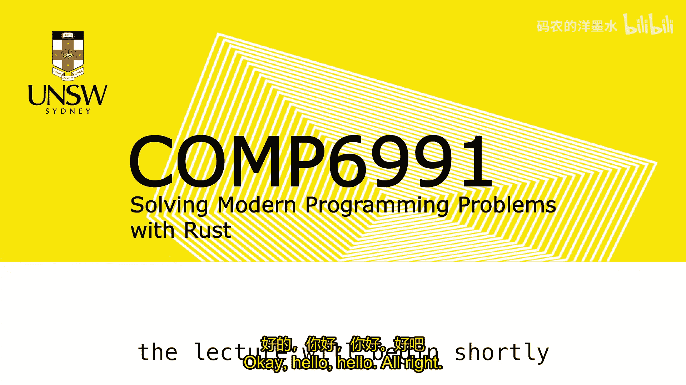

All right。Oh。Yes， hello everyone， so I've noticed as Kai just has that this is there's not many people here。

😊，It's， that's okay。 I was I was potentially expecting that I I got a lot of people saying that they aren't able to make lectures at 4 o'clock。

 Oops， I'm showing they're on the screen。 I want to show this one。😊。

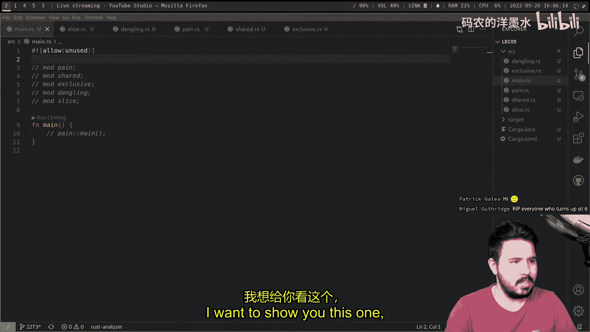

People who can't make the lecture at 4 o'clock this week and that's okay the recordings always available but I've just sent out another email just in case just in case a couple more see it and go oh okay and pop up but anyway。

 potentially a more personal lecture today。😊，So a few things to get out of the way。

Number one is this has been a relatively crazy last few days for me。

 I have been involved in two house moves， one of my own。

 does anyone notice anything different about today's lecture apart from the fact that it's two hours earlier than it usually is。

 hopefully the answer is no and everything seems fine because I am in a completely different house different location。

 not the house that I'm moving into but because that house doesn't have internet yet。😊。

But in a temporary house to try and stream the lecture from。If things go wrong。

 you'll have to you'll have to be patient and bear with me there is also like in the last 15 minutes like three very buzzy flies have made their way into this room as after they' become very annoying I will take an early break and I'll try and get these flies out of here Yeah I am really sorry about these random flies。

😊，Anyway， so yes， it's been a very crazy last couple days which also means I am definitely behind on emails if you have and also the course forum for that matter。

 if you have sent an email and you're waiting on a response or if you've posted a question on the course forum and I' waiting for a response that is entirely my fault I plan to catch up early tomorrow So if you can hold on till then then that would be great if it really is urgent ping me again like send another email tonight and'll if I see it pop pop my phone like put urgent in all caps and if I see the notification I'll make sure I deal with it Asap otherwise I'll be getting through the backlog tomorrow morning is my plan。

😊，嗯。So， yes， I don't know if you can see it fly past， but。That's great， Hopefully they settle down。

 maybe they'll fly themselves out。😊，Um。If it's， and if it the sound is really bad。

 I can see it's O B， S thinks it's very loud。 So I'm gonna turn it down just a tad。 But if it's。

 if it， if I've just made it too quiet， just let me know。Okay， so where else are we？Yes。

 screen screens working。 Okay， cool。 looks and sounds pretty normal。 am I feeling better today。

 I am feeling better。 I think it's well I've， I've been working。

 we've been sort of moving over the last week。 I started getting like very sick when all the dust got kicked up and I get。

 you know， it's it ended up really messing with me a bit。 but I'm， yeah， the sort of getting past it。

😊，Finally， I think， okay， cool， cool， cool， can't hear things。 That's good。 Okay， great。

 so what else have we got to address。😊，Assignments， so the assignments will be coming out。

 So assignment one， we are planning， we're going to try and release very late this weekend。

 Som I'm talking probably earliest Sunday afternoon。

 but expect it more like the very beginning of week 4。

 we're aiming just so you know we are aiming for the weekend。

 And it's it's not inconceivable that we fall a little behind。

 but we're aiming for that just expect it early， very early week 4。

 we plan to have assignment  one due week7 Wednesday。

 So our usually the weekly exercises and stuff are due week 7 Wednesday nights。

 We're just thinking it's probably best to keep the due dates all quite similar。

Just just for consistency's sake and then assignment2， we plan to release either week seven weekend。

 same sort of deal， week seven Sunday or potentially week8 Monday， very early week8。

And well you know we could go for consistency sake you can make assignment too also due on week 10 Wednesday but we thought no we'll make it week 10 Friday。

 that will be the one exception， week 10 Friday so you do get a little bit of extra time till the end of term to work on your assignment toos so you can expect those to be coming up there。

😊，What else have we got workshops this week， hopefully they were or rather workshops last week。

 hopefully， hopefully were someone went interesting。 I know there was lots of you know。

 there was those painful moments and stuff like that。 but hopefully regardless of， of the pain of it。

 the practice is interesting and and teaches you something。

 we accidentally really someone one for a few hours。 Oh， okay， whoops，😊。

The weekly exercises will be from last week will be due in a couple of days。

 I believe the weekly exercises S will be able to say in the chat。

 I'm not sure if they're out just yet， but if they aren't out。

 I believe it's quite soon either like tonight or tomorrow morning or something like that。

 they'll probably be out。 Sray can confirm that in the chat。

 He he obviously knows a lot more than me。And feedback， so。We've received。 So thank you， everyone。

 We've actually received a ton of feedback in the last week or so。 Thank you very much。

 everyone for passing that on。 Like it takes effort and time for each of you to you know to type to go to the form and type that out and also to just sort of like send to your thoughts and you know write that message。

 So we really appreciate everyone having done that。

 I am going to only address one single piece of feedback。 in the last week right now。

 which is the feedback that said there was some feedback along the lines of we really I really like that you addressing feedback at the beginning of the lectures。

 something about it it's like a good community vibe something like that。

 And I think Hayden does a similar thing with 1，5，3，1 and similar。 so。😊，I plan to keep that up。

 but I think we'll leave it to Wednesdays at the very beginning of Wednesday each week we'll address any feedback that we've got just because we did it last Wednesday and a lot of the feedback in the last week has been about weekly exercises Sre is aware of the feedback and has read the feedback about weekly exercises but he's still sort of working on responding and making plans to address that kind of feedback and so I believe Sree will have a better response on Wednesday for the Wednesday lecture where we'll be able to talk about it a bit there。

嗯。Cool address feedback about feedback， Yes， yes， yes， yes， yes， okay。

 exercises coming out tonight and yes， I have given some context， yes， okay。😊。

So I think that's most of what we need to get out of the way before getting into some very epic fun content does anyone have any questions or like things where are like I am just not sure how this is working in the course like sort of if you could imagine me talking about this at the beginning of elect lecture before you get into the content。

 Does anyone have any questions or confusions you want me to address before we before we get into some things ownership and borrowing and stuff very cool。

 Very fun。😊，These flies。I'm going to try it when we， when we do have the break。

 I'm going to try and get them out of here。So wish me luck for then， Okay。

 I'm not seeing anything in the chat if you are typing something out then please do continue as always。

 but otherwise。😊，We will get into some content ownership with borrowing， okay。

And farewell Sreray。So quick recap on ownership and owned types in rust， specifically， you know。

 the owned types as opposed to copy types that we' sort of see around the place。

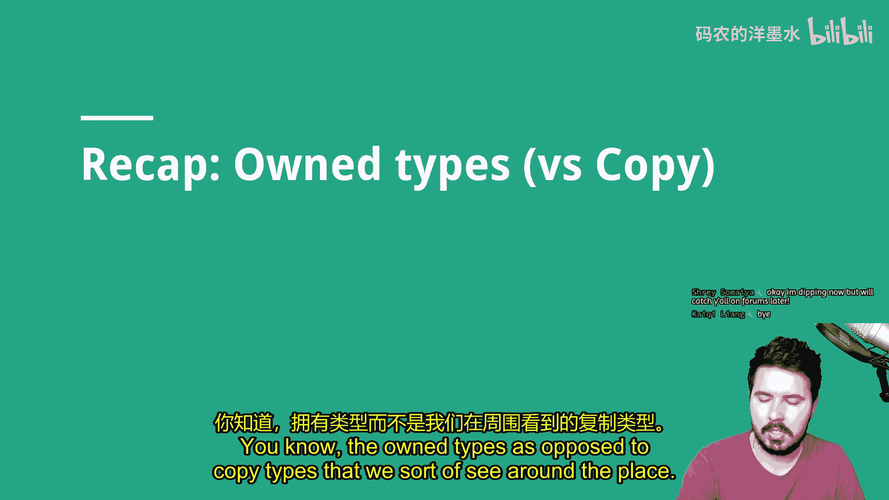

Okay， so。We know that in rust， as we've sort of played around with。Most values， well。

 sort of I most values to me， but you know， from the values that we've worked with so far。

 it's kind of a somewhat limited subset。But you know。

 imagine for with me for a moment that in rust values are by default by default。

 have these ownership semantics right， So if I have you know astruct student or something like that。

Which has some fields in here。You know， actually， you know， I'll go back to my old stuff。

 there's Z I name。And I believe when my oops are my。The three I go for。

And I create a student with let student equals some student here。 The Z I D will be 5，5，5，5，5，5。

 Their name will be。Let's say。Let's say， D wang。And we have their wherem is。100。0。

USo we have some student here and this lives in this， you know。

 this is this value is bound to by this name lowercase student over here。😊，If we went'。

 let other student equal student。Then we have learned that this moves， right。

 this moves student into other student。And then this sort of original student is no longer usable。

 So the the sort of makeup of this struct got taken from student and put into other student。

 So this value itself is still accessible through this other student binding。

 but this one over here is now basically dead。 we can't have two things pointing to the。

 you know sort of。Two of the same value in rust， sort of like other languages in other languages。

 this would often just copy。 So we just have like two of， you know， this D weighing student here。

 But in Ruster has these strict ownership semantics where only one thing can own a given value and。

Only one thing can only a give value and ownership is generally transferred around when you do these sorts of you know normal language operations like if you do an equal or if you say pass it to a function。

 so if I had a function that was like say hello to student and I passed it a student through here and it says printlin。

Hello there。Student dot's name。Like that。 And then， I said。Say hello to student。

And past to that student， then this also moves out of student if I try and run this function twice。

 you'll see the second time it doesn't work because it was moved when it was passed into the function。

And it says you know， hello there're D Wang， and then when we try and say hello to student again。

 doesn't work values been moved out of so we can't use it anymore。

So for strings would it be more idiomatic to do something like to string or string from DeA。

 honestly literally doesn't matter at all， it's completely up to you。😊，Yeah。

 it's the I think the reason I lean for string from as opposed to what's being sort of the other suggestion here is dot two string is。

I mean， they really， they literally do the exact same thing。

 They'll turn into the exact same machine code。 I guess the reason I。

Often write it this way is because I sort of feel like I'm constructing a string and this is what I want the string to be。

 whereas this writing it like this sort of pars in my you know how I think about language as I take this and then I do an operation on it to turn this into a string whereas I'd rather to say like I'm just creating the string in place。

 again， they functionally do the exact same thing is just sort of the way I tend to think about it。

 And it's very it's very minor and not I don't think this is the kind of design decision that we'd be particularly worried about in something like in your assignment code or anything like that in this course。

 So anyway， there' there's often options around the place in a language like rust。 But big picture。

These ownership semantics exist。 and in particular， especially with the bitmap workshop。

 the first workshop， a lot of students found that the ownership semantics were a pain in the butt to deal with。

 like they were， they were cool。 A lot of the time students will be like， yeah。

 I think it's quite interesting。 And I'm sort of starting to get how it works。

 But it's also like really kind of frustrating to work around。

 we have to do some sorts of like annoying solutions just to work around the fact that rust has this。

 We're gonna look at that in in just a minute as well。 as a recap as well。

 we have this idea of copy types。 So if I have let let me go down here。 If I have let X equals 42。😊。

And then I say let y equals 42。And then sorry， not y equals 42， rather let y equals x I mean to say。

And then I try and print them both out。 X is bh。 Y is bh。Actually， I can put them in here。 X is X。

 Y is y。We'll comment out this second thing here。 If I try and run this。

 you'll see it actually works。So we get the helloette there D wearing， which is great。

 but we also get x is 42， y is 42， right？😊，But intuition， might say this doesn't。

 This shouldn't work because we have X is 42。 X is moved into y right here。 So X is no longer valid。

 But then we try and use x again down here。 And this is that sort of escape hatch that rust is built into the ownership system called copy。

 So if we look at the type of X， X is an I 32。So what we've learned here is that I 32 is a copy type。

 There was a list that we looked at。 So for example， we have things like I 32 U 32。

Generally these types go as low as eight bits and goes high as 128 bits。

 those are all copy floating point types。Buulions， chas， you know， and so， you know。Tups。

 tuples of copy types， bull I32， you know， even if we have a tuple of like I32。

 I32 I32 a thousand times and then I 32， this would also still be copy in rust。😊，嗯。

I believe that's the case anyway。 there is some weird compiler magic that is。

 I believe still yet to be fixed where sometimes things only go up to 32， which is a little strange。

 but's that's sort of something that they've been working on the language for a while， but you know。

 in in terms of the sort of what we're going through in the lecture。

 all these types here are copy and what copy trivially means is that it opts out of this whole ownership system。

So this whole idea of moving and then things being invalid after they move and all that is completely gone。

 it acts just like you'd expect in a language like C in a language like Python and whatever else。

 where if you assign or if you pass it into a function or anything like that。

 anything of these types， then it just copies the bits into that and everything stays valid。😊，Okay。

 so out of curiosity， would it be possible to not copy a copy type and nuke it as usual。Yes， yes。

 it is。 and we'll see in a second I'll give you an example in just a second。

 So the other interesting thing about copy types is that you can make your own copy types if you'd like。

😊，And so the way you would do that is， let's say have a struct。

 this could potentially work with an enum as well。And I fill it with some fields X is an I 32。

 Y is a boan。 Z is a char， A is a tuple of I32 U 32 and a float， something like that。

 Like let's say this is my str hereer。And I want to make food be trivially copyable with that。

 you know， the whole like this list down here that we've looked at。

I could do that by throwing in a derive of。copy well。Copy， but I also need clone。

 You'll see if I just throw a copy on anything。 It'll always be like， oops。

 I can't be copy because I need to have this clone one， which can also be derived。

 So we just write clone copy。Which is really just to say copy for the most part。

And now anyF is also trivially copyable。So。So that that means that if we sort of have let X is F。

 let y is X， let Z is Y sort of， it'll， it'll just get copy， copy copied。

 No sort of moving out of things。 You can pass it into a function。

 It'll copy it all that sort of stuff。 We can also do the same thing with enums。

 But the variants are gonna have to look a little different here。 So let's do。Something like that。

 And then this will be Y， Z。系。And now this enum here is also a copy。Now。

So like can I just make anything copy Well you can make your own types copy。

 but what if I said I throw in another field here that has type string like capital S string here。

 which is move right， or for example， I throw in something with a student which is just a structure that I created。

You'll see， oh， I also forgot to put the clone copy on the enum here。

 You'll see that now the copies no longer work。Now。

 I wonder if the compiler will give us a good message as to why says the trait copy cannot be implemented for this type。

 Here we go。 Am I running nightly。呃。嗯。呃。Weird， Oh no in nightly builds。 Okay， it's all。

 I saw nightly and was like， that's weird。 So it says here this field does not implement copy。

 See this student field right here。 So copy may not be implemented on this type。

 this field does not implement copy。 Or if we go to the the struct through here。

 This can't be copy because this B field here does not implement copy。 So that's basically the rule。

 you can make your own types copy。 But only if everything inside your type inside your struct duringum whatever。

Is also copy。😡，That's the rule。 And it's auto makes sense。

 you'd end up with the double freeee or if you are potentially use after freeze that sort of stuff。

 if you are able to just copy a string like this， youd get two pointers pointing to the same string one goes out of scope。

 it frees the string。 the other goes out of scope。 It double freezes the string or you use the other one afterwards and you have a use after free very dangerous。

 but this is the rule to remember。 you can your type can be cop only if all the things inside of a copy and as。

Daniel Wang asked。Can you make a， would it be possible to not copy a copy type and you could。

 as usual， the way you would do that is you would just say， like throw it in yourstruct。

 So I'd call itstruct you know， move I 32。And just wrap an I 32 like that since I don't derive copy on this。

Then wherever I use this， this type move I 32， which really just holds an I 32， right。

 This is just a special syntax， by the way， that basically just means like。

Imagine it looks like this， but the field is， it's like a tuple， so the field is called zero。

And it just has an I 32 inside it since I don't derive copy。Then this saw BNI32 that is moved around。

Okay， so not sure I feel about having different behaviors by default。 Yeah， okay， fair enough。

How a clone copy different so clone。Is very much a similar idea。 It is a trait， in fact。

 let's go to the exact trade documentation。

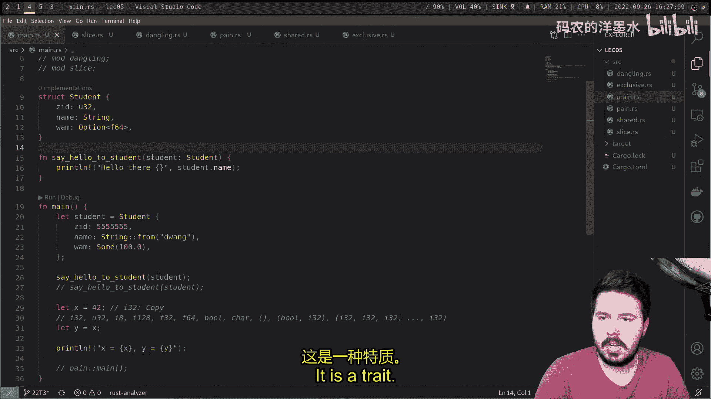

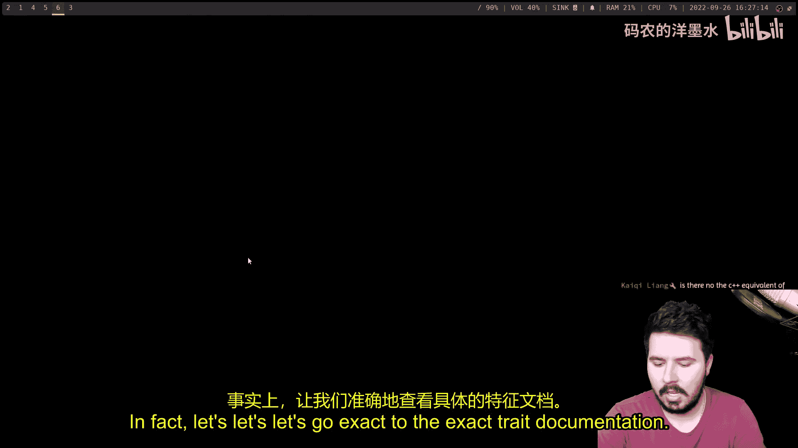

Because they've spent a lot of time trying to find the right wording for this， I'm sure。

A common trait for the ability to explicitly duplicate an object。That's a， that's a。

 that's a nice way to put it。 So like， if I have this string， right， let's say。

Let string equals this string here。 And I wanted to have five copies of this。

 Like I wanted to have five of this string。 Then I can use string dot clone to generate more strings that have the same contents to duplicate this original string and have a whole bunch of owners right。

 this， these can all be like let X， you know，1，2，3，4。

5 and have a whole bunch of strings that are all the same data。

 but have different owners and clone is very much explicit。 I type dot clone。

 and it gives me that if I didn't use dot clone than it would actually be a move instead。

 I'd be moving out of string here。😊，And the idea is that copy doesn't add any extra behavior right it doesn't give you an extra function or anything like that all copy means is that when you are going to move out of something it basically implicitly inserts dot clone there for you。

😡，That's all it basically does。So if you don't have the hash drive on that foodstruct。

 I it moved by default， Yes， absolutely。 I there no the C plus plus equivalent of stood move on a copy type。

 Not as I understand it。 There might be something that I've missed， but to my knowledge。

The only way to have move semantics on a type that's cop is to wrap it in a move type like this as before。

 But keep in mind that this like this move I 32 type is really just going to end up being an I 32。

 So it is going to have the exact same behavior at runtime， but it just won't be。

Typed out and code the same way that it wouldn't C++ if that makes sense。

So it's an explicit verse implicit， yes， absolutely that is the exact difference between copy and clone Cl is very explicit。

 you want to point out when you're duplicating data and clone also may do anything Cl could you know if you're cloning a file it might need to do something in the operating system to go say。

 hey， there's another thing using this file log or whatever it is right Cl can go and do extra stuff in order to clone the thing。

😊，Copy。Always must just be bitwise， It always is just like these are the six bytes that make up this type。

 copy those six bytes across。😡，Like bit by bit， one， you know。

 bully like literally one or zero by one or zero through the whole type。

 no additional code can be run as part of a as part of a copy。So that also does sort of。

Cut down a little bit， I think， on that sort of being worried about copy just implicitly doing this stuff for you because you know it's only just going to be a memory copy。

 There's there's no additional behavior that can come along with that。

 So a little less to be scared of， perhaps。嗯。Can we make string copy by say telling it to use dot clone。

 no， you cannot， it must be explicit， So that's part of the trick there。嗯。

So seeing as it's possible to derive these trait。 I'm assuming it's possible to implement yourself。

 instead， yes， you absolutely can。 So let's say we wanted to derive clone。

 let's say we wanted to clone and copy on this move I 32。😊，I would write。

 and we're gonna this is jumping ahead a little bit， but just to show you you can do it。

 We'll learn more about traits and how they work in week 5。

 but I'm gonna to say Iple clone for Mo I 32 That's gonna to say， okay。

 you can do that but you need to give me this method here。

 clone that has some stuff that we don't kind understand it basically just means give me a new move I32 provided。

 I give you I let you read some someone else's Mo I32。 and it basically just looks like oops。😊。

It just looks like。This kind of thing， we spit out a new Mo I 32 with the same value。

And then I would say simpleple copy。 And the funny thing is that as I said copy defines no additional behavior。

 it's just something that I tell the compiler Mo I 32 is now copy。

 and I don't need to tell it anything else。 And again， if I cheat。

 if I cheat this and like this is now a string， then it won't let me copy like it won't let me implement copy because it goes this field is like this is baked into the compiler。

 The fact that it goes copy is this thing is not copy。 So I won't let you implement it。

So that's how you could do it。 But as we saw before。

 it's not much easier to just write derive and derive will literally just spit out this exact same code。

 The code I just wrote there is derive spits that out for us。 It's called a macro。

 We learn about macros in week 7 or 8 or something like that。😊，Okay。

Is there a way to make a structure that contains a move type to be copyable， and yes。

 I answer that question， the answer being nope？And again。

 so that makes it be very explicit when you are copying resources that aren't just like literally a couple bytes here in their integers remember if integers and stuff weren't copyied it would also make using the language way harder than it actually needs to be and you might go。

 well it's already really hard because like all these other types are I'm not copy and I have to deal with the move semantics there yes。

 but we're going to learn about some tools today that are copyied that help us deal with these objects called shared references were we're going to get there in a second or shared borroworers rather。

😊，So copyable objects exist entirely on the sec and have no pointers。 Yes， yes， once again。

 absolutely。 Well， they can contain pointers， but they can't。Well， okay， they can contain pointers。

 but they must exist entirely on the stack。It's it's it's a little tricky。 They。

 they can't sort of carry around an allocation with them。 if that makes sense。

 sort of how like string here carries around this allocation that it's this mallic that it's made for Dwang because it needs to clean it up later。

 A copy type could never do something like that， copy types are also not allowed to do to run code。

 I believe， yeah， I'm pretty sure it's correct。 I actually might need to double check this myself。

 But I if I recall correctly， copy types cannot have behavior when they are dropped when they go out of scope。

 But I'd have to， I'd have to triple check that。 I'm pretty sure that's the case。

I don't think you can infer anything about whether it's a pointer or not yeah。

 so in fact one of the most important ideas of rust is that these shared bors that we're going to learn about。

 these shared references， sharedd pointers， whatever。

 are in fact copy but we'll learn about that in just a minute。😊，O。

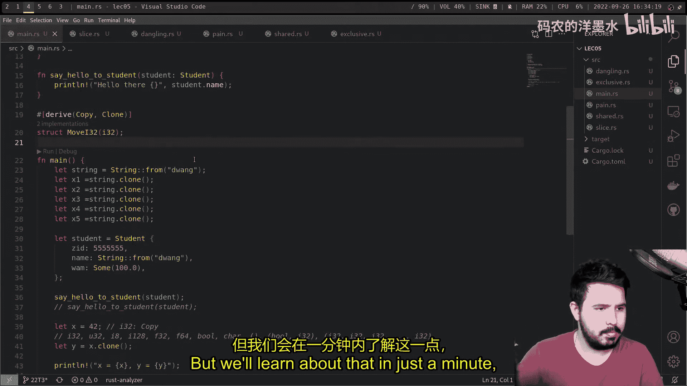

So that's our ratecap。

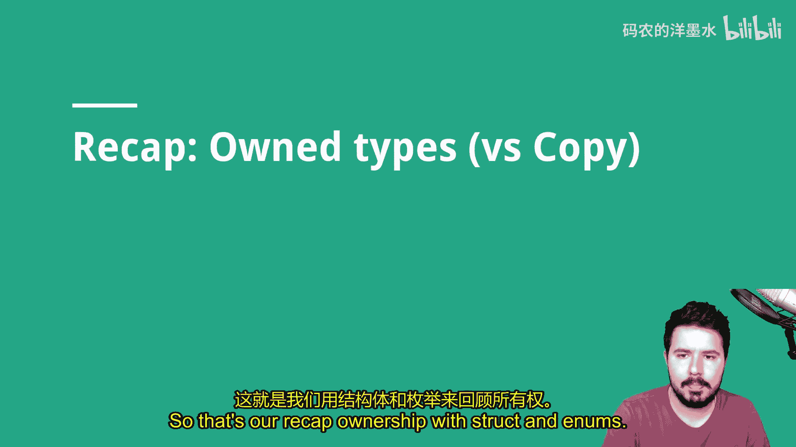

Ownship withstructums as mentioned before， when you define a structure an anineum it is you know these ownership semantics by default。

 you can opt in to copy or clone sorry you can opt in to copy if you want to opt out of the move semantics but all the things inside here need to be copied there is one other important idea with these withstruct and enums。

And how they work in food。And let's say it says A is a string and B is a student。

And C is a move I 32， I don't know， just some random things I can throw in here。And。Right， yes。

 let's get out rid of all this。 Let's go to the noise。So something that's rather interesting。

Let's move the string into here， that seems interesting。This student here， this binding。

Essentially owns this student value here， but there is one additional bit of ownership that's also going on here。

 the student value also owns the string inside it here and also this WM here yeah this Wm here as well。

嗯。So this this type here is that ID is copy。 So it's whatever。

 we don't really have to worry about the ownership in regards to it。

 but the value the value itself also owns。Here， this。

 this name and this way' this string in this option。

 So the additional idea here is that if your struct has own values inside it。

 any values with type that struct， say with type student also own the owned types within it。

 So you can think of it here as this variable。 Let student owns the student。

And the student owns its name， and its w。Right， so it the student here maintains ownership because there was some interesting questions in the workshops that were like。

 well， I have a hash map。That has a string and a student， I don't know， whatever， whatever it is。

 right？And they said like， you know， who owns this string and who owns this student and the answer is well X here owns the hash map and the hash map ends up owning this all the strings and all the students within it。

 So the ownership sort of like cascades inside the student we own the student。

 the student owns its name its name and its W， this string in this option。😊，And， you know。

 we could potentially move out of these but then we would make this the overall student invalid we if we end up moving out of these fields and taking ownership of them ourselves。

And so in that sense， the student is also responsible for cleaning up the resources inside it。

 which which it does and through here in the case of Anina。Whichever variant it is， if it's an A。

 if it's a B， if it's a C， it also owns whatever is inside it and is responsible for cleaning that up。

😊，And that's right。 So the variable string here。Is moved into a student right there and it can't be used after if I try that print line out this string。

 you'll end up seeing the the fabled error message B of moved value string。

 so it was moved away right here which is that dot dot dot there and so we can't use it anymore because it's owned by this student value and the student value itself is owned by this student variable。

Okay， are we sort of with me so far？Oh we sort of like， yeah， you know， little hiccups。

 but like vaguely get the idea， vaguely get the big picture or do we have any sort of。Any。

 any qualm so far。Okay， Patrick's good so far。Daniel says it's it。

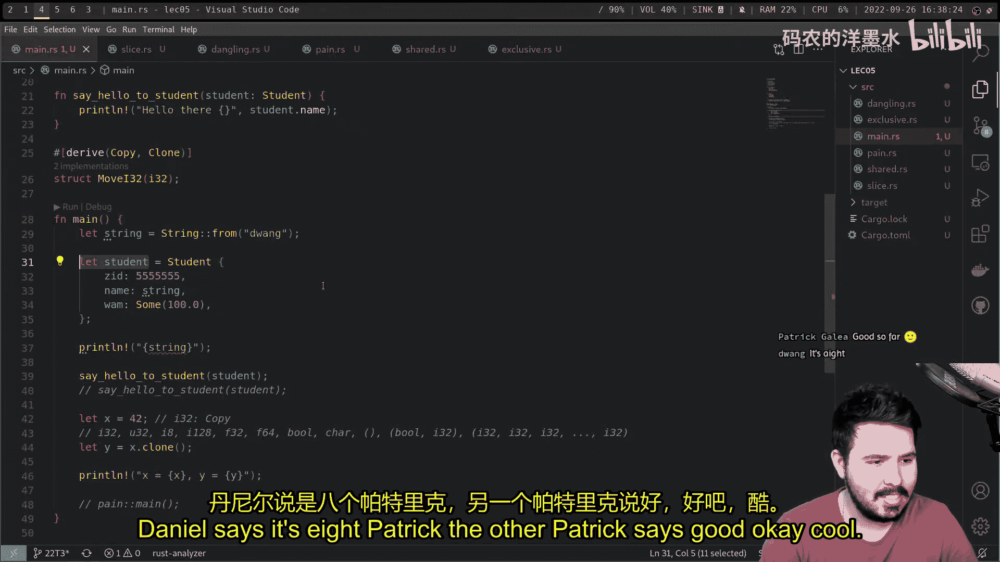

Patrick， the other Patrick says， good， okay， cool。So that's our ownership so far。😊。

Now we're going to have a quick brief look at the pain of ownership。

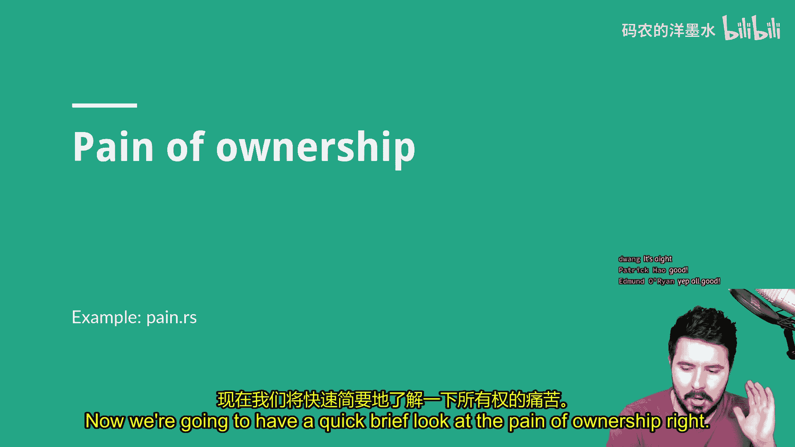

Right so I mentioned before， where can I put this code。

 I'm going to throw this code all down the very bottom。Like that。Just to and in， all this stuff too。

Let's just throw this all down the bottom。Great。That line does not work。Okay， out of sight。

 out of mind。So let's bring pain in here。 Let's bring pain main in pain main。 That's funny。

 I didn't even think of that。 So as I mentioned during week week one's workshop。

 youre using that bitmap library and the ownership was really rather annoying for a lot of people。

 So let me give an example of what that kind of annos might look like。 Who。

 lots of codeal on screen at once。 Let me just slow down their partner。😊。

So here's my main function that prints Hello worldd for whatever reason。

 probably because it was already there， and it creates a new image to 56 by 2 56 and calls a draw line function that a lot of you ended up creating。

😊，And it wants to draw a line with， you know， these parameters will look at what they do and then eventually it saves this image。

😊，Right， if I pull in the code here to draw a line。

 well you can see I've got a like this line direction inum which is just literally just means vertical or horizontal and draw a line takes in an image an X coordinate。

 a Y coordinate， a length and a direction for to draw the line in but the interesting thing is it also spits out an image right it takes in this image here and spits it back out and a lot of you are doing this because you want to write a function that works on this image right。

😊，But if we， if we just passed the image without spitting it back out， right。

 if I get rid of this return value here and write it how you might in another function in another language。

 Sorry， this line didn't work。 Wait， this， where， hang on， Let me get rid of the let image equals。

This line didn't work because it saidB of move value image。😡，When you went to draw the line。

 you moved this image into the draw line function。 It draws a line on the image just fine。

 But then we've got， we can't use it again after and save it。 So it went， oh， well， that's annoying。

 I guess I can like pass it in， do some stuff on it and then transfer the ownership back out of it by。

😊，Returning image。And at the very end， just giving that same image straight back and then over here。

 either you would do let the mutable image is this and say image equals draw line image。😊。

Or also some people wrote it more like this where you say let image as this and then just overwrite that name。

 let image equals with this draw line， pass the ownership in and spit the ownership back out。Right。

So let's run it。 Let's see if it works。 cargo run。 Hello world， hellello， they're De Wang。 Yes。

 and we got an image。 My image do B。 Do we get a line。 Great。 Okay， so we got a line in the end。😊，嗯。

But this， you know， this， this whole passing in and passing out got tedious for a lot of groups very quickly。

 And it's just， it just feels like something you shouldn't have to do when we didn't need to infflat diagonal lines。

 I put so much effort in。 Yes， I remember one group was， I walked over and I was like， hey。

 how are you going there like， where're reading a research paper on diagonal lines。 And I was like。

 oh my God， like。That's okay。 So that was funny。 But I think a lot of groups ended up doing this。

 And if not， hopefully you can sort of see the justification as to why if you didn't do this。

 hopefully see the justification as to why a lot of groups went and did something like this。 again。

 you want to use functions。 you need to pass the image into the function to draw the lines on it。

 But by passing the image it you're sort of moving your image into this function。

 then you can't use it again later to say draw another line or to save the image at the very end。

 So we pass the ownership back out， we pass this image back out。😊。

Put another variable in it or modify the existing variable or whatever。

 And then we can keep using it again afterwards。I did diagnoseize and it was pain， I see。m，Okay。

 great。😊，So this was painful。 And I think I tried in all the workshops that I was in to be like。

who found this like who found dealing with ownership like annoying or frustrating and basically the whole room's hands go up and if I was writing Ru code like this I would also very much agree this is annoying and it is it does feel a little pointless as well。

😊，So。With all this in mind， there must be a better way， right， There must be a better way。

How interesting sorry。

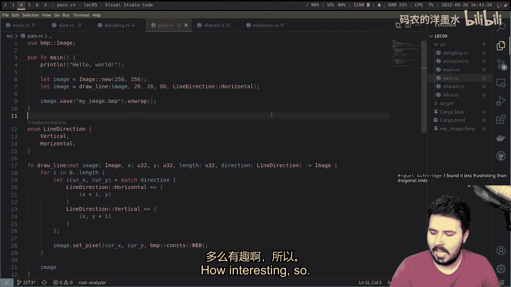

That's the pain of ownership。You know， it still worked， we could still write code to do stuff。

 but it was painful， the pain in dealing with this ownership。So as an aside。

 the perils of shared mutability so。

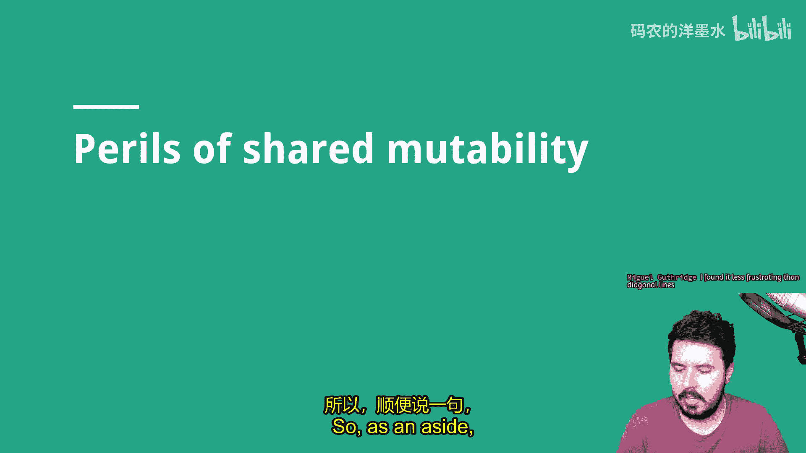

Why do we even care about ownership at all in the first place。Well， there's there's。

 there's many different reasons that whole sort of idea of。

Being able to have types that like free up their own resources themselves。But then don't。

 don't cause like use after freeze。 Don't cause double freeze。 Don't need a garbage collector。

 All this stuff is， is kind of nice。 But there is also another very。

Potentially scary and dangerous idea。Which is， if I had many， many owners of a single type。

And let's assume these owners are operating on different threads。

 which if you're not super familiar with threads， basically means these different blocks of code are running at potentially at the same time。

 simultaneously， let's say。😊，So I have like this is code。1， I have code 2。I have code three。

And I have code for。That are all doing。Potentially the same， potentially different things。

 they're just executing code right， so these are these are threads essentially。😊。

And let's say we have one little object in the middle here。 Let's say it's that student。

And they're all working with this one student over here simultaneously。Right。

So this is our diagram that I'm working with now。So this student has some like bites inside it has some data。

And all these different threads of execution。Are trying to work with this data at the same time。 Now。

 I have a question for the chat。When is has anyone sort of experienced or is aware of any issues that could crop up with this situation happening？

Like just in general。Does anyone have any personal experience or has sort of learnedt about or heard about？

Anything that can particularly go wrong with this kind of scenario。

So Patrick says data races Hasssein says race condition room room Deang says use after free So yeah what I am looking for here is different bits of code racing against each other and data races can absolutely cause things like use after freeze as well once you have something like a data race or a race condition a lot of the time all bets are off because the behavior is going to become so scoffed that you can't rely on anything the behavior is going to be basically completely undefined past that point。

😊，So。A data race， so how would a data race occur？How does a data race occur。

 Does anyone in the chat who who is familiar with this kind of idea know how this this potentially scary thing happens？

Or even what a data race really is in the first place。

So it happens in multi threadd code because instructions aren't atomic。Very interesting and very。

 very， very nice and and accurate explanation as well。 Okay， so。😊，The idea here is。

 let's say we have a。Let's say all these threads of code or whatever are trying to modify， modify。

 oh， let's go。Which one we looking at， we were looking at， oh we were looking at main before？

But all the way down here。Let's say they were all trying to modify the Wham。

Let's say that same is reasonable。Like all the results are coming in and they're all trying to modify the WAham at same time。

 Daniel Wang has been overloading with four courses this term it's been crazy and they're all trying to you insert their results and end up modifying the whham at this exact same time。

😊，And the idea is if you have， if all four of these are trying to go， oh， here's the W。

 I need to do some calculations and update it and all that。

 they can end up writing on top of each other， they can end up writing to the same data at the same time。

😊，And cause this cause something known as a data race， where in hardware。

If something in memory is being written to。By， by multiple threads at the same time。

 you may have learned about this sort of stuff in 1，5，2 on as well。

 And you might know about like sort of concurrency。

 like sort of race conditions on data where it's like this idea of instructions into leaving。

That's almost like potentially a better kind of a data race。 if you're familiar with that。

 where it's just like you miss an increment。 or often it's like， yeah。

 you miss an operation because something is using an old something' is using like an older version of the data by the time it's been written to or whatever。

 But more generally， if two things are trying to write to data at the exact same time。

 the brilliant thing is that data in you know， if you consider hardware and not just sort of this abstract machine that we generally think of。

 if you consider the actual hardware。 that piece of data can end up with literally any value。

 So there's the value that it had at the beginning。

 there's the value that code1 is trying to modify it to be。

 there's a value that code 2 is trying to modify it to be。 And And like maybe3 and 4。

 we could throw in this as well。 So you might go， well， there's five different possibilities here。

 if they're all trying to write to it at the same time。 But the answer is。

 it can actually be literally anything。 you can get any byte spat out。

When two things or more are trying to modify something at the same time。More generally as well。

 So that would be what's called a right， right data race where two or more things are trying to write to something at the same time。

Even worse， if you have， let's say something's trying to write to some data at the exact same time。

 that' something at the exact same time as something is trying to read that data and try and see what value is that。

And they do that sort of at the same time。 The write will almost certainly always go through and be fine in that case。

 But the read， if you're reading the data right as it's being modified， same thing happens。

 it can end up with basically any value as well。 Your read could just be completely wrong。

 which is just， again， absolutely spectacular。 And so it's very dangerous。

 And that would be called a read， write data race， read， write conflict。

 where there's at least one thing trying to read and at least one thing trying to write。

 And so the read ends up getting an incorrect value， So。As the examples that we've sort of seen。

 we have， Oh， my tablets sort of a little offset。 Okay， I can't write at the very top。

 We have a right， right conflict that we've sort of talked about， and we have a read。

 write conflict that we've talked about。And these are exceptionally dangerous and often disastrously possible in languages like C。

 languages like C++ languages that have sort of that really care about performance end up giving you that low level sort of end up giving you those low level capabilities to access memory and you know to go really fast。

😊，But with that also comes the ability to cause these kinds of data races and yeah。

 it can just be all kinds of horrible。Another really fun one in particular has anyone。😊。

In the chat here， is anyone in the chat familiar with C+ plus's iterator invalidation？

Out of interest。Iterate invalid has anyone heard of that or has anyone run into that either？嗯。

James says yes。Kai is smiling at Miguuel。And Hassin said。

 one is reading the value stills somewhere before can use code two ends up changing the value of something else。

 yeah， absolutely。Danny Wang says yes， Okay， so familiar with the concept of iterator and validation for anyone that isn't on my。

 my pen carco quite to the top to the toolbar again， varied had to。Throw this setup up together。

 So it's， you know， been fun。The idea is if I have， let's consider the humble V。Right。

 the humble vector of let's say， integers here， I 32。If we what a V looks like。

 if we consider what a V looks like， it has three fields， it has a pointer。

 it has a length and it has a capacity。Great， so let's say the pointer is pointing to some data。

 and in this case， pointing to 1，2，3，4，5。Then the length would be five and let's and when the capacity is sort of the length plus whatever extra space we have at the end because we probably allocated a little more than we need we talked about this in another lecture so let's say the capacity is eight in this case so there's room for three more before we need to move to a bigger buffer。

Now when we're iterating through things right， so when we've done like Vec you know dot Eer or whatever。

 when we're just sort of using that functional iterator style。

 what rust is doing internally is it manages a pointer。Imagine as a pointer to like。

 which element are we up to。 And whenever you go next on the iterator next， next， next。

 give me the next thing， the next thing， the next thing。

 or you end up sort of like doing your operations and then say collect it into a new thing， whatever。

 as it's going through， oh， I've just accidentally。How do they do that。

 I've accidentally changed my color。Away from the color I use。Let me。Grab that again， does that work？

Sorry， give me， what the heck has it done？Oh man， it's really fun having to。His paintbrush。

 nope settings。Oaque。No， Id， okay， that's。I'm going to call a palette。Nope， okay， let's do save。

 We'll save it into。Here， here， here， save。Great， yes， save it as Lego 5 stuff。

And then we're going to do the classic kill it。Open it。And open it like five stuff。 Okay。

 do I get my fan back， Oh my God， no okay。The pen might be， I am not very good with this software。Oh。

 hang on， hang on。😊，Whatever， as long as it's kind of close。 Okay， that's fine。 that's fine。 Okay。

 great， sorry， I figured it out。 Alright， we're back。So。😊，The idea of an iter being， we can go。

Next and then， you know， the next one， the next one。 So as we say next。

 what Rus does is it maintains this pointer and it moves it， oops。

 it moves it to the next element along。 So now we point at this element。

 we say next and appoints us at this element。 if you're familiar with C plus plus。

 this idea should be pretty should feel pretty pretty similar to what you're used to。😊，Now。

 the problem， the idea of iterator and validation is。

 let's say we're halfway through this or even where it doesn't actually matter where we are。

 Let's say we're looking at two right now。And then someone comes along to this original vector。

 which again， maintains this data。And says， I want to push on the end of that。6，7，8，9。Okay，6，7，8，9。

Now， if you see this they're pushing four more elements， which would make the length，5 plus 4 is 9。

Which is greater than the capacity of 8。 So it's going to go， okay。

 I need to make a new allocation to make room for all of this。

 And so what it does is it goes free this junk here。 we're not going to use this allocation anymore。

 Well， actually， that I may have jumped a little too early on the gun there。 First of all。

 as asks Malick。 Let me allocate space for 16 now instead。 Right， let me allocate space for 16。

 and Malik goes great。 Here's all your bytes。 Then it copies across all the old data into it 1，2，3，4。

5。😊，And then it can go， great。 We don't need this old version anymore。 I'm going to free that， right。

 Liter， it runs free on it。And then it goes and does this operation， this push of 6，7。

 so it goes great 6，7，8，9， and we still have plenty of space left here。 The length is now9。

 the capacity is now 16 and it's all great。 The vector is happy， everyone's happy。😊。

Except for this iterator that was halfway through its job。

Except for this itertor that was halfway through its job， it's right here。😡，Yeah。

 but that data is freed， it's now pointing to freed data。

And the actual vector is pointing somewhere completely different now。 right。

 If you think in terms of addresses， these addresses are completely different at this point。

 potentially。And so this iterator is just completely out of whack。

 We call next and we get memory memory memory un safety immediately。

 which can be exploited to hack into your computer， do horrible things。

 ransom your company for $10 million or something like that。

 I'm sure that would never happen and be all over Australian news and you know。

 many customers being worried about data I'm sure that would never happen。😊，嗯。

And so this is a very serious problem。And one of these problems that rust。Is。

 is designed to try and fix。 essentially， something that rust is designed to try and overcome this kind of issue。

 So we'll look at iterator and validation and how it occurs in in C plus plus maybe on Wednesday。

 I think that'll be a nice little sort of comparison to look at， but。

One of the things I sort of want to relate this back to is。I want to。

 I want to relate this idea of this iterator and validation to this idea here of the of the data race where many things are trying to modify this。

 And the idea is。Well， actually， pause for one second。I wanted to also mention up here。

 when is this okay？😡，Right， let's say there are many core all operating at the same time on the same data。

 right， They're all operating on at exact same time。 exact same data。

 let's do this like a riddle as well。 There are many core all operating at the exact same time on the exact same data。

 but there is no problem。There is no there's no memories， un safety。

 there's no crashes or vulnerabilities， everything is perfectly fine how and yes， Patrick。

 Daniel Husseain， you are all correct， they are only reading All these threads are only reading the data。

😊，Right if no one is modifying the data， if no one' is mutating the data。

 then it's perfectly safe for everyone to be able to do that。

 and you also want that ability to be able to do it because that could lead to like very very good performance gains。

 or it could also lead to it could open up more design options for your language if your language doesn't support this。

 there are programs that you may want to write that you are then not able to write So being able to support many people。

 many threads reading the same piece of data at the same time is something that you'd certainly be interested in。

😊，Or if we're using synchronization peris。 Sure， yeah， that's， that's also very true。

 And that's week 9，8，9，8。 I think week 8。 But I you'll have to double check something like that。 So。

 yes， so this is okay when you're reading。😊，And the problem occurred here， right。

 This was perfectly fine。 Everything was great until someone modified this vec， right。

 for in some way， what I'm suggesting is that this v here and this iterator here are related in a certain sense。

😊，Right changing this V effects this iterator， this iterator is reading off this V they really are related in a certain sense and spoiler alert if you're someone who is already somewhat familiar with Ru。

 yes， this is exactly what I'm talking about here， but we're leaving that for Wednesday at least so。

😊，The problems occurred in each of these examples when someone was mutating a value while someone else was trying to use it。

 right， Someone else was either trying to mutate it themselves or someone else was trying to read it at the same time。

 So in this case， this sort of Vec iterator invalidation problem is a read。

 write problem where someone wrote to the Vec and someone was reading with the iterator。

 and we ran into this invalidation issue。And up here， we saw examples of write。

 write conflicts and readwr conflicts causing these kinds of problems。Okay。

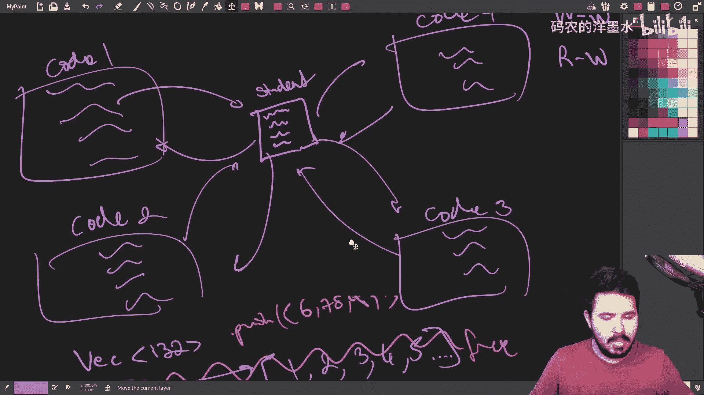

This this is so my overall sort of thesis here is that shared mutability， right。

 the idea for some value to be shared。😡，Not necessarily shared mutably， right。

 Not everyone who who is sharing this value needs to be it necessarily needs to be mutating it or be able to mutate it。

 But if something is shared， and it is also mutable like and something is able to mutate it。

 then there is inherent danger。

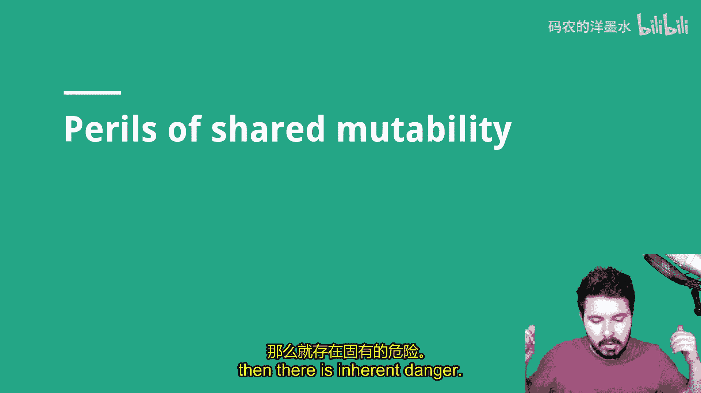

Of that。Right， if this thing is shared across all these threads and even just one of these threads is able to mutate it。

 there is inherent danger of a read， write conflict。 If more than one thread is able to mutate it。

 then there is inherent danger of a right right conflict and a read。

 write conflict and this iterator in validation example， if the。

 the Vec and the iterator are sort of sharing off each other。 And if you can mutate this vec。

 then that could pose danger to this iterator through a read， write conflict， right。

 sort of getting this， this idea over here， right。

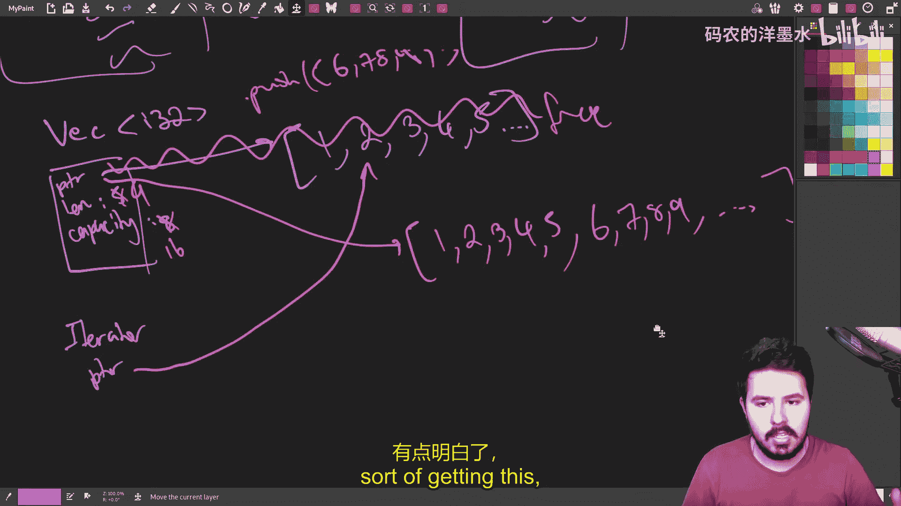

My thesis here is that shared mutability is inherently dangerous。Right， does that make sense。

 Are we there so far， If we're there， we'll talk a break and talk about how Ru deals with this idea in the second hour。

 Are we Are we okay， Are we have okay， checks out what saying Patrick says yep， any questions。

 I'll only leave like 30 seconds to just type some questions out now if you have any otherwise you can type out questions during the break as well and I'll answer them in chat or when we get back。

But any sort of like。Is anyone just sort of feeling like very not， this is。

 this is a bit past or you know， anyone not feeling particularly good before we take a break。

Go get those flies。 Okay， I will。 We'll take a break。 It is。

170330， let's come back at 07， so three and a half minutes， we'll see you back at 507。

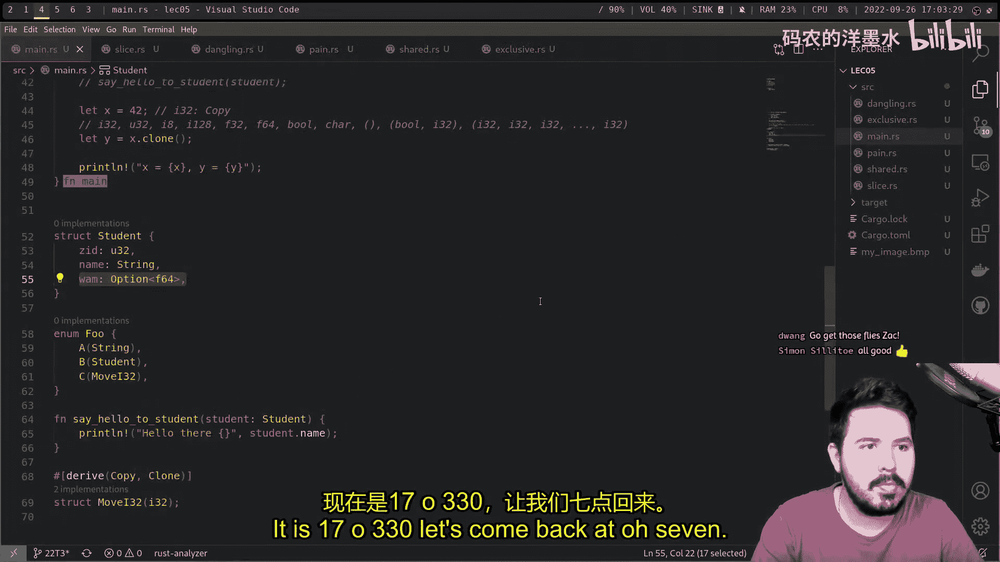

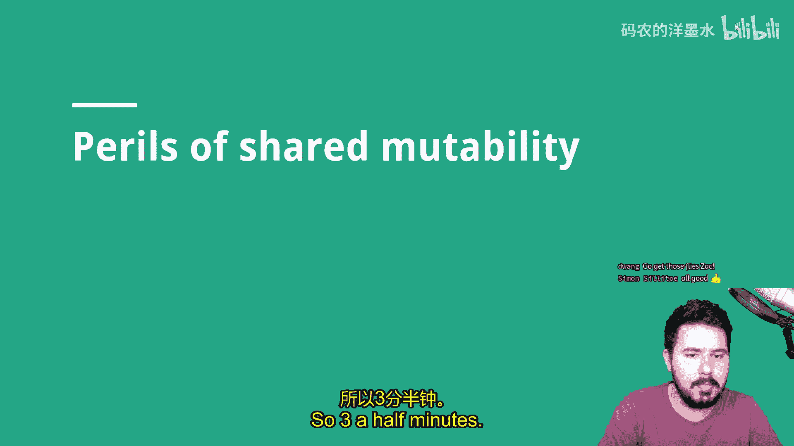

All right。 Welcome back。The flies have been dealt with。So。Hopefully。

 you're pleased to know we shouldn't。 Hopefully we don't get， you know。

Zooming past my face or the camera anymore or leaking into the rather sensitive microphone。Okay。

 so great。😊，It seems like we're okay right now at at the idea of this shed mutability。

 So how does Rus deal with this？

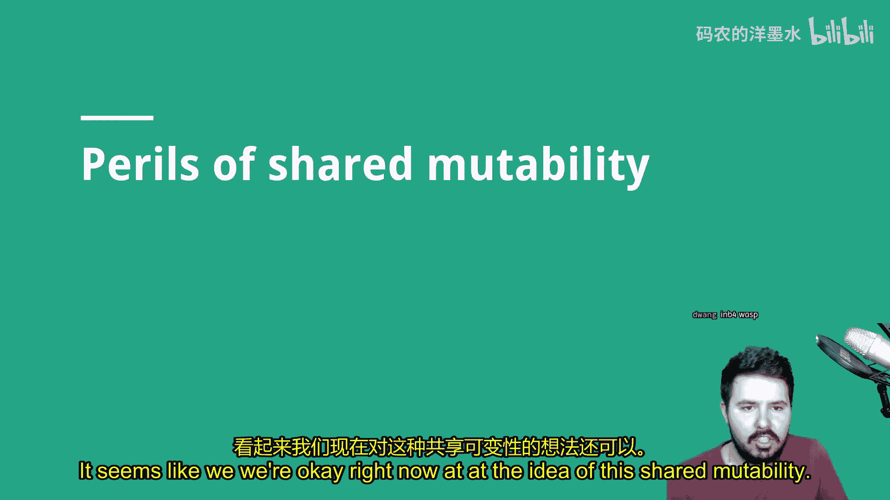

Rust has an idea that's rather famously known as。Shehared。X or。Mutable。So what's the idea of this。

 Xor is sort of like a a Boolean logic terminology， essentially Xor means that。

Like you cannot in in the context of this， someone's gonna get upset and then say， you。

 you can't have neither of those。 Okay， fine， whatever。

 what they're using it in they maybe they should have shared and mutable。 But I don't know。

 this is this is the nomenclature that it's commonly known as the idea is， out of these two options。

 you can pick one of them， but not both。 So either your value you can share it around as much as you want。

 And as many things as you want can all read from this potentially at the same time。 or。

You can only have one the the that value can only be like held by one thing or accessible by one thing。

 but it's allowed to mutate it。 So you either get to choose sharing a value around。

 read only or mutating a a value。Right， but only by one， only one thing can access it。Now， note。

 note that this sort of decision is very temporal。😡，Right， temporal。Meining。

That temporal meaning sort of dependent on time， meaning that this。

 you can change this decision for a given value many times as time passes， right， So I can say this。

 if let's say my value here is called value。 I can say value is shared。

 and so I'll make like lots of things will use value。 but then later on， I want value to be mutable。

Now， in order to sort of switch from shared to mutable or sort of switch from mutable to shared。

You have to make sure that it is no longer that， right。

 So if it is shared and you now want to mutate it， you need to sort of collect up all those things that are borrowing it and make sure that you need to make sure that value is no longer borrowed by anything else。

If value is no longer borrowed by anything else you're owning it， it's not shared anywhere else。

 then sure， you can mutate that value， that's perfectly fine。Similarly。

 if you're mutating that value and you want to share it。

 you need to make sure no one else has access， no one has access to mutate the value anymore。

And then no problem。 You can start sharing it again。

 So that's what I mean when I say this decision is temporal。 But at any point in time。

 this decision needs to be clear to rust。 Are you trying to share this value or are you trying to mutate this value。

 right， Ru needs to be able to know that answer at compile time when you're building your code if it can't tell if it can't tell what's going on。

 you'll get some kind of compiler error， And if it believes that you're trying to do both， right。

 both sharing and mutating a value， if it believes you are doing that a compile time， it will say。

 no， you cannot do that。D the。In safe rust， right， in the rust that we're sort of dealing with in this course。

 it is not possible to end up with a program that shares and that shares a value that is also able to be mutated simultaneously。

 It is not possible to write that program in rust。But note。

 it is possible to write programs in rust that are not like do not express that do not attempt to share a mutator value simultaneously that the rust compiler may still reject。

😡，Right， so a set of programs where the rust compiler is being dumb。And it's saying， hey。

 I won't compile this because this is you're doing something bad here。

 you're trying to share and mutate at the same time。😊，That actually isn't doing that。

 You can maybe go through and verify know go know it really is， I know what I'm doing here。

 but the rust compiler isn't able to it thinks that it's doing something wrong。

 That set of programs get smaller over time as sort of more programs become except and the compiler gets smarter but it does exist So keep that in mind Sometimes you might go know I really think this is right。

 but the compiler is getting angry at me。 That's the kind of situation where you can post on the course for him and ask us hey。

 why is the compiler upset about it， It might be， hey， did you consider this or hey。

 here's like an input that might program might make your program do something really bad。

 that the compiler is trying to stop， or it might literally be the compiler is just not quite smart enough to deal with this situation。

 you are right， but you're gonna have to maybe rewrite it a little bit to make the compiler happy Again。

 that situation is somewhat rare these days， The compiler is actually pretty good these days。

 but it still does exist。 It's worth knowing it does exist。😊，Okay， let's see what I oh。

 the green screen is really becoming blue。 Okay， yeah it is。 hangang on。😊，Okay， that's very blue。

 I have a couple of other tricks up my sleeve， there we go。See， I've got things on hand。

Thank you for letting me know。Okay， hopefully it wasn't too much of a bother while it was like that。

Okay， so it was the wise when rip my audio driver crashed and I can't hit play anymore。 Oh no。Okay。

I am very sorry in the last five minutes we just talked about this idea of shared exomemutable and rust。

And oh， we can't do that even with synchronization primitives。 Okay， so that yes。

 you can with synchronization primitives， but that is because synchronization primitives are built in unsafe rust。

😊，Right， so there's this idea of safe rust and unsafe rust。

 We're not going to learn that distinction until I believe week 9。Or week 10， week 9。

 I think and essentially this this the like things like a mut text that let you mutate something that is shared。

 right， that's sort of a big primary idea of a mut text is that you know a mut text is allowed to do this because although the mut text is shared the value inside it。

😊，Isn't isn't shared and so Safe rust is happy with it。

 and we can convince the compiler by doing some special unsafe magic。

 but that's you know very far ahead towards the very end of term， But yes。

 you can do this in certain situations where like you can't just write in unsafe rust a data race something that does something horrible or use after free and be like it's fine like it'll still do horrible things like in C or C+ and potentially even worse but if you know a mut text in this case allows you to share and mutate because you're not actually mutating the thing that you're sharing only one thing is still able to mutate or read the value at the same time any given time rather。

 So it is along it follows the rules of safe rust you just need unsafe rust in order to implement it essentially time travel on my curtain unsafe。

 Yes， don't。very good okay， so this idea of shared Xormable。

 you can either share a value or you can mutate it at any point in time and we generally think of these in terms of what's calledBrows。

😊，Something called Brows in rust。And there's two kinds of burrows in rust， like literally two。

There is a sharedd barer。And there is an exclusive borrow， exclusive borrowor。

And you might go what the heck， that's some crazy terminology。

 Here's some other things that you might be familiar with。😊，That's a horrible drop。

 That's there we go。 That's a little bit shed bar。Exclusive borroworough right。

 So if you ever seen an amand that， you know， and you might also hear this as a reference。

Or you might hear this as a potential you might hear it as an immutable。

Reference everyone has their own sort of way of talking about this。 This is someone David Tooleney。

 who is a absolute genius in the Russ community， very strongly suggests teaching them as shared and exclusive burors。

 as opposed to all these other different terminologies。 So I'm going to， you know。

 give that one a try。 But just so you know what you're seeing when you see it around the place。

 there's all different kinds of names for all this。 So， for example。

 you might hear this as just a reference， you might hear it as immutable reference you might see it as an ampersand or some people pronounce it like at。

 you know， if I have like an ampersand Vec or something they might say at Vc。😊，Just so it's。

 you know， just so you know。What you're hearing when you say this stuff and this is this over here would be at mute。

Or you might hear it as shortened as ref mute。You know。

 there's all kinds of things you might hear this as but。😊。

The right hand side is only if you already sort of have seen some of this terminology for the rest of us。

 we have shared Bough and exclusive borrowough。And we have some。

 I'm assuming French coming through and sadly I'm not I'm like。

 I'm like hello and how are you in French。 that's that' that's about the extent of my knowledge。Okay。

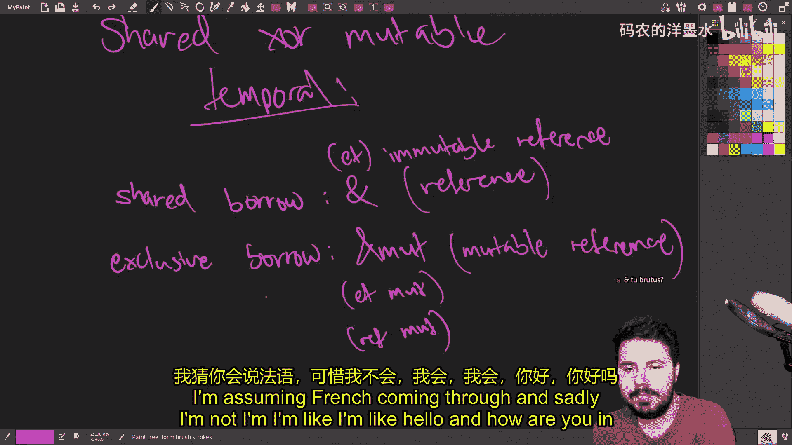

So shared and exclusive borrows。Sheed borrowrows。Worked example。 Yes。

 we get to do a worked example now。 Awesome Sha dot RRS。 So I'm going to un this。😊。

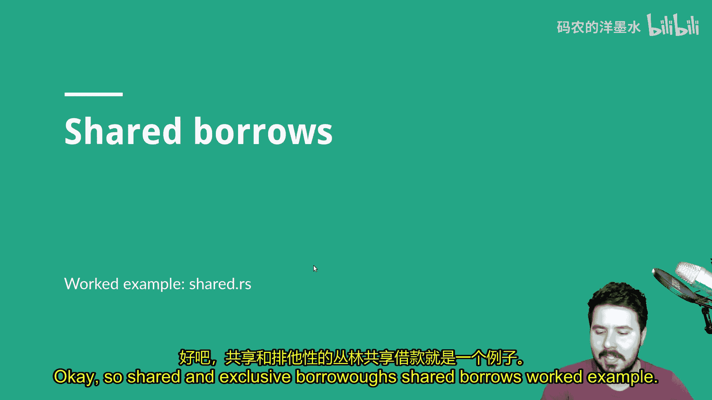

And we'll hop over here， great so。😊，I want to make a function。That I am calling， oh。

 that was a bit too much string chas L。 And I wanted to take a string， right。

 I wanted to take a string。But what's sort of annoying about this， Well。

 I don't really want to take ownership。I don't really want to take ownership of a string。

 I only need to read from a string。Right， I only need to read it。

 I don't need to like pass ownership off everywhere。

 I don't really want to free the string like I don't want to be responsible for freeing the string when my function ends or anything like that。

 I don't want to pass the ownership back out。Right， and I want to say， give me a string。

 and I'll give you back this string and the amount of characters in the string。 right。

 string chas L is what we're sort of looking to moment here。

 I really would just like to do the the like what what a rust programmer would do the idiomatic rust programmer would do and just like read from a string。

 not take ownership and tell and skit out how many chas there on the string。 Now， how do I do this。

 Well， if we think about this， As I said， we only want to read from the string。

 we don't need to modify it。 In fact， I think anyone who called this function will be very surprised if we modify this string under them。

 if it's just like how many characters are in this string。😊，And so if we go back to this。Up here。

 do we want to mutate the string。 Well， no， we don't need to mutate it。

 So let's err on the side of shared。 right？ So in this case， we're looking for a shared borrow。 We。

 like we need to， to be clear we need to choose one of these。

 We need to choose either we want to borrow a value。 Like when we're borrowing a value。

 Either we want it to be a shared borrow or an exclusive borrow， right。

 assuming you're not taking ownership。 You just want to borrow the ownership。

 Like you just want to borrow that value and be able to use it for a little bit。

You need to choose between shared and exclusive， exclusive。I is more restrictive， as we said。

 you know that you can't share it anymore， there can only be one thing that can mutate a value。

 so an exclusive borroworough is a much greater ask。

No one else must have access to this value if I want to take it in。

 or the shared borrow is a bit more flexible， it's like no one else could be mutating this at the same time。

 but you can give out as many of these as you want at the same time and so it's a little more flexible like that。

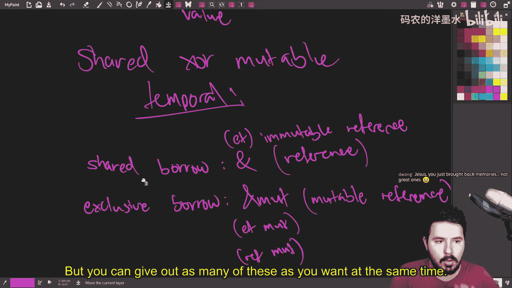

嗯。So where， where we're over here， So what would we look for here in this charge length function。

 probably we just want to have a shared borrow， a shared B。

 which we just write as an ampersand right which might look like a pointer in another language or or something like that。

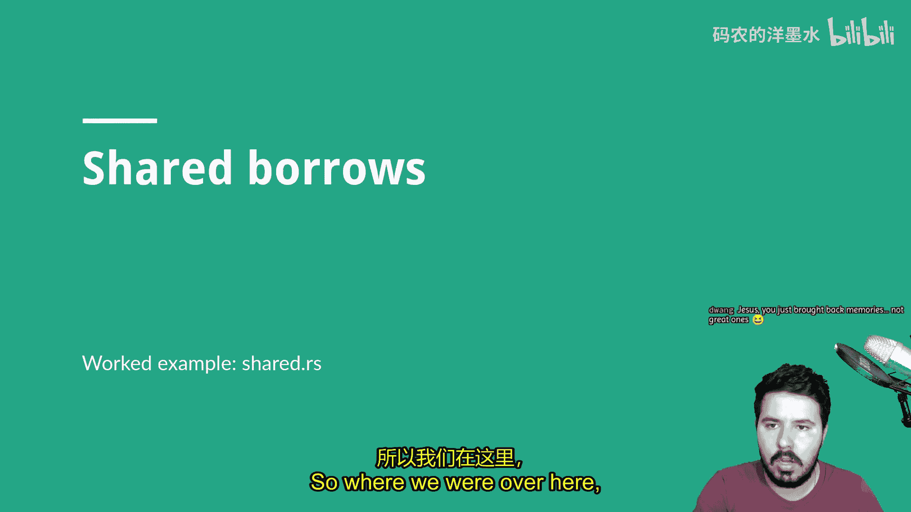

Right， so we take in a reference to a string。And and it should spit out how many characters the string。

Just like that。 so it's borrowing from a string。Another thing that's worth mentioning。

 worth just very quickly pointing out is。This shared bough also if if we like when we take in a shared borrow here。

We are。We have a shared b on this string because the rules of shared bors is that there can be no exclusive bors of the same value and exclusive borough that's able to mutate it。

That means that for the duration of this function， we are guaranteed that no one will mutate this string。

 that no other thread。Will possibly be able to mutate the string as we're going through it。

 which is something important for us， because if we're reading through the string to find how many characters there are。

 And then someone starts changing the string as we're doing that， we might end up with a data race。

 as we saw before， which is very bad。 But even someone might like change the amount of characters behind us as we're doing it。

 or since strings are essentially like a vck of characters in a certain sense。

 it's more like a v of bys。 But there's sort of like a v of characters。

 if someone modifies this original string and pushes more stuff onto the end of it， for example。

 we might get this iterator and validation problem。

 where now we're pointing it like freed memory and have a memory safety issue。

 So it's really great that when I write this rust guarantees that you know within these curly braces。

 it is not possible for anyone else to be mutating the value that we're reading。

 the only thing that could be possibly happening is that other other code is just reading that string。

😊，Okay， I've also done a whole bunch of test cases down the bottom here if you're familiar with the idea of unit tests then this is these are basically just unit tests and they go calling this function on an empty string should give you0 A A B。

 ABC， ABC D1，2，3，4 and it should also work with emojis emojis are a single character so should there should be five characters here notice this is 20 bytes。

You know， this is0 bytes，1 byte 2 byte，3 byte 4 bytes。

 but this is 20 bytes as opposed to 5 bytes because emojis take up more space than a simple ASII character And so we can't just use like a simple length function or anything like that like string dot length dot O dot land rather because strings。

Strings will tell you the length in bytes by default。

 And you need to tell it that I want to know the length of the character。

 how many characters there are in or topped into that。 note that these。

 I set up the unit test to pass this string by value。Right to take ownership here。

 But now I'm saying I want it to be a shared borroworough instead。 oops， I didn't want to do that。

 That's not what I wanted to do。 not， not what I wanted to do。Okay， it's fine。

 I pressed the wrong button， I guess。So it wanted to be a shared borrower。😊，But now these。

 these are still like passing it transferring ownership， and so we need to explicitly tell them no。

 I want to pass it a shared borrow and I just do that by putting an amand in front of the value here。

😊，Right， just like in C and C， if I want to pass a pointer to something or reference to something。

 whatever you want to call it， I put an ampers sound out the front。 The address of operator。

 same idea is going on here。 I am getting a reference to this value or as where。

Sort of learning it here。 We are taking a shared borrow of this value。

 So notice that this function empty still owns this string。But it's just passing。

 it's just sharing it over here， Okay， so we've got a whole bunch of tests do the test pass。No。

 because it just says it has not yet been implemented because it just write to do here， okay。

 so we actually have to do that。And how do we do this， Well， string dot。

Cs will give us an iterator of the characters。 And if I don't even want to look inside the iterator。

 I just want to know how many elements were there。 I can tell the iterator to count through each of them and spit out how many there were and。

If we run this， it's okay， it's all passing now， so just how many characters are there count them up。

Now， why do this work if we look at this chas function over here， right。

 let's look at the documentation for that。Oh， I type in uppercase chas。

 I want lower case chas actually。 So this chas function。Takes a reference， right。

 Notice this like sort of self thing here。 When I do string dot chas， right。

 Call this function with like this dot notation is's essentially shorthand for writing。Like Charlesz。

 sort of like this， well。Yeah， sort of like this， let's say。Where you're calling the chaS function。

But passing it like string into it like this。 Now， that is the string that we're passing in is what's known as self over here。

 and self can be taken actually can be taken many ways。

 But the three primary ways of passing in self to this function。

 passing in the value that we're operating on is as。Self。Ampaan self。A self and ampersand mute self。

So that is。Calling this function will take ownership of the value and then you won't be able to use it again。

 Calling this function only takes a shared borrowough of self and calling this function requires an exclusive borrowough on self right As a reminder。

 self in this case is this string here。And when I wrote it like this， it looks like that。

 so chaz implicitly takes this string because I did string dot。

And it requires that I have a shared borrow that I can like take a shared borrow of that of that string。

 which I can do because it's this is what I have。 I have a shared borrow of the string。

 If I wanted to， for example， modify the string。 Let's say。

 I wanted to push some text on the end of it。 Like I'm going to say， string dot push。

And so in front of the string， it's like。Lll， I'm mutating the string like this， right？

This will not work。Why doesn't it work If we go to the push stir function， which is here。

You'll see that it requires an exclusive borough of self。Which we simply don't have。

If this was amand mute， you see this function is now happy， right。

 If this is an exclusive bar of a string， then sure we can mutate it。 That's fine。

 That's allowed in the rules。But if we only have a shared bar， we are not allowed to mutate it。

 And so Rus says no happy， not allowed to do this。So it's great that it actually stops us from doing that。

Okay， so this passes。Oh， happy。And this is our sort of first example of saying a shared borrow。

En rust。Why do we need to borrow even for immutable values？So the trick here is that this function。

 I don't know if you're saying this in reference to this function。

 but I'll just quickly explain that in reference to this function。

 this string value here may be mut somewhere else。 So for example， if I have some function too。😊，不要。

I could have a string that's like， let mut string equals string from hello。Then I go， let count is。

 you know， this function is string Chars L of that string。And then I actually go， like。

 string dot push stir of。Wld， let's say。And so this string is， you know， it can be mutated。

But this test case still passes and it works because I own the string here。

 Like I create the string and I own it then。On this line， I take a shared borrow， right。

 I borrow the string and return the count of it。But after this line。

 notice that this function is no longer， no longer is borrowing the string。

 like the function has finished。 So it's no longer borrowing it。 So now at this point right here。

 no one is borrowing。This string， like， I own it， but no one's borrowing it。

 So that means I can then take an exclusive borrow in order to call the push stir function here。

 Right， I can now take an exclusive borrow for this line of code in order to， in order to to。

 to mutate the string。 And this all works perfectly fine。

 Why do we need to borrow even for amutable values。😊，So。If it's immutable。

It's then that it can't be mutated， which means you sort of really don't get any options on on this on this。

Oops， this one here on this shared Xmutable choice here。 If it's immutable by definition。

 then it can't be mutated。 And so all you can opt for is to share and sharing still denotes the the ownership semantics Like you still have two choices。

 if I'm calling some function， either you want to like transfer ownership， right， transfer ownership。

 I can't spell， you know， whatever， transfer ownership or you might want to share the value instead and retain ownership yourself。

 And so the choice is still important。😊，You can't pass an exclusive borough with a nonmutable variable。

 I assume。 Yeah， that's a great question。 Oh， I'm pressing control。 There we go。

 So in you can't pass an exclusive borough with a nonmutable variable。

 Let's look at that in the next example， but you're absolutely right。😊，嗯。And we'll。

 just because we haven't seen an exclusive borrowough just yet。

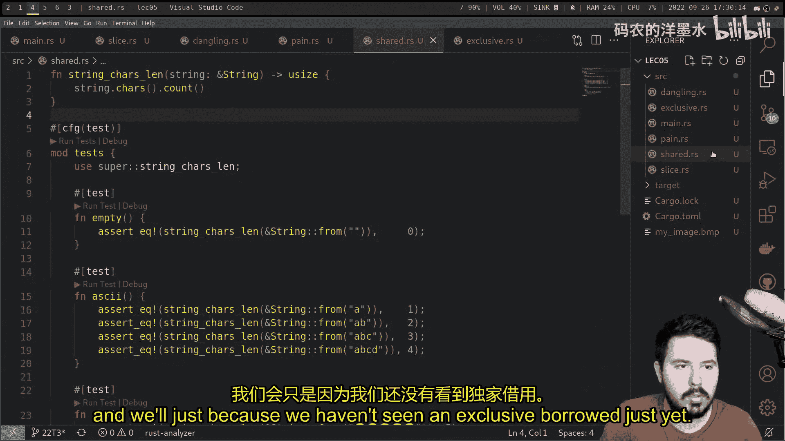

Soir。In terms of shared borrowers， the superpowers you get is that they can be shared infinitely many times right you can make as many as you want and they're also very cheap to pass into functions。

 if you have a really， really big value this you might notice this from something like C if you have a really。

 really big value passing it into the function like on the stack。😊，Might be quite expensive。

 like in terms of performance， it might use a lot of memory or take a lot of time in the CPU or anything like that。

 whereas passing pointers around is usually very， very cheap。

 very fast to do and doesn't use much memory。 and shared borrows， you know。

 spoiler alert basically are just pointers。嗯。But， you know。

 with a lot of extra semantics smacked on top。 And so they are。

 they are very cheap to pass the functions。 If you have some owned value that's very large and very expensive to pass around。

 you might consider passing a borrow instead， because that's also very cheap。 However。

 your limitations， you're not allowed to mutate the data。

 it's read only So to save you from these kinds of data races or data and validation or anything like that。

 And you cannot take any exclusive references during the lifetime of this shared borrow。

 So if you passed out a shared borrower to your the value that you own and that shared borrow is currently being used。

 then you can't create an exclusive borrow at the same time。 it's simply not allowed。

 you could only make an exclusive borrow once once all the shared borroworers have lapsed right once once no one is borrowing it anymore。

😊。

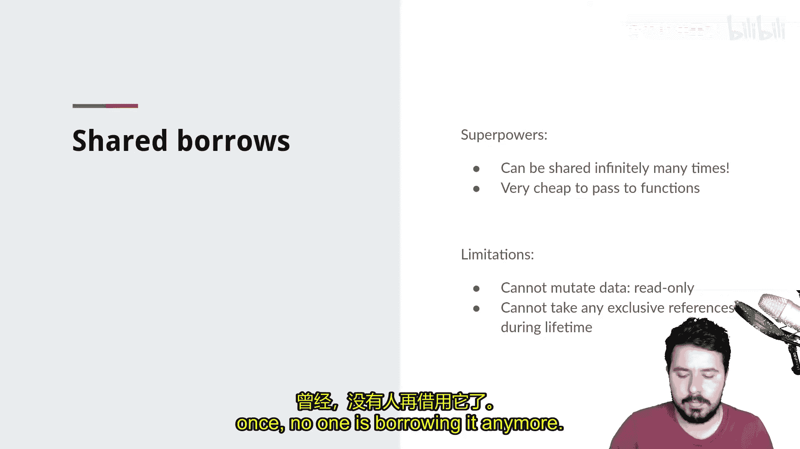

Okay， so let's have a quick look at exclusive Bors then。

I'm trying to be a little mindful of the time and for the demonstration of exclusive borroworoughs。

 I've got this idea of an emphasis。😊，Emphaize， oh my God。 Empha。 I'm going have to。呃。What can't I do。

change， okay， short， change all occurrences， emphasize， there we yeah， great。Emphasize function here。

 which takes in a string， right， but it shouldn't。 if we don't want it to take ownership of the string。

 We just want to make any ASI characters in the string uppercase and throw three exclamation points on the end。

 So， for example， if I had some string test and I emphasized it。Then the string that I own。

 if I look at that string again， it should now be test with like three exclamation points on the end。

Right and I've got some tests down the bottom here as well。

 an empty string should just turn into three exclamation points， A， A B， ABC should be A， A B， ABC。😊。

Hello world should turn into a very angry hello world。 and emojis。

 similar to just like there's not really an upper case for an emoji。

 So they just become emojis and some exclamation points on the end。 right。

 But notice that they're just modifying the string。

 We don't want them to take ownership We don't want the emphasize function to take ownership of the string。

 We just want to mutate it。 And in order to mutate it again as per our diagram over here。

 you get to choose one。 You get to share it or you get mutability。 We need mutability。

 So we're gonna say， I need an exclusive borrow on this string。😊，Which I write like this。

 I need an exclusive borough。And then off we go， string dot， oh sorry。

 the reason the thing's not working is because I need to un that。Okay， so string dot。

 let's look for like uppercase to uppercase it takes a shared self。

 so it takes the string as a shared reference and gives us a new string okay maybe two ASI uppercase takes a shared one creates a new string make AS the uppercase just takes a exclusive burorrow on self and doesn't give anything back right that seems like exactly what I want。

 These two would make new strings， but I really want to modify this one here。

 I don't want to whole extra string to now deal with This one make ASI uppercase just takes an exclusive buror on the string and therefore since it doesn't return anything back and it takes an exclusive borrow。

 we can sort of assume just by the function signature that it's going to modify the string that we have here to make it uppercase and if we look at the documentation converse this string into AS the uppercase equivalent in place and they have you know they have examples here as well。

😊，Cool。And then we want to throw bang bang bang on the end。

 so I'll say string dot push on the end of it and again pushster takes the string as an exclusive borroworough。

 which we have here and we can lend out。And it takes a string to push on the end。

 bangang bangang bang。Like that。Okay， let's bring the test into view here。Cargo test。

Exclusive tests are all okay。So that's it。Make ask applications case and push a string on the end。

Okay， so， okay， so， but you can't pass an exclusive。Borrow with a nonmutable variable， I assume。

 great。 So let's look at that at one again。 So let's say we have this string here， string for A。

 and I want to emphasize it。 So I need an exclusive borrow to the to S to pass that into the function。

😊，And then I make sure S is has the correct value。 So the question was。

 what if the variable here is not declared as mutable， then， yes。

 you cannot take an exclusive borrower on it because it's not declared as mutable。

 So you can't borrow as mutable。 Borrow is exclusive。 whatever the， you know， the terminology is。

 And so。Yes， we're going to have to say that this is mutable here。There is， of course， by the way。

 a divided Ru community who believes it should have been like exclusive or you know， Amazonerson EX。

 you know， whatever it was going to be， something that was meant to be have the terminology of exclusive as opposed to mutable。

 but this is this syntax we ended up with， an exclusive borough on a string。😊。

P for the happy face to turn into the angry face。 If you can paste an angryface emoji in there。

 I can paste it in if that'll make you happy， but I don't have an angry face emoji on hand。

 can you give an example of trying to exclusive borrowor multiple times the compiler will yell at us。

 Yeah， that's a great example。 So something funny is that if I take just one of these examples in the middle here and say emphasize so many like a ton of times compiler is perfectly fine with it and just really drive it home sorry。

 it's going to it's gonna put lots of exclamation points。 but it will like build and run。

 it's just failing because there's now tons of exclamation points。 but this is okay。

 Anyway go well that's weird because now you have seven exclusive borrowers here you said you can only have one and that comes back to this idea of temporality I only ever have one at any particular time。

 So in this case， I'm like one here。 it starts at the beginning of the line you can imagine and it's gone by the end of the line。

 So there's。😊，0 mutable brows， sorry，0 exclusive bors。

 rather one exclusive borough and then 0 exclusive bors。 once again，1，0，1，0，1，0，1，0。

 And this is the0 here。 And then we take a shared brow when we do this assert ache。

 It doesn't really like look like it。 But that's just because of sort of this macro magic that's going on。

😊，Right it's essentially inserting a reference there automatically。

 but we take a shared bar there again。嗯。So great， this is， so that's pretty cool。

 but how could it go wrong？😊，Let's say， I wanted to。Well。

 let me just create two mut references just to sort of show it。

 There's some cool examples that I might maybe show tomorrow， but if I said。

 let exclusive Bough1 equals at mute S。And then I did emphasize the exclusive B1。

 Then this should do like still do the exact same thing。

 Let me separate this code out here a little bit。This should still work correctly。

And we say it does because I just take the exclusive borroworough and then pass that exclusive borroworer into to emphasize here。

So that's perfectly fine。But what if I did exclusive Borough1 and exclusive Borough2 like this？

Now the compiler is not happy because if you think about this。

 exclusive Borough 1 starts here and ends at like right at the end of this line here， in theory。

Exclusive Bor2 starts right here。 So in this sort of section right here from all the way from here to here。

 we have two exclusive bors of the same value。 compiler not happy。

 You cannot borrow S as mutable more than once at a time。 and this is the second mutable bor。

 the second exclusive bor。Audio died。 Oh， I I thought my audio died。 And I was like， oh my God。

 this is gonna be a nightmare。 I'm， I'm very sorry for you。Right， so the compiler will get upset。

There is one very sort of like slightly weird thing in all of this， though， which is that。Well。

 I have an exclusive borrow on the string， and then I use this exclusive borroworer to like make to call this make askciopa case。

 And there's this sort of idea that。I think it's as best left as a forum question。

 but I'll do like 30 seconds where I say when we call makeaskkiia case。

 which essentially just looks like。String， make ask up a case of the string here。Where this is。

If I recall correctly， essentially something called a rebrow where we're taking our exclusive b of this string and basically going you can have this exclusive b of the string for a little bit and then once you're done I'll you be able to use it again and so there's really still only one because this sort of atM gets passed in here。

😊，And it's， it's just sort of like one slightly weird thing where it kind of looks like there's two at a certain point。

 but the compiler is， is generally happy about it， mostly because Russ would be an even even bigger of a nightmare than it may already be if that wasn't the case。

 So if you're if you're like， I didn't get what you just said， it's fine。

 it's probably like you might get to like week 10 or you might get to like two months past the end of this course and be like oh。

 I finally get way。 he was saying that's kind of a weird case there And then think about it。

Or if you just sort of got like， okay， I sort of get it。

 just you can ask it on the course forum and we'll go more into it and all that。

So is exclusive B 1 and a mutable very variable equal to an exclusive b of S in that case。 Yes。

 so in this case， I can show you if I said exclusive Bor 1 is actually going to be now equal to a different。

 like a borrow of a different string。 Let's say let， in fact。

 let's just change the name of this one here to S1， S1， S1。 So this has the same type。

 like this should type check， but it's not happy because this variable is im mutable。😊，Right。

 if the variable is mutable， then I can make it say it's now an exclusive b of a different string。

 so the variable itself is immutable， but it points to an exclusive bor on S。

 that's absolutely correct。😊，So in the emphasize function。

 you can't make a new binding for amute string。Right， so if I said let X equal string here。

 then I'm transferring this right， at mute。 an exclusive Borough has ownership semantics， right。

 It is not copy。So when I say let x equal string that moves this exclusive borrow into X。

 And so string is no good anymore。 I'm assuming that's what you're asking there。

 So at mute is not copy， right， If it was copy， that would be a problem as well。

 because I could just say like， let X， Y， Z A A B and like have a whole bunch of exclusive borrows at the same time。

 So that's not happy。But the really important idea， like the thing that's。So like super neat to me。

 at least， is that if we go back to this one。 Sha borrows R copy。 That's sort of。

 this is like one of the big brain moments of this whole lecture。 Sha borrows are copy。

 So no matter what type this is。 whether this is a copy or non copy type。

 a type that can be moved around， whatever Sha borrowors are so great because they are copy。

 Let X equal string。 Let and then like。😊，Let me just go like a little crazy on this。

 Sure that's that'll do。 Let Y， let Z， let A， let B， let C， let D， let E， right。This。😊，Bs。

Because immutable borrowers， no matter what they'reof， immutable， sorry， shared borrowers are copy。😡。

It's pretty neat。 And if I like， literally， I can look at the documentation as well for。A reference。

 And you'll see that it is。Youll see。 No， you won't see。 Oh here。

 The following traits are learned for all am percentee copy。So all shared bors are copy。

Which is very great。嗯。So I think I glanced in the chat and saw that I didn't actually answer the question that you were looking for。

 So let me see with more asking if let x equals at mute string。Right， so that actually will work。

 Let X。 Well， let x equals at meetstream。Like this。

And remember you can't take an exclusive borough of something that's not declared mutable。

 so I need to say that this is mutable and this does work。

 Why does this work Because X is now an exclusive borough of an exclusive bor of a string。😊，Oh。

 back in sea， a pointer to a pointer to a thing to astruct to a pointer to a， you know？😊。

Exclusive borrow and an exclusive borrow of a string。 Fortunatelyly， for everyone here。

 this is exceptionally rare to see an rust， seriously， seriously。

 exceptionally rare to ever see a borrow of a borrow。

 an exclusive borrow and an exclusive borrow exclusive borrowor of a shared borrowor of whatever。

 like very， very， very rare to see something like this。 So you're basically not gonna have to do it。

 but it does still work because this exclusive borrow。 It's not used anywhere。

 So it just sort of immediately lapses If I did something like print out X down here then it would no longer work because it goes this borrow。

 you know， I'm exclusive borrower exclusive borrowing this exclusive borrow over the whole period of this function。

 So I can't use the exclusive borrow because it's exclusive borrowed by X。😊，Until here。

And if that all just flow over your head， it's okay， this is， you know。

 we're getting a little silly at this point。So。That's exclusive borrowing Also what if a function that took a shared borrower passed that shared Ber into a thread and then later a function made it an exclusive borrowough of that how would the Ru compile a deal with that or forum question that sounds like a great candidate for a forum question but in shortt make you can't turn like you can't upgrade a shared borrow into an exclusive borrow。

😊，Right， so like over here， this string over here， I can't just say let exclusive borrow。

Of that string， be equal to， while here's the string。

 I'm going to de reference it to give me the string itself and then take an exclusive borrow。

 It simply won't let me cannot borrow it as middle because it is behind a shared reference。

 String is a shared reference。 So the data it refers to it cannot be borrowed exclusively。

 So the compiler is smart enough to go。 This is not。 you cannot do this。嗯。And so you need to。

 you need to be the owner in order to create an exclusive reference of a value。

 All I heard was exclusive borrow an exclusive or an exclusive borrow and at yeah， yeah。

 Me the caller not the function that made the thread， but I'll ask on the forums。 Okay， great。😊。

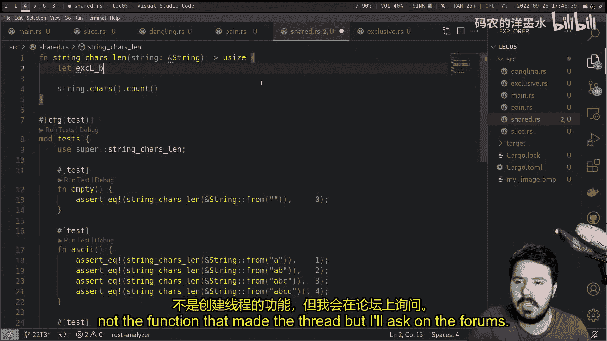

Cool。So that's where we're at。Those are exclusive borroworers。 So they're superpowers。

 You can mutate data without taking ownership。 And like a。

 since they're essentially just a pointer as well， like a shared borroworer。

 they're very cheap to pass the functions。 The funny thing is， once the compiler is done。

 like once the compiler builds the code， there is literally no difference between a shared borroworer and an exclusive borroworer。

 they compile down to well， okay， not quite true。😊。

If ignoring optimizations， the compiler is able to make certain optimizations based on whether something is shared or exclusive。

 If you're interested in that， just Google， Google the text， Google。😊。

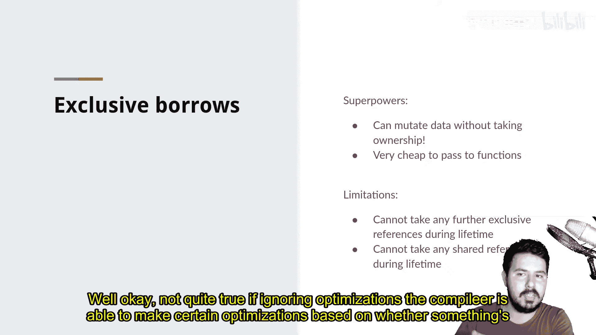

No alias。And maybe you might want to throw in like rust in there and stuff like that there is。

Dozens of insanely interesting articles all about this。 But ignoring optimizations， there is no。

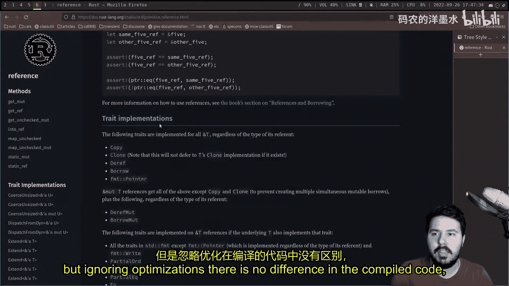

Difference in the compiled code， between a shared borrower and an exclusive borroworer。Theyre。

 they're just pointers， essentially。 So limitations of exclusive bors。

 you cannot take any further exclusive borrowors， exclusive references。

 whatever you gonna call it during the lifetime of the one you've taken。

 So that was that compile area where we did at mute S。 you know， at mute S1 is X at mute S2 is X。

 And it goes， no， can't have them both at the same time。 No good and。Furthermore。

 you can't take any shared references during the lifetime of any exclusive borrower that you have。

 So if I'm borrowing it exclusively， I can't just make a shared borrowough at the same time because then that violates the rule where you have a shared borrower and an exclusive borrower。

 And you can run into all kinds of problems。 So that's Rus approach to this kind of problem。And it。

By doing this， it guarantees you at compile time right if your code builds。

 then you won't get any kind of data races， iterator and validations， anything like that。

 and you also get a lot of information at compile time about what code could possibly do what。😡。

whichch is interesting might relate to Oscar's question。

 but it seems threads can't take exclusively borrowed because you can't make any guarantees on the lifetime at compile time that's a great question that you will either have to ask on the forum or in week nine。

😊，But it's there's some really interesting stuff to that question that might may surprise you but yeah So that we coming is like just super sleep deprived thankfully we have the recordings and lots of content to help you sort of see how you're going and also I noticed that the green screen is getting particularly upset it。

😊，The microphone there。yeah， I can't really do much about that right now， sorry about that。😊。

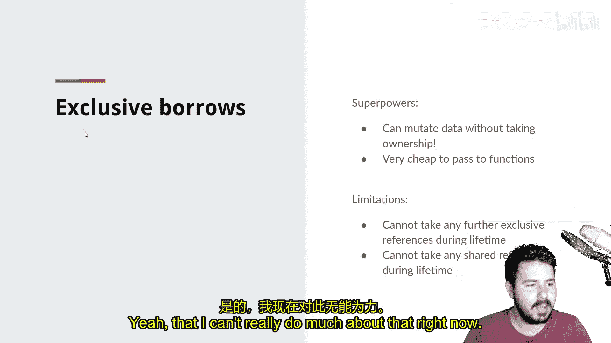

Okay。A quicker aside， dangling references， so another thing that's very common in a length to see。

For instance， in a language like C or potentially C plus plus or anything like that。

 is this idea of a dangling reference where。Let's say， we have like。Create。

Let's say like I think someone that something that everyone's said in like 1511 if you've taken the course is you have like astruct to linked to list or something like that。

Right， and。You want to create like create a linked list。

You want to return like a pointer to that sorry， a pointer to that。Which is， you know。

 rust' equivalent here being a reference。 a reference is just a pointer at the end of the day。

 and you've tried this thing where you go， I'm just going to create a linked list like this。

 let L is let list is my linked list。And then you just go return a pointer to this。

 And this is very hazardous in C because you allocate this on the stack。

 So they say and return a pointer to it at the end of this function， this variable。

 this linked list gets cleaned up， gets all the memory there gets destroyed and you've just passed out a dangling pointer And if someone tries to read from that pointer。

 horrible things will happen at runtime。 Dcc in particular is pretty good at catching this and will say。

 hey， you made a mistake here， you did a stack use after free。

 But on a real compiler like Gcc or clang or anything like that and the real world。😊。

You've just made a memory safety issue and hackers are in your computer ransoming tens of millions of dollars over customer data。

 right， So very dangerous and rust fortunately protects against this because it says。

Let's just get the big error message here， missinging lifetime Specifier。

 we're going to think about lifetimes on Wednesday's lecture。

 but it says expected a name lifetime parameter。This function's return type contains a borrowed value。

 but there is no value for it to be borrowed from That's sort of the key idea here。

 We don't end up with this problem of dangling references in rustt because someone needs to be responsible and if rust can't determine who's responsible for the value。

 it'll just say I'm not I'm not going give you a I'm not going to let you write this。

 I'm not going to build the code。It also says help consider the tick staticatic lifetime over here。

 This is quite funny because this is a pointer， specifically this。😊。

Tixtatic am percentcent here is specifically a pointer that needs to be able to live for as long as。

 let's say for like at least the duration of the program。 That's not quite correct。

 but it's close enough where where we're at。 It needs to be able to live for the entire duration of the program。

 That's the only time a pointer just returning at random pointer would be okay。

 I if that pointer is always going to be okay。 And so。The beautiful thing in rust is， well。

 how can you create a pointer that will live forever， Well， you could just。Alloccate a memory。

 like do a， do a mallik， and then just leak that memory。 Never free it。 Just leak the memory。

 And the beautiful thing is you can actually do that in rust。 and the compiler will be happy with it。

 There's a function called leak where you get to explicitly leak memory。

 and it will return you a ttatic borrow。 It will return you a ttatic borrow。

 which tells the compiler itll it'll live forever。 And so I could potentially write it as。😊。

All allocate me this list， we don't know this terminology yet box or anything like that。

 but allocate me to the list， instantly leak it。And it's like great。

 you can return that reference then because it's going to live for the rest of the program because no one's around to free it。

 which is just quite funny to me， but rust also sort of potentially solves in its own way this problem of dangling pointers。

 dangling references。😊，Okay。So we've only got one last thing to poke out in this lecture and that's this idea of slices。

 Where's my slides going here？Slices， so we have one last worked example here。

Before we actually get into this last work example。😊，Are there any questions on yes， once again。

 shared Bors， exclusive bors， this idea of the dangling references actually and also while I wait if there's any questions。

 we can also fix up this code back here， this BMP image。Well， do we need to mutate it。

 Let's look at set Pixel。 Se Pixel takes an exclusive bur on self。

 So we're gonna need an exclusive burrow on the image that we're setting the pixel on。

 So forget this whole passing the image in， taking the image out。 Let's just。😊。

Exclusively borrow this image here with at mute like that。 forget returning it back。

 Don't need to do that。 Just exclusively borrow it。 And then when we pass it in here。

 give it an exclusive borrowor of image。 And there's， again， no more let image or anything like that。

 And it's upset because image needs to be declared as mutable。 And there we are。😊。

RightAnd so this is genuinely how the idiomatic rust programmer would write this code。😊。

I the use of leak and antipat seems like it would be better to declare initialize your gl upper level。

 you couldn't have that passed down。 Yes it's a complete antipat。

 but it's very interesting to see that the compiler。

 if you explicitly leak memory due to the way that the types are laid out you know this returns this type which has this implication and blah blah the compiler ends up being able to sort of prove to itself that returning this dangling reference is actually okay So that's the interesting thing about that。

 but yes， you shouldn't just be leaking memory without thinking quite carefully about it。😊。

What's the difference between the mute before the variable and after can you do at mute my vase string。

 right？ So this is part of the type， right， so I actually can't write at mute image image here This like at mute is。

 is sort of。Modifying the， the type of this image variable。

 whereas the mute here is declaring that this variable is able to be mutated。Now。

 I know that feels weird。 It's like， shouldn't this be mute image。Is like an a mute image。

 And this is one of those things where， like， what this is saying here is that if I wanted to say。

Image equals something else。 Let's just set it to itself。 Then this is okay。 right now。

 when image is declared as mutable。But。If I get rid of that then it goes no because you're trying to assign to this immutable argument。

 so that's what the sort of mutability is talking about there。

In this case of the and if it was owned as well， ownership doesn't imply that you can mutate something。

 an exclusive borrow does imply that you're able to mutate it。

 but you very well may want an an owned value like a value that you own that you don't want to have mutated and so you explicitly need to opt into that like this。

It is， it's a little weird， probably。Like it might feel weird and go like this this this is confusing and you may absolutely be correct it's something that you sort of get used to over time I suppose but yeah it's you know one of those things that you'll play around with please ask on the forum as well if you're like I still don't quite get you know what each of these things are and we can try and lay out different cases and stuff like that but it's again one of those things the compiler will generally guide you it'll hey insert a mute here and of mute there take away and mute here and it'll try and put you know the right direction and then you just get a feel for it over time but it's it's a little arbitrary it is a little arbitrary the placements and all that stuff。

😊，Big idea is that this is the type of image really has changed。

 it's not a image that we own anymore， it's just an exclusive borough of someone else's image。

This is saying the references okay， and so Kaai'saii also explaining as well。Okay。

 so our last little bit here is slices。Slices， and actually I'm going uncover with this。

What is a slice， first of all， very quickly。I'll try and keep this relatively brief。

 So we know that I can have something like an array。 Let X equal an array of， say，1，2，3，4，5。

I can also say let y be something like a vector， a vector of 1，2，34，5。 I remember these two。

 we've talked about the distinction between between these two here。

 being that the array is on the stack right， It's stack allocated memory。

 you can't dynamically grow the array， you can't dynamically shrink the array whereas a vector is stored on the he uses Maloc。

Oh， the connection just went very poor。呃。The Internet is getting slow。

 Is the stream still okay because I am noticing that it's。Not super happy。 all of a sudden。E。Yes。

 this is。Yeah， this is this is the pain of。This is the pain of streaming from。

Streaming from a different location。Okay。I'll tell you what。This， yeah， this is。

 this is not going to be enough to stream out of。 Yeah， this is。

This is not good enough to stream out of。呃。Let me do this。Okay。If you can hear me。

I'm going to call it there。Um。Thank you everyone for coming。 I'll post a video on slices separately。

 I'll fix Oh， hang on， my bit rates up Oh， my bit races through the roof。😊，Okay， hang on。Oh， wow。

 I'm getting even， okay， I'm getting higher than I was before。O呃。Okay， it seems relatively stable。

Is you happy over here。Okay。Okay， all right。Never mind。 Okay。

 the lecture is definitely going to go a little over time now。 I'm very sorry。 Okay， yes。

 OB S is happy。Connection stable， YouTube team happy。 Alright， I'm very， I apologize very much。

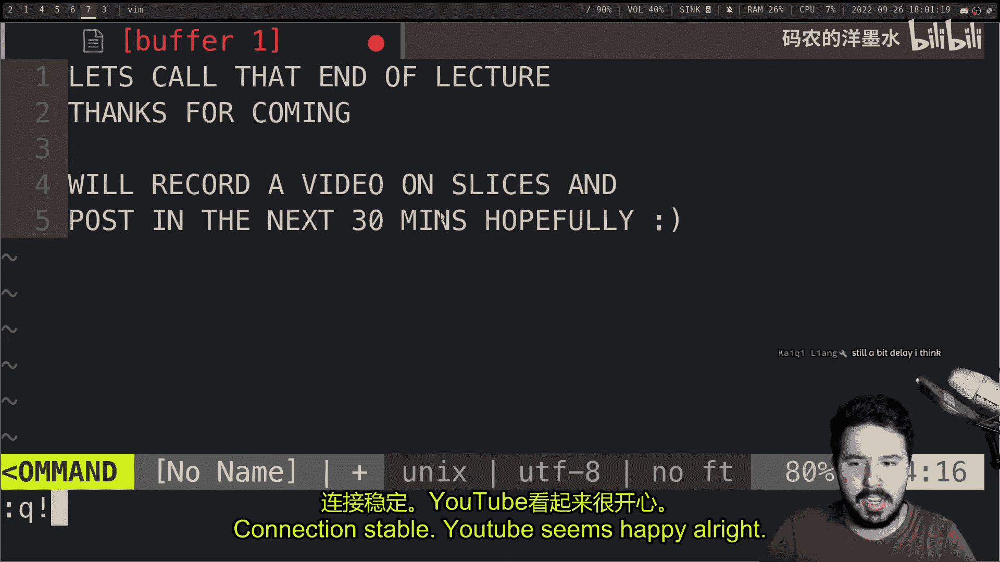

I think we can I think we can finish this off。

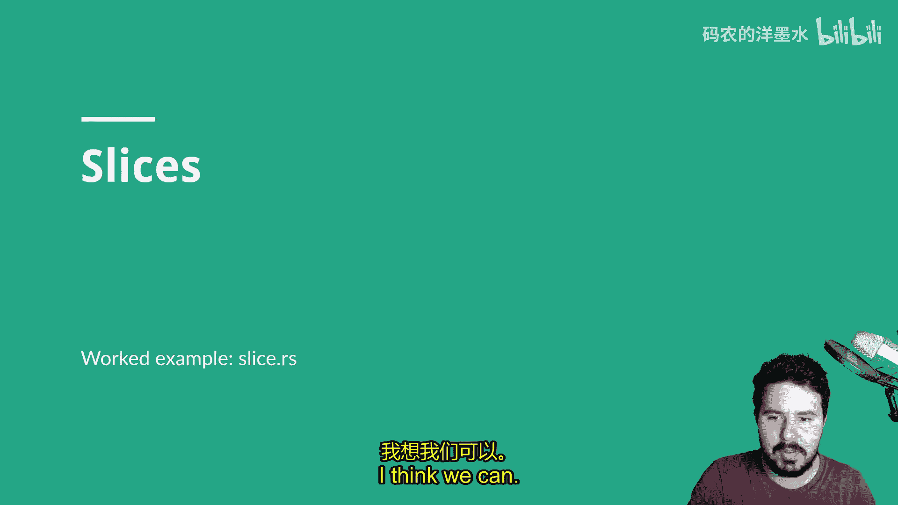

Okay， alright， O B， yes， O， B S is happy。 I'm very sorry。And let's， let's。

 let's try and not go to not go too far。 I think Mi well might be。 Okay， yeah， much better。 Okay。

 great， great， great， great great。 Okay， if you want to catch up very quickly。

 I believe what you can do is。Let me do this。You can。

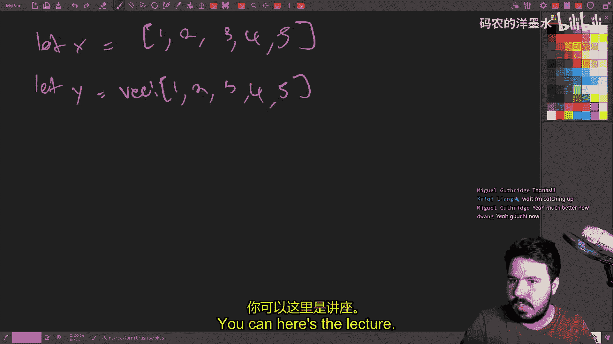

Here's the lecture。 Oh， nope， what is this7？Here's the lecture you can do click the live button down here and then go Playback Sped 2 x and it'll catch up for a little bit。

It'll take a little bit to catch up， and then it'll go back to normal playback speed once it's caught up。

Fun little YouTube tip fo you。Okay， all right， it seems okay now。

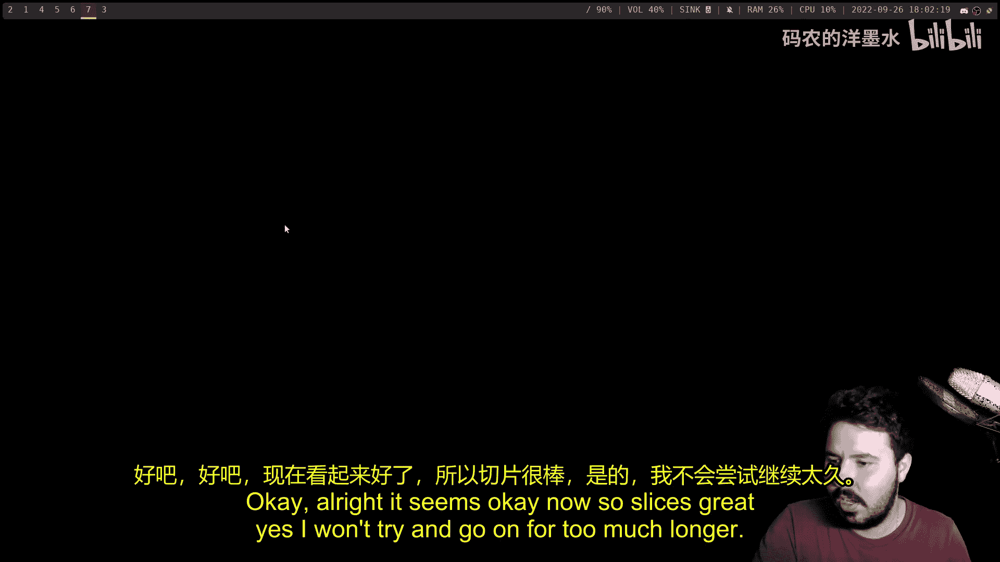

So slices， great， yes。I won't try and go on for too much longer。

 So the difference was that vectors can be expanded， and they can be shrunk。

Where arraysor a fixed size and are on the stack and vectors are also on the heap。

 they use malikin free and that sort of thing。Now。We could So this， this also has type Vec。

 let's say， in this case， a V of I 32。And this has type array， oh， I can't draw up that far。

This has type array。Of i 32。Now， we could borrow from either of these， right。

 so we could have a borrow of a array of I 32s， or we could have a borrow of a V of I 32s。Right。

 and that that would， that would work out perfectly fine。

 But the problem is there's a lot of different containers you might want to store data in。

 So not even a well， a linked list isn't a great example。 Let's just consider these two here。

 at least a V and an array work very similarly。😊，Right。

 but I need sort of two specific types to denote whether I'm talking about borrowing borrowing and reverse borrowing and borrowing a V。

 and interestingly。If you borrow a V， you can't modify it。If you can't modify it。

 you can't grow or shrink it。 If you can't grow or shrink it， it is effectively just an array to you。

Right and a rate that where you can't modify the elements。

 you can say change this to like a four just for funsies， right？

So these functionally work basically the exact same。Interesting。

 another thing I'm going to throw in this list here is is a string。So string。Oh， might be right。Yeah。

Bad did， right。

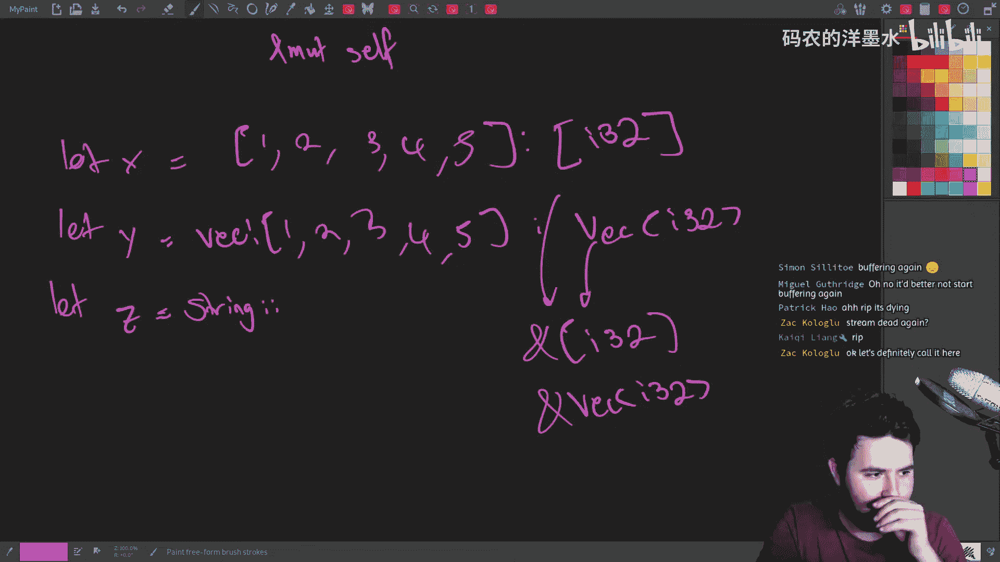

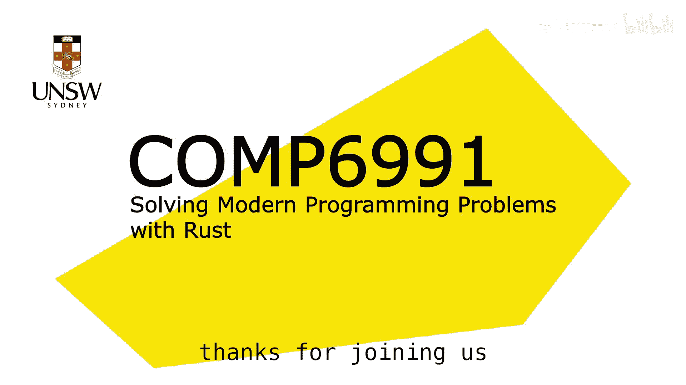