# 【全集】新南威尔士大学 Rust现代编程 中英字幕 1080P p06 Lecture 6 - 生命周期与智能指针 -BV15cf4BCEN1_p6-

Okay， hello， hello。Hello， everyone。Is made their way in。Hello， okay。 so welcome to lecture。😊，6。

 I believe。Yes， hello， hello， hello， everyone。😊，嗯。Today。I'm a little， I'm a little sketched out。

 I'm sure most of us here are probably aware that last lecture things got off to a bit of a shaky end。

嗯。And with the internet troubles， again， as I mentioned before。

 I am in the still sort of halfway through moving house， rather I have moved houses。

 but my new house does not have an internet connection yet。😊。

And so I'm streaming from a completely separate house this time。 and the Internet seems very solid。

 It's， it's， it's streaming out very happy right now。

 but it's been occasionally known to do weird things as we saw yesterday。 So I'm。

m I've got my fingers crossed that that doesn't happen。😊，If it does end up happening again。

 then we'll to we'll have to figure something else out。

 but I'm not I won't put everyone through that again if it starts if you see the lecture does start chopping up。

 you'll just look to the chat and you'll probably see a message from me saying we'll postpone things until we can figure out a better solution but fingers crossed it it was a sort of nasty one off。

😊，But yeah， so。With that in mind。The first thing I wanted。

To to do today in the lecture was to do another round of feedback。嗯。

And there is a lot of feedback there genuinely has been a lot of feedback that's come through and it's all been very nice and I think I was saying last lecture thank you to everyone who's been putting feedback in and giving you know constructive ideas or even there's actually been a reasonable lot of people who just submit the feedback form to say I really liked this or you know things enjoying the course and you know that sort of stuff and that's all been very nice to see as well thank you all very much。

😊，Now， I very much would like to address that today。But last lecture。

 we left off with a bit of content that specifically to do with slices that I'd like to try and see if we can just cover at the beginning of today's lecture。

 And I figured， you know， it's probably。It's probably not the end of the world if we do if we end up addressing feedback on Mondays as a sort of regular thing and instead of the Wednesdays because then we can also pull in feedback from the previous week's exercises as the previous week's workshop all that and address sort of the previous feedback on the Mondays instead so I think we're going to roll with that for now so there has been a lot of feedback and we absolutely will talk about it but we're going to save it for Monday instead and I think we'll try and make it a regular thing out of Mondays。

😊，嗯。What else is there to address。I think that's I think that's all we wanted to address before we get stuck into things。

 but yes， we'll kick off with a little bit of a quick recap of yesterday and then also finishing off slices from yesterday。

 I I is gonna make a video and then I ended up getting all my time basically stripped away from me and I figured let's try and slot it in here。

 And if we end up with troubles in today's lecture then I actually will do something to make up that content。

 but we'll see how we go today and we will have time for feedback next week because again。

 as a reminder next week， I am almost certain is going to be more chill this is absolutely going to be a tough week I think。

😊，Borrowing lifetimes， the and sort of the， the whole ownership system in general is one of the biggest hurdles for every new rust beginner。

 It is， it's some， it's an idea that's。At this point。

Pretty much unique to rust Ru didn't invent this idea。

 it actually came out of a research language called Cyone which doesn't exist anymore in fact if you go to  Cyone's website it says this has been superseded by rustt which is carried on the torch of this idea。

😊，But for the most part， this is an idea that currently is pretty much unique to rust。

 and so it's often a really big hurdle for beginners to get over。

 Exp this week to be difficult but next week is all about sort of documentation and a bit of modularization and how to use those sorts of features and I think like we'll be able to sort of step off the gas pedal a little bit。

 we'll be able to slow down a little bit and take a breather and then you'll have your flexibility week as well but this is sort of this do we expect this to be quite tricky content that's going to take you quite a bit of time quite a bit of energy。

 quite a bit of frustration to get through and to sort of start to become accustomed with these ideas。

 and yes， well yeah hoping timebased issue well the lecture was two hours earlier And so if it was time based in terms of like right at 6 o'clock at the internet goes out we're doing well so far So that's good news also。

😊，lightinging is I've got my lighting setup that I use here but the rest of the lighting is a little poor today so if the green screen starts going crazy just let me know and I'll see if I can try and muck with some lighting on the fly and fix it up。

😊，Okay。With that。Let's so again， lifetimes and smart points of what we're looking at today。

 it's going to mostly be lifetimes not so much smart pointers and we're not going to have too much like cross language analysis for this week just because the content this week is sort of。

😊，Very complex and very unique。 And so we're going to spend more time doing that in the lectures as opposed to sort of cross examining different languages if we end up with extra time next week。

 maybe we can do that out of sort of like interest and maybe not quite so related to next week's content but we'll we'll just see how we travel with it I think。

 but before we get into lifetimes and a little bit of smart pointers at the end。

We will quickly recap this idea of ownership along with the the borrowing concept that we were talking about last lecture。

 so a little table to sort of try and summarize things we have。

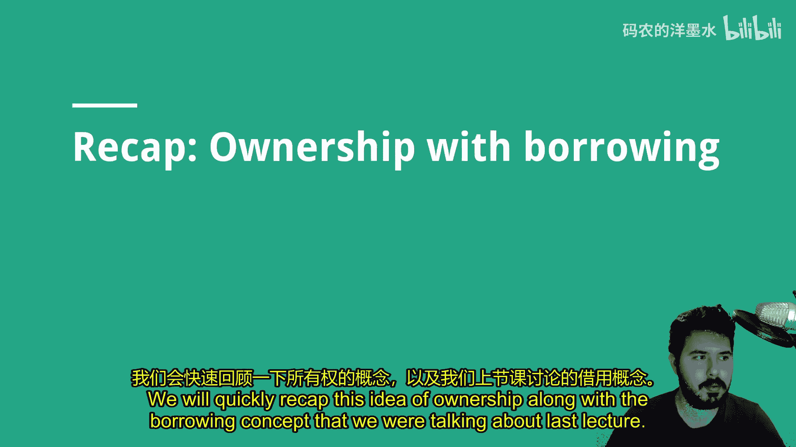

Three main sort of types that we think about in terms of the ownership and borrowing system。

 So for any type T and this is assuming the T here is not like is not a borrower itself。

 This might be like this might be an I 32 this might be a string this might be somestruct that you've made in fact。

 it's probably not best it's best not to think of this as an I32 because copy types。

 as we know often skirt around the ownership system and so it's best to think of this as some sort of owner type。

 let's say like a string or somestruct that you've made and the requirements of this is that you have exactly one owner。

Right so as we know in rust， let x equals something， some string， whatever， let y equals x。

 then the ownership has been transferred from x into y because the rules state that there must be exactly one owner if they both were that string there would be two owners doesn't follow the rules。

😊，And so that is this requirement on owned types， exactly one thing， one place can own this type T。

However， you get full access to the type as well right so if you want to mutate it。

 if you want to read from it， if you want to transfer ownership of this type to someone else。

 all of that is well within your right to do and it should all just work。😊。

Then we learned about bors， so we learned about shared bors and exclusive bors。

RightSo if you have a shared borroworer， the requirements is that only shared borrowers can exist on that value。

😊，Right， so you can't have， say five shared borers and one exclusive borrower。You can only have。

 you know， an N shared borrows。 N could be just one shared B。 It could be two shared Bs。

 It could be 5 shared Bs。 It could be 10000 shared bors。

 and the compiler will track tracks all of this at compile time。 However。

 your access is is read only。 You cannot mutate。 You cannot modify anything with a shared reference。

And also you can't upgrade a shared reference in upgrade as a bit of a weird term here。

 but you can't upgrade a shared reference or even an exclusive reference to that matter for that matter to an owned type T。

 So for example， I can't just say like dereference this this shared borrow and give me that T。

 It'll go， hey， you only have shared access to this value you're trying to get owned access out of it。

 That's no good。 The same thing also follows for fields in astruct。 So for example。

 and this is the example the code we end up with last time which will come back to in a minute。

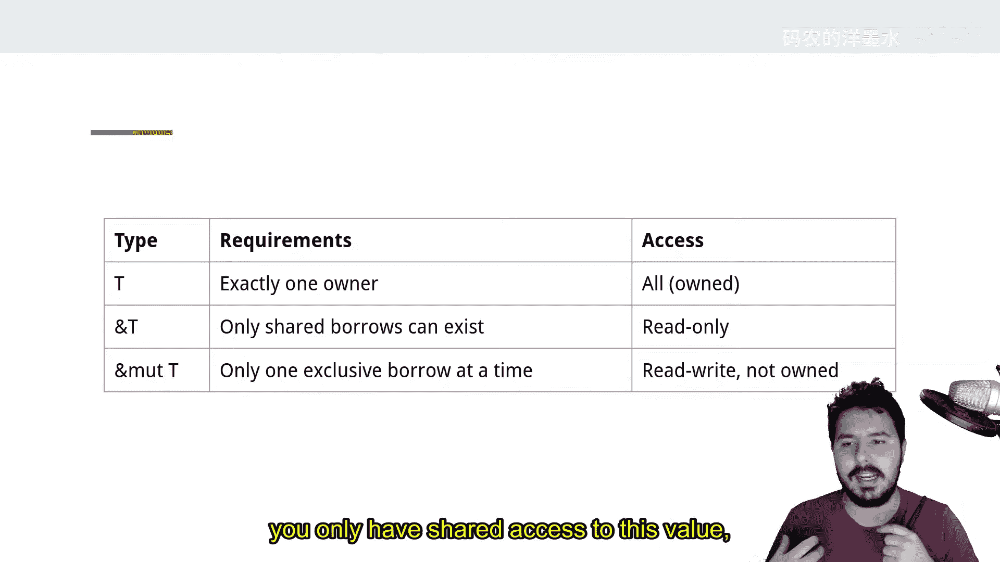

So for example， if I have somestruct food。And Fu has S， which is a string。Which is owned inside it。

 Then I have， I have let F equals some P。Right， with some fields in it。 Well， that string there。

 And then I say let， I'll just call it F borrowrow FB equals a shared bor of F。

 I can't then say like let my S equals F B dot S。 right， So I've borrowed it。

 And I'm saying from that borrow， give me the string inside。

Because this this S is has typeype string， which is owned。

 and I'd be trying to sort of take the ownership。Out of the food borrow and into my string there。

 And so， in fact， you'll also have to throw an ampersand around the front here to say that I would like to borrow FB dots。

 No， you don't need these per ends。 I'm just sort of putting that in there to show you like the the precedence here。

 essentially。 But what it's saying is or the associivity rather。

 what it's saying is take fo borrow dot S， right， this， this string here。

 and I will take a shared borrow of that， because I only have a shared borrow of the food value itself。

 So essentially。

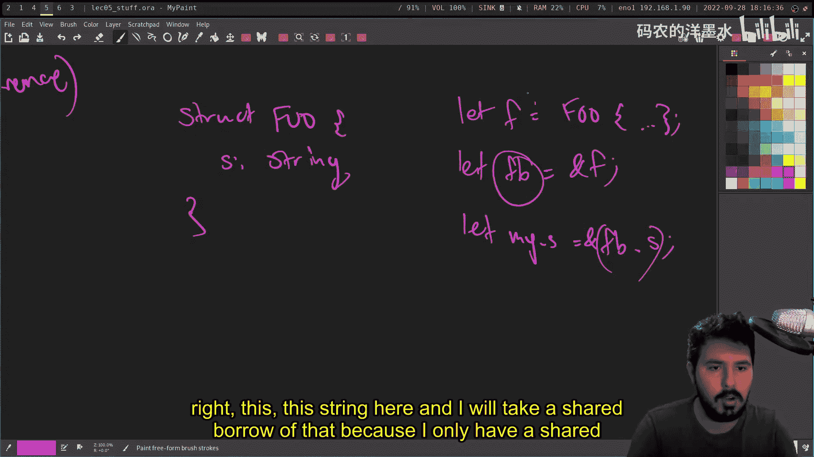

If you have a shared borrow， your only access that you have is shared。

And then we also have exclusive bors， the requirement being that only one exclusive borough can exist at a time so you can't have an exclusive borough and say a shared borough。

 you cant have two exclusive bors， you can only ever have one exclusive bor at a time and your access is read right。

 you can read the value you can mutate the value all of that but which sounds the same like the same as this tea thing here。

 but the difference is you don't own it just like this shared borough if you have an exclusive borough on something。

 it is still a borrowrow， you can't just magically turn that into into an owned value Miguuel says。

 well' slightly late because I do a class to go bit of time。

 damn is anything important great and Daniel's catching you up a little bit there。😊。

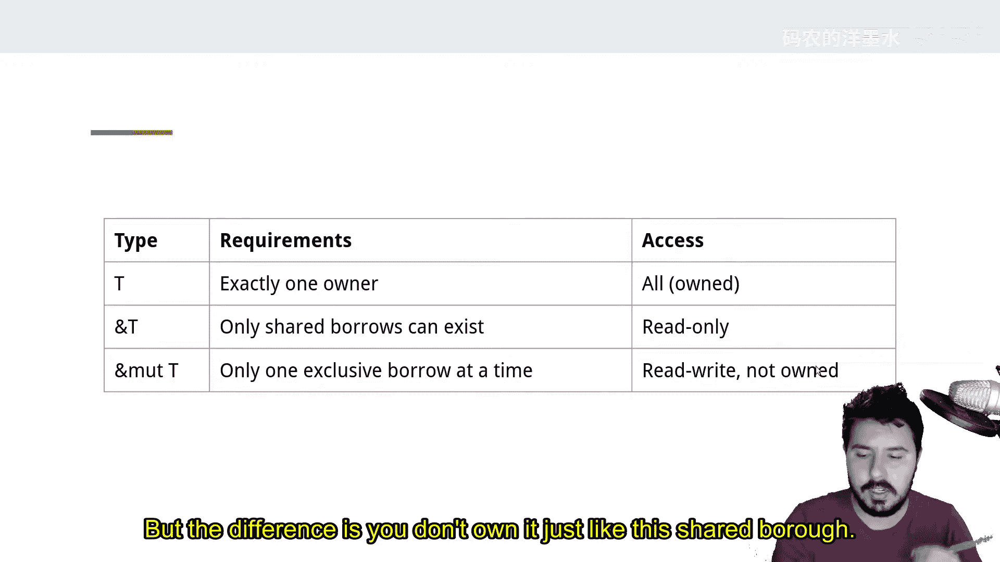

Okay， and note the great news as well， in particular with the language like Ru。

 at least from my perspective， is that if you forget this idea here right。

 if you type this code in and you forget， oh I I only have a shared borrow and so I need to throws。

 I need to throw an ammppersand in here to make it happy。😊。

The worst that it'll do to you is give you an angry compiler message like an angry error message when you try and build your code。

 which probably says try including an ampersand here。 It'll honestly probably just tell you。

 suggest you to do that。 As opposed to say it building the code， you getting to run the code。

 And then at some point， the code does something really bizarre or crashes or something like that。

 because of the code you written。 So it will tell you upfront。

 And it will often suggest you the right thing to do。 So it's something that， again。

 you'll get a feel for over time for sure。

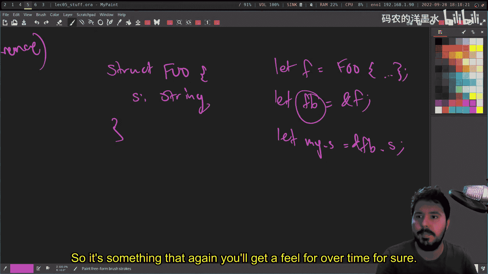

Okay， so this was this big idea of borrowing that we were talking about last lecture I don't want to spend。

Too much time recapping it because you know， we spent a lot of time talking about it last lecture。

 but of course， if you have any questions and feel free to drop them in the chat or on the forum and we'll chat all about it。

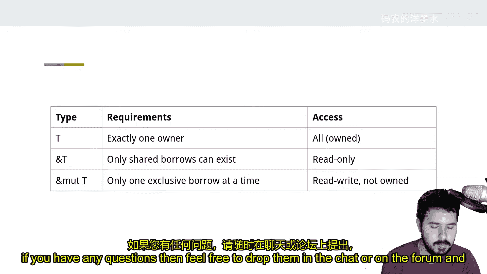

Okay， now the other thing， yeah， I like the green screen leaking off my face through， I apologize。

The other thing I wanted to do is finish off that the thing we're talking about there with slices last at the end of the last lecture when things went。

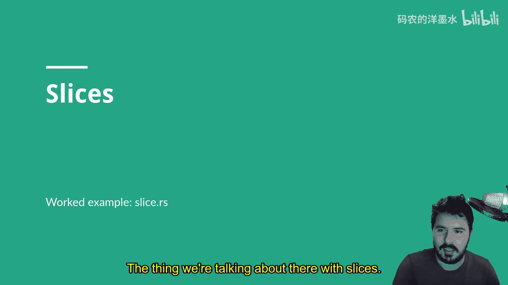

Things sadly， crashed and burned。 So we were looking at this， essentially。

We had a variable let X is some array of 1，2，345 and that had type array of I32。

 in fact I actually mess this up， this is an array of I32 with five elements is how you actually write that type correctly。

Then we had let Y be a Vck of  one， two， three，4，5， and it has typed this。😊。

And we also mentioned a string， but I think this is where things may be cut off there。

And we were talking about borrowing this right， we were talking about if we had a read only like sorry。

 a shared borrow of either an array。😊，Or a Vck。 And we were talking about how there's quite a big similarity between what these two might look like。

So Daniel says for just T does it mean T will only one reader and writer which is the same person。

 so for T， where am I over here for T here， its it's kind of interesting。

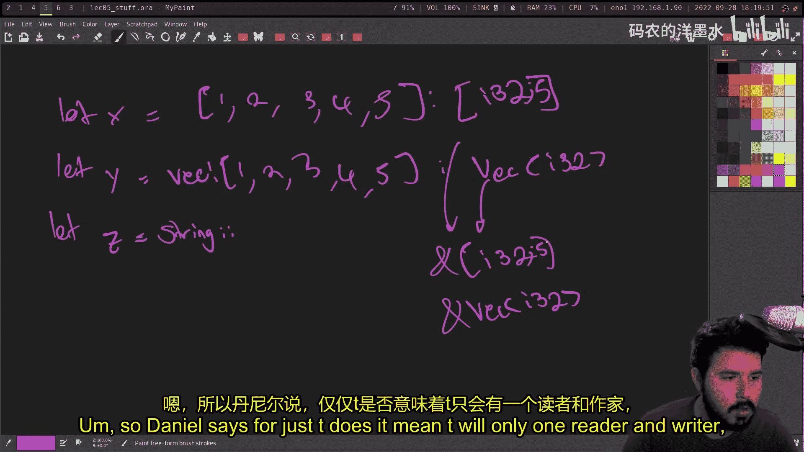

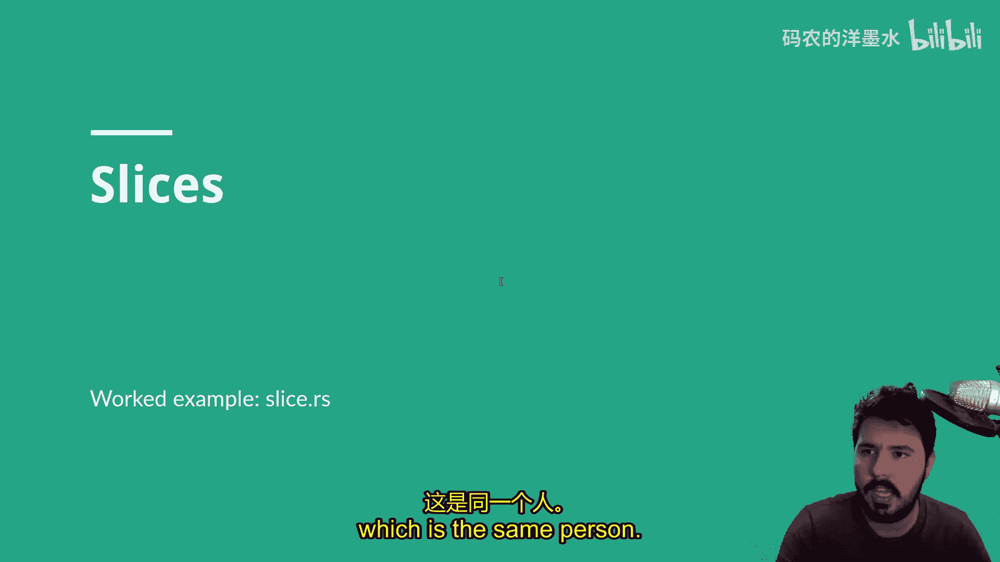

T gives you like the most power。You can， if you use a T， man， this is。

 it's hard to sort of find the exactly like right words for this。

 But think about the ways that you could use a type， let's say。In particular， you can do things like。

You know， pull out a if it's say a struct， look at the fields in the struct if it's an enum。

 you could match on it and look at the fields in that enum， perhaps。

And you can or you can call functions that involve this type T。So， when you're say。

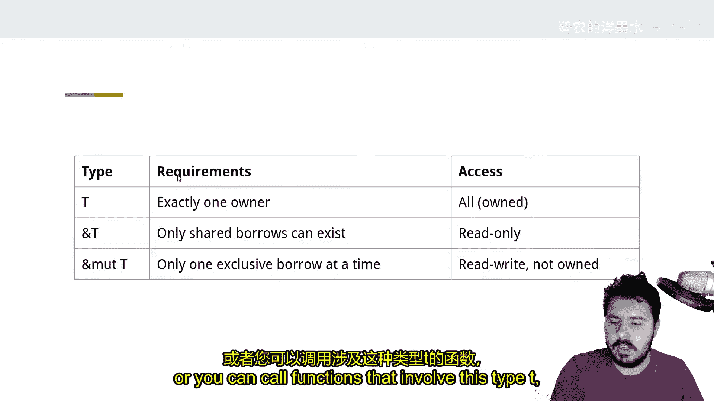

Pulling things out of a， let's say， a struck tea。Over here like this and a similar sort of thing follows for enums as well。

😊，You really define how you're using this value by the code that you write here。

 So if I say fb dot S well in fact， let's let's think about the T here as opposed to the borrow。

 if I say F dot S what I'm saying is move the S out of F and I'm gonna to like set it over into this variable here and now F is actually this F has been moved out of it's put this value into S and F is no longer valid because one of its fields has been moved away from。

 if I said ampers and before it， if I said ampersand mut before it。

 then I sort of define what I'm doing with the struct that way through through borrowing。嗯。Now。

 the other thing that we often do with some type is， is like pass it to a function or you know。

 use functions on it。 And so if I have some function F。Which takes some T。

 Then this function is going to take ownership of some T that I pass in。Similarly。

 I might have a function， let's call it food one and food two because I don't am terrible at naming。

😊，And this one takes in an ampersand T and this one takes in a ampersand mute T。Right。

 so a shared bor of tea and an exclusive borough of a tea。And if I have， you know， my tea over here。

 let。T equals sum T， right， whatever it is。Then。I could pass it into a function like this。

 I could pass it into F1 like this。And I could pass it into Futu。Like this。Right， so this is。

 this is my type that I've got。 These are some functions that I could call and use with it and。

And and this is sort of like a very core primary idea of the language。

 So to sort of bring this round for just T doesn't mean T will only have like one reader and writer。

 which is the same person。 Well， so half of this is that I'm not 100% sure on the exact thing of what you're asking。

 but I sort of feel like I'm getting a gist of where you're coming from。

 which is sort of where I'm going with this， but if you're able to nail it down a little further。

 I might be able to answer a little more accurately， but。嗯。In the case， like in terms of rust， right？

This tea。Rust is going to track all like the ownership stuff to do with this tea。 So right now。

 as I've written it here， T is in just like an owned state， right？This like T lowercase T。

 this little T binding here owns this T value and that's sort of like the state of it right now this T is owned by little T little T could do things like。

 you know， access the fields or move out of the fields。Like this one here and you know。

 you can do whatever you want with it there。Now there's two other states that this。

T could be in well really this value here this T could be in， which is it can be borrowed from。

 can it can be borrowed from in sort of a shared sense and it can be borrowed from exclusively。

RightSo let's say I do like I call this function here through one of an a% of T。

For the duration of this function， right， just based on the way of written it here。

 for the duration of this function， this tea has been borrowed from in a shared sense。

 And so I actually can't， while it's borrowed from， this is sort of a key idea。

 while it's borrowed from， I can't sort of。I I can't treat it likem I'd be using an owned value。

 I can't move out of a field。 I can't take an exclusive borrower。

I can't pass it to this function here that takes it takes it through ownership， right。

 I can't do any of that while it's borrowed from in a shared way。

Then the other state could be borrowed from exclusively。Right。

 and if it's borrowed from exclusively same thing applies， I can't do。 I can't like。

I don't really have true ownership of it myself， I may still be the owner。

 but someone's exclusively borrowed it so I can't be using it myself for other purposes。😊。

The one sort of caveat to all this is that if someone has borrowed from it in a like as a shared borrowough。

 then the one thing I can still at least do is generate more shared borrows out of my own value。

 and I could generate myself a shared borrower Exe me。

 I could generate myself a shared borrower and then like read from that value myself。

But you don't get to have all these like extra ownership privileges while someone is borrowing from your value until that borroworrow has expired in the case of these functions and basically every function we've seen so far。

 the borrows will expire by the time this function like concludes by the end of this line here and we move on to the next line this borrowrow whether it's shared or exclusive in these cases will have expired will will have lapsed and so I sort of regain my full ownership privileges on this T。

😊，嗯。However， there are some functions that we could write where the borrow does not immediately expire once the function finishes。

 the bor might sort of continue into something else and that's all about what we're going talk that's very relevant to all the stuff we're going to talk about today furthermore。

 if you aren't say using a function and you're just like passing it through like scopes and stuff I might have like let T equals some T whatever code this is and then in some scope here I could say let T borrow TB equals a shared B on T。

😊，Now this borrow here exists across this scope from like from where it was declared until the end of this scope here。

 we're sort of assuming that this code exists in an even larger scope3 here， for example。

 I'm only to scroll out a little bit， there we go。So T itself exists for this period。

 often in these periods that they exist for or like while things are alive， their lifetime。

 we annotate them in Ru sort of like this。 I might call this tick A tick just being like a single quote character。

 and I might call this lifetime here tick B， for example。😊，And so we say that。

The overall lifetime of this thing here is tick A， which will live until the end of its scope you know it was declared in。

 but this T has been borrowed for tick B， so this sort of space specifically here until this phrase where it goes out of scope。

So， for example， I can't then just say like， you know， some function food， which takes。

T away right here because it'll go， hey， there's a borrow that exists for tick B here。

 and you're trying to take this ownership away。 This is actually a very slight live because Ru improve the compiler in 2018 such that it would in this specific case。

 it would go， oh， I see you've got a shared borrowor of T。

 but notice that you don't end up using you don't end up using this borrow anywhere else throughout this。

 So I'm just gonna shorten this lifetime here。 like the compiler is really smart and goes。

 I'm just gonna shorten tick B to be this lifetime。

 Your code's still happy because you don't end up needing to use it past this point。

 So I'm gonna shorten tick B to here and then it goes great。 tick Bs over。

 I now have my full access again and then I can pass that ownership away。

 And so the lifetime of this would then only extend here as opposed to all the way down there。😊。

Anyway， these are the exact ideas we're gonna be talking about during this lecture in terms of lifetimes。

 I think you guys my question also originally saying awesome。

 What if the scope brackets didn't exist， what would be the lifetime of TB if these let's sort of rewind bit here。

 if these brackets， these braces here didn't exist then tick B would sort of extend all the way down here。

 And it would sort it would extend just before the end of tick A here because the borroworough will expire。

 and then T will expire and get dropped and cleaned up and stuff like that。 But it is， yes。

 it is the same scope of t， you can imagine that this sort of gap here is like infinitely small。

 just to sort of make the almost like make the math that up in a certain sense。 But so yes。

 everyone's correct when the borrow of T expireir immediately， Yes。

 that's also another perfectly fine way to think about it as well， just because there's no code here。

 if we assumed that there would say like let's say there was a print and it printed out T here。😊。

Then you could also think， you could realistically think of tick B as living for this duration here。

 oops， I've learned how to fix this since。You could think of tick B is living for here or T B is living like this whole scope here。

 Both of them are perfectly fine。 The compiler will basically agree with you。 And yes， it exactly。

 it's just the compiler being clever。😊，Where you draw the line， like。If you think about it this way。

 we have。This line of code here， line of code here， line of code here。

 It doesn't really matter if I draw the region to here or if I draw the region to here。

 that ends up being the same scope and like realistically。Cool。Okay。

 so that's all what we're talking about today and how the compiler attracts all these lifetimes。

 but sometimes you have to help it out a little bit。

 we're also going to be looking at that kind of thing。😊。

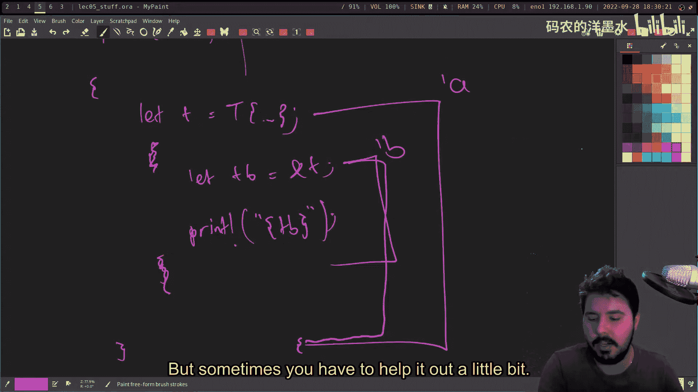

USo slices， right， right， yes， over here， where are we？

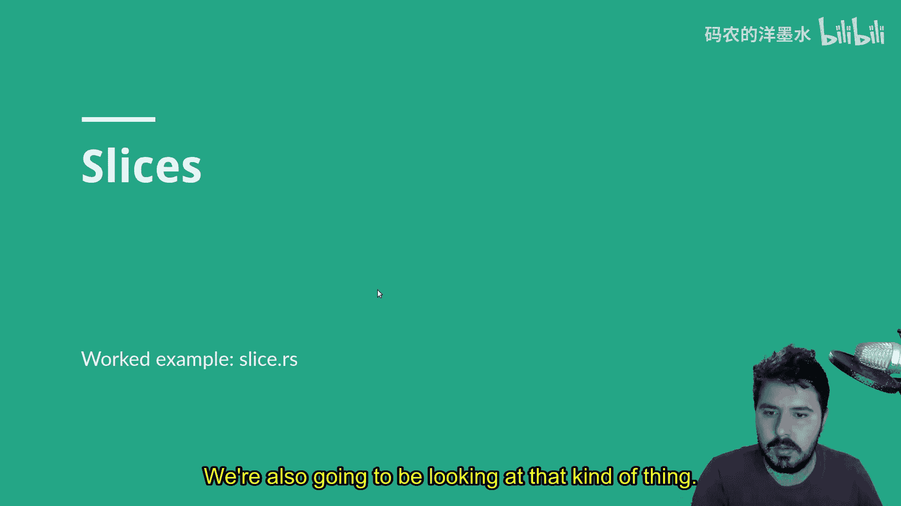

My pen。Slice it over here。Okay， and we'll zoom in once more。 There we go。

So this is what we were talking about。We're talking about the idea of borrowing like a shared borrow from a array of I32s versus a shared borrow from a V of I32s。

 the big idea that I was sort of trying to get to was that if you only have read only access to a Vec or read only access to an array。

You don't really get much different， right， The whole point of a v is that it's like an array。

 but it can grow。 or it can shrink。 So， and like so it's like dynamically sized。

 But if you don't have permission to increase the size or decrease the sizes， write。

 these are mutations， these are write that you may you wouldn't have access to through a shared borroworrow。

 Then does it really like its， it's kind of annoying。 You get this， again， language by formity。

 where which one should I use， Should I ask， like， if I'm writing a function that say summing the elements up in a sequence。

 Should I ask， I don't want to like take ownership。

 because I only need to just read it and add up the values。

 So should I ask them for a borrow of an array or should I ask them for a borrowor of a V。

 And there's really no good answer， Because if I ask for a borrowor of an array。

 then any time someone needs a V， right， then they can't use my， like sum my addition function。

I might have to write say two functions， if I choose a V。

 then anyone who uses an array will need to turn that array into a V before they use that and there's performance penalties associated with that small microcontrolls。

 this is one of those times where I actually。😊，One sec。Green screen moment。Here we go。

Microcontrolls like say this wfi card which is making itself see through because it has a green PCB which is quite funny but you know a little thing like this。

 you may not be able to allocate memory on you may not have Malic available on something like this and so you may not have a VC on something like this and so now people who want to write rust code for one of these things can't use your summation function。

😊，So。What's the solution here， The answer is slices。 So slices unify this idea。

They unified like ideas of arrays， Vx， and all other kinds of sort of contiguous containers。

 essentially。The syntax for a slice looks a little bit like this。 So if we， if we oh， well rather。

And the syntax for an array looks like this。 The syntax for a V looks like that。

 The syntax for a slice is just。Like this or in sort of general。

Just any tea can be substituted in there so notice you don't have the semicolon 5。

 you don't have this semicolon5 you don't have like V or anything like that。

 it's just square brackets with the type inside this is a slice。Now。

 problem arises immediately with a slice， which is how many elements are in it。

How many elements are in it？If I have like a function。FN takes。A slice。

And let's say S here is a slice of I 32s。Then the compiler is not particularly going to like this because how many bytes should it allocate for S here in this function argument？

Right， how many bytes is S And the answer is who knows like this could be someone could realistically pass in an array of like  one。

2，3 here。And again， this is meant to work for just any arrays or Vex or anything like that。

 They could pass in a V that's say empty， right， it could be 0 by。 It could be， you know， 12 by here。

 It could be 1000 by。 So the compiler doesn't know how much space to allocate for S。

 So slices are basically generally pretty unusable on their own because they are the correct rust terminology for this is that a slice of tea right。

 S of tea in this case， is not sized。Slice of tea is not sized since it's not sized。

 you can't just put a slice of T in a variable like this。 you know， if I said let S equals。

 you can't T straighten an S。 if you have a function argument， you can't have a slice of T。

 if you have， if you put it in a struct， then you're struct becomes not sized。

 And then you can't use your struct anywhere。 it's all a big nightmare。 So this sounds horrible。

 Like if you know， how the he heck I meant to use this at all。 And the answer is， oh， no， oh。

It seems happy here。Oh。Stream health， Stre is healthy。Okay， yes， it says 10000。A bit right on my end。

So I think it's okay。 how much did we lose。What was like what was the last bit that we heard about？

Like 10 seconds。YouTube is not。Okay， I think YouTube's just running behind。

As such viewers will experience buffering。 Yes， thank you for that YouTube。Okay。

 so I said it wasn't sized。 cool so so。It's not sized。

 which means you can't use it in a variable like let S。 if if S is a slice of tea。

 you can't just say let this variable here。 you can't use it in a function parameter。

 which is effectively like a variable。 you can't if you throw one of these straight and you're struct。

 then your struct becomes not sized and you can't use your struct anywhere or either it all becomes a massive headache。

So。TheThe question is， this sounds horrible how the heck are we meant to use these slices then。

 and surprisingly， as a very simple answer， you just need a layer of indirection。

You need a layer of indirect， which for most languages that's achieved through a pointer。

And as we know in Ru， we have references which are basically like pointers right， pointers。

 I like stars in C， but with like extra rules attached them， extra sort of semantics。

 so ampersand and ampersan mute and we'll also learn about some smart pointers later on which can also offer this kind of indirect。

😊，Okay。Cool， think。Stream seems happy for now。嗯。Okay， so if we add a level of indirect。

 how does that help us， So let's say we have a shared borrow of this。

 you know I 32 slice here or a shared bor of these T's。

 Well now suddenly it is sized the type of size how big is the type it's the size of well。

 it's not quite。 let's just say for now it's the size of a pointer and then you simply follow the pointer right。

 you follow that pointer to get to the data right， in this case。

 the pointer might point to this data here or in the cases above the pointer might point you up here or the pointer might point you all the way up here for example。

😊，But then you follow the pointer， how do you know how many elements there are， This is like how。

 you know how many elements are there C does stuff like throw a null terminator on the end。

 So you just read， read， read， read， read， read， read until you run into a null terminator。

 And then it's like， oh， okay， that must be the end there， which has all kinds of。😊，You know。

 horrible implications that we might find some time to talk about during the course。

 but so how does Russ do it， the answer is that I lied， this type here is a little special。😊。

An ampersand almost always just means a pointer， right。

 it's the size of just one pointer on your system。But there's a few types where an ampoand of that type T。

 in this case， let's say an amand。Of this like slice I 32。Is not in fact the size of one pointer。

 It's actually the size of two。 So this gets encoded as。An actual pointer itself。

 which might point to， say some data here， 1，2，3。And along with that， it also carries a size。

 so in this case， the size would just be the number three。And so you look at this type。

 you can imagine it literally is just like a tuple of pointer and size。😊。

And then you go okay the size is three and the pointer will take me to this data and I get one。

 two three elements and don't read any further than that so that's what a slice gives us。😊。

And the great news is you can very， very simply， very trivially turn an array or say。

 a Vec or anything like that into a slice。😊，But you need to borrow from them right in order to create that like borrowed slice that we need out here。

 right， I'll borrow over here。Okay， so。The other interesting thing about a slice is since it carries its size along with it。

We can actually use slices to obtain sort of like a sub sequenceequ of whatever list we have。

 So let's say we had let a equals an array of 1，2，3，4， and 5。

And then we wanted to hand out like a slice to a function or something like that that just contained these bits here。

 two， three， and four， and it sort of skipped off the one and skipped off the five。

Now that is possible with a slice。And the way how is that， well， a slice of， in this case。

 let's say I 32s is just going to contain a a pointer and a size。Or a pointer and a lens。

 whatever you want to call it。 And the trick is we make the point to point right here and we make the size three。

And so then you just get this sequence here，2，3， and 4。And so the syntax。

 let's say I actually had this a here。 and I wanted to generate this， this slice right there。

 I could write something like let slice， oops， lets slice equal am percentand a of。Index 1。

Up until index4。So index1 here， this is index 0，1，2，3。

4 and this is sort of like inclusive exclusive syntax right here I believe you could also write dot dot equal 3 if you wanted to write it that way but this is very common to have inclusive exclusive syntax like this and so it says from element1 up until just before element 4 and you would get this slice as a result and you could pass that off to a function and it would just see these three elements。

So。And to keep in mind， you can also have different forms of slices。 You can have things。

 You can have like an exclusive bur on a slice and percent mute slice of I 32s。

 And this would be in our case here， let's say it was the same values。 It would be a slice of 2，3，4。

 where you can modify those individual elements。 So you could say change this 3 to a 7， or you could。

 you know， change all the values here to like 0，0，0， something like that。 But notably。

 you can't like expand or shrink or anything like that。

 All you see is these three elements with no additional context。

 And either you have an exclusive borrow on them such that you can mutate them you know。

 modify the values or you have a shared borrow on them where you can just read those values off。😊。

Okay， I might have done last week's live without knowing anything about borrowing。The followersers。

 Larry lose this I could use what they were talking about the docs cool。😊。

So let's do a quick example then。😊，First word of some string， right， Yes， very good。So。

If we wanted to write a function like this， we probably could。

 you could do this imperatively by looking through the bytes and trying to find like a space character or something like that。

We could also let me un it so we get。R analyzer in fact。

 it's even I love how Azbys is at the very top here。

 I mean we could do that we could say for you know， let the bys of the string。😊，The。

 this string is bytes。 And then for index and item。In those bites。Dot enumerate。

We can have this video into it all that。And so this will give us just sort of like together the indexes and the bytes of the string as a piece。

If。The item is a space character。 Then we've found the end of the string。 Otherwise。

 if we never find a space character， we'll end up down the bottom here。

So what should we return back here if we have like a first word if we。

 if we have some string and we want to give back just like the string that is the first word。

 we could give back a new string， right， And this new string will just contain that text。

 And then that'll be the end of it。 But with our newfound knowledge。

 oh we haven't talked about strings， string slices yet。 So bear with me in a second。

 strings also have this same parallel。 Sorry， I really should have mentioned this before jumping to that example。

 The parallel that we've just observed of let's say between Vec of I 32 and a slice of I 32。😊。

This parallel here。Is also mirrored as。Capital S string and lowercase STR。

 These are exactly the same sort of relationships。 So a string is a sequence of text that can be grown。

 It can be shrunk and it's allocated on the heap with Malick， whereas a ampersand STR。

 ampersand stir ref stir， whatever you want to call it， is a slice of characters that may point。

 it may point within a string。 It may point to like a text literal that's been typed into the code but it's the same sort of idea。

 It's just a pointer and and a length。And the pointer points to an actual string and the length is the amount of bytes of that string。

 same sort of parallel here。 So if you've seen big string and ammppersand stir。

 that's what you're looking at there as well。 And notice again， same deal。

 this always needs to be borrowed in some sort of borrowed form or at least have a indirection like behind a pointer。

So with that in mind。😊，We could give back this whole string， but realistically。

 we don't need to make a whole new string。 We can just give them a pointer that points to like a bur。

 a slice that starts at the very beginning of this string and only goes so many bytes。

 So let's say we were doing this。 Let's sort of we can mix a little bit of functional and imperative here。

 We could say， let some index start at like an end index。😊，Start at zero。For each item here。

 we'll say。End index plus equals one。 And if the item is a space， then break。

Now at the very end here， we should hopefully have our end index be。

 whatever the index would be once we hit a space character。Essentially。

Is that going to the way I've written it here is that going to include the string does this need to go above or below well if we have a space F at the beginning。

 the end index would be one which would be exclusive so actually this probably needs to go up。😊。

Over here， I believe otherwise will include the space itself。

 but you can feel free to correct me if you think I've got it backwards potentially。😊。

And then finally end here， we have our ending index。

 simply we'll say give me the string from zero up until that ending index like that。

 but of course I need to borrow this。😊，With an amand。

 come to have an early return where we found the space for returning the entire string and again in the end。

 Yeah， we absolutely good for sure。 oops， let's change this to an aand stir。😊，And we get this thing。

 let's see item here is a ampersandu8。 Fortunately。

 I could say like borrow this the space character on the side here。😊，And that would be happy。

 but that seems a little silly because U8 is just again， a copy type。

 it's a very trivial type then Ru is fine to let us just dereference this item and I'm saying this is a space bite as opposed to a space character which is there's two different types here char and U8。

😊，嗯。But anyways。This is the big idea at the bottom here that we can do this。

 and if we wanted to write it as as Daniel says there， we could just say give the whole string back。

Like this and instead of breaking up here， just say give them the string from zero up until the ending index like that。

 potentially return it rather as a early return。Like this， this is also a potential option here。

If you try AMN string of 0 to0 will it just be the first character or an empty string well if we go back to this again。

 the ending index so the starting index is inclusive。

 the ending index is exclusive so like which one takes precedence in a certain sense you might be asking if I have0 dot do0 and the answer is this will be an empty slice in our case。

😊，嗯。The green screens starting to get fizzy。 I will brighten myself up a whole bunch。Yeah。

 it's a little less fizzy。So this will end up being an empty slice essentially。

So your end index in a certain sense kind of takes like priority there in a certain sense， really。

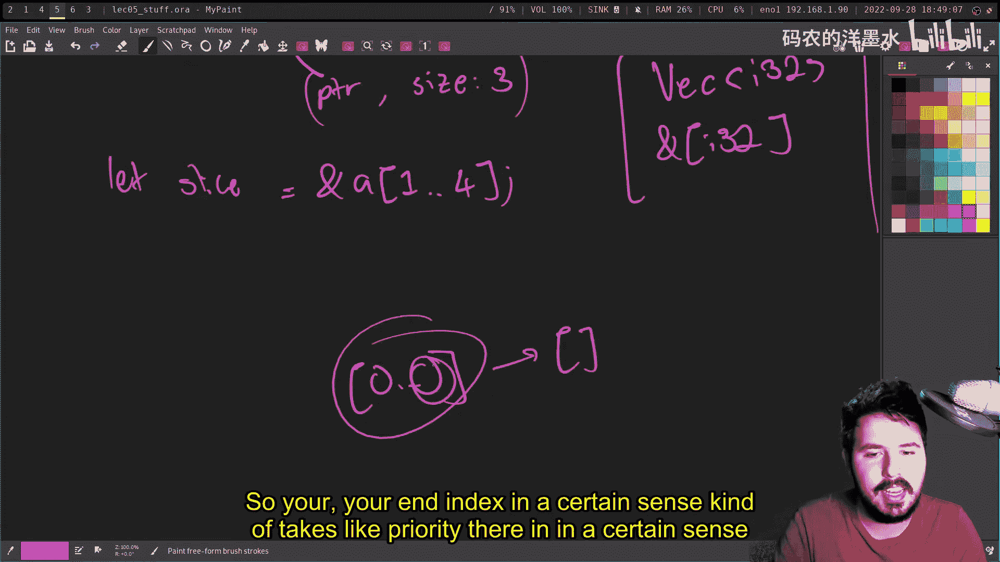

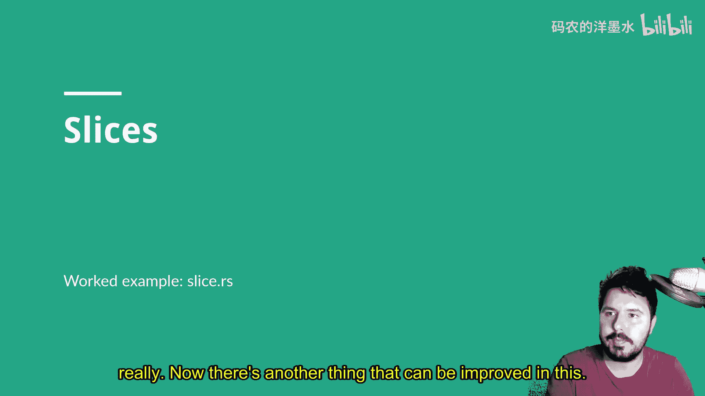

Now there's another thing that can be improved in this arm's we'll go back to the other option here。

 but both of these are perfectly fine， you also don't if you're starting at the beginning or if you're finishing at the end you also can just leave them like allied them and the compiler will know this just basically means a zero if I don't put it here just basically means like the length。

嗯。So this whole same tap。But up here， notice that I've said this function can only be called for people who have capital S strings。

 They own the string， Well， or they have a burrow on an owned string as opposed to just like any slice of any string。

 which is。More， more flexible， right？So if I say just give me any like string slice。

 that could be something within a larger string like this。

 or it could be like something out of like a string literal that someone's typed in。

 or you know all kinds of other options as well。 So this is a more flexible interface because all it's saying is I need a pointer that looks at some looks at some text and how long like how many bytes of text there is。

 which is just far more flexible than like I need something allocated with mallik and all that sort of stuff。

 So this is sort of like the ultimate final form of this function in my opinion。

 we've got some test cases down the bottom here， I believe and notice it's funny。

 I'm using a string here， capital S string， but it still seems to compile if we run the test here。😊。

The tests are all okay， but I said it takes an  a% stir， but I'm passing an am percent string。

 and this is again， part of that flexibility。😊，Rust is very smart here in seeing that you have an ampersand string。

But what the function wants is an ampersand stir， and it actually knows that it can get that simply by doing like a D reference on this type here to trivially get this and so it ends up applying that automatically for you which is actually rather nice。

But。Since we've made it more flexible， I don't even need to do this whole string from over here。

 I can just pass these string literals directly in because string literals have the type Eand stir。

Breath stir and so this will also pass all these tests and just give us back string slices of just the first word and anything here。

Okay， so that was an example with a string slice。 So those are these are the main like the slices that we end up looking at in this course are slices。

Of some type T like this。Which， again， the the closest parallel to sort of tie them with is something like a Vck of some type T。

And the other one that we think a lot about is strings like capital string with a stir slice being its parallel。

 and these are all you need to know for slices。Does that also work for Vck yes where we can pass an app and Vc where the signature is slice of I32 that's an awesome question。

 that's an excellent question let's find out function2 takes a slice of I32 and let's say xs and let's say it returns a their sum x's。

da。 sum。😊，Like that。And then I have another function that says let x is a V。Of1，2， and3。

 And I say call P with an ampersand X's。 So ampersand X's has type reference of vectorec here。

X C Xs has V Y 32。 So A and X will be ampers and V by 32 a shared bar of an I 32。

 and it does compile it' all happy because it sees it can convert that with a D reference。

 So very nice。 And the difference between iter and into it。 That is something that。😊，We。

Definitely would like to talk about。Yeah， let's let's quickly try and slot that in as well since now that we've got this idea of borrowing down as well。

 we've sort of hand wavedd a bit before in that there's three main methods that rust conventionally users for turning sequences into like iterators。

And those were into iter。They were， there was also iter， and there was it mute。And these are all。

Very common like commonly exist on things like arrays， they exist， so like the arrays of some n。

 they exist on slices， they exist on Vex， they exist on， you know。

 all kinds of types like this where you can that you could iterate over。

 they very often produce these these three functions available for you to use。And the trick is。

how they sort of correspond to ownership wise， so let's say we have some sequence。A sequence of Ts。

Right。Into itR will consume the sequence right， if I have， let's say in the case that it's like a V。

 let's say a V of T。😊，Into iter will move out of that V of T， so you will no longer own it。

 it gets literally converted into an iterator and you lose ownership of it。

But the iterator will then spit out like the item that the iterator spits out will be individual teas that are owned。

 So as you sort of iterate over them， you get given ownership of those Ts of like of the actual items that the iter is producing。

Itta will give you item that each item is going to be a shared borrow of T。

 and it only takes a shared borrow of the V。Right so you will still get your VC to be used after the iterator is all finished and everything like that but you'll only get shared burrows on the items inside and you may be able to predict a similar thing happens for itme here where you have an exclusive borrowrow on the items inside and it requires an exclusive borrow of your container of your like say Vec of Ts。

😊，And the way these end up looking in the signatures is that into itR。Takes self。

Self referring to the container it's being called on， so let's say like a V of tea in that case。

Itta takes a shared borrow of a self。 right， a shared borrow of the container like a V and it a mute。

Takes an exclusive borough。Of the container self in this case。And so。These here， each correspond to。

The different items that it will spit out to sort of like again there's going to be things where you like look at this and you go。

 okay I get like 20% of that and I'm losing a lot of it and this is where it comes down to sort of your practice and just playing around with the language and seeing what the compiler likes and doesn't asking questions on the course forum and all that and over time you'll sort of eventually you may have it now it may take you another five weeks and you' but at some point you'll go oh my God I see how all this is sort of coming together and like lining up now。

😊，嗯。Cool。Alright， so those are our iterators as well。 It's probably a decent time for a quick break。

 And then when we come back we'll be talking about lifetimes probably for about 45 minutes and then talking about smart pointers。

 probably for about 15。😊。

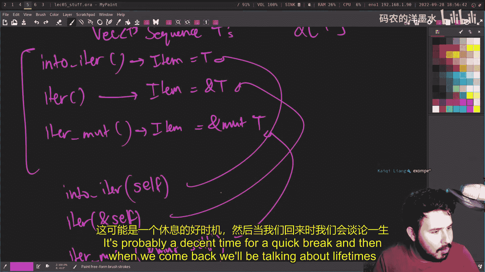

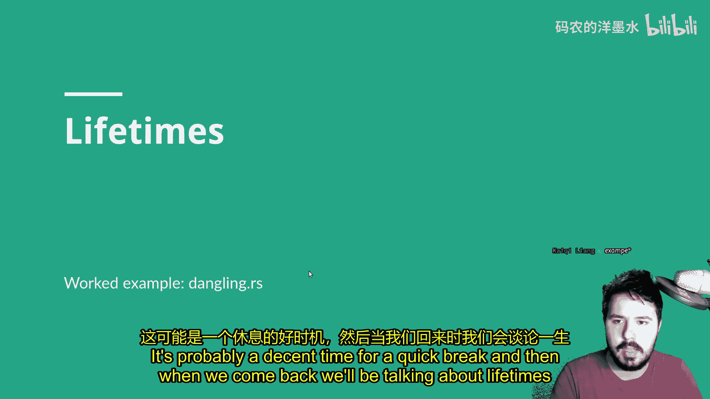

Is what I'm hoping for。 And yeah， So do we have any questions， Let's say break starts now。

 if you wantan to go take a break， then go for it。 We'll come back at 7 o'clock， right。

 in three minutes time。If you have any questions， then I'll field them during this break time。

 Otherwise we'll kick off again with more content at。About our 7 o'clock， so any questions？

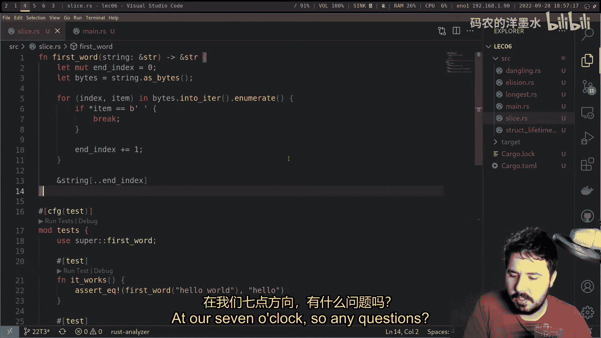

I might also mess around with the lighting a little bit while we're waiting。吼吼吼。😊，Focus。嗯。

That's potentially a little better。That's potentially a little worse。Hm。

That's why I want I do it or I have to deence into a lambda function， yes。

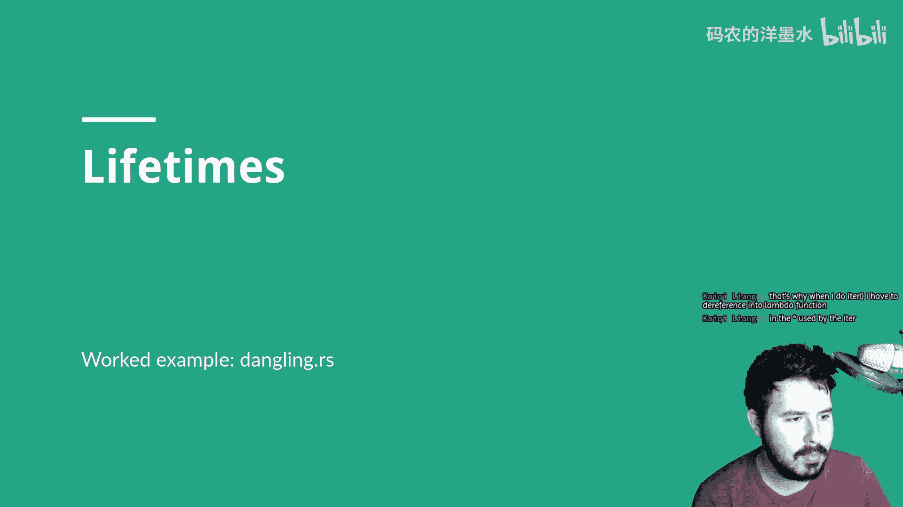

And the star used by the it。 Yes， yes。 So that's that's this one here。 Well， this。

 this we did use into iter， but where。Calling into iton something that's already borrowed。

 so again we can't upgrade a shared borrowough into a。Into an exclusive borough， sadly。

 but potentially if we did， yeah， we could also just write it here and we get the same result in this case。

Just because this is already already a shared borrow。But if we had， for example。呃。X's is an array。

 one， two， three， four， five。We we say four item in xs dot E or let's say x is dot in it rather。

Then item here has type I32。If I change to it item item is a shared bar of I32。

 and if I change to it mut。Then item is an exclusive borough of each individual I32。

And the one of the things that's worth notice is that if we use intuitor。

 and then I try and use X's again after。Then we've got a compiler error because it does implement display by debug printed it's。

さっぴー？喂。😮，How am I doing this， slice？啊。Oh， you know what。 Oh， this is so nasty。

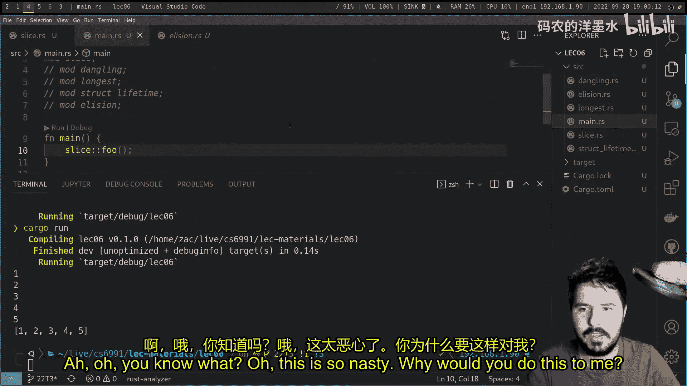

Why would you do this to me？H on。啊， okay。Ah， 158， what？😮，Oh。That's quite interesting。Okay。

 so this is a particularly weird one。 Oh， we're back from the break technically。

 That's really interesting。This was not my understanding， but what's actually happening here？啊。

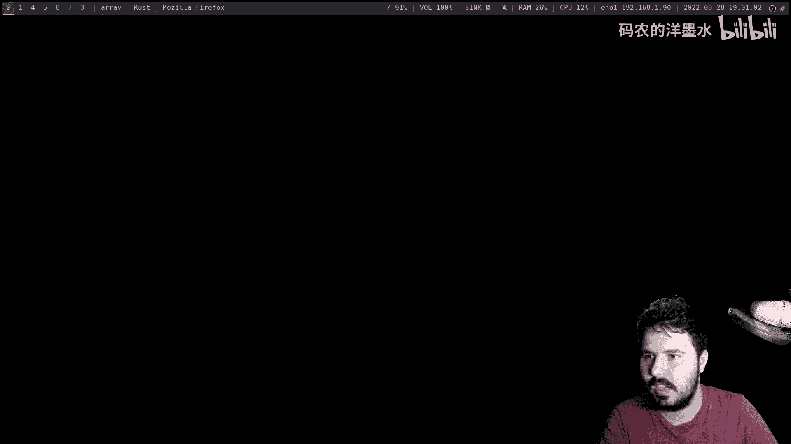

Is the type array？Arays of any size implement the following traits if the element type allows it。

 copy is one of those。I'm not sure if this was I may have just always had this misunderstanding。

 So notice that the implementation of copy。 So first of all。

 the things inside the array must be copied as says I'll implement copy for any size array。

 I am guessing that prior to 158， which is relatively recent。

 it's I think we're in like 162 or something now， it was probably only for arrays up to size 32。😊。

In particular， that would be copy where the element individual elements are copy。

 but now it seems like all arrays are copy if the if the T itself is copy。

 which is actually quite interesting and honestly news to me。

 I I think I might have even just given faulty information in a previous lecture。

 so there's a quick addendum there， I wonder if I can look at like a Ru 157 stood docs。😊，Actually。

 wait maybe no because it's not Dox RRS。It's going to be a little tricky for me to get the old documentation up。

 but that's something that I'd be very interested in。

In looking at I bet I bet it would only be up to size。Yeah。

 arrays of size implementations is generally implemented up to size 32 for array until apparently until recently。

 when we've got something kind of cool called cons generics anyway， if this was something else。

 let's say Vec。 There you go。 That's what I was hoping for， the into it moves out of it。

 but if I did say it， oops， it， it's happy if I do say it。

 but it's not happy because this is not mutable。 But if I make a mutable， then it's also happy。

 but if I say into it。😊。

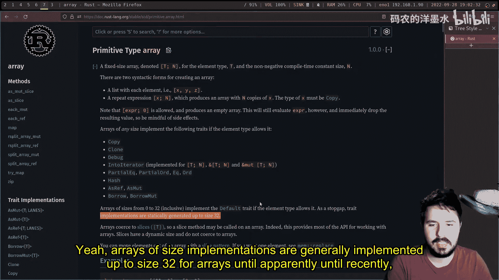

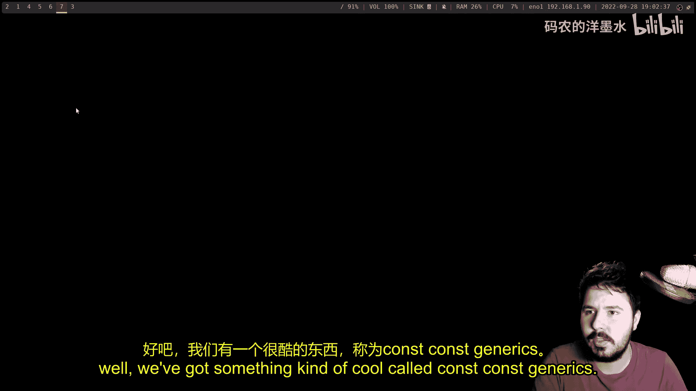

Then it is no longer happy because we moved out of it by taking ownership of these individual items here。

That's what's happened there， basically。That was fun， all right。So。😊，End of break。

Let's get back to the fun stuff。So right， it does a copy。 it's more like。

When we had it as an array here into it takes self。 So takes X's here， but X's is a copy type。

 So it just gets copied into the function， into the function into it。

 And so it leaves our original one intact。So that's why this was working in particular。

 but as soon as it's not a copy type， it doesn't get copied in and it shows us the breakage that I was hoping for。

😊。

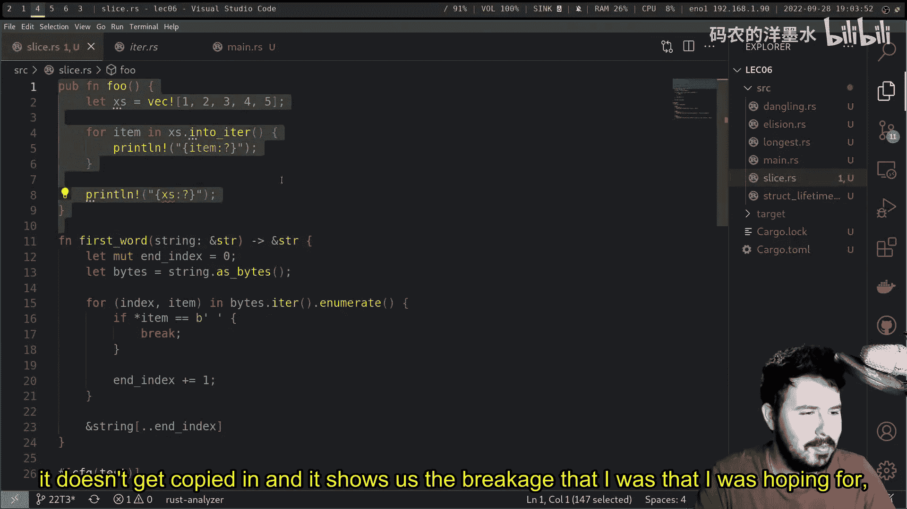

Okay。So back to our usual content， lifetimes great。😊。

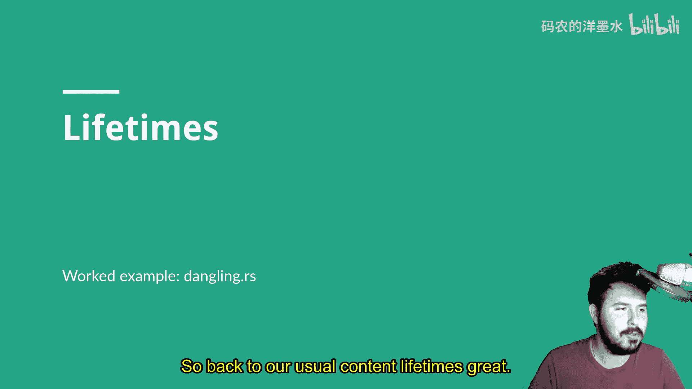

We've already sort of jumped ahead on this a little bit。

In when we were sort of asking at the beginning， but this is the idea that I was talking about before。

 where let's say we have some value， some reference R sorry some binding that is yet to be set called R。

Are sort of is granted this implicit lifetime tick A that's just and again。

 the tick syntax is just what the how we usually talk about this idea of lifetimes in rust。

 and we just give it some arbitrary name， Often it might be better to give it you know a better name for yourself like lifetime R。

 it's essentially like a variable name， but since we're not talking about anything in particular。

 sort of like how we often use like X， Y， Z for variables that mean nothing。

 we often use T to indicate a type that doesn't really mean anything lifetimes we generally start with tick A。

 tick B and tick C， which is what's happening here。😊。

U and what's going on is R has is implicitly is granted this lifetime of tick A。

 which basically extends from where it's declared here until the end of scope where it goes out of scope。

😊，And then we have this inner scope here where I say let x equals 5， so now this value5 here。

 which x is you know referring to which x kind of owns in a sense。Is granted this lifetime tick B。

And that lifetime expires at the end of this scope here so tick B lives from where X is declared where this is given a value right up until the end of that scope there。

 that's tick B。😊，And then this very cheeky line of code here， let R be a shared bor of x。😊，Right。

 and this is where we finally meet our nemesis， the Brow checker。😊。

So notice that there's an error on this line that says x does not live long enough。

 so let's let's actually get the error message out here。X does not live long enough。

 I'll zoom out a little bit， actually。So when we say r equals ampersand x here。

 this borrowed value of the shared borrowor of x does not live long enough x is dropped here。

 right that's the end of tick B here that we've seen there while it's still being borrowed by this R here and R is later used down here。

Right， so you could also， it's also pretty reasonable to think of this borrowers living like of T a sort of living like this。

😊，Potentially。But the borrow checker is come in here and gone well what have you tried to do。

 you've tried to almost extend tick B， right this R is borrowing from X。

 so it's borrowing from this lifetime here， tick B。😡。

You've almost tried to extend this all the way down to here， but it actually ends too soon。

 It ends too soon， which it spits out as does not live long enough。

 This is Rus's sort of famous Brow checker that's able to stop all these memory safety issues at compile time。

 It's able to check the lifetimes of all these different pointers and references and all that sort of stuff。

 right。😊，This is our first encounter with the Brow Checker。Okay。

 now what if we rewroite this function a little bit into something like this so let x be equal to 5 R is then a borrow of x we print R out and the function ends so the lifetimes here look like this we have this value here that's living in x has this lifetime tick B which is going to live until it goes out of scope down here。

😊，And then this we borrow x from this R， this borrow， right， the borrowing x lives for tick a。

 So you might like to think that this ampersand here。

Almost has this lifetime associated with it called T A。😊，Excuse me， and it's borrowing from X。

We use R here。In the， in the print， and then finally。

The borrower here with lifetime tick A goes out of scope。And then x goes out of scope。

 And the borrow checker is perfectly happy with this， because this X here that tick a borrows from。😊。

Is lives at least as long as we want it in this take a lifetime here。Right。

 so the thing that the borrow checker is checking for is X here， this lifetime tick A is。

 is borrowed。In this segment here。 And it needs to be borrowed for at least as long as X is valid。

 which is this lifetime tick B。 The way we'd also write this in rust is tick B。Outlis T A。Right。

 this colon here is， again， tick B。Outli。 that's what this sort of colon here means。

And as long as that's the case， as long as that's true。

 then the borroworcheer is usually going to be happy。

 it's got to check the things like have you got an exclusive reference already。

 you know do you like it's still got to check the usual ownership rules and all that。

 but as far as lifetime concerns it's basically checking these sorts of outlives ideas。😊，And this。

 this one failed here because R borrows from X here。 And let's say this reference。

 we're sort of thinking has lifetime tick B。 Oh sorry。Sure， yeah， this reference has lifetime tick B。

But then we use it over here。 We use it like down below in this larger lifetime。I need to get these。

Slashes right。We use it in this lo lifetime。Does T Be outli tick A。Sadly。

 it does not in this anymore because we have this sort of shorter lifetime of tick B here。So this。

 we're trying to sort of extend the lifetime of tick B past where it actually lives。

And the bar check will stop us from doing stuff like that。Okay， let's。

So this is this is just a very quick introduction to this idea of lifetimes。 very。

 very quick introduction。 and I'm going to like immediately comment it back out again。

And jump into sort of how lifetimes can potentially like when we run into this sort of idea。

So consider this function here。Longest。So longest takes in two string slices， two brows of strings。

 X and Y。And then it spits out。One string slice here， a new borrower at the end of it。

And it says if x is longer than y， then spit out X， otherwise spit out Y。

But the Ru compiler does not like this program for some reason， let's see what it has to say。

It gives us the exact solution， which is quite funny。

 But I'm just going to leave us right there and shorten this down。

 So here's our error message missing lifetime specifier。

 This function's return type contains a borrowed value， right？

 So the return type here is has a borrow in it， which is the same percent here。

 but the signature does not say whether it's borrowed from X or Y。😊，Oh， interesting。

 So let's say we had a function food。That we were using。

And we wanted to call longest with some strings Now you might imagine okay。

 they're going to call it like foo or F one， something like that。

 and we'll give this string slice back and everything's happy。

But imagine we had two very two string slices with。Different lifetimes。 So let's say we had let。

 like long lifetime string。The string from hello。And then let's say like a few scopes deeper we have let very short lifetime string。

Is string from Fu bar ads。And then right here， I said， call longest with the long lifetime string。

And with the very short lifetime stream。哎不行啊。Let。Long guy equals that one。Right。Oops。

 what have I done， Here we are。So the question is， what is the lifetime of longer？😡。

How long does longer live for？Right？This long lifetime string exists all the way from where it was declared here until the very end of this F function here。

 And imagine， let's say we have you know， more code here， more code here and more code here。

 like there's a lot going on with this code compared to how I've written it。😊。

But this very short lifetime string is only going to live just until here。

And this longer really could be either of these。 it really could be either。So the question is。😊。

And this is also paired with the consideration that the compiler needs to know all this information needs to know all these lifetimes at compile time right this is not some extra code that checks things as the programs running。

 it needs to be statically determined at compile time when you're building the code。😊。

So it's not going to like these strings could be completely dynamic。

 this could be like get input from user。😡，Right， this could be getting some input from the user and you don't know whether it's gonna to be shorter or longer。

 The compiler can't just go， let me just guess， or let me just like check the links of the strings。

 You might not know how long they are when you're building the code。😊。

So what does it do Well the answer is it gives us a compiler error in this sense。

 and the trick here is that we need to help the compile compiler along with the lifetime of this string output here。

😊，Now there's a couple things we could write。We could write。

 So I'm going to introduce a named lifetime just like this。

 So the trick here is that we throw in some angle brackets just between the functions name and the parameters。

 And I can name a lifetime by saying tick and then a name。 So I could say tick F if I wanted。

 I'll call it tick A。😊，And let's say I said X is a borrow with lifetime tick A。

And it's a borrow of of a stir。 And the output is going to be a borrow tick a stir。

 So what we're telling Ru is the lifetime of the outer the borrow that we spit out is going to be the same as the lifetime as the of X of x's B that was spat in。

And this makes the function signature happy。😊，But then we get a problem。 What's this problem。

 It says， it says that like why here could have any lifetime， right， It could be longer than A。

 It could be the same as tech A， or it could be a lifetime that's shorter than tech A。And right here。

 you're trying to return why， why has some unknown lifetime。

 And I need to say that this has this lifetime tick A。

 That will be okay if why does have the lifetime tick A or if y has a lifetime longer than tick A。

 But if y has a lifetime shorter than tick A， then that's a real problem。

 And it really could do that。 as we've done it right here， This is a really long lifetime。

 that's a very short lifetime， really long lifetime， really short lifetime。

 And it's expecting the really long lifetime out。😊，Right， so as Alex has said here。

 maybe it should live as long as the shortest。 Daniel says， I also think it should be shortest。

 but I think it's because it goes out of scope at the same time as shortest so。Right。

 we actually like the only way that this code could be sound。

 right this code could you know do the right thing is if this output of one is is the lifetime of whichever one whichever one here is the shortest lifetime。

😊，So let's say we had。To life day。No， we won't jump straight into that。

What happens if I annotate Y with Ta here？It seems to be happy。 Let's build it and it builds。

 So why is it happy now， Well， we say x has some lifetime tick A and y has some lifetime tick A。

 and the lifetime we're spitting out is tick A。😊，But we know that these don't have the same lifetime。

 Let's say this has lifetime tick X， and this one here has some lifetime tick Y。

These are not the same lifetimes， but they're sort of being implied to be if you look at the types here。

 this is you know some like string over here with whatever lifetime。

 this is a string over here with whatever lifetime， these ticks are the same here。

 but tick X and tech Y really don't seem to be the same and the trick is rust is happy in these cases here to just shorten lifetimes where necessary。

😊，So tick A will be chosen to be， you know one of the lifetimes and it it's happy to say， well， y。

 well in our case， X has a longer lifetime， so it'll make tick A B this lifetime here。😊。

We'll make tick Ab equal to tick Y， and then we're fine to use tick X in place of that tick Y。

Or the take up here， because it's at least as long as it， right？Tick X out lives。

 It lives for the whole period of tick Y， so it's perfectly happy。

Since it lives across that whole period， it its it's at least as useful as tick Y is another way to think of it。

 It's at least as useful。 And again， the syntax here would be， oh， I guess up here would be that。

Tick X outlives tick Y。And so since it outlives tick Y， this is all okay。

 We could also name them individually， like as tick X and tick Y。

And gave this one tick X and this one， tick Y。 And the question is， you know。

 what does this one spit out here。 And it's， well， we could do like a， let's say。

 tick Z that this one here spits out。 And I could sort of work all these lifetimes manually here。

 So I could say that。Tick X。Tick X needs to outlive T Z。And T Y needs to outlive T Z。

And it should also be happy with this， because essentially， we were saying this has some lifetime X。

 This has some lifetime tick Y。 And the output here has some completely unknown lifetime tick Z。

 But we know that tick Z， like tick X must be bigger。 It must be like a。😊。

The same or a longer lifetime than T Z， and tick Y must be the same or a longer lifetime than T Z。

And it does all its analysis it goes， okay， can we return X here， X has lifetime tick X。

 tick X out livess tick Z， so it's happy。 What about y， Well y has lifetime tick Y。

 tick Y out livess tick Z， so it's also happy。😊，And then down here。

 it just instants those lifetimes and this lifetime that it spits out will end up being inferred to be。

 it has sort of these constraints that it gets where it knows that it's the longest lifetime it can be。

 such that tick X outlives it and tick Y outlives it and with those constraints you get that it will be this whatever the shorter lifetime of the two are。

 essentially。So it cast the longer lifetimes to the shortest among all。 Yes。

 that's absolutely correct。 So if we go back to the simpler example back here。

 if we go back to what was simpler with just tick A。

Then it will just end up giving you whatever is like one will be instantiated as the shorter lifetime will be tick。

 the other lifetime will just like automatically shorten itself， so it's happy。And yes。

 lifetimes is almost certainly one of the hardest things。

 especially when you're getting started with the language。😊，Which lifetime notation is more ematic。

 The simple version or the version with where the simple version is almost certainly more preferred。

 and a lot of the time the compiler will be able to do the lifetimes automatically for you。

 which we'll talk about when we get to a lesion， but this is this is the simplest format of this function here and that's generally what's preferred。

 I'm not understanding what extra information the compiler is getting here。

 Can't it just infer the shortest right， So that's a very reasonable question。😊。

So I'm assuming if you're saying we had over here， this was the code here。

 why doesn't it just infer that it is the shortest of the two here。

 like it should be able to just guess this？And the answer is。😊，You're like。

You're right in a lot of situations， but not in this specific case。

 And I think there's a pretty reasonable reason why。

 So let's pop quickly back to this slice one that we were looking at earlier and pay close attention to the signature String here is a borrow of a stir。

 and it spits out a borrow of a stir。 Notice that we didn't have to write。All this。

 we didn't have to tell it this thing as an input of lifetime tick A and this thing has a life an output of lifetime tech A。

Right， it just sort of like inferred it。So why did it infer it here？

Why were we able to And the terminology here is eliide or e。

 So why were we able to allide the lifetimes over here。

 But it really is requiring these lifetimes over here。

 And my take on this is that these lifetimes here only really have one realistic possibility。

 There is actually like technically other possibilities that you could have。

 But there's only one reasonable possibility if， if the code is written like this。

 which is this thing， like we have a borrow that's being put in， we have a borrow that's coming out。

 And so like these， these borrowors should be like。😊，One。

 the lifetime of the borers should be equivalent here， one lifetime should follow from the next。

And so it's happy to all this。 The problem with this is it's not clear what the lifetime of this could be。

 And you might go， okay， it's obvious to me。 it's just the shorter of the two。

 But what if I wrote you a function that looked like this， What if I said F N。Empty， if。If。

Second string。In first， otherwise。Uh， like first， it's a great function name and I have the same signature。

😊，And what does this function want to do Well， if these second string， this y here exists inside X。

 right， if x contains a substring of y， then we'll spit out。

 then we'll give it back the empty string， otherwise give back if it doesn't exist in Y， give back X。

 So let me write it if x contains Y， then we give back an empty string。😊，Otherwise。

 we give back X itself。What is the ideal lifetimes for this function？Now， we could write。Tickay。

 ticket， ticket， throw ticketes on everything， oops。And take it over here and the compiler is happy。

Build， oh， it's not happy with this one down here。Comment that out。

It's not happy with this code down here。Comえ that out。And it builds。Right， the code builds。

 it's happy with this function definition up here， but this is actually kind of bad。Because。

If y is a really short lifetime here， this second string， why？😡，If Y has a really short lifetime。

 then the rust will infer that this outputted lifetime is also very short。

 but we actually don't need to do that。 Watch this。 if I take the ticket a off Y here。

And just do a ref stir。Compilr is still happy Why this borrowor of Y has no sort of bearing on the lifetime of the outputted string。

It really only like cares how long X is because we're either going to return back an empty string which is perfectly fine to live forever。

 right it's its lifetime is what we call there's a special lifetime called tick static。😊。

Which means it will live， it can live as long as it needs to。But in this other case。

 it may return back X， and so we need to sort of illustrate that this of the lifetime that we give back might be contingent on the lifetime of X here。

 but y can live for as little as like the duration of the function here and we're still perfectly fine。

😊，Why has no bearing on this output lifetime， so that's why Rus specifically wants you to annotate these lifetimes here。

So isn't the example of returningian empty string similarly relevant to our previous function with one parameter where it was a lightinging？

😊，Rety an empty string。Oh， I see。 Sorry。 So that's what I was saying。

 where there is some different ways that you could interpret this， which is like。

 it is a lighting essentially this， which says you have tick a， tick a， tick a。

But there could be a scenario where this lifetime here is actually longer than tick A。 But the trick。

 the sort of thing to think about here is， well， if this is the only thing you have as input。

 then there's really no like lifetime that you could name if you can't sort of type this lifetime into your code。

 that that lives longer， but let's say lives less than forever。

You're actually not going to be able to name that lifetime in your code like this is sort of like。

II I can really， the easiest way for me to answer this is like try and find a account for example。

 and you will almost certainly just never find it。 like give me a。

 give me a lifetime that this return value could have that is longer than tick A that or could be longer than tick A。

 but is not。but is not like could could live forever， could live for the rest of the program。

 which we've just learnt as oops， which we've just learned as tech staticatic。

And so then if you can't do that， which I'm sort of asserting here that you won't be able to do because you just have no lifetimes that you could like。

Name out here。 essentially， there's there's no way to sort of specify that lifetime that you're talking about because Ru needs a value that to generate that lifetime from。

 it's kind of tricky andnlly to explain with what we've got right now。

 But if you take my word on that or you try and disprove me and。

If I'm almost as most likely have trouble with that， then it only leaves you with， well。

 the only other lifetime this output could have， if it's not tied to this。

 then the only other lifetime it could reasonably have is techtatic。

 this lifetime that could live for the rest of the program， and if that's really what you meant。

 if you meant that this is a techtatic stir like an empty string，😊。

Then you would just you could just type tick data here and you don't even need this this tick A over here anyway。

 So if this was just like。Return empty string。Right then this is happier if it was like returnturn hello because this is a string literal it's baked into the program itself so this string can absolutely live forever。

😊，Then you could reasonably just type it like this。 And it's， it's perfectly fine。

 And so that's why it'll， if you don't specify it， it will just elude this as T A here in take a there。

 And a very， very， you know， occasionally， it's not what you wanted。

 And the illusion can sort of bite you a little bit， but it's。

Pretty rare it's pretty rare the more likely scenario is that you as you do you make a mistake like this where you tell the compiler that this output lifetime is going to be the shorter of these two when it doesn't actually need the lifetime isn't。

isn't dependent on one of the borroworers that you've said it is dependent on。

 and so that's a much more common problem that people a more common mistake that people accidentally make。

And that's why I won't a it， in my opinion， is because there are there are actually quite a few answers here that are perfectly reasonable。

 Its the lifetime of the output is dependent just on x， just on y， or is the shorter of both x and y。

Okay， so。What do we end up at the very end here， we ended up with some T a， T a。

 T a and T a like that。So we introduced this named lifetime parameter just after the function's name。

😊，And then we specify which borrows are related to that lifetime。

By throwing this the name of that lifetime just after the ampersand and before the the type。

 note if that one of these would say an exclusive reference。

 So let's say we had why was an at mute stir like this。

 The spot that you put the lifetime is not here。 It is between。

 It's like the lifetime is associated to the borrowrow itself So you throw it right here。

 Ref tick a mute stir is the is the right way to to type a lifetime like that。

Of course these aren't mutable， these aren't exclusive references in our case。

 so we're just write it like this。😊，Okay。Soir。This is our sort of like introductory idea too。

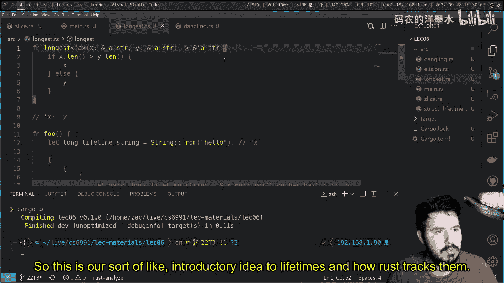

Lifetimes and howrus tracks them。We can also。 So that was， oh， sorry， we had。

 that was our introduction to the idea of lifetimes， especially through through。

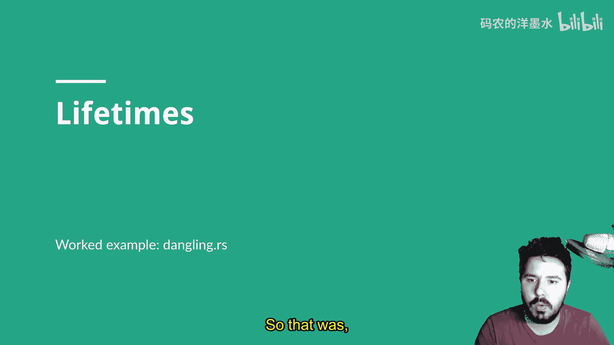

Where it go， this idea over here， as we saw earlier as well。

 this is all very relevant to this idea of the tracking of lifetimes and stuff like that。😊。

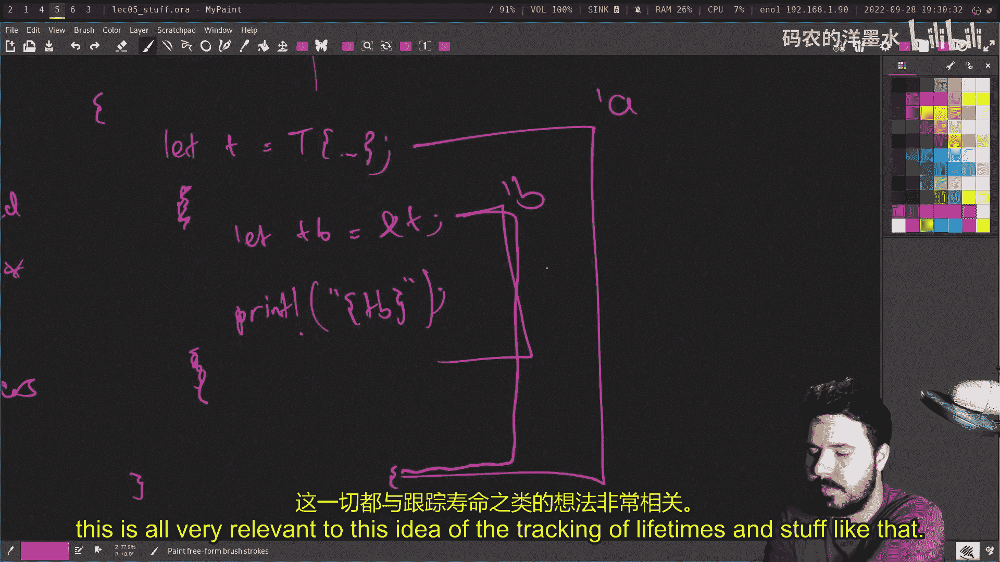

嗯。And then we looked at how we annotate those on a function like this， introducing the name。

 annotating it where it where it exists。 Notice as well。

 there's there is one thing thats oftens trips up rust beginners。

 let's say let' Z equals y or something like that。 And I want to type Z， often people will go， well。

 Z is a borrow of a string。 And since it's borrowed from why it has a lifetime tick A。😊。

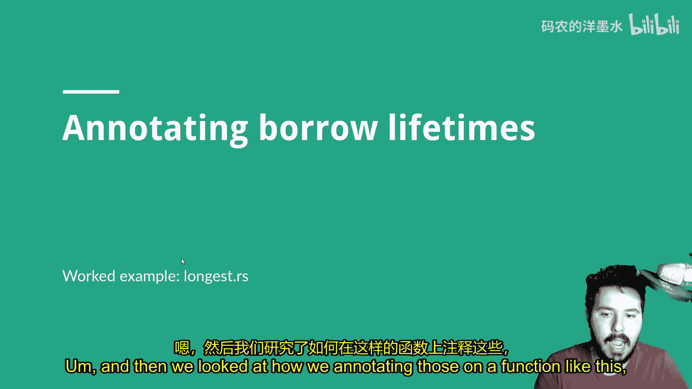

And this is so this scenario is okay。As far as the rust Comp is concerned， this will build。

But if I say like I have some lifetime tick B。And then I say， let's say Zed is just a string hello。

 And I say this is now lifetime tick B。 It's also happy because this is。😊，Because this is static。

 Let a is a string from Ho。 And then this is a a b of。A like this。A dot as the。There we go。

 Happy now so。It doesn't。 you can't just sort of like randomly assert and annotate your own lifetimes in the code yourself。

 or you can't say like， I'm gonna borrow this like I'm gonna take a。And like borrow it for tick B。

 or I'm going to borrow it for tick A， like this is just not syntax that exists。😡。

So whenever you're saying like sometimes ampersand appears't a type where you're specifying this is the type of like my my value here。

But there's also this am which is meaning like take a borrow of some value and you can't just like assert what lifetime that you would like it to have that's all inferred by the compiler。

you can't assert that yourself， so it's one thing to keep in mind that sometimes trips up beginners。

U， but it's something that you'll often just like at some point you'll run into it。

you'll be confused， you'll fight the compiler a little bit。

 you might ask a question on the forum and you' go， okay I see what was going on here。

 so don't worry about it too much in advance。Just something you might run into。Okay。

 so then we had also structure an enum lifetimes over here。So let's say I had astruct。

A struct that contained a burrow inside it， or let's say an enum that where at least one of the variants had a bur inside it as well。

Now you'll notice if you just type this， the compiler is going to be like， no way。

 not allowed to just do that。And the reason is imagine we had a function that was like this。

 which said function fo， let's say let's let's I'm actually going to change this like a string。😊。

Yeah， I'll turn it to a string。Function food takes in S， which is a string， sorry。

 a borrow of a string in this case。And then it spits out astruct with burrow。 And in fact。

 we have stirs now as well。 So let's let's be a little。

Cleleaer and actually now I need this own thing over here， fighting， we'll leave it a string。嗯。

And the problem here is if I just said， you know， return back astruct with borrow， where X。😡。

Is this S that's been passed in？This function is happy。

But we've sort of like hidden the lifetime from the rust compiler。 So notice that S here。

Really has some lifetime ticket。But we're just giving back astruct， right。

 we didn't say thisstruct is like tick a struct with borrowrow。Right。

 it doesn't know that the input here actually sort of the the lifetime of the input sort of carries into the lifetime of this output because this struck with borrow should really only be valid as long as this borrow here is valid。

 This borrow here， which is S here， will only be valid for the lifetime tick A。

 And so it's almost like。We could potentially be able to escape the safety of the rust compiler if it didn't know how to deal with these lifetimes in Strt。

And so essentially if I ask the compiler， hey， what should I do here。

 it's actually going to give me the right thing I'm going to get here missing lifetime specifyifier。

 you've got X which is a borrow inside the struct， but I'm not able to keep track of this borrow so you might want to consider saying that this struct。

😊，Carries along some lifetime tick A。And this X here， this x is borrowed for that lifetime tick A。

So now the， the interesting thing is that this and it's is the same thing applies for the enum here。

 Thr on a tick A there。 This enum may have a lifetime of tick A this。待って。It's。Happy with that。

 I didn't know it would alive。Just like that。Really。😮，Sorry， hang on。 This is， oh， now is it on。

 Oh no， now it's unhappy because this is not pub。This might be another new kind of a that's join the language。

 Let S is Str lifetime。F of s screen is spring from。Hello and the borrow of string like that。

And S has this structureive borrowor。 Well， it's it's actually alignlighting this for us。

 which is very surprising。 But what we usually see this as as is sort of like this。😊，Oops。

So we say that F has some lifetime tick that we're keeping track of。This S here。

Includes this lifetime tick A， right S this borrow is valid for some lifetime tick A。

 and this struct that we're spitting out that contains a borrow is also going to be valid for this lifetime tick A。

😊，Right， so this has some lifetime this structure will only be valid while s is while this S Borer is valid here。

So if you have a string that only exists for a very short period of time。

 then this struct really should only exist for that very short period of time as well。

 But if you have a string that's gonna to live for ages， this struct can certainly live for ages。

 That's maybe a way to sort of help think about it。 Now there is sort of again。

 this a that I had not seen before。 honestly， again。

 the rust compiler the rust language updates every six weeks， which like sounds like not a lot。

 but you know when you use the language for years， it can certainly run away on you how I as a rust programmer of however long ago would tell the compiler to work out these lifetimes for me is Ill get rid of the tick a here。

 I'd get rid of the tick a here， and where we have this structive T。

 I can actually use this special lifetime called tick underscore which essentially means you figure out this lifetime here。

 it should be pretty obvious。 That's essentially what it means Figure out the lifetime it should be obvious。

 And since we have S is a borrower here， it'll go。Right， that's gonna to be some lifetime tick A。

 And this should obviously be ticket a as well。 We have a borrow in， a borrow out。

 like it's the same thing as when we saw。As what we saw here， Brow in Brow comes out， Brow comes in。

 Brow comes out， but apparently you can now leave off this whole tick underscore thing as well。

 and it will also all that， which yeah， that's news to me as well。

 but I generally prefer like it feels a little strange to me。 I'm sure I would get used to it。

 but I like to sort of see that thestruct does borrow from something inside as opposed to just looking like it's it'll live for you know I'll be the owner and there's no borrows associated with it essentially。

😊，So let's just put in the long form for now， but knowing that there is a couple different ways you can get the compiler to infer those lifetimes for you。

Question， why couldn't we have done this for our previous example with the empty string illusion。 A。

 why couldn't we have used tick underscore for the counter example you talked about earlier。

 So this one was。Was it was it this function here that we were talking about or was it this function here as something like this function here。

Like which signature we we looking at and also by the way。You absolutely can do that here as well。

 where it will infer a little go。 Yep， I know what the lifetime of that thing should be。

 And it's fine with that。 First word。 Oh， yeah， okay， first word， Yes， you can do that。

 You can do this kind of illusion as well。 you go， this should be obvious， and it goes great。

 It is obvious。 This has some， this is a borrow in this is a borrow out。

 So the lifetime of this will be equal to the lifetime of this。

 And so it will infer this lifetime for us well， that's exactly what's happening when we just write the code like this。

 So again， most of the time。😊，Don't worry about writing in the exact lifetimes until the compiler goes。

 I can't figure it out。😡，Right while the compiler can figure it out， you don't need that extra noise。

 It's generally pretty obvious as a human reading the code what's going on。

 So let the compiler do the work for you when the compiler complains and in fact。

 I've you know broken my own rules exactly right here。When the compiler complains。

 then you go through and like which lifetime is which and that kind of stuff。

 and then very rarely will you get a problem where the lifetime that the compiler infers is worse than the lifetime that you actually want if that makes sense。

😊，U and that also， I guess just brings us very quickly since we've been talking about this for a while now to this all here。

 which is， in fact the first word example that I was talking about before， where instead of，😊。

SpSping all the lifetimes manually， which I believe I was planning to do what we ended up getting there earlier anyway。

Right， instead of specifying them all say manually like this。

The compiler will often let you allide the lifetimes。Like that or like this and all is happy。

And this is just also this is a slightly more functional way of doing this first word thing as well。

 split once on the first space character and then it'll split it into before and after potentially it's an option just map that into the before part and if it's there。

 splitit it out if it's not then give back the whole string and again the lifetimes there are a lot of lifetimes that are getting tracked around here but the compiler is very good at that and so like I don't have to worry about all the lifetimes here it's figured it out and gone yep。

 this all follows the same the rules that we expect。😊。

What if you declare the lifetime in a functions signature。

 but you break it when you call the function。 I'm guessing the borrowche will pick it up。 Alright。

 that's a great question。 So if we have some function fo。😊，In fact， you know what， No。

 let's not do some function through。 Let's grab this function here that we've written。

 function longest。 We'll do it in main as well。 So function longest we've now got here。😊。

And this tick big really doesn't need to exist anymore。So let's say we have this string here。

Which is a string with a very long lifetime。And then we have a string。With a shorter lifetime。

Like that。And then we say let longer equals the longerest between。String and short。Like that。

 if we use it down here。呃 longerer。Then it's going to be perfectly happy。All right， and it spits out。

 I guess if they're equal it chooses the one the second one， let's just make the shorter one longer。

 so it's very obvious。And there you go。UAnd because the lifetime it infers is this is a long lifetime from here all the way to here。

 this is a short lifetime from here to here， and longer is only existing within this short lifetime so everything's perfectly happy。

 the borrowcheer doesn't care。😊，But we can try and like skirt our way around the borrowor Jacobco by doing something like this。

 so let's say let longer。Then we say down here， longer is equal to this。

 this is still happy because although。Longer looks like its lifetime is all the way to here。But。

From this function here， it should infer that the lifetime is this it sees that since longer isn't used in this section here。

 it can shorten the lifetime in order to make the program compile So to be clear。

 this idea of shortening the lifetimes automatically it's something called nonlexical lifetimes NLL that appeared in rust in 2018 and it only does this shortening if it finds that it needs to if it finds that your program won't build it'll try and shorten your lifetimes is one way to think about it and if it shortening the lifetime solves the problem makes the program compile。

 then it's like great we've fixed that。But if I then move this print line down here。

 you'll see that suddenly things aren't so happy。Because the lifetime。

 the shortest the lifetime can realistically be is at the end of this print line here。

 But this short here only exists over this period。 So what kind of error message do we get。

We get this short does not live long enough。 The borrowrow checker has stopped us in our tracks。

 So it says that short here is borrowed and it doesn't live long enough。

 The borrow Its short is dropped at the end of this scope here on line 28， right。

 It's dropped here while it's still borrowed by longer down here。

Right it's later used on line 30 and so the borrowcheer stops us。

 stops us from letting this code run And to be clear in other languages。

 this would be something like a stack use after free。 So in C or C plus+ or something like that。

 you get a memory safety vulnerability hackers are in your computer and they are leaking you know。

 all your data and ransoming your computers and all that very very scary， horrible stuff so。😊。

The borrowcheer tracks all these lifetimes for us， it's very nice， very nice of it。😊，Okay。

 global in rust， so you're asking about global data。

 I might need little a little more than that to work with if that's all right。😊，呃。Cool。

 so that's all that。 No more dangling references， hooray。😊。

So that's our sort of like vague idea of lifetimes。 Lifes go， you know。

 I think we've had a pretty decent。Where am I up here？

I think we've had a pretty decent introduction to the。

 the premise of lifetimes and sort of the fundamental ideas behind lifetimes。

 Lifes take most Ru programmers。A few months to really， really sort of like understand quite deeply。

Sometimes it can if you're you and if you use Rosles， it can take， you know。

 it could take a year or maybe even longer to really， really set in。

 but often you don't need like a really， really， really deep understanding to use the language。

 you sort of need like that medium understanding that we're hoping to get to within maybe the next week or so。

Where you may not be able to answer every single thing about it。

 but you should hopefully be able to like。Follow the error messages when the compiler tells you something's wrong。

And use that to try and get a program that builds and。

Or potentially be able to spot a situation where the compiler says， hey。

 won't I'm not building this and you go all right， that's because my whole approach here is just like completely unsound and it's just going to cause it will cause like memory vulnerabilities if I let this if the compiler were to let this through and I need a completely different approach potentially。

😊，What if we make a global design the lifetime would extend indefinitely right。

 So that's your question there。 If I said let X is an sorry static x is an I 32 is the oh let's say is a string is string from hello like that。

 Yes， X here has the lifetime tick static right So again， I I can't really sort of type this here。

 The compiler and let me， but this if I were to like borrow from X static y is a borrow of X like this。

😊，Well， actually， maybe it'll let me type it like this。Then yeah， okay。

 it's happy with this if I borrow from X， then I will get a ticktatic。String。

 so the borrow will be the borroworough is valid for the entire lifetime of the program。

 which is quite nice。Okay。And this is is how you do globals and rust。

 generally we avoid globals and rust and rust makes it hard to deal with globals because globals can be quite dangerous and rust makes you avoid danger at all costs。

😊，😊，Cool， okay， great。😊。

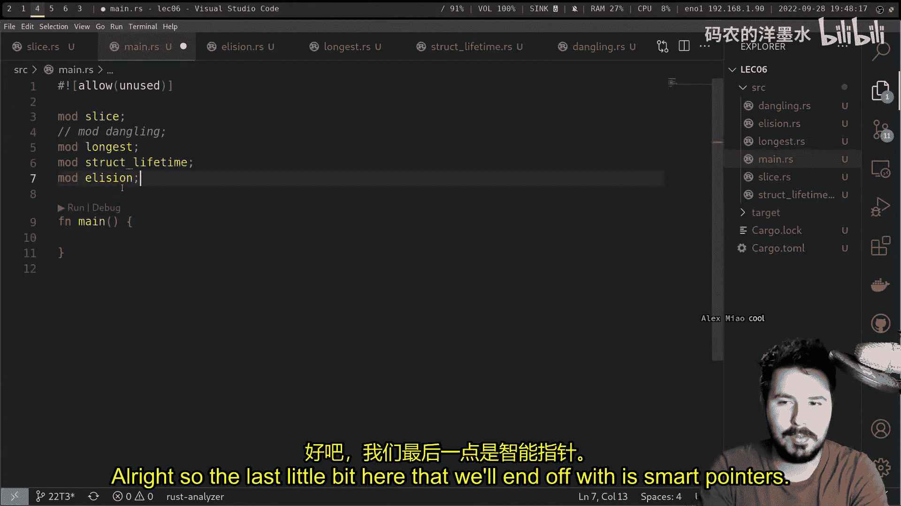

All right， so the last little bit here that we'll end off with。Is smart pointers。

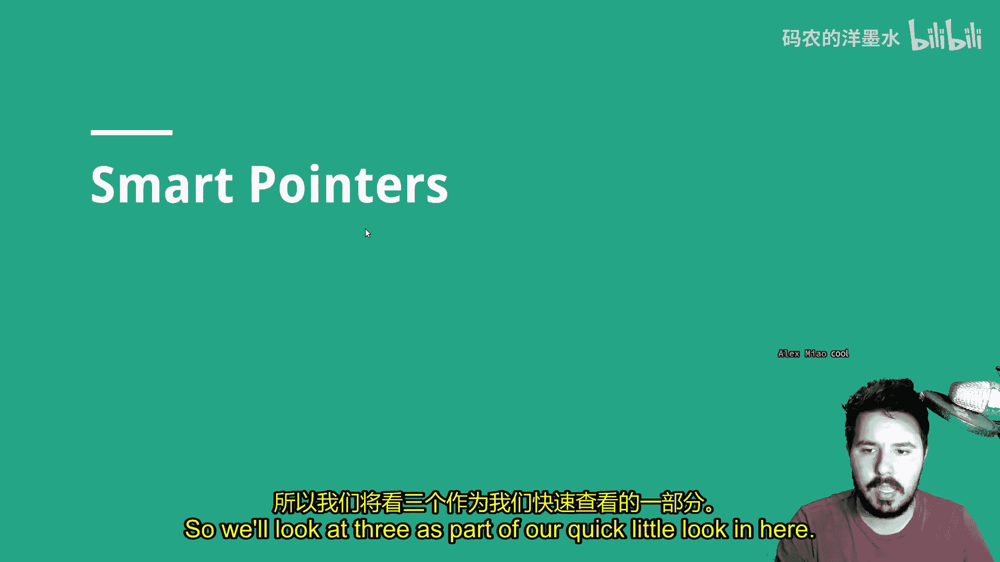

So we'll look at three as part of our quick little look in here and I don't have any sort of practical exercise to go through。

 but we'll just chat through them a little bit so we've already seen just again T we talk about this all the time just sort of any standard type T whether let's say strings maybe a bad example。

 if it's like an I32 let's say or something like that。😊，The the location of this type。

 or if it's some stock that you made， for example， the location of this is on the stack。

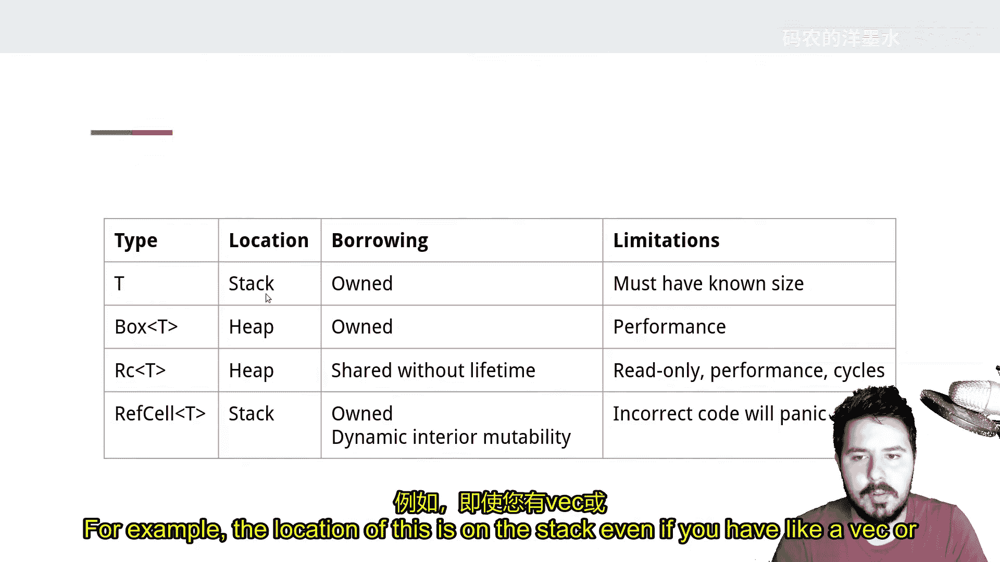

Even if you have like a Vck or something like that， a Vic。

Which I keep saying is like Vex storess things on the heap。

 which is like maled memory and all that Vck realist actually is astruct。Vec is， oops。

 astruct V that actually lives on the stack itself。 The things that live on the stack is a pointer。

 the pointer lens and the capacity。So it's basically three pointerized values essentially and the pointer points to the like you know the actual vector itself。

 this is the stuff that's on the heap right this here exists on the heap it was malled but the pointer landing capacity itself that really make up the V still do exist on the stack it's just that the stack values have a pointer over here that send you to the heap So by default things live on the stack。

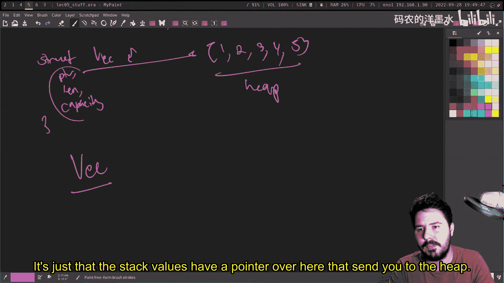

And the borrowing here is the borrowing semantics is that it's not a T is not borrowed， right。

 you own this T， you are the owner， but a limitation that we have to work with is that any sort of tea that you just declare。

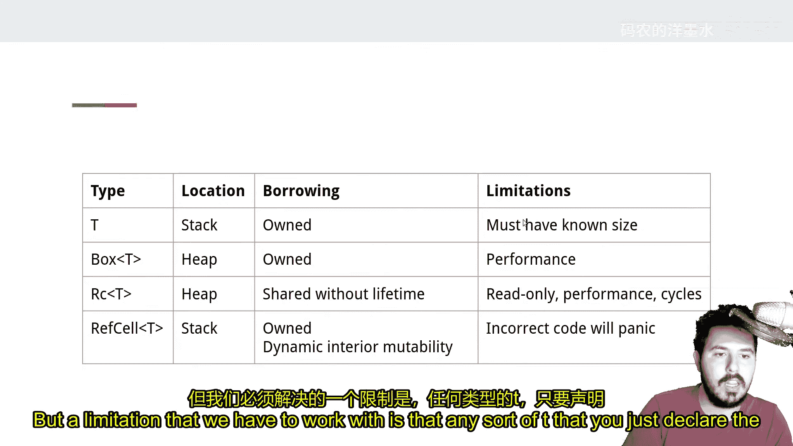

The T must have a known size right， This was the idea of like we can't write we can't have like a slice like we can't have a slice that isn't behind a reference or isn't behind like some sort of other indirection because we don't know what the size of a stir is。

 So in our case， let's say we had X's is a slice of I 32s。And it's going to be equal to like one。

 two， three， four， five。Right， I can't then say like let wise。

Which is a slice of I32s equals d reference x's。Because it's going to say。

It doesn't know that the size for values of type slicelic A32 could not be known at compile time。

 in other words， it's not sized。 So this is like a serious problem。

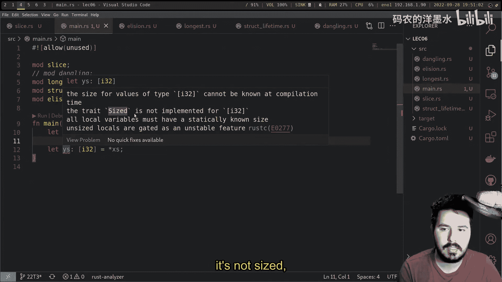

For things for just variables that you're declaring is that if they don't have a known size。

 a compile time， then you simply can't declare them or just simply like this。 So instead。

 you have to put some indirect behind it。 The indirects that we've learned so far are a shared borrower and exclusive borers as well。

 So I could say X's is a shared borrower here。

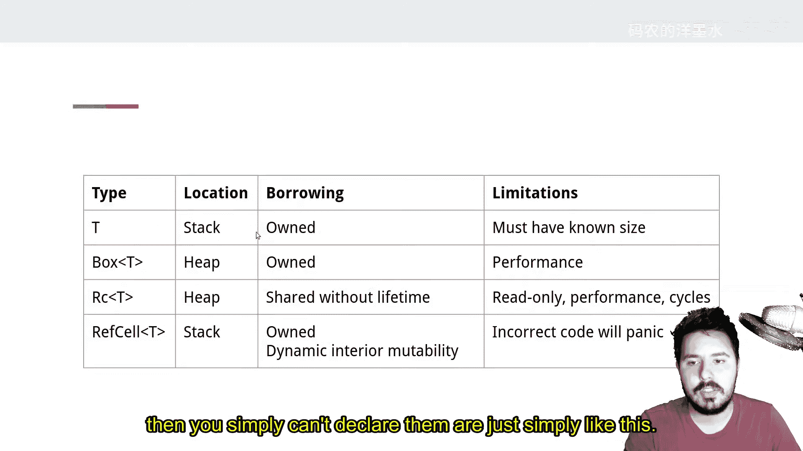

Or I could also say for example， use an exclusive borrowor。

 which also provides that same kind of indirect here and that's also fine。

But there are other pointers that we can use right the the sort of trouble here is that what if I just want that indirect。

 I just want the fact that instead of the value itself I'm storing I'm storing a pointer that I know the size of。

And I but I don't want this whole idea of lifetimes to come along with it or I want some other things instead I just don't want this shared bar and exclusive bar I want and I don't want to deal with the lifetimes I just want that indirection so I know the size of my thing and but I maybe I'm still the owner or I want some other thing these are the different smart pointers that we have available to us So the most symbol of which is box of tea。

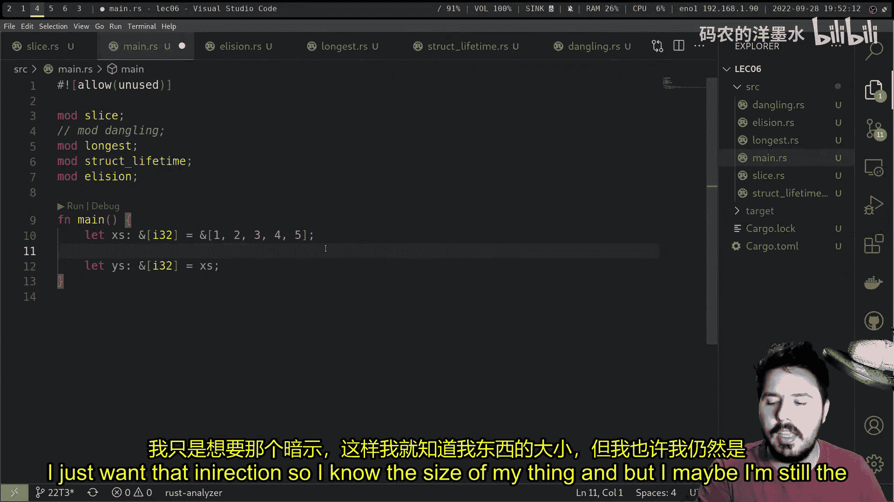

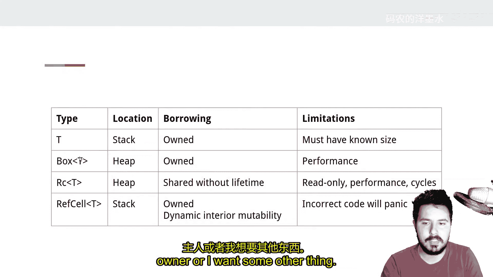

Right， so in our case， that would look like this， a box of an I 32 slice like that。

 And the way we create a box out of something like this is just simply with box new like this。

It's not going to be happy with this because oh， sorry， we'd have to say box。B into box slice， right。

 box into box slice of。哎呀。Conver。It'sThese things are gnlly at best to deal with because the question。

 okay， I don't want to go too deep into it essentially but。And if you are interested， of course。

 ask on the forum， but I'm wary of time， I don't wantan to go 20 minutes over time explaining things that aren't really that relevant to the course。

 but we can also have types here like a slice of I 32， which is behind a box。

 A box is really just a pointer This unique of tea is eventually we'll get down there is just a pointer to some type T。

 And that pointer goes to a points to the heap。

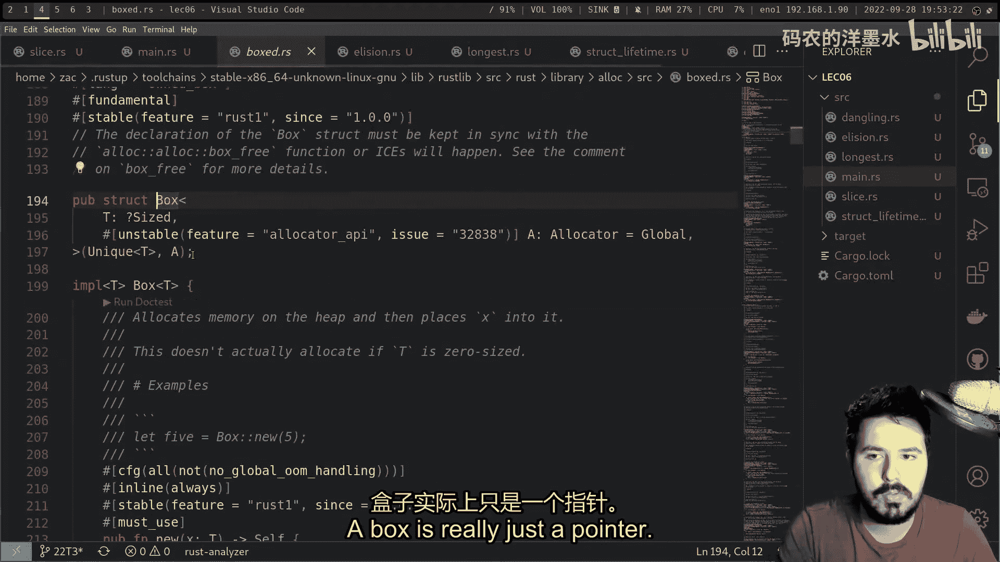

Box of tea still implies if you own the box of tea， you own the tea inside。 So that's perfectly fine。

 The limitation of a book like why don't we just box everything then because a tea is you know。

 must have this known size， and but a box tea is still the same stuff。

 You still own the tea and can still use it for everything but it can even support values where you don't quite know the size。

 Why don't use it everywhere。 The answer is for performance reasons。😊，You know， mallicking。

 allocating memory and freeing and all that takes time。

 it can often add up over time and you know if you're if you care about performance。

 boxing everything can be a serious issue and languages like Java， languages like Python。

 languages like Ruby， I don't know there' there's plenty of examples here languages like Java。

 whatever are very keen to box。😊，Tons of stuff。Every object in Java is boxed。

 every value in Python is boxed， every object in JavaScript is boxed。

 and so that's why a lot of the time they can， if you sort of need to drop down that level for more performance。

Rust can sort of give you that option if that's what you're sort of looking for。

So box T is really honestly not that special there's not too much going on with it。

 it just is like it's a T， but instead of that t living on the stack。

 the T lives on the heap that T is malled and then you just sort of store the pointer to it just like you wouldn't say C you just store a pointer to that T value。

 but it gives you a bunch of functions because it makes it very convenient but yeah it's rather simple and it also frees when it goes out of scope。

 So when you drop a box when a box goes out of scope。

 it runs a little bit of code which just says free the pointer， which is also quite nice。😊。

We also have RC reference counted of T。Similarly to a box， this lives on the heap。

 The thing that's convenient about a reference counted T is it acts like you're sharing the T。

 It acts like you're sharing the type。 So let's say I had some string where my string was like。

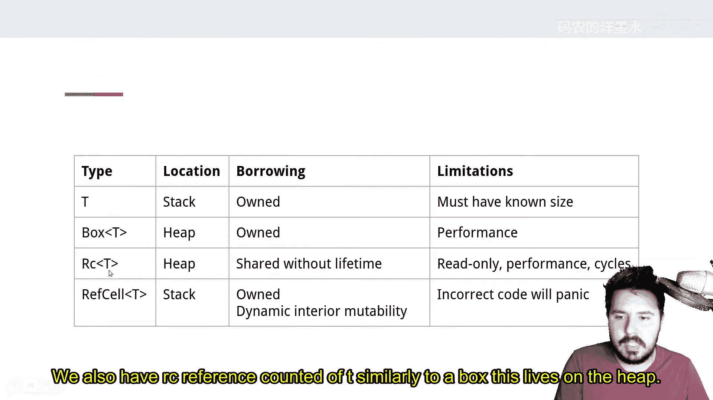

Yeah， let's do it this way。 Let my string is。A string that says hello world。

And I want to share this string， like the string object itself around a whole bunch of places。😡。

Right， and so that would be， you know， if I have some function food。

 the way we know how to do that is that it would take in a b of the string I know we've just learnt about stirs。

 but let's say I really wanted to actually pass around this string object。😊，And so we say okay。

 yeah we use borrowrows there and that's fine， but the problem is what if I want to pass it to this function fo or a whole bunch of other different things and some of them might need it longer than I'm able to store it over here。

😊，Let's say that's our sort of scenario that we're in。In that scenario， we'd get a lifetime error。

 the Borerche would come， you know， banging in an outdoor and would go you're trying to like pass off borrowers of this to all these other places but they might need it longer than you're able to keep it alive for。

 And so the idea of a reference counted value is that I can say let reference you know。

 reference counted。😊，Equals R C。嗯，阿 c。From my string， let's say。And it's oops， RC new rather。

RC knew my string， so this has type RC of string。And over here， we'll say RA string。

 let's we have some function food， let's say we have some function bar and some function bass。😊。

That all want to take this string in。And let's say this string only exists for a very short lifetime as well。

Inhael。Then the really cool thing is， let longer。😊。

And then longer down here is going to be equal equal to reference counted。嗯。

Referencecounted strings implement the clone function a little differently。

 so instead of actually clonening the string， making a whole new string with the same stuff and then giving you that back instead they just take this reference counted thing which contains a string inside it and increment a number the number starts at one when I create it and every time I clone it it increases that number by one so we go here we have one and then when we do clone here it increments it to two。

😊，And then every time this RC is dropped and they're all pointing to the same string as well。

 which is quite interesting every time this RC is dropped， it decrements the counter by one。😊，Right。

 so this longer is reference Can dot clone。 And let's say let's say down here。

 we go through of longer and pass that out。This original Rrc here is going to go out of scope right here。

 and this looks like the barchecker should be really pissed off about this， right。

 This is going to go out of scope right here， but I use it over over here later。

 And the reason this works is that again， starts off with the counter of one。😊，When we clone it。

 it increments the counter to two。Then this one here is dropped right at the end of this scope。

 and it decrements the counter to one， which is not zero， so it doesn't free the memory。

Then we pass this RC into Fo， it gets transferred into here and then dropped at the end of F and when F drops it。

 the counter drops from 1 to0， it goes great， the counter0。

 no one else is using this anymore and so it then freeze the memory after all of that and so if I can actually go like fo of like let me like make longer one。

😊，Longer two， longer three。Loer one。Longer 2， longer three， and then two of longer one。

B and baaz of longer2 and longer three。 I can just make all kinds of these copies around the place。

 and it never， it never actually creates a second string at any point。

 All these clones are actually very fast because they're just incrementing a number。

 And then every time each function is done with it。

 it'll drop one off the number until eventually the count goes to0 and it actually freeze this underlying string at the very end。

 Now， the caveat here is great。 You know， everyone has these own values and the string will live as long as you need it to。

 It will only ever possibly like disappear once you drop yours potentially is that you can you can only have shared access to the string itself。

 if you could say mutate the string。 if you could get exclusive access to this inner string。

 or if you could say own。😊，Get ownership of this inner string。

 then that would be no good because these two really are talking about this same string。

And so we can't have these two functions both be trying to mutate it at the same time。

 So that is like explicitly unsound， not okay and rust。

 And so a limitation of Rrc is that you only get shared access to the inner value。 So in this case。

 we could only read from this string。

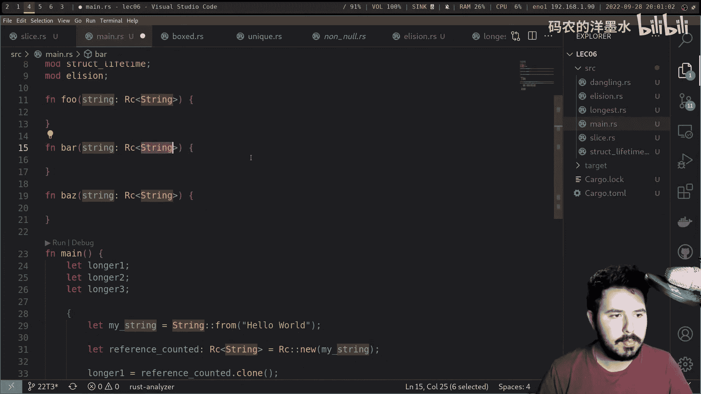

So that's that's a limitation。 So it's the borrowing is you can now share a value without any lifetime。

 It'll live as long as you possibly need it to。 but it has some limitations。 you know。

 you can only read from it because it's a shared it's a shared borrow borrow is not really the right word here。

 but you know， shared access only。 reference counting does have a bit of a performance overhead。

 and you still do need to increment that counter and you do need to decrement the counter each time。

 If you have tons of things at are reference counter， then it can kind of add up。

 but it's pretty rare to be honest， reference counting is usually pretty fast。 However。

 one rather serious problem with reference counting is cycles。

 So I think I saw someone say Migu says basically like manual Java。 So Java has a garbage collector。

 And the one thing that that's sort of。

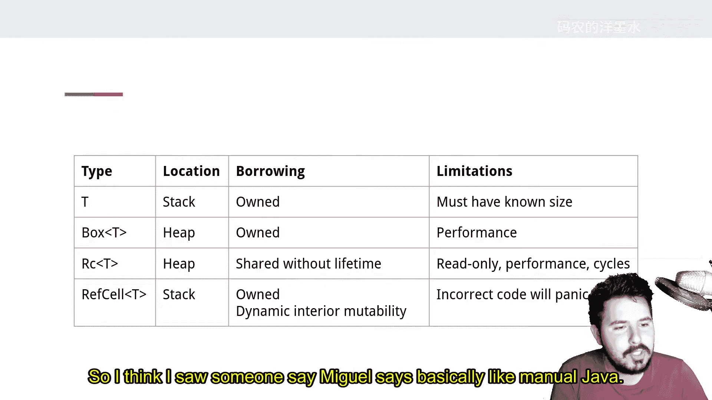

Substantially differentiates a Well， there's quite a few things。

 But one really important idea that differentiates garbage collectors and reference counting is that imagine I had a reference count ofstruct one。

Let's say。诶。Yeah， this is I had a reference cancel。 let's say let's I had some struck，struct 1， Str。

 Str one。And insidestruct1， we had a R C is going to be a， I have to write this as option。

 If you're writing the code yourself， you'll have to use option and you'll end up figuring out why。

 but just for simplicity， I'm gonna to write R C ofstruct2。Right is inside a struct1。

 and if I have astruct ofstruct。2。And struck2 inside it has a field called R C。

 which is an R C ofstruct 1， let's say。Right， and again。

 these are both going to need to be options if you're doing this yourself and you'll figure out why。

 but not super important for us。😊，The problem， and that looks like a two I'm now realizing。

 but it really is a one。嗯。Like that。If I then create these two values like I have an RC ofstruct1 andstruct one points to struct two。

 struct two points to struct1， and then I drop。This one here， well， the。

 the R C obstruct one that is sort of shared between this and this here have count 2。Count 2。

 and this RC of struck2， which is not shared anywhere else， has a count of one， count of one。

I drop the one that I sort of like have access to。Right this is sort of my window into this whole world down here。

But the count doesn't drop to 0 and free old memory。

 it drops to one because we still have this one over here and this one over here pointing at each other。

RightAnd these both end up getting stuck with count of one。

And so even though no one is pointing into either of these。

 these really are like candidate to be freed， we don't need it anymore reference counted cycles see we have a cycle here goes to here and then this goes back we never end up freeing themselves this will end up creating a memory leak sadly whereas a garbage collector which is much slower but potentially more accurate is able to come through and see well no one else is pointing into any of these so I'm going to go ahead and free all this for you that's sort of like a limitation of reference counting as opposed to garbage collection but garbage collection is fast slower and brings a whole bunch of。

😊，A whole bunch of baggage along with it， which I'm sure we'll find some time to talk about sometime。

嗯。So yes， so hang on aren't objects essentially always unique pointers in rust no unique pointer if you're coming from C+ plus is box in rust so you generally write when when your thing is a heat allocation with box so all we've been talking about the majority of what we've been talking about have been stacked values in rust so no not everything is a unique pointer in rust。

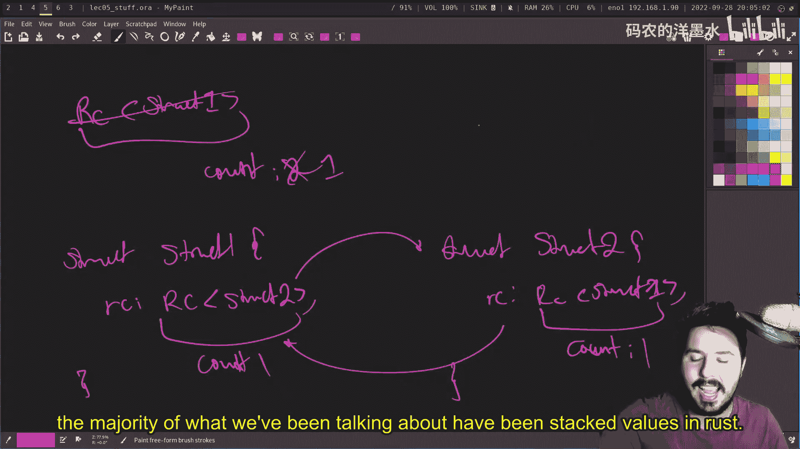

And yes， if you're coming from C++ B's unique pointer。

 RC is Shad pointer and RC is's RC is a little actually Shad pointer is actually something called if you have coming from C++ sharedd pointer is actually something called Arc which we'll talk about in week9 and this is something where Rus has certainly a distinct advantage over C++ in this specific case here。

 but that's sort of just a little teaser we'll talk about it more in week9。😊。

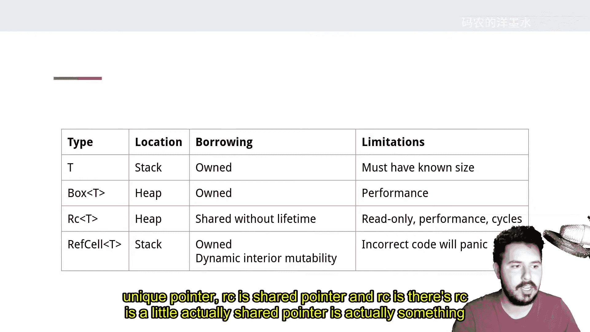

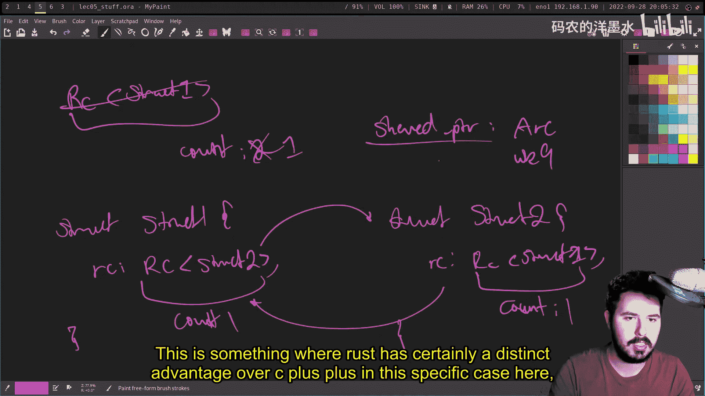

And then finally this is the last one I very quickly want to talk about is RefF cell RefF cell is a really interesting type where essentially what it allows you to do is almost like defer the borrower checking rules to run time。

😊，So instead of the borroworrow checker checking all the stuff as the compiler does。

 checking you checking your ownership rules and whether you can have two exclusive borroworers at the same time and all that。

 instead of it doing it at compile time， it defers that work until runtime and if you sort of put yourself in a situation where the rules would be violated。

 it will panic your code instead it'll crash your code。😊。

So ref cell is a little bit of like an antipa。 You want to try and avoid it if you can because you'd rather be hit by those errors at compile time。

 So your program that you build is more likely to be correct。

 but sometimes you do really need it or it can be really handy to write some code quickly and again it just sort of if you go。

 yeah， I know this is gonna be okay。And the the， but the borrow checker won't get off your back。

 It's complaining about your program that you're very certain is correct。

 but the borrow checker is not convinced of。 You could defer that borrow checking until runtime。

 and it lets you take a， yeah， it lets you essentially。

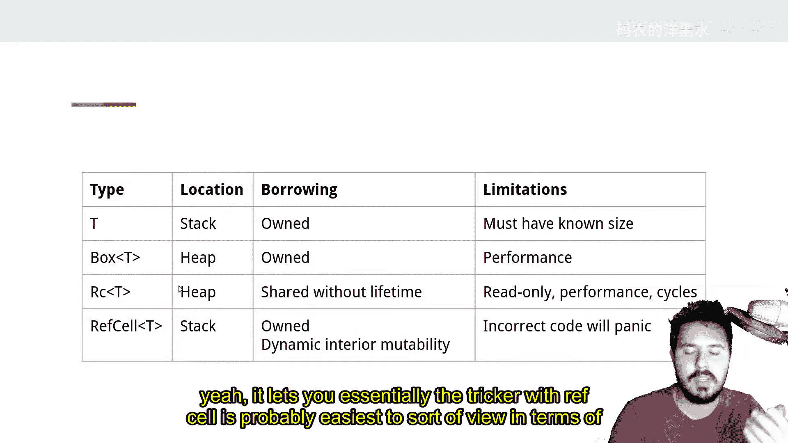

The trick with RefL is probably easiest to sort of view in terms of the documentation。

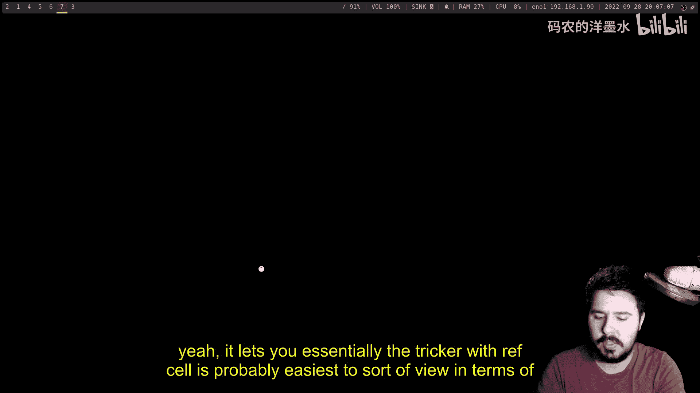

Ref cell。The idea that the thing that's really cool about ref cell is if ISA1 to Ref cell is sort of generic。

 sorry， it takes some type T， so you put a ref cell around some type T like an I 32 or a string or whatever you want。

And you say I want to borrow that。 I want to get like a shared borrow on it， then you can do that。

With with a shared borrow on the ref cell itself。And you can also say I want to borrow exclusively。

 give me an exclusive borrower on the value， and you can also do that with just a shared borrower on self。

😊，And so that looks very scary。 A shared Borrow itself lets you get an exclusive borrow on the inside T。

 which again is scary because I， if I have one refll， I can say give me exclusive borrow。

 exclusive bar exclusive borrower like on many shared borers of the ref cell。

And just get all these exclusive borrows to the end value at the same time， very scary。

 but the trick is if you have an exclusive borrowrow that you're currently using。

 then this function call will end up panicking at runtime because it checks it for you and it'll crash your code and so there's no possibility of unsoundness and breaking rust's rules。

😊，Not it's also worth noting that this is not like magic。😡。

TheThe way Ref cell is implemented is not compiler magic。

 It's not like rust the language sort of built in this idea of a ref cell。

 It's actually just like code that someone wrote。 and like you could implement Ref cell yourself。

Maybe at the very end of this course nice it's a nice exercise to try and do yourself it's certainly like very tricky and you need something called unsafe code to make that work but anyone could make refL themselves it's not a special type to get around the borrow checkingck rules it's all sort of above board which is I think rather cool as well。

So。

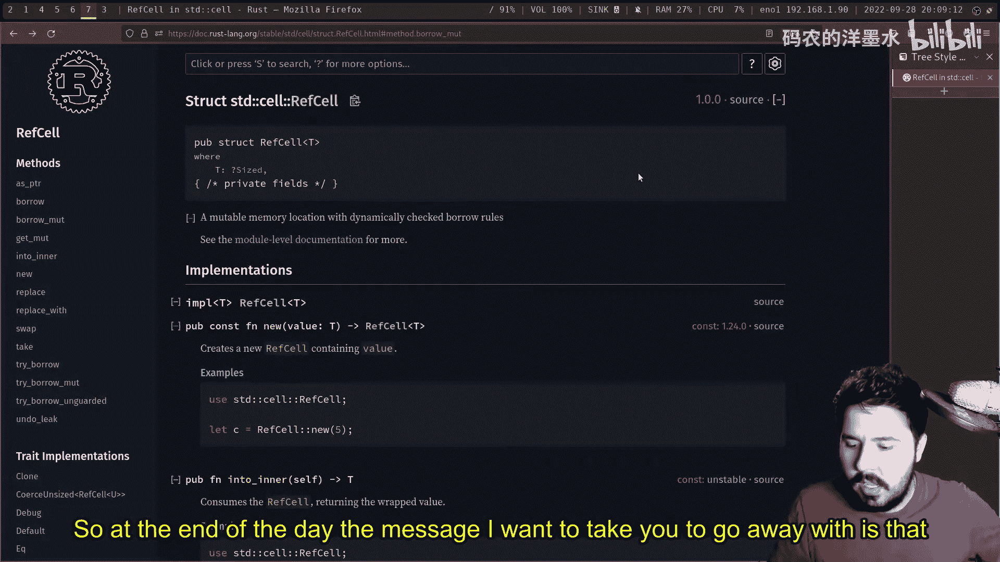

At the end of the day， the message I want to take you to go away with is that there's some smart pointers here to like play around with and to think about。

 And in this case， box， R C and ref cell might be of particular interest to you。

 There are some more as well。 But like， for example， there's other cell types other than ref cell。

 Ref cell is usually is often the most。

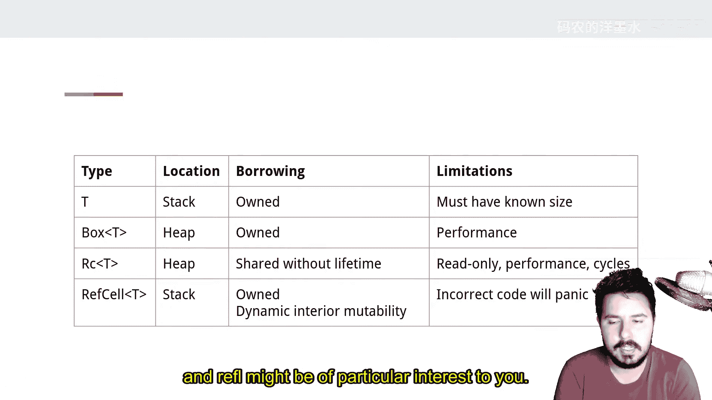

what's the word sort of like flexible of them all， but you also have a cell here。

 you have unsafe cell that that again is。You， you have to be very knowledgeable at rust to confidently use this one。

 So the main tool is cell and ref cell。 have a look at cell in your own time as well。

 C is quite an interesting one and try and think about try and convince yourself why cell is。

 is like sound to exist， why it doesn't break rust's rules。 But otherwise， yeah。

 those are most of the。😊，Most of the smart pointer types that are particularly relevant to this course。

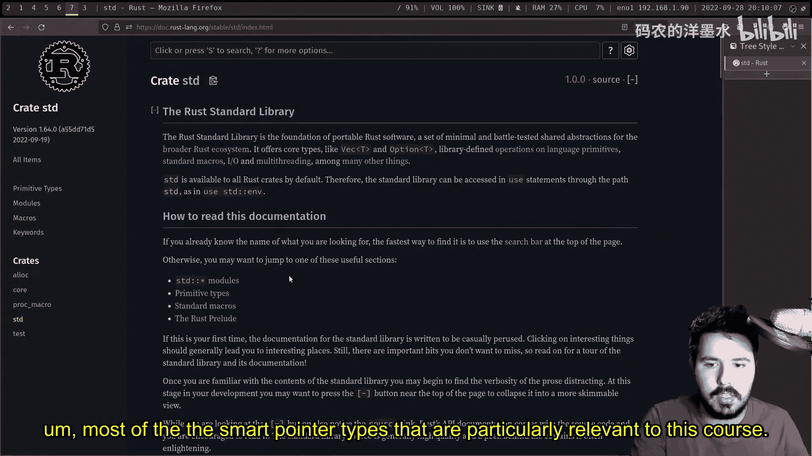

Okay， let's cap it off there。 I think it's a nice spot to， to sort of leave things off。

 Strings also stored in the stack。 So string is stored on the stack。 Again。

 the distinction here is it's just like a V essentially。 Or if you have， you know， let my string。😊。

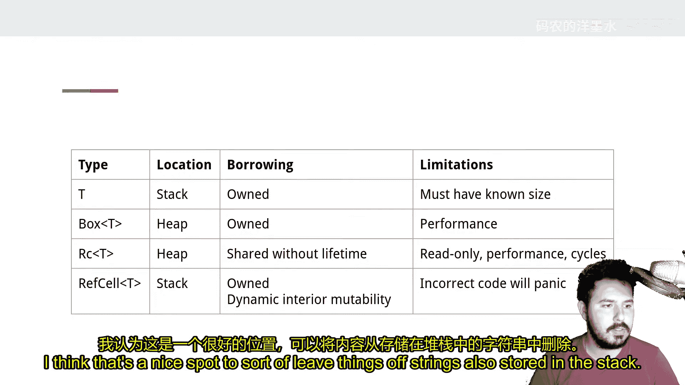

Equals string。From。Hello， right， hello。The trick here is that my string essentially looks like astruct string。

String。Which looks like it has a pointer， it has a length。And it has a capacity。

And so these three things get stored on the stack in my string here。

 these three in a 64 bit computer these will each be 8 bytes。

 so these 24 bytes and it's always 2 a 64 bit computer will be stored on the stack。😊。

But this pointer will point off like， let's say this here is the stack。

 and this side here is the heap。 This pointer will point off to， you know， the bys， H， E， L， L。

 O that live on the heap over here。And so and this might be of any length， in fact。

 the length will be this length that we've stored on the stack here， but this could be dynamic。

 this could be no elements， this could have you know five characters or it could have a million characters as well so that's sort of the distinction there does string live on the stack or the heap kind of like both in a certain sense。

嗯。Cool。So any other questions。 we're wrap up the lecture。 Thank you， everyone for coming。 Thank you。

 everyone for dealing with the the Internet dropouts and you know， bearing with me as I try and。😊。

Make this setup work and keep getting these lectures out。As a reminder。

 next week's content should be more chill， right， This is weak。This is week Oh， this week 3。

 is it week  three or week4， What week a week。I should know this， I think。😊。

Let me double check it's week three that we're in and week four's content is documentation testing modularity。

 I think that's a lot more chill than anything that we've covered yet Week five is like definitely gonna be week five is going to be a fun week in that it's going to be complicated again and have some pretty gnarly stuff to play around with。

😊，Next week is going to be a little more chill。 I hate to say this。

 it doesn't feel super nice for me to like say， but it's something that。

People should probably be aware of regardless census date is at the end of week four。

 I believe like week four Sunday， so next week Sunday。

It it really genuinely does pain me to say this， and I don't want to say it。

 but I'm going to say it anyway because there is know some students who this is you know you'll want to spend some time thinking about this the end of week four is sort of where you might want to take a quick pause and go how am I feeling in this course。

 how am I feeling about the speed of this and how am I sort of getting along with Ru and doing okay And so I think most people who have made it to know pass the prereqs into this course probably are aware of how census works and how it relates to academic and financial liability and all that So it's just there that point where you want to have a quick moment to stop and think am I enjoying the course if you're finding the course difficult that's almost certainly to be expected。

 I think lots of students came out to me before this course ever ran and said。

 hey is this going to be an easy course or is this going to be a hard course and I'd always go like that's like probably not the right question to ask。

Hnest， but I'm always going to lean on the side of going。

 this is probably going to be a hard course and it's probably going to be a relatively high workload course。

So if that's if you's， if you're enjoying yourself and you are sort of。

Eventually coming to understand these concepts， even if it's a week or two behind or whatever it is。

Then that's perfectly normal and okay。 and if you're otherwise having fun and want to keep going with the course。

 then we really would love to have you all if you're not enjoying the course and or you're just like not getting the ideas and you really like having a particularly bad time that's when you might want to consider maybe the course isn't for me at least for now and's it's very sad and I would。

😊，Very much love for that the number of students in that bucket to be zero。

 but its there's going to be you know at least one or two at an absolute minimum for sure and so。😊。

It's just something to be aware of。 Again。 I'm it's making me sad just like talking about this。

 So I'm going to stop talking about this so I can be happy again。

 but just keep that in mind for sure。 And， and if， if you're in that position right now， if you can。

 if you can like。Sort of foresee that you are in that position right now and you like don't want to give up。

 talk to us course forum or the course email or sort of you can talk to a tutor in a workshop and that kind of stuff。

 let us know the position you're in and think of what we can do to help you if it's that you're not enjoying the course you're not enjoying certain aspects。

 let us know also there's the feedback form available as well。

 let us know so we can try and fix it for you and try and keep you in the course and get you through to the end。

 And if you're struggling with things in particular。

 also let us know and maybe we can set up some certain things for like revision or extra content and that kind of thing to help you with that So I want to keep everyone that I possibly can in this course and enjoying it but if if you're really not enjoying things and you don't think there's going to be a way for you to enjoy things that I don't want to hold anyone against their will。

 So that's where I leave that Daniel says need to。Wates again， z out a couple times here， Oh。

 speaking of watching again， speaking of watching again。😊，And in fact。

 I'm going to learn my lesson here and go to a private browser。嗯。

Let me make a quick recommendation like this is just my personal recommendation。

John Jgset is an absolutely fantastic rust educator， rust content creator。

 and he also has sort of live videos that are certainly better than what I'm able to produce to be honest that talk about these similar ideas。

 whether it's talking about lifetimes or smart pointers in this idea of interior imutability with things like refF cell or iterators there all kinds of videos that he's got on his channel and even just somewhere he's like building a big program in rust。

 implementing and optimizing a wordal solver and rust， which is a six hour video。

Absolutely excellent content creator。 I love everything that he creates。 and in particular。

 something like lifetime annotations。 I believe this is the video he does with St split。

 and I'll just double check yes， stir split here。😊，His content is often a little more。

Lanning towards intermediate and its assumptions about rust。

 which is sort of like that this's a tricky thing for us to deal with in the course。😊，Is that。

A lot of the time it's a lot easier to talk about the ideas of Rus and to really teach you deeply about the ideas of Ru once you already know how to write rust and that's sort of where I was talking about that level where it's like you can use rust and follow the compiler complaining at you to get to where you need to get to but you don't have that super deep fundamental understanding about a lot of these ideas John's channel here is really great at getting you from that I know how to use it or I know I can read rust and I can read and write Ru writing maybe to a certain extent if it gets really complicated then you know maybe I can struggle or not get there in the end。

😊，Taking you from there to that really fundamental understanding。

 his channel is absolutely excellent at， whereas in the course， we need。

 we need to keep the students who are sort of far， far further down and like the I'm I'm still getting to grips with even just like the syntax。

 We have to keep them in mind。 So we have a slightly different target audience。But anyway。

 that's an excellent channel to keep in mind， Another one that's also really good that I can personally recommend is faster than lime。

Which is a slightly smaller channel here。 And I think he talks about ideas that are outside Ru as well。

 He also makes some absolutely killer blog posts， which。

Hopefully maybe here， Yes， faster than L dot M。 And there's some really great blog posts that I think I think we've already recommended one or one or two in the course web page here and there but some articles rather not blog post articles that are are seriously very interesting。

 and they're usually like a。I， I find that a lot of these are， you know。

 it says like it's an 80 minute read。 and it's more like， I， I think the sort of。

The thing here is it's more like 30 minutes to read the text。

 but maybe more like 80 minutes to understand it。 so don't get scared off too much by like the the estimated time to read it。

 but they genuinely can be can be very interesting so。Yeah， I guess that is pretty long， isn't it？

Oh my teeth are getting green screened， that's funny。Okay。So any questions before we Oh。

 andmigugo likes no boiler platelate as well。 I think I've seen a couple of them。

 but not enough to give a personal recommendation， but I've certainly， I've certainly。

I think I've seen one or two of their videos。But Miguel seems to recommend them on the on the contingency that sometimes they're a bit information dense。

Okay。Yes， this is a rather long article， there's some shorter ones as well。😊，嗯。

So any last questions before I flick the lecture off， Thank you all for coming once again。

 I hope we learn some new stuff。😊，嗯。I'll leave I'll I'll I'll give if I don't hear any questions by 45 seconds pass。

 then then we'll we'll cut we'll cut things off。Not for the faint heartted。😊，But they're really good。

25 minute read。 I rust match made in hell。I mean， honestly， like。

The text goes faster than you'd think， I feel like。

I feel like the text goes fast anythingca it's a very， it's very like long vertically。

 but a lot of it is just sort of like him talking to himself。 So it'll be like， here's some code。

 And then like， oh， a little thing here， the code changes slightly， a little thing here。

 The code changes slightly， a little thing here， the code changes slightly。

 And so like although that is like， you know，3， a，4 pages of text。

 it maybe only takes like one or two minutes to read。 But yeah， yeah， yeah， Okay。

 I'm not seeing any questions， two weeks to read the Ru book。 Yeah。😊。

I'm not seeing any other questions， so I'm going to leave it there。

 We'll see you all in the workshops， the workshops this week。😊，Oh， that just reminded me。

Monday is a public holiday， I think I think week for Monday is a public holiday， which kind of sucks。

 So we might have to reschedule the lecturer， I might record something。

 I don't know what I'm gonna do yet。 I' I'll I'll make an announcement。

 I got to figure out what I want to do。 But I think it's a public holiday。 So I'll double check that。

 look out for an announcement as usual and yeah， I'll figure that out and let you know what we're gonna do。

 But yeah， I think I think the next lecture。 next next week's Monday lecture is is a public holiday。

 So regardless if assuming I am not wrong here， enjoy your public holiday off as well。

 And we'll see you in the workshops this week， very excited to to do that and we'll address feedback in next week's first lecture again as as mentioned earlier on。

 Alright， thank you， everyone。 Thank you for coming。

 See you in the workshops and have a good have a good night。 Yes， See you later。😊。

