# 【全集】新南威尔士大学 Rust现代编程 中英字幕 1080P p07 Lecture 7 - 集合处理 -BV15cf4BCEN1_p7-

Okay。5 past。

Time to get started， I think so。New term with for this for the streaming setup。

 So we'll start with an A V check。

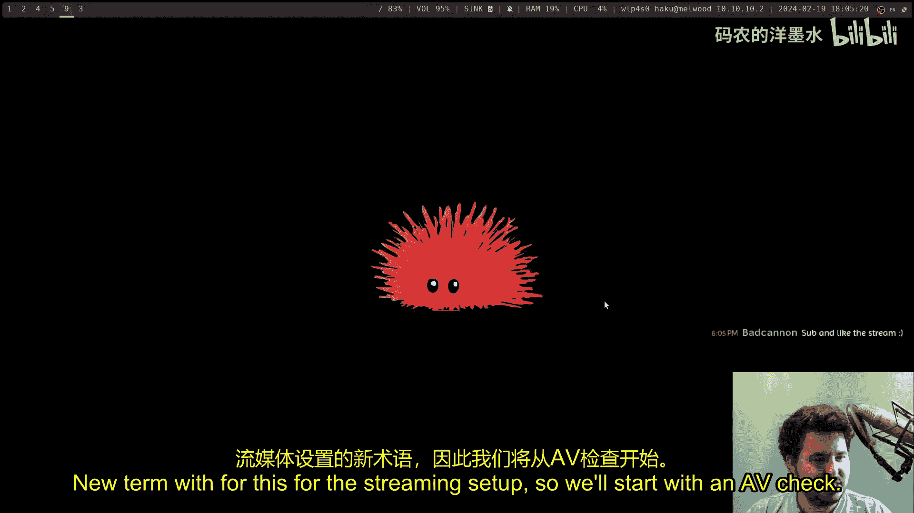

嗯。Can we see the screen， can we read？Like text on the screen。

We see me over here and is the microphone working okay， doing what it needs to do？Oh， good。Hello。

 hello， everyone。 Yes， we can see and here and see fantastic。😊，嗯嗯。As I mentioned in the announcement。

 I'm going to try and。Preserve my voice as much as I can。Actually got， I got a message from Andrew。

Who said that。He thinks there might be some throat sicknesses going around at the moment。

 So if you're feeling unwell， you know， go see a GP and you know stay home from uni if at all possible。

Hopefully， some of us， I'm sure some people had to come into uni regardless。

 but hopefully some of us managed to。Stay home and ski some of the awful weather we've been having today。

Is anyone actually at the room like the room that we usually have the lectures in out of interest？啊。

If you are， and there's other people sitting there confused， like where's the lecturer。

It'll be awesome if you could dislike。

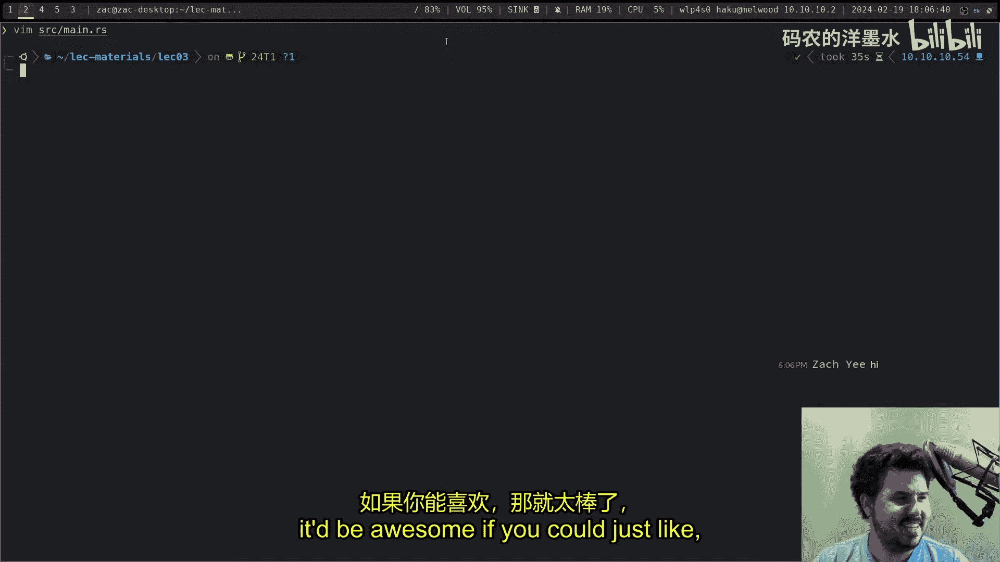

You know， tell them go check the announcement， that kind of thing。嗯。Yeah， and to be clear。

 I'll say this immediately。 we're going just do the same thing for tomorrow as well。 We have another。

Live stream set up for tomorrow。嗯。And so， yeah， will be a little bit online this week。Luckily。

 I have most of the setup up all still kicking around from 22 T 3 originally。

 And it looks like it's mostly working。 So thank you， everyone， for joining。

 It's a totally different format， obviously。😊，Communication， I think。

 is not quite as effective online as it is in person generally。

 but online has all all of its own other kinds of benefits as well in terms of how we can。

 you know how I can present and how efficient I am， you know。

 sitting at a desktop with all these screens and stuff first。

 a tiny little laptop and everything like that。 So you know。

 ups and downs and we'll try and take advantage of what we are able to take advantage of。

Now I'm sure there's going to be plenty of questions around does is this thing not quite so we have like is the exercise marking system currently down you submitted them last Wednesday and they haven't been marked yet in theory if it was working correctly they should have been marked already so almost certainly a bug we're trying to improve some things with it for this term so I'll go talk to the admins and we'll have a look at that for sure it's not going to be your fault don't worry。

嗯。ACool。So as usual， do we have any questions or any you know。

 interest things that you're interested in vaguely relevant to what we're talking about today that you'd like to you know have presented during this lecture while you think of if you have any questions or anything like that。

 I'm going to run us through what we're hoping to get through today and you know it。

We don't need to rush to fit things in or drag past， you know，8 PM whenever everyone wants to。

You know， have some dinner or go to sleep know and so if we don't get through everything I'm totally okay with that。

 it just moves into the next lecture。 but what we're aiming for ideally would be we just missed this little bit here wanting to talk about matching this idea of patternss and how we can match against patternss。

 it's a really powerful feature。 there was this whole thing about optional values which looks like there's a lot of slides here but they're actually relatively quick and it's just like our first little glimpse into contrasting some different languages and features and all that。

 And then you know once we've gotten through that stuff we're hoping to just talk about collections and you'll see that there's really not many slides here It's very we're aiming to have it very practical and contrasting some different approaches to working with collections。

 especially with iterators and imperative styles， functional styles So just playing around with a lot of code basically。

 which is why again。😊，I don't have many slides。😊，Yeah， and hopefully it's a bunch of fun。Hello hello。

 will there be recordings available on Echo as well I if that's something that people want。

 I'll try at the very least， it will be available on YouTube like where we have the the 22 T3 lectures and if you go to this here。

😊，嗯。Allright。 Okay， that's my mistake。 There should be。

 I'll I'll patch the infrastructure after the lecture。

 There's should be an extra column here that says like a link to a YouTube vd。

 like a YouTube recording。And you can view it on YouTube if you'd like。嗯。

But if Echo allows me to upload a manual video， which I think it probably will， but。

If it allows me to， I can also pull down the YouTube video and and upload it there as well。

 if that helps。And will the deadline for week when exercises be extended if the continuous smoking system isn't working close to the due date。

 mainly asking case of educationuc。 Yeah， sure， no worries。 Yeah， that'll be fine。 In fact。

 we usually end up extending it anyway， just in case sometimes we have students who join the course a little late like during week two。

 So we'll probably extend it anyway，'s be let's be real。嗯。Cool， okay， so。Again。

 if you have more of these questions and just keep them coming。

 I'll keep an eye on the live chat over here。 You're welcome to talk to each other in there as well。

 and I'll try and do my best to filter out， you know what's meant for me and what's not。

But otherwise， I suppose let's get started so first of all you want to talk about match and I have a few of these dot points to get through but the most important one here being this idea of pattern matching so to talk about pattern matching I think we'll first talk about what a pattern is。

啊。So a pattern tries to describe the shape of some data。

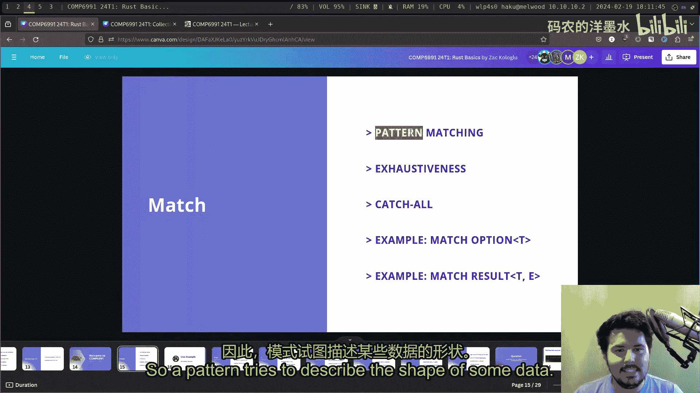

T to describe the shape of some data。So let's maybe don't wanna do it in here。 Let's go。Go。

 let's why not use experimentation。So this is what we were using from last lecture。

 we had a few different。You know， bits of data to play around with over here。And in particular。

 let's just use something like option as a， as an example。

To try and start to talk about what pattern matching is or what even a pattern is。

So we know from the previous lecture that there is this thing called an option。Right。

 option of some type T。 And it's either nothing， none or something， some T。 Yeah， like that。

 So when we're defining an option， I could either say， you know， let my option。

And let's say this is an option because you need to say what kind of， you know。

 an option of what it's a what that may or may not be present。

 Let's just say an option of an integer。 for example， option of I 32。

 I could say this is some value and I need to provide the value in here， like some 100。

I thought if I forget to provide a oops， if I forget to provide a value like this， I get narrow。

You know， this will all be an error if I forget。So I need to provide that value。Or I could also say。

But there is no value， right， specifically because it's an option。 It might be there。

 It might not be。Now， I can also。Do a pattern match on an option。 So there's。

 we've seen things like if， we've seen while， we've seen4， we've seen loop。

 all these control flow operators in Ru。 There's another really special。

 really fancy one called match。😊，Match is great， one of probably my favorite operator in rust。

So what it looks like is you say match and then you say what you want to match on right here。

 So you know， usually some variable， but I could say match on like you know。

 some function that I call that returns a value and it'll match on you know what this whatever this function returns in the same way I could write if。

 you know， this sum function returns true。But keep it simple， match on my option here。

And I'll immediately get narrow because I'm missing these match arms so let me just get it to generate the code for me if you're in like vim or visual Studio code or whatever。

 you can usually press some key combination to get it to suggest things to do for you in my editor I have alt enter setup I think in V code it's maybe maybe control dot or something like that。

You know， play out， you'll find it Often you can get rust analyser to fill the match arms for you and it looks like this。

So what Russ Ana has done for me， is it said。My option。Is going to be in one of two formats。一组。

Either， it'll be something。And it'll have some value， or it'll be nothing。

 If you' seen like switch case like a switch statement with all the different cases。

 it might look kind of similar to that。 But this is kind of like switch case on steroids。 Sw case。

 but like leveled up because what can I do here。 I can say， match on my option。

 It's either going to be nothing。 Sure， or it'll be something。 And I can put in like。You know。

 value here， say some value。And let me just change these to dos here for， let's say， code blocks。

Like that。And there's so many warnings going on， just because。I'm not like it's saying， hey。

 this code is unused。 You're not doing anything with it。 I know it's on purpose。 Okay， there we go。嗯。

Just like this。 So match on my option。 If it's something， then it'll have a value inside it。 right。

 And I've just written like lower case value here。And what Russ says is。Let me match。

 say this value or this value， depending on， you know， if I commented this line out or not，ops。

 match this or this against these potential branches over here。

 So if we see how I've got it right here where it's equal to none。

It's not going to match some value because it the data doesn't look like that。

 It's not structured like that， but it does match none。 These are clearly the same thing here。

 So we go into this branch and say print。The value was。男。Like that， right。

 Let me do like an if true return of a heel。Like materials。Cger run。

 and we say that the value was none， right？Now， if I comment this line out。And I run it again。

 you say we didn't end up in that branch this time， there's no output here。In fact。

 what I can say is。Printlin。The value exists， and it is。Value。Like that。 So in this branch。

 I implicitly have this value variable being declared。Which I' am then able to hopefully print out。

 the value exists， and it is 100。Right。You can even get fancier with this。 right。

 So these are both examples of patterns。However。Another pattern I could have is like sum 42。

This looks looks like a pattern that you could fit this kind of data into。So this branch comes first。

 so matches are， you know， theyre evaluated top to bottom， checks the first branch。

 then the next one， then the next one， then the next one， and so on， right？Now。

IfIf it matches this P summ 42 exactly， then it'll enter this branch and it won't enter any others。

So I could say。I could say something like ha ha，42 like this。 right， So a really special case。

 Haha 42， if I change this now to be 42。😊，You'll see we hit that first branch over here。

 and we don't enter into any of the others。 The important thing。

 what I want to sort of make clear here is that this。

This and this all are patterns as far as rust concerns and a pattern at the very core of it says take some data that exists at runtime。

 All right， some data。 we might not know what the exact state of the data is。

Which we match on and then check， does it look like。

 like could I fit this data into looking like this。Could I fit this data into looking like this。

 Could I fit this data into looking like this so on and so forth。

 And it allows us to do things like leave certain things blank。For rust to fill in with a variable。

 So if I said， imagine it almost like an equation， I have some。With the value 100。

 and I try and match that。Imagine matches like a mathematical operator here。 Mat that against some。

Value。How do I make these two things match？Well， you have to ask， first of all。

 can they match and if they can match， how can I make them match？ And the answer here is， yes。

 they absolutely can match。 And the way that we make them match is we say value must therefore be equal to 100。

Right， as like almost think of this like an equation， right， solving for X。

 solving for value in a certain sense。 And so since rust solved for value here。

 will have value available to us as a。As a variable to use， other wrong。

And match really works for basically any data， so it doesn't need to just be a like an option that could be one thing or the other。

 I could match， say on the number 42。All right， match on 42 and it says， you know。

 missing match on this this type here 42。Is of type I32 is is really big。

 I would actually have to cover all these branches， check if it's zero and like do something to do。

Then check if it's one， then check if it's2， then check if it's3 and so on。

 I'd have to check every branch because in rust， Mat must be exhaustive。 So I have this over here。

 exhaustiveness。 Mat must cover all possible cases of whatever input value they're consuming。Right。

 so in the case of an I32， I'd have to cover every number from negative 2 billion to positive 2 billion right So that way。

 whenever like whenever you match on something， you know you're going to end up in one of these blocks for sure and Rus checks that that must be the case at compile time if it thinks that you've you know if you've broken if it thinks that you've broken that promise。

 it won't let you build your code。😊，Now that seems crazy then。

 like how am I going to ever match on any kind of integer if I have to cover all the integers。

 literally all 4 billion of them。😊，And the answer is， well。

 one answer is that you can also have catch alls in your matches。 A catch all says， you know。

 whatever else it might be， I want you to catch this branch。Now， what I therefore need to do。

 if I wanted to make a catchule， I would have to create a pattern that can match anything。

Write a pattern that no matter what data I give it， it'll match that data。Now。

 if I went back to this example of the hereel。You'll actually see there's a trick I can use to make that happen。

 Imagine what I cared about， let's say， actually， let's say over here。

 we'll get rid of this 42 bit temporarily。Let's say I didn't really care what the value was。

 I really just cared whether the value exists or not。Now， in this sense。

 I've created a variable name value that I'm not even using。Right， there's like it's。

Your code would be a lot less clear if you just randomly said L X equal 42 around the place never actually using X。

 It's not a good idea to create variables for things that you never end up using。

But that's exactly what we're doing here。 by' saying make a variable value that represents whatever value was inside that option。

So if you say I want to match something that looks like this， but I don't care about what's inside。

 I know something will be there， but I just don't care about what it is。There's a pattern for that。

 and that's the underscore。So importantly， I couldn't just say some because if I go back to this。

 I'd lost my pen。Trying to match some of 100。You know， match that against。Some。

These are just not going to match right， these bits match。

 but then where does this stuff go over here doesn't make sense。Similarly。

 if I had parentheses like this， you know， these patterns just don't match like the parentheses will。

 but this thing has to go somewhere in here and it just doesn't fit。But if I put this underscore in。

 underscore is like saying a variable name， but saying I don't care。

 Like I don't actually want that to be a variable。 I just am ignoring this that it's great。

 This all matches over here。 You know， this parent， you can imagine matching over here。

 And then the 100 matches into this wild card pattern。 We call this here a wild card。😊，Right。

 if you've had of like a wild co in。You know， uno， the card game， Shaw， like that's， you know。

 that's what we call it's a wild card pattern it matches anything。嗯。

So this code I could write like this， and this would end up working。Now， if we think about this。

 this wild card said match anything。 So if I wanted to say match on 42， check if it's the number 0，1。

2， or 3， and then any other numbers case， do something else。I could write something like。

And now us is happy。 I've covered all the cases for all the numbers。 It's either 0 or 1 or 2 or 3。

 or any other number。😊，So sometimes it makes sense to have this catch all wild card case at the bottom。

 But you want to be a little careful with it， I would say， in general。

It's easy like it's good to take advantage of the fact that Russ makes sure you've dealt with every possible case。

 and as soon as you put a wild card pattern in， you lose that guarantee because you'll always match every case by default。

It's really quite handy， imagine if we have a this car brand enum。And I want to match on it， right。

 So let me， in fact， do that wherever I got， I've got one down here， match on this brand。

s I can then say fill all my match arms if it's a Toyota， what do I get again。

 Toyota gives me a number， Nissan gives me a string。 So if I say Toyota with my number。

 Nissen with my string， then do all these things。If someone came along and said， oh。

 we have a new client， you know that we need to aggregate cars for。

 I got to come with another car brand。 let's say Mazda， right。They add Mazda in here。 And guess what。

 Any place where we haven't properly dealt with the fact that Mazda might exist。

 We get a compiler error。 And the compiler go， hey， I'll generate the code for you， you know。

 And let's make sure we don't end up with a bug because you forgot to deal with this new thing that someone wrote in。

 So that's actually quite a convenient feature to have available。

 So be sparing and careful with where you have these wild card cases。😊，Another cool thing here。

 notice that when we have a Toyota， it's an option of an I 32。 right。

 Remember we matched on an option and it looked like this。😊，We can do a similar thing over here。

So we could say match on a brand where we have a Toyota。 And it's specifically some number。Right， or。

 and then in the other case， match on a Toyota where there is no number like that。 This also works。

 So the patent system is not just like one dimensional。

 where it works in the very first outermost case。 But then it just stops like thinking from there inwards。

 It's really a well formed total system where we can go and put patterns inside patterns， you know。

 pull out the variable here， you could have like multiple things in here。

 Like if the Toyota also had，It was like a tuple of an option and a string， something like that。

 Then I could have two variables in here。 Toyota is a tuple of an option and you know another string over here。

 this would also work。So it's a really powerful concept， it might be uncomfortable at first。

 and it might be a lot to learn。But it's， you know， it's， it's a really powerful tool to make use of。

 It's also how things like， if I have let x is 42， let y is 1，2，3。

 and I want to swap those variables around。 right， I want to say let X be Y and Y B X。

 That's also how we can do things like let X， Y equal Y X。You might remember， in the first。

In the first lecture or the maybe the second lecture， I told you that let statements。

Actually don't take a variable name here。 They take a pattern。

 It just so turns out that a variable name also is a pattern。

 Pats are more general than variable names。 And this is how we're able to use tricks like this to say。

 create a tuple of the values Y and X。 And then pattern match that tuple against this pattern。Right。

 so x has 42。 Y has 123。 Remember that for a second。

 let's go into the whiteboard over here on the blackboard。So x has 42 and y has 1，2，3。 I say let。X。

 Y be equal to。You know， Y x。Then what that ends up equaling is 1，2，3， oops，1，2。3，42 like that。

 And then we pattern match this data against this pattern。And what we find is yeah。

 we can solve this X matches with this 123 Y here matches with this 42 over here。

 and so they end up getting swapped values and you can you can continue to like iterate on this Pats can be really powerful。

Okay， lot of talking。 Let me catch up with the chat here。

 How would you decide whether choose this over an iflet？

 They seem to almost do the exact same thing from what I can see。 Yeah， that's absolutely true。

 There is another thing I haven't talked about yet， called iflet， where we could say。

With this option， let's say we only cared about the sum case。 We knew that。

That we're not going to do anything in the none case。 It's going to look just like this。

 There is a slightly more concise way of saying this where we can say。

 if let sum something be equal to my option。Like that。Then。Print out the value exists like this。

 So this and this are equivalent。 It's just saying we。

 we only care about this specific pattern matching。And if this pattern happens to match。

 then go into here。 And， of course， oops， and， of course。

 I can use things like variable names in here。 The value this and the value will rather and。

It is value。Like that and this yeah， this will also totally work。

And how do you decide between the two really it's actually just a style thing because they both are functionally the same if you're going to write a match where you only specifically care about one pattern。

 probably a flat might be more convenient for you。😊。

Does match only compare the type of the variables。 So yeah， this might have come a little earlier on。

 but just briefly， it doesn't compare the type。 It really compares the structure of the data。

 So this is really mostly in the case of like an enum， either like this car brand or。

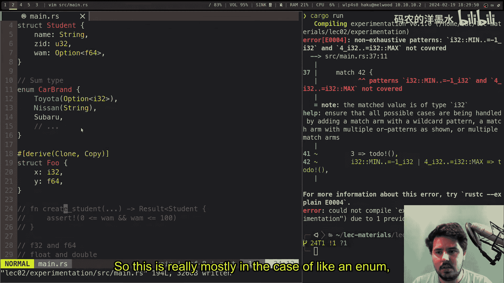

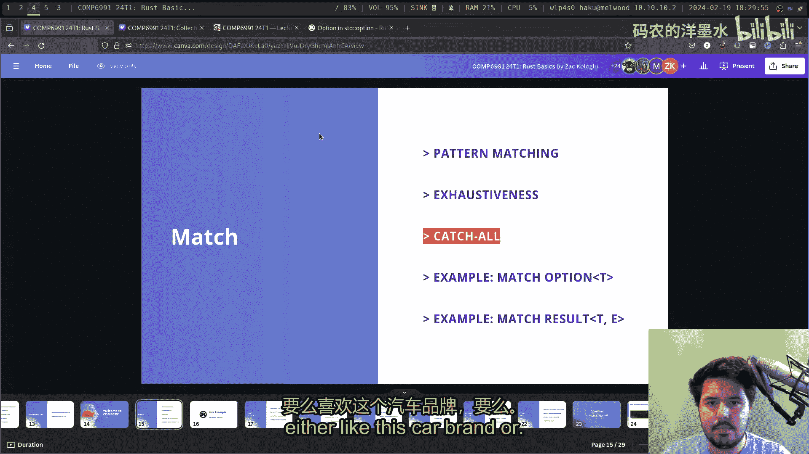

Or an option where we're comparing the structure of the data and the structure of the data at runtime。

 you know， is kind of defined by the type but is not。The type itself， if that kind of makes sense。

 So it's worth noting that these patterns all need to sort of describe a value of the same type that。

 you know， we only can put in one value and that value needs to have a known type as far as Rust is always concerned。

 And then we get to inspect on what exactly is the structure of this specific value。Okay， yep。

 cool answered there。 If some value is on top of the P summ42， let's still print half 42。 Yeah。

 great question。 And I can why not just show you。😊，So what's do。What am I doing？

Where did my match go， I was using this one。So I have， let's say。

 some value and then some 42 specifically。 And let's say the value is value。

 and then this one just prints 42。What we should find is we get the value is 42， not 42 itself。

 because it only finds the very first branch that matches and then ignores the rest。

 I bet if we turned if we used like a liter or something。

 probably if we ran on something like cargo clippy， I would be surprised if it didn't notice。

If it didn't it's got a lot of other stuff going on。

 it may or may not notice there's other like yeah， there's like clippy pedantic and stuff like that。

 there's probably alych that would spot a scenario like this where this match case is never going to get hit actually it might even fall under unused。

 which might be a why we're not seeing it， but in any case does the order of the match case matter yet because it goes top to bottom Can we match on expressions EG's value is less than 42 and greater than5。

 So yeah， there is a extra sort of functionality in patterns that you can also use。

 but is sometimes a little confusing you could say match on some value and then add in what's called a match guard where I can say some value if value is greater than 100 like that。

Now it's saying I'm not covering all these， you know。

 I haven't covered from any number less than 42 in like a sum。

 so it's noticed you know you have more work to do， but you can， yeah。

 you can add on these match guards as they're called。And they can be helpful。

 or we could also change the pattern itself。We could change the pattern itself to be some value like where it's 42 onwards。

 So this here would be a pattern saying some number from 42 up till you know。

 infinity is not really the right word for it， but up to the maximum number effectively。

 or I could say like 42 up to 100 for example， That's a pattern I could use。 Then you might go， well。

 what if I actually want to know which exact number it is。

 And there's more stuff you can do for that。 You can write value at 42 up to 100 it gets， you know。

 there's they're quite complicated。 There's a lot of stuff you can stack on。

 stack on stack on and stuff。 But yeah， you'll just I think it's easiest to just play around with it yourself and you know do the Googling when you think of something that youd quite like to use。

So matches is basically used as a comparison。 Yeah， you're basically comparing data to， you know。

 what kind of structure， what kind of state you think the data might be in。

Instead of a wild card I used an X， and it still worked。 Why is that。 Yeah， great question。

 So if I have， let me undo a little bit back to， let's say here， let's say my wild case。

 wild card cases down here。 I can absolutely change this underscore to Ho。And this will still work。

 because。What's going to end up happening is it's going to match， let's say。

 none being the data against a pattern of， let's start with the underscore。

 underscore and none do they match。 Well， of course。

 the underscore will fill in this nun value and you just won't have a reference to be able to use it。

But if I wrote Wilmart value， let's say I wrote hello instead， these also match。

Because this here is just a variable name。 If it was something that wasn't a variable name。

 like it was。Like student or let's say food down here。

Rust wouldn't be so happy Like if I said it was fo with an X and a Y inside it。

 Like it saw that these， this is not a variable name。 Rust would not really be very happy。

 You can see it's getting an error here。 But if this is just a variable name， hello。

 it's working like an underscore wood。 right， It's working like an underscore wood。

 And I would just have this hello available to use。 So I could say print line，😊。

Value equals hello like this。And then called the。Run。The value wasn't none。

 so I'll actually make it be none。But we see value equals none。

 So this is working just like the underscore case in the same sense that。This and this， you know。

 kind of doing the same thing， just binding a variable or not。On to the order question。

 does the order of match cases impact performance I。

 if I put the case that gets called most often at runtime all the way at the bottom。

 is that less efficient， Yeah， in theory， it'll have to check the cases before's that's correct。

 yeah。So it's more like case conditions in Python。 Yeah， that's that's a reasonable comparison。

 But again， very like the the power of these extends quite greatly。😊。

Will these variables and pans be where matching be accessible outside of the match statement， yeah。

 no， they won't be， because let's say have value in here and hello over here。

Am I gonna be able to use value in h here。 The answer is， we don't really know。

 right if I try and like print out。Value。Whatです。We don't know whether when we went into this match。

 it happened to go into here and get this variable value。So this thing like first of all。

 rust has like scoping rules so that variable is really only going to exist for this scope here。

 but even if it didn't have this scoping rule， even if it had global scope where variables were you know we allowed to exist forever we wouldn't know whether this variable is actually present or not and because rust doesn't have like null or undefined or anything like that anytime we have some sort of value it must always be present in this case。

 value and hello may or may not be present so rust couldn't reasonably say that you're allowed to use those variables outside of it。

Yeah， great question。扣。I think I've more or less caught up on the chat there。嗯。

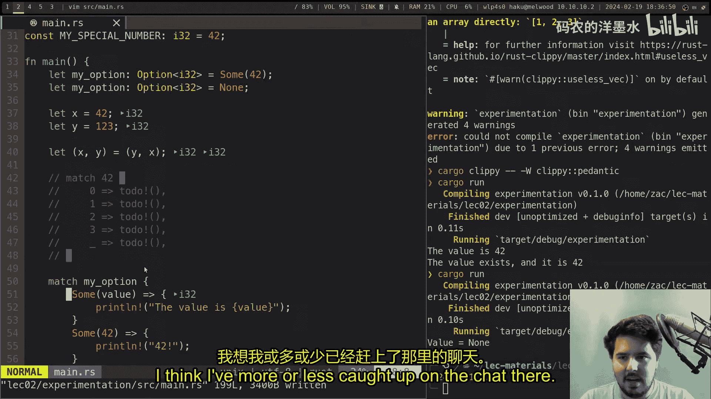

Sweet， what else did I have over here， Mat on an option and matching on a result as well。

 So I've matched on an option in a fair bit。 I'll just briefly show you what matching on a result might look like。

 So results are actually very similar to。

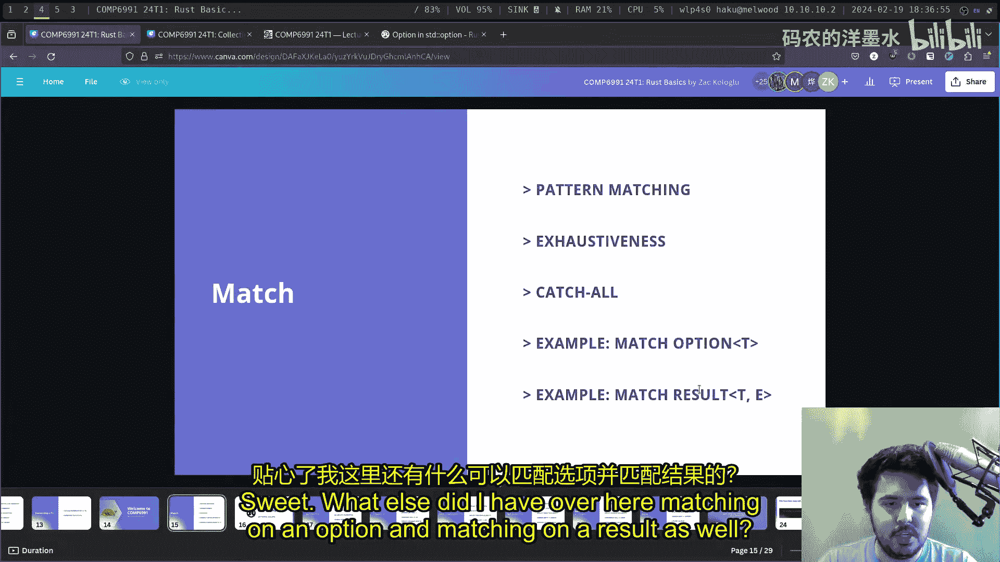

To option。Over here。😊，This one is either nothing or some value T。

A result is either some okay like some value T or error with some， you know value of type E。

 So the difference here is that an option。 it's either giving you the T like here is the value or there's no value at all and no data。

A result is much like an option where it might have an OK value， might exist and have a T for you。

 but if it doesn't， right in the nun case， you can also attach some data right。

 you can say error and here's some sort of error value。

 say like an error message or an error email or something like that。So if I have something like。

 let's go here。Let my result be equal to OK with the value 42。 I could say match on my result。

And let's say this was a result that either has a number or like a error message， which is a string。

Fill the match arms。 And this here， I say， okay， number or error message。で。Os。W。

 and I could write something like print out， okay， the number。Is number。Or I could write error。

 the message is message like that。All if I run this， okay， the number 42。

 but if there was some kind of error and I need to provide an error message like， oh no。

 a really descriptive and useful error message， you'll see error。 the message is oh no， right。

So matching， you know， looks similar to this kind of thing if you don't care what kind of error went wrong。

 you might just wild card it like this。 you just want to see if it went well， but yeah。

 match allows us to do this kind of thing。You can return values from match statements。 Yes。

 so this is the last important thing I really wanted to touch on， which is that like， you know。

 ifs and loops and every one of these operators in rust matches also an expression。

 So if I want to say， let expression value be equal to this。 I totally can。

 I need to put a semicolon down the bottom。 And then each of the branches has to make sure that it's producing a value。

 So let's say this gives back the value。 right。😊，Then in this branch， I say maybe I give back to 42。

 and maybe I want a default value if the option is not present， So the default value might be like 9。

9，9， which is a terrible default value， but it'll serve my example。 Then after this branch。

 I could certainly print out my expression value that I just created。

And you'll say because the value was none， I got back 9，99 out of that。So yeah。

 matches are also expressions just like all those other operators and this can be a really powerful tool to use matches as expressions that is and the highest priority pattern is just the very first one so itll go it'll literally just goes top to bottom in all through all the match branches。

😊，Now， what's the difference between if sum and if let sum， if some won't compile。

 if I say if some like you know， 42 equals my option or whatever like that， this。

 as far as Ru' is concerned won't be like syntactically valid。

 you'll have to say specifically if let。啊。You could do if my option is equal to sum 42 like this with the the double equal sign like that and those will effectively be doing the same things。

 but you wouldn't be able to say， for example， if my option is equal to sum value because it won't know what value is so that's where the you know the power of pattern matching might come in if you want to say if the option is something and you know knowing what the value is out of that。

嗯。Otherwise， you know， if you weren't doing it that way you'd have to write something like this if my option is sum。

 then let the value be equal to my option dot unwrap。An unwrapped is a function that might crash。

 might crash your program。If the option is there， it won't crash your program。

 it'll just give you the value inside it。 but if the option isn't there。

 then it'll crash your program。 Now， in this case， we know it's fine because we just checked if it's some and we're working on the same option in both of these。

 But as things get more complicated， it's very easy to make that mistake。 And that's。

 you know what happens all the time。 So using match to avoid the possibility of making this kind of mistake again。

 yeah， very powerful。😊，OK。Lots of match Mat is really cool。 It's really awesome。Okay。

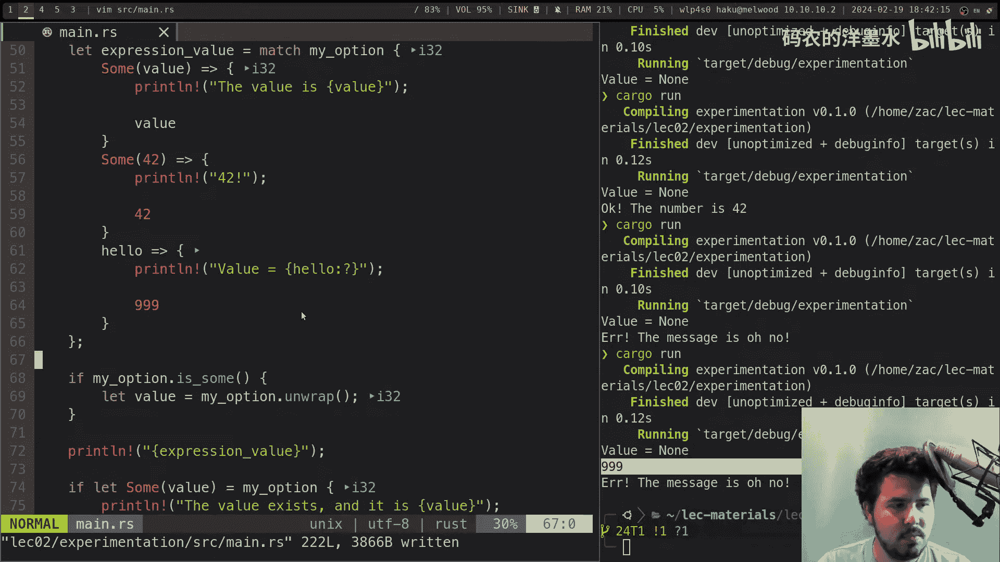

So where are we at？Let's。

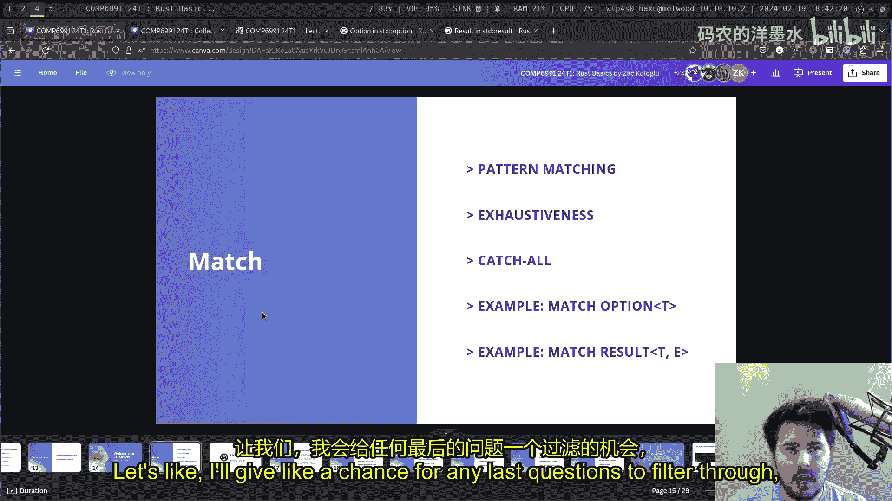

It like I'll， I'll give like a chance for any last questions to filter through， but we'll do well。

Do this like option example， the optional values example up till the break， take a five minute break。

 and then we'll do the like collections content in the latter hour。嗯。Cool。

 so any last questions about this。I think the chat's relatively quick because I've got it on。

On ultra low latency， stream latency， are there any advanced match operators or patterns similar to the at sign that you haven't shown us yet？

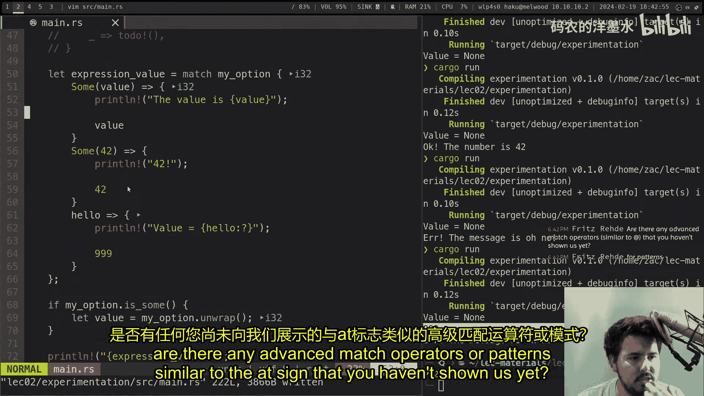

あ。嗯。I mean， we can just go like Ross。

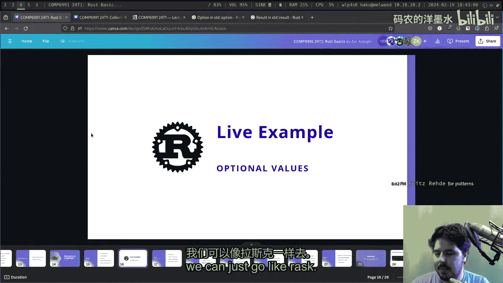

Patterns。Patterns and this is no， no， no， no no， I want rust up design patterns。

 Ru reference patterns。 Here we go。And like， the answer is。You know， purple matching。

 we've sort of seen identify patterns we've seen。Yeah， there is some one that just came to mind。

 Yeah， like the rest pattern， you， if you have like a list that you're matching on， you could say。

Any like any amount of elements。 And then this one being the last one。

Or like this element and I don't care about the rest Well I'll call the rest end。

 for example there's there's all kinds of like special things you can do in here that yeah。

 you could do like the pen ultimate one， So the one before the last one by saying。

Don't care about all the ones at the start。Variable this and then wild cut out the very last element。

 for example。The sign that came to mind is also ref， not this one， but。呃。R。Which will get。Yeah。

 this one Ref over here， which we'll see more of maybe we'll touch on this when we talk about ownership and borrowing。

 but this one is also a little bit special as well。

But yeah so if you're interested in all the crazy ones， the reference would be the place to look。

 there's tons of like crazy stuff here for sure or patterns as well you can do a pattern P or Q with just a single bar in the middle yeah plenty of interesting stuff to look at here。

😊。

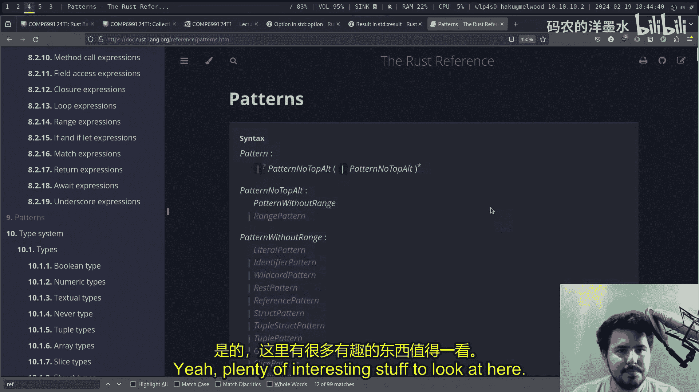

Kill。12。Optional values。 Okay， let's look at optimal values now then。2。Basically。

 what I want to get at here in this segment is talking about the idea of something maybe being present。

 you know， it may or may not be present。

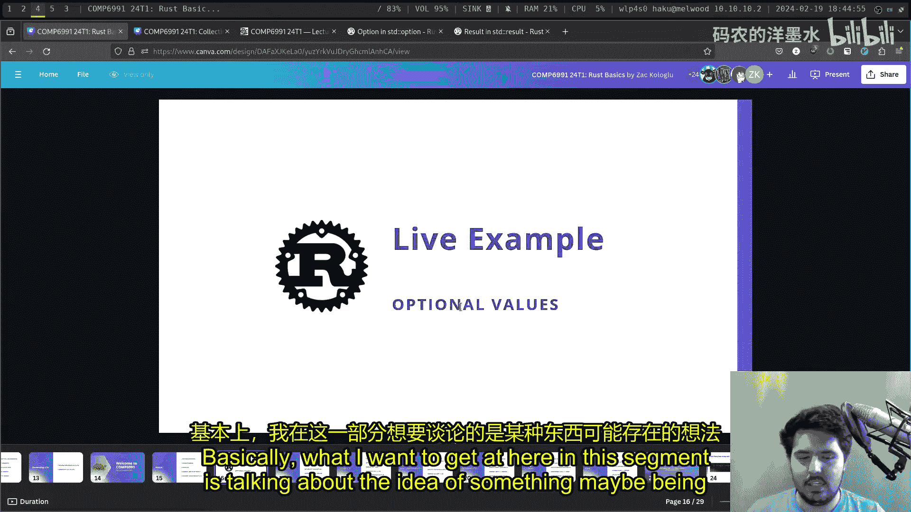

And I've， I previously compiled。A few examples。 I think I actually have this in。3 as well， yeah。

So I put together some examples a while ago of a few different programming languages that I think are relatively popular。

So we have Java C， C++ go， Python and Ru。So in theory， we've all seen。See， hopefully。

So I'll start with C， and you're going to see that all the programs end up looking approximately the same as this。

We have some main function that calls a another function。Which may or may not return a value。

 depending on a boolean。 So if you call this function with true。

 it should return a value that is present。 And if you call the function with false。

 it should return like an empty value， a nu value a null value， whatever you want to call it。

 depending on your language。 And I've tried to do this in relatively the most idiomatic way for each programming language。

 A lot of programming languages allow both like an imperative style and a more functional style。

 So I've also generally included two methods of destructuring that value once you receive it。

So you can see here and see the most canonical way， you know。

 the most idiomatic way of representing a value maybe being present。

 maybe not being is by using a pointer。And you have an implicit null ability of all pointers whenever you have a pointer and C。

 you can almost imagine it to be in two possible states where either the state is。

 it's a pointer to some data or the state is it's a null pointer with no valid value you know like the zero pointer Now in practice that's not quite the case。

 you can also have you know a pointer to some random position in memory that's totally invalid。

 but generally that means your program is has like undefined behavior going on you know is a dangerous program already So we're going to rule in a few of these languages favor and assume that's not the case because again。

 it's a little sideways to the point of talking about a value being present or not。嗯。

So over here it says if it's true， then return， you know this hello their string。

 otherwise return null null being the empty value。And so we can say create with true and one approach we might take to determine whether this value is present or not and then make use of it is and see we could certainly use if。

So we could say if this pointer， right， and when we write if some point of value in C that implicitly is the same as saying。

If C is not equal to null， then we know C must be valid to use。

 and so we can end up using it over here。Otherwise， we'll print out， you know。

 return some empty value。 It'd be a little dangerous to actually just unconditionally write。You know。

 create true return， whatever the value was， because if I do you know percent S with null here or some other function that's you know taking in this kind of value。

 it might not be happy to receive a null pointer and you might end up with you know。

 and see a segmentation fault in some other languages some kind of exception raised like a null pointer exception in Java or something like that。

So we certainly want to make sure that our value is valid to use first。

 but there is a connection going on with with the human here with the programmer in that this line is only valid in the case where creator is not null。

I checked that myself as a human， but it's not like the compiler has my back。

If I forgot this statement。Right if I forgot the whole if statement entirely。

You know is the compiler going to tell me hey， this line is dangerous to run， It'll probably just go。

 sure， I'll run it and then things will go wrong at runtime right。

 runtime when your code's been deployed and you know you might have users using it。

 it might really need to stay online。So。Having the compiler be able to tell you hey。

 this might be dangerous might be might be powerful in some cases。 So if a method to。

 this is another pretty idiomatic way of dealing with this kind of thing。

 I've used a turnernary statement talked about this briefly with regards to rust not having a turnernary statement but toernary expression really but you know under the belief that it doesn't really necessarily need it like other languages might here we unconditionally print but we just substitute a value in you know based on this variable so we say check whether this is okay or not if it is then use it otherwise use this thing Now this is you know potentially a little it's just really a different way of doing things if I forgot the empty case。

 but I remember that it may not be valid than it'll help me remember that I need that。

 this is basically the equivalent if I forgot the else block over here。You know。

 if I if I recognise hey the value might not be there。If I forget the else block。

 compiler is not going to say anything， if I forget the else block over here。

 at least I'll get a syntax error and the compiler will go， hey。

 you forgot to deal with the case where it it's not there。

 so it might be a little more useful in that particular circumstance。😊，But， you know。

 if you forget to check it entirely， it's not exactly going to save you， right。

 It'll still just let you write through。Okay， I'm guessing talking about the compiler。

 not being able to tell you things that are dangerous is leading into the rust compiler warning you about it。

Is it actually the compiler for rust or is it a static analysis tool that's being run before compilation？

 So yeah， we will get to rust in the end and how rust approaches this kind of thing in particular。

 in some cases it will tell you in other cases， it might not。 And in all cases。

 it is the compiler warning you about it。 I mean， the compiler really is a static analysis tool at the end of the day。

 but it is you know built into the compiler。 It is the compiler itself。

 and you can't just sort of skip the checks in a way that's like unexpected。

 I would say I'll show you you know when we get there for sure。Let's have a look at， say， Java。

And well see a pretty similar like a similar kind of approach。But with this optional type here。

 So C Java does have an optional type kind of like rust。

 where we can say we have an optional string that this function returns。 create， taking a boolean。

 if it's true， return a present optional with the value， otherwise return an empty optional。

Right and so we can say create create a present optional and do the whole if it is present。

 then create true do yet， so Java they're working to include some pattern matching things into the language but it doesn't quite have rust's level of pattern matching。

 pulling the value out while checking if it's present like we get with match。

 so there is again that contract between the programmer and what they've written here that the compiler is not exactly checking for。

And it does have a more functional approach similar to C as well。

 get me like create false or else empty。 This is going to say unwrap the optional if it's present。

 otherwise give me this empty thing and this is quite convenient as well because if I forget the or else case。

The Java won't compile。 I say Java is the option。 Oh， my mistake， Of course。

 because you in the case of printing， it will， because you， Java is happy to print it optional。

 But if I accidentally wrote， say。stringring through equals， not that one。

String food equals I've lost it， okay， create falses like that。

It won't be so happy I get rid of this plus try and compile it now， you'll see， hey。

 you forgot to deal with the fact that it may or may not be here。

So it does kind of catch you in that way。That makes sense。嗯。

But there is a nasty little corner going on with Java， which is， you know。

 if we have this optional type。It may be present or it may not be present， right。

 and a you know optional with the string or an empty optional。

 but there is actually a third state as well， which is that the optional itself could be null。

RightSo when I say option create true equals true， in theory， and this it would be generally bad。

 considered bad if this were the case。You could return null in the empty case and what you're going to find is as soon as we call create false and get this null value。

 whatever you try and do on that option is going to cause some kind of error right I say create false and then say dot or else I'm calling or else on a null value you know。

 Java is not going to be happy。 It's going to say you're trying to call some function It doesn't care what the function is doesn't care It's about。

 you know。Checking if a value is not there or not。 Sorry， a value is there or not。

 It's going to say you're calling this on。 No， I don't know what to do with this。

 So if I try and run this instead。Like that。I have it's been compiled by。Java， what do I have。

 Java 11。It was compiled on a more recent version。 Oh my gosh， all right。See something Java 19。

 There we go， null point or exception right， cannot invoke or else because the return value is null。

32。It can get like， you know， things will certainly break if you。

Ever accidentally end up with a null in place of an optional where you're expecting it to be empty or present。

So this really plays into this idea that a lot of languages have this you know。

 this implicit null ability where whenever you have some kind of value in the language。

 sure it might be there， but you'll always have to account for the case where it may be as null。

And so when you try and bake in some kind of optional scheme into your language like Java did。

 they wrote some code to try and， you know， we've seen other languages with this optional thing。

 Let's bring it into our language。 Now the optional itself could actually be null。

 And so the optional being it， you know， an optional that is present or an optional that is not present。

It could also be null itself。 And so you end up with two potentially bad。

 empty cases and then you're still stuck doing if create true is not equal to null and create true is present and stuff like this。

啊。So a lot of， you know， modern code bases have been trying to avoid null and specifically annotate。

 you know。Statically in their code， any value that may potentially be null and force themselves to deal with it because it's starting to be recognized in the industry that may be having a pervasive null potentially anywhere。

Might lead to more likely code failures over time。So that's something that's kind of going on with Java。

 I'm going to like there's， you know， we have C+ plus go and Python。

 I'm going to just quickly run through them and just give you the cliff notes。嗯。

It's really upset with my C++ because I think it might think that it's C in any case try and ignore these errors popping up all over the place。

 but C++ also has this stood optional type over here。😊。

C++ like C does have this idea of nullability about its pointer types。

 but not everything really is a pointer type。And in our case with the optional。

 it actually kind of works a little better。嗯。And so yeah。

 we can have an option of a string and say create a string hello there or return a null option and we have the similar kind of approaches check if the option is valid for some definition of valid as C++ puts it and then they use something like the Dreence operator to get me the value inside of it again。

 same contract where it's not enforced that you need to check this before dereferencing and you might run into issues if you dereference a null option for sure。

 similarly functional kind of approaches might help out sometimes。In gol。

We have the same kind of thing。Any pointer and go can potentially be they don't call an null。

 they call it a nll。 Everyone has to have their own little isms， you know。

Go call it funk Rus has to call it FN。 everyone has to make it slightly different， of course。

 just so it's harder to remember。But so we have check if it's not equal to mill。

 to your reference this kind of thing。 It doesn't really have。

 go doesn't have great functional capabilities generally。

 It's more of like an actual philosophy of the design of the language is that they。

Just find the imperative approach to just to be clearer。

 And so instead of offering multiple approaches， they sort of mandate， you have to work imperatively。

So we can't really do this whole turnernary thing like we did in other language as we have to sort of mimic it by saying create a variable。

 you know， set the variable to this in this case， this in the other case and then print it out down here。

嗯。So， you know， something to be aware of for sure。Again。

 I'm not going to go too deep into all these languages here。

 but you can play around with this code yourself。 Python has implicit nun ability， again， null， nil。

 undefined JavaScript， none we have here in Python。

 where basically any object in Python might be none。And so same thing， check it's not none。

 use the value and our turnernary kind of thing if this is not none。

 then give this value back otherwise give that one， you know。

 the python sort of rapping from the middle factor here over to here， youre love it or you hate it。

 it is what it is。But every value might be done。 And so you see like it's the same pattern across a lot of different programming languages。

 you know， the idiomatic way to deal with these kinds of things。嗯。

And now we'll pull up the rust code over here and we'll see that we can mimic that same thing in rust。

 so we have create returns an option of a string， ignore this like you know extra stuff going on for the moment we'll learn about that later。

 but if it's true， give back some value otherwise don't。

And we have the same thing going on we can do is some like check if it exists and then unwrap it and this might potentially crash。

We also have a functional approach over here， create with you know get an empty value。

 unwrap or provide me this value。But say I like forgot to do this over here。No， it's not going to。

Show me here， but you'll see， you know， you can't print this thing out。

 you forgot to deal with the the fact that it might not be there。 That is， of course。

 unless I you know formatted it differently than it would have been fine similar to other languages。

And this is where I've got some like dot dot dots all the way down here that I'll now get rid of。

 We have this third method of potentially dealing with things where we say match， right。

 and match sort of all these like different edge cases of what we might have like screwed up along the way。

 kind of tends to deal with all of them。 if we forget to deal with the fact that it might not be there。

 And I know， again， might， it's because it's not in a cargo project。

It's not showing me errors in the editor， but you'll see， hey。

 you forgot to cover the nu case over here。 or if I forget the sum case like this。

 you know you forgot to deal with that or if I just tried to like print it out directly without checking what it is print out。

 create true unconditionally like this we get a different error like this。

 only when you've actually dealt with things correctly。

 it'll allow to compile And now there are ways to get around it in potentially dangerous ways like this unw but what you'll come to learn is that rust has a few sort of keywords for specifically dangerous operations So things like unwrap another really common one is expect。

 and it's a relatively small set of these you know naming conventions。

 these keywords that you can sort of keep in your head such that when you see an unrap。

 you go that that might be dangerous。Now， you know if rust is so concerned about safety correctness。

 that kind of thing， why why would it allow us to have something like this？

 And this is actually something that I think is quite a you know。

 a powerful thing about rust is that I find it to be a really nice language for I have an idea of something I want to make。

 I make a prototype it crashes a lot。 It doesn't work for things。

 but I get like the proof of concept out there and I get the working prototype that thing has unwrap everywhere know like everywhere where I have you know some data that may or may not arrive forget it I'm dealing with the proof of concept。

 I want to see if this is gonna work， I'm trying to move quickly， unwrap。

 unra unra unwrap or it's very close cousin expect where I'm saying expect it to be there if it's not then like some error message like this。

啊。Great， so that gets me to a solution quickly because I don't have to think about about all the failure cases。

 But then I have my working prototype。 I get the thumbs up， or maybe it's my own personal project。

 I'm like， yes， this works。 It's gonna to do what I want。 I want it now to not fail。😊，Right。

 now I know what to look for。Right， I know I need to look for unraps， expects， you know。

 a couple other keywords that you might end up searching for。 I could literally do a like a find。

Right or I could just scan through my code and have a very clear indicator of this is an operation I need to fix up。

😊，The same could not really be said， for， let's say see。Because。Over here， okay。

 this is like a string pointer maybe an easier one to look at would be like C++ here。Dereference。

 right， Dereencing was the unwrap in Sa plus plus。RightThat's not so easy to check like every single D reference I've ever done of any pointer and be like those are what I need to clean up。

 That's like half the application， right， Or in C， there was really no operation in this case。

 it's often a D reference though we might just be passing a pointer to something that doesn't really want a null pointer and might cause an error elsewhere or you know。

 same deal goes with go， a D reference， in Pyon Pythons really dangerous because anywhere we use anywhere you use any value。

 that value might be none， and it might be a dangerous operation to do。😊，Right。

 so now you really have to check over all the code if you want to go from prototype to really robust application that deals with all the failure cases。

 or at least when you're prototyping， you need to take really careful note to do Z call of like this is dangerous。

 know， maybe this line in particular isn't， but you'd have to really meticulously keep note of where you need to come back to。

 or at least it's going to be a lot more effort to go from that prototype to the know robust real world application。

😊。

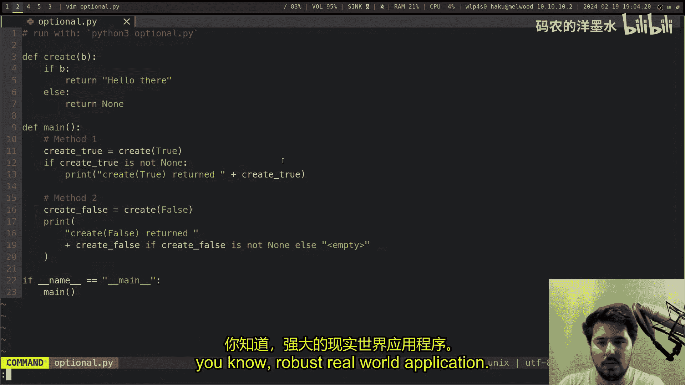

嗯。So， again。I like I have my own opinions about you know how these things sort of interact in different circumstances and I'm not asking you to share my exact opinions。

 I'm asking you to you know listen to the ideas and then experiment with them on your own and then come to your own conclusions。

I've tried to put together the sort of the rough structure of each of these languages we talked about。

 so things like so basically what each of these columns sorry these rows here are saying is talking about how you represent an optional value in each of these languages so and C you would use a pointer of whatever type you're interested in maybe being null。

 you know maybe being not present。Implicit pointing nu ability is saying that all pointers might implicitly be null。

 Unwrapping on star and arrow is saying these are potentially dangerous operations。

 If it's not present。 What happens when you do reference it， you get undefined behavior。

 We're going to find some time in some lecture to talk about undefined behavior。 It's a whole thing。

 Rebust programs must be defensive。 This is a。Important thing to mention。

 this idea of defensive programming。 if you're not sure where things may or may not go wrong。Or say。

 let's say in the very simplest of examples， I have a function。

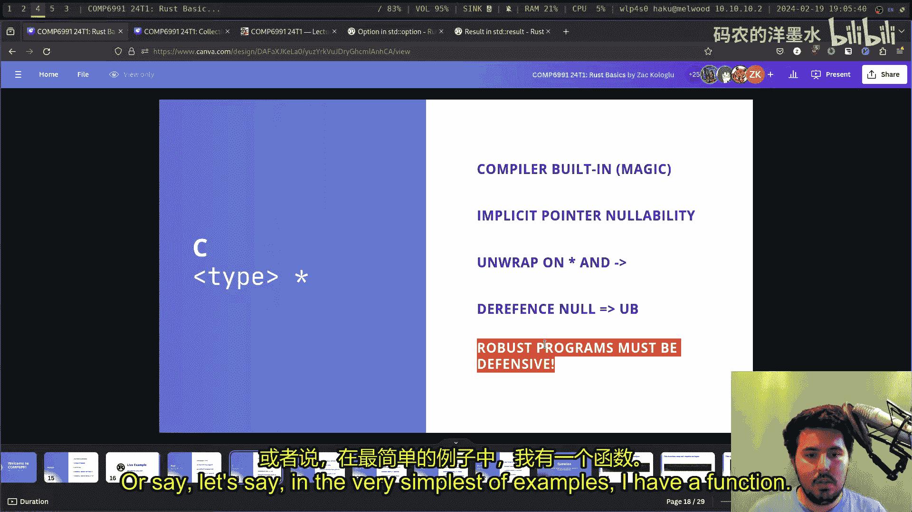

You know， it takes in， let's say， some inputs。And then returns like some type pointer。My question is。

 you call this function。 Let's call it F。You're in your function， you call F with those arguments。

 and it gives you back that value。 let's say you call it Valal， is v valid。

Does it point to a valid actual type？And the answer is。没笔。I don't know。Right。

 like if the function has a comment that says， you know， blah， blah， blah blah blah， like， you know。

 type like or not type style， like the return value is always。Valid。

Right it's always a valid point where it's never null。 okay。

 you read that as a human and you assume that's the case and then you don't need to do a null pointer check。

But what's to stop them from changing the definition of the function？

And now this function maybe sometimes returns null in some case that they didn't consider when they originally wrote it。

Right， they go and update the documentation。 Sure， okay。

 they remove that part that says that it's always valid。Your code still compiles， doesn't it， right。

 Like your code is still going to keep on trucking。

But the fact of the matter is now your function is potentially dangerous。

Because you are relying on what a human said， or if you're reading the implementation of the function。

 the actual implementation details， you know， that's you as a human reading that that might change in future。

The power of only allowing this nullbil through a specific type。Right so。

Having a function that returns type or a function that returns an option of some type。Like this。

Is that now it's represented statically in a way that the compiler verifies。If they go， oh。

 wait we've realize that sometimes this type isn't always going to be valid。

 they need to change the types， then when you go to compile your application with this new version of the function。

 it's going to give you an error exactly where it wasn't going to work。

 where you made the assumption that it was actually there。That's something to think about。

We're going to talk about this again when it comes to。Tony Hare's million dollar mistake as well。

For C++， can't we just have a DF method within the class that returns a DF object。

 which would be a pretty simple getter So couldn't we have a DF method within the class that returns a D object。

 which would be a pretty simple getter In theory you could do that and I think that would have been better if C++ chose to do that just personally The fact of the matter is that the standard library's optional you know optional type。

😊。

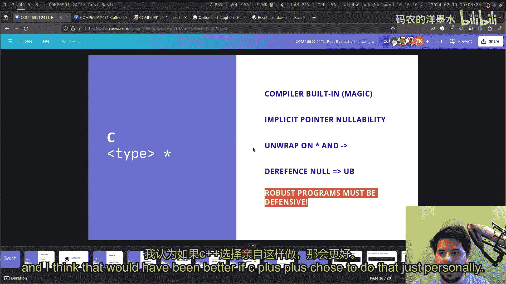

Chose to use the D reference operator to unwrap an option。

 I think it would have probably been better if it was something like dot unwrap in the same way。

 Rust has it because it will be something to look for when you're going to look for dangerous things。

 But because C plus plus doesn't have pattern matching in the way that rust does to help you extract the value out。

 You're gonna find unwrap all over the place where it is realistically totally valid。

 There's not like an error case to check for。 You've already checked for it over here。

So it's rust sort of， it's like twofold where rust is able to reserve unwrap really just for those situations where you're not dealing with things properly。

Because it has tools you know to deal with this case where it it's very clearly been checked for in the way that the compiler of the machine understands so yeah。

 again， just things to think about there。And yes， it does have dot value。

 but there's two ways to do it。 So you're going to find it happening both ways， yeah。

So if we use iflet intentionally and not a quick and easy way， don't handle now。

 would you use unwra for that？😊，So it depends on what you're trying to do if you are saying like I don't care whether there's an error in the sense that like robustly this application。

 it doesn't matter to this application， whether the value is there， whether it's not there。

Like I'm perfectly happy for the thing not to be there。 if let would be good。

 but when you're writing your code and you go， you know。

 this actually in theory could go wrong and I'd like to deal with it someday。

 Dot on rap is useful because it gives you that thing again to look for。😊。

The same thing in theory could be said for like dot value and D reference and that kind of thing。

 and that might be a kind of stylistic approach that you take on within your own like codebase。

 but the good news in Rus is that this is the culture of rust programming This is something we'll talk about in the course as well in that each programming language tends to have a certain culture that forms around it within which like how programmers idiomaticically think about and execute on certain ideas。

And that's， you know， that's generally important in terms of the。

 the approximate standards of the language， let's say。 But again。

 we won't go too sideracked with that today。

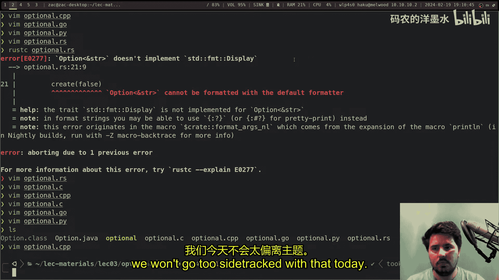

So what I' was saying is when， when I was saying robust programs must be defensive。

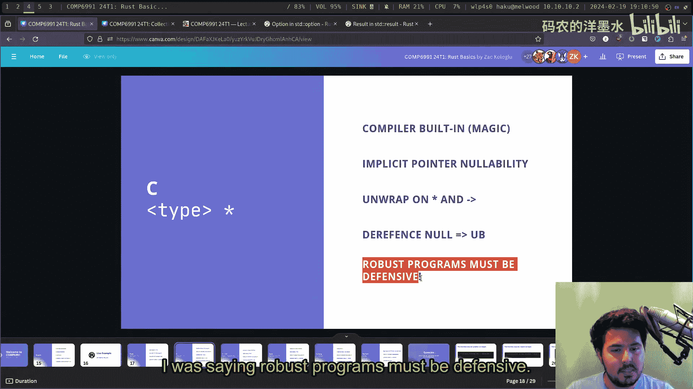

If you're not sure。Whether this， you know value that you get back is actually going to be present or not。

 you end up having to be so defensive in saying， whenever I call a function， check it's not null。

 You know， call this， check it's not null。 then do something with that value。 check that's not null。

 And then like， I get a list back。 check it's not null。 check， it's not empty。 then proceed forward。

 You end up writing so much code just like， Check things are all right。 Check things are all right。

 Check things are all right。 all the time。It helps make your coat a lot more robust。

 less likely to crash， more likely to do the right thing and so on。

But it ends up being very arduous and ends up taking over the code base if you've written you know a lot of。

 you know languages that suffer from this a lot might be things like C and Java probably C plus+ as well again if you're trying to write robust code you've probably felt this kind of pain before。

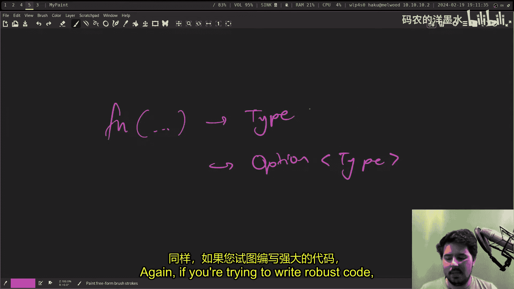

So when you know that your type will， if you have a T， it's never null， it's always there。

 it always actually has the value that we're interested in。

That can be quite powerful for your own assumptions and not needing to not needing to constantly be so defensive and check like is that tea actually there。

 I have a tea， I know it's there。 I have an option of tea。

 I know the option is there and the option will be something or nothing I don't have to consider something nothing and null right as three different possibilities like in some other places。

Anyways， I'll let you go through these slides if you're particularly interested yourself。

General question， what does an optional value even represent？ So quick answers。

 you might have a function that maybe just doesn't produce。

 it might not produce an output string to end。 not all valid not all valid strings are going to be valid integers。

That integer may or may not you know be outputed。A function might not require an input。 It might say。

 hey， this thing is required， but this thing isn't right， or some type might not hold some data。

 a student might be composed of a Z ID name， but that Wham may or may not exist yet， let's say。Right。

Notice that these are being encoded in types。

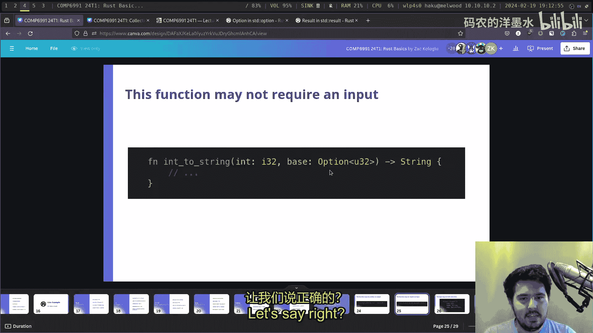

If I have a C function， like if I go into。This one。

 and I want to use the function stir to stir to L over here。Convert a string to an integer。

 Basically stir to L。 It takes in three arguments。 How do I know which arguments are required or not。

Alright， how do I know like， can this be null， can this be null， Can this like。

 what values can this thing take on， You generally need to end up checking。The man pages， right。

 Like you need to go consult documentation。 And what you'll find is that the it says inverse initial part of the string in endpointer。

 That's this one here to a long integer according to the given base。

 which must be between 2 and 36 inclusive or be the special value 0。

 So it's saying the base is actually optional in a sense if it's0， then it's， you know。

 will just default to something else。 end pointer， if end pointer is not null。

 So end pointer is nullable So you know it sort of continues on。

 And then you look at the return value， and that either returns the result of the conversion。

 or it might return long min， or if something else goes wrong， it might return long max。

 it sets something called error number to tell you which area it is right。

 So like there's a lot of human going on here。 and humans make mistakes very often。

If we can get the computer to do the same thing， there might be a benefit to be had there。

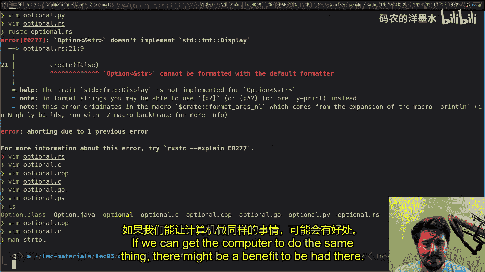

嗯。Cool， now the big question here is。How does language design make writing robust programs easier？

 And I think the general idea I'd like to suggest is that if we don't need to。

If we don't need to be so defensive in our programming。

Due to the language design of having implicit nullability whenever we have something like a pointta or in Python。

 like implicit nun ability of any value。Right？If the language doesn't allow for that kind of case。

 then we don't need to assume that might be the case ever。

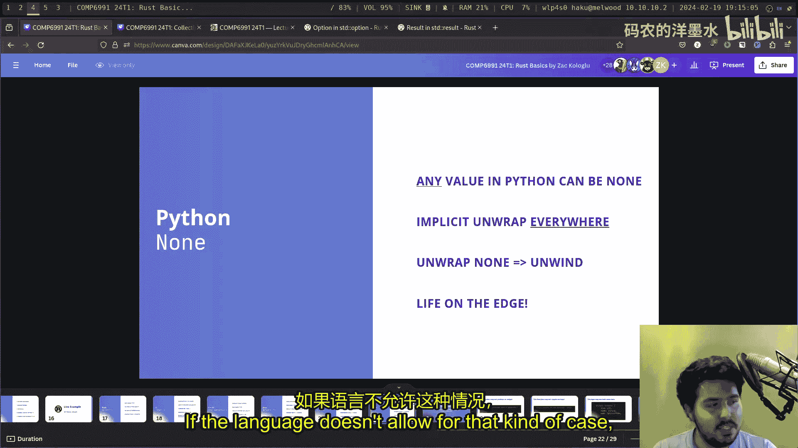

Right and that in theory， can make writing robust programs potentially easier up to you。😊。

A really useful and important like reading here is Tony Hall's billion dollar mistake this info Q link is probably the best one to look at where it's really not that long if I recall。

 okay， it's like an hour but there's like key takeaways here。

 if you have an hour to spend watching this like legend of the industry talk。

About his work。 It's really worth watching。 but he basically invented the null reference。

 the null pointer in Al goal W in 1965， simply because it was so easy to implement。

 And he he basically considers it to be his worst mistake in。In his like programming industry career。

嗯。And so， yeah， see what he has to say about it。 He literally came up with it， and。

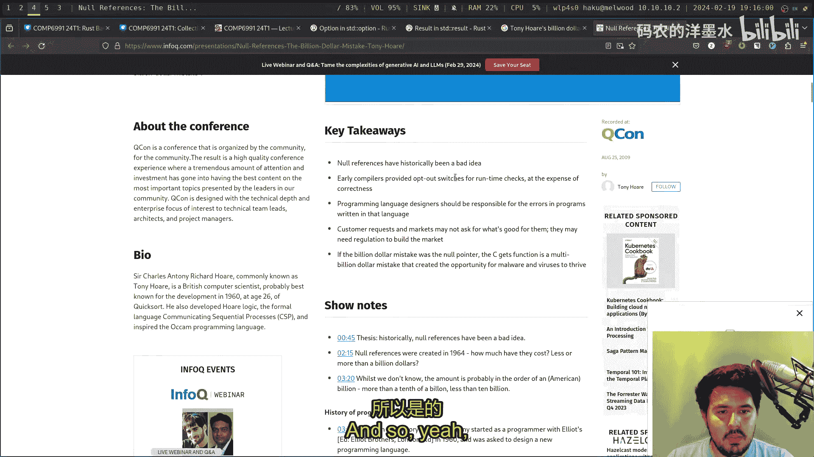

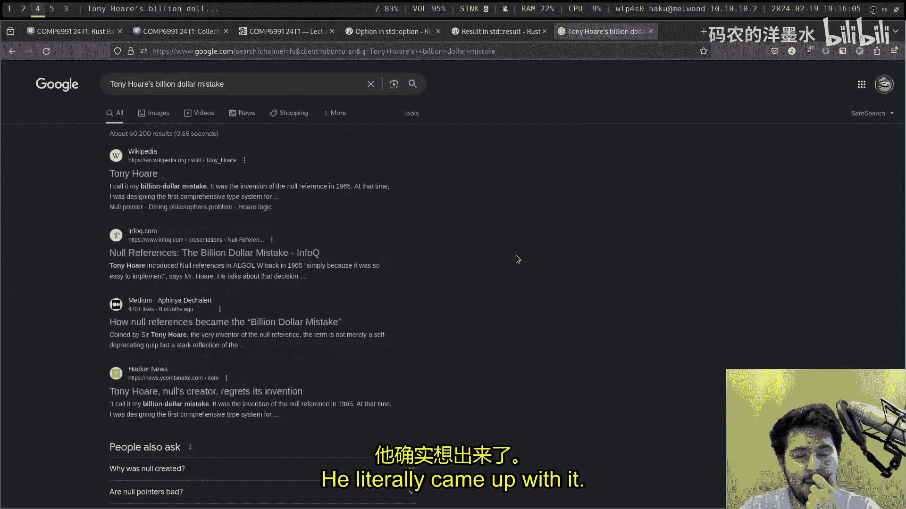

I want to。Like， I want you to look at that。Really， just to suggest。

That maybe null pointers aren't a good idea。 I'm not saying null pointers are a bad idea。

 You must hate null pointers。 You must use languages without null pointers。

 I want you to look at that， and say。Maybe there might be something to be had trying out a language that doesn't include a null pointer。

T to think about。 Okay， cool，16 past。 We'll take a break to like 20 past。 If you have any questions。

 type them in the chat。 And yeah， let's just take a quick break。 We'll come back 2 any0 past。 Look。

 answer some questions and then look at the collection stuff。😊，Cool， all right， quick break。

 quick break。

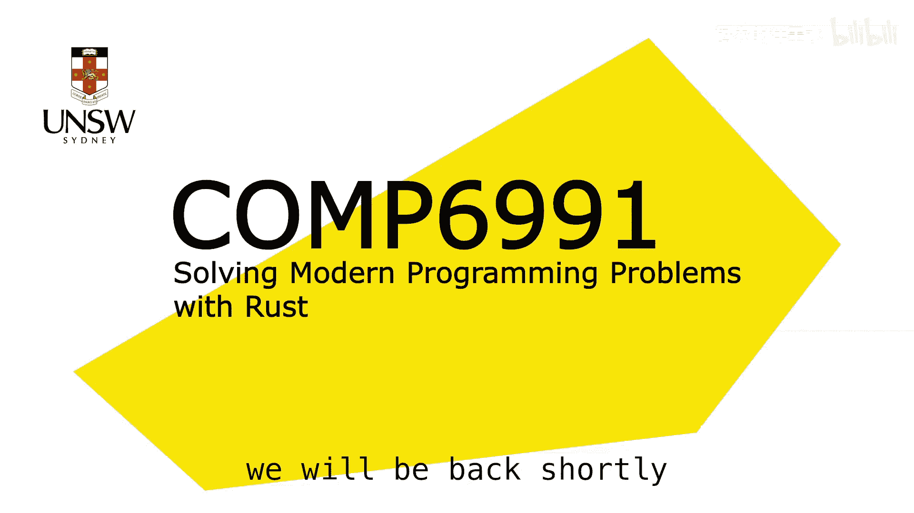

All right， let's get stuck back into it。

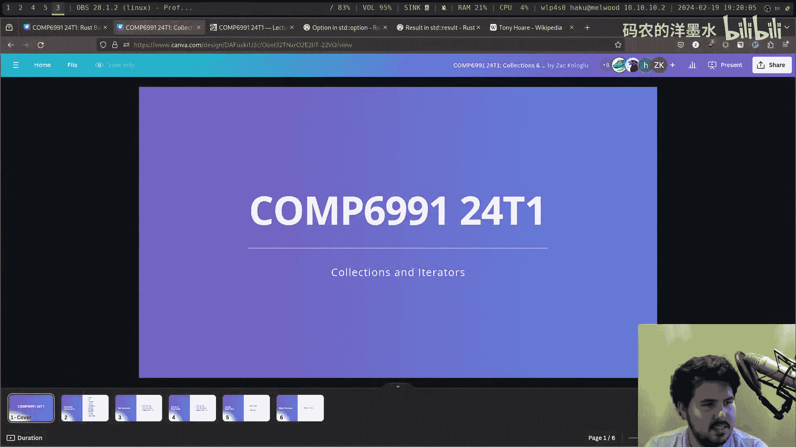

And I think and see， we can use default like a default value。 And the answer is， yeah， in like。

 in some cases， we certainly can use a default value。

 but there's not always like a reasonable default value for things。

 And sometimes the default value might end up just masking issues that are actually happening。

If we say do this thing or provide a default value。You know， maybe that's really what we want to do。

But if C， you know， used default values by default in a lot of these cases。嗯。Where you know。

 something going wrong， we really want to deal with that in some meaningful way。

 have some extra logic that maybe goes on if there's some kind of error。

 then it would probably get in the way more than it helps us。

 You might end up having checks to see if something gave a default value so you can deal with that error gracefully and then you end up with problems where it can be hard to tell between something going successfully and giving this value。

 which also happens to be the same as the default value versus it going wrong and giving the default value。

 which is the same as this other value。 You know there' there's all kinds of extra issues that potentially crop up that you're going worth thinking about。

Okay， so。

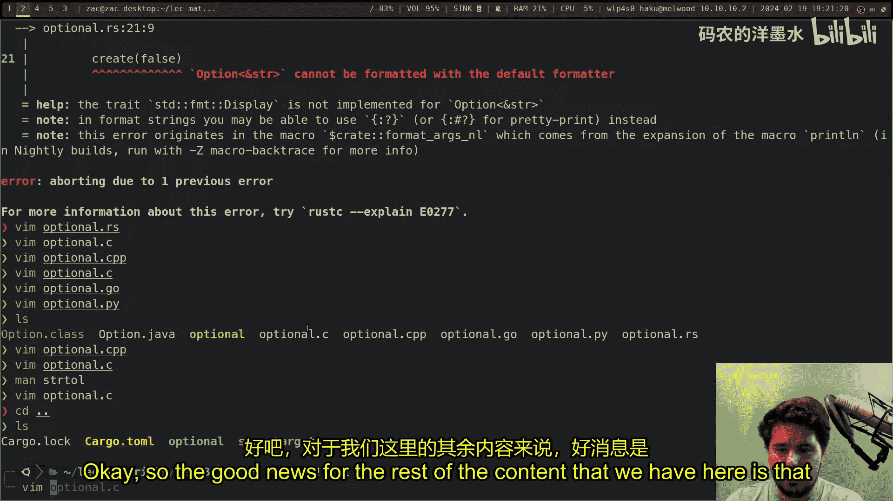

The good news for the rest of the content that we have here is that we actually got a head start on this when we covered。

 you know， we weren't meant to cover like some of the Vex stuff in week 1。 But we did。

 And so we get a head start on all this。 I got a list of common collections for you to have a look through。

 You can just go to the standard library docks and search for。😊。

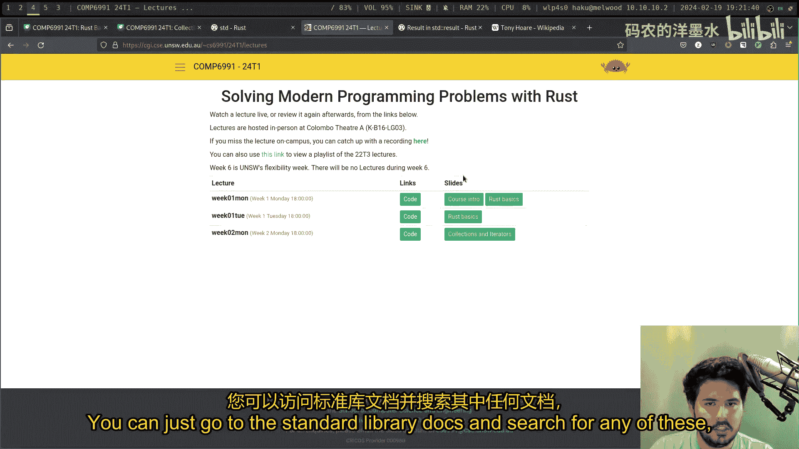

Any of these， like say， if you're interested in a V deck， search for it。

 you'll find it here and there'll be you know documentation explaining what this thing is。

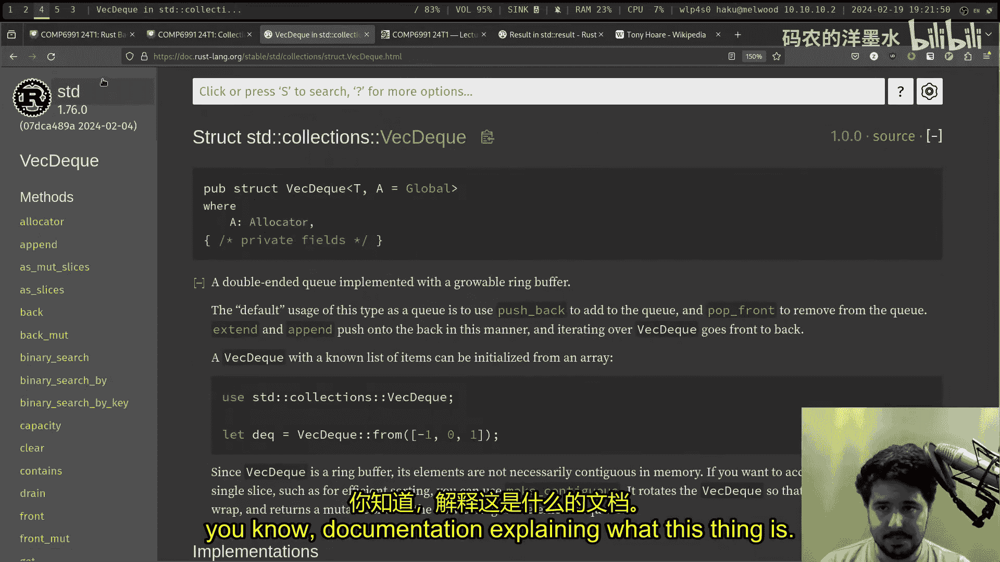

But the real bread and butter ones that you'll use all the time arrays kind of on the half bread and butter。

 you might sometimes use them， but they're not as common the really bread and butter ones。

 Vec string hashmap those you'll just see all the time Vc string hashmap if you're good with these ones。

 you'll generally be you'll be pretty fine。So we just have some exercises to do with Vex to get the hang of them。

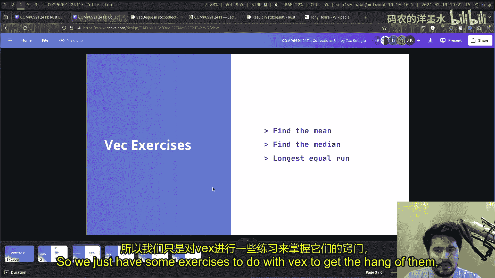

And it's all set up here， ready to go。So we've seen how to create a V and we've seen printing them out。

 we've seen pushing things to the back and stuff just as a quick recap。

 it looks like let mute v equals v bang of 1，2，3， let's say you could also create an empty vector you could create an empty vector a different way like this if you wanted and then I've declared all these as mutable so then we could say later on Ve dot push like the value 42 or more realistically push4 than push 5。

Print out。The the value of that vector。Be here up there。

Cargo run ruin cargo run doesn't know what type of these are。 Why is， okay。

 Ru analyzers working it up。 Okay， cool。 it's saying， hey。

 I don't know what these what these Vs actually are。 So I'm just gonna say they're Vex of I 32s。😊。

Oops。Okay run，4，5， right， I initialized it later to be empty V。Bring this one back， 12345， fantastic。

I'm actually just going to take a second as well to make sure I don't end up putting anything behind my camera。

Have a little terminal in the corner to remind me。 Okay， cool。Great， so we can push things。

 We can index into a V so I can say print out the zeroth element of a vector。😊。

And that gives me the value  one over here， like you'd expect。 you can print out the fourth value。

 That gives me 5。 You can print out the fifth value and get a crash like you would in many other languages。

 A more robust way to index into a vector is not to use the array syntaxia， but to say dot get。

So if I say dot get instead。You'll see I get an option back， right， an option with someone。

If I ask for the fourth thing， you'll see I get some 5。 And when I ask for something out of downs。

 I just get none。 So we're back into option land。 and we can deal with this。

 this kind of error gracefully。嗯。Cool， we can also go through a V。 So we can say4 x in V。

Let's say get rid of this line over here。Say print out。X。One， two， three，4， five， fantastic。mCool。

 and that's going to be like that'll get us most of the way。So we want to find the mean。

 this is our first exercise here。 we get a v of numbers。

 tell us what the average is right so as a reminder the average P have 1，2，3，4。

5 then the average of this list is going to be three because you add up all the numbers1 plus2 plus3 plus4 plus5 is 15 is that true Yes equals 15 So sum equals 15 and then you divide that by the length of the list which is 5 that gets us our average of three。

😊，But if the lists say was 1，2，3，4， then the sum would be 10， the length would be 4。

 and then the average would be 2。5， so I've said we might want to return a float。Okay。

 so let's say let our sum be equal to0。And let's say it's a mutable sum， a sum that can be changed。

We say for number in the V。Add on to that sum， the number that's there。And then at the very end。

 we're going to return the sum divided by the length of the vector。 Now， fortunately。

 we can get the length from this。Return sub divided by the length of the vector。 And again， it's。

 it's a rust。 we don't need to write return。 We can just have this expression at the very end。

Now this isn't going to work。We're going find we're gonna get an error here and I want to have this error pop up quickly because you're going to probably see this a fair amount and I'm going to show you a bad way to deal with it。

 but will you know it'll just be a bad way for now， which is that it's expected F64 found okay。

 that's not the one else。Give me a second， this is the error that I want。

Give me the error that I want to show them。 Okay， y。And I want to sight them。There we go。

 That's the 1 I wanted to show。 Borrow of moved value， Vec。

So what's happening here is that when I say for each number in the V， this acts like a move。

 I talked about moves at the end of last week's lecture。Where basically you know。

 when we have some kind of owned type like a V， like a string。

Then sometimes when I say like pass that to a function or set another variable to be equal to it。

 that induces a move。 It moves out of that value， and it's no longer valid。

 When I say four element in Vec that actually moves Vec right。

 it's moved here And the reason it's moved is so then we actually get this ownership。

 we actually end up moving each of the values inside the Vec， you know， into what we're using here。

 But you know， you don't need to worry about that so much for the moment。

 there's a neat trick which is that calling Le on a V doesn't move out of it。

So we can just say at the top here let land be equal to V dot La， so say call this at the beginning。

And hold on to that。 Just remember what it is down the bottom， you know。

 use L down here and you'll see that this now works and compiles。

 If you see this kind of thing happening in your own code。

 this is just a neat trick to get around it for the moment。

 we also see that length returns this U size。 Again， there's robust ways to deal with this。

 but I'd like it to be quick。 As is one of those kinds of things that you look for when you're trying to make your code more robust look out for as and then you know make it a bit cleaner like using things dot into or dot try into like we've seen previously。

But I'm just I'm going to leave it like that for now。Okay， so now this is returning a number。

 We want to really do like integer sorry， not integer division， but floating point division。

 So I had an F 64 here before。 I need to explicitly it same kind of thing in a lot of languages。

 they sometimes 1。0。Let's say like sum as an F64 get rid of the time 0。

0 that was silly and then this length here we can also store as like an F64 like that。😊。

So just treat these as floating point numbers so we can deal with these decimal cases like such。

 And hopefully， if I use let's say， I write printlin。Find the mean of one，2， three，4， five like this。

Equals something。Find the mean of a v of 1，2，3，4，5。我的。We run this， we see it's equal to 3。0， great。

 and that's what we were expecting before。By the way。

 if you want to do something approximately the same as this， there's a really nice shorthand。

 which I'm going to be using to do that， which is debug， find the mean of 1，2，3，4，5 like that。

You'll see if I run this now。It's basically saying the same information。

This is here and this is here， it just also gives you the file and the line number。

 which is quite convenient as well。啊。You can even then use that value。 So if you。

 if I wanted to debug， I think Vec dot L is giving me like the wrong value。

 I can also just throw a debug around there。And you'll see it'll print out that debug as it's running and still work。

 So debug is a really nice tool in rust to help debug your applications。

A difference between V new and Vec of empty of this like empty thing over here， absolutely nothing。

 So use whichever one you like to look of more。If I go back to 1，2，3，4， let's see。

 iss it dealing with。The floating points correctly， 2。5 seems correct， fantastic。

 but we had a message in the chat what if the length of vector is zero？😊。

And the answer is we get NAN Nan， which is a fancy floating point thing。

 floating points are standardized Rust really couldn't deviate from the floating point standard。

 and so null has made an appearance， is' kind of a tragedy of floating point of IE754 I AE754 if you're interested in that 152 on Comp52 on talks about it quite a bit。

😊，嗯。😊，And so yeah， this is like a reasonable thing， What if the V is empty？

So how might we like to deal with that particular situation， right？

And the answer is like we could you know have a like a panic going on。

 like we could crash the application， we could write some documentation and say the list must be non emptyty。

 like important， you need to you know do this or we could try and bake into the types that hey。

 maybe there's some cases where this isn't valid。So if we say this is going to be an option like this。

Then say， if V dot is empty。Return none。And the very end here， if things have gone well。

 give back some value。This is now， you know， a new way of working。 We see we get 1，2，3。

45 is sum value 3，1，2，3，4 is sum value 2。5， and empty Vec gives us just none。So this might be a。

A way that you'd like to implement this say that this， you know。

 this function may not return a value in the case where this spec is empty。

What is the exclamation point that's around the place here like in Dbug and Vec。

 it means it's a macro in and we'll talk about macros in week。😊，7， week 7， we'll talk about macros。

And Python and statistics statistics error mean mean requires at least one data point is raised。

 yeah。Exactly so and raising exceptions is not clear from the function's signature。

 the type of the function there is one language Java has something called checked exceptions where it is clear in the type signature but it also has this other kind of exceptions where you don't actually know what a function might raise might throw we'll talk about that a little bit tomorrow as well。

😊，Cool， so this is， I think， a reasonable implementation of this for now。

 There's certainly improvements that could be made。

 but it's demonstrated most of what we wanted to look at， I'd say。

Just as another exercise finding the median， the median is sort of like the average。

 but what you're looking for is the middle element。 So if I had  one，2，2，3，4。

What's the middle element well right in the middle here is two， so this would end up being two。

If I have 1，2， let's say 1，2，4，7， something like that， there is really no middle element。

 It's these two。 And so you end up just taking the average of those two。 So you'd get three here。

Right， so the middle element is this pair and take the average of the pair。

 that's how mediumns work in mats。So。Find the median。 What's the median as well。

 This is the kind of thing we should be thinking about What's the median of an empty list And I think it's reasonable to say well。

 the median doesn't exist for an empty list。 So I think it might be reasonable to take this same similar approach over here and start with an option like that。

But this here would just be none。Okay， so if Vec is empty。It's a none。Like that。Now。

This middle index is going to kind of change our logic depending on whether the list has a well defined middle or not。

So an easy way to check that is check if it's even。 so we can say if V dot L。

I wish I wish Ru hadta is even like this。 That would be really nice。 but you know。

 the usual approach。Suffices。If V then mod 2 is equal to 0， So this is if it's even。

This here is if it's odd。If it's odd， we could say it's quite simple just get me the middle index。

 this has length5， we're trying to find the middle index of25 divided by 2 happens to be2 because inter division rounds down so I could really just say give back sum of Vec of the V dot length divided by2。

As a float。Like that。And now you can see Ru is immediately saying， hey。

 you haven't dealt with the even case。 you know， compiler error。 Yes， I know I'm getting there。

 It's okay。 In this case， we would like to say where it's even let the， let's say。

 like the lower middle。😊，Be equal to v of。Be dot land。Divided by2。 So four。

 length of four gives us two。 That would be the upper middle。

 So we really just need to subtract one as well。That。This here can be our upper middle。

 so the two variables in the middle and then a neat little trick why not use find the mean over here that we've used already so we can give back find the mean of a V of lower middle and upper middle so because we already have a function to give us the average。

And this actually works as is。 Find the mean， may or may not return a value。

 We may or may not return a value。 Realistically， we would like to say the mean is equal to this dot unwrap。

 Like we're expecting that this must be the case。 In fact。

 you might like to write and expect and say this is exactly why this is totally fine to do。

And then once you've unwrapped it。Give back。呃Some。Mean like that。

And we ensure that this code path never really leads to a nun in an unexpected case。

 but as a shortcut in theory you could also just write。You know， delegate to find the mean。

Are we assuming it's sorted。 let's say yes， in this case。

 We're not like if we weren't sure it's sorted， that's totally fine。

 we can say vector sort over here as well before we start。

 And that's a nice function to have its sorts in place。 It's worth knowing。

 So it'll mutate the vector。 So let's do that。What do you think of giving find the means something like the V 1 data structure from the V1 is input。

 So which is always guaranteed to not be empty。 Yeah， that's， that's another option we can have here。

 which is instead of having just taking in an input of a V， we don't have V 1 in rust。

 but you could write， say I 32 like。First。Element being the I 32 and the rest being a list。 Now。

 because we always have to provide this， right， there's no null that we can have for first， you know。

 to call the function， you need to have a first value。 So it looks something like one and then2，3，4。

5，1，2，3，4， And this example just wouldn't work at all。 right， You'll see no errors on these ones。

 error on this one。 And so you absolutely can build this in compile time。

 but it ends up being a little like less convenient。It's often that you won't see。

 even in cases where at least one element is required。

 you won't see people writing it like that just for the convenience factor of using it。

And so there is a balance that has to be made between usability and， you know。

 how much we can really check at compile time。 I mean。

 the the logical limit of how much we can check a compile time going to we're checking literally everything that the program fulfills a certain statically defined contract is fear improving like formal methods kinds of programming。

 which certainly has its place and is very valuable。

 but not for all code because it is a massive overhead。 I think the。Oh，I'm trying to remember。

 I think。Trustworth these systems at UNSW put out what they believe was their factor of difficulty in terms of how much more difficult it is to write formally verified code than just standard code。

 I think they said this is total memory。 So take it with a grain of salt。

 I think that they said either 100 or 1000 was their factor。 and they were aiming to get towards 10。

 That's just off my memory。 Someone might be able to look it up and find the exact you know quotes But the point here is that there is there's a trade off。

Between writing code that is， you know where're certain is going to be correct and how difficult it is to write it。

 and it's about finding the balance that works best for you and you know your team， your company。

 whoever you're working with really。Cool， so I suppose we'll just quickly test this out as well。

 Of course， Rus does have like unit testing capabilities and the likes。

But it's not what we're gonna get into today。1，2， what are my examples，1，2，2，3，4，1，2，2。3，4。

 and my other one being。1，2，4，7，1，2，4，7。And then， of course， let's try out the empty list as well。

So we get two， three， and none，2，3， none looks like it's working about as expected。Okay。

 now there's this exercise I want to do called longest equal run。

Where we compare different approaches， particularly imperative， functional and a mix of them。

 But this example really deserves its own time。 So I think well leave it till we'll leave it for tomorrow at the moment。

And then we'll just focus on talking about string， we probably won't even do the hashmap exercise。

 we'll just talk about a hash mapap and I'll let you have that as your own exercise。

 but we'll just give strings and talking about hash maps their own due time and then we'll come back to this example first thing tomorrow。

What if the vector only contains one number element， I think that should be fine for both of them。

 Let's say we just had one value。42 each of them， I believe the correct value for each of these cases would really just be oh sorry median would really just be 42。

So 42 give 42， 42 gives 42， given it's the middle value for the median and it's also the average value just being the only one。

 so those seem to work correctly as well， but it's a good case to think of。

 especially if we're trying to know properly unit test these units， these functions here。😊，Cool。

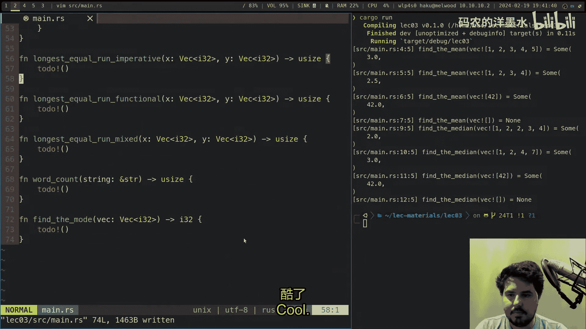

Okay， so。Let's talk about strings。

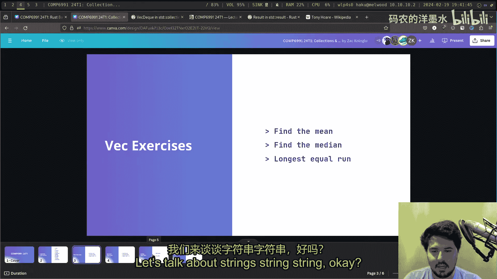

String， string， okay。Now， some important notes strings are UTF 8 in rust。

 if you know what UTF8 means， like if you know what Unicode is， then all strings。

 strings specifically must be UTF 8。 No UTF 16 going on。 No UTF 32 encoded strings。

 although characters are UTF 32。Lh， blah，la， if you don't know what that means it's fine。

 If you don't know what U TF8 means， it means strings can have like emojis， for example。

 and they can have you know， characters from international character sets。

 So you can absolutely have like， say the Japanese alphabet European alphabets like characters with you know。

 little accents and stuff like a。😊，I was hoping they would have。

Something close to the top here that I could use， but imagine like say an E with a with like a line on top of it。

 you know， Chinese character sets and the likes， we can use all of that in rust。嗯。

So they are convenient like that， but they rely on the fact that it must be valid UTFA text as well。

 So if you know what that means， you know what it means， if you don't， it's all good。 emojis work。嗯。

Okay， cool。 So we have two types string。 And there's another one fine stir over here。

And you'll almost always see this as ampaanster， see if they've written it， I'm not you。

Aamppaensster yeah over here is usually seen its bar form ampaanster like this。

Like this or in like one of these other cases here yeah。

 so you can see this function here returns this ampersand stir。

 We don't really know what the ampersand means yet it's kind of like a pointer we call it a borrow or a reference and we'll talk about that a little later on。

But basically when you create when you type double quotes into your program and you write some text in them。

 it'll turn into one of these ampersan stirs， in particular this ampersan tick static stir。

 again we'll talk about earlier this week for。And then there's this other type capital S string。

 And there's actually a whole bunch of other string types。 There's things like O S string。

 There's things like C string。 There's C stir。 There's O S stir。 there's path， there's path。Buff。

 right， I don't mean to like overwhelm you， but rust has a whole bunch of different string types。

 In fact， there's a， there's a meme that I， I quite liked。 It's like how programmers see strings。呃。

I'm going to see yeah we go， I found it。Oh my gosh， why does it that to be a Reddit preview， Okay。

 well， it is what it is。

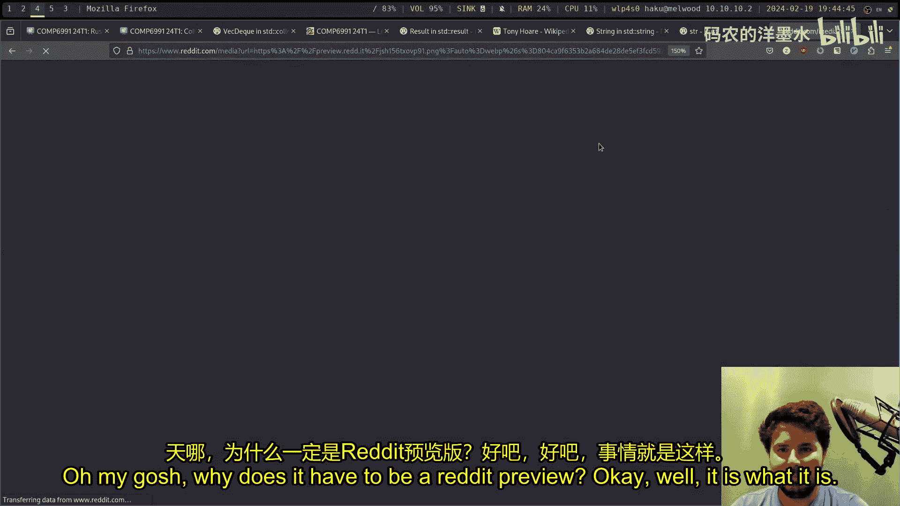

This is the meme here where it's like before using rust strings are a cha star like in C。

 after using rust， there's like all these different types that might represent a string。

 We'll come to understand a good chunk of these throughout the course。

 but they all sort of mean slightly different things。 And it is it's an interesting。

 it's interesting to have that distinction available in rust。

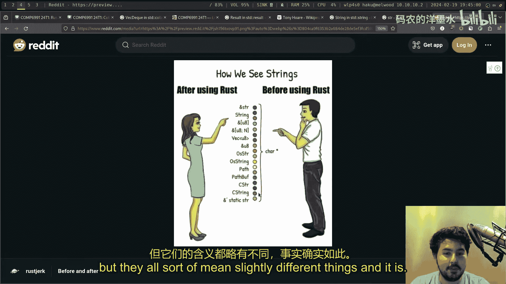

嗯。In any case， where you'll see these amp and strings。

 usually when they're being passed into functions， you'll see the capitalist strings。

 usually when they're being often when they're being passed out of functions like this。

 they work kind of the same to create a low you know an a sensor again。

 you can just do like hello like this that gives you an app sensor。

 If you want to turn that into a capitalist string。

Then you can use strength from that and that will end up doing what you want。

We're going to talk about all of that quite a bit later。

Let's implement a word count which just says how many words are there in this string？

Now you might go oh， I could solve this in my own language。 I' would go like for see in the string。

 like for each character in the string。Do like it to do at the bottom here， and you'll see。You know。

 stir is non iterator， I can say iterate me across the characters of the string C here is a character。

 I could say like if C dot like is equal to a space or C is equal to like a new line or C is equal to a tab or you know。

 all these kinds of things。😊，You know， and then you have a counter function。

 but you got to check if it starts， like if the whole string starts with the space or ends with the space。

 you know those。Don't really count for extra oil。 There's you can， you know。

 you can imagine this as a whole bunch of calculations where you turn it into quite an imperative solution that it really spells out how to do the whole thing。

But we're going to take a more functional approach with this one。We can say something like string。

And then split me， split the string up based on something。 So split， let's us say。

 let's say we had a string that was like hello world fu bar bass like that。

 If I said split on a semi colonlon。 Then this would basically give me hello world。😊，F。

 far fat like this。It won't actually be a list like an arrayator。

 at least something called an iterator， we'll talk about iterators tomorrow。

But splittingly allows us to take one big string。Like this and split it up into all its components。

And there's actual different variations on split， things like split， you know。

 I can say split at an indiceice， like split at index 5， for example。

 or I could say another really good one is split once， or it just says。You know。

 split on the first dilimiter， and then this will give me a tuple with just the first and last part。

 So I could say before， after using pattern matching like this。Right， so the before part。

 the after part， because it returns a， if I look at。Split once。Oh， not that one。With once over here。

 it returns a topple。Of two strings as you know， these kinds of things can be really helpful and handy。

 you know， read through the documentation and see if something is useful for you。 In our case。

 we do have something useful string split white space。

 which says splits a string slice by white space。 let's look at the docks。😊。

Split white space over here。The iterator return will return string slices that are sub slices of the original string slice bh。

 blah bh，lah separated by any amount of white space。

 and they have some examples that are tested here as well。

A good thing we can see here is Mary space space space had turns into Mary and had。

 it actually like joins all these spaces together。 So if I see Mary had a little lamb and see that gives back Mary had a little lamb that looks quite convenient for counting spaces。

 I can say string split on the white space， that gives me back， you know。

 all the individual words separated by white space。😊，And count them up。Done， just like that。

P on the white space counted up。 Now， of course， there's a lot of details going in here， right。

 like split white space， I'm sure was not like an easy function for them to write。In particular。

 if we look at what they would have had to write。呃， he呀。Self do inner a dot next。

 So there's like a split internal。 You know， we， we would have to find。

 we'd have to follow this hole like， you know， rabbit hole down。Where blah， blah， blah， but。

 you know， someone's had to write the code somewhere to do this logic。

 But if someone has written the code for you to do the thing that you want。You know。

 it might end up being a good idea to take advantage of that and keep your implementation simpler。嗯。

Cool， tons of things you can do with strings， just have a brief read through like the different functions available here and you'll pick up a lot of stuff just as you work on rust。

 you'll pick it up passively just reading random bits of code。Yeah， so on and so forth。 Excuse me。

In particular， if you want to work with the individual characters of a string。

 dot Chars is your friend it lets you sort of separate a string into its individual character parts。

You can do things like count them up， you can work on each character individually。 It uses， again。

 this iterator。Praate， which we're going to talk about tomorrow So we'll leave that for now。 Yeah。

 that's like strings we're just talking pretty vague at the moment， just making sure， you know。

 roughly like here's a taxonomy of them and a few things you can do with them。嗯。Finally。

 there's hash maps as well。 again， I'd suggest we're probably not going to write any code with hash maps today。

But if you've used a map or a table or， you know， any kind of key value store before。

 these will work pretty much how you expect them to。

But we can just look at this example to get an idea。

You can see they create a new hash map called book reviews。

 They declare it mutable so that they can insert things into this hash mapap。

 so insert key value and these key values can be different types。

 they have a hashmap of strings to strings， but they certainly could be like strings to like a number。

 maybe it's like the rating of a book or like the number of pages or something like that or astruct with a whole bunch of information。

 any key type， any value type。And they insert Advures of Huckleberry Finnin is my favorite book。

 groomroom's fairy tales is a masterpiece。 Pride and Prejudice is very enjoyable。

 and the adventures of Sherlockhomes is I liked it a lot。 So this is like their reviews。 you know。

 reviews some books。 they can say， check if the book reviews contains Le Mierable。 And if not， then。

 you know， we've got these reviews， but Prince but this one isn't。😊，嗯。So contains key。

 can check if something exists in there， you can remove things from the key value store and then we could say you know get me this key。

 so get pride and Preju， get Alice's Adv in Wonderland and that will return us an option right an option of the value。

P， K and this value over here， V， because， you know。

 you might say get me a book that doesn't exist in there。And it'll tell you， is the。

You could say sum here is the value， key value。Right print out key value。Or if it's not in there。

 you'll get some nonen back and then print out it's unreviewed。

 So using map here to work with the hash map。And you can also look up a value for a key just using the like index operator like we've seen here。

 but again， like a like a v it'll panic if that key doesn't exist like if the index is out of bounds and quite nicely。

 you can also iterate across a hash map。And the the each element within a hash mapap will be a topple。

 a topple pair of the key and the value so you can iterate over everything and you know。

 print them all out like this。 So that's quite convenient。 If I go and click run。

 it'll put it into the rust playground for us， we can then click run and see all this output that comes out here。

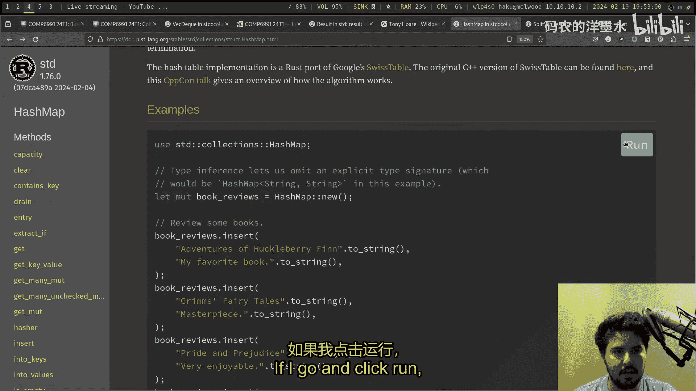

So definitely play around with that stuff and hash maps， yeah they they're pretty common。

 they're quite useful。 There's things like the entry API as well to make， you know。

 to write some particularly clever， more functional code。 Yeah。

 just just have a read of this kind of thing and play around with it， I would say。😊。

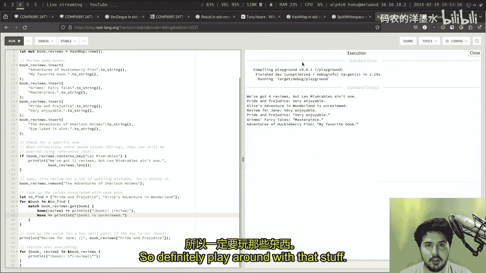

In Java， when you override the equality thinger， you generally also override the hash code for stuff like this。

 Do we also need to do something similar rust for hash maps keys。 Al， the docs head。

 So that's a really good question。 And I'm actually just going to show that off right now。

 Let's say I have a customstructstruct student。😊，That has a。That has a name。 Ha a Z Id。

And has a wham。This， and let's say I wanted to use students as a key and a hashmat。

 let my hash map be a hash map of students to like， I don't know anything， student to string。

 whatever， equals hashm new。What you're going to find is that when you try and say my hash map dot。

Let's say mute my hash mapap。Hi， I'm hashm do。嗯。呃，伟哥。Insert。Right， exactly。

 when I try and like confused about the exactly I'm trying to demonstrate when you try and insert into the hash map some like student value。

 you're gonna see， hey， I won't let you insert into this hash map because student doesn't implement e partial leak or hash basically。

 in order for something to be a key in a hash map。 you need to be able to hash it and you need to be able to compare like a quality wise。

 check if two different keys are equal internally for a hash map， this is quite important。

 And so the trick to solve that is using our old friend derive。

 So I would write something like derive partial leak e hash like that。 And it's gonna say。

 I don't know what hash is probably used hash hash like this。😊，And oops， I put a。

Exclamation point in there for some reason。this is a problem with floating points。

 I was like thinking about this and I was like I'll come back to this。

 some things can't be like because of the floating point standards， they don't have total equality。

It's kind of a long story If you try not to use a floating point number as a key in a hashmat because it's just not gonna work properly。

 And this is sort of a problem in all languages， but Ru forces you to not be able to do it that if you really。

 really know what you're doing there are tricks around it like you can have like a my F 64 kind of type that wraps an F64 and you know so on。

 I can help you through that if that's something you really want to do。

 just ask on the forum But now that this student can be used as a key， I could write something like。

 you know student with some name with some Z I insert that with some string from。Hello， for example。

Like， like that。And this will be happy。 So if you want to use a custom type as a key a hash map。

 you need partial E hash， and those can be derived automatically by by the compiler for you。

There you go。 Okay， I mean， we're at the end of the lecture。 We're at 55 past。

 So lets let's basically call it there to recap。 we talked about pattern matching quite a bit。

 hopefully where you know we have a lot of stuff to explore with pattern matching。

 I'm not expecting you all to understand it all and have learnt it all。

 I just want you to understand some of the ideas behind it and know how to get started with playing around with it yourself。

 trying it out。😊，We talked about optional values and looked at a few different languages and just you know spoke a bit briefly on that。

 didn't get too in depth because you know we'll save some of those more intricate discussions for a little later and we still have like just a lot of intro stuff to get through and then we did a bunch of work with Vex you know playing around with lists talked about strings talked about hash maps as well。

嗯。And we've left some stuff with iterators and comparing imperative and functional approaches for the first thing tomorrow。

 So that's roughly what we looked at today。So I'll stick around as long as anyone has any questions。

 feel free to just ask in the chat and yeah， literally as long as questions keep coming。

 I'll keep answering。😊，Thank you， everyone， for joining。 And we'll pick up on。

 I promise you this will actually be quite a fun little exercise to play around with。 So， you know。

 do。😊，To come tomorrow again and tune in for this coverage over here， it's quite fun。嗯。And yeah。

 I'll catch you tomorrow。Okay， hashtag overwhelmed。 Yes。

 its it all moves very quickly at the beginning of the course。

And so totally cool with like people being overwhelmed and feeling like there's a lot going on because。

😊，There is。 And that's okay。 But we have a lot of practical exercises to try and help you get comfortable with everything。

 And the expectation isn't that you're understanding everything。

 I'm really trying to demonstrate stuff for you to get a vibe of rust。

 see what it sort of looks like and be ready to start experimenting on your own。

 And that's where the learning will really come， I think。

 So much of programming learning is really by doing。😊。

I think it's probably the most efficient way to learn but it's hard to learn by doing when you don't even really know where to start and you don't know what rust even really looks like。

 so I'm just trying to write a bunch of rust code and walk us through a whole bunch of code to get us familiar with the vibes of things and then you'll find that you know what to try you know fall over and then how to pick yourself up and keep looking so。

Totally cool to be overwhelmed。 I get this like every term。 But by the end of it， people go。

 you know， it was， it was tough。 There was a lot to learn。 But， you know， I。

 I got the vibe eventually and。😊，嗯。And yeah， you you'll hopefully be feeling a bit better soon。Cool。

Thanks everyone for like coming out。Okay， so and as always questions。

 May I ask why I can't get my exercise score。 I think a student mentioned at the beginning of the lecture today that。

The exercise mocking is。There's， it's， it's not working correctly。 So literally， you know。

 once I finish this stream， I'm just gonna send a message to the admins and go like， hey。

 we'll just like check up on this。So its it's not your fault。 We'll get it fixed up soon。

Slice pattern docs say within a slice， a range pattern without both lower and upper bounds must be in closings parentheses。

 as in a dot dot to clarify it is intended to match against a single slice element。

And any this means would it match against multiple elements otherwise。Okay。啊。Okay。

 I see what it's saying。What that's saying is， and this is a very specific。Kind of。Isue is。

 let's say， we have a。嗯。Let me think about this。 Let's say we have a list of integers，1，2，3， let 1，2。

3， let x's be equal to 1，2，3。I then want to match X's。And for reasons unbeknownst。

 I kind of want this to be a slice， so don't worry what that means。They're saying now。

 I could match this and say， match on where this is。IActually， no， actually， let's。

 let's leave this in array。 I match this way there。 This is one。Undersco 3。

And then that does something。 and then I have a wild card case that deals with。The other scenario。

 So this is fine so far。What it's saying is， if I want to say。Match。

Let's say one let' let's change this to1，2， and then any number here。If I wanted to say instead。One。

2， and then just any number that's greater than two。Like。呃。3 dot， dot。Like this， I think。嗯。

Then this is potentially conflicting with。It's potentially conflicting with the like slice syntax like this。

 basically。Now， this specific scenario。呵。These patterns。

 x dot dot patterns in slices are experimental。Interesting。So apparently。

 that hasn't quite landed yet。 but I it's， it's like that。 Now， what's it saying。

 a range pattern without both upper and lower bounds must be inclos in parentheses to say it is intended to match against a single slice element。

Is this because can I write。Let。嗯B。1。And then let rain be equal to。Boo dot dot。 I don't。

 I don't think this is something you can do。Oh， maybe it is， okay。So if I go print out。Debug of this。

辛奎。Coming up to it。 Yeah， okay， so it does。 So you can define a range like this， basically。

Where you say。I have， a variable number， and I create a integer range out of that by saying food dot dot。

So saying like 10 upwards， basically， just， it's the same as this， but with a variable。And then。

 I want to match on。This like that same thing， use food dot， dot like this。

What it's complaining about is it's saying。This might， in some cases， match against like。

 if I wanted to say what the number one and then like the rest of the slice to clarify that I'm talking about a single slice element。

I need to put this in parentheses to say I really want， let's say， like the number one。

 and then this element to satisfy the pattern of this range。As opposed to the number one。

 and then like the rest of the slice with this food here。

 I'm not 100% sure what this syntax is representing， but it's complaining that that might be a。

That might be a conflict。Now it's worth mentioning。 It's a great question。 It's an interesting topic。

 This is not a conflict I've ever run into in my years of programming rust。

 so this is going to certainly be very niche， but yeah。

 I think that's the general idea of what they're getting at。😊，嗯。I think that not， yeah， this thing。

 don't worry about this thing。 I was， don't worry about this part。

 I was just looking at testing whether this actually works and does what I thought it was。

 But this panic is just coming down here from there。 Yeah， that's exactly right。

 So don't worry about that part。In fact， it would probably be wise to even comment this。

Out for if students want to like playground with this themselves。So does the show。

 this should still run and do the stuff。 And yeah， I really just wanted to check this line here。Sure。

Another question to end off， if I make my own quality operation not derived。

 should I also make my own hash thing I like Java， or can I still derive it。

 And Rus does some super magic stuff somehow。 Good question。 Let's try it out。 So Iple。

 partial e for a student。😊，Get rid of this derived stuff over here。Implement the missing members。

 And you can see it's actually really nice when you get it to fill out this usually most of the time。

 it'll just fill it out with it to do here。 But when it's something it knows。

 it actually fills the default like a a good implementation as well， which is kind of nice。😊。

Ample e for student。 This actually is just a marker trait。

 so there's nothing to limit there and the hash still works， it turns out。😊，诶。

And so you can certainly implement some things manually yourself that Ike can also be derived as well if I don't want to write that bit here。

 so you can have a custom partial quality and a different hash。

 And if you want to look at what that hash function turned into you can use cargo expand。

 which you won't have installed locally most likely， you can do cargo install cargo expand。

To get that command， or you can just use 6，9，9，1 cargo expand。Ca I have it installed on CSA。

And this expands all the macros and stuff like that。

 And you should see this is what it creates out of。

Imple hash for student you'll see it creates a function hash which basically just you know mutably hashes this name and Z ID field。

 So if you're quality， you know maybe names don't matter which would be a reasonable thing for a student to say that names don't matter only Z IDDs are important for both equality and hashing it's important to realize if I just derive hash it's gonna to hash everything in here So then you might want to do your own hash and so exactly yeah it might cause some problems if they go out of sync So it just depends on exactly what you're doing in the individual case if you want things to be automatically derived。

 it's important to know at least approximately how it's going to be derived in our case with hash。

 it's going to consider all the fields。嗯。So， yeah， there is like an important sort of correspondence between hash and Ike。

 I'd be surprised if it wasn't even mentioned in。In the documentation here， implementingluing hash。

Blah， blah， blah， if you need more control than implement hash yourself。

 when implementing both hash and I， it is important that the following property holds。

 So K1 equals K 2 implies that the hashhes are the same。

You don't need to worry about this if you derive it。

 but violating this as a logic error of the behavior is not specified。

 but it will not result in undefined behavior basically。Yeah， cool。

I say know I've been wondering why your vim is so user friendly as in like。😊。

How my vim looks like this。 It's， it's mostly just stolen configs from random people。

 I don't even know what's in there these days， to be honest。嗯。I'm going to bring this back quickly。嗯。

And then。There's just a whole bunch of random stuff in here。Saing。

FuzzI don't even think I use a fuzzy finding stuff very often like language highlighting。

 like rust analyzer stuff。Late doesn't matter。 you know， I've got some like random things in here。

You can use any of this stuff if you really want to。 I like also like usingarrow keys。

 which is gonna make a lot of people very upset， but it is what it is。 so on and so forth。

 And there's this thing here， alt。Alt enter。嗯。This is a really good shortcut to have。

 And it's not that easy to find like the right thing to put here， so。

This might be helpful if you're trying to set off a similar kind of thing。Yeah。

 you can poke around through this and。Take the the a like。I like to keep it relatively simple。

 to be honest。嗯。Cool， any other questions？Will we wrap up。I will， as always。Yep， this is good。

 as always。I'm going to change it。Oh， I added the matching stuff then， of course。

Add in the LeO3 materials。The old to make use of。And the like materials。GitHub repository。

 so go play around with that code if you're interested。Any other questions？

Lazy is much easier honestly， I'm not sure if lazy is like。Another tool or something。In Vim。

 I'm not really like， I'm not really much of a like a text editor person。 So you've。

 you've probably already gone beyond me And your text editor choice is Minecraft book and quill。

 that seems。Like a very reasonable choice， especially for programming。I like it。

I'd like to say using that as like a。An actual text editor the by poking into the。

Like the save file of the game or something and pulling out wherever it must store that actual text。

😊，ThatThat'll be quite interesting。有。wait the like。Again。

 any more questions in like the next 30 seconds。OhIt's a plug manager them。 butcha。 Yeah。

 there's like， I know there's like。2 or three dozen。Options， I think I'm using what like plug。Yeah。

 I'm using plug。嗯。Yeah， I'm sure it probably is a lot better。I mine thought this days what it is。

Cool， alright， I haven't got any more questions。 So thank you for coming out， everyone。

 I'll see you all tomorrow in same place， You know， up on YouTube。

 Everything's there for you to play around with。 We'll do some fun stuff tomorrow in particular。

 will' be。😊，Continuing on with these examples， which should be really fun。There's a lot to like。

 argue about there， which is always， yeah， tons of fun。

 And then we'll be talking more about air handling。

 particularly with some other languages in mind and。😊，Using we'll。

 we'll use some like match and some other fancy operators as one。

 which is the question mark operator。 It's really quite cool， cool。😊，Other than that thanks。

 everyone。 I'll catch you all tomorrow。 Alright， thanks then， bye bye。😊。

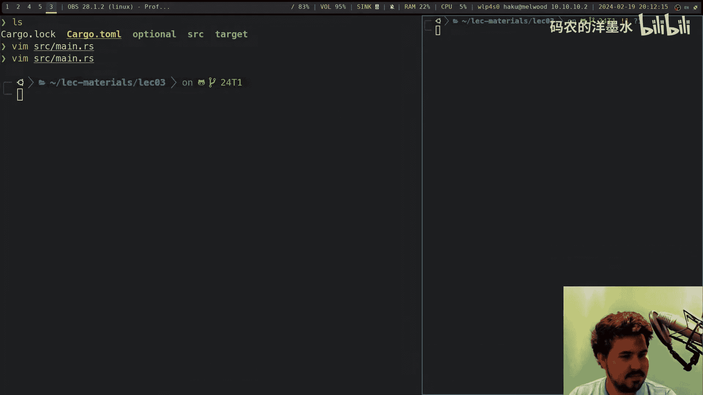

