# 【全集】新南威尔士大学 Rust现代编程 中英字幕 1080P p08 Lecture 8 - 模块与测试 -BV15cf4BCEN1_p8-

All right。Hello， everyone。🤧Hello， hello。Is YouTube working correctly today？Everything seemed okay。

I'll wave my hands up and stuff a bit to。Alright， yes， yes。 Okay， cool。Hello， hello everyone。

 welcome to。Week 4 now。So some fun stuff this week， as I'm sure we're all hopefully already aware。

 we lost Monday's lecture to the public holiday， the second public holiday that has messed with us this term already。

 but that's all right。 we let me turn this off。😊，We。

Ended up the thing we chose to sort of work around Monday's lecture disappearing was Tom produced a series of three videos。

I believe we can probably find those in the lectures over here。 So for the week for Monday lectures。

 it wasn't this is not sorry， there's a slides。 The YouTube video here is not a single video。

 but instead is a。

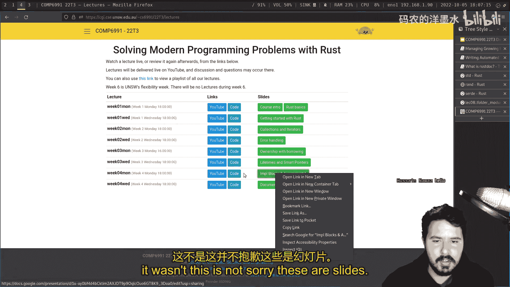

A small playlist， I believe。YouTube there we go where he did a lecture on Iple struct blocks。

 so it's essentially attaching functions attaching methods to act upon a struct It's a very common sort of design pattern that you'll see in lots of I mean really most modern languages。

 but especially sort of tends towards the the object oriented side of things for example。

 we don't have this kind of scoping or like the dot operator in this sort of sense in a language like C but really just about any language that I can conceivably think of that's in like serious modern use today has an equivalent to this kind of idea and rust is no exception So Tom did a quick 15 minute video on that he also did a 20 minute video on impfiltrate for struct blocks So this is this idea of implementing this shared functionality these shared concepts。

For for your own types， we're also going to look at defining our own traits and using them in a more advanced setting next week。

 but I think he was just looking at doing things some stuff like the addition operation or the multiplication operation。

I don't recall if you got around to any more complicated traits than that。

 but mainly just to sort of support you in getting started with assignment one because that is particularly helpful for something I'll mention in a minute he also did an assignment one walkthrough so assignment one if you weren't aware of already has now been released you can find it here under assignments。

It is called adventureenturrs and it is， it's due week 7 Wednesday。

 I believe I'll double check that week 7 Wednesday at 5 PMm。And just so you know。

 we plan to release assignment two week seven weekend due week 10 Friday is our general plan as well。

 so just so you can sort of timetable out when you're going to have assignments and stuff。

 so we give you a little break between the due date of assignment one and the release of assignment two。

And it's all about creating a little game， the idea， you know。

 this idea of sort of creating a little exploring game is certainly inspired。😊，From， you know。

 from other， from other courses and other teaching materials， it's a very sort of。

Common idea to make something like to give a task that's engaging and fun and interesting with also like。

 you know， potentially with quite scalable complexity。

 let's say if you need an assignment that's really simple， really easy。

 then you could scale this kind of task way down and have it just be like do a little bit of work。

If you need some more me Twitter or if you need it to become sufficiently complex。

 then it's the kind of task that you can scale up to there。

We've gone for sort of like a to sort of like on the medium to high complexity range， I believe。

 like is how I'd sort of。You know， phrase it for this assignment。In particular。

 there's a whole bunch of sort of little tasks here。

 It's been split up into eight sort of sub partss for the for the main sort of adventure game。

 part one。嗯。Some of these are basically like， you know。Like very， very simple。

 like something like this should like once you understand the assignment and understand what you have to do。

 something like this probably takes you。You know， two or three minutes to implement。

Some other pieces might take a little bit more time。

 but something I want to make incredibly clear is that this assignment is at its sort of very core is like a design is a design assignment。

So it's one of those things where you know we talk to a lot of students in the workshops and we go oh so you've noticed that you have this option of you know doing something or that option and they go oh I'm just going unwrap everywhere I'm just going to do this I'm just going to do that because that'll get me to announce quickly and you know we only have such a limited time in the workshops and in the context you're working in that absolutely make sense This is one place where I'm going to strongly suggest take like the long route here like。

Think about what you're doing and try and make a design that you are try and make a design you're genuinely proud of and。

You know， like most of the sort of。Critique is going to come from like you've how you've written your code in an assignment like this。

So there's there's a sort of first part where you're basically making a whole bunch of game features and then part two you get to make a completely separate crate。

 which is the Que system。And the idea is that this Que system is supposed to be like a library that you could use completely outside of this Advdventurous assignment if you wanted to。

And it's sort of about making this generic quest interface and how quests compose and all that。

 and again， it's very much about design we don't throughout this whole assignment。

There is there is a lot of sort of room for like feel free to do this how you like or feel free to do this how you feel is appropriate we're not sort of so like this must be done exactly this way。

 this must be done exactly that way and we expect you to use this and that like a lot of this for the most part is like do it how you want you know use your own common sense in terms of like you know just just use your general common sense when it comes to where you get leeway to do you know things your way because for the most part again。

 we're going to there is obviously some marks associated for like us ascertaining that your program works at least you know correctly for some definition of correct but again a big part of this assessment is about design and at the end of the day。

 a lot of it doesn't really matter exactly if you make if you make flowers green or if you make the grass blue or you know whatever the heck it is。

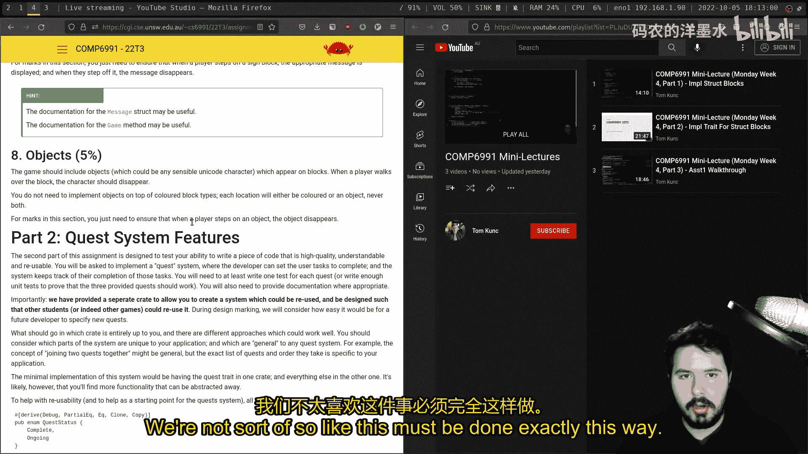

That we care very little about， it's more about the sort of code you've written and how you wrote it essentially。

So the marking has been broken up into this table here， which comes down to mechanical style。

 functional correctness and idiomatic design， mechanical style is basically like you know what you would consider to a big chunk of what you consider be style and something like comp 1511 or 1911 basically meaning compile without warnings without errors。

 Cpy is a nice little tool。Clippy will give you， if you've seen that like Microsoft little paper clip thing that offers you suggestions back in like Windows X P and stuff like that。

 cliplipy is like a little。codeode advisor， I suppose Ed looks over your project and goes， oh hey。

 you've written this like this， but you might want to prefer readingwriting it like that。

's it's a surprisingly clever program。 So you might just want to give it a onceover to see what it think。

 General formatting if your format is again， this is mostly a common sense thing if you have sensible formatting。

 then like will be okay with it。 If you go like I don't want to leave this to a bit of chance or common sense whatever。

 Just run it through rust format， This is just easy tooling that will just format your code idiomaticically。

 I somewhat famously am not a huge fan of auto formats。 And if you sort of。

Similar to me and that that's like a hill that you will die on if your style is sensible。

 then we're okay with it。If your style is like a nightmare。

 then you might end up losing marks here and then。Tests will also fall under。

YouTube is not receiving enough video， but you actually are， you definitely are。Okay， well anyway。

 it's clippy part of rust analyzer， no， Cpy needs to be running separately。

 but it's very simple it's just like cargo oops cargo Clipy or if you're on CSE 6991 cargo cliplipy and it'll just spit out suggestions there it's quite nice。

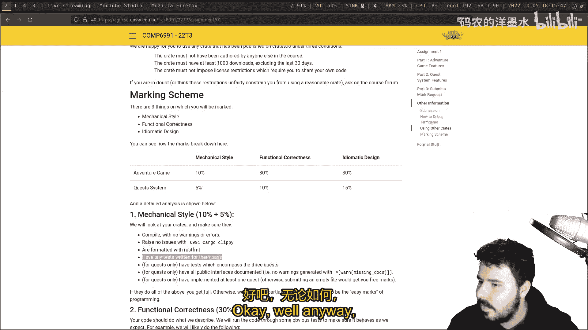

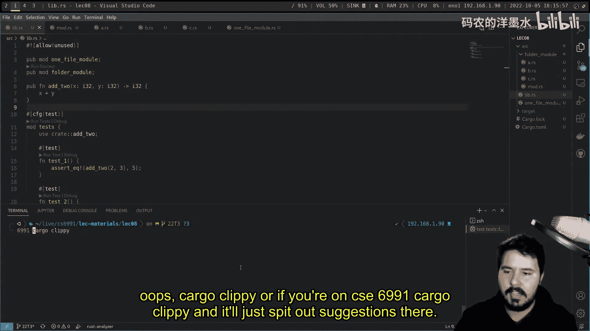

So yeah， and then having tests that passed essentially comes under this as well， we expect。

I don't know why YouTube is getting upset。 This is， it's getting plenty of， it's getting 10 K。

They're right。 If this， let me know if the stream is looking particularly horrific at any point。

But I don't know， it seems fine， but YouTube keeps complaining on my other screen。Um。Right。

 so we're expecting that like most students should be able to just get these。

 these sort of like pretty easy marks。And then we have the functional correctness and idiomatic design parts here so functional correctness is like we want to make sure that your program works string like can fine cool we want to make sure your program works。

 you'll have to fill out a checklist of what you finished and and how to run your program and stuff like that we'll just double check that you know we're not gonna to be trying to like you know do horrible things to crash your program。

 we're just going to be like you know start your program walk around try and go off the map and make sure the camera follows and stuff like that we might modify your map slightly just to make sure it's not like fully hard coded or anything like that but again it should be pretty we're not doing like crazy exhaustive exhaustive testing for the most part。

Then the real meat and potatoes what I think about is this idiomatic design section here and there's a lot of dot points that go into what we'd sort of consider to be smart design Tom has often referred to this as like design excellence having a read through these and clarifying anything that you don't fully understand on the course forum and stuff is I think a very good idea but this is like so this ends up accounting for 45% of the assignment and it really is sort of like the biggest individual section so 45% across part one here and part two in total functional correctness 40% across the two and mechanical style is hopefully for the most part just like a free 15% if you just take the time to make sure it's doing you're doing the right thing。

Cool， okay， fine now， all right。There's meant to be easy marks， okay， cool。😊，All right， blah， blah。

 blah there's a whole bunch of other stuff and Tom's also made a whole video rambling on about the assignment so I'll leave it there for now you are always welcome to ask as many questions as you would like on the course forum and if you need like generally we don't like to like go hunting through your code this isn't sort of like 1511 where we have like where we have help sessions where you pull up your code and we sit through it and debug it with you you're sort of expected to have the skills of debugging you know down pat before getting before making your way into this course。

😊，But well， you're expected to be able to do that。 And more importantly。

 you're expected to be able to take a problem that you have and reduce that problem into some kind of MCV。

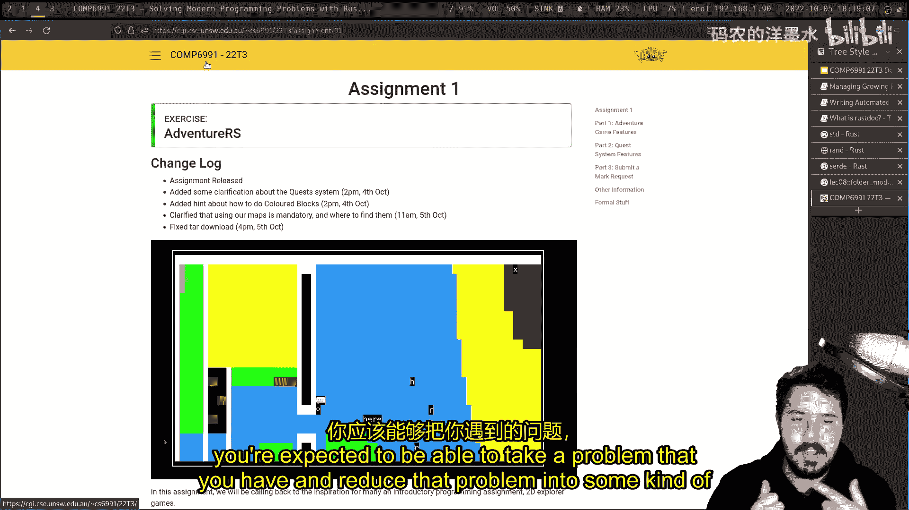

If you have heard of。This sort of terminology from stack overflow， minimal。

 complete verifiable example， or have they changed it， have they changed it？

MV minimal complete verifiable example well that's what I that's what I often refer to refer to it as MCVE So the idea being that like if you have a bug sorry like you know it won't compile or something like that or your program's not doing what you expect。

 we expect that you're able to sort of slowly bisect your program down to the part that's causing you a problem and then turn that into a general example that then you can post publicly on the course forum。

😊。

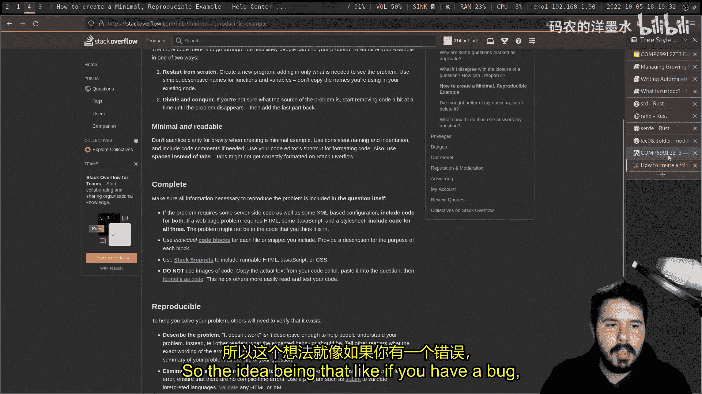

And then we're perfectly happy to sort of help you debug your code in that sense。

 So generally we're not super keen on going hunting through your own individual code。Again。

 ask general questions or turn your issue， the code that's causing you headaches into a smaller example that you can post publicly and you know sort of talking about your code directly as a last resort and you'll have to have run give on your code for us to access it。

 absolutely never post your accessible assignment code on the course forum。Do not do that。

 but as the last resort， yeah， then make sure you've run given the code and that's how we can access it if it's absolutely needed。

Cool， what else Auto marking is out if you haven't seen the email or the announcement。

 you should be able to see your auto marking with class run St。

 I believe you can also do class run dash collect and then like an activity name like lab 0。

1 underscore Van Gogh or， you know， lab 0，1， underscore Picasso， let's say。😊。

mBut collect gets really upset。This is sort of like a technical thing where。

Give expects you to be able to sort of like give doesn't like to give directories。

 let's say but in Ru generally like all projects end up being like a crate directory so we went okay that's fine we'll sort of set up additional tooling to tar up your crate to take all the files in your crate and put them in a tar a tar is sort of like a zip that is not compressed by default zips zips sort of also have compression by default。

And tarrs have T is like a tileballs or a binary format， which includes， you know。

 all kinds of bitetes and collect， spits things out into lessen stuff and things get upset。😊。

If you run collect， it might be like， oh， I'm not happy about this。

 I've spat this file out over here。 go check it there， just sort of like。

Try and follow your way through and eventually you'll find like you'll probably find an output that's like here's the marking。

 here's your mark， here's what you submitted and there'll be like random bys all over the place in your code and random bytes and some other files that you submitted and I think down near the bottom you might get like auto marking output and stuff like that。

😊，You're having trouble with it， just let us know。 But for the most part。

 like I can say that out of the out of all submissions。

 the vast majority of them are getting 100% anyway。 There's， you know， small things where。

People have submitted maybe completely broken code or code that wasn't sort of passing any of the auto test and stuff like that。

 if that's the case， if you've put like work in like genuine sort of work towards a solution and but you the auto marketinging spat out a result of zero for you。

 you can just send us an email， send an email to the course account and say， hey。

 I got zero for this， but I feel like I should have gotten I'd like to be compensated for some marks for the work that I did put in and usually we're fine with that we'll have a look manually and go yeah that's worth 50% that's worth 60%。

 that's worth 80% whatever it ends up being and we can manually adjust your mark but this is all just like auto marketinging。

There is also two exercises， as you know， from week two and week three's set that were didn't have auto tests that are meant to be manually marked。

We'll have a poke at them in the workshops this week and you'll get to be able to discuss your answers and。

 you know and talk to a tutor about it this week's workshop is going to be。

Quite different than usual。We strongly suggest everyone make it to a workshop this week if you are not able to make it to a workshop or if you are not able to or I feel the case for a subset of students。

 you choose not to we're never going to force you to come to workshops and in this sense as well we are not going to force you to come to the workshops。

 you will still get grade you will still get your mark but you won't have that sort of discussion and individual well somewhat individual feedback from tutors。

 you'll just end up getting given a mark if you go this mark seems wrong。

 I want it to be looked at again， then you'll still have a chance to say that and we'll still be able to like look at your mark again and discuss it if it's required。

 but you might miss out on if you choose not to come to the workshops I think you're already aware of the fact that you might be missing out on some of the learning and in that sense you might miss out on some of the learning as you probably already know。

 but we're never going to take marks away or anything like that if you don't come to workshops and stuff like that。

Okay。So any more， does anyone have any sort of more general questions？Before gets stuck into stuff。

 as I've mentioned， I think like 15 times by this point， the content this week is pretty。Like tame。

 pretty tame compared to the previous weeks。Which is why I'm not so fuss about， you know。

 going slow and dili ding and not doing too much and in particular。

 a lot of the concepts that we're looking at this week。Especially in terms of like testing， you know。

 unit testing or testing in general。You know principles around documenting code we not going to like be discussing at length。

 it's more about like how do you do this in rustt and we're expecting you understand what a unit test is or like have done some amount of unit testing and say something like comp 1531 or I don't know Comp 2521 I think has some semblance of unit testing in that we're mainly going to be looking at how rust does things。

And so I'll be poking at different bits of documentation and showing you where to go when you have when you're not sure what to do and that kind of stuff。

And yeah， I expect it to be pretty chill today and lots of room for questions。

 even lots lots of room for questions about previous week's content and stuff like that as well。

 I reckon throughout the rest of this。😊，So I'm not seeing any questions in the chat。

 so while I guess we'll get into things， we're mainly just looking at modularity， testing。

 documentation and documentation tests， this is the one thing that might be new to some people but some languages again like most things in rust。

 most things in rust aren't particularly new ideas。😊，They're simply stolen from other places。

Even things like like borrow checking and stuff like that where it's like， okay。

 that's rust's Ki featureia Ru stole the idea of region analysis from a research language called cyclone In fact。

 I think if you go to cyclone language。😊。

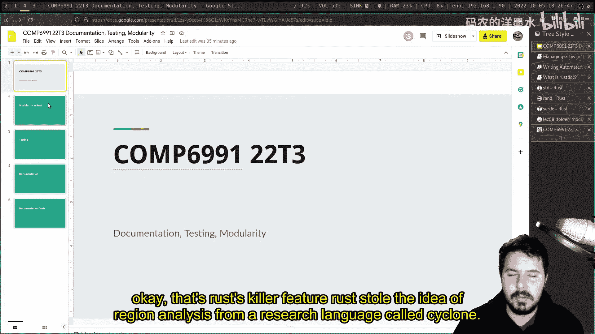

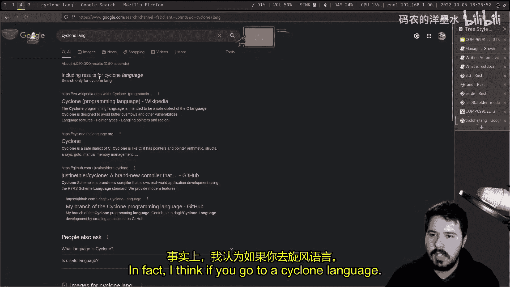

Here， cyclone dot the language dot org cyclone is a safe dialect of C。 blah， blah。

 blah cyclone is no longer supported。 The core research project is finished。 The drill have moved on。

 Several of cyclone's ideas are made their way into rust。 So that's that's a fun one。

 Ru's sort of main killer feature is you know， also not from rust。

 most of Rus ideas come from all different kinds of languages just sort of。You know。

 amalgamated into one big thing。Okay， so。We'll get stuck into it then， modularity and rust。Most。

Let's say most relatively modern languages。 And by that， I mean， languages made in the last。

Let's say language is introduced in like the last 30 years， generally， have some。

Some features set to describe the idea of modularity， in particular， modularity。

Often encompasses the idea of multiple files in a single project， right， However， in some languages。

 you can have。How do I say you can have multiple files without。Extensive language support for it。

 So C is a pretty good example in this case where C。

 you can absolutely have projects and it's incredibly common to have projects that have many files。

 but the language doesn't have like the programming language itself doesn't have much much in the way of tooling inbu for it。

 So you know and see the compilers may support it go like you can give it five files，10 files。

100000 files， whatever it is。 or even just sort of partially compile one file and then link them all together later。

 but C the language like the text that you type into C doesn't really have you know much in the way of。

😊，Dealing with this concept other than sort of like header files and implementation files is。

 you know， sort of。You could， in terms of the language。

 maybe more like function prototypes and forward declarations and stuff like that are the manner in which C sort of tries to attempt this problem。

 but as anyone who's written，Sort of written in a large code base of C is probably where it can end up being quite a bit of a headache and tricky to deal with at times。

But so most languages have built in most modern， somewhat modern languages have built in support for dealing with this idea of modularity and multi filele projects。

Yes and yes， Dong is dg notes See make in the chat as well。

 So Ru is no exception and Ru doesn't really have a super unique take on this idea。

 if you are familiar with how you know， this idea of multi filele or modularity works in things like things like Java。

 things like Python， things like even like the Java family like Koland， even。😊。

Maybe Ruy to an extent。What are other Javascript also relatively close。

 although JavaScriptscript has some weird quirks， actually， Javascript is pretty similar in terms of。

The I forget the names for the different syntaxes。 There's like the node syntax， which is the。

 I think it's called the common J S syntaxes。 what I'm looking for。

 someone jascript developer in chat can can。Can correct me。

 The one that's like import b and export b as opposed to module dot exports and。

 and that sort of stuff。 I think that's called common J S， but。

It's beens it's been an adequate amount of time since I've used JavaScript professionally。😊，Yeah。

 we'llll put it as that。 So when you talk about modularity in rust。

 do you mean createstructs and infiltrates， etc cetera。 Some specific stuff or generally。

 So for the most part， I'm talking about the mod keyword and multi filele projects。

 And it also encompasses ideas around things like the use keyword as well。

 So why don't we just jump into some code。😊。

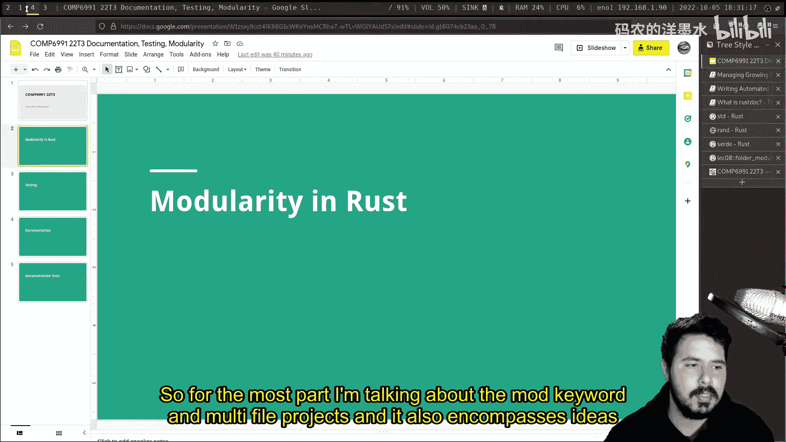

I've thrown together in the LeO 8 folder here just a small like library crate。

 so we know that crates sort of get defined in cargo toels and stuff like that。

This sort of overall thing， generally we think of a crate and a package。😡，Ass the same idea， E S 6。

 awesome。 Thank you。 We think of a crate and a package as the same thing。

 but a cargo Tomel at its highest level defines this idea of a package。

 A package can be comprised of multiple crates， a crate being sort of like a single compileilable project kind of thing that you can imagine in rust。

 and it may be comprised of a package may be comprised of many crates that eventually produce some kind of output。

 whether that's like a you know。😊，A crate for a library。

 whether that ends up being some sort of binary file that you can run。

But most of the time we've just had and for the most part in rust。

 you often just have like a single package here that describes a single crate with potentially many dependencies on other crates in the ecosystem and it has some sort of entry points so most of the time we've been looking at source main dot Rs and。

😊，Again you'll notice that we never specify source main here or in our case here source Lib or anything like that this is a bit of a convention in the Ru community in that source main if cargo goes looking and it sees a source main。

 RRS then it's going to go great， this looks like a binary crate。

 a crate that should compile to some binary program that we can run and it's going to require some sort of function main。

Or if you're making a library for other people to depend on and use sort of code that you've written。

 then you'll create a Lib。t RRS instead and cargo will go great， I see that you've got a Lib。

t RRS there， I'm going to build that into a library crate that other people can end up consuming。

You can also do both and that's why I say you know a single package can refer to multiple crates。

So like if I had a main dot Rs here as well。 then， you know， it's gonna complain， hey。

 don't have a function main。 Yeahep， let me get there。 There we go。

 Now it's sort of this one package describes two crates。 One's a library that other people use。

 One's a binary that you can run to produce a。That you can。

 produce an executable out of and run or execute and that sort of stuff。

To have like a working program。Now。In rust， libraries are more flexible than binaries。😡。

In particular， there's a subset of things that you can't do with a binary that you can do on a library。

And libraries， if you write a whole bunch of code to do a whole bunch of stuff。

 whatever that is in a binary file， then it means that it's very hard for other people in the community to make use of the code that you've written。

 you know， and say like an open source community。Whereas if you write a whole bunch of your code in a library and then just create the smallest little binary crate that you can that uses your library to do whatever it is that you wanted to do。

 then other people could use your library as a dependency and make use of that and you get more features that you can use it will talk about as time goes on during this lecture。

 So this kind of split where you have two crates， a library crate and a main crate when you're trying to create some sort of executable program is a relatively common and idiomatic split in the rust community just because it sort of allows you the flexibility of having a library that you get these extra features with that you can that the rest of the community you could potentially make use of or even if you're let's say you're doing private development work for a。

😊，For a tech company that you're working for。You know， it may not be the great open source community。

 but it means that other people at the company could make use of the code that you wrote as well if you did it in a library。

 so you get that and also you get a way to run your program to get the like terminal output that you wanted。

 let's say So this kind of split is again very common and something that you are welcome to make use of。

😊，But for now， like， okay， if you understand， okay， right。

 main dot RRS means we have some sort of binary cr。 Lib dot RRS means we have some sort of library。

 You can also define more crates as well。 oops within this。Cargo dotophile here。

 you'll need to tell it where Ru should expect the base of that crreate to be like you know。

 saw Lib 2。 Rs or saw dot。Another main dot RRS， something like that and I honestly I've forgotten the exact syntax for that。

 but you can go looking in the rust documentation and stuff like that to figure out if you want to pull in multiple binaries or multiple libraries as well in within a single package。

😊，Okay， so。Talking about modules， I think a lot of the time it's best sort of just explained by example。

So you'll notice here。That I have a public function called Add2， takes an X， takes a Y。

 and adds them together。Now this public function。Will get exported at the root of the crate。

 So my crate's name is Le 08。Right， so if I had another crate， in fact。

 if I hadgo cargo new users Leco8。Sure， and it can be a binary， let's say。Users LeO 8 like that。

 Let's throw this over， actually， sure， we'll leave it here。 that's probably fine。

we'll hop back in here。Right， in this new program here， I could say it depends on Leco 8。

Whi has a path of dot dot slash like 08 like that and cargo will go great。

 I can go looking for that and see that there's a crate there and cool you'll depend on it now。

And we can simply access this add2 function。 You might just go well。

 I can I't know how to do that I'll say let sum equals add2 and you see that Ru analyzer suggest this for you you hit enter。

 you go add together 10 and 15 and。And I'll print out。

That's sum on the terminal and it just sort of does everything for you 25 great life is amazing The one thing that we're sort of paying attention to in this lecture is this line that rust analyzer inserted automatically for us here which says use LeO8 add2 if you' are familiar with a lot of other languages you probably seen this as import import LeO8 add2 for example。

 and it's a very similar idea it's basically saying bring this add2 function into scope。😊。

You wouldn't have don't have to use a use if you don't want to。

 you could have written it like this as well， which just says inside the LeO 8， great。

Give me the add to function， and call that。But noting that if you didn't do either。

 we didn't do it like this and we didn't have the use statement。

 then this simply won't work it doesn't know can't find the function add to because it's not in this current scope here。

 so you need to tell it where it comes from either with a use statement that brings it into scope or by specifying the path to get to this item here。

Um so。That gives a head too， but you don't want to do all your work in just a single file。

 One would imagine You might want to split it up across multiple files or very commonly as well。

 In two different folders as well。 where we have， you know。

 like this folder has a whole bunch of files。 This folder as a whole bunch of files。

 This folder maybe has a whole bunch of folders， which in each of them have a whole bunch of files as well。

 sort of splitting up your project into logical little chunks。 And again。

 this is what Ru describes its module system as。 So。😊，There's two well。

 there's a few ways to sort of work inside a new module。

 the simplest of which is just defining a module in line。Like this。

 we would just say I'm going to create a new module。

 I'll call it inline module in this case and the naming convention is usually lower snake case。

 as we've seen here。And this anything in between these braces here is its own sort of separate submodule note it's a submodule of whatever we've got here。

 the thing we've got here is basically the root of the crate because we're in the Lib dot RRS file so we're in sort of like this module space LeO8 in here and then we've just defined this inline module inside there so this is sort of like LeO8 colon colon inline module right now and in fact I could even write that in here LeO8 colon colon inline module like this and that's the module that we're looking at there。

And I can define things in here。 so I can say function2 that just says printlin。Food。Like that。

 and I've defined a sub function in here and now。Now。

 something interesting is that in this program over here， let's go。

 let's say I wanted to use that function。 I could say use Leco 8 inline module module food。

But we're going to get narrow。 It says module inline module is private， private module。

Right so if I do the big output here it says module inline module is private。

 this one here and it's defined like this so a lesson here that we've already run into definitions are by default private interest so if you're familiar with any other language that has this concept of like private or you know something you have other visibility modifiers like you might have protected in Java or just like no visibility modifier might mean something else entirely and often you have some sort of public or like export or whatever you want to call it。

😊，Rust has this idea of different visibility modifiers too。

 and they apply to any items that you might define apart from macros macros are weird。

 and we'll talk about that。 maybe in week 7。 But in this case。

 if I want this module to be accessible from from an outside crate。

 I need to declare the module as being publicly visible with pub like this。

 Now note that will solve this problem， but you'll notice that who is still private。

 And so here again， I'll have to say that's public。 We go over here， it seems happy。

 I call the function。😊，And print out fo。Okay， so there's this idea of modules and there's this idea of visibility modifiers and's there's this idea of importing with this use statement like this noticeice that the use statement there's some interesting things you can do with it so for one you can import something like this。

This is essentially like shorthand for this import LeO8 inlay module F as F right just takes whatever like the name of the thing is and imports it as that。

 but I could say import it as F instead if I wanted to and instead of it bringingF into scope it brings F into scope and you could use it like that。

So that's one thing you can do with use statements。 And you can also like sort of see here， well。

 we have a use statement that is LeO weight add to and a use statement that's a LeO weight inline module through as F and see that these have in common like they they sort of have a common。

Prefix So in this case， the common prefix being LeO8 colon colon and you can sort of take advantage of that by throwing some braces here and saying inside Leco8 like use LeO8 an inside Le8 add to and inline module through as F like this。

 And this is the same as having those two use statements separately and it still works just the same And you know。

 you can sort of format your imports how you like as long as they don't get too ridiculous or anything like that。

😊，But this can sort of group things together almost like semantically with these braces as opposed to just visually sort of scanning downwards。

's it's really up to your own preference if you use this or not some people choose to use it。

 Some people choose to avoid it I don't really honestly。

 I don't really care you know for such a small thing like this。

 I might have miss this but what's the main purpose of an inline module and rust。

 that's a great that's a great question。 So an inline module is useful if you want to sort of。Like。

 how do I， This is， there's an interesting sort of idea here in that。

Modules are one of those abstractions that。If looked at in a certain way， do absolutely nothing。

Right like the fact that I've got all these modules split up and stuff like that。

 I could just take all this stuff and copy paste it into one big file and the program would be the exact same at the end of the day modules are really just about sort of like splitting up。

😊，Splitting up different ideas。 They do have a little bit of semantic meaning in the sense that they let you separate visibility。

 So if we were working in just this one file here， let's say I had two functions。 So function  one。

And function 2。At this。No matter what visibility I specify right pub and there's a couple more that we'll look at in a minute or this default private。

 there is no way that I can separate function  one from function2 in the sense that like make it so they cannot call one another right function  one oops function  one can call function2 right now and function 2 can call。

I got that wrong twice there we go and function two can call function one。

 maybe I don't want these to be able to see each other or call each other and the only way I can realistically do that with is with a module if I want it to be like sort of looking like this。

😊，But at the end of the day， they really don't actually do anything。😡，Which is why there's， again。

It's more of a。This is one of those things where it's not going to unlock some sort of superpower and programming for you。

 like something like the Browcheer might where it's like great。

 you can write this low level code using and you know take advantage of this full performance without a garbage collect or anything and you don't have to worry about all that stuff that's genuinely it's sort of bringing something very you know potentially new and like special to you。

😊，The module system doesn't really do much like that。

 It's sort of just like a way that you can keep your thoughts organized as a programmer。

 right You can say this is all sort of relevant to this idea。

 that's all sort of relevant to that and split things up and an inline modules case。

 you might have this sort of you might have this small case where it's like this is not really a big enough idea that I want to separate it out into a whole new file。

 but it's also not like entirely trivial and there are a few things that could like reasonably be grouped together here。

 into their own module。 So I'm just gonna declare an inline module like this I'll throw them all in here。

 I won't bother making a new file。 if it gets out of hand。 then maybe I'll move it into its own file。

 again， it' it really is mostly a thing of kind of like taste。

 So like putting them into two different scopes。 Yeah， for sure。

 So modules also like they define their own scope。 So notice that if this function is not public。😊。

Function 1 and function 2 cannot pull through。And so you're sort of separating out these different scopes。

 but the inline module you'll notice can still call。If I say like super function one like this。

 so notice we're inside the module here， but I can say in the super meaning the module above me right above this inline module is the sort of big cr module call function one and it can still access everything from the parents like this。

 even if they're private。Which is interesting。But yeah。

 separating scopes if you would like to as well。嗯。Okay。

 so we can declare modules in line like this we can also declare modules as their own file。

 So if I just write pubub mod some sort of name here and then a semicolon Rus will go looking for this thing here in the file system。

 whatever this thing's called So in this one's case we have one file module RRS right here So it says oh great there's a file there that will be the module。

Or in the case of folder module here， it sees a folder with the name folder underscore score module and it'll in that case。

 it'll go to the folder and look for a file specifically called mod dot Rs inside it。

 it needs to be called exactly mod dot Rs in the case of a folder module and that becomes the entry point and you can define more modules in here and we'll look at folder modules later on in a second。

 horrible Java flashbacks， no inheritance please， Yes。

 so there's no inheritance system for modules fortunately。

 but there is the idea of always being to access things in parent modules。 Oh。

 I guess that is kind of inheritance isn't it， but a very， very limited form of inheritance。

 I suppose it's more like a tree than than。😊，Then all the baggage that comes along with inheritance。

嗯。Okay。So let's have a look at the one file module here。So one file module。

 great has some examples of the different visibility modifiers for us。😊。

So it defines a sub moduleule inside it。 And again。

 this is just like an inline module from the library function。 It doesn't need to do this。

 could this could all just be inside the the one file module module if it wants to be， in fact， sure。

 let's change it。 So it does that and single file module。With no。

 with no additional stuff inside of it。 And so let's look at some different visibility modifiers here。

 So this one， we already know， private functions。 So if you don't give any visibility modifier。

 it's going to be a private function that cannot be called from outside this module or。

Or this should really say any super modules， I believe， is what I meant to write there。

 So sub modules of this module here can still access the private function， but。

A like say this module here， the crate， the overall crate module here。

 will not be able to see this private function inside the one file module。嗯。

Another way of writing private is pub self， so this is how we sort of。

Do like an in the middle visibility。 We have private， which is just like nothing。

 We have totally public， which is pub。 And then you can throw these pars in here to modify the visibility。

 So it's like less， less than entirely public。 So pub self。Is really saying。

It's public within this module， which if you've been following along public only within this module。

 it really just means private and so pubs self is basically the exact same as being private。😡。

We can also do well let's say we'll skip it here for a second pub super。

 so this is saying it's public within this module and my super module。

 so the super module being the module that sort of defined me that brought me into scope and so that would be the overall crate itself if we were like five modules deep then it would be like the fourth module deep that would have access to it。

UmPub crate， meaning it's public from anywhere within this crate， but not from a separate crate。

 like say， over here。😡，So we have pub crate there and then there's this sort of more general one which is pub in somepath here so I can write pub in Cate Col Col one file module。

 so it's public only within the one file module so this is just saying oh this was pub super because we had the sub module in here before but the documentation is now potentially a little wrong。

But I could say， you know， pub in createate， pub in， createate one file module。

we don't have any options here since I got rid of that submodule here。

 but anywhere along the ancestry tree you can actually say with this synax here。

 it's public like if we're 10 modules deep， it's public from like the third module downwards。

 let's say is something that you could write here or you know or you could just say it's public to just like two creates too sorry two modules above me but no further you know it's more generic here that you can use。

 you can throw a whole bunch of parts in there。And so， yeah。

 Rus doesn't have some default visibility。 The default visibility is private。 And this is how you。

 there is， I guess you could write this as well。 But I don't know if I've ever seen pub self in the wild。

 It sort of just exists for。嗯。What's the， what's the word I'm looking for here， It's， it's。

 it exists for sort of like uniformity。 The fact that you can define sort of any visibility with pub and then like some modifier after it。

But yeah， the default is pub self， the default being private essentially。Cool。

And then if we go up to this folder module over here as well， you'll see again。

 if you have a folder module， you need to throw a mod。 RRS in there。😊。

And inside this module you can throw whatever you want， you could have functions in there。

 you could have constants， you could have you know static data， you could havestructs。

 you could have venoms， you could throw implementation stuff。

 whatever in any modules you can basically throw anything。

Mainly because all the stuff like everywhere， all the stuff you've written up to this point in this course has been in a module already。

It's just been inside sort of the top level crate module。

But a very common thing for folder modules usually use a folder module when you have like a whole bunch of stuff that's all going to be loosely related but going to be their own things and so it's very common very idiomatic for a modt RRS。

 a folder module to just like re exportport stuff so to to us go there is a module called module A there's a module called module B there's a module called module C and those just as file modules in the context of this folder so module A module B module C。

And you can just bring them in like that。😊，And another very common thing for you know libraries to do for folder modules to do and all that is to re exportport So this is this pub use syntax which is also new to us it should be like completely new you may have seen this before as you know rust analyzer was doing it for you automatically pub users quite possibly completely new essentially what it says is。

Bring this thing into scope here。 So if we look in the module A。

 it defines a public function function from A。And it just gives back the value 42。😊。

And we say use function from A， so bring function from A into scope。

 but not only that also like publicly export it from this module。

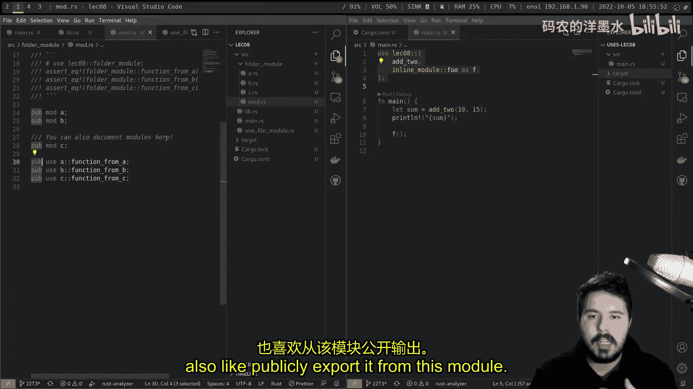

Also publicly exported from this module so what does that look like。

 it looks kind of like this where LeO8 folder module contains this function from A function from B and function from C。

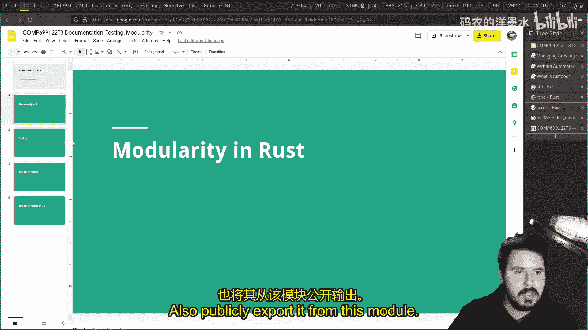

And then in our other crate over here， I can say。

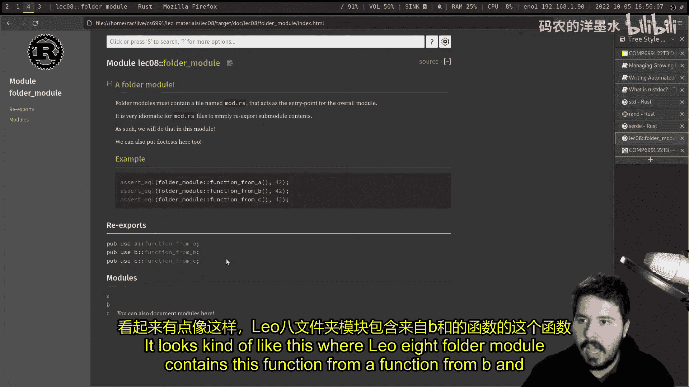

Pritlin B， for example。Lecho8。Fold the module。呃。It's not seeing for some reason， function， Oh no。

 I guess it is seeing it。 It just wasn't suggesting it for some reason。Food became private。

 Did I do that in line module？Lib， oh， I did do that。My mistake。Okay， it's happiness now right。

 so I can say Le8 folder module function from A， whereas previously it would have had to write folder module A function from a。

 So note that this works right， There is the 42 in the middle here。😊。

But because this brings function from A into scope and then re exportports it。

I can just access function from Ace from like straight within the folder module here。Right。

 and know that this of course， doesn't need to just be functions。

 This can be any real item to be honest。 So this could be like some pubstruct。

 let's say it's a pubstruct fo， which has a X value is an I 32 and on fo。

 we define a function fo that has a shared bar of itself that just says print out。Who has x equals。

Self products like this。So we define astruct called Fu。 And right now， if I wanted to use that。

 I would have to go let。2 equals。Foo and like rust analyzes。

Really going to struggle to find this right now。 I'm probably going to have to go。

Or is it going okay， it sees it now Leco8 folder module a F like this？Why it not important。

 I clicked it food。嗯。It thinks oh， it did。 It did import it up here that's。

Ross A is being very smart with the way I'm trying to format things clearly。😊。

And give it say x is 42。Oh yeah， sorry， field as well insidestructs can also have visibility modifiers on them so I'm going to need to make this field publicly visible and this again follows the same sort of rules of what you you know where it can be。

 but I'm going to say the field is public just in this case to make this work。😊。

And this comes from all the way in here， in fact， I're going to leave the whole path here for demonstrated purposes。

Like this。 And then I can say， food dot。RightThis also needs to be public here。F dot food。F do。2。

 okay。Rt analyzer might be getting a little upset。But who has x equals 42， as you can see here。

 this works。Right as it comes from A and we sort of follow our whole path down there to A and note that everything is public along the way。

 pubub mod folder module， pubub mod a pububstruct F， pubub X and pubub function foo over here。

 so everything was public along the way。😊，But often like people using your library don't want to go finding this whole path here。

And so it's very common for， say at the very top level of our library here。

 we might write something like right here， pub， oops， pub views folder module a。2。

Thisstruct over here。And so bring like。Bring fo here into scope in this module。

 but also re exportport it out of this module as if I was the one defining it。😡，And now。Magically。

 we can just say oops， sorry， not quite that far， Magly we can just say Leco weight P over here。

 or if we were saying as a use statement， use LeO8 F like that。😊，Right。

So pubub uses a very nice and sort of powerful thing。

Note that like again this is sort of with sometimes you don't want people to be able to access your fields directly。

 this is a pretty common thing in an idea around encapsulation which is very common in object oriented languages。

 you might say no I'm going to make this field private。

So then you can't instantiate this directly and instead you have to use some sort of constructing function that you write yourself。

That maybe looks like this note that I can write fo here or I can use capital S self that just basically is an alias for the name fo it's like they've just gone type self equals fo。

嗯。Like that and again， similarly， I can write through here to create a new structure or I can just write selfia。

X is， let's take an x is an I32。And just include x in thestruct there。

And so this way I can't in shape feel like this， maybe you want to force them to use your new constructor like that。

And it still works。So a smart construct kind of。You'll have to。

 youll have to tell me what you mean exactly by smart。 like what the smart。

Means in in this in this context。 but it certainly is acting as as a construct or from Haskell。

 I'm not。I'm not a home sensor sure I'm entirely familiar with the idea of smart constructors in Haskell。

 but speaking of it's time for a break and maybe I'll just quickly have a look at the Wiki page and see if it might click in my head and I'll go oh yeah I remember this or if I just don't know it at all So let's take a quick break that's most of the stuff to talk about honestly about modules。

 multi filesles and visibility and that sort of stuff And then we're just gonna talk about testing and documentation after the break for the rest of the hour And again I think I should remain to be relatively chill。

😊，And a lot of this stuff， just to be clear。I don't be like don't be afraid of， you know。

 of the stuff that we're learning here， be afraid of like messing it up and stuff。

 because although the compiler can be very mean， very mean as maybe is not the right way of putting it。

 it can be very persistent。Let's say the compiler commit you did that wrong。

 that's wrong that's wrong。 nope， that's wrong， right， It might do a lot of that， but you know。

 you it won't。 it does its best to not let wrong code through。

 And so if you're having trouble with it。You know， just keep trying to iterate on it until the compiler stops yelling at you。

 you can ask us for help and help figuring out how that stuff works。

But it's just something that you'll play around with and get used to over time。 And again。

 if you're familiar with other languages， there's really not much special about Ru's module system。

 It's very typical and very standard。 There are some languages that have。

That reserve the name like module system for somewhat different kinds of ideas。

 in particular the language that comes to mind for me is like the ML family or potentially most popularly Ocal。

Where the idea of a module system is actually a very sort of is a much more sort of serious and semantic idea。

 I suppose than what we have here in Ru。And Russ doesn't go down that route in this particular case。

 it just follows what a whole bunch of other languages do in a rather simple sort of take on things and nothing。

 not too much magic。It's when you make a type B you don't want to use it put in in invalid data so you make a specific constructor for the type or something along those lines。

 Okay sure， well in that case， this is absolutely the same idea in that if you may call your fields public。

 then someone in a separate great can feasibly construct or someone even in a separate module。

 let's say， can feasibly construct this food with any value that they want。

 but let's say we only wanted to let them construct fos with values between0 and 100。

 let's say then we could absolutely do something like the constructor returns an option of self where we say if x is less than0 or x is greater than 100。

 then give them none。😊，Otherwise， only then will we give them a value back。来。This。

And since they can't construct themselves， they have to use this constructor that you've defined here and there is no way a food could be created with anything other than an x between zero and 100 so that kind of idea absolutely for sure you can bake those kinds of ideas into rust and this is a kind of thing that can also help you write far more robust code because you may be less likely to end up in a state that you may define as like an illegal some sort of a legal state or something that's going to cause your headaches so a patent to certainly consider especially for things like your assignment so with data andvari。

 yes， a very important concept in rust particularly around unsafe as well。😊，Which we'll talk about。

 I believe， week 9。 So we will absolutely talk about the idea of data invari with a T S at the end set of a CE。

And yes， a very， very big concept in rust， especially on the advanced end of things。

 But even if you're defining your own sort of data here and you don't want x to have some kind of value。

 this kind of idea， like establishing an invariant onfo that X will be between0 and 100。

 this can absolutely help you enforce that at compile time， knowing that if your program compiles。

 it will have， you know， a correct value， let's say。Allright， let's take a break。

 Let's come back at 10 past and we'll talk about the rest of the stuff。 so enjoy your break。

 We'll be back in a few minutes。

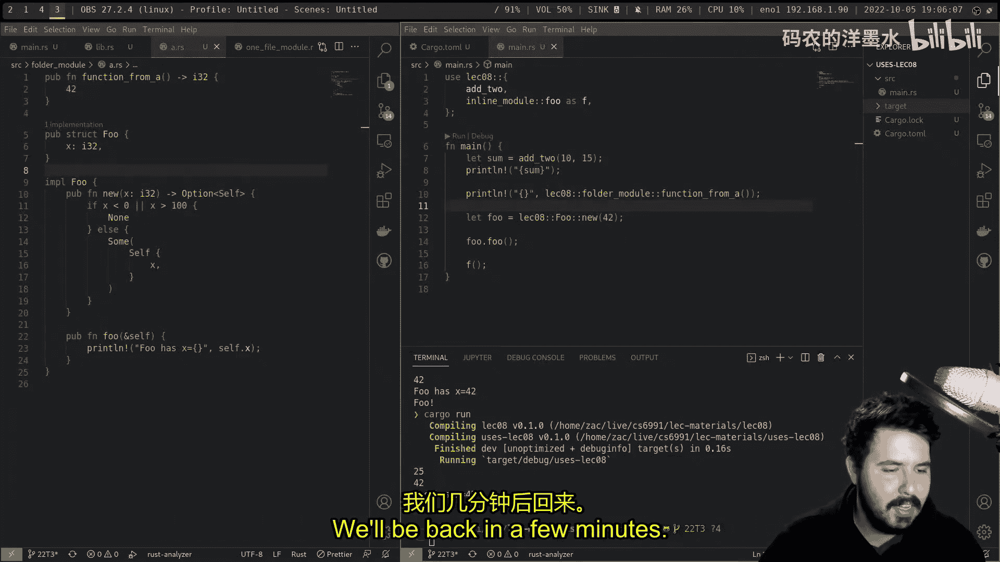

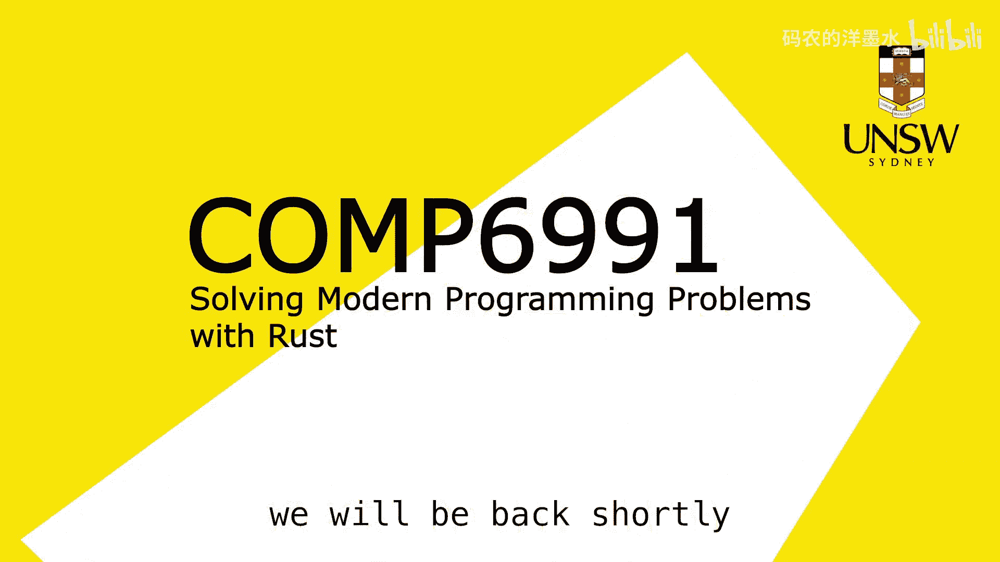

Okay， let's get back into it。So。The chat， since rust doesn't have function overloading。

 how do you make constructors that take in different arguments？

That is a great question and one that I'll answer by looking at， say， the standard library。

So let's look at V。Vec has a new function。Right， new。

 but also has different functions to construct a V。With different parameters。So， for example。

You can also specify a capacity when creating a V to say that like I want you to oh wow。

 look what's right underneath this one， I just realized I was looking down here about to jump to it。

It's right there。 create a new vector preallocating some specified capacity。

 And this is generally the pattern that Rus programmers will take is that they'll go you know。

 they might have a new function like this or a with b function that you know define some additional arguments。

 So yes， we just generally call it different things， which is can be both a blessing and a curse。

 a curse in the sense of you end up maybe having to think of a different name for every different set of arguments。

😊，But a blessing in that you get sort of additional inherent documentation in your program in that someone reading this will go。

 ah， then you know， Vec new of 42。I don't maybe know what maybe that 42 means that it's you know initializing with one value of 42 so the Vec has length one with the value 42。

 maybe it means it's a capacity of 42， maybe it means zero 42 zeros or something like that it could mean a whole different bunch of different things。

 whereas with capacity of 42 sort of self documents that yeah this is initializing a vector with capacity 10。

嗯。And there is another common pattern in rust where if you， if you end up with the。

What do people call this Java Java telescoing constructor。

 this sort of pattern of telescoping constructors in Java， hopefully this yes， this is there we go。

 So this is a very common thing to see in Java code bases in particular that I I'm certainly guilty of over the last decade。

 and that you'll have a constructor for this class here， dirty person。

 I don't know why it's a dirty person， this blog post， but that's all right。

 where they justify a first name in a last name or you can do an age or you can do a you can also give a profession or a list of string that your hobbies。

 I'm assuming they probably give you another example right。

 where they say each constructor sort of just passes on to the next one with with some like default values along the way。

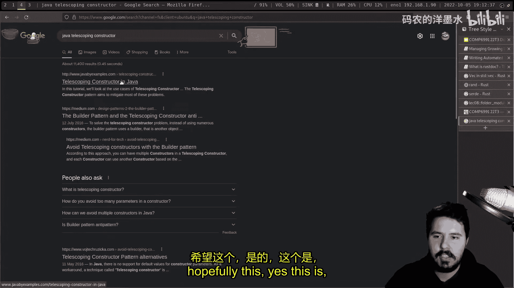

That's what this like this syntax is is like pass it on to the next one， the next one。

 the next one and again the sort of this is a this is a relatively common pattern in Java in rust if it gets to this point where you're getting all these sorts of different things that might need to be initialized。

😊，We generally palm that off to the builder pattern。 The builder pattern is very common in rust。

 I'm sure you can probably just search rust builder pattern and find examples on。

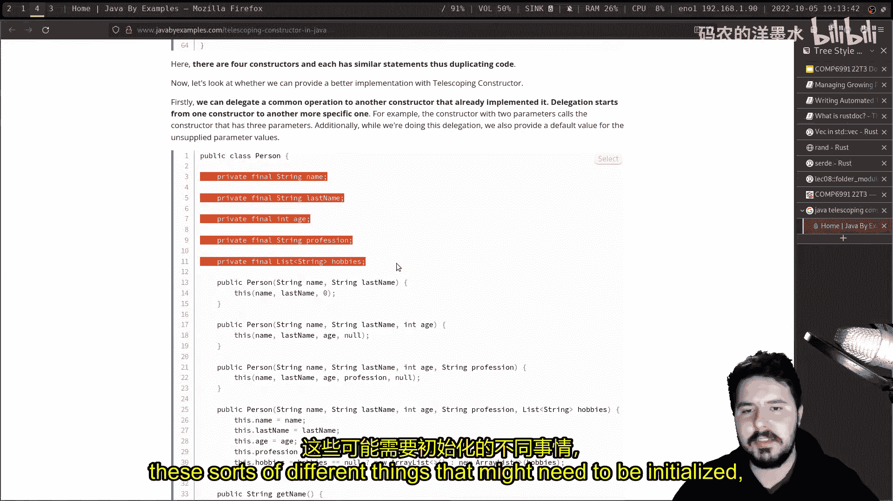

Sure， yeah， style ownership builders， and it shows you a common way of creating a builder in Ru to achieve a similar idea。

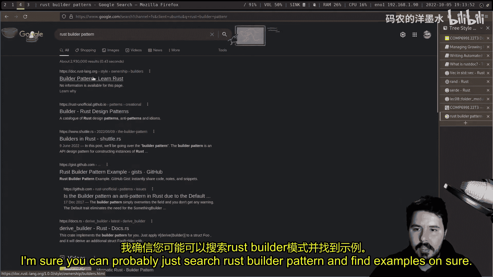

With the nice benefit， of course， being that。Unlike this example here。

 when you're creating a new person。You know， it might not be obvious to which parameter means what right。

 raised out as list fishing here。 It's not 100% clear that this is hobbies， right。

 This could be like skills or this could be professional or whatever， whereasas in a builder pattern。

 you end up like really typing out what each individual thing is。 So for example。Here。

 dot named thread to， dot stood out， blah， dot， whatever。

 And it short sort you sort of like self document。 This here is an argument or this here is something else along the way as well。

 and you get the same sort of same sort of idea。Yeah， good question。So oh yeah。

 if you're interested in like more stuff about modules， by the way， Cha7 of the rust book here。

 managing growing projects with packages， crates and modules is a nice chapter to read in your own time as well we're now going to talk about testing in particular well for now we'll just start off with unit testing。

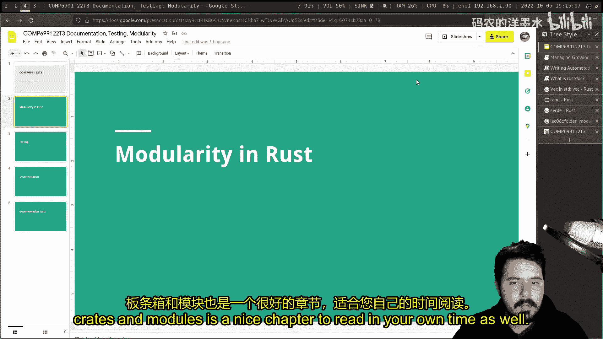

UAnd again， there's really not much to add in terms of unit testing for this course if you're not familiar with unit testing。

 like what unit testing is。What is unit testing is probably a good Google query to get you started。

 But the basic idea is， oh to all our readers in Australia， go away。 I'm kidding I love Wikipedia。

 unit testing is a method by which individual units of source code are tested together tested to determine whether they are fit for you。

 There you go。 So basically， does this function do the right thing is what it is all lot the time。

 Or does this struct act in the right way or something like that。😊。

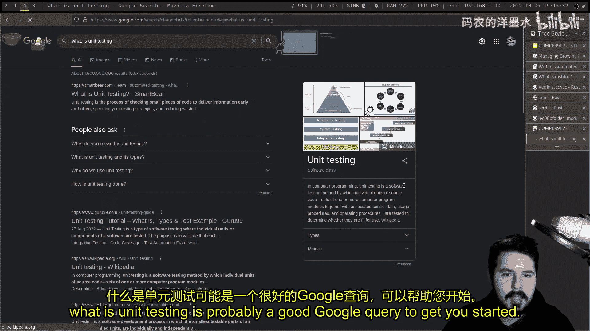

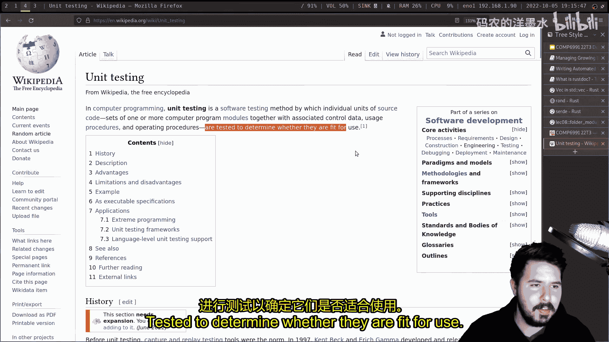

So I've got an example of a unit test here。Our three unit tests here。Test one。

 test two and test three， and they just say if I call add two with two and three， is it equal to 5。

5 and 10 is at 15，4 and 40 and2 is it 42？Right。Now the thing that makes this a test notice that this is defined in line with all the other code This is。

 I believe some languages act like this， but a lot of languages you have a completely separate source and tests directory so you have your source folder with all the source code and your test folder that sort of mimics the structure。

 but with but with only like unit tests in that separate thing。In particular Java is a language。

 in fact that's a really big reason as to why Java has like the the default visibility is this like package local idea and it's almost like a hack so this the testing idea can actually work。

😊，In in a certain sense， in rust， it can all just get sort of thrown in together in the same place。

 And the thing that makes something a test is throwing this test attribute on it。

 So it's just a hash a square bracket， the word test and then a closing square bracket。

 the next function that is defined I。e。 this function right here is now a unit test that can be executed。

 If I click run test。You'll see VS code will go ahead and run this test for me。Generally。

 we'll use cargo test。All right， cargo test Lib to test all to do all my unit tests。

And says test one is okay， test two is okay and test three is okay。

 note that if one of these functions was incorrect if I said。

But test that five and 10 add up to 16 instead。We would get test2 failed It says test test2 failed panic that assertion failed left is equal to right left was 15 right This one here left since I was 15。

 the right hand side was 16 on in this file on this line here right so it points you to the right spot it tells you what the values were and all that and in this case the test failed because I just modified it to make it fail I run it again and now my tests are passing So you know tests are a nice way to help you right cases to try and ascertain whether your code is working correctly there is a beautiful quote。

😊，And you know I love my quotes， here we go in fact in the Ru book on the Wri Auto Test chapter chapterpt 11 in his 1972 essay。

 the humble programmer Edger Dyictra， right Ed Dytra。

 who made a quick feature in lecture one said that program testing can be a very effective way to show the presence of bugs。

 but it is hopelessly inadequate for showing their absence。😊，The Rus book notes。

 that doesn't mean we shouldn't try to test as much as we can。So。Again， this is one of those things。

 I think， Could I just close it。 Yes， I did。 This is one of those things where oh， had  two。

 So what I called it as well。That's funny。I like， I sound like I'm being sarcastic。

 but that's actually a funny coincidence。嗯。So。Again， a thing in rust。

There's nothing particularly special in rust as far as I'm concerned in terms of what differentiates rust's unit tests to unit tests in other languages。

 if you've done testing in any other language in Python in Java in Java in whatever it is in C+ you the overarching idea of unit testing is still very similar the primary differences in rust is that we generally just include our unit test alongside the source code。

 it's very common to just throw these tests at the bottom of the file。

 whatever file or I guess at the bottom of the module considering that a file now we now know that a file sort of acts like a module itself at the bottom of the module we just throw a whole bunch of unit tests。

Andum yeah， we we expect you to do some testing and stuff like that in some weekly exercises in the assignments to try and。

 you know， try and prove an absence of some amount of bugs to try and just give you like a baseline。

Does it look like it's working correctly or maybe to test out some edge cases。

 stuff like that and and really there's。The way I should be saying this is that there's I don't feel like there's much I can talk about in this lecture here in terms of unit testing in general that you wouldn't be able to get better information out of。

 you know， just googling around on the internet。I don't really have much special in terms of testing there are some people who I'm sure are incredibly smart and have spent a really long time thinking about unit testing and all that I'm not really here to be that person but I will show you at least how to do it in rust。

😊，There is one other idea that people commonly do， which is to stop these test functions from cluttering up all this other code here。

😊，It's very common to throw them in a submodule。And you often just call that submodule tests。

Right so we throw all of these tests here in a little submodule called tests。

 you'll notice that since we're in a submodule it doesn't know what add2 is anymore。

 so we might need to say use super meaning the module that I am inside use super add to or a very common thing for mod tests as well as say use super star which just means bring everything in the above createate endscope because that's what we're testing at the end of the day anyway。

 so this is very common to see in specifically in a test module。

And then one last little thing that we can do as well。

 it takes rust some amount of time to compile this code and sometimes we're just saying like cargo build。

 right， build my code， which doesn't include say cargo test。

Go ahead and test my code and cargo build is still going go and build all this stuff。

 It's going build all this code， even though it really has no need to unless we're testing。

 So you can throw a little attribute on top of this whole module that says only consider this module if we are running tests right only like bother to compile this code inside here if you're running unit tests and the way we say that is another attribute similar to how we use this test attribute down here。

Another attribute that just says CFG config test。So Config essentially says only include the item that comes below this。

 the item that comes below this being the module tests。

 only include this code here if and then inside here there is a lot of different things you could write you can say like the target OS is UniX for example so like only build this code on a UniX platform or like on a Windows platform or something like that you know there's a whole bunch of different things you can put in here but test means only build this code here if you are running unit tests。

And you'll see， y， as so as that and building will be ever so slightly faster。

Because it doesn't need to end up building this code here， which is kind of nice。

What we've got here is basically its final form， this is incredibly common for testing and rust。

And you'll see it in like basically any popular crate。

 you'll see these little things peppered at the bottom of basically every module， just you know。

 just for some amount of unit tests。Rust also does support integration tests integration tests sort of being like tests that don't just test one small thing individually。

 say one small function， but test everything together as a whole。

 And I believe you can just throw these in a oops， you can throw these in a foldicle tests。

 and you can just make any file you want here like my oops， my。Test dot RRS。That just says like test。

function my test。UW Leco 8。Add to。Add2 of 5 and 10。And assert that that's equal to 15。Let's say。

And oops， let's go cargo test。 It doesn't like。This is something completely different， I believe。

Over here， there we go。 test my test， which is this one here past。 if I give it something different。

16， we should see that this integration test here。here has failed。 My test failed with， you know。

15 is not equal to 16。So that's kind of handy， I notice I'm running it as cargo test instead of cargo test Lib。

 which is just running the unit test as opposed to integration tests as well。

I could also write a note test。Oh know。 that was right。 Sorry， test my test was right。

 So I can also tell it just run this integration test in particular if I wanted to。

But we'll fix that and then leave it be。Nice， it's okay it's happy so you can test sort of the public API surface this is almost like these integration tests also essentially act as a completely separate crate。

 which is very handy if you want to sort of test as if you are an external user using your using your library you know as a completely separate thing。

😊，And make sure that your whole API surface is working as intended。

 so integration tests can also be kind of handy as well。And they just get thrown in like this。

 this test folder。Cool， was there anything else that I wanted to mention。

 Something popped into my head。 Yes， one other thing did pump into my head。 Let's say， add2。

This seems like an absolutely insane requirement， but let's say add to said that X and Y must be like must not be negative。

 I don't know。 And if they are negative， it panics。

 Let's say that's like genuinely what you wanted your function to do。 Again。

 It seems like a pretty crazy thing to want your function per do to do， but let's say like。

Let's say we wrote this， you know， warning， this function will panic if。X。Or why are less than 0。

And in the code， we wrote， if x is less than zero or y is less than zero， panic。Saying， oops。

Pnic saying。Up X and Y must not be negative。Right， so again。

 an absolutely bizarre idea for a function， but let's say you wanted to test that this function should panic。

 that's a little tricky because if I wanted to write a test for this function， I don't know。

 I'm just going to call a test four， these are not good unit test names either keep in mind Like what I write here。

 let's say if I want to test where x is negative  one and y is 50。Like it shouldn't be 49。

 It should be like， I don't know， panics， you know， something like that。

 so maybe I don't know what to put here。 let's just say 49。

You'll see that this test will fail simply because it panicked。Right。

 the test failed because it panicked。Now the way that you tell a unit test this test。

 if it panics it passes， like this test is supposed to panic， if it doesn't panic。

 then throw an error is with another attribute that just says should panic like that。

And you'll see now great。 it should panic。 it did panic therefore， the test passed。

 if it didn't panic， if I got rid of this negative one here now。You'll see that it's okay， right。

 that's funny because 50 plus1 is 51， which is not equal to 49， which panics assert eke。😊。

If I make it not panic， it then fails because it did not panic。

So should panic is useful but you've got to be， you know。

 you want to be careful with it as well because as you can see。

 it just made something that was doing the wrong thing look like it was doing the right thing for me just then。

 So just be a little careful when you're using it， but sometimes you do want to test that something should panic。

And this is how you would do that。Okay， so that's our unit testing。嗯。

Cool so I've got documentation and documentation testing left over Does anyone have any questions up to here oh actually there are some things I just like I've missed the chat for a while but if you have more questions keep asking them while I read up。

😊，I just realized this structure makes testing private functions trivial。 Yes， so there， in fact。

 I think the book even notes。Test organization。呃。there we go There's debate within the testing community about whether or not private functions should be tested directly and other languages make it difficult or impossible to test private functions。

 So this is this is a very common idea and often if you like really want to test private functions you need to do some like horrible hacks in other languages to make it work。

😊，Regardless of which testing ideology you adhere to。

 Ru's privacy rules do allow you to test private functions。

 so like if you think that private functions absolutely should not be tested then you can just not do that。

 but if you would like to test your private functions you do have that option available to you so it's your choice。

And Javaro just gave up and either copy pasted a private function into a test file or made the private function public and yes that's also why Java has that packaged private default specifier。

 a very big reason for that is for this testing hack。😊。

Are there any rust assertion libraries Stdlib seems not to have many and library suggestions for mocking stuff so in terms of the standard library。

😊，呃。Lets go。Asert。So it spits out a whole bunch of like random macros here。

 but it's mainly just assert， meaning like assert this is true， assert e， you know。

 assert the two expressions are equal to one another， assert not e with any。

 and I don't think there's much more than that。There's like debug asserts that you can that aren't intended to be used in unit tests。

 they're just sort of intended to be sprinkled throughout normal code in terms of。

Create suggestions for assertions。

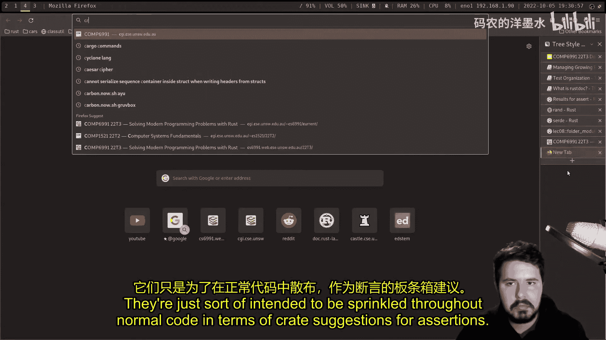

Not 100%， I know there is absolutely some good crates for mocking。😊，Asert， let's see。This。

 this seems like a lot of downloads。 That seems like a lot of downloads， but it hasn't been up。

 these haven't been updated in a few years。 What if we just go sort by downloads or sort by recent downloads。

あ。Assert。Potentially， this one。Assert。Nope， there is really not much in here。

 I there What about this one， spectral influenced by Google truth。 Well， that sounds。

 that sounds promising。诶。Assert that subject starts with， Yeah， okay。

 so this sort of has that sort of Google truth feel that sort of like a JavaScriptscript jest。

Feel to it a little bit。 There might be some good crs out there。

 if you find some that you particularly like， then let us know in the course forum。

 but none that I'm like super familiar with personally。 Well they're probably out there。

And then in terms of mocking。Gratuitously gratuitously unsafe mos。

 So I was thinking of mockel personally， but that one comes up first。

 I think just because it's got it's got the exact name that I searched for， but mockel。

 I believe is the is the most popular one if you would like to do mocking。😊，And yeah。

 I won't go too deeply into this now because mocking is also a little bit too advanced for where I want to go with the lectures today。

 but it is definitely a an option for sure。And yeah， Moel is generally what people reach for。

And the command of run tests again， no problem at all。

 so there's a couple we have the easiest one is cargo oops， cargo test or on CSC 6991 cargo test。

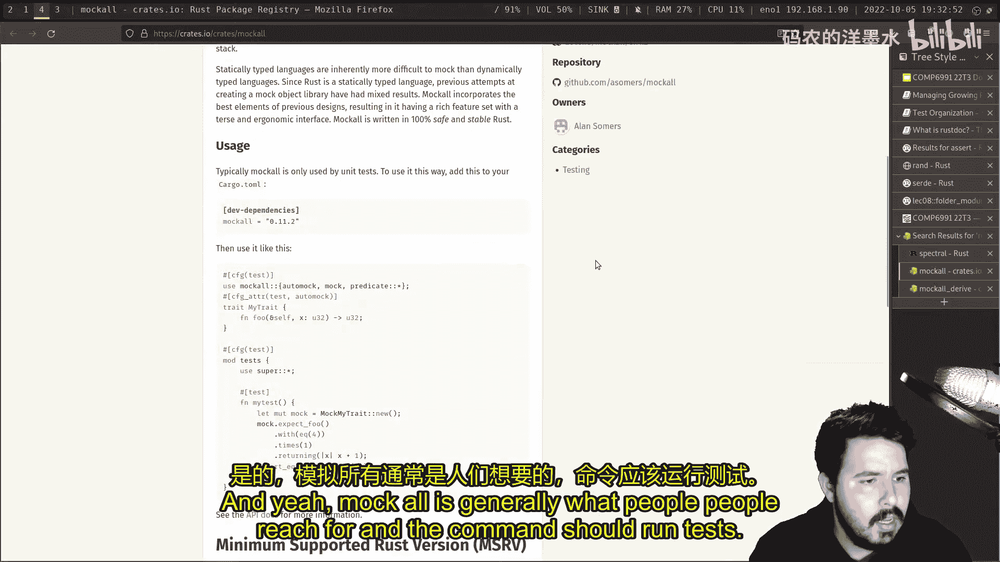

And that just means run all the tests， run unit tests， run integration tests。

 run documentation tests， just run it all。And you're can to see there's some tests that are failing right now because I messed with the paths earlier。

If you just want to test your unit tests then dash dashlib is what you're looking for。

 just give me the unit tests if you want to test a particular integration test then you would say test and then the name of the integration test so in my case I have this test here called my_ test。

And that will just run the integration test and we're also going to look at documentation tests in a minute that you will test with dash dash doc and that just runs documentation test。

 one of which is failing right now， but cargo test is the overarching command cargo test。Cool。

is the first test。Do you mean you missed the first command that we ran， which was just。

 I think just cargo test， otherwise， yeah， cargo test Lib or dash dashlib dash dash test unit with an integration test or dash dash doc for documentation tests？

All right。So last little bit of this lecture then is rust dock and documentation tests documentation tests will come pretty easily at the end because we sort of we have covered everything around it。

😊。

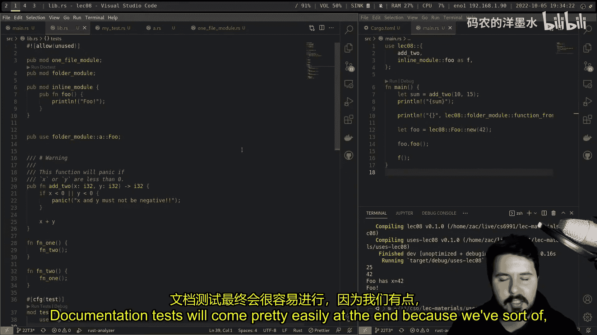

Documentation is an absolute， like。

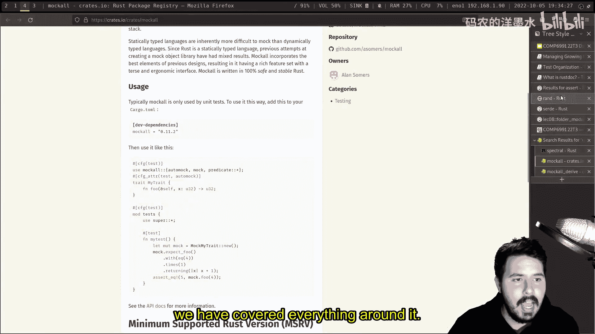

Form of art writing good technical documentation is a skill that probably takes decades to master it's。

 but like， you know， when someone's like， when someone is good at writing technical documentation。

 it really it does a lot for for people who are trying to use that code。 So if we look at， say the V。

 the Vec type here and let's say we look at insert or something like that。

We'll see that the function comes along with some documentation。

 it says inserts an element at position index within the vector shifting all elements after it to the right。

 it says it panics if the index you provided is greater than the length of the vector。😊。

And it also comes along with this little code example here that you can also run。

 So it says let mute Vec is a V of 1，2，3。 insert at index 1，4。 So we have 141，4，2。

3 and insert index x 4，5 is。 we have 1，4，2，3，5 now。Here's something really important to notice。

Do you notice that this example is written as a unit test？😡。

Right like see this assert e assert eke now this is like there's obviously a little bit of fluff that comes along with writing it this way but for the most part you can sort of read it top to bottom and go okay I understand what this example is like this is an example of code to me and I can run this here it'll take it to the rust playground and I hit run and it works right or if I want to go okay actually I want to like I really want to see what the V looks like right here。

😊。

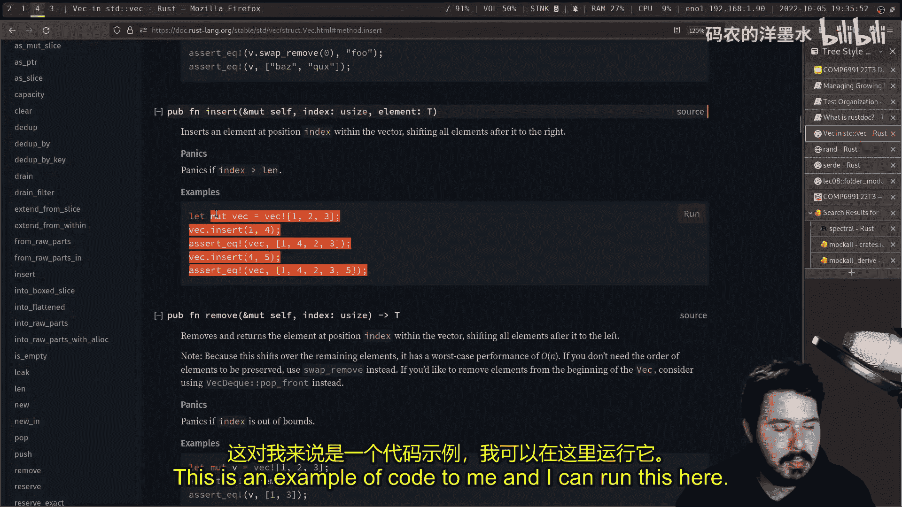

And when I run it， I could print it， I go， oh， okay， it really is like that or something like that。

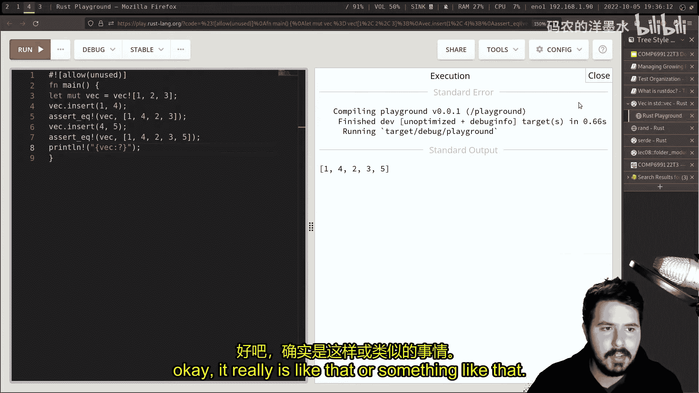

Something that's really interesting about rust is that this example is tested。

So that's one really cool thing have you like。😊，This is the kind of thing that you may run into like very infrequently。

Is you run into a case where someone has written documentation。

 they've provided you an example and the example is like just wrong。Like the example doesn't work。

 the example doesn't compile， the example does the wrong thing。

 you don't have to worry about that with rust documentation because this acts as a unit test。

So how did they make their documentation look like this。

 Let's just look at the source code and it'll show us。

 So notice above where they've defined the insert function here。 and by the way。

 this is what the insert function looks like。 In fact， if you look above it。

 you'll see these triple slashes so you'll recall in rust you can define a comment with a double slash but if you do a third slash it doesn't actually change anything。

 It's still just a comment in fact， it's more like a comment that starts with a slash But tools like rust do。

 you know rust do in particular will look for comments that are slash slash slash or also slash slash exclamation point。

😊，And treat them specially so in this case， if you do a triple slash。

 it means this is documentation for the the item that comes next right the item that comes next being this function insert here。

😊，And then， you know， after these triple slashes， you can just put mark down。😊。

If you're familiar with markdown format like dotmd。嗯。

You can just put markdown basically and if you like don't know what markdown is。

 there's a lot of like really quick sort of cheat sheets on learning。

 you know how markdown works just Google Markdown and find the first the first guide that you know。

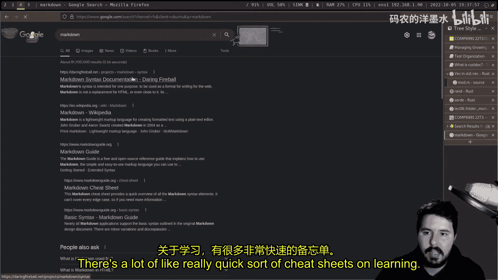

Feels like it fits for you that you're like yep， you know even like a cheat sheet is particularly handy like headings look like this bold text。

 italic text quotes， lists， unordered lists， you know inline code URLs you know it's a very simple syntax to be honest if you're having trouble with markdown you can always ask on the course forum at any point。

😊。

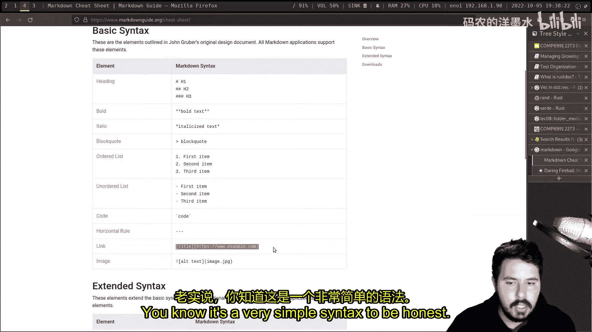

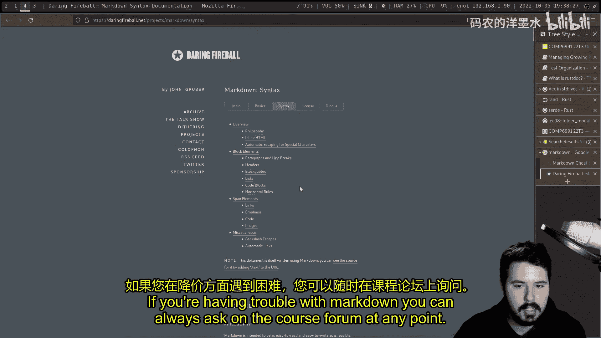

But you can just basically put mark down。

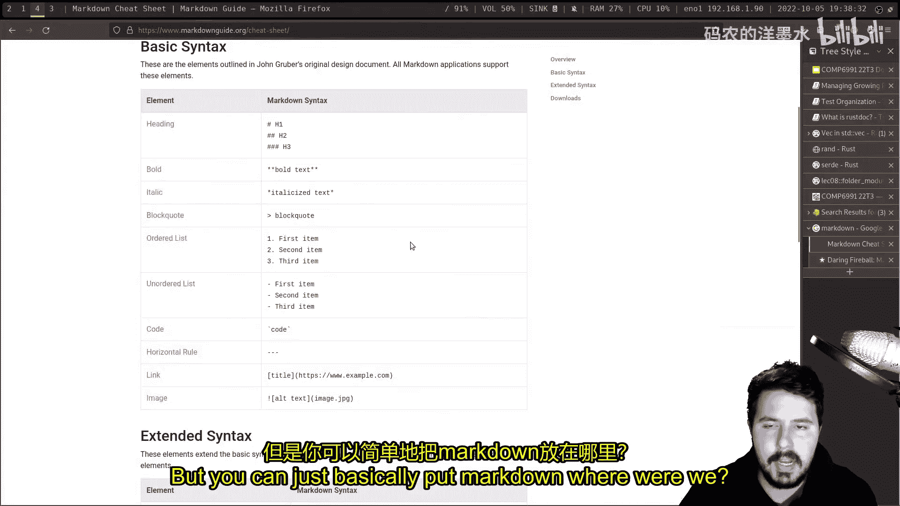

Where were we， we were here。And that's what they've done here， they've written some text。

 notice here's some inline code index and that index sort of gets highlighted as code there because it's referring to this argument here。

A whole bunch of text notice that they have a line break after the word all shifting all line break elements after at the right。

 shifting all notice there's no line break here in markdown if you want a line break you need to sort of do two new lines。

Because of that， I'd strongly suggest， you know inserting new lines as the line is getting relatively long because it won't make your documentation look weird if you really want a separate line。

 then you'll just need to do new line new line。So yeah。

 means your documentation doesn't end up drifting way out to the right if you know。

 if that was going to be a problem， they have a heading here for panics， al right。

 which is this one here， panics if and then code here indexes greater than land， right？

And then examples， they do a code block， which they donote with triple ticks here， triple tick。😊。

And that creates this code block here。 and without doing anything else。

 without writing anything else， this， they have created a documentation test。

And when you run cargo test or cargo test dash dash doc。

 it will test that this example both compiles and like works correctly if in the case of this unit test here。

When you run cargo test， which is just awesome， Like I think it's a really cool feature。 I think。

 I think this was primarily inspired from Python。😊，I believe。嗯。And just like， what a great idea。

 what a brilliant idea。In my opinion。So yeah， and this documentation will get generated and thrown into sort of a page that looks a little bit like this。

And let's see how we can do that for our code here。

 So here's our library notice that I've put in some documentation around the place， right？

In some other functions like the one file module you'll see that I put in some documentation all over the place here。

 I also have used this slash slash bang syntax here slash slash bang basically means you know this is a module Yeah this is gonna be like an English essay here where I just say the same thing a bunch of times this is a book my module defined in a single file。

 this single file comprises。The module。In its totality。Please。Enjoy。

This single file module at your leisure。Great， so this slash slash bang syntax here basically means don't document the thing that comes next right。

 see this triple slash meeting document the thing that comes right after these comments here。😊。

Slash slash bang means document the thing I am in。 So in this case， it's inside this one file module。

Right here， so it means the document the module itself， one file module。Um you know。

 up here when we're in sort of the crate module at the very top here。

 I could also throw a documentation that goes， u， you know， Le 08 crate。

This is a crate that is used to demonstrate modules， testing。And visibility。

Is there another thing in there， modules， testing， visibility， whatever that sounds about right？

And this will document sort of like the overall crate itself because it's defined in the crate。

 noticeice you could， for example， take this documentation here。Right。

 which is documenting the thing that comes next。Throw it inside the function。But with。

Exclamation points instead to say document the thing I am inside this is very rare to see in the wild most people only use double slash bang to mean at the like top of a file to mean document this module and the triple slash syntax。

😊，The triple slash syntax domain like document this item， this function or whatever。

 because it's the thing that comes next very rarely will you see something like this inside of a function。

 which is something that you might see in Python where people just sort of like define a string that like is their documentation which。

Always felt a little strange to me， but that's okay。 Yeah， so this is not so idiomatic。

 but you can do it that way， Yes， and regardless I'll leave it there and if you want to see the documentation for your crate。

 you simply go cargo doc。😊，And it's built the documentation。If we look inside Target。

 you'll see that there is a new folder and target now called Dock。Inside targett Doc。

 there's a whole bunch of like JavaScript and CSS and all that。But if you see here。

 Le 08 is the name of our crate。And if we look inside there。

 there is an index dot HTML indexationl So if you open this file in your browser。

 which I'll do like this。😊，It's put it on the wrong window， I'll bring it back over here。

 you'll see it just opens up。

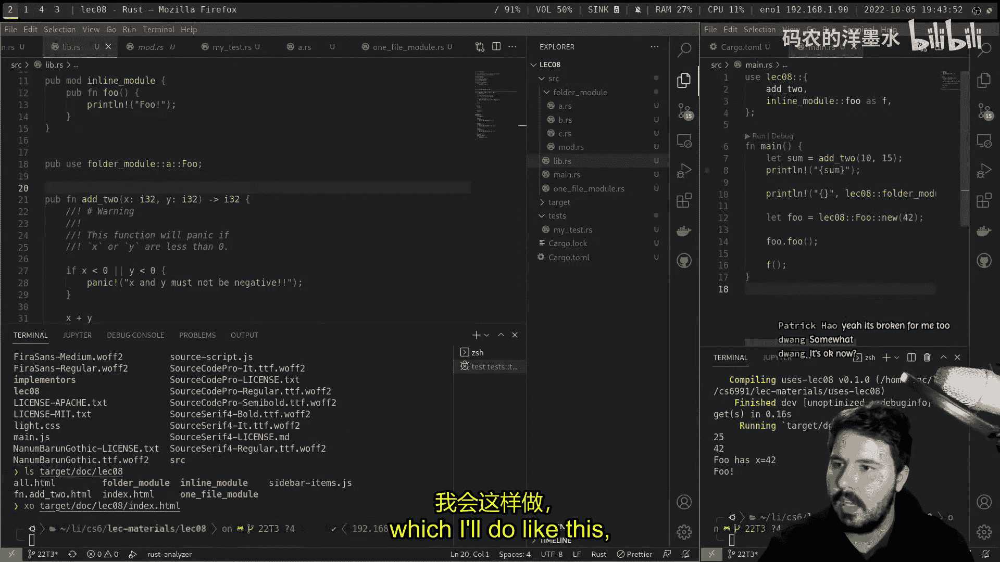

This part here。YouTe is not receiving enough video， yes you are you liar。

You see it's opened up this file here in。X indexex。

html and it looks like rust crate documentation you have S to search and all that and it does the right thing I can search for F and I get all these different things。

😊，So it acts like anything else and you can see our documentation has popped up over here now。😊。

In book。 Oh， oh good now。 Okay， so YouTube， maybe YouTube was right。

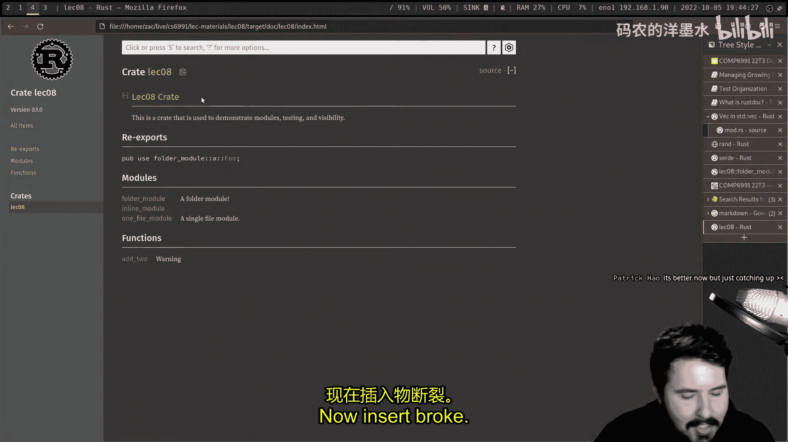

Okay， maybe YouTube was right， just to recap what I was saying， I opened this file in my browser。

 this index HTML is target doc LeO 8。😊，Index on HTML。

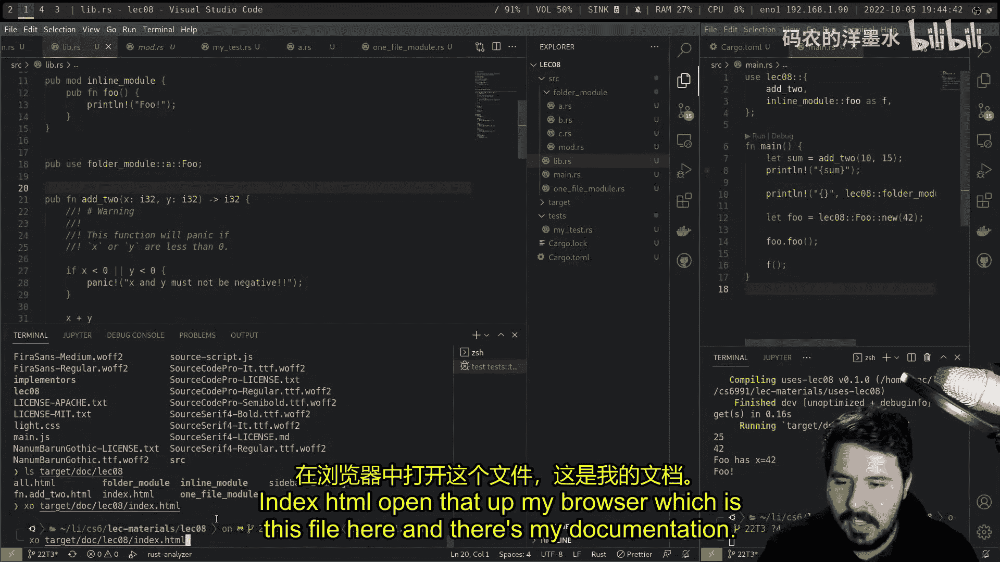

Open that up my browser， which is this file here。And there's my documentation。

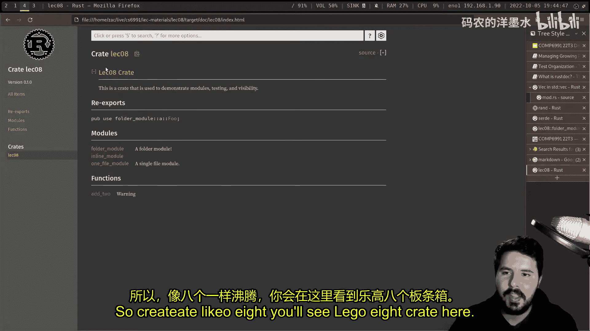

嗯。So。Create LeO8， you'll see LeO 8 cr here， that's this heading that I defined here。

 This is a crate that is used to demonstrate module testing and visibility。

 That's this all here No it says it re exportports module folder AF that's an documentation has a modules folder module inline module in one file module and add2 nose add2 has this warning this functional panic if X or Y are less than zero Okay that's nice。

😊。

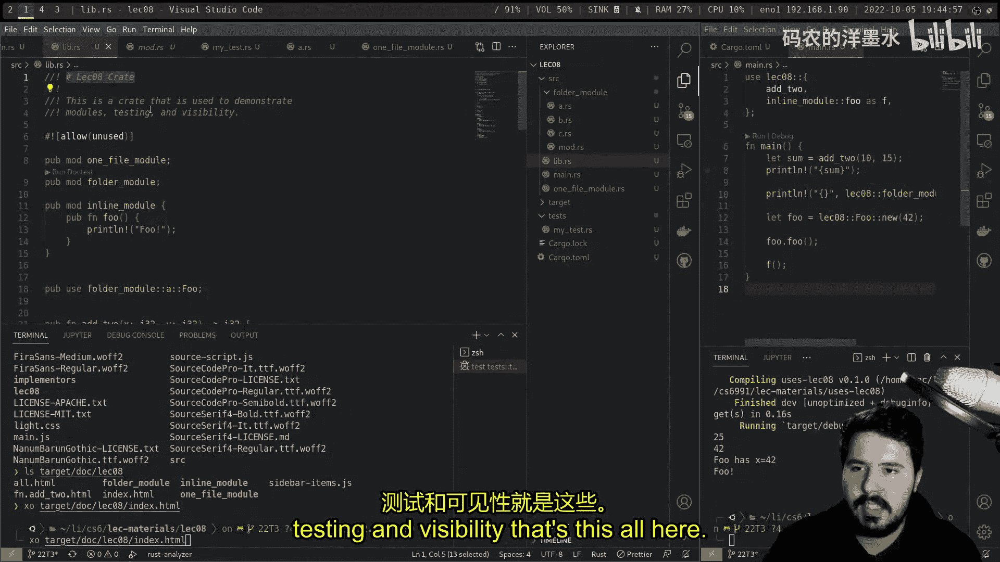

The one file module， theres a module defined in a single file。

 this single file comprises the module and its totality。

 please enjoy this single file module at your leisure。

That would be this one here and you'll notice this private stuff doesn't end up appearing in the documentation。

Because you're not able to access it sadly， from outside the crate。

I believe that is a way to get Russtock to build documentation with private things。

IDo we get to see it in here， No， I don't think so。 But I， I honestly。

 I can't quite remember the incantation to do that。

But I'm sure you could find it if you really needed it， but we see the public function here。

And it says this is a truly public function。 This function could be called from anywhere within this cr or not。

 great news for API consumers as they can use it。 You'll definitely want some good documentation to go along with it。

 as well as a documentation test。 So you can see I wrote all of this over here and then I wrote a documentation test。

 So note that over here we say we see let my number equals public function right calling the function here and assert that it's equal to 42。

😊。

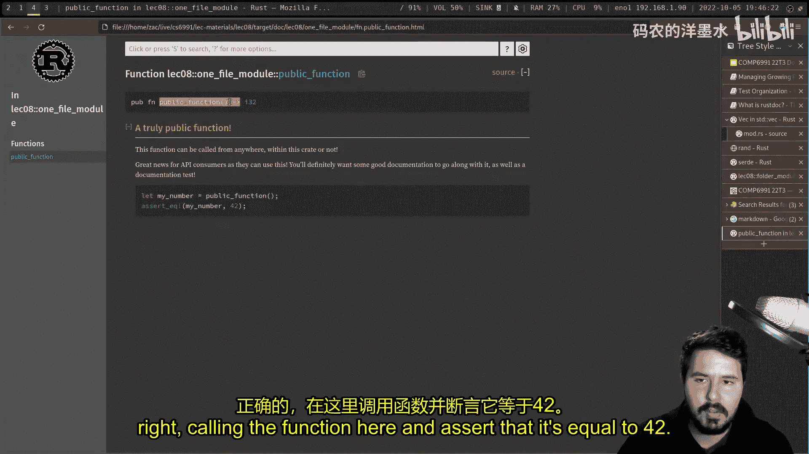

I actually needed one more line of code to make that work， which was this use statement。

 like bring the public function into scope with this big path here。

 but I don't want this to show up in my example， I figure that someone who knows how to write rust knows how to import this function when they need it so I don't want it to clutter my documentation and I can tell the code that you know the doc test to include this line of code when you're not testing it but not to actually include it in the overall documentation。

By putting a hash symbol。Just like this notice I got rid of that sub module before。 So if I go cargo。

Test do。This documentation test here is failing because it goes I don't know what sub moduleule is right you can see it's really like running it through the rust compiler。

😊，So if I get rid of this， oops， this sub moduleule here。And then test it。

 you'll see the documentation test all pass。Which is。Brilliant。I have another one folder module。

 folder module， modRS oh let's let's look at the documentation for this I've written something apparently。

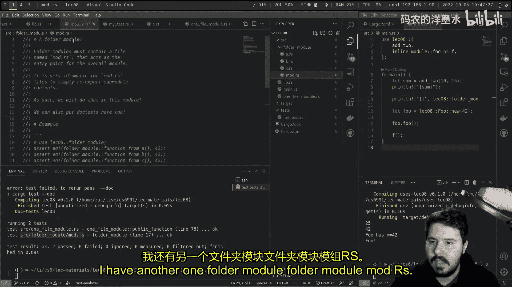

Folder module folder module folder modules must contain a file named mod Rs that acts as the entry point for the overall module。

 It is very idiomatic for mod Rs files to simply re exportport submodule contents as such。

 we will do that in this module So you can see this is the stuff in the module。

 We can also put doc test here too。 So in the overall module documentation。

 I also threw in random test here that just tests the individual functions further down。

 this is not so idiomatic I mean， actually it is actually useful when you want to just show a quick example of using your crate overall Like I wonder to say the RA crate does that。

 Yes， it does。 So the RA crate in the overall you documentation and we can look at the source code for this as well So this is their Lib dot Rs Maybe it makes more sense if I go to the Github page。

😊。

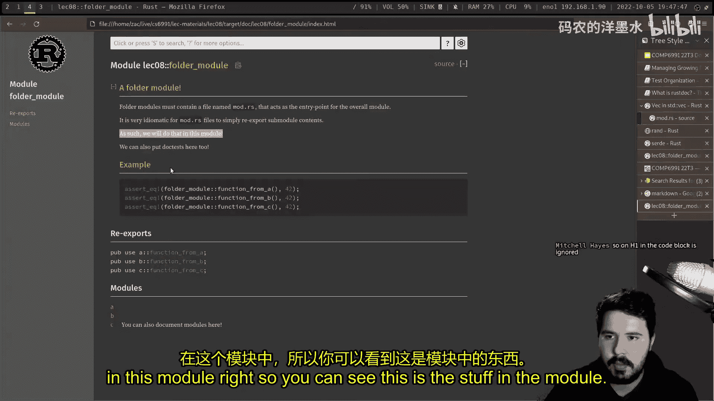

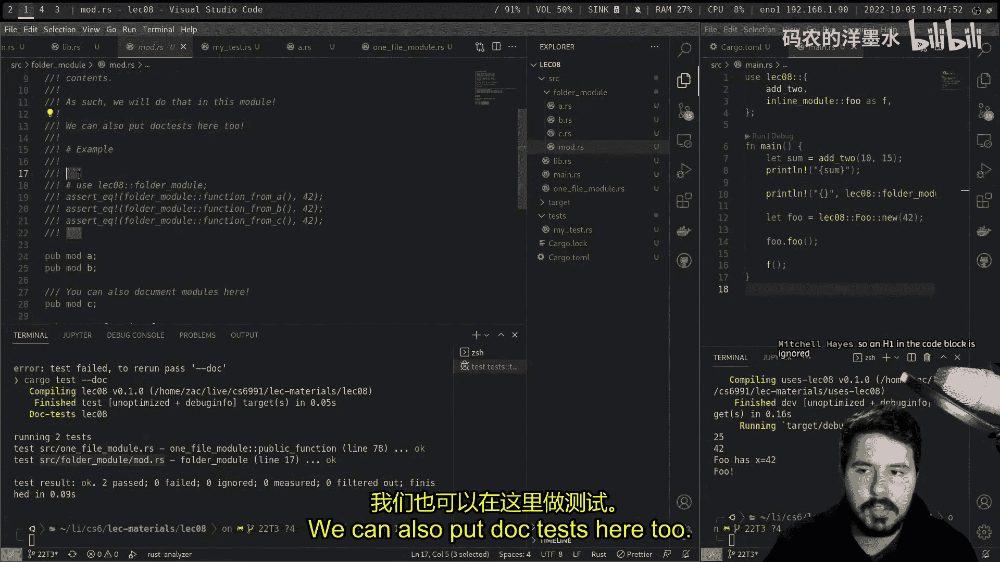

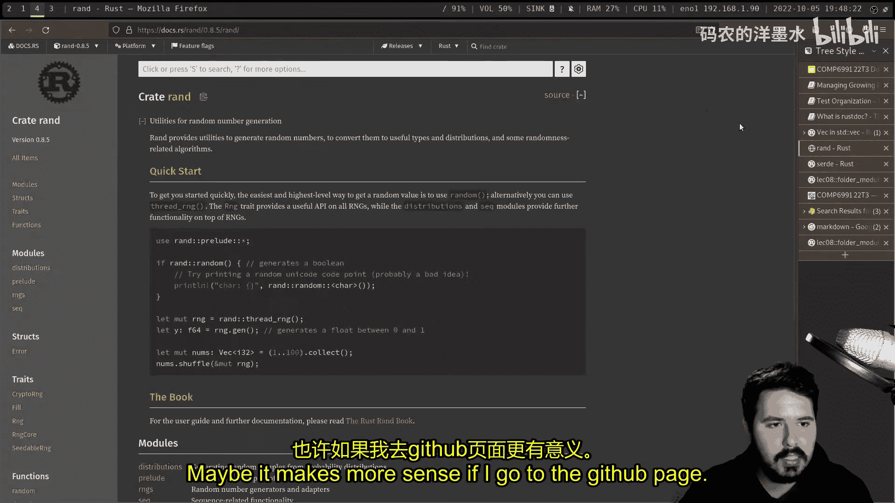

And show you in their source， this is the R crate to generate random numbers and go Lib do Rrs。

 You'll see at the very top here it says they've got this documentation。

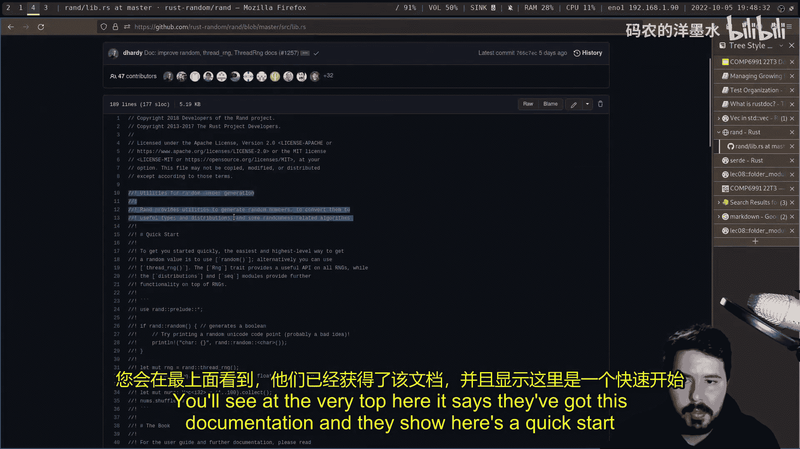

And they show here's a quick start if you just to get you site quickly the easiest and highest level way to get a random value is to use the random function。

 or you can use thread RNG here's a quick example that shows you and as we know this example is tested they have not written this example as a unit test because it's more of a quick start thing they just want to show you like how to quickly use the thing as like it's not going to be so useful if you copy paste it and it's like a unit test。

😊，But it is it will at least like the test will make sure it compiles， make sure it builds。

 which is at least something。

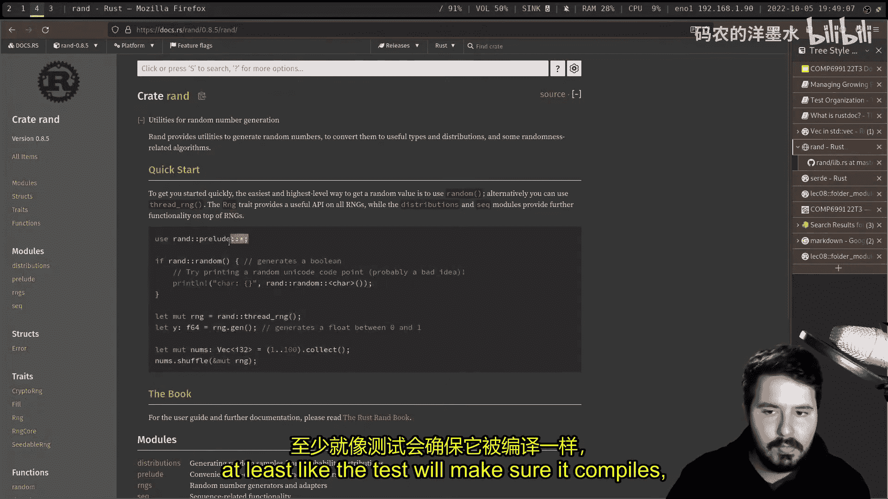

And。

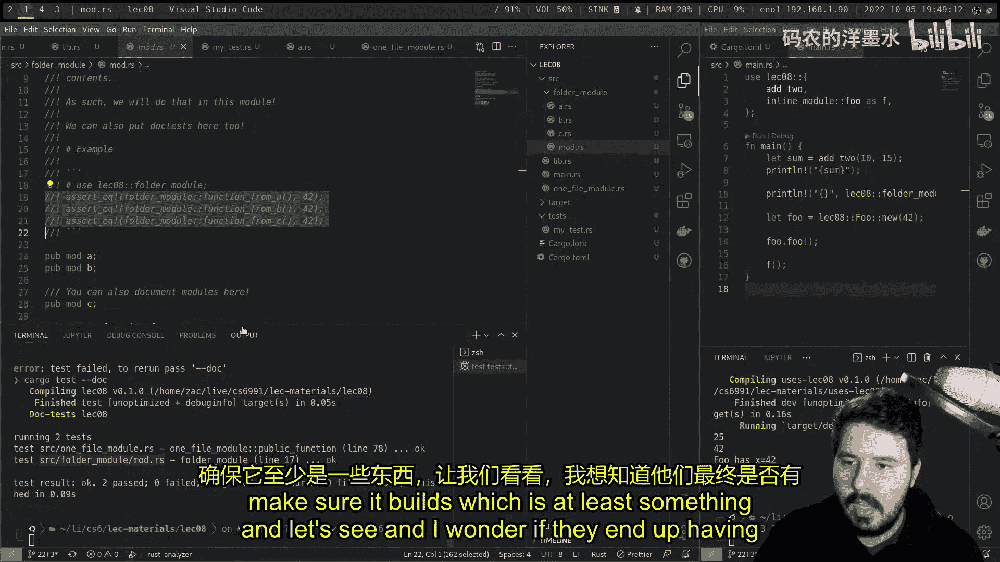

Let's see and I wonder if they end up having any code in here that gets not used， no。

 they don't comment any of the code out， which is interesting。

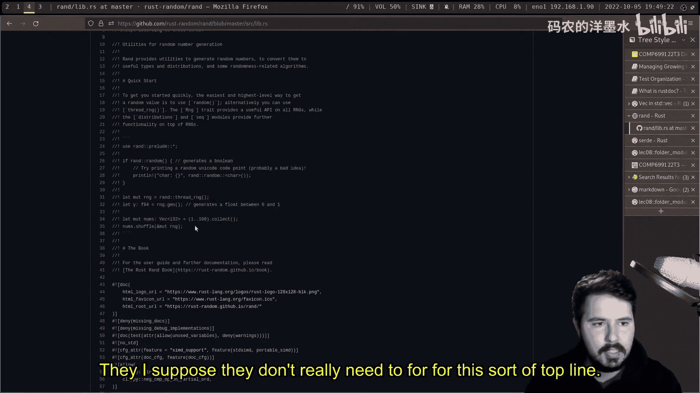

I suppose they don't really need to for this sort of top level thing。Anyway， where were we。

 we were here， we saw this this will get run as a doc test。

 we see it re exportports these submods and we can access the modules from within。

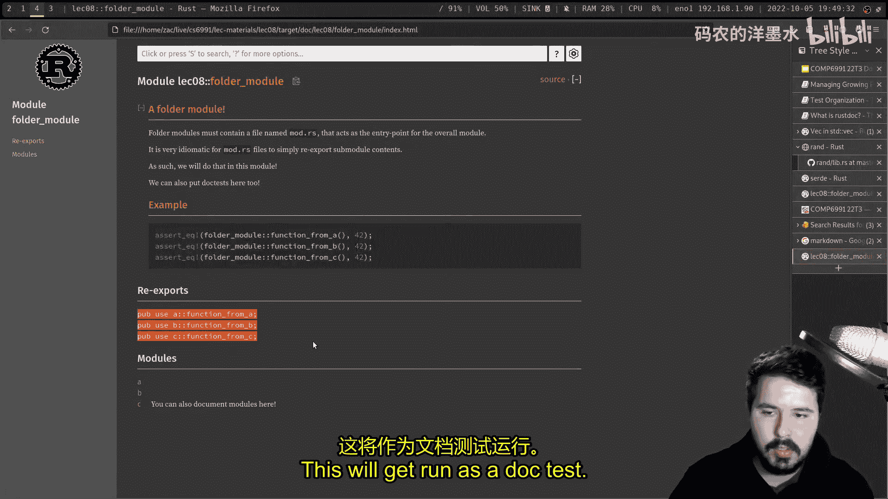

And so as I noted here， you can also document a module here if you wanted to。

 but generally people tend to document the module。Usually， oops， usually we document it up here。

 though。Like that。

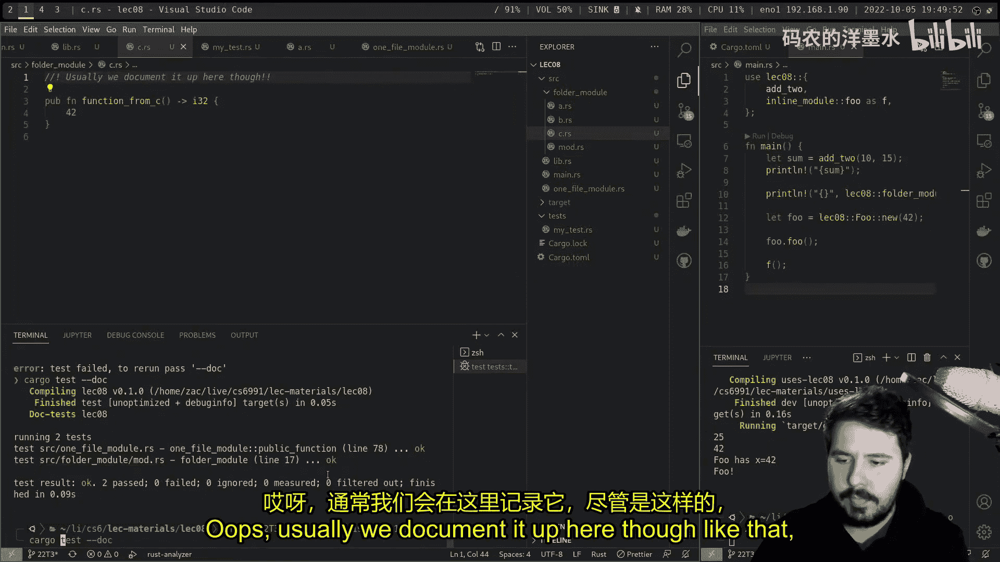

And you'll see that all this documentation ends up getting。

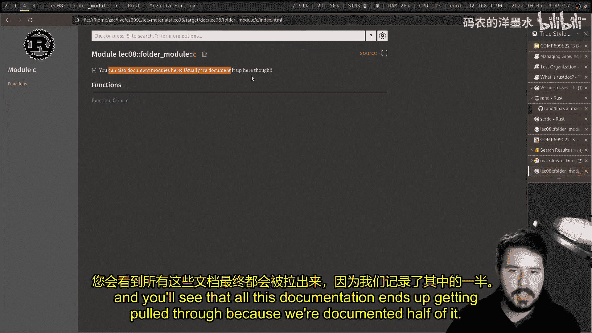

Pulled through because we documented half of it。As like a next item kind of documentation and half of it as a。

 you know， the thing I'm inside kind of documentation with these two different syntaxes。Okay。

 so an H1 in the code block is ignored。 Well， a code block doesn't really have an H1 if that makes sense the。

Like where have I got some good documentation here， So like an H1 makes sense in terms of markdown。

 which when you're like just writing normal text do in documentation。

 it'll be interpreted as markdown。 but if you open a code block， then you're no longer in markdown。

 you're writing rust code now， you can also do other languages like if you want to do C or if you wanted to do like Python。

 you might have to write all the Python now， I can't quite remember if you wanted to and then you'll notice that when I do this。

 it doesn't get interpreted as a doc test anymore。 See what' at the top here run doc test。

 I say it's Python code and now it goes away。If I do rust though， then the run doc test will remain。

 we'll stay。USo this isn't really， theres there's no way this is not marked down syntax anymore until the code block ends。

 this is code at this point， so the hash has no semantic meaning。😊。

Until they decided that a hash will mean include this line of code。

 but don't make that line of code appear in the actual documentation itself。Cool。

 so documentation tests are awesome when you're documenting code I strongly suggest them and we strongly suggest them in some exercises and your assignment code in your assignment for sure。

😊。

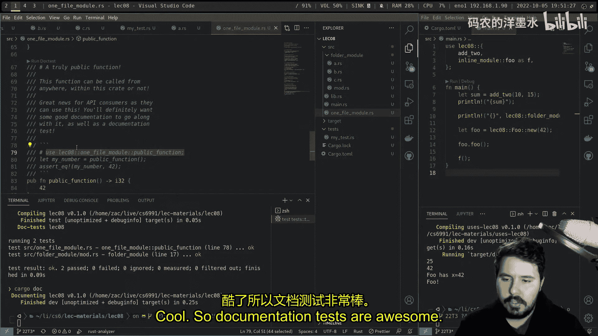

And yeah， they're pretty cool。I wonder if there's anything else that the。

That's some of these other very popular crates， including here 30， which we've used a little bit。

 an awesome framework for serializing and dealizing rust。

We can look at how they've written documentation in their code， 30 source。

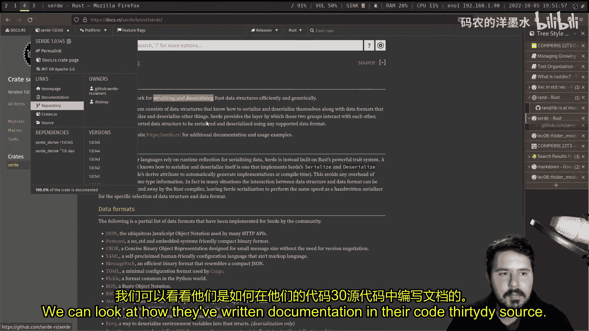

Live dot Rs。And you'll see again， they've written it。

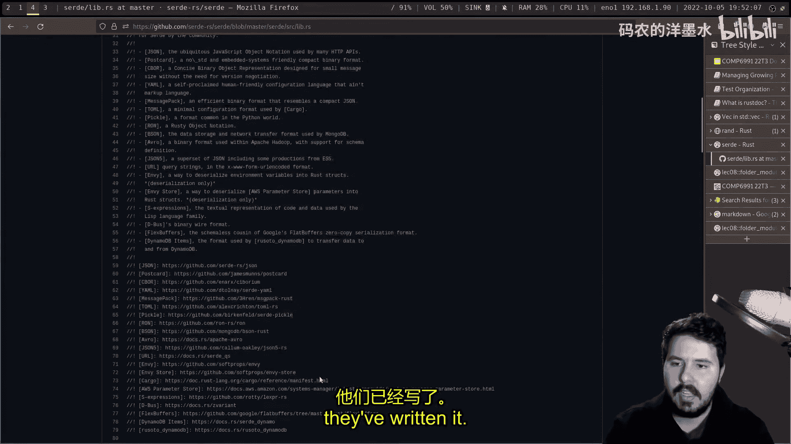

They've actually used an unordered list here as well with。

With URLs in them and you can see they've done it like this， they've gone J postcard， Seaor， Yaml。

 whatever with these square brackets， and then they define those URLs down the bottom here。

 which is also quite nice。

Oh， another actually quite awesome thing to do in your documentation is you can link across them as a link for to different things as well。

 Like， let's say in。😊。

Let's say this add2 function。We wanted to say like， you know， some notice that says this function is。

H， what's， what's a good thing to go for like。Maybe we're saying like this function is useful if used alongside the the food type。

 right， So stage 1 is it like， imagine I just wrote it like this。

 If I look at the the documentation now。

For this function， it says this function is useful if used along the food type here。 right。

 I can improve this a little bit， though， by putting food in back ticks like that。😊。

I have to rebuild the documentation， of course。And now it sort of shows us code。

 but I can go one step further if I wrap this in square brackets like this。😊。

And then。Do that， you'll notice it goes orange。And it becomes clickable。 And if I click it。

 it takes me to。Destruct food with like you know fos functions and all that。

 So if you mention another type in your program， like in your documentation。

 I would strongly suggest using this syntax， the square brackets。

 meaning generally meaning like some sort of URL。 But then with the back ticks inside here saying this is this is like a piece of code that we're linking to another type in our program or another item in our program。

 this is a great thing to do because it lets readers of your documentation just like click straight to it and then see all the stuff over there。

 So strongly suggest that。

嗯。ふう？Is there anything else I wanted to talk about there's the rust dock book is pretty handy you can just search for the rust dock book。

 I suppose。

The rust do book。 and it's yep， the first result here。

 If you're ever confused on using rust stock or anything like that， you can just find。

 you can find this。This rust doc book here and it'll have most of the information you need。

 for example we were just talking about linking to items by name and we used this syntax over here。

 but there's also different syntaxes you can use as well。嗯。And， yeah。

If it's if you need some sort of like path two things as well。

 then you can write it can you can use this as well， kind of syn deal link correctly。Yeah。

Not too much to it。I don't think there's anything else I really wanted to talk about。

So any questions， I suppose？

And we'll like not have to go over time this week， which is pretty epic。 Oh。

 something I did forget to mention earlier。 I think submissions for a couple things are broken right now。

 in particular， I believe the assignment expects you to submit two crates。

 And I think in this week's weekly exercises。

I wan to say modularity。 Oh， here we got a great warning。 Sub for the exercise is not currently long。

 This is another exercise that it expects you to submit two crates6，9，9，1 givers is。😊。

Not prepared to deal with submitting multiple crates at a time。

 And so the submissions don't work just yet， but I believe Sy or Tom are looking into this。

How much documentation are we expected to write for the assignment？That's a great question。嗯。

Let's say。So， here we go， so。That would probably fall on idiomatic design here， which is again。

 one of the big components of the assignment， 45%。And in here。

 it says documentation where provided is correct and readable。 There should probably be。

There should probably be another dot point here that says documentation is is like you know a lot a very reasonable amount of documentation is provided。

 I hope it's mentioned in this part too here at some point。嗯。Let's see。爸爸爸爸叭叭叭叭叭爸。Dock。Here we go。😊。

While you must make sure you implement these features。

 you do not need to limit tests to write significant documentation。

 so this is part one here that they're talking aboutops。So part one。

 you don't need to write a whole bunch of documentation yourself There we go。

 you will also need to provide documentation where appropriate in terms of part two I it mentioned again a here we go。

 this is what I was looking for Great， so it's not only as a part of idiomatic design but also this mechanical style。

For quests， you must have tests which encompasses the three tests。

 you must have all public interfaces document， so any public type that could be visible to an external user must be documented and then so like the mechanical style is it must be documented and if it is documented then you'll sort of you know get some marks。

And then your documentation itself is assessed under idiomatic design here。

 so this is like you documented it at least like a little bit if you just put a doc comment that had nothing in it then we will take the marks away from you。

 but if you document it if you like at least made a reasonable attempt you'll get the mechanical marks。

 but then we also sort of assess the manner in which you wrote your documentation and if it's correct and readable and you know uses stuff like documentation tests and it is generally just nice to use documentation then you'll get the marks over here as well。

😊，嗯。So and a very good suggestion here is this one missing docks。

Let me show you that So notice at the top here I've got this little attribute。

 the hashb here is essentially saying similar to like this here。In this case。

 it's saying apply this attribute across the whole crate。

So not just like one item or one mod or whatever， make the whole crate here。Like allow unused items。

 Like I'm just using this to basically silence warnings that are like。Here。

 like this function is never used， that function is never used， this function is never used。

 and I'm turning this on so we don't get so much noise in the lecture just by complaining hey you didn't use this by the way。

 which is honestly just more annoying than anything。😊。

Something that I would very strongly suggest you turn on is。1 on missing dots。So anything。

 any sort of publicly accessible item that's missing documentation。

 you'll get a warning when you build your code so maybe you don't need to do this like right at the beginning because it might just be annoying to you if you're not writing documentation as you go。

 you might find that writing documentation as you go actually helps you but if you choose not to it might end up being annoying。

So maybe you just do this at the end， but this will show you every oops every single thing that could be publicly accessible that is missing documentation which is really handy。

 you could also change this one to deny and then it will literally not let you build your code until you write your documentation which is kind of funny but one on missing docs is very common to sort of help you through and then even in some big libraries in fact let's check Rand and 30 Sometimes they'll even do deny missing docs see look at this。

😊，In this one of the most popular crates in the whole rust ecosystem。

 the Rand denies missing docs so that if someone tries to like make a pull request and goes， hey。

 I added something and then it runs through C right it runs through continuous integration， know。

 makes sure that the code they're adding isn't breaking stuff， but they didn't document it。

 then it'll go nope， we won't merge this in。 we won't even look at it because you know you didn't document your stuff So this is something very common once the crate isn' entirely documented。

 Once you've documented everything， then you might want to consider turning on deny missing docs as well。

 especially if it's a big project。30， let's see if Cdy did it as well。

 I'm just sort of interested at this point。 Allow all this stuff， deny missing docs。Yeah。

 pretty cool。Should the depth of documentation be around what you've shown today or something less or more about around what we've seen today and in fact。

 the standard library is also like a good level， like you'll notice that often the sort of top level documentation in the standard library is far more than it would be necessary for for something that you're writing right like this is the documentation for just like struck V。

Which is a lot。 And we'd absolutely not expect this that sort of level of documentation。

 But look at something like new here construct a new empty V。

 the vector will not allocate unless until elements are pushed onto it。 examples， blah。

 or what's another good example here to use a， this is a good one here。 Reserve。

 Reservs capacity for blah， blah， blah， talks about some stuff。 you know。

 here's some stuff you might want to know， panics， right， So it panics if you do this。😊。

Right so let us know if this function is going to crash me for some reason or any other like additional foot guns and stuff。

 and then an example as a documentation test。😊，Just this is an excellent example that would constitute as Thomas has been naming it。

 this would for sure constitute design excellence。That just needs to be added to the entry point of our app。

 right？I'm all right。 this here， this stuff I'm assuming you're talking about。 Yeah。

 you just need to put this。 Yes， this needs to go in the。 well。

 I you should be able to throw it in like。😊，え？In here as well right like you can throw this wherever。

 but it means similar to the comment bang docs， it means apply this to the thing I'm in and so it's most common that you see this stuff here in the root level right the Lib dot Rs in this case or the main dot Rs the root of the thing so it applies to everything inside it that's where most people end up doing it and this people generally like refer to this as like crate level attributes where this applies across the whole crate。

Man， just realized reserve would have been a useful a week or so back for a week so can't be believe I missed it。

😊，Well， I mean， you're not expected to know every single function walking into this course。

 but it's one of those standard libraries that。A A。

 you'll end up remembering a whole bunch of this stuff over time anyway， and B。

 I find this documentation like rust do in particular。😊。

Way easier to look through and find the things I want once you're used to it than than a lot of other different kinds of like if I pull up Java dock right now not to like throw shade or anything。

 but like let's look at like Java S E docs。

嗯。Oh， God， oracle man。

系い诶系啊。Java， Java stood docs oh god。There we go。Oh god， no man。Show me the job。

What if I just do like Java stringed con？

Sure。I mean， it's not like Java S API dos is what I should have typed to Se docs right。

 this is Java doc， for example， which is like。You know， at the end of the day， for the most part。

 it's presenting the same kind of information， but having used， you know。

 Ru doc for a very long time and Java doc for an even longer amount of time。You know。

 I I have my personal preference， but you're free to you're free to make your own， essentially。

But again， at the end of the day， it's a very similar sort of idea in almost every language is sort of built in ideas for documentation。

 where they have it。Even still， I'm looking for like package。Yeah， yeah， okay。

 I guess that is what I wanted。你。There's no， I there a search。

 I don't think Javadoc has a search either， which is just。Anyway。

You use Ruock and decide whether you like it C+ F reference， I'll stop， stop it you'll make me cry。😊。

嗯。Yeah， so anyway， at the end of the day。😊，Another nice thing that we're hoping for， I personally。

 I have a personal belief that Russtock is generally pretty has like a pretty low barrier to entry。

Like as far as I'm concerned， you know the sort of bar for writing documentation is writing slash slashlash right if you can go on your keyboard and do slash slash s then you can start writing documentation and like hello world and like markdown syntax is also very easy to use as opposed to like you know Java dock and stuff you end up getting you know I feel I don't know why but I feel like it's stuff like this here and then you have like at Para and all these sort of like weird。

You know， weird isms， weird nomenclature and stuff that can make it difficult to just write。

 write sort of basic documentation。And so the hope here as well is that using a system that's generally。

 yeah， andgen， oxygenxygen and Java doc are very closely related。

The the hope is that being given a system that lets you write documentation with a very low overhead will also help you focus on the documentation that you're writing itself。

 therefore， thereby giving you more room to become a better better at writing technical documentation thereby giving you skills when you go back to a language that maybe it's a little more pesky to write documentation in know can you end up spending some of your energy dealing with that。

 but you already have some skills in writing some useful technical documentation。

 So you know you let us know how you go with that。 other than that any other questions will call the lecture like officially over。

 I think the lecture is officially over 10 minutes ago。 But again。

 as usual I'll sit around here as long as you keep you keep spinningitting questions in the chat。

 I am more than more than happy to。Sit here as as long as we'd like。But otherwise， you know。

 apart from any other questions。 Thank you everyone， for coming to the lecture。

 Make sure to come to the workshops this week if you at all can。 so you can。 Oh oh。

 that's the that is the one other thing。 Sorry， Last thing I forgot to mention this week's workshops。

😊。

Here after the first two parts of this workshop， which is about like discussion and like the theory questions and stuff like that。

 after the first two parts of the workshop， we will sp to small groups where you can work on directions lib partially provided as partially working data code。

 this is a library。😊，If you can get it working， it will be useful for your assignment。😡。

Unlike other code， you may use this code in your assignment。

 even if somebody else in your group contributed to it。

 so we have some exercise for the workshop this week that literally will be really handy to just go like copy paste into your code and like so genuinely this workshop if you're like not into the whole sort of workshop idea like at least come along to this one because I can almost guarantee it will be useful and that you get to look at other people's code for a certain exercise and get feedback and stuff you get to talk about the theory answers from weeks two and three and you get to work on stuff that you can literally copy paste into your assignment So a strong recommendation from me the person who has been badgering you old term to continue coming to the workshops。

😊，Stacker workshop flow。 Yes， very good。 So I strongly recommend coming a lot。😊，Alright， so anyway。

 just questions feel free to leave if you're if if you have no questions， otherwise。

 I'll just keep field those we get as long as we get them。

 I there any way to autogenerate docs in rust Like I think in many ideas。

 you can auto generate most of the Java doc for a particular function signature。😊。

So。The answer to that is mostly no， specifically because。Rust do。How do I say this？

Java dock in particular that you're talking about is a very structured documentation language。

In that it defines。

Yeah， Baedong， Wikipedia， any of those work。It defines like specific tokens to look for like at Para or at return。

 at C that are like semantic to the documentation generator。

Whereas Rustock really just is a markdown language with， you know， some additional semantics。

 But at the end of the day， really just is a markdown language with none of this stuff here。

 So there isn't really boilerplate to generate。 And a lot of this like。

a lot of what Rust encourages at the end of the day is。If the if this stuff here。

 like the parameters， like what you what you're giving or what the function returns or whatever is not obvious from the type itself。

 then like maybe you want to rethink the way you're writing the function in the first place。

 right because we get you know this level of type assurance and you know and static assurance that is it can be difficult to achieve in other languages。

 So make use of that。And at the end of the day， in some edge cases where you really want to like specify exactly what a parameter is。

😊，Generally， you'll just write that， right， You won't right like at Param， blah， blah， blah。

 You'll just go like， you know， let's say this took like X， I 32， whatever。 And you're writing like。

 you know， some stuff about the function。 blah， blah， blah。 You would just write like X is。

And then here， like the boilerplate that it would generate is like X is。You know。

 X is a number from a number。 The X is the number of。Of who's， you know。

 I'm just like making a brand of stuff here， right？嗯。So not really， I mean。

 maybe Ros Anar does have something。😡，😀は。😊，Maybe it does some stuff when you have some types in here。

 let's see， let's see， let's see， let's see。😊，Okay， that's cool， that's actually really cool。

 it saw that there's a panic in here and so it put a panic at her here and said panics if bh。😊。

That's kind of cool。 But you see that there's even rust analyzer doesn't really think to do much because it's not that typical in rust in particular。

 I wonder if it says if I had an unsafe function， just this is just out of my own interest。

 unsafe function， unsafe food。😊，And it said like panic。我。Let's see what it does here。Yeah， cool。

 That's what I was hoping for。 So it says it see that it could panic and it says panic if。😊。

Connects it crude and it also has a safety thing which says， you know in order to use。

Unsafe food safely。You must ensure。宝宝宝。This kind of do。 So yeah。

 there's a little bit of documentation generation， it turns out。

 but but there's there's not much because it's not super idiomatic and rust in particular。Yeah。

 that's pretty funny。All right， any other questions。

 I'll stick around for another 60 seconds until we get no more questions。😊，No problem at all。

No problem at all。Yeah， you must ensure you must ensure that false。As。Yes， yes。Alrighty。

 see your letter。I'll give another 15 seconds just to see if we got any more questions。

But thank you all for coming。I'llCan up this in the meantime。C 下一 c 嚟啦。Cool， that's probably fine。

Yep， all tests。Pas。🤧K。All right， now more questions， thank you all for coming。

And we'll leave it there。 See you next time。 See you next week。

