# 【全集】新南威尔士大学 Rust现代编程 中英字幕 1080P p09 Lecture 9 - 泛型与特质 -BV15cf4BCEN1_p9-

All right。lets see。Okay。Hello， everyone。Now。Once again。We have a new setup。

I know it seemed like my setup has changed。Every week and that's because it has changed every week。

I am in yet another house。 Hopefully， this is the final destination。 I'm in my new house。U。But。Sadly。

 I have not been I've not been granted the absolute gift。Of the the notional broadband network。

I' have not been given the gift of the Nbn by the Australian Government just yet。So。This。

 and this might scare a couple people and scared me is currently running off a like a USB tether on my mobile。

 my， my mobile data which I just wasn't going dare to overdo until I actually started doing some testing。

 And I was like。I was like， okay，4G is actually pretty quick， maybe， maybe I can。😊，And it's， I've。

 I've done testing。 and it seems like。From 6 to 8 pm。

 which should be like the real worst time it holds up。At like you know a high quality 1080p stream。

 so I hope we survive through this， but if things go wrong， it's probably my end。

 not yours so don't panic。Anyway， fingers crossed。And， but， you know。

 we've dropped zero frames And on my second test dream。

 I also dropped zero frames over like a couple hours。 So thank you very much for the good luck。 Yes。

 and we shouldn't have a problem with running out of data or anything because I've been。😊。

I'm I'm on a mobile data plan whether the data I don't use rolls over into the next month permanently with no limit。

 and so I've saved up。I've saved up half a terabyte of mobile data over a couple years and now I get to spend it now it's all coming together now。

😊，My not to in which carrier I don't want to necessarily， I don't necessarily endorse them。

 And this is not a， this is not a sponsor lecture， but I use Aldi mobile because I personally like the Telstra network and they have at least a portion of the Telstra network in particular。

 Everyone seems to be on the Optius network。 Optius loves to sell off。Pitbitits of their network。

 Telstra only has like used to be three。 Now it's like five or six carriers or something。Anyway。😊。

Cdual E must pay well to move into new houses every week。I mean， even if it。

 even if it was who really wants to move houses every week， it's not been fun。Spking of， you know。

 moving houses and being very busy in the likes。😊，I had had took a chance a couple days ago to catch up on。

 I think， I think I've caught up on all the emails to the course account and we did a big run through the course forum and I think like。

Anything that's not more than like anything that's that's more than， say。

 24 hours old or something like that。Has been responded to。

 we've tried to resolve whatever we can and I think a couple of things we just needed some more information。

😊，But if you think that if you believe that an email of yours has gone unanswered or you have something old on the course forum that。

That may have been missed， just let us know let us know however you like。

 you can send another email with you can full caps yourum。😊。

Full caps your subject line if you think we're missing emails from you or something like that。😊。

but I think we're mostly caught up at this point， so an apologies for， you know。

 having taken a little bit to catch up。Okay， so let's let me see the chat here。

 So hello to Mitchell Dong， Simon， Cci， Andrew， Josh， Miguuel and Kai。😊。

So mobile data is usually better than NVMH toC opts， sponsored， no， not sponsored。😊，Voter gang。

 license number， Votaphone。 Okay， yep， yep， and other data carriers。 Okay， cool。 And yes。

 everyone is famous now。 Alright， great， so。😊，This week we are looking at polymorphism and this is a particularly interesting topic for this course because。

Rust， I'm going to word myself carefully here。Rust is not a like diehar。

 exclusively object oriented language， you know， languages that I might throw into that category are you know。

 vaguely things like Java or the Java family of languages or something like Python where they're very committed to the idea of object oriented programming。

You know， even if Java or Python really has like， say functional capabilities。

 the vast majority of like data and behavior that you're dealing with are in terms of objects。😊。

Where there's this sort of one sort of all seeing object at the very top and everything。

 there's a lot of inheritance sort of all the way down classically in these kinds of languages。 Now。

 rust again， is not a not quite so object oriented to that point。

 C plus plus is pretty object oriented as well， but you can sort of you can certainly opt out of it and and do things particularly differently。

😊，嗯。I would what I would phrase Rus as having is object oriented capabilities。

 So some of the things that you'll that you'll find in object oriented languages。

 Ruy that has like a very sort of。It's an equivalent offering and then for， you know。

 some features are missing， for example， inheritance isn't really present in rust。

 there is inheritance sort of over lifetimes， but that's not really generally a thing that you tend to think about you just think of lifetimes getting shortened。

 but technically it's its a system to do with inheritance。

 but there's specifically no inheritance over types。

 there's no say golden retriever extends dog extends animal extends。Object， I don't know。

 Maybe there's something between animal and object， but I don't know。

And so you don't get this sort of chain of inheritance or anything like that in rust。

 but some of the patterns that you'll sort of spot in object oriented programs can at least be emulated as well in rust we're going to look look at that in terms of the classic animals example and look at how we can get some sort of object oriented capabilities and also like sort of things that look slightly like inheritance but not not quite the same thing。

Okay， and sure， family species， self species， there we go。

 we've got the the biologists coming in so perfect and but yes， importantly。

 this pattern is is generally not quite so。😊，It is not expressed in rust so much， let's say。Okay。

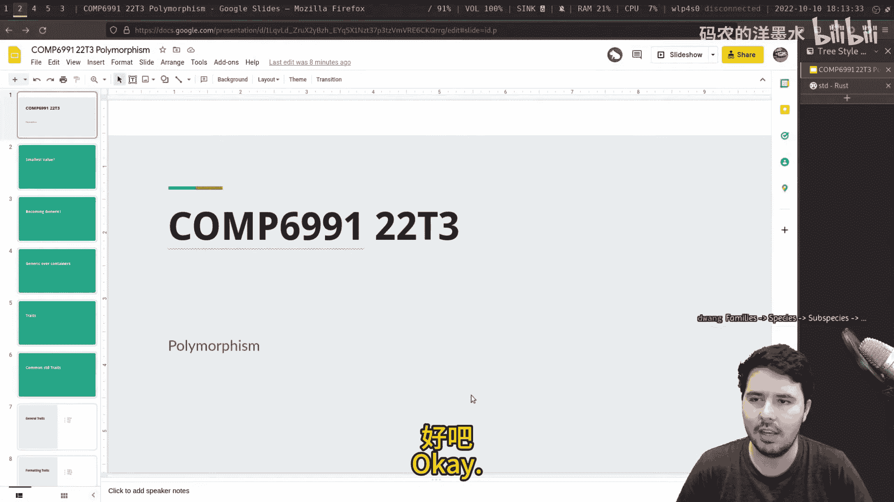

So to outline， in fact， speaking of outline， I should just。

 it might make sense to just pull up our right line here and yep， checking St all looks healthy。

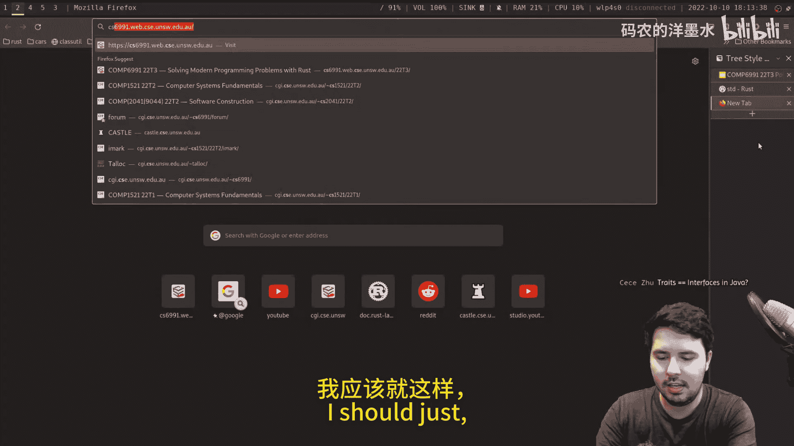

嗯。Topic notes。 So this is the polymorphism week。 and we're going to talk about generic this that s is snuck its way in there。

 generic type parameters， which if you're a， if you're a very diehard theoretical programmer you might know as parametric polymorphism or specifically bounded parametric polymorphism。

 if you don't know what those words are， then that's not really a problem because we're not like a。

We're not a PL theory course in the same way We have theory aspects in our own way。

 but not not specifically PL theory we're going to talk a little bit about monomorphization。

 which is how generic type parameters are implemented These words are all going to sound scary but at the end of the day it's actually I think they're relatively simple ideas that you just have to play around with and you'll get used to。

We'll then talk about traits which allow in particular ad hoc polymorphism。

 which is sort of distinct from parametric polymorphism in this case。😊。

And then we're going to look at static versus dynamic dispatch of those traits where usually you will opt for static dispatch。

 you know， just when you're generally using traits。

 but occasionally we opt into this dynamic dispatch with something called the Din keyword。

 which is DYn out of dynamic here。😊，That's like what we're all the stuff that we're going to play around with this week。

 we'll see how far we get today and then that'll sort of inform our lecture on Wednesday。😊。

Watched the video about it recently， very nice and we have a cat coming out of a v。

 Sree says it's definitely not。😊，WellI don't know what what's definitely not。😊，U。Cool， anyway。

 so that's what we're looking at。😊，And we're going to start off。

 We're gonna we're going to be talking a lot by example as well。

 People seem to like like things being shown by example as opposed to just like things on a slide。

 So we'll we'll start off with that。

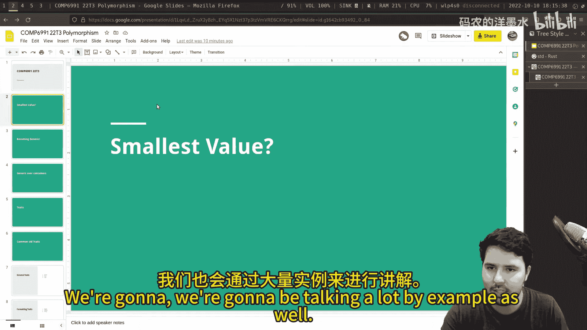

And strain check， everything looks good， good。

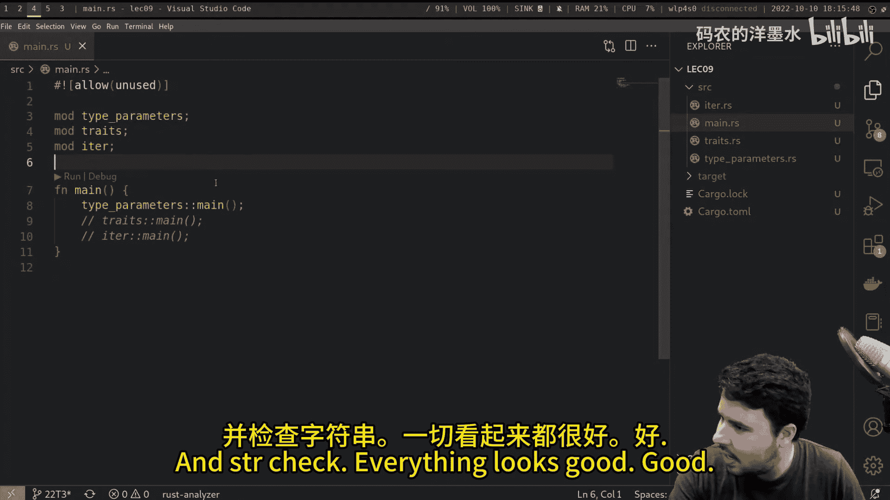

So type parameters。 We're starting off with the， the generic type parameters that we've mentioned over here。

 And you can see I've written some。

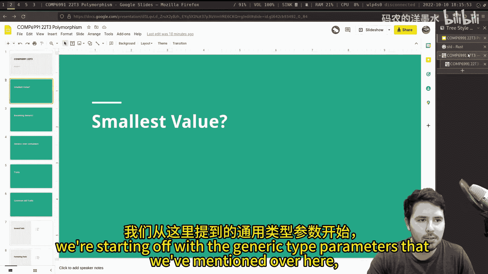

Some kind of painful looking code right here， So I'm going to give you a sec to just read through this。

And then I'll run through it again， and then we'll have a chat。So we've got three functions。😊。

And they all basically do the same thing， in fact， if if I like if you look at this body here。

 this is going to be the exact same in all three functions here。😊。

It's just trying to find the smallest of two values。RightBut let's say I want this function to work。

 whether I give it integers， whether I give it floats。

 whether I give it characters or potentially some other types you might want to throw in there that could be compared to see which one is greater or smaller。

😊，Oh， it's definitely not fun to move houses， I see， okay。😊，Yeah， it's not that fun， is it？😊。

I'm not sure I've， I also turned like up the stream delay。

 I'm not sure how big of a delay that's actually turned into because I wanted to。

 if there's a hitch in the stream， it's， it's more likely that things will survive if there's。

It's on low latency mode， so。Anyway， I'm not sure how far behind the chat is。

 but you might be a little more behind than you're used to if it's particularly bad I might try and。

I might try and drop back down to Ul low latency mode。

But I'd have to stop the stream and start to do it again， so we'd have to do that for Wednesday。

Anyway， so the chat the chat might be quite far behind I also just realized I missed a message that said traits is equal to interfaces in Java Yes。

 they're very much an analog of one another I believe traits in rust open up more possibilities than interfaces in Java but they they traits offer at least what Java interfaces offer potentially some more 10 seconds also okay cool that's not too bad then。

😊，Traits D。Thank you。Okay， anyway， so I want this function to work across all these different kinds of data types。

😊，And so far this does right， I write one function for I32。

 one function for F32 and one function for char。😊，And if I go cargo run。

 you'll see the smallest I 32 of 42 and 100 is 42。Excuse me。 The smallest F 32。Of 3。14 and 99。9 is 3。

14。 The smallest character of A and Z is a。 In fact。

 I also just realize the smaller one always comes first。

 So I'll prove to you that my code is not oops，1000。

 I'll make prove to you that it's actually doing the right thing。 We still get 42。

 if I change the order up， so。😊，It's really， it's really working today。 Stres on fire today。😊。

Alright， cool。 But this kind of sucks。 if you are a diehar go programmer as of， you know。

 maybe more than a year ago or so， one or two years ago。

 you may disagree with me and may say this is actually very good code。

 I'm personally not a fan and I'm happy to leave it to you to sort of make your own judgment on this。

 but I'm gonna show you tooling that we have to not have to do this。

 So I mentioned go Google's go language in particular， because prior to two years ago。

 this is about as as。😊，If you wanted to write code to do something like this and go。

 this is what you end up having to write。 Essential， there are tricks around it。

 There's tricks to do with。with like boxing and and performing some horrible curses and also a very common thing in go is to write code like like macros and Rus we haven't really talked about yet。

 essentially write code to generate go code， so you go write a program that spits out this function。

 but for like whichever type that you want here。And yeah， this is a decision by some languages。

 in fact in C as well， we have the same problem in C。

 but and often C programmers will use hash defined macros to work around this kind of limitation。😊。

But。呃。You know if you're not a fan of like repeating lots of code many， many times。

 you may like the idea of just writing this function once and having it applicable to whatever type you use Now of course there may be downsides that come along with that and and that's almost certainly going to be the case however you perform it in whatever language。

But it's useful to， I think it's useful regardless to have the ability to do it in our case。

 it certainly adds to the language's complexity in terms of like the feature set of the language。

 but it may also reduce the language's complexity in terms of you know not having to worry about generating 50 functions if you need a function to work on 50 different types so it may increase the complexity of understanding the language but may decrease the complexity and writing code in that language again。

 it's up to you to sort of form your own opinions on this over time。

My typing has been bad as Zach can attest do， but yeah。

 basically saying that traits can do a lot more than interfaces。

 there's a talk called traits and not your grandfather's interfaces will link on the forum。

 Awesome generically amazing， anyone disagrees is wrong in my opinion， says me well。

 So I trying to take selfies while typing S and trays leaving and implement generics with custom said commands in the middle of my build chain right。

 Yes， so that would be the 2020 go programme as approach， I suppose。😊。

But we're going to look at how we can sort of do this in rust so。The first thing。

 like we've written three of these functions， we need to figure out what they have in common。

 Like what they have in common and where their differences lie。

 So one thing we've noticed is that the body of all these functions are the same。

 They do the same thing， regardless of what type it is。

 Now this less than operator might act differently depending on what type it is， potentially。

 for example， comparing chas might not be as simple as comparing ints and comparing floats has some baggage associated with that as well。

 they conceptually doing the same thing。 They're checking if one thing is less than another。

 but the implementations might be different。 It's something to keep in mind。

 But the code here we've written is all the exact same。😊，So ideally。

 what would we like with like a function that's just like smallest， not smallest I 32。

 not smallest F 32， whatever， just smallest for any type。 we take an X， which is。

 well whichever thing the user wants， we take a Y， which is anything the user wants。

 and we return back the smaller thing here。And what's this code going to do， Well， it should。

 in theory， do this if x is less than y then give back X， otherwise Y。

 So that's what we're sort of looking for。Now， let's say this question mark represents some type。

Right， and let's say the question mark can just be like any type that we want here。There is。You know。

 in this definition that I've written here of smallest。

 there's one additional constraint across these question marks here that I haven't really expressed。

 that is important in terms of finding the smallest。

 Can anyone think of something important across these three question marks and their totality that's important for the smallest function that I haven't necessarily like mentioned just yet。

There's a couple things you could answer here， and I'm looking for。

Out of a few things I can think of that you might answer。 I'm looking for a simple one。

But I'll see what the chat says in about 10 seconds or so。So you want the type to be comparable。 A。

 you can do the less than operation。 absolutelyutely， yes， and the chat is now coming through。 Yes。

 they must be the same type， same type they'， the same。 The question marks have to be the same。 Yes。

 you're all on the money。 So the one thing that's important here is that。😊。

The question mark if it represents some any kind of type here。

 there's an important constraint that all three of these question marks must be the same。

 we can't have I32 compared to a char which spits out a float right like this is just nonsensical and not something that we want。

Okay so we know sort of what we want here now how do we actually get there in terms of rust so these sort of question marks that I've put here this is just not rust syntax at all question mark is that operator to do with options and results and stuff that we've seen earlier on in the course I think we'll also use it againN later today。

😊，嗯。So what's the actual syntax for this？ Well， I sort of need to make this smallest function。

Generic over some type。Now what should that type be well it should really be any type that they use at once。

 we might want to sort of constrain things later on。

 but for now we'll just say any type and the way that we introduce this generic type parameter on our function here is right after the function name and before the argument list before these parentheses。

We throw in。Crocodile brackets， angle brackets， whatever you want to call them。

 I feel like as an Australian University， we're sort of we have to call them crocoddile brackets。😊。

So we introduced these crocodile racks here and then。😊，In these brackets。

 we can sort of name a new type that we're making up。Now a really common。

 you know how very commonly if you don't have a name for a variable you'll use like x or y or P or bar or BS in terms of type parameters people tend to use T as like their first just like I'm just naming random of type note that this could be anything I could call it fo I could call it bar or I could call it Baz and you could call it you know who's in the chat now we could call it Simon right and this is all fine Rus has no problem with this。

😊，But when you don't have a good name for something， people generally start with T。

 then often they go onto UV， you know and sort of iterate that way。

 but we're just going to introduce a new generic type parameter called T and this according to rust is just going to represent any type。

Right that the user， the caller of the function can specify。And we're going to say， well。

 what type does x y and the return value have， Well we'll say x will be a t。

 y will be a t and the return value will be a T。Right。

 so now smallest it doesn't know the types of these these parameters in this return value here。

 but it knows that there'll be some type T and t like will be the type of all of them。

 So notice if I wanted them all to be completely separate types that could just be whatever I could right say T U V and then this would be U and then this would be V and now these are all just gonna be three completely random types that that you know may not be related to one another。

 they could all be the same like someone could call smallest right。

 they could say I would like to call the smallest function with。I 32 I 32， I 32。

 and that might be fine。But they could also just say I32 f32 and char and provide three different types noticeice if we said just t and this is here is a T and this here is a T oops then they only have one thing to specify。

 they can't say i32 f32 because there's not two things here there's just one。

And as soon as they specify that one type， it implies this constraint on X。

 Y and the return value here that they all must be I32 now。So。

This is us introducing a new generic type parameter and you'll notice I'm using this tubofish syntax。

 I think I've mentioned this in a workshop or two and basically it's saying call the smallest function where the generic type parameter here is we're subing out T4 A32。

You you very rarely have to write this syntax here。

 The most common example of where you'll use it in Rusk is with the collect method。

 like if you have my thing dot It， oops， dot E do map with something dot filter oops。Dotn again。

 I don't know， and then eventually you want to collect it back together。😊。

Collect needs to know what kind of container you want to collect into。

 if you want to collect into into a V， into a linked list， into a hashmap。

 you know what what are you trying to put all these elements into and you specify that type parameter。

 say like this。😊，You would say collect call the collect function with the type parameter of V I 32。

 potentially， I'm just sort of making up an example here。

And that would work because collect much like smallest。

Defins a type parameter that that it uses there。 Most of the time。

 the rustk compiler can just figure it out for you， though。

In that if I type in like 42 here and 100 there， it'll go。

 well you're calling smallest where x here is 42 which is an I32 in this case that means t is an I32 and now it's resolved the types of everything else and so a lot of the time you don't need to specify it at all the rust compiler just go a you've used even if it looked at Y let' would see you've used an I32 for y that means y is of type I32 but y is also of type T therefore t is i32 and it's figured out how to call this function essentially。

O。So let's start with that。We've got our smallest function here and let me catch up on the track because I saw it flying by a little bit。

😊，Oh， okay， we're talking about crocodiles a lot。 crocodile， crocodile safety type safety。

 more crocodile。 Can we impose some restrictions on what T could be looking at chunknet， Yes。

 and in fact， we're going to have to。 So if you're a diehard C+ plus programmer。

 you might look at this function and go great， we're done。😊，Right， like this。

 this seems perfectly fine to me。 The equivalent here in C++ being something called templates。

 And the idea of C++ is when I call like， let's say I I throw in another test case here， oops， Dbug。

😊，I throw in another test case where I say 40 to 100。

C++ will essentially just throw these values in here。

 it'll throw in you know I 32 and I32 42100 and it'll see when it when you call this function。

 it'll see that yes， I32s can be compared right I32 you can do the less than operation and therefore this function call works but this doesn't work in rust again I mentioned this a little bit before if you enjoy the idea。

😊。

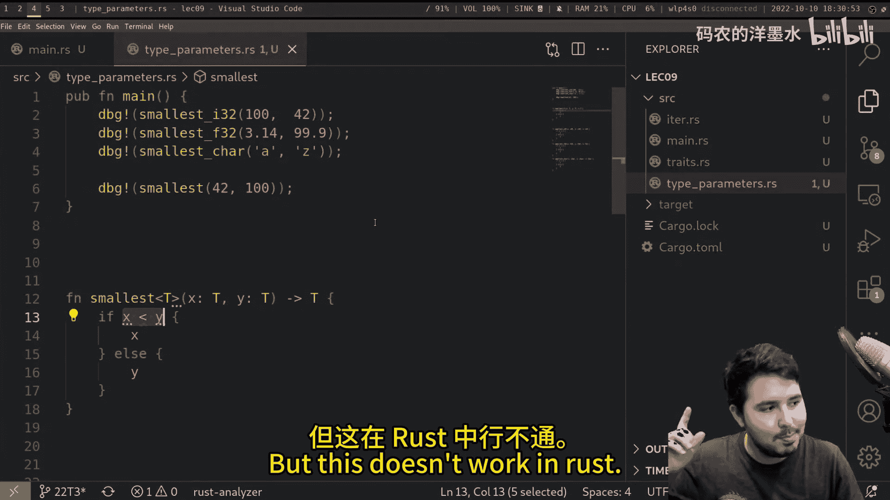

OfPL theory， this is what specifically makes this parametric polymorphism bounded。

re we're going to look at what this sort of idea of being bounded means right now。

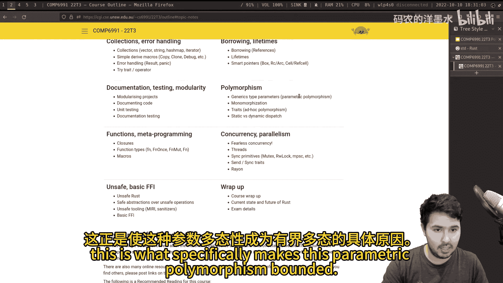

So。Why doesn't this work？If I try and build our program。

Maybe I'll get a little bit more room for an error message， here we go。

Binary operation less than cannot be applied to type T right， so x is of type T， y is of type T。

 and the error here is on this less than operation。

And it says help consider restricting type parameter T。

 Now remember Alex in the chat there saying we impose some restrictions on what they could be。

 Consider restricting T。And say that T has the capability to be partially ordered， partial a。Oh。

 interesting。 so what's going on here？😮，When we write this code here。

 it doesn't care how anyone else might call it， right。

 The rust compiler doesn't look at everywhere smallest as used and make sure every time someone's using smallest。

 the stuff that you're doing inside the function is okay。 That's just simply not how rust works。

 Instead， this function。This function needs to be okay on its own in isolation。Right。

 like if we just consider this as its own unit， this must always be okay。

 But the problem is that it's not always okay。 Why not？ Well。

 if I substitute T here for something that can't be ordered。Right。

 something that just has no inherent ordering， like， say， I don't know。 Like I made my own struct up。

 likestruct food。And food， just like。Simply cannot be ordered。 There's no real ordering to food。嗯。

Or or in a case where there's no ordering defined because it might not be entirely obvious。 Like。

 for example， if we had T is an option of I32。 Now， I 32s can obviously be ordered。

 but how would you order an， you know， options of I 32s。You might say， well。

 I think all the nuns should go at the front， like all the nuns should be less than it。

 and then all the sums get ordered。 You know， like， so you might。

 if you have a list that's like none， some1， none， none， sum negative 5， you might go， well。

 I think that should be ordered。 none， none， oops。None， some negative 5， some 1， you know。

 someone else might come in and go， no， I'd rather have all the sums first， some negative5 is some 1。

 and then none。 all the nuns sort of go to the end。 This is a case where the ordering， right。

 How should you order an option of I 32 might not be entirely clear。 And for that reason。

 option doesn't define an ordering。But I mean， the simpler example is just a struct that you make up that just has no real ordering to it like like if maybe a struct student and it has a name。

 they have a Z ID， they have， you know a WM， you know， always going back to this example here。

And the question is， how should you order a student， It's not really obvious just on its own。

 Should you order them by name， order them by Z I D， order them by Wham。

 And then how would you order them by Wham， if you chose to do that， It's just not obvious。

 You'd have to sort of。You know，You have to give some extra information on how you wanted a student to be ordered in this case。

And so， because of this。Smallest， this smallest function here is not really fit to exist for just literally any type T。

Right， that's the like。All my job here to say that this function is not okay is if I can find just one type T where this function doesn't make sense。

 then the function is not allowed right， I have a very easy job if you wanted to prove that this function is okay。

 you would need to prove that for literally any type T that anyone could ever have this function should make sense。

😡，Right。So。How do we make this function work， The compiler gave us a very big n here。

 which is restrict the type parameter T。 Don't say literally any t ever could possibly be used only allow Ts that support ordering。

 right， T's you know values of type T， where T defines this less than operation。

 So where does the less than operation come from。

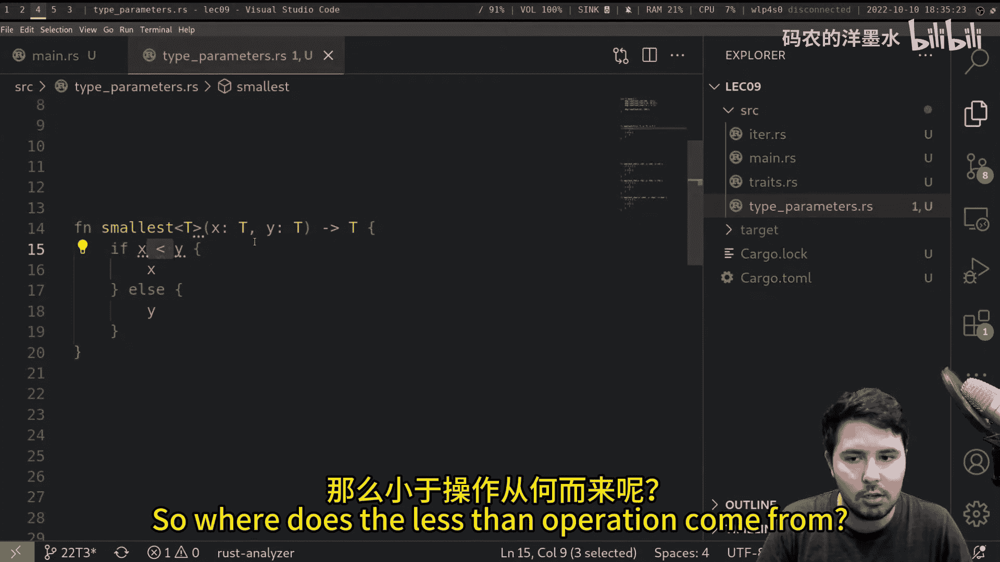

We we get to jump ahead a little bit in the slides we've done becoming generic we're halfway through this。

And get to look at some common standard library traits in particular。

 partial a here is the trait that we're looking at。😊。

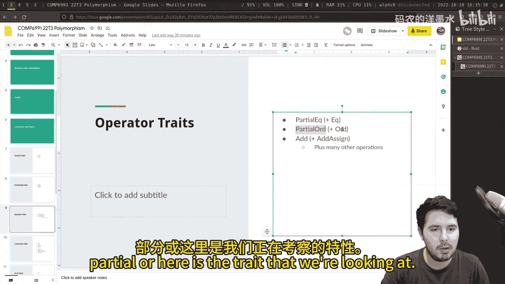

So let me pull that one up。Partial load。Slow stream is healthy， okay？partialcel Lord。Okay。

 so's all right。 I think I'm worried that things are slow on the internet， but it's St seemss happy。

And it's a trait for types that form a partial order， if you're a mathematician。

 you might be getting all excited over the terminology of partial orders and total orders and all that for us。

 you know for us lesser beings who aren't you know so mathematically inclined it basically means that it defines less than less equal greater than greater or equal。

 right these operations here， if your type。😊，Implements partial a。Right， then。

You can use these operations on that type。 And if we look at implementers like there's a ton of things that implement ordering。

 So if we look at a couple examples， IP address right， you can order IP addresses。

 you can order you can order orderings。 That's weird you can order bulls。

 I guess that would be false than true， I suppose you can order characters， you can order floats。

 you can order integers， you can order strings， more integers， you know。

 all kinds of stuff that the standard library does by itself。😊，Durations， that's another cool one。

 like one second verse one hour。😊，And so yeah，' there's all kinds of things that are implemented like this。

😊，And you can also implement partial orderings on your own types。

 If you decided that there was one sort of clear ordering for， say students。

 maybe by Z I is the most obvious one， you could definitely implement partial lo of students for yourself。

 Oh， options do implement partial Lord。 Alright， Well， my example is moot。 I guess it does。

 It must order by none then some。 There you go。 That's the right answer， apparently。

That's that's a fun 1。 I wasn't aware of this。 But now I am。 You know。

 that's how it goes with this language a lot of the time because I'm not gonna memorize every single traits。

 every single implementer。 But， you know， I I've， I've just run into one where I'm like， well。

 that's surprising。😊，Cool， but so this trait is implemented on a whole bunch of stuff。

 and it essentially means that once you implement it， you can use these operators so。😊。

Do we want literally any type T then， Well， probably not。

 we want T T where they implement the partial oddd trait which allows us to use this operator。😡。

So let me impose thatstriction restriction rather， the compiler suggested that we just put it right here and I'll just show you how that worked。

 but it's not my preference personally。So we say smallest is generic over a type T。

Where T implements partial load， I save the file， you'll see that this。This no longer errors。

 Why is it no longer error Because it knows that T defines partial lo And the requirement on the less N operator is that the type is partial load。

 So the compiler is all happy。 And if we run it。You'll see that we get smallest of 42100 is 42。😊。

So that seems cool Now this is going to be semantically the exact same。

 but I'm going to show you how I prefer to write this myself。😊。

I prefer to write smallest of T right is genericcho of some type T， and then after the return type。

 but before the starting brace， you can introduce a new separate block called a where block here。😊。

So we have function smallest of T。Takes an X， which is a T， A Y， which is a T and returns a T where。

T is partial， partial odd。Like this。I prefer to like write it like this because when things。

 when you end up with like a few type parameters or if your constraints get a little more gnarly。

 you know， being able to say like where T is partial Lord， where y is fo。

Where Zed is some bar trait and， you know。You can， you can like， you know。

 there's all kinds of constraints that you can sort of put in here。

So being able to sort of lay them out over a greater space as opposed to pushing all the parameters towards the right is my preference。

 but these mean the exact same thing as as what I wrote above so I just write yeah generic gravity where T implements partial a。

😊，Okay， so。This is what I wish C++ did。 And yes， if you're in Java T extends bar is is is your sort of quite similar idiom here。

 derived partial or org。 Yes， C plus plus frame functions within painful Java generic decent runtime penalty meta ordering me and lectureism in God。

 I'm assuming it's possible to impose multiple restrictions。 Yes， and we've just seen that as well。

 Oh， sorry on the same type， right， So I could say that T is also partial leak， for example。

 which means that it can be compared to like you can say if t is equal to t or t is not equal to t。

 I could write that like this or alternatively。😊，You can use this syntax， which is a plus。

So T implements partial lo and implements partial leak。

 and this syntax can also be used up here as well。So like T is partial or plus partial leak。

 But you can see this stuff is already starting to drift across across to the right quite a bit。

 And so I probably either write it like this or potentially like this。

 Those are both perfectly fine to me and。😊，Like we're not going to mark you down unless things are like seriously egregious。

You are free to make up your own preferences as long as we can reasonably read your code。

 then we're not going to care about small things like this on stuff like the assignment。😊，Okay。

 as long as you want the the ideas， right， the idea is the most important part。Okay。嗯。

So that kind of makes the signature look like the Rostock， yeah。😊，And yeah， I'm a fan of this。

So let's see if this fixes our example above here。😊，So I'll try that out。Cargo run。And there you go。

 it works on two things，2 I32s， two floats， two chas。 And if we defined some struck student。

All right， struck student Z ID is a U 32 name is a string， and WM is an option of F。64， I was saying。

Hash derive partial ad。Partially partial Lord， sure。Now。You'll find that if I do let all right。

 who have we got， let Dwang equal students。Z8 D is 1，2，3，4，5，6，7 name is。D Wang and Wham is 100。

And then who else have we got， let S equals student。 And I'm going to do a slightly different Z I D。

 Let's do 7，6，5，4，3，2，1。Name。There we go， and。0 everyone gets 100 whams in the lecture examples naturally。

Now， will this smallest function work with students。

 even though the smallest function never intended you know worked to be done on a student。

 will it work D Wang and Supeng like this？It's not happy because it doesn't know how to print out the student。

😊，In the debug print， you know how when you call it。

 it also prints out the code like the text that was there。

 it doesn't know how to format a student so I also have to bring in debug as well。😊。

But if we do this， you'll see that the smallest is Dwang because the Z ID is smaller。

 If we made the Z I is the same， it would probably order by name。

 I would imagine like you would move on to the next thing and that would still be Dang， I suppose。

 but if this was say one Z I less， then we would get Chiping， so there you go。😊，The smallest student。

 yes。mCool， so this function。😊，Never intended to be called on students。

 but it just magically works because what smallest really cares about is that you can order the parameters that you bring in。

Awesome。😊，That's pretty cool。😊，嗯。Okay， so there is something that we can make a little more generic like this。

 this function here is is pretty nice。😊，But we could even go like a one sort of step up here in terms of what we could。

What we could， I like the terminology， this is a terminology that is completely made up maybe by me or maybe by someone else。

 I like the generic size terminology。😊，To make something increasingly generic that's completely made up。

 but it's I'm I like saying silly stuff like that there's something further that we could genericize about our smallest function here Can anyone think about what sort of。

😊，You know what's a potentially unnecessary restriction on the smallest function right now that we could make more generic and sort of give you more possibilities while still working with you the same with the context it already does。

 let's say。Does partial ordering imply partial equality if something is equal， it is not less than。😊。

If something is， let's see we're going to have to pull up the trade docs here。

So the first thing you'll note is that partial ordering on a type requires that that type also defines partial equality。

 so that and that in particular is whether they are you know checking checking whether two things are equal or whether they're not equal。

And it says the。I mean， you might be able to prove based on you know what they say the requirements on these types are。

 you might be able to prove that that's the case， but I'm not gonna like go too deep into it live in the lecture。

 but if you are interested or you can't you know you give it a try and you're not really sure definitely ask on the forum and we'll see if I can figure anything out sort of I'm assuming an ordering on options would break down if the option doesn't contain an orderable type。

 that's a really awesome point So the question is， I mentioned oh my God options do define orderings but you know how can we order an option of something that doesn't define an ordering and if we look at this implementation down here。

 we might be able to read it a little a little better now that we know a little bit more when if it go option option option。

I thought it was right around here。AndI gotta scrapt my eyes。Option， option， option。

 Where did it go by an old control app。Like a。Absolute no。Here there we go， have a look at this。

 implement for any type T， partial ad of option of T。😊，4 option of T。

 So this is saying implement a partial ordering where you can order two options of T's together。

But only where tea can be partially ordered with other Ts。Wow。

 so the reason T is sort of appearing twice here is because partial Lord。😊。

Allows the possibility of ordering things of different types。

hi is actually one thing we could make more generic in this function here that I actually wasn't thinking about when I was mentioning making it more generic earlier。

 but in particular it's basically saying only implement partial lo on option Ts where the T itself can be ordered which is pretty cool。

 which makes like total sense to me at least， so yeah it's baked into how they implement the type there。

And I'm assuming we might't be able to look at this all because it's done by the drive。

 I also hoping that we could look at the implementation itself， but it's just derived sadly。So okay。

 we had that it requires less than or equal， greater or equal and greater than not just less than yeah。

😊，Cool。So， okay， what I was looking for here is we've written a function that gets the smallest value of two values。

Right， the smallest value of two values。But we could potentially。

Make this find the smallest value of any number of values。

Right of three valuess of four or five of six， right？Now， there is some considerations to make here。

 which is if we say any amount of values， there could be something that could go wrong。

Can anyone think if we sort of extend this to any amount of values？

say what's a problem that might arise in the way we deal with this problem？

HI get to like sit here quietly now because the because of the greater delay。And patiently wait。

Lots of problem that could arise。Hm。Separate arguments versus using a collection。 Yeah， okay。

 so that's， that's an interesting point。 I that。Like if we're we might want to sort of make this like an any function where it takes any amount of arguments as opposed to。

 or sometimes that's called like a veryic function versus you know。

 taking in some kind of collection。If you've used veryic arguments before， which， you know。

 often looks something like this in some languages where it's like you may have any amount of tea's past to this function。

 Rust doesn't have that at least yet。 There are some talks about it， the general consensus。

There's a bit more like pain andvariatic arguments than they bring to the table。But it's， it's this。

So， so Ru doesn't have very arguments。 So if we're using， if we're talking about any amount of。

 you know， values， we're probably gonna need to be thinking in terms of collections。

 which is absolutely true。 And that's， I think the variable number of function parameters there as well。

 Lifes of the return value probably needs to get annotated， maybe。Potentially。

What I'm thinking of is， is there any amount， let's say we're taking some sort of， you know。

 some collection or whatever of arguments。 Is there any amount of arguments that might cause us a problem。

 You know， when there was two， we had no problems at all， very easy to write。 There's3。

 I think we could make that work，4，5。 Yeah， seems reasonable， Are there any amounts of elements，0。

 right， What's the smallest of a 0 element collection。Right。

 and so now I would say like a zero element collection doesn't really have a smallest value。

 And in fact， if you were to say， you know， I'll just change this to x's and let's say we're taken a V of t。

 We'll look at changing that later。If。If you know， there is the the x is empty， right。

 let's say if x is here is empty。Like， what are you going to do here？You you could panic maybe， oops。

 panic， but panicking is like you shouldn't like opt for that where possible because it's very difficult to recover from a panic and someone might want to call you a smallest function and if it goes wrong。

 you know， do something else。So this isn't really that good。😊，Return default， right？

 So maybe there's some default value for T where like， if we don't find a small。

 we'll return the default value。 But the question is， like。

 what can I do on a tee if I ask Ru analyzer， what can I do？ Oh， no。Oh， no， the stream。呃。Come back。😔。

The message could not be sent。哦。It's they're coming back。Okay， I think it's。

The bit rates come way back up。And it's just going way back down。And it's going way back up。

Don't you dare go way back down。 Don't do it。Okay。I think it's， I it's， I think it's good now。Okay。

 I'm going to， I'm going to do a ping test。 I'm going to say type pg in the chat right now。

 Like type pong as fast as you can。I'm saying ping and I'm going to see how long it takes for the pong to get back from the chat。

😊，I'm going to say it was about 32 or 33 seconds passed reasonably。And pong， okay， that's okay。

 about 15 seconds delay。😊，All right， let's keep going。 I think we're okay。嗯。Cool。네。

It's funny seeing the whole chat go p。 Alright， some people maybe have more like a 20。

25 second delay or something like that， but we're we're gonna power through as as C C says。 So。

 so like if we wanted to return some default value， right。😊，You know， well。

 where are we going get that default value from， All， Okay， it's fine。

 All we know about T is that it can be ordered or is it can be partially ordered。Right。

 you can you can do equal， not equal greater the equal， greater than less than less than equal。

 you know， that sort of thing， but we can't just say we can't just like give a default value back。So。

 in fact。If we wanted to do something like this， there is a trait that allows us to do something like this。

Which is the default trait。So the default trait。When it loads simply defines one function。

 function default， which returns a like one of the type that's implementing it。

So if you define default on sayI 32 or something， you might say the default value is just something like 0。

And so you' would implement default and say spit the value at zero。

 so we'd actually have to say for to call the smalls function。

 team must not only support partial ordering。😊，But you must also be able to get a default value。Now。

 this might work。 This would work。But now you've there's there's a case where what if someone wants to use this on a V of Ts。

 where t doesn't have an obvious default value， but they know that the V will never be empty so that shouldn't be a problem。

 They cannot use this function anymore。Because you have a requirement that T always implements a default。

😡，Right， and you know it's it sort of imposes a restriction now you' sort of like walked a little bit backwards in terms of if someone just wanted to do the case with two items。

😊，Now they also need to make sure that the thing provides the default。

 like say in the case of a student right like this our student example here no longer works because student default is not satisfied default is not implemented a student and so we'd need to say。

 well what's like the default student right Iple default for a student。And the question is， like。

 is there even like a default student， does that even make sense？

And so the sad thing is maybe we just like can't do this。

 the smallest function on students anymore because as like if I just said Z 80 and like name empty string。

 that's not actually like a student。 Now， anytime anyone uses a student， they need to worry。

 is it an actual student or is it like the student with0 empty string。

 none right and we' back straight back to like null pointers and stuff。

 And the stuff that comes along with that。 So that's almost like a little dangerous default student is 50 5 or 5。

5。 Yeah， actually， surprisingly CSE does have a student Z 5 5 or 505。

So they have to think about that， just which is just great as well。😊，Anyway。

 so that's that's potentially problematic。😊，The more sort of。

Rustic potentially student oh donng just dong just got png。😊，あ。😊，Is。Potentially to turn this。

 this return type into an option， right， and if the。The V is empty。 then， say none。

 Otherwise we can find the smallest of the sequence。And。You know。

 we've sort of stepped a little bit backwards in terms of now people have to think about。

Whether their sequence is empty or not。😊，Or there's one other maybe particularly clever way that we could。

That we could sort of write this function such that it always work and we don't sort of trade anything off。

 which is return a T and then take the first TN as a parameter。

 right This is just the first element of the list and then give us the rest。

 give us the rest of them。 And so if this is empty， that's fine。

 Like we already we always have at least the first thing And then if this is not empty。

 we go through the rest and see if any other is a smaller。

 And so that's potentially another option as well， which could be rather clever。

 but then it's more inconvenient to use this smallest function。

 You need to separate whatever you have into the first thing and then the rest of it。

 which you know there's different trade offs to consider this is part of why like design is a big consideration in this course。

 You got you know think abouts you know whats the right trade offs to make in the situation， right。😊。

Allright， blah， bh blah， blah， blah， John Smith， yep。Yep， y， yep， yep。Okay， cool。So。😊。

Let's just do it this way with an option。And we'll say。You know， if X is empty， return none。

 maybe the better way of doing this is like。You know， we could match on X's dot。First。Right。

 if it's some element。Then do something。 If there's no first element。

 then we can just instantly spit out none。And if we know this。

 if we know we're going to instantly just return none。 if there's no first element。

 then what could we write， We could say let first。Equals x's dot first question mark。

Screw this whole match。 screw there is empty， whatever。 If the first doesn't exist。

 the question mark will bubble that none up and just like return it from the function immediately。

 But we know that if it does exist first will not be an option anymore。

 It's just giving us the tea that we care about here。 So that's pretty good。And then。

We could say for item in let's， let's mutate， let's make this mutable， I suppose， for item。

 let's call this like lowest as well， as opposed to first or smallest。

TheWhat you would looking for for item in X's dot。It all。But we want to skip the first thing。

If the item is less than the smallest， then the smallest is the item。

And then finally give back whatever the smallest thing was。

Now this is no longer happy because were sort of。We have a little bit of a potential problem here in that。

I've now sort of made this work over borrows to tea。😡，But I've told it'll return back at T itself。

 So we could just go like screw it。 We'll just return a borrow of tea。

 Then we have to think about lifetimes。 And suddenly things are a little gnarly。 Or alternatively。

 I can do like an into it。 And the codes gonna become a little more complicated。

 This is a very like rust moment where it's like the obvious thing here。

 The easy thing is not working because ownership moment。

 And so I would probably write something like let mute it equals X' is into iter。

 Let the smallest is。😊，Itter dot next。 So just give me the first thing in the iterator。

And then for item in the rest of the iterator heel like that， and now we're all happy。

So turn our vector here into an iterator。The smallest is gonna I'm going to assume the smallest thing is the first thing。

 if there is no first thing， if the iterator returns none， then just return that none upwards。

If it does get something， that's great news， we now have the smallest value as a t because into it。

 as opposed to it or it mute。 then for item in the rest of this it。

 notice we've already got the first thing out of this。

 so it's not going to yield that first item anymore。 we've already sort of notionally skipped it。

 I suppose。😊，If it's less than the smallest， that's now the smallest。

 and then just give the smallest back at the very end。

 So this is a a perfectly reasonable implementation of this。 And in theory。

 it should still work with the rest of our test cases。 So let me grab this。Let's do oops。

 square brackets， square bracket and square bracket。And test it。Right， 142 is 42， 3 and4， 99 is。

3 and4。A and then a student here and the great thing is if I throw more numbers into this，1 thousand。

 another 42， a7 and a 600， just a random of numbers。😊。

Our function still continues to work and gives us seven back。Right， so that's pretty cool。

 but it is notice it is like wrapped in an option sum of blah， some of blah， sum of blah。😊，Which。

 you know。Its is a little。Potentially a little painful， but。We've made our function more generic。

Now there's one more thing that I want to quickly talk about before we jump into the break here。

 which I'm going to， you know ask the chat in this case。X is here， right， we've taken in x's。

 and I've just said it's going to be a V of T。Right， I've said it's going to be a backup tape。Now。

 there's sort of a fundamental shift。A fundamental shift in the way that I want you to think about like a parameter to a function and like types and stuff for just a second。

So when we say that like my function here， x， this function takes in parameter x is an i32， right？

Why did we make X B&I 32？In this case it wasn't really for any good reason I mean。

 those a couple things I 32 we knew implemented ordering like partial ordering so I could do this thing on it and the other constraint really was that these two things were the same with the same type as the return value what's maybe a better example。

 something like。😊，Let's say function， log2， whatever。And I take it an I 32 and I scan out on I 32。

 the types might be a little gnarlly there， but I think X has like a log 2 function I can call a U32。

 I guess is what I'm looking for here。嗯。And this is probably unstable。

 so don't worry about the error message there。But my question is。

 why did I choose x being an I 32 here， Well， I imposed this restriction。

 X is an I 32 because I needed to call log 2， and log 2 is only going to work on some kind of number。

 And so I need to impose the restriction that the X I'm taking in here is a number。 right。

 If I just made this any type T， any type T。Then this is just not going to work at all because it's going to go what do you mean by log 2。

 Like log 2 is a function that only exists on a subset of types。

 So I impose the type I 32 here because I know that an I 32 will let me call log 2。Right。

Now we come up here and trying to play the same thinking I've imposed X's to be the type V of T Now T has its own restrictions that we've already thought quite heavily about in terms of finding the smallest。

 which is that t can be partially ordered。😊，And we need that to do this operation down here。

But so if we forget the T for a second rather， why did I impose the type Vec What is the like what is the only thing that sort of Vec is bringing to the table here。

😡，H aha and actually， Andrews Andrew， I'm just catching out the chat and Andrew seems to be like on on the money here as well and people seem to be catching on quickly。

 but just to like really spell this whole thing out here。😊，嗯。

What like what does Vec bringing to the table here， Well， Vec， right， If I look at where X's is used。

 Vec implements into iter， right， Vec is a thing that can be turned into an iterator， right。

But where did Intuit even come from right， if I search up if I go to Vck？

And I look for the intu itum method。 Yeah， okay， streams okay。Stream is healthy。 Okay， very good。

Apparently the stream was unhealthy for two minutes， so I think that's okay。嗯。😊。

And we look for Intuitta。 Where is it， insertert into box slice into flattened raw parts。

 but is empty。 No into it。 That's weird。I keep scrolling down，lah， blah bh blah blah blah， blah。

I'll come to trade implementations， What traits does Vc implement？And as part of that。

 I'll find it in to iterate a trait。Right we're looking for this implementation here in particular says implement intotu itative a VC。

😊，What does that give us， It gives us a function in itor。😊，Right so as the chat is noting here。😊。

This， like V of T is needlessly concrete， as way would say this。 It's needlessly concrete。

 There's no reason that we need to use a type as specific as Vec。Right。

No longer need to be a type as specific as V， this could be more generic。So。

And like what would this let us do， well， what if someone wanted to like had like a linked list say？

A linked list of values as opposed to a Vec or they had an array of values， right。

 or they had like a hash set of values or something like that。

There's all different kinds of containers that someone might have containing teas that they want to find the smallest element in。

 that just aren't a vec。 And by writing Vec， we're forcing them to take whatever format they have and shove that into a v。

Just for us to turn that back into an iterator， there was no need for this to be a V。

So how could I write this Well we have our type parameter T。

 we may also want to be generic over some container type。 I'll just call it I in this case。

 right I because it's going to be turned into an iterator。But if x's is no longer vector T。

 we could make x's。Some eye here。Where。I implements the Intu itator trait。Right into iterator。

 if we look at the trait here。You'll see。When it loads。

 there we go into iterator defines that function here， and it also defines a type。

 This is one of the first things where like。You know， the the a big difference between， say。

 Java and rusts Java's interface system and rather's Java， oh my gosh。

Java's interface system and rust's trait system。Have a potentially significant divergence。

 I think Java might be introducing this is called an associated type parameter。

I think Java might be looking into this， but I don't know how far along they are with that if at all。

 but we have an associated type parameter here that says when。😊，Okay， hang another。

It's only just a little bit's。It's happy again， I think。嗯。Hotpot moment。Yeah， hiccups。Okay。

 it's green again。I think it's okay。 Yeah， it's it seems it's it's a little bit if he we'll take a break in a minute anyway。

It defines this associated type item。Cool， which is what item will this iterator that it can be turned into spit out？

😊，I'm also going to stop the playback on the preview because that might be sucking up some internet potentially。

 And so we'll just define that here。 We'll say that I implements into iterator where。

The iterator that it can be turned into will spit out items of type。What items， What type。

Of what type of items will this iterator spit out？I'm assuming the the chat's going to catch up with this and you're probably right。

 T， I'm hoping that you've typed in the chat， It'll spit out Ts。😊，Right， yay， the chat did get that。

 Great。 I I predicted it in everything。 How amazing。Exactly。

 so it'll now we're sort of like very generic。😊，This function takes in anything I。

 any type I where I can be turned into an iterator that produces items of type T。

 where T is any type such that it implements partial lo。

 and this is like a really just beautifully generic function。😊，In my opinion。

 and you'll see this just works right， it still works because if we like if I do x's dot here。

 you'll see what information does the rust compiler know that x's has。

 it knows that it has into iter because we've defined that constraint here。

 it doesn't know if it has like if it can be turned into a string。

 it doesn't know if it can be you know can if it has a default value or anything like that。

 the only constraint we've provided was that it can be turned into an iterator that produces t's。

 So the only thing available for us to use is that it can be turned is to like called the into itta function that the trait defines。

😊，And so this just beautifully works。 We'll test it， we'll take a break。

 So if I have let L is my linked list。😊，mututate。Now if the L dot push to the back， I'll push 42。

I'll push。100， I'll push 5000。 I'll push 7。And we'll print it out。Smallest of our linked list here。

And that would be the smallest so the linked list was7， which is great。

What if I give it small of a reference to L。Smallest of a referenced L is still 7， wow。

How did that work， I didn't even have to move it in。😊，This is。

 this is like a lot of trait implementations helping us out in rust that the standard library has written for us。

 in particular， what it's inferring here is that the item， the T here is going to be a。In fact。

 I might type this out is going to be a borrowed I 32。

 That's what t is and I here is going to be a into it' well it's the linked list really is it's a ref linked list of I32s like that and it knows that a reference a borrow of a linked list of I32s can be turned into an iterator where the item is a or actually it's going to infer T here so item is right yes where the item is a borrowed I 32 right we saw that t here is I32 item is t So oops I've lost it here so it will infer this。

And then the other requirement is that T is partial Lord。

 so borrow I32 is partial Lord and all these things are sort of defined in the standard library all over the place I could quickly point you。

 say for a linked list you would find that。😊，Into iterator。

Is defined not only for a linked list where it'll give you an iterator of T's。

 but also is defined for a borrow of a linked list where the item is a b of T's。

 So that's what gets us sort of halfway there。 and then we also need to know that borrowors of I 32 can be ordered And if I go to something like I 32 which is just a big thing here and look at partial orderings。

 partial a you should find that。In fact， maybe partial Lord itself has。Has this， let's see。

 partial ad for。You know， there's all kinds of things here， I 32。嗯。It should。

 How is it inferring this， It's inferring that it can order borrowors of I 32s， but。In my like。

 you know， lecture mode right now， which is I'm， I。

 I can convince you whenever you're sort of up in front of everyone lecturing。

 you' sort of got a like。At least hve your intelligence in front of the crowd。

But it's able to find that it can partially order brows of I32s。

 but my brain's not finding it at the moment， but you know， hand wave had figured it out。

 it's pretty cool。嗯。But yeah， so it's just like a function that can be used with all kinds of different values specifically because we only specified the constraints we cared about。

😊，Right， just as a really quick reminder， if you went， oh。

 I need a function like I have a V of I 32s， and I need to be able to find the smallest thing in that。

You could very well just go。 smallest V is my vector of I 32s。 And I'm going to spit out I32。

 and you just like write the code here。 But if you think， and that will work。

 but it's needlessly restrained。 It's needlessly constrained， right， or needlessly concrete。

If you take a little bit of time to think about what are the actual requirements they care about。

 then your code will work for like anything it possibly could on， which is a very powerful idea。😡。

Let's take a break for let's take a break， we'll come back at 20 past。We're really in no rush。

 to be honest， we have all of。Wednesday's lecture as well to keep moving on this stuff。

 But I think I think we're going great so far。 Yeah， let's come back at 20 past。

 have a little break and we'll see then。 I might answer some questions in the chat or something like that during the break。

 but enjoy a break。 We'll be back at 20 past。😊。

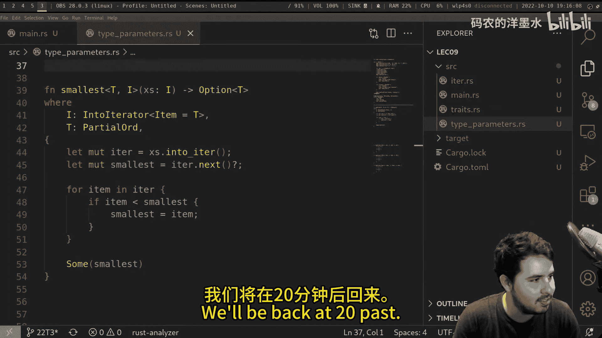

All right， so let's get back into it。

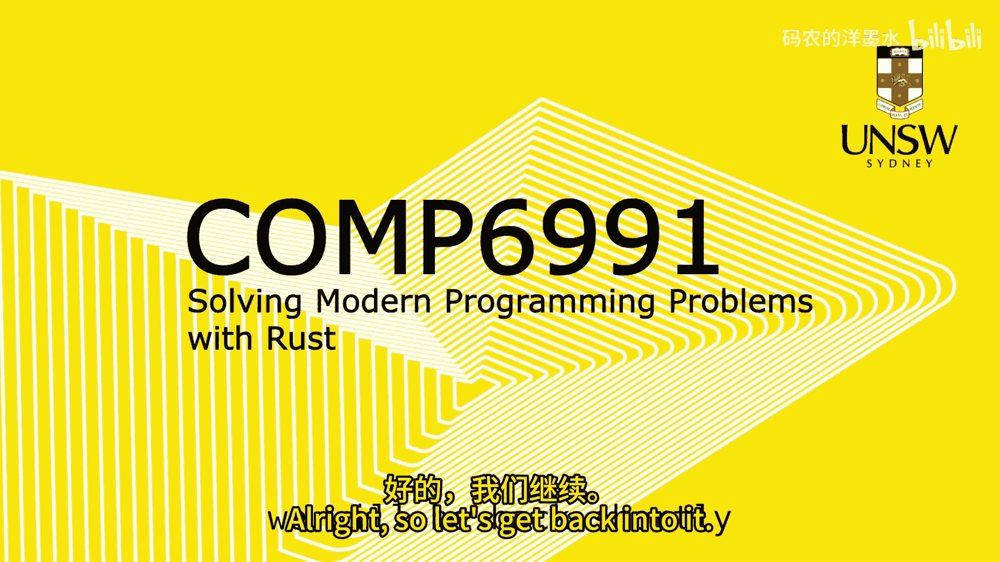

Oh， actually， I was worried that the green screen looked like it was doing some weird stuff。

Let me just muck with the lighting a little bit。That seems bad。 Okay， oh， yeah， sometimes it。

Starts thinking my shoulder is green or something if the green screen gets distracting I'll just turn it off so if it's if you're finding it distracting just let me know。

😊，U so。Right， yes， the chat was talking about the multi crate submission。

 I probably should have mentioned this at the beginning of the lecture， to be honest。

Give really hates the idea of submitting like a。Filees that are like nonfi let's say because like we don't care what files you write like if you want to split it up into 50 different files or if you want extra like data files and stuff like that to do things with so we didn't want to impose that restriction right you can almost think of it as like what we're doing here and so we get you to submit T but dealing with T and stuff is。

Kind of annoying at best， I suppose。Just because well， yeah。

 it's just kind of an annoyingy deal let's so we provided things like 6991 auto Test and 6991 give to automate things for you。

 but when I wrote that tooling I didn't anticipate having to deal with multiple crates at a time So the I mean time to use Gitla yes。

 but then you have to bring in Git for people and not everyone wants to use Git for every single like exercise。

😊，And so。嗯。Probably what we're going to do is on specifically the things with two with like multiple crates and stuff like that will'll do basically what you wrote in the chat there。

 Andrew， which is。whichch is get you to you know， sadly the tooling might not be advanced enough for this tire up your things manually and then submit the tar I'll probably write some instructions for that up probably after the lecture maybe otherwise maybe earlier tomorrow and we will guess we will make an announcement and send an email。

We'll make an announcement and send an email when that's all you know。

 when we've figured something out for you and our deepest apologies as well to go along with that。😊。

嗯。So there was a question which was， is there a way we can make it more clear what the constraints on x's are and the definition as opposed to down here in the constraints？

😊，And yes， Ru does have a shortcut for this， since the only constraint on I is that it can be turned into an iterator where the items。

😊，That it spits out our Ts。tThen we can just do that in line so there was two ways we sort of sought to do that well there's rather there is two ways to do it we saw one of them one is that we can just sort of in line say I is something that can be turned into an iterator where the item is teas。

 which is like maybe halfway to what you want Miguel but like not quite there。

But there is one other way that's a little better Note there well that t。

 even though t does only have one constraint on it， it also does impose a second constraint。

 which is that the item that the iterator。Spits out is the same as the T here in the return type。

 so we can't do the same trick with the T， but we can with the with the I because it's only really like just this is the only constraint on it。

 We can remove the I as a T parameter at all。And then instead of saying x is I here。

 we can use the special syntax Iple， where we say x's is some type that implements into iterator where the item is a T。

😊，And this this is probably much more like your Python sequence of b in line。

 And you may also prefer this syntax。 If I run the code， you'll see everything still works amazingly。

 but notice if I tried to replace the T here with you know。

 if I tried to do the centric T is anything that implement partial lo。 Well。

 that works in the context of X's。 But then the question is， what is this T here。

 I can't really say that this t here is also impple partial lo because you know what's the relationship between this and this here。

 it's not actually given that the item that your iterator spits out is the kind of item that you'll that you'll return out。

 sorry that use put into the function is what the function will give back。

 Or the only guarantee this function gives you is that it'll give you some type that implements partial ordering。

 And so the only thing you would be able to do with this thing that got spat back out of you is order it。

😊，With other things with， you know it。You can't do the same trick with the T in this case because there's too many restrictions going on。

 but in the interiterator case， you absolutely can。 And that's what we have right here。

 So hopefully you enjoy that。 Hopefully that tickles your fancy for what you're looking for。😊。

Because that's about the best you're gonna get in rust sadly。 I I can't think of any shorter。

 you know， short sorry， any yeah， shorter shorthand off the top of my head than this。

Can we could we keep the Og code scaffold in the reference a minute with the additional two crates？

 Yeah， that seems fine as well。 It's not if I recall correctly。

 it's not an auto marked exercise so like。😊，At the end of the day。

 I not really that fussed how you end up submitting this stuff。So， yeah。Cool。

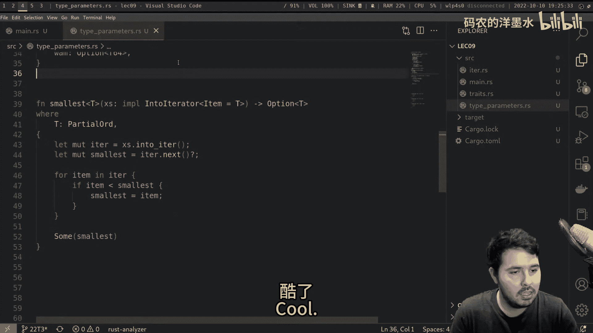

So that's type eminence。Note that type parameters can go on。

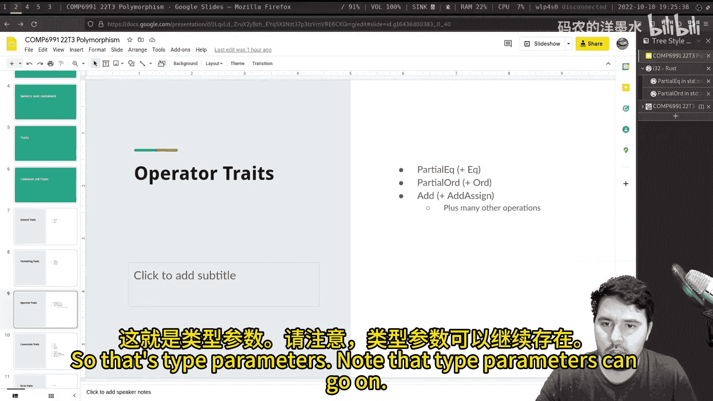

Uh， you know， not just on functions here， but they can also go on strap and enums and that sort of stuff like we saw like we saw with lifetimes。

You know， easiest example here being option of T where there's either some T or there's none。Right。嗯。

But something to keep in mind is that when， like， if I wanted to add a function to this option。

 let's say a function that's like is none or is some or something like that。

 As I notice myself phasing into in an into and out of reality from the green screen。

 I can't simply write Iple option anymore more。 Iple option function is none。Takes a borrow on self。

Returns a bull。Sell， you know， match on self。 If it's sum of something， then return false。

If it's none， then return true， something like that。

 this won't work anymore because option is not really a type。

 This is something maybe I should have mentioned a little earlier。

 but whenever you have a like a type parameter， you can almost think of like this function here has parameters that need to be passed in in particular it has this x's。

 this x's value that needs to be passed in， but you can almost think of there's like a step before that where the smallest function。

Takes a type。As a parameter， right this smallest function requires a type T before you even get a function at all that you could pass a value to as a parameter。

 so that's why we really call it a type parameter and that's what's happening here is that option is no longer a type。

😊，You might， if you're going full sort of P mode， you might even like to think that option is almost like a function on types where。

Option alone is not a type， it's more like a function where you give it a type T and I'll give you the type option of that T。

😡，And so I could say implement only for options of I 32。 this is none function here。

 and this would potentially work。 It's probably pised off because。Why are you Oh。

 you're upset because I need to say， you know。That this is a。Option sum option none like that。

But like that's needlessly specific。 This should be able to work on any option。

 And so you can also say implement for any type T。On option of tea。Right。

 same sort of idea as before for any type T we implement on an option of that T。

 the function is none。Or you could say something like I for any type T on option of T。

Where T also implements default。Something like function。Unrap。Or default。Which will give you the T。

Such that we match on self。 If we have some tea， then we give that tea back。If it's nothing。

 then we just give the default value for whatever that type T is。 and again。

 I've got the same stupid problem here。Like that。Like that， and this will work。😊。

For the same reason this function down here works apart from the fact that that's funny it's because I've called this option it's getting the two options mixed up and it's broken everything but this is essentially what the definition will also look like in the actual Ru standard library for this function here。

😊，So Iple T option T where t is default， this gives us the constraint that the default function will exist for the type T。

😊，Which is what we're using here， and we just write the method as such。😊，So yeah。

 this is something to keep in mind when you're doing implementations。

 you can also throw generic type parameters here， you can also specify constraints on them， so forth。

And I'm looking like I got Tned。 Yes， why would the impble be necessary Intuitator isn't a defined type constraint。

 So the fact that it's a what you might call it interfa C thingy is pretty clear， right。😊，嗯。So yes。

 that's that's certainly partially true。 The things that I would sort of point your eyes to is a。

 if there was no impple here， sure， the compiler could probably see this and go， that's a trait。

 So I know what you mean by that。 But if I'm a human reading through source code。

 Is it immediately obvious to me that this is actually generic。Like it's generic of a T。

 but is it immediately obvious that this is also like a generic type parameter in its own way because to be clear。

 this simple into iterator just is syntax sugar to turn itself into you know I。

 this is an eye where I is into iterator and so on so forth。

 So like it's almost like a hint to any reader who's looking the function that by the way。

 this is generic。 you can use all different kinds of types here。

 It's not some likestruct into iterator。😊，So that's one thing to consider the other thing to consider is something you may not be able to entirely consider yet。

 which is that this is one sort of method of working with generic types and traits and stuff。😊。

Called static dispatch。 And we are going to learn about a completely different way of dealing with traits called dynamic dispatch where this Iple here is actually going to get replaced by Din DYN。

 And so theres there's multiple ways of working with traits。

 So the I is sort of helps make it clear what's going on， I suppose so。😊，Reserve judgment for now。

 and then once you sort of have a bigger picture of everything can you can ask yourself that question again。

 I think。嗯。Do all these inple blocks stack together you so you don't need to redefine some things Yes。

 so these these all sort of get just thrown on the option type。

 but you know some of them might have different restrictions on that T。So for example。

 you wouldn't want to put is none in this block here because you're also implying the constraint that this function can only exist where t exposes some kind of default value。

 but like they all end up on you know if you have an option of I32 since I32 has a default value。

 you'll just see both of these methods available to you and things will just work essentially。

 which is quite nice。Okay， I am continually looking like I'm getting pretty thin snapped。

 so I might try and。Really quickly filters。Chroach key。Is there a way to just。

I'd like to turn it off without just deleting it， I suppose I'll just delete it for now。

I can always make it later。 All right， you'll get an actual background for now。

 I got to get this thing。😊，So welcome to new background。

Bodddy hell that's a big green screen It's funny because the new walls are also green but。

I don't think the most effective green screen。If the， if the camera gets in the way of something。

 just let me know。But it's， yeah， room reveal。Study reveal， yes。Cool。

 it's so neat that you can have methods that only appear based on the contents of thestruct， yeah。😊。

Cool。Not the first lecture I with the door behind them。🤢， okay。

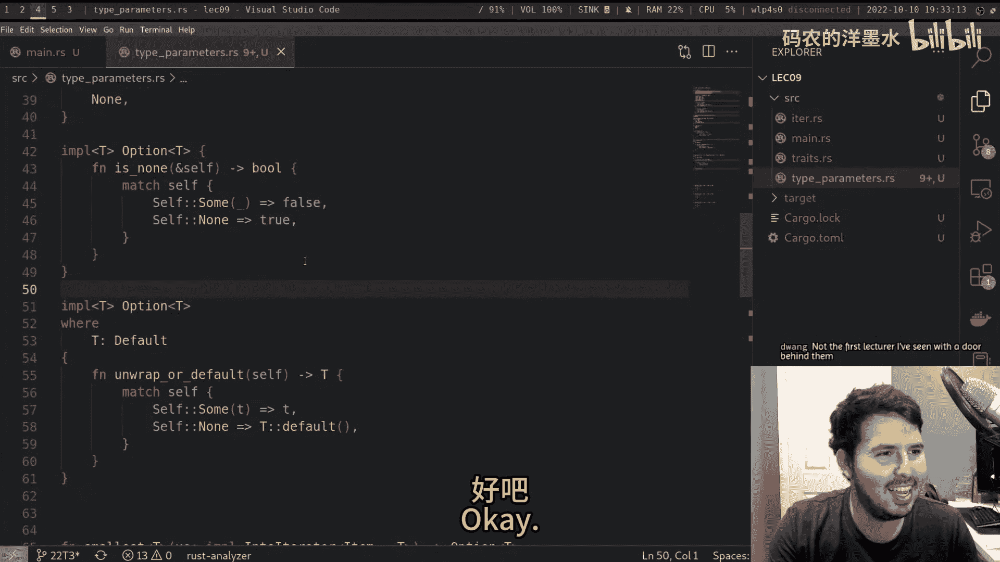

So let's catch up with the slides。 smallest value。 We saw that as the very beginning。

 We made a generic over any type T that can be partially ordered。

 Then we made a generic over any container type like a V or whatever。 We started to talk， you know。

 about different traits and stuff。 And I think。😊，Yeah， a nice spot maybe to sort of， well。

 we'll see how we go， but， you know， 20 minutes or so we can just poke around at a whole bunch of common standard library traits and how they work。

😊，And then save working with traits and trade objects and stuff maybe for Wednesday。嗯。

What's behind the door， Another door， yes。Okay， so there's a few different categories here。

 And these are stolen from where are these， Where is this sort of like general listing stolen from。

 It's stolen from like。

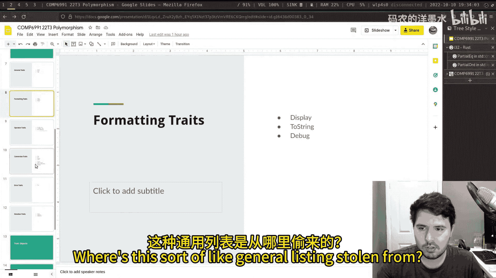

Std traits rust here， the rust blog， that's the one。Tour of rust Stan library traits。

 this is a great little mockdown file that is loading slowly， but the stream is still healthy。Okay。

 yes， good that has， you know， a whole bunch of information about how traits work and different things traits can have and all that and then takes you on a tour through all these different kinds of traits I've left up。

😊。

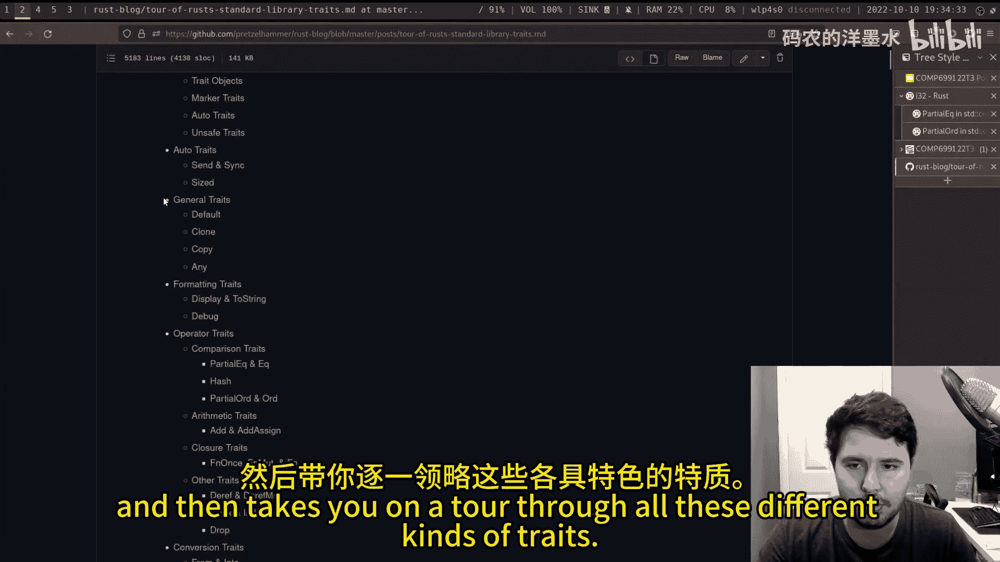

You know， not not an obscene amount， but quite a few of these different traits out that are just like needlessly complicated or not sort of interesting for what we're looking at now。

But I thought it would be nice to have a little poke around and see like different traits that the Stan Library defines。

😊，And why is it good， Like why might we be interested in specifically the standard library defining some trait。

 So we want to give some thoughts on that。 Like， for example。

 the default trait here where that specifies I think we were just looking at this before， actually。

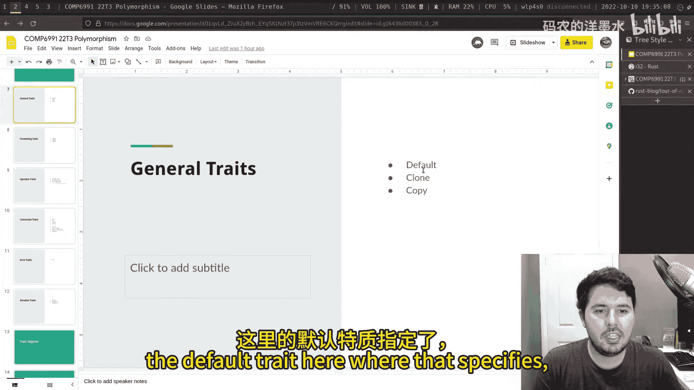

That specifies that some type。Has like a canonical default value。

 like a general default that makes sense。 Why is it specifically useful for this to be defined in the standard library as opposed to just in my code base that I wrote。

N also says it means that it'll be consistent between all apps， yeah。

 and I'll substitute the word apps there for crates， but you know， meaning the exact same thing。😊。

Um like。If even if we have two traits called default that are like the same thing like thright trait default。

 which just defines a function default that creates。Os， sorry， like that。Also。

 I'm going to comment out this option because it's driving me nuts。Like that。

Even if I define a trade default that looks like this。It's not going to be the same default。

 this is not considered to be the same trait that's defined in the standard library right and if it wasn't in the standard library。

 let's say there's like 10 really popular crates that all define this trait default。😊，Now。

 none of those defaults are actually the same。😊，Which is kind of annoying， right。

 it's kind of painful。So if I just went， I want any type that has a default。

 like in this option here， right， this unrapable default function that just requires the T should have some sort of reasonable default value。

😊，Like there's no sort of。Sort of like， what would you say， consistent way to make that work。

 There's no sort of。ThereThere's no really generic， really is probably the right word for it。

 there's no generic way to make that work across all different sort of types that anyone might want to use in my crate。

😊，And so it becomes really difficult to sort of establish these。These sorts of。You know， like。

Points of commonality almost between these different crates。

Who should be sort of responsible for the default trait。

 So like a really good example of where sort of we have to think about this is if I am in the standard library here and I go show me the serialized trait。

 the trait for any type that could be serialized into bys。😊，Zero results found， no results。

 you want to try on D。go。 Sure， let's try on D。go。And will' find。We'll find， there it is。

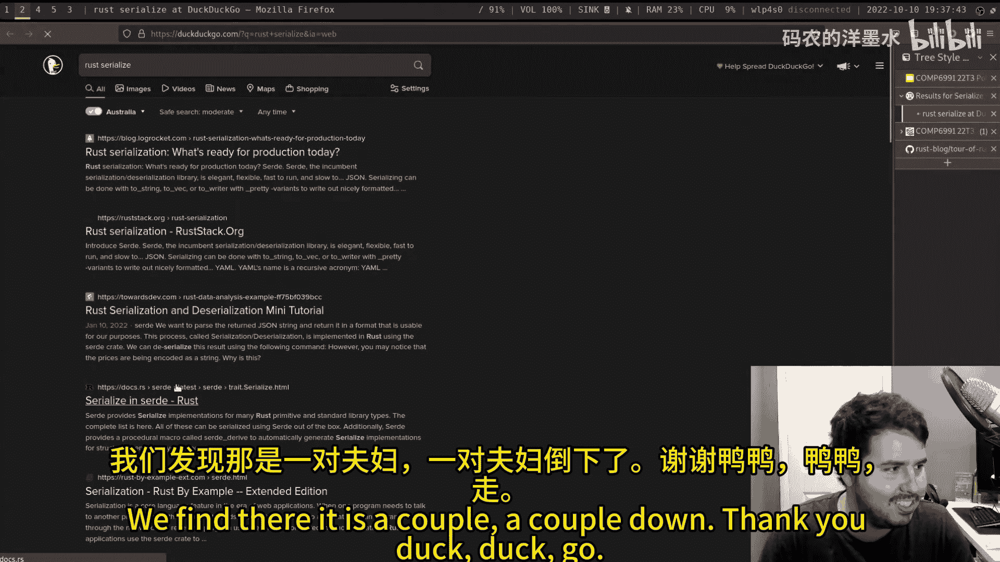

A couple， a couple down， thank you， do。go。Is that this trait exists in a crate called Sturdi。SERDE。

Hh， that one's， that one's familiaramil。Right， 30 serialized and so。😊。

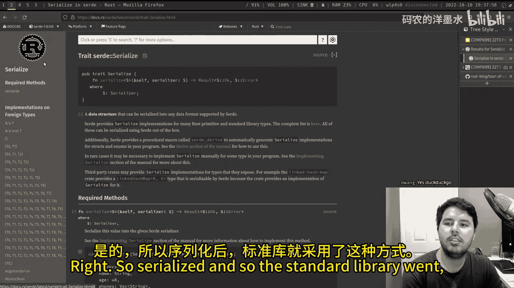

The standard library went。 this is too big of an issue for us。

 And like there's a reasonable chance that we get this wrong。

 Like we do our best at making a trait to serialize things or deialize things， but it's like not。

Like the community wants something more powerful， more generic。😊。

And but but like where're the standard library， it's really hard to change things because we need to make sure we sort of maintain backwards compatibility and everything so they went let's not do this。

😊。

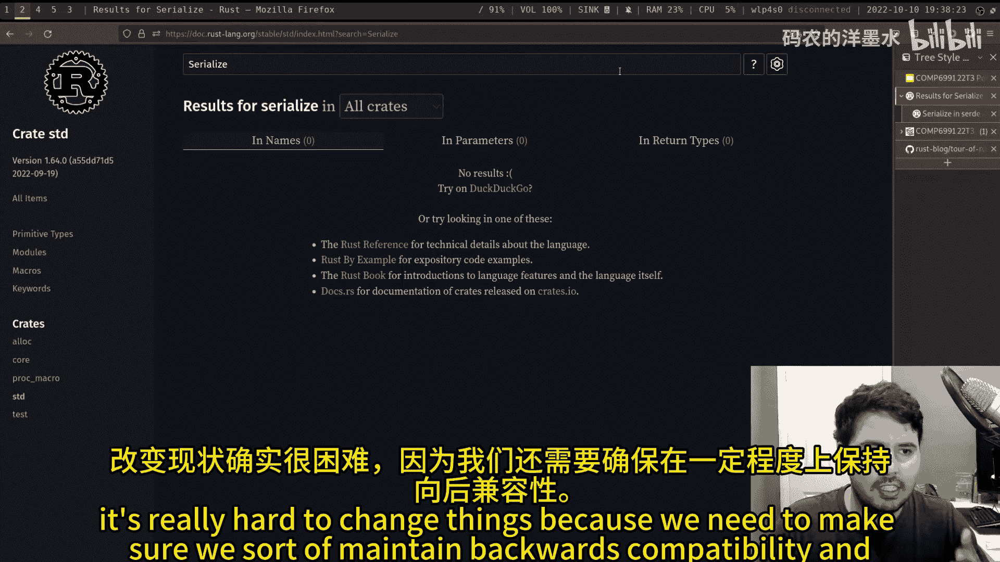

Which means there's kind of an arms race like there's a race to who can make the best serialized trait that everyone's going to use。

 And the thing that's really annoying， potentially。

 is when there's two really big crates that like half of the community each。 Use one of these crates。

 and then you like need to build all these sorts of layers of compatibility between the two of them just to make life not be hell。

 Fortunatelyly， in the case of serialization，30， like just hugely one out。 everyone loves30。

 if you don't love30， then will bring out the pitchforks and the flaming torches and stuff， you know。

30 absolutely one out one out in the war of serialization。😊，And so。And so yeah。

 like this ended up being okay because everyone， if you want serialization， go to 30。😊。

But there are scenarios in which this has been an actual pain in particular。😊，In async rust。

There's two primary asynchronous runtimes， one's called Tokyo。T， O， K， I O。

 and one's called aync underscore， Asnc underscore stood or async dash stood。

 I always get get it backwards。 I got it right this time。

 Async stood because they put a bloody dash in their logo。Um， and these days。

 Tokyo is is winning out over Async St， it appears。😊，But it's。

 you know there's still people that use each of them and so a lot of workers。

 you know people who need to be generic over the idea of their program being async often need to provide two feature sets in their program。

 use this stuff if you're on Tokyo， use this stuff if you're on Async St and it can be a real source of pain。

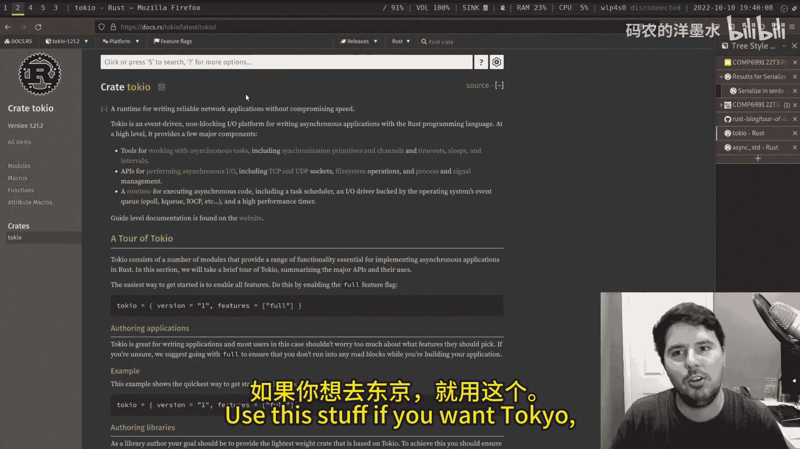

So。Really sort of generic big picture ideas we really do like to have in the standard Library because we get uniformity across the whole ecosystem。

So let me catch up on the chat。 you don't necessarily need to add boost Col colon to everything consistency C++ moment suppose it wouldn't make sense that the default is not the defaults across all defaults very good Was that suggest site suggesting Dutch like it was your default search engine because of some partnership I think it's because like a。

😊，A core value of rust is， you know， the ability for privacy and stuff。 And so duck。

 duckco is like a。It's relatively at least sensible default for that。 I'm not 100% sure。

I don't think it's because it's my preferred search engine because it was。

 and then I' change back to Google because。I think internally， D Dco is Bing and。Bing is。

Sometimes doesn't get me exactly what I'm looking for。

 which is kind of frustrating as a developer this reminds me of what case tool be using for file names and directory names。

😊，Do you mean for right， like for source files and source folders。

 we generally use a lower snake case for all of that。 So if I have like， if I make a new folder。

 my module， then we use a lower snake case and like my file in module dot R， something like that。

 we use lower snake case， all of that， it's specifically in types and stuff where we jump to that upper camel case over here like。

Like partial ache or partial ad。Or into iterator， yeah。And yes， there's some kab case。

 but there shouldn't be kabab case for modules or file names or I think sometimes people use kab case for like crate names and that's annoying to me because Ru doesn't like kab case because Kabab case yes。

 is written how they've done it there because there's sort of an ambiguity between if I write my like my dash module is that a module named my dashash module or is that a variable my that is subtracting a variable module。

😊，And so because it introduces the ambiguities， it's generally not permitted in the Ru language。

Anyway， so。Oh， there's one more thing I actually really wanted to mention and then we'll just go on a browsing spree and like we'll have a chill final 10 minutes or whatever The last thing I also really wanted to mention is how does this even work？

😊，Right， that might have been kind of good to know， right， like we wrote stuff like this。😊。

And let me just， this was like we've gone sort of。Wigh off the beaten path here in terms of making it very generic and it's very cool and we love it。

 But let me just go back to what we had before， which is like smallest I'll just call it smallest too because we had two things where x is a T。

 Y is a T returns a T also where T is partial ord， there we go。

 And we if x is less than y then return back X， Otherwise return back y。😊，Like that。

 This is where we were at here at one point and hopefully we should be comfortable with the idea of this。

 How did this even work if I have some function foo and that function fo calls smallest two of like 42 and 100。

😊，And then it calls for smallest two of 42。2 and 100。1。 And then it calls smallest two of。X and Z。

How does Ru make this code work， right？😡，You might have an idea in your head of like， oh。

 that's obvious， but it shouldn't be obvious because there is many different ways you could implement this。

 So how a lot of languages， a big chunk of languages choose to implement something like this。

So let's say Java has a strategy that's quite similar to this as we dropped as 6 k bit rate。

 but I think that should just be like quality drop， not straight up outage and it's back。

Think it should be okay。The Java will attempt to do something like this by generating one function that's called smallest two。

 and it deduces how to like do the body of the function。

Based on like it'll check at runtime in a certain sense。

 this is a little like handwavaving and it's more complicated than I'm making it out to be。

 but it essentially will go is X and I3 sorry is T and I32 is T afloat is T a character and it'll do different things in the body based on you know what type T is that it figures out at runtime This is because Java has a concept of types at runtime。

😊，Right at runtime， you are able to figure out if I'm like a type food or type bar or like if I'm type animal or type dog or type golden retriever。

 that information is still available while the program is running and it uses that information to deduce how the body should work。

😊，Generating a single smallest two function。The way we've written it here， Rust does not do this。

 right， Rus does not take that approach。 how I've written it here。

 That is an approach called add like it's dynamic， right，'s that's a dynamic dispatch at runtime。

And it's what we're going to look at later on with the， I mentioned earlier。

 there's something called the diin keyword， right， where we have some like diin。Dn， partial Lord。

 whatever it's going to be。And rust doesn't do that for one， there's a few quite good reasons。

 but just to like rattle a couple ideas years off， dynamic dispatch takes time right。

 it takes time in that when you call the function， some work has to be performed to figure out what type it is and to sort of do the right thing based on what type it's being called with。

That takes performance。It also harms the idea of optimizations because you can't optimize this function for any particular type T。

 you can only just sort of like apply optimizations that would make sense for any type T that might be used because you don't know what type the function might be called with so how does rust avoid this Ru avoids this with a technique called mono more。

😡，Physation。Moommorphization that's a tricky word。 And this is the same thing that C plus+ does with its templates。

 The way monomorphization works is believe it or not， when I call smallest2 of 42100， 42。

200 points smallest two of X and Z。😊，It literally spits out these three functions。

It literally spits out these three functions when the program is being compiled。😊。

Right when I'm running rust car cargo build or cargo run or whatever you are correct so dynamic dispatch is how C++ influence polymorphism via V tables virtual yes。

 which is the same idea as Din in rust DYN but templates in C++ template expansion is done monomorphically which is what we're looking at here So when we have this function here small as two of T。

No smallest two function ends up being generated as actual code。 Instead。

 Rus will inspect anywhere where this function was called， so it'll find it's called here。

 here and here， It looks through the whole crate for this。And it says it was used here。😊。

With an I 32。It was used here with a F3264， I don't know， whatever， whatever it decides it is。

 and it is used here with a chart I think actually this would be F64 in particular。😊，So it finds。

 okay， it was used with an I32 and F64 and a char and what does it do。

 it literally takes the function here and spits out small as2 I32 and it finds all the T's and goes。

 yep， that's an I32， yep， that's an I32， yep， that's an I32。😊，And then spits out this code here。😊。

And then it does the same thing for F32 and for char F32 F32 F32 F32。

 oh sorry that should have been F64， but you get what I mean and it does the same thing for chas and we are right back where we ended up the like sorry right back where we started I should say right。

 it's the exact same stuff。😊，And the reason this is potentially better in terms of the tradeoff we were looking at earlier is that now the compiler is free to optimize all these functions individually to make them go really。

 really really fast like maybe there's a trick with I32s or a trick with floats where you can check the ordering really easily and in fact there actually is really clever tricks on floats to check ordering very easily。

 you might have to head to 1521 for that and look at there's like a solution I wrote to float ordering lab exercise at one point that I use a very neat little trick to order floats quite cleverly now the compiler is free to make those optimizations to make the code run very fast and it's also free to go。

 hey， this is just being called with like an I32 here。 that's just this code here。

 which is very simple I could just like take this function call and spit out this code right here just called inlining and it goes okay it was called with 42 and 100 so I'll just substitute。

😊，ちだ？42 for x， I'll substitute out 100 for y and then oh。

 I can figure out exactly what this is right now。😊，Is 42 less than 100 like the compiler。

 The code's not even close to running yet。 It's like I know what this is like statically so I can just turn this into 42。

 And so probably before our code is even like built。😊，It's already just turned this into like 42。

It's already just turned into that code there。This is something the compilers do liberally and this technique is called inlining where it just grabs the body of the function and pasts it in if the body is like simple enough。

😊，And so it's very clever like that。😊，It's tangentially related to cont Exp。

 but there's some more stuff that goes on and Rut has cons functions as well。

 which is a similar sort of idea。😊，But it's a similar idea in terms of trying to get things to go at least very fast when when we actually have run the code。

 So there is obviously， you know， there's trade offs to almost every decision that we make and can anyone think of a trade off like a negative trade off of monomorphization in this case。

ThereThere's two sort of really main primary tradeoffs that I can think of。

But this technique of just going， find like where it's used for like find out what types this functions is used with and just for each of those types spit out as an individual implementationation for that type right number one and that's this is absolutely the probably the big number number number one as Dong and Andrew and also and Patrick here in fact let's let's say there's three because that's a really good point as well。

Is the program size like once we've compiled the program how big is that binary。

 monomorphization in particular makes that program size once it's compiled get bigger and bigger because if you write one function that's called with1 thousand types you now have1 thousand functions as opposed to something like dynamic dispatch where you do a little bit of extra work when the function is called each time。

 but there's only one function and so you know。If you're using just one type。

 like if it's only called with one type， maybe monomorphization will net a smaller amount of code。

 but if it's 2，3，4，5， you know1000 types being used， then dynamic dispatch。

 which only generates just a single function like what Java does。

 may give you a much smaller overall program size。Yes。

 Josh also mentions libraries have to be provided as source code。😊。

And with this network for sharedd Library， yes， that's what you're both saying there。

 I'm going to say it a little more generally because that's sort of like maybe one step further along from the way I'll put it。

😊，The way I'll put it is with monomorphization， you must know what all the types are at compile time。

😊，Right like in Java， I have a function food that takes in A is some animal type like this。

But realistically， this type could be all kinds of different things。

 It could be this someone could call this with a dog， someone could call this with a cat。

 someone could write a completely separate Java program that loads this program in and provides an animal that this program had never heard of before。

 assuming they， you know， create their own animal that extends the thing。

 whatever like this function can take。All kinds of different types of it may not even know exist when it's being compiled。

 which is just not something compatible with the idea of monomorphization。

 so I guess the three big trade offs here would be the overall code size slower compile time because there's just more code to compile often with monomorphization and number three being you must note all the types at compile time。

😡，Which is not something you'll always， you know， you'll always know。😊，Because of that。

 we're going to look at doing dynamic dispatch。😊，Right which is sort of a different way of providing this generic behavior。

Without monomorphization and like specifically with now knowing what types things are。

At compile time。Where we'll pay a slightly bigger performance penalty in running the code。

But we won't sort of， you know， we won't have those trade offs of code size compile time and knowing all the types at compile time。

And that'll be on Wednesday， though of course， we don't have time to cover that in about 30 seconds of time。

😊，And if you've heard of things like V tables and C++。

 then you should be familiar with the idea of dynamic dispatch already because that's essentially what we're looking at in。

😊，In yeah， with Din in rust。Cool， so that's how this ends up working Oh and I guess I'll just undo to the point where that was kind of sensible。

Which was here。 Everything skill compiles and builds。

 So I think that's a good point to upload this code to Github。Um， yeah。

 there's a whole bunch of random stuff there for you to poke around and play around with for sure。😊。

I guess we don't need this though。I said we take a tour of the standard library traits but we can leave that for Wednesday there's really no big deal in that。

 but if you want to poke at the slides yourself and just like for each of these traits that I've written here。

 let's say for example display that's a cool trait you just go to the standard library docs which you can either access by clicking on Ferris up here or just going to docs。

r/ STD stood。😊。

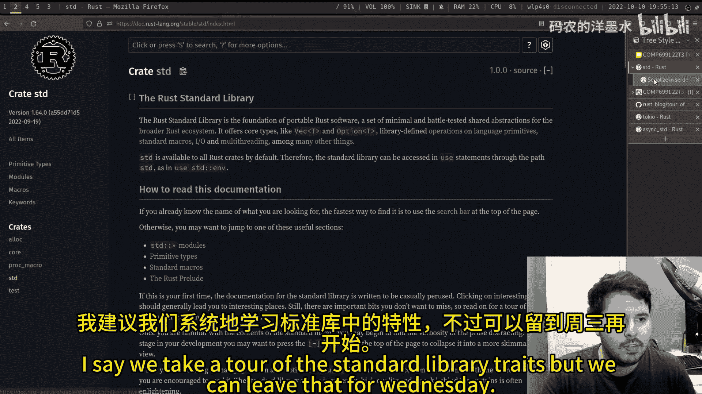

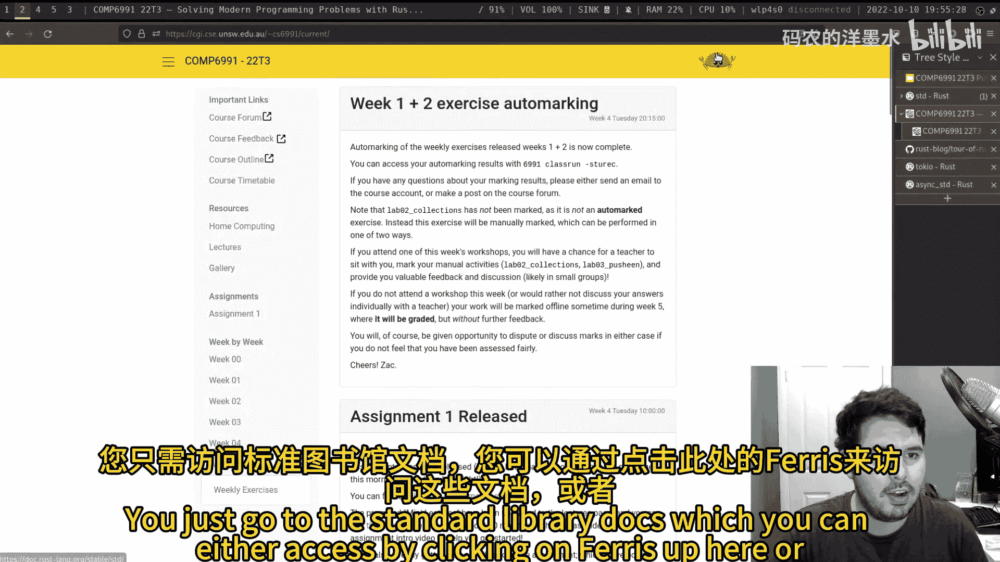

And then search for that thing。 So what I said display， I think you search for that。

 look for the pink ones， the pink ones are traits in this case。 Wait， no， that's wrong。

 This is a struct。Do you lie to me， sorry， not purple， blue。Blue， sorry。

 ignore I said blue is traits， I mean it says trade over here and so we find the trait and you go。

 how does like what does this trait do？😊，Display is similar to debug。

 but displays for user facing output and cannot be derived， and it shows you some examples。

 try and figure out what these different traits are for， how you might implement a trait yourself。😊。

But otherwise we're going to play around with them on Wednesday。Alrighty， so any questions。

 I'll cover this question in a second here， but we'll call that official end of the lecture。

 feel free to type out any questions you have into the chat。😊。

And so let's see what Patrick says here。Do you mind just quickly elaborating on how creating new types at runtime would work。

 Is it just your program accepting user input to construct a new type？

 So I think this is in the case of the Java 1 I said。

 And if you can follow along with a bit of like syntaxxi hand waving stuff。

 you might have something in Java that's like class animal， right。

And a class animal might have like a， you know。A stringing name and like a function。

 maybe like void speak。Which， you know， is， is able to say like system dot out dot printtel and bolah。

 which they'll say like， you know， my name is。The name。 And I go bh， I don't know， whatever。

 And then you might have a bunch of other function classes that extend off this。

 class dog extends animal。And it might define its own behavior in here like， oh， in fact。

 I will speak。I will speak like such， I'll say my name is Blair and I go dog， no， I gowoof。

 rather I should say， and so on and so forth。😊，And you might write a function in your Java library。

 that's like void。Say hello to animal。That takes in an animal。 I'll call it animal。

And what does it do goes and it goes oops？😊，System out print line like print to the console。

Hello there。 oops， hello there。😊，Animal dot name。And then。The animal might like speak back to you。

 all right， something like that。Now the idea is you've written this function here to work on any animal。

😊，And it knows sort of like the things that are available on this， right。

 like what sort of what properties and behavior an animal can specify and the idea is someone could pull in your Java library as a library into their program。

So now we'll say like， this is in my program up here up here was like。The library。And in my program。

 I could write code as such， I could say class， what's a cool animal。

 what's someone's favorite animal， I'll do like a maybe like a lion or something。😊，Right。

 they could assuming like the visibility all works out public， private， whatever。😊。

They can make their own animal。It says my name is Bar and I go raw。Right。Actually。

 that should be like this， shouldn't it？I'll leave it like that。 That's more fun。 And they could。

 in theory， still call your function with。😊，Like there lion or whatever it is。

And your function will still work。😡，Right， your function will still work even with this lion。

 Alright， Totle is in full caps。 Sorry， dong， C C went full cap。 So I'm gonna go。 Well。

 what does a total， What does the total go， It goes like。I'll just do， like。Cirrickets。

Like it doesn't make any noise， I guess。😊，Anyway， the main idea being that you could say say hello to animal with an animal that this library has never even seen the likes of before and it will still work。

😊，Why will it still work Because the function when it goes like animal dotpeak？😡。

Is going to look sort of at runtime。😡，Like the how do I say is I'm trying to like。

 I don't want to curve too deep into the weeds and just become like needlessly confusing。Yes， right。

 yes， so this would still be possible via monomorphization if the creator is provided the source code。

 yes， absolutely， but if you don't have all the source code to compile all at once。

 then monomorphization won't work here now。😡，there is one sort of canonical example of when you don't have the entire source code available all at once。

 which which would really impact this scenario here。

 which is something like a plugin system where the library is no longer library。

 let's say it's like the server right and this is some big server that's doing a you know does a lot of work and it's such a big idea that you might want people to be able to extend the functionality to be able to extend the functionality of this server with additional behavior。

Right， but you and you wanted to sort of be like swappable these sorts of additional behaviors swappable in and out。

 and this is sort of like a pretty big contender for like。The， the like plugin。

The plugin pattern right， where essentially you have this primary thing。

 the server and maybe when the server is booting or something。

 it'll look up for these dynamic libraries。 Yes， as you mentioned there in the chat in this case。

 we'll call it like my plugin here。😊，Which adds more types and does more stuff。

But the server is already being built and compiled by this point。

 it's like in fact it's even running by now， it's booting up the server。

 it discovers your plugin and wants to load the code current into the current environment。

And so it's too late for monomorphization so this is like a scenario where you really might care about this and so you have to lean on something like dynamic dispatch which Java has like dynamic dispatch everywhere whenever you're calling a function in this sort of way like a function on an object like this。

 it's a dynamic dispatch。😊，Which。Is why Java is not really in the same leagues as something like C plus+ or rust when it comes to performance。

 Java can be very fast。 And in specific scenarios， Java can even once the Javas virtual machine gets like warmed up and starts applying on the go optimizations。

 It can even potentially run faster than you know carefully tuned C plus+ or rust code。

 but just in general， Java is not on that same sort of performance tier as like on the metal languages。

 and this is a pretty big reason as to why Java loves to malic all kinds of stuff you know it boxes everything it can and basically almost any function call ends up being dynamic dispatch。

 Even this printline here will end up being dynamic dispatch where in rusty or usually a lot more sparing with it。

Part of that admitted merelyly because there's some pain that comes along with dynamic dispatch that we'll talk about on Wednesday。

 but you know it's a consideration regardless， and how can Java make itself faster。

 as Mial's mention there through Jit compiling mainly， which is Giit stands for just in time。

Whereas the program's running and JavaScript in particular has often has these kinds of optimizations as well。

 as the program's running， it sort of looks at common patterns and modifies its own code。

Modifies its own code as it see fit to try and improve the performance and occasionally you know it's getting sort of like current runtime behavior information in order to optimize the code。

 it might take quite a bit of time for it to figure out those right optimizations。

 but once it's applied them you can get faster than carefully crafted Cc+ plus or rust with the power of that。

😊，But again， it's， it's pretty specific and it's hard to be very general about these kinds of things。

 apart from just being like， generally it's not quite in the same performance tier。

 but it it always depends。Best animal in order。Sinest sest saneest student in chat right there。

 polylympsism and dynamic libraries， O， OS S extensions， design patterns， C sharp Java， C sharp Java。

 Microsoft Java， Yes， yes， yes， yes， operator reloading。 Yes， C sharp is from from my point of view。

 Java， Microsoft's， you know， compared to Java， but also with like more bells and whistles attached。

😊，To， to to put it very briefly。 And what's the， what's the word I'm looking for here to put it briefly and。

哦。I can't find the word I'm looking for。嗯。Yeah，' it's escaping me。

Like briefly and a little bit like a bit of an idiot is what I'm trying to get to。

 but there's there's the right word for what I'm looking for but yeah。

 it's not the differences are never as simple as that， but it's fun to put it that way。😊。

To just answer it quickly。Okay， cool， we're talking about all kinds of random stuff and I'm glad for you also to be doing that。

 but do we have any other questions before before we end the lecture off？😊。

I'll leave time for any questions about our content and stuff， I suppose。😊，Otherwise。

 you can just keep chatting I't really， I don't really mind， either。嗯。I'll probably close this。

Other people might be confused with the way that's just randomly there。CLA to CC， no worries。😊。

Any other last questions？And we've got some fun ahead of us for Wednesday as well， naturally。

Fiz Buzz Enterprise Edition， yes， I know Fiz Buzz Enterprise Edition imagine we had a course discord well。

 you can make a discourse thread and chat there， of course。😊。

For anyone who wants to see FizBuzz Enterprise Ed。It's pretty funny， it's pretty good。

It's this first one here on GitHub。It's a very， very Java moment。FizBuzz implementation just。

know enjoy this in your own time， it's very funny。Okay， anyway。

Let's call there that I'm not seeing any other questions so thank you everyone for coming hopefully we' had some fun and we we'll see you again on Wednesday where we'll keep talking about polymorphism and traits and stuff and dynamic dispatch It'll be very fun We'll see you then and yeah so bye for now see you later。

😊。

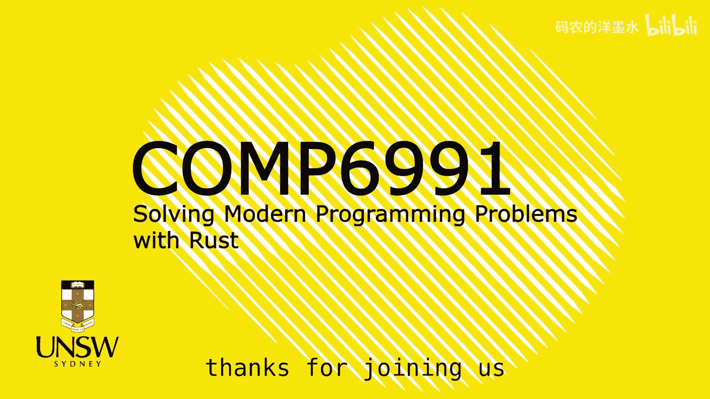