# 【全集】新南威尔士大学 Rust现代编程 中英字幕 1080P p10 Lecture 10 - 特质对象 -BV15cf4BCEN1_p10-

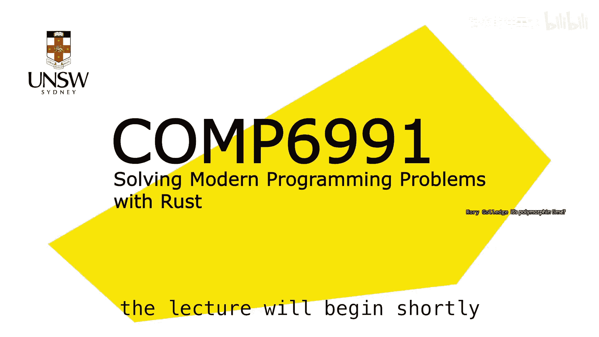

All right。Hello， everyone。There go。Hello， hello。😊，Welcome to another comp 6，9，9，1 lecture。 In fact。

 welcome to。😊，Our final Com 6，9，9，1 lecture before flexibility week。 Don't worry。

 not our final Com 6，91 lecture。In its entirety。 but yeah。

 it's going to be our last little lecture here before we get a week'。😊，Break， well。

 awake flexibility， I suppose you would call it。And yeah， we're。

 we're continuing on where we left off on Monday。 And very exciting。 A new house again。 Yeah， thiss。

 I am fortunate， I didn't have to go。😊，I didn't have to change houses from since Monday。Once again。

 but I have done away with the green screen because I don't know。

 the backgrounds nice enough and the green screens annoying so。😊，Yeah， screw the green screen。 If。

 if， if my camera ends up blocking something， then， then let me know。

 I suppose I'll be spending probably a lot of time in in a terminal。

 So I might just go ahead and make a little thing right now now that I think about it。

 that sort of reminds me if I can't see it， then they can't see it。 There you go。

 Now there's a terminal in my corner。 So like I won't be being like。

 why I can't anyone see this because there's a bloody terminal in the way。

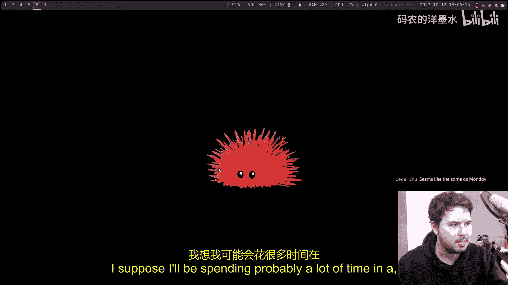

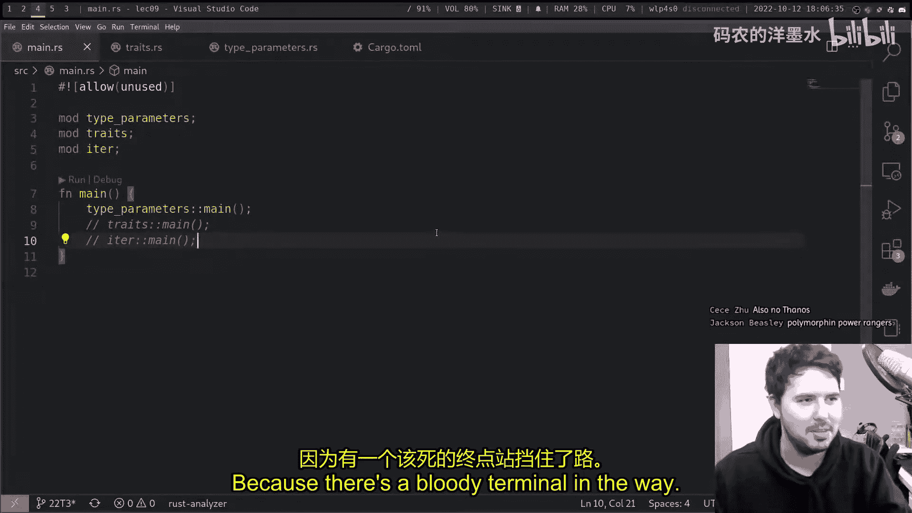

Cool， I see that everyone's very excited to get morphine。😊，UmPolymorphine power ranges， yes，um cool。

 So a couple things， as usual before we get u started。😊，I believe since the Monday lecture。

 I think it wasn't fixed before the Monday lecture。

 the submissions for the submissions for the what was it called the modularity exercise has been like fixed in quotation marks it is like a fix you can now submit for the exercise。

 but it's just like a kind of not the best solution ish hence why I put it in double quotes。

 but you can submit the exercise， I also extended the deadline by a day just to give everyone a chance to to make sure they submit it So all the other exercises for week for are due tonight。

 I believe our usual deadline is 9 pm。 but the modularity exercise I've thrown I' thrown another 24 hours on that for everyone just to get those submissions in。

😊，嗯。So。Yeah， to compress press your tar。That seems like maybe you need to clean。

 You need to run like a cargo clean before you。Yeah， before you tie it up， I I put it in。

 I had to change the submissions instructions。Once after I sort of put the instructions up because I forgot to tell people to clean because then you're sort of submitting all your build artifacts and potentially dependencies and all that。

 which can take up a lot of space。 I will try and make sure if anyone did end up compressing their tar。

 We， you know， it's， it's a manually marked exercise。

 So I think it'll be pretty obvious to a marker if like， oh， this doesn't look like。

If this doesn't look like actual code， if it was compressed。

 so we'll I'll put something in check for it。 But ideally， you run cargo clean before you submit。

 and then you shouldn't like you get， I think something like you think get like 8 megabys or something like that。

 Or maybe maybe it's like4 megabytes or something like that。

 which should for a small text file should be more than enough。

 So you probably submit a something that you didn't you didn't intend to。 And yeah。

 you need to submit as crate dot tar。 Yeah， which is sort of why it's a little a little。

Potentially strange。Exippping it if the if the extension isn't there。

 but I'll try and make sure we account for that regardless。

 favorite part of lecture is when Zack said it's polymorph and time polymorphed all over Ferris。

 Very good。And just yeah， re namedd it， yeah， yeah， yeah， Okay， cool。

 So there's thatum the the the submissions effects， make sure you submit modularity。😊。

And the other important one was， yes。 so we've。I addressed feedback a few lectures ago or two or three weeks ago。

And then I was like， oh， we'll it on the Monday。 And then the Monday lecture got cancelled。

 And so then I was like， oh， okay， well not the Wednesday。 And then this Monday rolled around。

 I was like， damn it， this is a really busy week I don't want to like you know。

 we're doing a lot with generic type parameters and traits and all that。

 So I don't want to lose a bunch of lecture time because there's a big chunk of feedback。

 And so I thought I just quickly take a thing here to say。

 we're going to address that big chunk of feedback in like a forum post or something as opposed to the lecture as opposed to the lectures now。

 just so we can make the most of the time we've got。

 but you can keep your eyes out for a forum post if you've submitted feedback or you're interested in hearing on on like。

😊，You know how we address it or any plans we make or anything like that。

But just thought I let you know it's not being where we're not just like ignoring it and not planning to deal with it or address it。

 We are planning to address it， but we've just had like oh we'll do it in lectures actually no we won't Oh the lecture got canceled oh this is busy And so we've got a big Google sheet Toms very nicely gone through and and like labeled everything and organize it all。

 It's very nice of him and we're gonna put together a forum post at some point that talks about that。

The usual reminder， yes again， this is Wednesday week 5。

 which means we don't have lectures next week， we don't have workshops next week and you won't have weekly exercises next week I can't I don't recall what we set the due date for the week five exercises to be So okay the week five exercises are still due week six Wednesday which is illegal。

 not allowed things due in flexibility week technically you are allowed regularly scheduled activities to be due in flexibility week assuming you also have a reasonable length of time outside of flexibility week as well to do that that's why you know the intro courses and stuff still have weekly tests and stuff like that often。

 but Sree mentions now it's a mistake on his end and where apparently we're going update this to be week 7 So you won't have don't worry about this deadline yet I suppose we'll update it sometime soon。

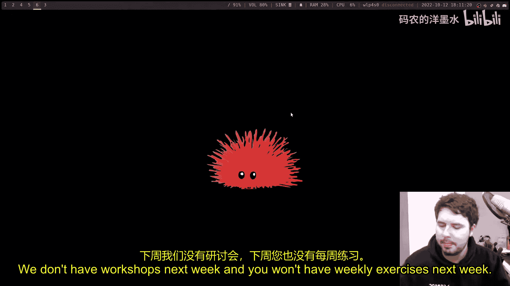

There you go， I justified it both ways， How about that？😊，嗯。Cool。And as a reminder。

 your assignment one is due， is due is due。Did I miss it here， week seven， Wednesday？At 5 PM。

It's our usual deadline 5 PMm or 9 PMm。呃。9 pm this is should probably be 9 pm as well。

 maybe we're a a we're having a bit of a deadline headache。😊，but anyway。

 so they they'll both probably be due， well， this is due week seven Wednesday。

 the the assignment that is and the exercises will get their due date updated to also be week seven。

😊，Cool， and the week four exercises again due today at 9 PMm， apart from modularity。

 which you've now got an extra an extra 24 hours on。😊，Cool， so yeah， in theory。

 Labo 5 is Labo 5 is probably gonna be due the the。Same， the same day as the assignment。

 I would imagine。 I'm not sure if we're gonna stick to 5 PM，9 PM。

 So it may not warrant a whole announcement on its own。

 if we just change the deadline by a couple hours for consistency。

 but I'll probably just put like a thing on the forum。

 like a just quick forum post with no email announcement or anything。 if we。

When we change any deadlines。Cool， and to be clear we're not going to change any deadlines to make them less forgiving。

 we'll only ever extend the deadlines outwards so to give more time。😊，Okay， very cool。

 So that's a bit of administrative。 Does anyone have any like course questions。

 You still have workshops this week as a reminder， the workshop tomorrow。😊。

And Friday they're looking they're shaping up to look quite interesting and get you playing around with traits。

 and we're going to be talking all about traits today。 It's going to be very fun。😊。

So if you have any other like random administrator via things or confusions or anything like that。

 just feel free to post them in the chat。Otherwise， I need to turn off my notifications otherwise。

We willll press on with where we left off。How do you do test a function that returns a unit？

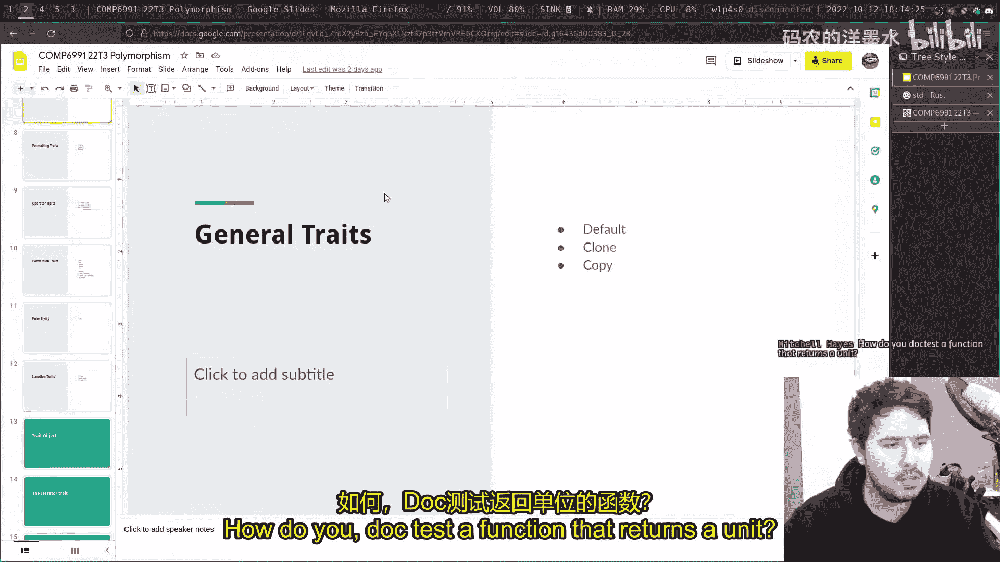

Hey， Doctor Sur function there returns a unit。Well， here's a good example， Main， right。

 So I didn't write this here。 Main returns unit， But this is technically， it's kind of interesting。

 I don't think we ever mentioned this in the course。 If you don't specify a return type。

 it's implied to be unit。And all functions sort of implicitly return like if you don't have an expression at the very end。

 say like a string expression here at the very end of like 42 or whatever。

 they implicitly return unit。And so mainine is an example of a function that doesn't have a。

That returns unit。 And， I mean， I think， I'm not 100 percent sure。

Like maybe you've had some specific troubles with doc testing functions a returning unit。

 but from my understanding， it's just sort of like the same way as usual you can't really like you won't be able to really test necessarily for the most part。

 it'll be very tricky in particular to test a function that' you'd assume that it's sort of doing something like impure if you're coming from like a Haskely functional programry perspective in the function works by producing some sort of side effect。

 maybe that's a side effect that you can test for by like pulling in some other stuff potentially but in the case where it' like this is not really reasonable to make a small example to show off a test case。

 usually the doc test just comes down to showing an example So instead of like going a that like calling main is equal to unit or something like something like this。

 usually you'll just go like。I， I want to call main。 So I do this and like， you know， call main。

 And this will still get tested。 It'll still execute the code and make sure it doesn't panic。

 and it'll。And it'll make sure that the function exists and you're calling it correctly and stuff。

 so it'll serve as an example， but it may not serve as as a tested like as a sort of traditional unit test with assertions and stuff like that And if that's the case that you're in then probably that' that's that's perfectly fine。

But yeah。That's， that's， I think about， okay， yeah， cool。 So， if you're happy with that。

 then that's all good。 if you want more then anyone feel free to post on the course forum and there might be some more interesting stuff to go into。

 but。😊。

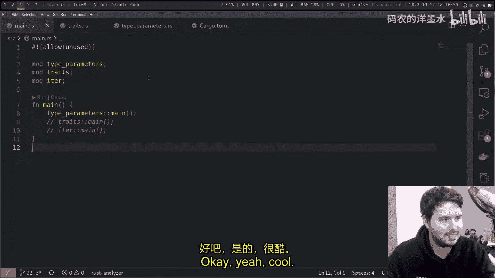

But yeah。So， and Tray says the doctor's exercise is a bit strange with what specific functions need to be tested made public。

 we'll be fixing that for next term， cool。

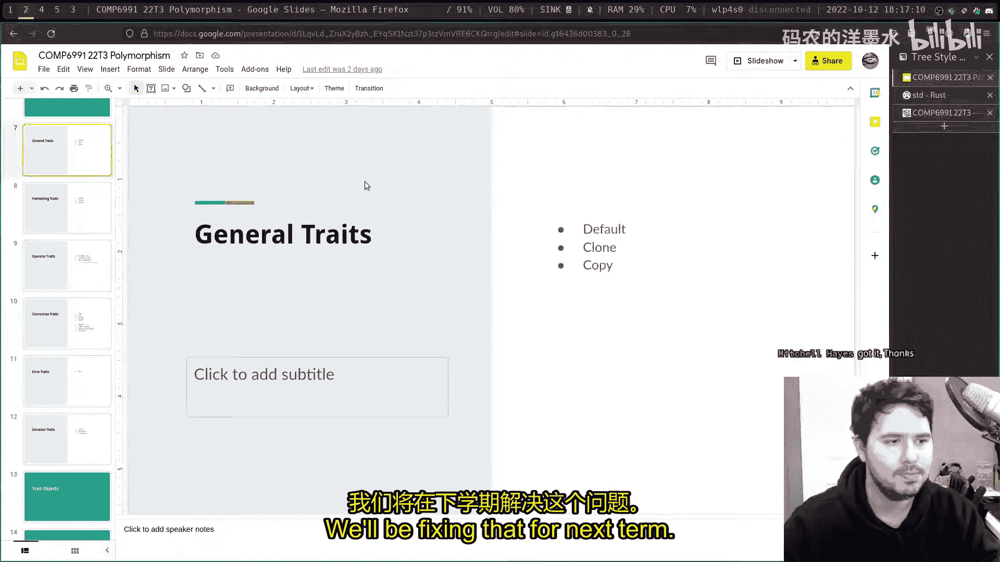

Okay， so we left off we to just quickly recap what we looked at last lecture。

We were looking at generic type parameters。So yeah， we add a whole bunch of stuff here， blah， bh。

 blah blah blah， but in particular， this was the big thing that we managed to write during the lecture。

 which is this highly generic function that finds the smallest value in a。😊。

In a like the smallest value in anything that can be iterated over for any value that can be ordered。

Right and so this could be like you could throw a V here， a linked list， a hashet， whatever。

 and you could throw anything in here you could find like you could do an integer。

 floating point a string， anything like that， and it will find you the smallest thing in that sequence just with one sort of body of code here。

Another important thing and listen up to this one because it's going to be relevant to something that we learn about later on called trait Ob。

😊，Is that the way the compiler， like the way rust sort of implements these generic type parameters。

Is so for example， here， this function smallest two of T。

It just like it looks through a whole code base， the whole sort of unit that's being compiled and finds all the different cases that T may be。

 so it might find that oh， we use like one case， T is an I 32 an F 32 and a chart。And then it goes。

 cool， I'm going to basically spit out。handand crafted functions like this for each different type。

 so it essentially generates one individual version of the function for each type that it's used with。

And this process and like this eliminates all generic high parameters essentially。

 the all the like the T partial lo and stuff that all gets checked before this this code generation step here happens。

And then once all the like checking and everything is done it goes， yep， all the types are good。

 it just spits out a whole bunch of functions， one for each type that it's used with and almost like treats them as if they have different names and stuff like that。

 and this process we learned is called monomorphization which is a massive mouthful but it's a pretty important idea that will come back to later in terms of how the compiler does this we talked about tradeoffs with this as well。

 which is also quite interesting in terms of the big ticket ones where you know you trade off things like binary size and compiled time and all that。

 but you get very fast code that can be optimized very well and it's also potentially a relatively simple optimization and yes。

 as Stray mentioneds， it's also a zeroco abstraction in sort of both senses of the word in that if you don't use generic type parameters if you don't use this abstraction that rust provides。

😊，Then you， you won't sort of pay any cost for them General。

 you won't pay the cost at compile time like in the compile time takes longer nor at run time in to say a bigger binary size of your code running slower。

 If you don't use it， then it's fine， you don't like pay the price for rust having included this feature。

 And if you do use it。It's generally as fast as if you would have handwritten it all yourself anyway。

Right so those are the two sort of sense that it's a zero cost abstraction。

 zero cost if you don't use it and also in theory， zero cost if you do use it。

So this is a pretty interesting process and it's a similar process that languages like C++ take in terms of C++ has a similar idea called templates。

Cool， so that's our recap of last lecture。 And we left off starting to like。

 look at traits and how traits vaguely work。 I've also left my。😊。

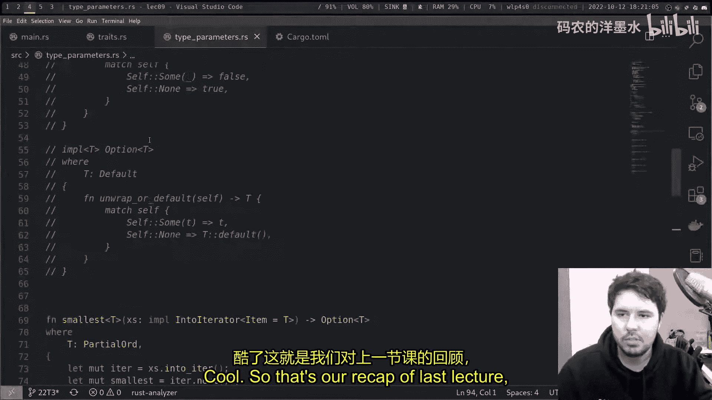

My side， made like study window open over here。And sometimes the birds like to go a little bit sicker mode。

 if it gets annoying or distracting or it starts leaking through。

 let me know in the chat and I can close the window。A。Cool。

 so I think it'd be nice to do a quick tour of the Stan library over some of these traits。

 we almost got to this point and then we were like a but monomorphization and then we finished off with that instead。

 which is an important idea So we didn't really get to poke too closely at any of this。

 So let's have a poke at a few standard library traits So what's a really what's an interesting one to start off with maybe something like two string two strings pretty easy to start off with。

😊。

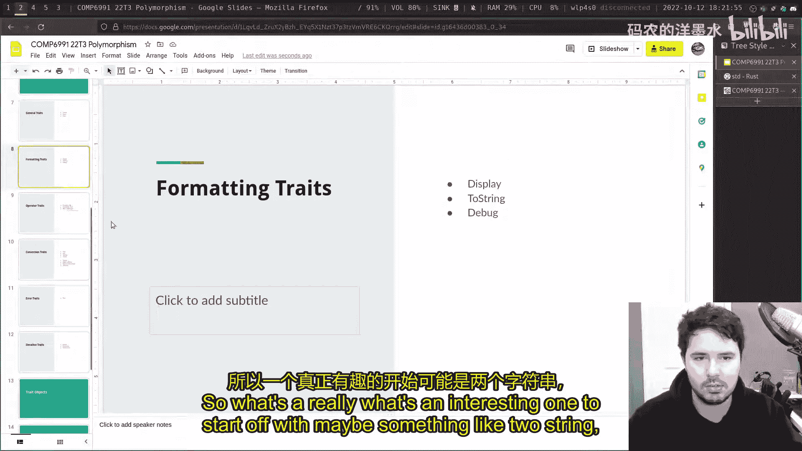

So two string here is a trait and it's defined like this。

 so the trade definition is the sort of the big one we're interested in here。

 pub trait two string and this trait defines one function。😊。

And it's a function called two underscore string。 It takes in a shared borrow on self。

 so a read only a borrow。And it produces a string。So as a reminder on how traits work。

 this trait can theoretically be implemented on any such type， like any struck doum or you know。

 whatever have you that you create。And when you implement this trait for some specific type。

 you need to provide an implementation of all the functions that the trait defines in this case。

 and in a lot of cases there's only one function that it defines。

 but you absolutely can write traits that define you multiple or many functions。In this case。

 it's just this one and it must follow this same signature， so it must have the same name。

 the same parameters， the same return type， that sort of stuff。😊，And in this case。

 it's a trait for converting a value into a string。 So， for example。

 if I have the number 5 and I say let 5 is a string。

That is like the string five as opposed to the number five。

 then that should be the same as calling i dot2 string。

Now there's an interesting thing that sort of comes up here。

 Why can we do I dot 2 string in the first place Well I here， they haven't explicitly typed it。

 but I here we'll have type I 32 And if we look down here at the implementers of this trait。

 So like what what types implement the two string trait that the sort of standard library can see right here and it should find that so it's funny that it's like we don't see I 32 here it implements two string for string for stir for a char。

Let's just look at this implementation for a second here。 It implements two string for。8 bit numbers。

 I ate and U 8。 So potentially I'm betting， oh， I was worried that this might be spat out by a macro or something。

 but it's not。 Instead， we can really see here's how they implemented two string for a 1 B signed integer。

 And it basically like。Does what I think you would roughly expect if you were writing this code yourself。

 it creates a string with with a default capacity of four to avoid sort of maybe need to allocate multiple times if the number is negative then it puts puts a minus character in front and then it just sort of goes in like mod O 10 it goes if it's bigger than 100 then push the one and then you know n divided by 10 plus you know blah bh。

 it just sort of like constructs the number slowly and then goes great。

 here's that string out the other end。😊，And no worries Migu well。

 just some like random announcements and we're starting to look at traits in particular we're looking at the two string trait。

😊，So yeah， I think this does roughly what we'd expect it to do。

 And if you were writing an implementation for I 32 it be。

 you wouldn't be able to do it exactly this kind of way you'd probably need a loop and stuff or a lot more code to deal with if it's 10。

100 a thousand00，10，000 you know up to a couple billion。😊。

But there is this rather complicated impulse here which does cover this I 32 case。

 I'll try and read us through it， but it's a little complicated for now， it says I on any type T。

 the trait2 string for that type T。 So if this is where it ended off like there was nothing below this point。

 then this would implement the trait for literally any type T。

 which is you know a little interesting， but it probably wouldn't be able to do much useful。

But there's a constraint here it says Iple for any type T， the trait two string for that T。😊。

Only where T。Implementments the trait display Don't worry about the question markized for now that's something a little special。

 but only where T implements the display type the display trait sorry。

So if you implement the display trait。If you have mystruct， whatever you call it，struct mystruct。

And you implement display for mystruct。 Then you'll automatically get an implementation of two string field your type。

 which is kind of cool to display is another thing that I put in this in this list here。😊。

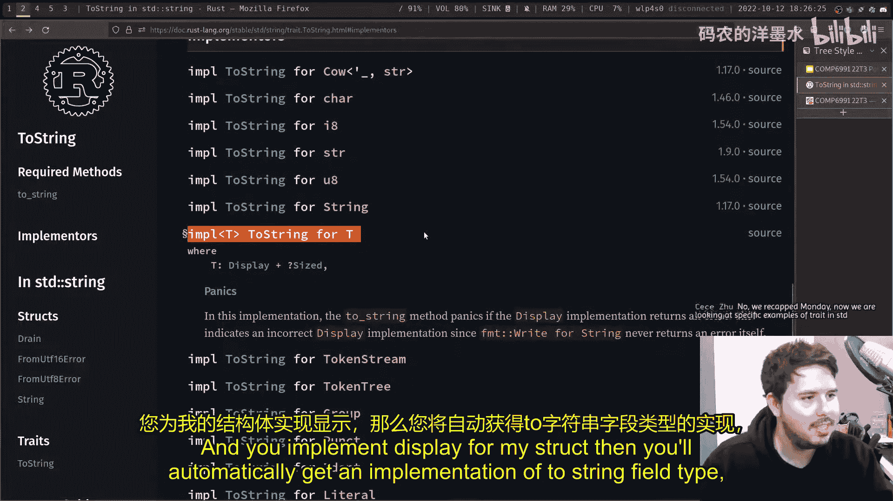

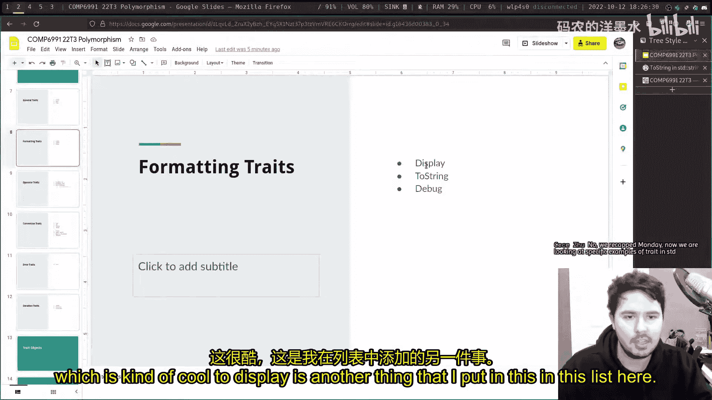

And display here is sort of similar to the debug trait。 it's another way of in effect。

 turning a type into a string like it's very similar to a two string。

 but instead of actually converting it to a string。

 it uses this thing called a formatter and this idea of the formatter is it's almost like an abstraction over how you might like to see a type as a string in that if you want a string。

 then you can format this into a string and that's perfectly fine。

 but a lot of the time if you have like let's say it's a really big string that's gonna to get spat out but all you intend to do is just like print it to the console then you would rather just read the type and write it to the console as you go as opposed to allocating a huge string。

 writing all the bytes into the string and then spitting out the string。

 you might as well just write it as you go and save all that extra work and constructing a string So that's what the display trait basically does for us。

😊，You can see here that point will format as like this these braces。

 so like a par zero comma zero in this case， you can see down here。And yeah， so if， and in our case。

 we know that if you implement display， you get two string for free。

 So if you're looking to input two string， a lot of people will instead opt to implement this display trait and you get。

 you know， you get two string for free and you have the display implementation as well。

So it's an interesting thing to keep in mind， so a couple interesting standard library traits to kick us off。

And you see that this pub trait display again is just defining one function that you have to fill in and usually you can just again follow these by examples and stuff like that to figure out you knows what's an easier appropriate way to implement this trait in our case we see that this right bang here takes in F which is the formatta that it gives you and then it looks very much like the format bang or print line bang macros that we've already seen so。

😊，You know， it's still relatively convenient to use， I would say。

And there's a whole bunch of implementations here and you can see displays implemented 4I32 and that's how we got that's how the standard library got too string。

 And I wonder this is probably yeah， this is implemented by a macro we learn about macros in in week week  seven。

 I believe。😊，And yeah， it's a little gnlly。But you can see this is basically where the display trait is being implemented。

 but it's all this nasty macro code that's kind of hard to understand。😊。

we'll get like most of the way here to understand how this stuff works in week seven。Okay。Cool。

 so a couple interesting traits there。

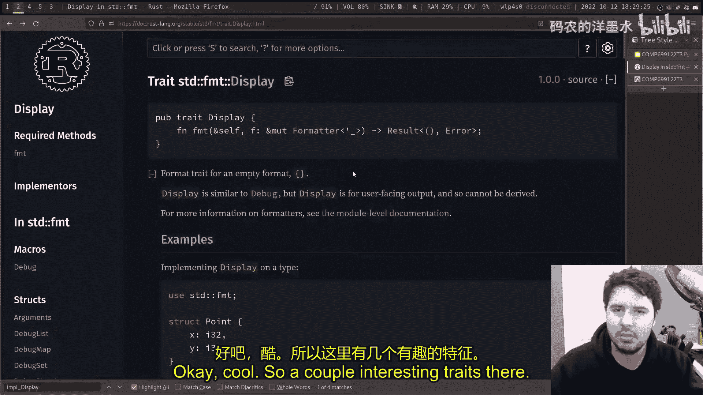

Debug， we've already sort of seen a bit， usually just derive it。

 get a default implementation of the trait and。

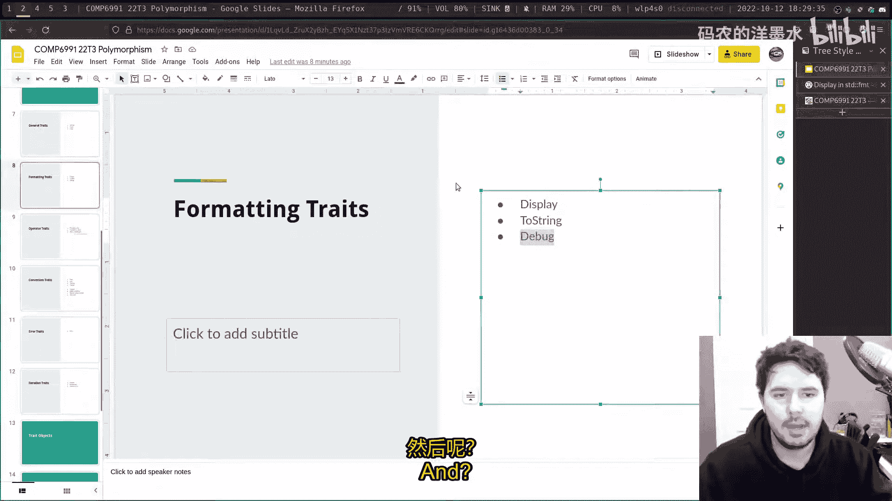

In fact， actually that's a nice thing to quickly look at。Let's go to a temporary directory。

And I just want to show you something that I think is pretty cool really quickly。😊。

So if I dostruct mystruct here。😡，And let's say it has x as an I 32。

 Y is a the char and Z is a string， something like that。

Something that you've probably found yourself doing from time to time is I want to derive clone on this。

I want to be able to clone my structs and the way that we told you， oh。

 you want to clone your my struct。The way we told you to do that is probably through this derived clone up here。

But what does this derived clone code even do I have showed this to a few students like maybe four students also at points during the workshop when they've come up and asked how does this stuff work。

 but it's a lesson it's probably worth looking at in the lecture quickly as well。

Let's just quickly look at the clone trait first。Which is here trait stood clone clone And you'll see this is also interesting because it has two functions here。

 but one of them is a little fancy pub trait clone， so you can implement clone on some type。😊。

And to do that， you need to satisfy this function here。

 which says you define a function called clone， which takes a shared borrow of sell。 So again。

 you can only read it。 You don't have ownership， and it should produce a new owned value of your same type。

And in this way you take a shared borrow of something that you don't own and it spits out a new owned value now you have two potentially owned things。

 it' it's you know cloned it。😊，It also defines a second function clone from。

 but you'll notice that there's braces here and then it's just sort of ripped out the body of this function here。

😊，This one here is a default implementation， so if when you implement the clone trait。

 you must implement this clone function because it hasn't been defined right it's just a semicolon right here and then you can optionally choose to implement this one if you would like if you choose to implement it then great if you call this clone underscore from then it'll use your implementation if you choose not to implement it。

 then you'll get the default implementation which they've written here which'll just do whatever this code is。

U。So， so this is an interesting one， you could either implement one or two functions in order to implement clone。

Is clone from kind of like stood move in C++？Performs a copysome from source A dot clone from borrow B is equivalent to A equals B dot clone in functionality。

 but can be over to reuse the resources of A to avoid unnecessary allocations so like sort of yeah。

 more like a copy constructor， yeah， yeah that sounds right。😊，Again， not really being。

 I'm not necessarily a C++ expert， but that that sounds about right to me。

 someone who maybe knows C++ better than me might be able to shed some as well。

 but that sounds about right。Cool， so you need to implement this function here。

 And if we didn't want to use this this derive， we could still。

 we could still write this implementation ourselves。

What would that look like it probably looks something like this， ample clone for my strut。

Function clone。 And like， you'll see if I just leave it blank。 I'll get an error saying， hey。

 you forgot to implement the function clone。 I can tell Ru analyzer to。Oh wow， that's nice。

 Rust analyzer can do all the work for me。 I was just expecting it to do this for me。

 So it says create the oops， create the clone function here。

 takes a borrow of self and returns a new self back and reminder that this self here capital self is just an alias essentially for my struct。

😊，And we probably do something like， well， give a new mystruct that goes。

 the x in my struct is going to be self dot x， the y in mystruct is going to be self dot y and the Z in my struct is going to be self dot Z。

However， we'll see that this line here doesn't work because writing self。

 Z like this will try and move out of this string here。

 like these two ti herea copy string is not and we don't have owned access so we can't just move out of Z so we end up needing tos we end up needing to clone here。

And then this implementation will work。Now， something interesting is that。

If you were like a computer writing a clone implementation for a type for just like any random type or any randomstruct。

 let's say in this case。嗯。You could like like what's a pattern that you could follow here。

 Well you could say just return back thestruct itself with each of the fields right or the fields here and for each of the fields。

 I'm just going to say clone the field Now will that work for copy types like I32 and char。Well。

 yeah， clonene will end up just doing a copy anyway。

 like you don't necessarily need to write the dot clone there。

 but it makes it simpler for like a computer if a computer is doing it， just say dot clone。

 do clone dot clone， right？And so we could write this implementation ourselves， sure。However。

 we know that we can save a lot of time and energy。

 especially with a lot of these very common traits in writing hash derived clone。

And let's see what I can tell cargo to expand out all the macro expansions。

 show me all the code that gets generated and stuff like that and before I do that I'm going to get rid of this printline macro because that spits out a whole bunch of random code。

😊，If you want to do this at home， you can simply do cargo， well。

 6991 cargo install install cargo dash expand。Like that and then 699 will cargo expand。

And you'll see here， what does it spit out， Well it there's no longer this hash derived on top of my struct。

 Instead， we get this automatically derived Iple clone for my struct。

 and it says function clone my struct X is clone self dot X。 Y is clone self dot y。

 Z is clone self dot Z。😊，So these hash derives are actually just spitting out these imprate fur type blocks。

😊，That that just sort of do it like mechanically， which is pretty cool。

So that's a lot of these hash derives here are just implementing traits for our type。

 which is pretty cool。😊，And if you want to look at those implementations。

 cargo expand or like cargo install cargo dashash expand and then using it。

 it's a very fun and interesting tool to play around with。

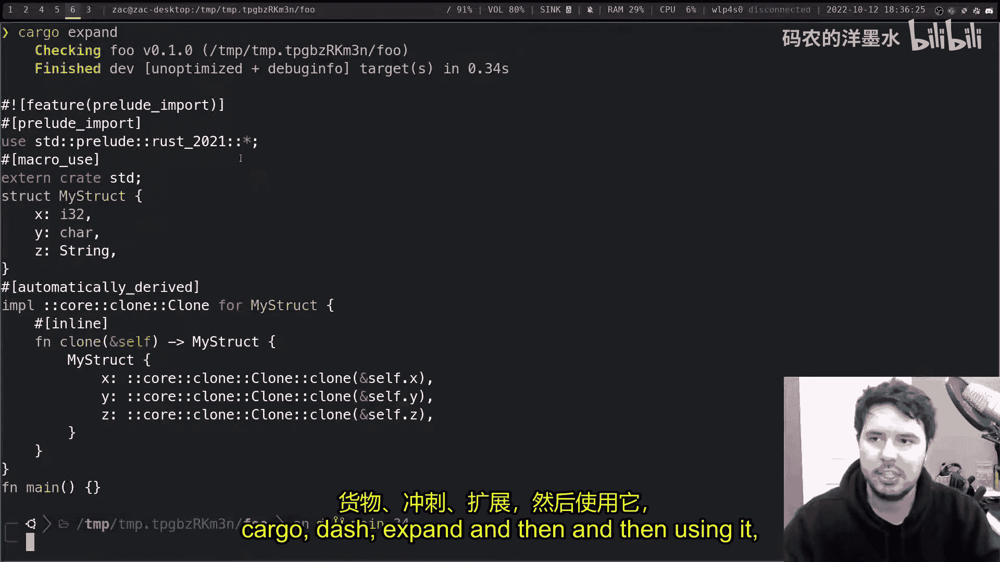

嗯。Any other interesting traits to look at partially and partial load。

 I think we've looked at a reasonable amount traits like add。

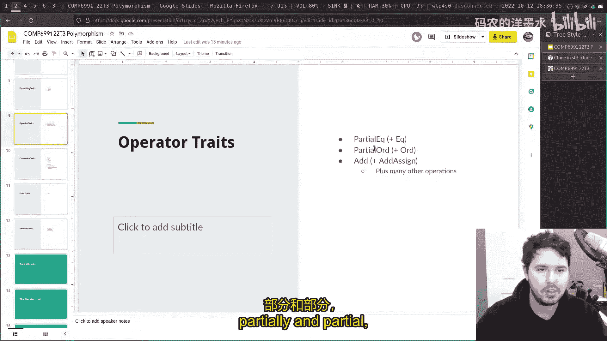

Right， so this is a trait that gets invoked when you use plus。Right，When you use the plus operator。

 it ends up calling the dot add function from the add trait。😊，And。

It almost feels like riding clone three times is a meta joke。So if we look at their example here。

 you might have astruct point， This might feel irrelevant to。

 to some large task that we're expecting you to work on currently。

 You might have somestruct point and you go， I want to be able to add points together with the plus operator。

 Great， No worries。 Just Iple add for your point。😊，There is a optional generic type parameter here。

 right hand side， it defaults， so this is like if if you want to be able to add together two things of different types like say the left hand side is a point and you want to add together。

 say a point with just a single I 32 and it maybe adds it to both X and y。

 then you could say the right hand side is you can you know I add where the right hand side is just an I32 for a point。

😊，If you wanted to。And then if you add things together， if you add two of these things together。

 what type gets outputted and they're saying in this case。

 if you add two points together right because the default is for right hand size is just self which just means a point plus a point。

 then what do we output another point， self just meaningan point as a reminder。😊。

And how they do this， they say， well， they have to define this function ad here。

 which says you take in one of yourself and you take in a right hand side of type right hand side。

 which is also self in this case and spit out an output， which again， is also self。

 So take in yourself， which is a point， another point and spit out another point。

And you spit out a point， which is just your point X plus their point X。

 and the y is your points Y plus their points Y。 And now magically， you can add points together。

 Good point， yes。😊，And so this is， this is quite handy。嗯。Ah oh， this is really cool。 that's awesome。

 Look at this one。 Let's see if we can try and quickly understand this。 Imagine。

 so this was a point of I 32s。 But remember how in last lecture， we were like。

 we can make this more generic， right， Like why do we type Why did we write an I 32 here when we maybe didn't even need to do that Like the only。

 the only reason we chose I 32s here is， well， a because we wanted them。

 But why does I 32 work because I 32s can be added together， right。

 where sort of like delegating point edition down to integer edition down here。

 But it doesn't necessarily need to be integer division。

 This could be really anything that could be added together， So they make it more generic。

 make it more generic， right， So they go point of T where it just contains an x。

 which is some T and a y， which is some T。😊，Right， where they are， you know， given they're both T。

 then that also guarantees the x and Y of the same type， whatever that type is。

 And then this implementationation here says Iple， ignore this stuff for a second。

 Iple add for point of T。Imple addition over points of T， but only where the T， right。

 only where tea can be added together。Right with again， they're sort of alighting off the first。

 the like the right hand side here because it defaults to a T in this case。

 but it's basically saying where T's can be added with another T， that's the alighted thing here。

And they end up outputting a tea。😡，As the output off to audit。And the body just remains the same。

 We're making it sort of more generic here。 And it all just works。 But now if you had a point of。

 I don't know， like chas or if you had a point of floats or if you had a point of points of integers。

 whatever it is， they can all just be added together。 make it more generic， right？ So this is。

 So this is a really cool example， which is very interesting， I think。😊。

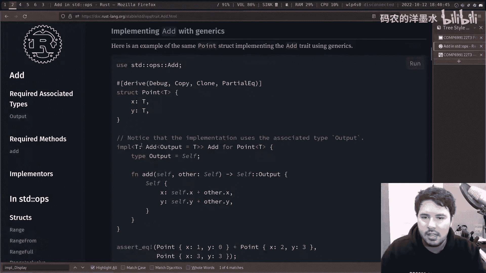

And note that you can also if you're if this block here looks a little intimidating。

 you can of course， do the the where syntax。

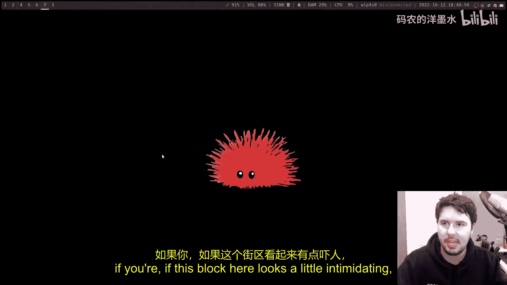

So instead of writing Iple T add output T here。You can say Iple T add for point T and then use the where syntax down here like it was a function where T can be added together to create an output of T going I don't know what addd is。

 Yeah， I can help you with that。 use add and it's going to be like。

 I don't know what point is and I' go fine。 I'll grab that here。And now it should be happy， probably。

 Yeah， yeah， it's happy enough。And what else I can hear is as sort of like a。

Right hand side is tea here as well， which it's。呃嗯。Whatever that's fine。UAnyway， regardless。

So this is a very， this is a very nice generic implementation for us to poke about at， which is yeah。

 pretty cool。😊，Okay。

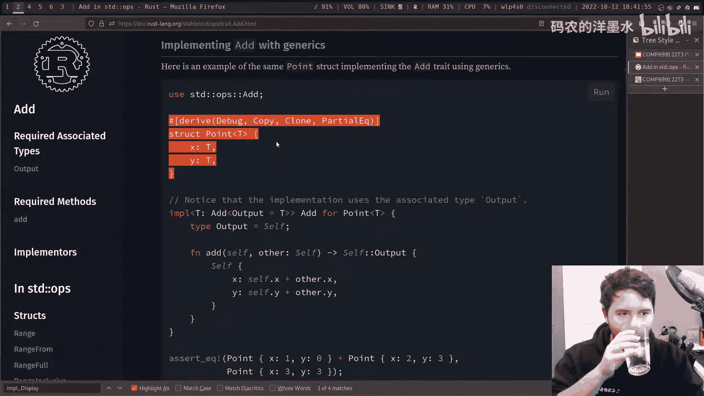

So any other particularly interesting things to poke at。

Default we looked at in the other lecture as well， defining some sort of nice default for a type。

 which is occasionally useful， all these different conversion traits from into try from try into those are nice ones to look at there's also some more complex traits here that are like you know as ref borrow to owned。

 they can be a little confusing and look like they're。😊。

Like the same thing a lot of the time and they're they're more about like nuanced borrowing and ownership rules and。

Help make code easier to write but。We're not really expecting you to touch to these ones so much from St is a cool trait lets you sort of define how you may construct one of your type from a string and if you've ever use dot pars。

 that's how that worked。

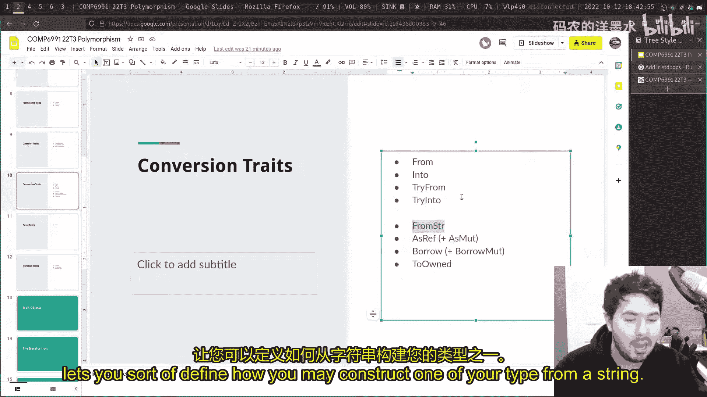

Right， if you had like， if you have。The string 42 dot pars into like an integer。

That's working through the tri the sorry the the from stir trait， which is pretty cool。

 So you define there would be an implementation。 It's like Iple from stir for I 32。

And it has some code that basically converts a string into an I32。

And that's how dot pars works as well， which is pretty cool。

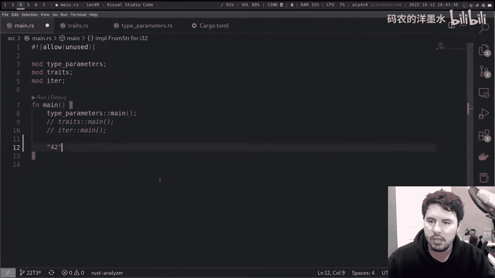

And。The error trait as well， I love this is a great slide， error traits error。😊。

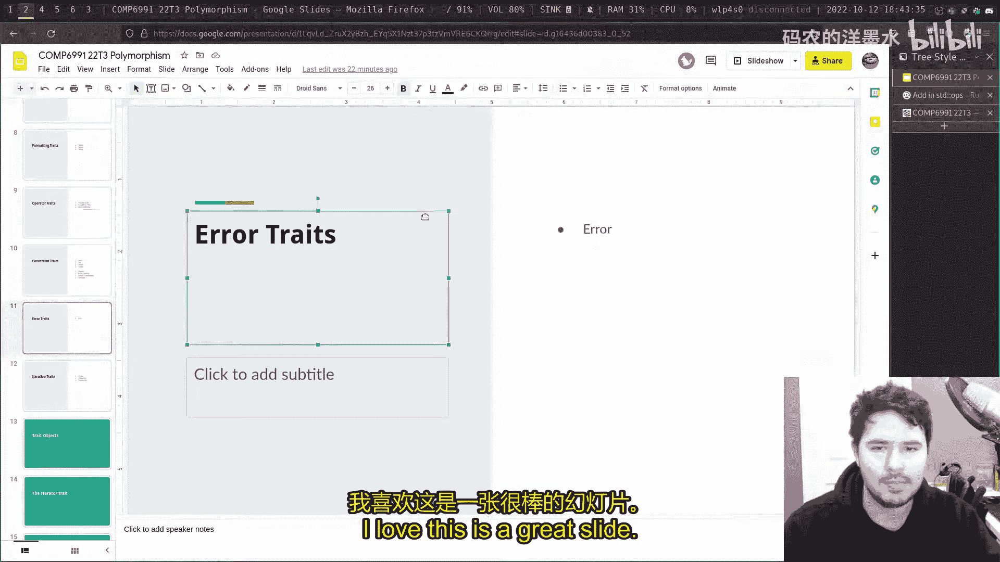

嗯。Errra is a important trait。Where are we traits arrow， there we go， stood  error arrow。And this has。

 these are all default implementations， which is also quite interesting。

 so you can implement error as long as your type implements debug and display。

 then you can implement error of your type。嗯。And this is sort of like this overarching thing。

 If you have a type that's you're sort of using to denote some kind of error。

 it's a good idea to probably implement error for that type。

 especially since you don't even need to do anything。Like in order to do it。

 you could just do empty braces and leave all the defaults as they are。

Super error is there is their example， I suppose。 And you can see here that they have like。

 they have a， they only implement one of these functions here， the source function。

Where it's basically saying， hey， is this is the error like that's the actual like problem。

 which is kind of interesting。

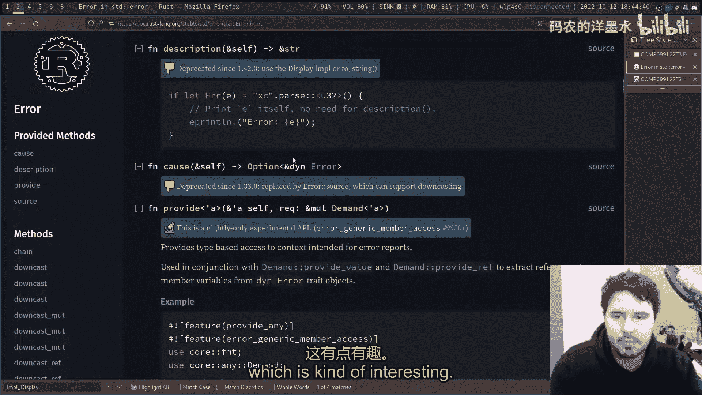

But yeah， the error trait to sort of。Generally talk about errors。

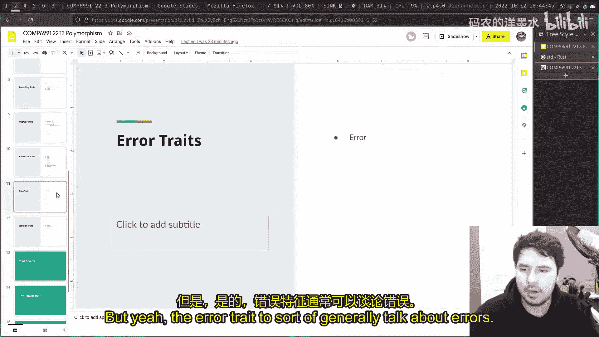

And then iteration traits as well， iterator into iterator and from iterator。

 so the really important trait here is iterator。😊，An iterator defines two important things。

 Why is next not showing up in the docks here， That's weird， I guessca there's so many functions。

 it just like collapse them all。 but iterator has two required things。

You can implement iterator for some type， but you need to define what is the type of the thing that the iterator spits out right so if you have like a V of strings and you sayve dot into iter。

 then it'll give you back an iterator that produces you know item here is equal to string and you don't define a function that says give me the next item and if there's no item just give me back none like if you reach the end of iteration。

So this is a really important core trait in rust。 And you can see there's all these different functions。

 all sort of。Defaultly implemented on iterators that help you do things like you know， dot filter。

 dot map， dot skip， dot take， dot collect， dot whatever I'm just reading out random functions at this point。

嗯。And and then a couple traits that sort of define that your type can be turned can produce an iterator。

 let's say， so for example， we have the inter iterator trait here。

And a V will implement into iterator because it can be iterated。 like you can， you can。

 if you have a Vec， you can create an iterator out of that v that you can then iterate over。And this。

 this actually exists in like most modern languages， you know， your Javas of the world。

 I think Java calls this iterable and like it has a distinction of iterable and iterator。And。

I'm guessing the cool thing is that with all the all the ones other than next automatically infentia。

 but you can find them yourself to potentially make it more efficient。 Yes， absolutely very。

 very wisely noted。😊，And so， but yeah， initator， something that's quite interesting about initator as well。

 is that often people will implement initator like three times。

 So notice here for in the case of Vec， it's implemented for a shared borrowor of Vc。

 a exclusive borrowor of a Vec and also for a Vec itself。😊。

And what's the difference between all these implementations wells if you own the VC itself。

 then the iterator that it creates will spit out owned Ts。😊，If you have an exclusive borrow on a V。

The thing it spits out will be exclusive bors of Ts and if you only have a shared bar of a V。

 the items it spits out will be shared bors of Ts。😊。

And the the actual iteratorstructs that it produces different things here。

 it it mute and into it over here， which are slice iterators and then a Vc iterator over here。

 We'll look at writing our own iterator across a V at the end of the lecture， which is pretty cool。

You can only do hash drive if all functions in a trait is implemented， right， Not quite。

 I don't think I think that's quite the way I put it， because。So in the case of error。

 oh there it was， I couldn't say it before error， you can just sort of do like I error for my type here and then just do empty braces like open brace closed brace。

😊，Oh， sorry， right。 yeah， I think Srey might be finding the misunderstanding here in the all fields in a struct。

 So this is an important idea where I did like hash drive clone on my struct but that's not gonna work if I have something a field in here that doesn't implement clone because clone needs to go through and clone the way it spits out the implementations by clonening all the all the inside fields So I might have a struct food here that doesn't implement clone and then the implementation of of clone will not work because it goes hey。

 I don't know how to clone a food。😊，Even though maybe you full well could imp clone yourself。

And you might have to do that function， clone， self， cell。So。X is self dot x Y is Seta y。

 Z is Seta z。t clone。And then you could write something likefo is just create a newfo。

 And so there are cases where maybe you might be able to implement clone yourself。

 but the derived macro is not smart enough to figure it out for you。😊。

And that might be sort of the way you're going down there。嗯。

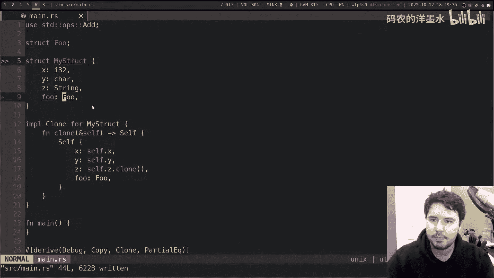

Cool， anyway， So there's also from iterator。 if you've used dot collect， that's basically， you know。

 you're in iterator land， you've done a bunch of stuff。

 and now you want to put it back into a collection from from iterator ends up allowing that dot collect method to be called at the end of your big iteration chain。

 So in fact， if we go back to itator for a second and we go to collect the function。 oops， collect。

 you'll find that collect will collect into some collection they call B， I suppose。

 any collection B is happy to collect into as long as B implements from iterator for this kind of item。

😊。

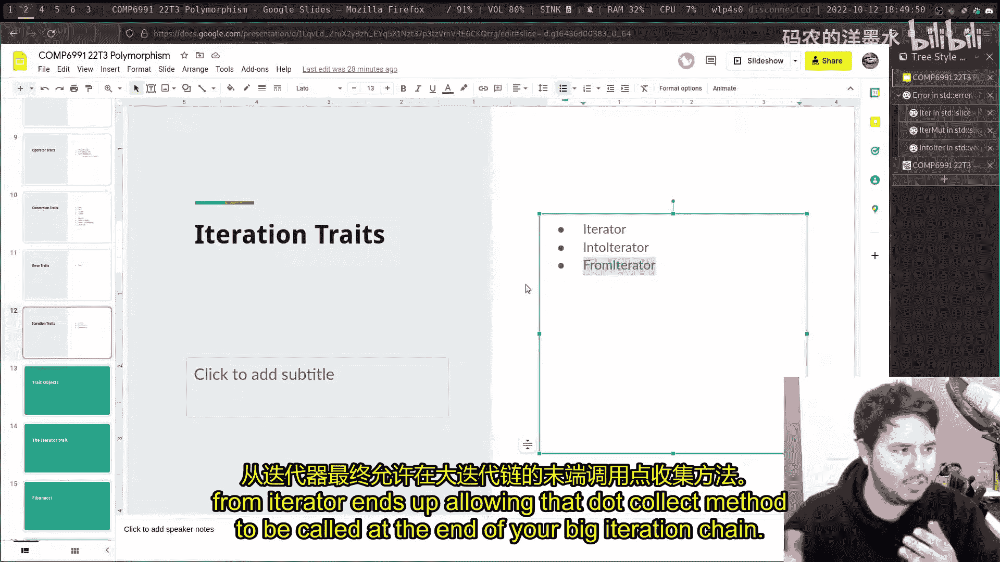

So there would be an implementation of from iterator。For say， a V。For say ave， avec， avec for ave。

Where a V can you can create a V T from any from iterator of T， there's no requirements on T here。

 but say a hash set if you wanted to collect your items into a hash set。

 there is a requirement that you can hash and check for equality。

 the T's that you're putting in there because that's sort of like a requirement for a hash set to work is that you need to be able to hash the T's that you put in and compare them for equality if there's some sort of hash collision。

 so that's also quite interesting a Vec you know supports any T's。

 a hashet you can collect into only if the T supports you know equality and hashing。Um。

 and similar things for like， you know， binary tree sets and stuff where it u needs to implement ad。

 like a strict ordering and that sort of stuff。Um，Yeah。

 or you can collect a whole bunch of chas into a string， you know， all kinds of fun stuff naturally。

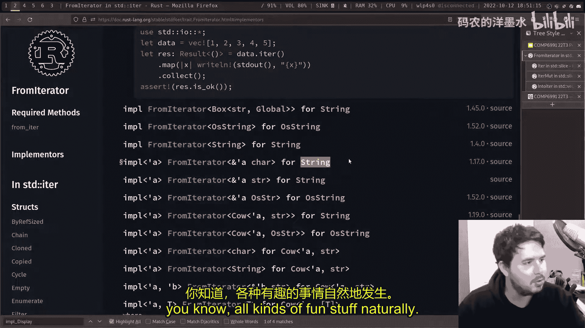

Cool， so I think that's our sort of standard library tour of a whole bunch of common traits that you're likely to run into。

😊，Focus， focus your bloody camera。nerir。Okay， there we go。

 I don't know what's wrong with the thing sometimes。Probably the lighting actually。

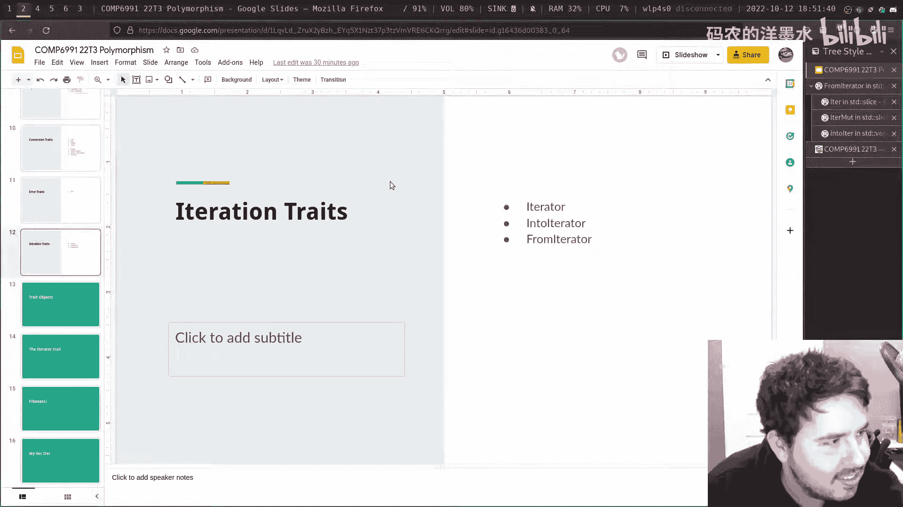

Yeah， we'll do that。All right。So now we get to play them with some traits ourselves。

And this traits example that we've got here。So， traits。Ha look， the animals have come out。

We've got a sheep and a cow， two different trucks here。And again， naturally。

 if you have any questions， oh I missed also Ka saying。

 so you if you can do derive it the same thing as doing imp for for empty braces， yeah， not quite。

 it's more like the standard library has defined a macro。😊，Like some code that can take in。

 say a structure an E or whatever and spit out a imp trait for that type。That， that。

They sort of write the code for that implementation as code。Automatically for you。

 as opposed to traits that have no required fields， They're not necessarily derivable。

 The derived macro would be very easy for it。 It just be imp trade for type empty braces。

 but also you could just write that line of code yourself。 I don't think like in particular， error。

 error is a trait that has。

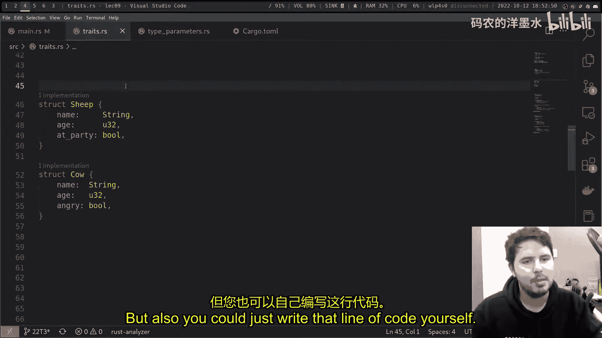

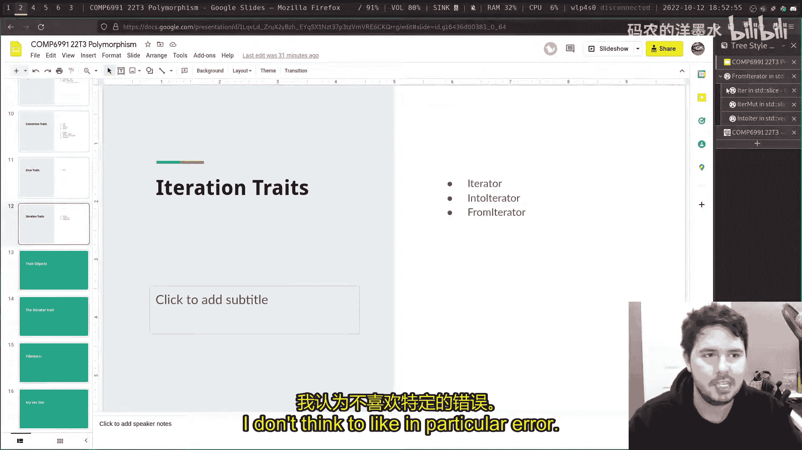

No that has no required functions， but I don't think there's a derived macro for error because you're expected to just do simpleple error for type empty braces。

 macros。All them but the yeah， the bloody derived macros don't show up in here。嗯。

Is there any way I can， I guess I can just。Do it by testing hash， derive error。I don't think yeah。

 there's no error derived macro， for example， anyway。嗯。😊，So on our trace example here。

 I have a sheep and I have a cow。 No crab。 Yeah， actually， that's a good point。 Well， I apologize。

 but sheep and cow is what we've got。And you'll notice that they have different properties。

 So they both have a name and they both both have an age。 you know。

 every sheep in every cow has a name in an age， but they each have their own sort of like differentiating fields that I've put in here。

 A sheep in particular。's it's important to know whether the sheep is currently attending a party or not right。

 true or false， false。 They're not at a party true， They're currently at a party And a cow。

 it's important to know whether the cow's angry or not。 right， angryry cow or。Non angry cow。

 maybe we can consider that to be happy cow， but I suppose a neutral cow might also fall into that category。

And so I've got， I've got some different animals， and they've got different properties。

 But I'd like to be able to sort of talk about the idea of an animal more generally， right， like。

This is， you know what I've written here is all well and good。

But there's no real relation between sheep and cows that I might actually I。

 I might want to sort of make take advantage of to be able to use them sort of in the same。

Almost in like the same idea in my code， right？So I might want to write a trait to unify these kinds of types。

So in this case， I've written a trait animal。And the trait defines a few functions that must be implemented。

 It defines a name right if you if you ask for the name of the animal。

 you've got to spit out a string， if you ask for the age of an animal。

 then it gives you use32 you also must define a function speak which should spit out a string。

Which is you know how the animal speaks。 it says something。

 and then a slightly more complicated function here called say hello to。Which you define。

 you have to implement on your particular animal， such that if it takes in another animal。

 right here a。Where A is some animal， then its out a it spits out a greeting from like one animal to another。

Right so。😊，Like our， if I implement animal for sheep。

 then I need to be able to define these three things here。

 And also how a sheep would say hello to any other animal。A， in this case。

 and it might want to sort of use the information about this animal here in order to to figure out how it would say hello to it or not。

嗯。So I've got some I've got some animals up the top here in Maine。 So let Shan equals a sheep。

 which has the name Sha， itss ages4， and it is in fact， currently at a party。And we have Betsy。

 which is a cow with the name Betsy。It's 10 years old and it is Betsy is currently not angry。😊，Right。

 and then I tell Maine to make Sha speak， make Betsy speak。

 and then you can see here how that say hello2 function is working。 Sean say hello to Betsy， Betsy。

 say hello to Sean。😊，Okay， so。How might I implement the animal trait on these animals。

 Well I've got a couple of implementations down here。And let's， let's take them slowly， I suppose。

 So you see here， I've written Iple animal for sheep。

So the first function requires the name which produces a string。

And you'll notice so I've just done self。t name。t clone here Note that we only have borrowed access to self。

 so I wouldn't just be able to say self dot name because I can't move out of self dot name which is behind the shared borrowough。

So instead I'll just clone it here， this function could very much probably just return a ref stir like I could define this trait to instead of spi out a string spit out a ref stir。

Which is， you know， borrowed against self， but。In the name of simplicity and I' have to think about like live or borroworrows or anything like that。

 whatever， we'll just clone it， it'll work。Next up we have give the age。

 that's a copy type that's very easy， just self。t age。😊，And then we have the function speak。

 and you'll notice that a sheep can have specific behavior based on whether it's at a party or not。😊。

Right， because we're implementing this for a sheep。 So we know the properties of that sheep。

 in particular， we can say if it's at a party， this sheep can say bars， spas， spots and has an emoji。

 which it somehow communicates。Verly， I suppose， whereas if it's not at the party。

 I'm assuming it's just gonna go bah， right， A top tiered， cheap impression naturally。

And so we can have sort of behavior that's predicated on upon the fact that this is a sheep。

And then to say hello to another animal， right to say hello to any animal A， right。

 we have a shared bo our and a shared boer of that other animal。😊，Where a is some animal。

 and we say if we're at a party， the sheep will say， how's the barti， Yes。

 and it also puts in the other animal's name here。 So it asks the other animal how the party is once again。

 conveying these emojis verbally， I suppose。😊，Um， whereasas if it's not of the party。

 it just says bar to you with the animal's name。😊，Right， did Tom write these funds。 No part。

 this was。Part may in part my partner。Coming up with these， these horrible things here。 So naturally。

 we also have an implementation of animal for cow down here。 So you have self named clone。

 self at age。 So notice that these are， you know， pretty similar because they have pretty similar properties。

😊，I guess this is less fun。 Maybe the the， the cow1。 If the cow is angry， just goes mo。

 whereasas if it's not angry at the time， it's， you know。

 it's like a normal cow mo as opposed to angry cow moo。 And then to say hello to another animal。

 if it's angry， it goes moo you other animal。 But if it's not angry。

 it says mooo with the other animal。 and it also。😊，Verly manages to communicate this one here。

 So there's all our implementations。Right， a cow is now an animal， according to this。😊。

And a sheep is now an animal， according to this。 And so。And so now we're ready for some action。

 right？😊，So since they're an animal we can call these trait methods on these sort of concrete objects here like this concrete sheet。

 this concrete cow， I can now say speak， speak， say hello to say hello to。

 even though the struct itself doesn't implement these functions the traits that it implements does and so I can call those functions note something interesting is that it is important that in order to call the methods。

 these methods sort of have been defined by this these trait implementations down here。

 which are implementing this trait animal。😊，In order to be able to call these methods on the type。😡。

The trait itself also needs to be in scope。😡，So what do I mean by that。

 I mean that if this trait animal was defined in a separate module， a separate file。

 an entirely separate crate， anything like that， so let's say I'm going to call it mod animal trait here。

😊，And let's say we have the trait in here and let's say we have the trait and the trait implementations the trait implementations don't need to be in here to be clear。

 but I'm doing it to make the scoping a little easier for myself in this example。

 you'll notice that if these right if all of these are in a separate module here。

 it no longer knows what these functions are because it doesn't like see the functions having been defined by this trait animal。

 which also I'm going to need to sort of make public to the trait， I suppose。😊。

It also doesn't know what sheep is， so I need to tell it to use a cow and a sheep。

Which is funny as well。And so the easy fix for this is just bring that trade into scope。

 use animal trait animal And as soon as it knows that trade exists like you've just brought that trade into scope。

 then it has no problems calling this methods note that this use could be really anywhere that's visible from wherever the code path is so I could put it it's pretty usual to put it up here something like that and again these functions become available to you The compiler is usually pretty good at guiding you through this kind of stuff if you get lost or confused。

 it'll say， hey， I can't find this function but I did actually find it I just you know you need to do this for me in order for me to do that for you and all that。

😊，And so we can speak， speak， say hello to， say hello to， so let's double check this actually works。

😊，Cgo run。So the Sean says hello and Betsy says hello。 And then Sean says， how's the party。

 Betsy And Betsy says Mooo。Which is naturally just fantastic。U and yeah。

 so we've got our first little bit of， you know， using traits here。😊。

Now we're going to do a whole bunch more with these traits over the next you know half hour or so。

 but I think it's a good time to take a quick break。 It's three minutes past。

 let's come back at seven past the hour we'll play around with these traits we'll play around with something called trait objects and then we'll do this these cool sort of it like using the iterator trait as well in a little bit。

 we'll come back at seven past and we'll continue on。😊。

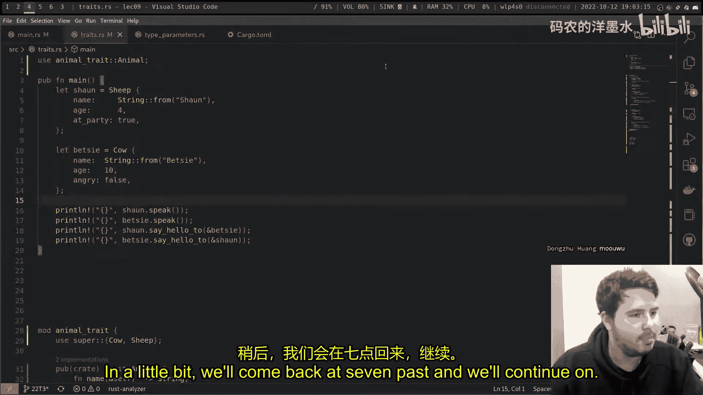

Come see you all soon。All right， and welcome back。

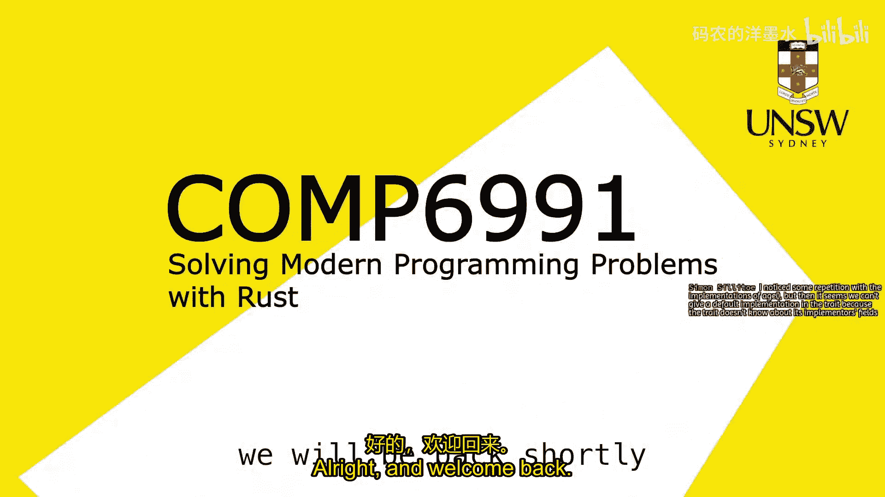

Here we go。 So let me see what the chat's just saying。

How does a trade definition usually handle not knowing about the other objects。

 I had to avoid use super cow sheep。So this is just because because we've named sheep here and named cow here。

 it doesn't know like Iple animal for sheep， what's a sheep？

So I just had to use this used thing here because it's in a separate module often you'll define。

 like notice thestructs were defined outside the module over here。

Usually it's pretty common to define your trade implementations and you're struck right next to each other。

 so you don't need to do this like use， you know， to import， I suppose the。The， the things。

 thestruct you're implementing on and stuff like that for， for， for the most part。

 But sometimes you might want to define your own trait like animal and say， you know。

 something strange like imp animal for some completely foreign type， like Vec， I don't know。

 Like apparently a vck of whatever is， is is a valid implementation of an animal。

 And you might need to pull in that foreign type with with an import statement if it's not。

Sort of like a default import of the language。But it's not something you usually run into and it's just because you're naming the type over here and so it just needs to know what that type is。

😊，I suppose since I made the point about。About the trait needing to be the trait definition needing to be in scope。

We can get rid of all that code as well now， and。And things are just fine again with no users or anything like that。

I noticed some repetition with the implementations of age。

 but then it seems we can't give a default implementation of the trait because the trait doesn't know about its implement as fields。

 Yes， so absolutely correct that any around that or is it just a trade off we have to accept。😊，Hm。

It's an easy way around that is not necessarily coming to me immediately。嗯。Usually， it's。Yeah。

 nothing， nothing super obvious immediately， to be honest。But yeah。

 it's it's it's an interesting point that you bring up regardless。

 regardless of there maybe not being obvious， an obvious， easy way around it necessarily。Yeah。Okay。

 so。To keep moving， we've used these concrete types。Over here。 and then we've called methods on them。

 And since we've defined our own trait here， we can also use this trait in generic in generic type parameters。

 So we could say， for example。Define astruct。Best friends struck best friends that takes in two different types of animal。

 An 1 and animal 2。And animal 1， I suppose。And animal two keeps them as fields like this。

And then simply define functions。For any animal one and An two， on best friends of An one An2。

Toef find functions to do common things， like， for example。We do like function， both great。Right。

 a bar of self。They both great or a function。 say hello to each other。Right。

It also produces a string， and we could write code that does something like this。 Now。

 sign is going to go wrong， which is going to be fun。

 If you've spotted it already that I'm I'm very proud of you。😊，So we might do something like。

 we're gonna need to sort of join the greetings together。 I suppose。

 I guess we can do something like a。Format this new line that and self dot animal 1 dot speak。

 as we've seen down here， self animal 1 speak and self animal 2 dot speak。

And this is going to lead us to an error。 and I'm not going to show the error message。

 is Why are we getting an error an error in our function definition here。

Any anyoneone want to take a stab， why is this here causing an error where it's causing that error and I'm being very mean and not even showing you the error message？

Lifetimes， maybe。It mightight be a little too deep in the source。If we're thinking about lifetimes。

 right， A1 and A2 are just any types。😊，Right， A 1， A2， A1， A2， A1， A2。

 never did we specify any kind of restriction on what a1 or A2 could be。

 So like speak is no method name speak found for T parameter a 1。And the compiler is so smart。

 The following trade defines and I speak。 Perhaps you need to restrict the type parameter a1 with it Call an animal like。

😊，Rust is turkey。 Ru， you know， Ru is a difficult language， but the compiler。

 like what other compiler is smart enough to tell you like。Oh， I think I get what you mean here。

 And like you might want to throw， say that like these are animals here like that， that's。

Something that I really like about the， you know， something that really cool about the the rust compiler。

 And so we'll specify those restrictions。 So where a1 is an animal and a2 is an animal as well。😊。

And now this function is perfectly happy， so fortunately no lifetimes having been run into focus camera okay？

😊，嗯。Cool， so that's pretty awesome。 Now we could also。

 there's two different places we could have specified these， these。😊，Type restrictions here。

 these type bounds。Oh I， I guess if I'm gonna have Im going there and have to do it here as well。

 I could have specified them on the struct or just on this implementation and there's genuinely a fair argument in both cases here for what might be the best the rust。

😊，Community in general opts to not specify the restrictions on thestruct。

 but only specify the restrictions sort of where they're required。There's。

 there's a few arguments to this， a few different perspectives and。

Some of a portion of the perspective is just like is like it makes writing code easier because if you do it up here。

 then there's annoying things you have to think about that you don't necessarily have to if you just do it down here。

 but it's a pretty long winded discussion So if anyone's interested in sort of putting it here versus putting it on the struck definition ask a question on the forum and I'm happy to。

rite up a big post all about it and link to some interesting stuff。

 But I'm gonna just sort of specify the restriction down here。

 And we should see like you can create a best friend struct with any two types。

 You could say a 1 is an I 32， and you could say A 2 as a string， right。

 But you're not gonna be able to call both greet and say hello to each other unless both those types are animals。

 So that's all the restrictions we placing on this。And then naturally。

 we can write this code down here as well， where it says hello to animal self animal 2。

And this will say hello to self dot animal 1 like that。And ta， so now we could simply say。

 let best friends equals best friends where animal 1 is shn the sheep。Like this。 And An 2。Is。Betsy。

 the cow。 Betsy， the cow。Like that。 and then simply。Priinntlin printlin of。Best friends dot。 say。

 what do they call it。 Bestest friends dot both great。

Best friends dot both great and best's friends dot say hello to each other。 and in theory。

This does the same thing。Right， so now we've managed to write some code。

 which is generic over this animal trait that we created。😊，That maybe does some interesting stuff。

 So that's great。 We've got some best friends happening here。😊，So。That's pretty handy。However。

 there's there is we're about to run into， we're about to run into a pain of rust， a pain of rust。

 which is。And this is a very natural thing to want to want。 What if I want a vck of animals。Right。

Now， how would you sort of like type that out well。

There are some different ways you could say you might go， okay， I know how to do this。

 let's say I want a function that's like all animals greet。😊，Like this。

And we're going to take a An is a Vck。Of， well， you know， let's say a V of a。

Where a is some type that we're specifying here。Say this goes to a string where a here is animal。

Why did it put the braces there。 Great。 And we say four animals in animals。😊，Animal dot speak。

 or okay， fine。 Let's just， let's just make this not return a string and we'll just printline it instead just to make our example here a little easier。

Animals speak。Like that。And I suppose this could be， this doesn't necessarily need to be a V。

 It could be a borrow of a V， and that could then be a slice as we've learnedt in all this。

 but whatever I'm just gonna to leave it as a Vec for now。All animals great。Now， does this work。

 Is it going to do what we want？ Well， let's try it out。Let me say let。

I guess we'll just do it above here。 Let my V equals V bang of。Let's just do a couple sheep。

 let's do three sheep， Sha， Migwell and Alex， I hope you're okay with being sheep for I't okay。

 I didn't mean that， but like I hope you don't mind sort of being being part of part of the barnyard here I suppose for our examples。

 and we're going to say call the all animals greet function with my deck of animals。😊，Now。

Does this work？Yes， it does， that seems to work， they're all sort of happy enjoying themselves at the party。

😊，But let's say。Sn is no longer a sheep。 I don't know if either of you really want to be a cow。

 So I guess we'll change Sha。 Shan is no longer a sheep。 Shan is gonna be a cow。And Sean Sean。

 unfortunately， is not angry at this time。Now we run into a problem。 Oh， no。

 we've got error messages。This was meant to just work， you know。

 it was all meant to be great and notice that this v here can really just be thrown in line here as well。

😊，Without the semitolon naturally。And it's no good。

Is there any reason why you need to give the form string even if you're Bruce a single thing for printlin。

 this is sort of rust's defense against format string vulnerabilities Fortunatelyly does all the formatting at compile time。

😊，You could reasonably suggest that if the printlin macros see something that's not a string as the first thing。

 it just prints that thing as a string， but they chose to not do that to make it very clear that this is formatting and that it's not something that might be vulnerable to format string injection which is a whole sort of thing and see that's a little out of scope for right now but perfectly welcome on the forum naturally。

 so this doesn't work。Can anyone suggest？Why this might not work。嗯。Vck of animal， right。

 So this is like this is not quite an answer to the question。 Like， sorry。

 like the way I've structured this is a little misleading。

 But I think writing it this way is gonna potentially help explain why this doesn't work。

 even though if you're， if you're advanced for person。 You might go。

 he's not explaining the actuaary。 He's explaining a step further along， but。Anyway。

 I I think this will， I think this will work best。 But yeah， Vc doesn't like different types。

 Vc did same type， blah， blah，lah， great。 So the idea here is that this a is sort of is a generic type parameter that represents some type。

 And we know that that type must implement animal。😊，And we take a V of that a。

 but at the end of the day， a will be instantd to be some actual concrete type。

 and so once it's instantd to that， let's say cow is first thing here。

 then really what we're asking for is a V of cows and remember it's going to generate one function for each type it's called with。

😊，It's not just magically going to handle having Vex of all different kind of A's right。

 we'd almost need like A1， A2， A3， A4 and so on like if you knew how many animals you had in advance you could make something like this work。

😊，Potentially with something like a top or a whole bunch of arguments。

But if you want some arbitrary amount of animals， this simply isn't going to work because a is sort of is just。

Generally going to be one type。So。And Vec needs to know it can't have a v of traits so this is。

Note that this is not yet a v of traits。 And that's the important thing here。

 What we kind of want is a v of traits。 But instead we have a v of this type A。

 which is going to be like whatever like the rustk compile will figure that out when the function is called。

 and that a is just one type。 So we really want a v of animal。

But a v of animal is not going to quite work straight away either， Vck of animal like this right。

 save the file， Does it work。😊，No， almost， you know， oh， there's only one tiny little error。

 Maybe it's not so bad。 It says trait objects must include the DYN keyword Din。

 Add diin keyword before the straight。 You can call it Dn。 You can call it Dne， I don't care。

 It's fine。 That was Doctor Seuss around there， But it stands for dynamic。 which is。

 you know where the DYN comes from here， But it goes， okay， just throw din before it。 Okay。😊。

Din animal， Okay， thearrow got bigger。 It's got a the size for values of type den animal also plustictatic here。

 That's a whole another thing that we're not going worry about for now cannot be known at compilation time。

 blah， blah， blah。😊，So what's this complaining about？

The thing that it's complaining about now is that you have a vck of these。

Animal these animal trait objects here right， this is where you get into this object terminology here。

 trait object。😊，And conceptually， this is a vck of any kind of struct where that struct implements the animal trait。

 So in our case， we only have， we only have。Where are they， Where they go。

 We only have sheeps and cows， right， But presumably we could also have other things here。

 like we could have struck crab， as someone mentioned earlier。 And maybe a crab doesn't have a name。

 right， All crabs are are implied to have the， the name Ferris and a crab just has an A G 32。

And so you might go implement implement animal for crab。

And their name is always just string from Ferris and their age is self do age and they speak all they say is。

呃。I don't know， crab noises and to say hello to， they just go。Format， they say something like。

Att tax law with。With claws。Animal dot name， something like that。

 so it attacks the other animal with its crab claws， right？😊。

The interesting thing that's happened now is not all animals have the same size or the same layout or anything like that。

 But importantly， not the same size。 This here has a string， a U 32 a bull。

 This has a string U 32 a bull， even though they're like different types。

 these end up probably having the same size， but a crab is a completely different size。 and Vex。

 right， most things in rust， ge， Most things in rust really care about their size。 right。

 in the case of a Vec。 The way it works is it has a pointer into this sort of allocation here where we have。

 you know， like， let's say it's just numbers 1，2，3，4，5，6，7。😊，Right。

Where each of these numbers is a fixed size。 So let's say they're each like four bytes or something like that。

 And if I say Vec， I want like the third element， well it's going to go well here's where it starts off right here and I need to go three times four bytes across right I suppose that's probably here。

😊，And it'll get you to the the element that you're looking for。 But if we now have like cow， cow。

 sheep。Sheep， crab。Cow crab， like suddenly this starts breaking a whole lot of the stuff that's sort of important in rust and that these can all have potentially different sizes。

whereasas rust very often really cares what the size of a certain type is。Right。

 and so then Simon comes across with an idea。How about instead of doing din animal here。

 Because this is not sized and Veck is saying， hey， this the thing that you want me to be a Vck of。

 Why is it not give me the error。 Here we go， The thing that you want me to hold in the Vec。

 I need to know what the size is。 And basically any time you write。

 You know there's an implicit thing here， which we sort of ignore a little earlier。

 whenever I introduce a new type parameter here， a1 a2， something like that。

 the compiler always says it explicitly says that a1 and a2 must be sized， Sorry。

 implicitly rather inserts code that looks like this for you。

 there requires that basically any time you're dealing with any kind of random type parameter It goes。

 I'm going to assume you want to know the size of that thing。

 So if you don't know the size of the thing， it's really hard to do anything with it in rust。

 which is the exact problem we're running into here。 So Simon mentions， well， a box。

 a box ends up just being like a pointer， know， is just a pointer into the thing that you want。😊。

You'll be able to still use that thing you want， but a box has a known fixed size。

 A box is always going to be just give me two seconds here。呃。Okay， I think it's fine。

Can you can you hear and see me and stuff now？Stream health， St is healthy。That's so weird。 I got。

 literally， I got a call and it goes， let me just switch that internet off。Good now。 Yeah， okay。

 that's a， that's a fun moment。I apologize for that。

 I will pray that no one else calls me because I don't think I can just turn off calls without also turning off my data。

So that's really， I'm glad I know that now anyway， so the idea was。😊，A box is a fixed size， right？

Yeah， don't doss lectures， please。😊，A box is always a fixed size， it's just going to be one pointer。

 and so maybe a V is happy to hold a box of something that it doesn't know the size of。😊。

And the other thing that's important here is if you look at box。

 the definition of a box says that a box can hold some tea here， right。

 the type that the box contains。 And it explicitly says that that tea doesn't necessarily need to be sized。

It can have like an unknown size and I'll keep track of that size， you know。

 so that's no worries there。嗯。So that seems good。 And the errors gotten smaller again。

 And now we get to this really sort of painful bit here。 The trait an cannot be made into an object。

 And this is one of the most the biggest thing you're going to the biggest problem you'll face with traits in general。

 So here's a nice like tip， Simon was absolutely right。

 I think it was Simon that said Ive got to scroll off in the chat now because of all the Fs。 Yes。

 Simon was absolutely right。 in that when you're using like di trait。

 you almost always wanted behind something like a box or or a borrowrow or something like that。

 note that a borrowrow also has the same behavior like a box or it'll， you know。

 it'll do what you want。😊，It'll， it'll take some something that it can。

Point to something that has an unknown size。And and give it like a fixed to size by being a pointer。

And basically the question is， do you want to own it or not。

 Do you want like if you want shared access， then use a shared borroworough of a din animal。

 if you want exclusive access an exclusive bar of a diin animal。

 if you want owned access usually you just say use the T itself。

 That trick no longer really works for us because we don't know the size of it So we just say throw it in a box because a box sort of implies ownership And so that's your sort of if you want the cliff notes on using trait objects。

 then that's sort of the trick for it。 Now the problem here is that animal。

 the way we've defined this trait， animal cannot be turned into a trait object and I can explain why。

But it's a little， it's a little tricky。 So focus in for a couple minutes here。

 I'll explain why animal cant to a trade object。 I'll show you where you can find the rules for trait objects in rust。

 I'll apologize profusely for like you having to think about all these rules because it is a pretty annoying part of rust。

😊，And then we'll fix it and make it work。 So the problem with the trait animal is this function right here。

 say hello to。The reason there's a bunch of things that can stop a trait from being turned into a trait object。

 this function is currently doing it for us， and the reason why is it has this generic type parameter on it to call a。

Now the reason this is a problem is that we know that when we have a generic type parameter。

 the compiler will look for all the different places it where say hello to was called and it'll generate a single function like for each type for each type of animal that it was called on。

嗯。And then when it's， when it finds the types that it's been called with。Yeah。

 it generates that function and then where it was cold from。

 it just callss that function directly now。Right。嗯。

So where does that pose a problem for us with trait objects， well with trait objects。

 you have no idea what animal this is anymore。😡，You have no idea what animal this is anymore at all。

And so， the question is。like。It's tricky to get my wording quite precise here。🤢。

If you don't know what animal。Whatever like this din animal here is。

 And you want to say hello to another animal， right， which is also。

 let's say another din animal in this case， you don't know what either of their types are。

And therefore， like， which say hello to function do you call。

Cause there'll be like a few different versions of say hello， to。 sayy hello to cow。

 sayy hello to sheep， say hello to crab， that kind of thing。 But if you have two animals， right。

 and you don't know the type of either of them。You don't know which。 say hello to function to call。

And so one of the rules basically this is a blanket rule。

 which they're working on reducing their restrictions on trade objects。

 but it's something that's going to certainly take a long time is。So in our case。

 if you have a generic type parameter on a function in a trait。😊，Can't be a trait object。

Now you have two options from this point forward or sorry。

 you have a few options really here's here's a couple that I can point out。

 Let's say you want you want to make this functions work for the trade objects。

 you really care about saying hello to with an animal that you don't know the type of The solution there is exactly what Dong said make the function use trait objects as well。

 as opposed to using these generic type parameters， right。

 they mostly achieve similar ideas generic type parameters and trade objects。

 but generic type parameters monomorphically， as we know。

 where it creates these functions at compile time， whereas trade objects。😊。

Don't know the type until runtime， like as the program's running it works more like a language like Java or C++ or whatever。

😡，嗯。So呃。So we can change this so instead of using a generic type parameter like this。

 it simply takes in a refft di animal like this。😊，Right。

 our trait implementations are now going to probably be wrong because they're still used to this old format here。

 refft in animal。A animal。Third， get rid of the A here。And this one here for the crab as well。

The animal。Like that。 And then up here， the only area that we've got at this point。 Like。

 you see this function is now happy。 All it's saying is that， hey， you gave me a cow。

 but I needed a box in animal。 Oh， yeah。 Like， I forgot the box， right。 So you just throw a box new。

😊，Around this cow。And then， similarly， you throw。B new。Around the sheep。And。It all works。All right。

 let's see if the animal is all great。M butts， bot， buts。 Yeah， that seems right。And just like， yeah。

 So this is now the the animals are all greeting。 So that's one option is convert the function in the trait such that it doesn't have that restriction and say it uses a trait object and everything's okay。

 again， cow in a box。 Yes， cow in a box。 Now， another option is you might go。 Well， like this say。

 hello to function is all good and well。 if I'll go back now to what we had before。 which was here。

 I think that's where I want to leave off。 And it's gonna be saying， hey， yeah。

 this can't be a trait object anymore。 Good。 Maybe what you go is actually。

 like I would like to use a din animal。 I'd like an animal trait object。 But like。😊。

I'm happy to just not include this function in the trade objects， so if you have a Dn animal。

 you'll have access to these three functions here。😊。

But it'll just like forget that this function even exists on a trait object。

 You can still use this if it's not a di animal， if it's just like a cow or a sheep or you know or a some animal as a generic type parameter。

 but just don't include this function in the trait object and and leave it otherwise。

 So there's two ways you can do this。 One is you could move this function into a separate trait。

So you could say for example， trait animals say hello and this requires that you're an animal in the first place potentially that's sort of this it's not quite inheritance。

 it's more like a restriction on the types that can implement this trait here so to implement animal say hello you've got to first make sure you've implemented animal and then just move this trait out to a separate thing。

 implement them all separately and then you only do a boxed di animal in most places and then you do like a animal say hello where you want to use this function outside of trait objects。

That's also a potential solution， but can get a little confusing and a little annoying at times。

 And there is one very special escape hatch in the rust compiler where this is the trick that I generally opt for。

 If I just want to not include this function in the trait object。

 but still leave it there for normal trait parameters， as opposed to like the objects。

 which is in this wear clause， you can add in a self sized this sort of magic incantation here。

 And you'll see this is now working。 of course， we need this whole box business again。

 box new and box new and the closing pres。😊，And this also works just by adding this where self sized。

 The reason this trick tends to work is。Trit objects， as we know， den animal are not sized， right。

 They they， they are， in fact， a trait object is never sized。

 So that's why we always have to put it inside a box or put it behind a borrowrow or something like that。

 right， Since it's never sized， Rust sees this constraint that I put here where self sized and it goes。

 right， You're saying that this should only be included on things that。You know， have a size and it。

😊，Coses to opt the trait object out of this function here。

 So you'll notice that now we can use trade objects。 We can still use。

 say hello to each other when we're not using trait objects。

 when we're just using the monomorphic generic type parameters。But when it's a trade object here。

 you'll notice if I look at the functions available， I have age， I have name， I have speak。

 but say hello to here won't work。 Let's see if it was not gonna to work to say hello to itself。

 but actually maybe it would， but it says here。ay say hello to method cannot be invoked on a trait object right because it has a sized requirement so this is a good thing to know about it's good to know about this escape hatch in the compiler where self sized。

😊，To just like include a function in a trait， but don't include it in a trade object because it might be preventing you from being able to create a trait object。

So where is a list， like a comprehensive list of these rules。

 the answer is you look for rust object safety。😊，These are the object safety。Requirements。

And it an object safe method must meet one of the following conditions。

 and these are the important ones here。Is that you must not have any generic type parameters you can't use like there's a couple of restrictions on things you can use like self here and you know。

 must not use self。If you run into them the compiler will stop you and say here's what's going on If you just want to opt it out。

 then you can just throw that wear self-sized magic sort of wear claws on it and if things are getting really complicated and you're confused you can feel free to ask about trade objects and stuff like that on the course form as well and will help you walk through it but that's our sort of introduction to using things as trade objects and you'll see now that this Vec boxed in animal can hold all different kinds of animals in like one single collection as one single thing。

And that can often be very helpful。 You do pay a runtime cost for this。

 So note that compared to monomorphization， you don't have to generate a whole bunch of all animals great functions。

 there will just be one， which is really handy by using a trade object。

 but it means it's going to be slower at compile time because you have to follow pointers。

 It has to use something called a V table。 There's all kinds of interesting stuff in terms of the implementations if you're interested in it。

 but there's you know those are the rough tradeoffs that you're making there。Okay。Trade objects。

 That is basically everything I wanted to talk about in terms of these traits here。

 Our last thing in the lecture is just going to be implementing the iterator trait for a couple things。

 which will just be， I think mostly quick and fun but we'll pause a little bit for questions about any of this We'll move on with that stuff The stuff at the end I think should be relatively quick。

😊，And， and that'll be it for until that'll be it for， for lelexia Week and stuff。

 So slower at run time will compile time， sorry。 So trait objects are faster at compile times slower at run time。

😊，Generic type parameters are slower at compile time faster when running the program。

Is C++ objects slicing its own way of getting around this since they have inheritance？😊。

I am not entirely sure I've meant a few points in my life to have a big mess around with how C++ deals with all of these problems。

 where Rus at this point has mostly just like thrown its hands up and I'm not well versed enough in the like low level details of how C++ implements like its V tables and its object rules to be able to answer your question confidently。

But if you ask on the forum， you can certainly prompt me or maybe someone who also knows more about C++ to really get into those details and see how it deals with some of these。

 but one thing I will note naturally is that rust is working on trying to reduce the requirements on object safety over time。

 it's just naturally a very difficult it's naturally a very difficult process to work on that。

But it's a great question for sure because C++ doesn't have these kinds of strict requirements as I understand it。

 but of course， they make their own trade offs along the way as well。And object slicing is。

 as Migle saying， object slicing is the issue we're avoiding interesting。Okay。

Any other question is naturally all this code is on GitHub it's under like the LeO9 because it's the same sort of series of lectures I have linked the code on the website to go to this one as well so and I'll push all the changes we've made as well today after the lecture so I'd suggest having a look at this code again and poking around it and you know playing with things。

😊，Yourself and asking lots of questions on the course forum naturally， all that。U。

And you two are having an interesting C plus plus chat that is a little too above my head for me to get in on sadly。

 so， but I'll I'll happily leave you to that。So that was some trade stuff。

Now we're just going to implement a couple traits and I think it's going to be fun。So。😊。

I'd like to implement the iterator trait specifically。

 so iterator as a reminder is a trait that requires you to define two things。

 type the type of the item that the iterator spits out and then a function to get the next thing you know if it exists that's why it returns an option here and then it gives you all these sort of functions for free as default implementations on the trait。

😊，Now， note that the iterator trait is for something that is to be actively iterated on， so。

That's distinct from the intoitrate。 That's distinct from the。Into Eer trait。

 which essentially takes a thing that could realistically be iterated over and actually creates an iterator for it。

 So note that if we have something like Vec of I 32， then Vec gives you things like into Eer。

 which is what the into itator trait is and convenience functions like Eer and it， oops。

 that should be an underscore mute。😊，And each of these functions here gives you back a and this gives you back astruct。

This one is called into ItA， thisstruct here is called Itta。And this struct here is called Ittermute。

 They're just Vex ownstructs， as far as we're concerned。

 And each of these has an actual implementation。 So there's an implementation here， Iple iterator4。

Like， you know， each of these types here， imp iterator for intuittor， imp iterator for iter。

 Iple iterator for it mute， but notably there is not impple iterator for Vec。 Instead。

 there's things like Iple into iterator for Vec and also Iple intu in iterator on a b of a V or an exclusive b of a Vec and stuff like that as we saw earlier。

 So it's a difference between something that could。😊，Realistically be iterated over again。

 languages like Java might call this iterable。And the actual iterator itself。

 the thing that's like where like three elements in and where， you know。

 the next one you can ask me and I'll give it to you and that sort of thing。

So we've got two iterators I'd like to make。 The first one is a Fibonacci iterator。

 which just produces elements of the Fibonacci sequence and then a Vec iterator that lets you iterate over the elements in a Vec。

 I think both of these are interesting for their own reasons and note that the Fibonacci iterator in particular will be infinite。

 There is no realistic and L supposese overflow is maybe overflows a nice end to the iteration。

 but iteration and rust can theoretically be infinite， which is kind of cool as well。😊，嗯。

So I've got some code in main here。Whi says the first 10 terms of the Fibonacci sequence R。

 and then it calls this Fibonacci function here， which is de struct。

 and I intend to implement iterator for the Fibonacci struct here。

 which is Fibonacci struct will basically be our iterator。

 and it says take the first 10 elements of it note to take here is defined by the iterator trait。

Take， take， take， take， take LMNOP， Q R T for take。And it just means like， see if we have array  one。

 two， three here and we're iterating over it。😊，Take2。 It'll only give us the first two things back。

 So just take the first 10 things of the5bon arch sequence。

 Not even says take is often used with an infinite iterator to make it finite。

 So this here 0 dot dot is an infinite iterator。 It'll go 0，1，2，3，4，5 up to， you know。

 until it overflows， I suppose。😊，And so this will restrict it down to just the first three things。

One of the exercise this week is almost DRY Tribonacci generator。 Oh， very cool。

And so we'd like to write this thing。 So the way I'm probably going to write this is I'm going to say。

 well， for a Fibon archci sequence， we're mostly interested in what the current element is and what what the next element is。

 I suppose。😊，When you want to create a new Fibonacci iterator。

What are we going to instantiate these fields with？

Probably we're going to start off with the first element is one and the next element is also one。

Yeah， that seems about right？So the first， you know。

 the the first two elements in the Fibonacci sequence are1，1。 then it goes 2，3，5。

 it just adds like the previous two things together。And we can implement， sorry。

 don't implement a Fibonacci implement iterator or Fibonacci， so it can be iterated over。 Now， again。

 there are two required things to implement here。 And I'll just tell rust analyzer to sort of fill out the structure for me。

 So we need to tell it， what does the Fibonacci iterator produce。 The thing it produces are U 32s。

 right， I defined these things here as U 32s， just like numbers。 There's a few different types。

 this could be a few different number types。 But say something like string would not make sense here。

 really， like。Some kind of number that it produces and then the next function。

 which says you get an exclusive bar on yourself so you can mutate the elements the in the Fibonaccistruct that we have here。

😊，And we need to produce an option of an item。So how would we do that， Well。

 there's a couple things that an narrator really needs to do。

 It needs to be able to produce that item， and it needs to also sort of be able to like move on to the next step。

 right。So the current thing that we're going to spit out is going to be like self dot current。

 That's what we intend to spit out of the iterator。 And so we're sort of ready on that account。

 We might want to do some code here and then give back whatever the current thing we're talking about is。

 but we need to set ourselves up for success in that the next time they call the next function these need to have moved on to sort of the next elements in the sequence。

 So how are we going to do that。 Well， the next， you know， self dot next。😊。

I's probably going to want to be whatever the like whatever the current value is plus itself。

 I suppose。Right， so。TheYeah， how do I how do I say this correctly？Like if this is。

 we start off with one and one， the next element is going to be these two things added together to produce two。

 So we add the two things together and that's going to be the next thing。

 And then the current is going to be need to be whatever the next was。

 So I guess I'm going to just remember this for a second。Next is going to be this stuff here。

Well then say self dot current is equal to。Not next， self dot next。 So current becomes this。

 this one here。Next becomes whatever we calculated。 the next thing should be。

 and then we spit out current at the very end。There's probably a more efficient way to write this in like less lines of code。

 but hopefully this is like relatively clear in that we we， this is like what our current item is。

 This is what the next items should be。 I guess we'll call it next should be this。😊，Then we say。

Now mutate ourselves such that the current thing is whatever our next one was。

 so's going that'll be what's like spit out next time this function is called and next is whatever next should be。

😊，Right， which is just the two things added together。So does this work？😊，1，1，2，3，5，8，13，21，34，55。

So yes， it does。😊，And then maybe we would want to use this to make some sort of like triangle and stuff。

 And because we implemented this as an iterator， it makes it like very easy to do something like that。

 We could say for line in Fibonacci。Take 10 Fibonacci， take 10。dot map。

Whatever the Fiengi number is into， let's say， hash times or dot repeat that number amount of times。

And then this here should spit out like a nice sort of Fibonacci style triangle for us。Right。

 which is kind of cool。😊，And we just sort of get all this stuff for free by doing things as an iterator。

 which is you know， very nice and convenient。😊，And very much demonstrates like the power of iterators。

So anyway， that's implementing sort of like an iterator just based on its own state here。

 sometimes we might want to iterate over something like a V。😊，Right， so let's say we have a function。

 Myve it that we'd like to use like this。 We create a V of 1，2，3，4，5。

 and we call myve it with a borrow。😊，Of the Vck。And we'd like to iterate over it。

 if we're borrowing the V， then the items it spits out should probably be like borrowed elements of that vector。

 So how might we want to do this？ Well， the V iter。

 you know my V iter is meant to return back this V iterstruct here。

 and we want to implement iterator for that V iter。

 So it needs to know that the vector that it's iterating across， So we're gonna have to include that。

 let's say the V we're iterating across is a borrow of a vector of T。

Now that's immediately going to run us into two problems。

 What is T and what is this like what is the lifetime of this borrow So I'll say actually aveter really cares about the type that it's iterating over and it also has this inherent lifetime tick A。

😊，Which is， however long the Vec itself lives so this is essentially putting in code to rust that the Vec iter must live at least as long as the V that it's iterating over。

 so you can't get any scary stuff where you drop the V that's no longer valid memory。

 but we still keep iterating over it， which is definitely possible in some other languages。😊。

So we're putting that into code rust forced us to do that。

 and myveter should theoretically just spit back out thisveter here。Like this， of course。

 naturally we now need to say the T's here， oh， and nicely。

 it's also inferred the lifetimes here for us with lifetime o。

 but you can imagine that this is essentially what it's inferring here。😊。

That there is some lifetime tick A， which is the lifetime of that Vic。

And this lifetime in theveator that's， you know， that's related to it in this way here。

What else there's one other thing that a V editorer needs to know that I need to put here。

 Does anyone want to take a stab at what what other bit of state does this Vec iterator need to keep keep track of in order to iterate across it。

 There's one extra thing that we need here。So we've got the V itself。You know。

 we know the V that we are iterating over。What else do we need to know the end。

 maybe our video frozen？Stream is healthy。 Oh no， maybe I hope。I'm quite hopeful its not my end。

 The element we're up to is probably what I was looking for here。😊，Yeah， the position。

 What element are we currently up to over the iteration。

 We know the end because that's the Vec keeps track of that with the length， right， Vec dot La。

 So that's sort of already included in there， which is nice for us。

 And I'm assuming this is sort of coming from C plus plus where that's very much gonna be the case And did anyone else see anything else？

 No， So yeah And so we need to know which element we're currently looking at。

 And I'm just going do that as a index。😊，Right and index into the back。

And when we create the iterator， what's the index going to start off at probably zero。

 we want to start at the beginning of the back。Now we're ready to implement iterator for Vedo。Right。

 but naturally， what's ave hitta。 I don't know what that is。 Instead。

 it needs to be well simple for any lifetime tick A and any type T iterator for ave itta of the lifetime tick A and that type parameter T。

😊，Okay， then it needs to know the item and how to get the next thing。So what is the item going to be。

 Well， it's not actually going to be a T here because that implies that it's going to be able to spit out owned elements right。

 it's going to like the item you'll get back is the T。 And if we trace this T back。

 that's the T that's owned inside the V。 it's a Vck of strings。

 let's say then that's saying that it'll spit out strings。😊。

But we only had a shared borrow access to the Vec。 So the best we can really do here is a shared borrow of the tea。

 So actually， the item here should be a shared borrow of a T。

 We're gonna spinit up and naturally rust is gonna go pesky rust is gonna go what lifetime， though。

 what lifetime is this tea living for The answer is， well， however， long the V lives for。

 which was tick， which got put into the ti a here， which was the tick there， which is the tick here。

 which is the tick here， which is the tick there， which is the tick here。 This is like。

 I hope at this point， lifetimes are started got starting to get to like a oh。

 I get why it's all over the place here， lifetimes of what rust is using to track like literally to track the lifetime of things。

 It goes， oh tick a there is tick here is ti there is ti is ti there and it sort of tracks it all the way down into like right。

 the lifetime of the item that the Vck it will spit out。

 traces it all the way back to is whatever the lifetime of this。😊。

Vec is So no items sp out from this iterator should live longer than the Vck itself， which is great。

 no use after freeze。 That's exactly how long it should live。😊，啊。

So that's pretty cool Now how do we get the next element？😊，From our V， well。

 I would say like let our current index be self thought index。Right。

 so this is the current index we're up to。And we're gonna to want to go like self dot V， you know。

 get me the current index。 Maybe we'd like to write this as a match。

 So get in particular takes a oops， get in particular takes an index and returns an option of whatever the V holds。

 So I'll say match on this。If we get some item back out， then that's great news。

 spit that item back out if there is no element at all。

 then well then we don't have an element to give back。

 we must have reached the end of the V I suppose， and so we can simply return none back as well。😊。

Right。There is one problem still left here， though， which is that as we've written it。

 it's just going to give the zeroth element， the zeroth element。

 the zeroth element every time it calls next。 And so we're going to have to say self dot index。😊。

You know， plus equals one。 So grab the， remember the current index。

 increase it by one in the iterator， and then。Get the current index in the V。

 And Dong I was hoping someone would notice this notices that like some item and none here， like。

 you know what's going on with this， couldn't this just be a question mark and it absolutely could In fact。

 we could even reduce this all the way just down to this because we return an option of the item of the V and V get returns an option of the item of the V as which Simon notices yes。

 and so you could use it at the end here， but you could also say something like let item equals selfveck get question mark and then give back some item here。

 if it returns if get gives you back none， then it'll return none to the iterator。

 if it returns back some then great， we get the item back out and we can splitit it out here。

 and you might also prefer it to be like this， because then you don't need this current index thingop you just go get me the thing of the current index。

 if you get it increase the index by one and give back some item。

 however you choose to write it is completely up to you Maybe this is actually。😊。

A little better because although they'll behave exactly the same。

 the slightly weird thing is if you reach the end of the V in this sorry。

 in this way of doing things，😊，齐下 here啊。There's this weird thing where the iterator won't return none until it gets to this line And so like the index will keep increasing over and over if you keep asking next next next。

 even though it's just giving you back none none none none none and eventually if you call none if you call next sorry enough times on this iterator this could overflow and panic the application like the index could end up overflowing which is pretty funny so maybe we actually do prefer to write it like。

😊，Oh gosh， I've lost my， I've lost my history here。

 Maybe we do prefer to write it like let item equals。Self get self thought index。

 Then we question mark this。 so it returns if it doesn't find the item only at this point do we increment the index by one。

 assuming like we actually found something and then give the item back。Yes。

 Ru does check for overflows If it overflows by default littlell panic， there's ways to get。

 isns't that a huge runtime penalty， Yes and no， it kind of is。

 but probably less than you think it's only by default done in debug builds when you do a release build with optimizations。

 it turns off the panicking and you can easily opt out of the panicking by saying instead of like plus equals like this。

 you could say something like wrapping ad， which means。😊，You know。

 wrap around on overflow or you can do something like a saturating ad， which means if you add one。

 but it can't get any big or just don't change the number。

 there's like all different kinds of behaviour that you can just tell Ross to do it's pretty flexible。

But anyway。This presumably should do the right thing and all the lifetimes and everything magically work out。

😊，And then we simply say， yeah， we have our V 1 to 345 for item in my V itta of a bar that V。

 print the item out。And there it is，1，2，3，45。 ignore the Fibonacci naturally that's just above it。

 But there's that vector being preached out。 Does it work for things of a completely different type。

Let's say had string from Dong。 We had string from Simon， and we had string from poor Miguel。

 who's trying to。Get back on the stream。 And yes， it works no matter what the type is。

 So that's also quite nice as well。All right， one minute past， yes， okay。😡。

That's it that's all we want to talk about as many questions as you want。

 spit them out here and otherwise naturally， of course similarly as many questions as you want the course forum。

 but otherwise that's all our content before Flexy Week。😊，Yay， so enjoy your Fly week， everyone。😊。

And yeah， I hope you have fun playing with the assignment。 Natural。

 we still have our workshops tomorrow。 So I might see some of you tomorrow and Friday rather。

 So I might see some of you then。😊，But no， not assignment week， FlI week， flexibility and stuff。😊。

So no please enjoy your flexibility weeks if you can。

 you'll obviously probably end up spending some of that time working on assignment one but。😊。

Try and find some time to enjoy yourself as well， naturally。But yeah， any other questions？😊。

I'll push this code up while we're waiting。 But yeah， any questions I'm。

More than happy to chat about。Until you're out of questions and we'll call a quits。Commitlect 10。

Bush。How do we write a do test for some functions in a trait that return nothing。

 just change the internal fields。 We actually talked about this at the very beginning。

 I can't remember who asked this question at the beginning。喂， where was it嗯。

I can't find it in the chat anymore。I think that was a point that we talked about this。But。

The idea was that。You probably， Oh， yeah， Mitchell， there you go。 So Mitch。

 Mitchell asked for it earlier on。 Oh， yeah， there it is。 Yeah， now I see it。

 How do you write a doctor test for a function that returns a unit， It might be best to just sort of。

Scroll back to the beginning of the lecture when that question was asked。 Yeah。

 but just as a the cliff notes of it was sometimes like if a function doesn't return anything or in other words。

 returns a unit。There is occasionally a decent way to test it in that you might be able to like observe some side effect that it creates。

By constructing a bit of a test for it， sometimes that gets really complicated to do。

 sometimes it just does a side effect that you can't really control like printing or just you know reading。

 doing weird stuff that you just can't deal with in which case usually the suggestion is just like write write it as an example。

 Like write your doc test as an example。 the doc tester will make sure that it doesn't panic。

 It'll make sure it compiles So it'll do some basic checking。

 but you you know write it without things like assert econ stuff if you just can't find a way to do it because the function is inherently quite difficult to test。

So that's my vague example of my vague advice rather there。

 We talked about it a little more at being at the lecture field looking for more。 But yes。

 don't worry， we understand your， we understand the difficulty in it when it's。

 when it's a tricky situation like that and where we're not。

 we're not like meanies who are gonna be like wow， you didn't manage to do this where， that's that's。

That's horrible， no， we understand the problems that arise in this official。Cool。

 any other questions？😊，I'll give till。If I don't hear a question by 45 seconds past。

 then I'm going to wrap things up and turn off the stream。But any more questions at all？No problem。

 Dong。10 more seconds。A reminder， if you do get any questions later on。

 whether it's about the lecture or anything else， the course forum is always open。3，2，1。 Alright。

 no more questions。 Thank you， everyone for coming。 Enjoy your flexibility week。

 Cha to us on the course room。 If you have any questions。 I'll see some of you in the lecture。

 sorry in the workshops later on you know， to the tomorrow and the day after And。

 and we'll see you in the lectures again。 Monday， week 7。 So see you all later bye for now。😊。

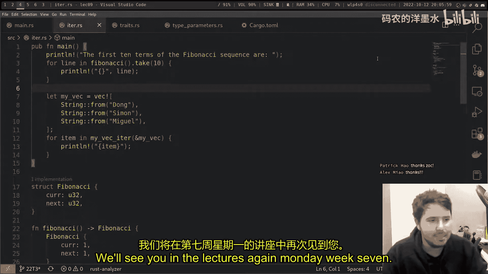

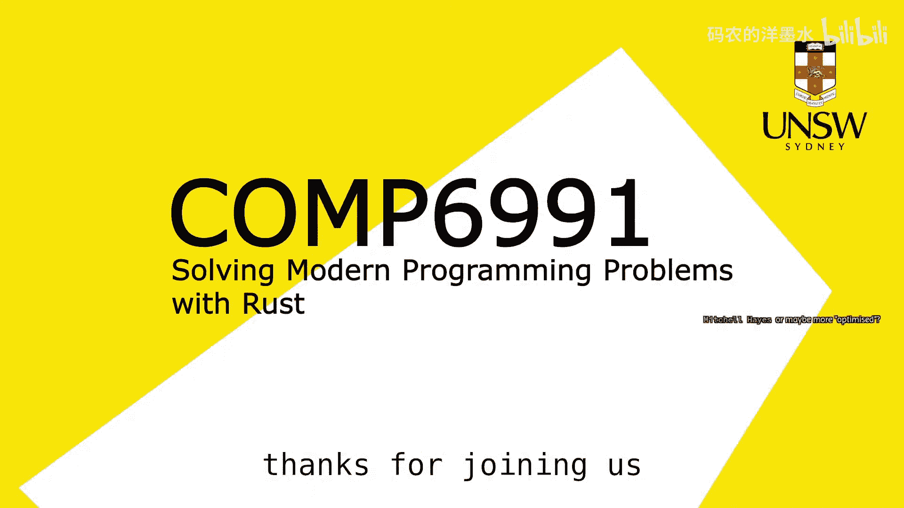