# 【全集】新南威尔士大学 Rust现代编程 中英字幕 1080P p11 Lecture 11 - 宏与元编程 -BV15cf4BCEN1_p11-

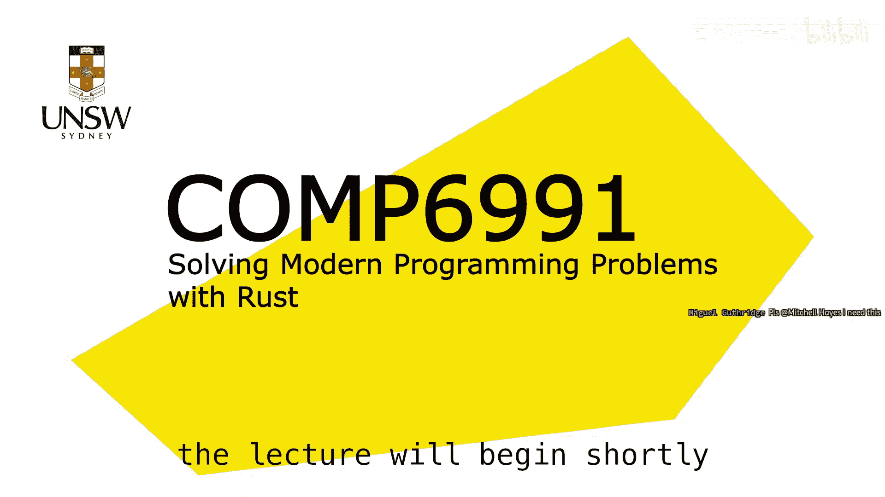

All right。Oh， oh， my Max quiet。 hang on。There we go， something like that， probably。哎 we go。Hello。

 hello。I might turn it up a little more。Hello， hello， test。 Okay。

 now it's getting towards the yellow。 That seems a little better。Hello， everyone。

Just wanted a fairris chain。 Yep， I see you old having a fun there。Oh， and what the heck。

 I also see YouTubes like retracting all the messages。What the heck。嗯。If YouTube chats being weird。

 let me know。It's like， can I show this without leaking too much。 Yeah， on。

 on like my screen where I've got chat and stuff， It's just got a whole bunch of like message retracted。

 So if it's doing something weird just。No， that was us deing them to try。 Oh， okay， okay， yes。

 very clever。 I see。U。The camera lighting makes me look like I've gone through hell and back。

Am I looking like pretty red。Yeah， that would be unsurprising。I don't actually know。

 I can turn this on hand。I don't know if that's gonna to help too much。But， it's there。嗯。

Me after assignment 1。All right。Soir， welcome back to the grind。I hope we had a。

A I've heard it being called。 Well， I've， I know it is flexibility week。

 I hope we had a flexible flexibility week。People were calling it some people were calling it recharge week I'm not sure if that's a staff thing or if they're like rebranding it or not。

 I don't really know what's going on but regardless。

 I hope you had an all right time catch up on sleep week。

I hope you had a relatively good catch up on sleep week。Some and yes。

 I've definitely heard a lot of people calling it assignment week， yes so。😊。

Reminders in terms of like the course and stuff。

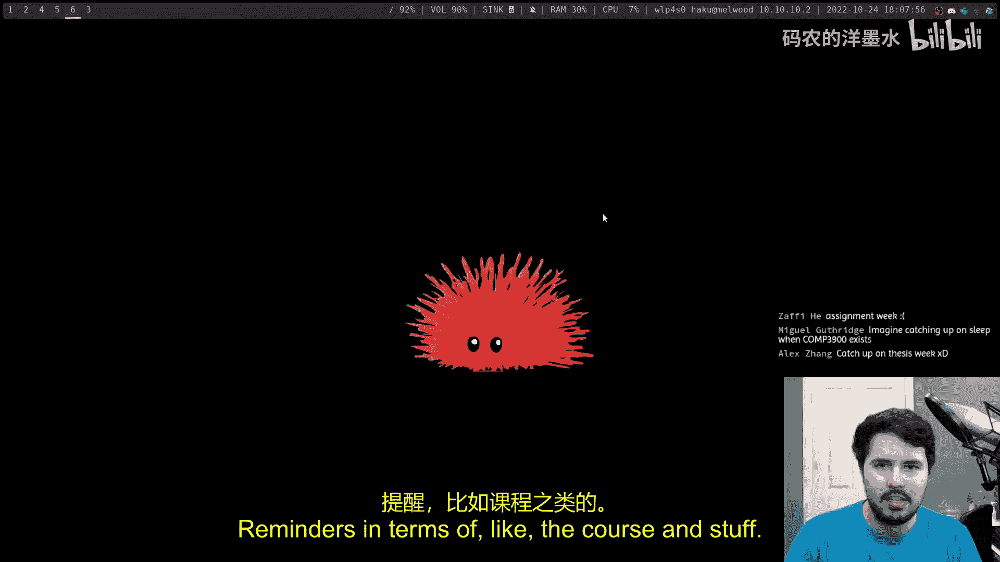

Or have I got this open。 Now， I'll just make a new one。

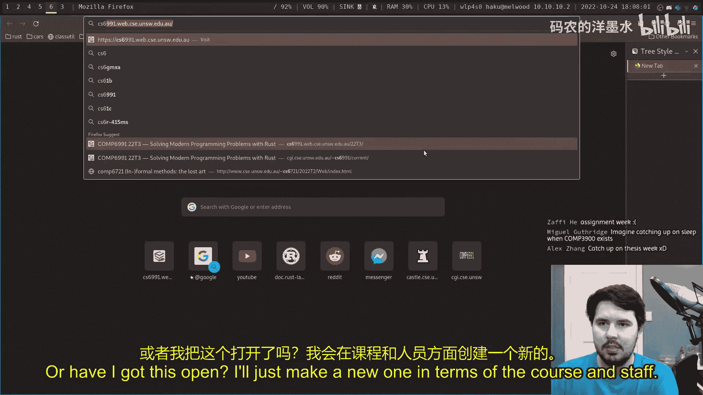

In terms of the course and staff。A reminder that assignment 1。Is due。Is you。ドヒア。Week 7 Wednesday。

 it's now officially week  seven。So two days this Wednesday at 5 PMm。

So just an hour before the lecture starts is when assignment 1 is due。The week five weekly exercises。

 usually these would be due like usually it's the you know， one week after release on the Wednesday。

 but we were we were nice and we gave you till week 7 Wednesday instead of the week six Wednesday so it wasn't due in flex week。

So， but so reminder that your week five exercises are going to be due。Also。On Wednesday。

 the week 7 exercises have been released。 I think there's a note about。

The auto tests for a couple exercises still coming， the macros exercises。

 auto tests are still coming。And yeah， and we have we're back to normal， we have our lectures。

 we have our workshops and we have more weekly exercises on the way。

 a reminder as well that well this is week 7 exercises just been released and then they'll only be the week 8 and nine exercises because week 10 we give you a prac exam instead and and that's obviously not marked it wouldn't really be great to mark you on the actual exam and also a practice exam So you've got three weeks worth of weekly marked weekly exercises left So yeah。

 we're getting towards the tail end of things for sure。😊。

What else did I want to say So in terms of like random course to do things？Maring。Like。

 as in weekly exercise marking should be entirely caught up on。

 So notably week 5 exercises aren't due yet。 So everything weak for and backwards。

 including all the manual marking， I think should be done now。

 and it should be accessible if our infrraed didn't like， you know。Go a bit sad。

So check up if you're like seeing like marks are missing or something looks wrong， it's。

Almost certainly not your fault。 Just let us know if you think anything looks wrong。

 And it's probably on our end。 But yeah， all the week  one through four stuff should be marked now。嗯。

What else have we got emails to the course account。

 all of those should have like been followed up on if if you've sent an email to the course account that you think you believe has not been followed up on or you're waiting for response on just bump it again again。

 don't be shy to throw in like to throw in like a cas lock important if you think we've missed an email from you like ideally not just like the first time you're sending the email。

 but if you think we've missed something then get our attention about it。

 but I think we should be all caught up there and the forum as well anything that's posted you know previously to today should have been caught up on and like half of the stuff today has already been caught up on I know there's a couple questions that are still yet to yeah。

 yet to be followed up on today yeah， sometimes it takes a couple days to catch up on things on the forum。

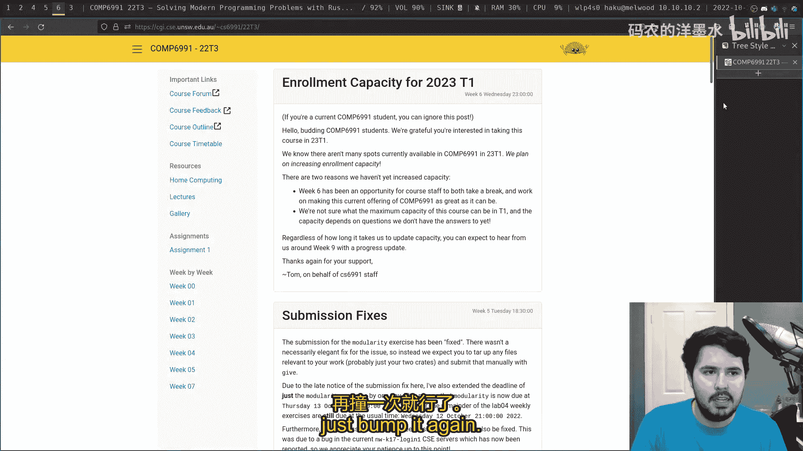

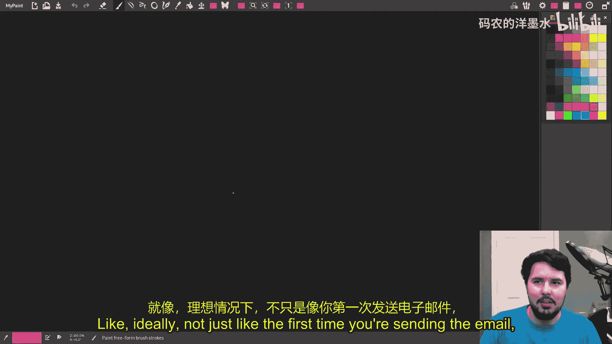

Why is。The internet dropping out， well I was about to say。

What I was about to say is that I'm on the NBn finally。Horay。

So the internet should be way more stable， but then I just watched it drop to0 kilobit per second for like one second。

So I don't know if that。 it may have been short enough that you didn't even notice a hitch in the stream。

 but。Ha great， the。The， the fun continues， it seems。 it's not。 well， it's， it's HFT。So sorry， H F。

 HF T， I've been talking to Tom too much。 HFC， rather。One second buffer， yeah。嗯。But sadly。

 I'm on wfi。 The new house does not have。It does not have ethernet wire throughout the house。If。

 if keep an eye， if the stream startss buffering， you best believe I'm gonna start running ethernet cables across doors for the next lecture。

 But we'll see how we go for today。And we'll， we'll press on regardless。 So catch up on the chat。

 Is assignment 2 gonna be similar to assignment 1， right？ That's another thing I should mention。

 Assign 2 should be coming out。Most likely， either。

 either very late this week or very early next week。 So probably like。Like if。

 if things go spectacularly， like which is。Not particularly likely。

 then you might see it as early as Friday， I would be expecting something more like Sunday slash week8 Monday as a release for assignment too。

😊，And that'll be due week 10， Friday is what I believe。

We've given you the due date as assignment2 is going to be workload wise。

 I mean the workload is going to be different for everyone My expectation is that the workload on these assignments is relatively high you know part of that being that they're like a relatively significant waitinging in terms of like how we mark the course and stuff like we only have a 35% final exam。

Right a lot of courses might do like 10% for weekly exercise then 15 and 20 and stuff like that for assignments and have a bigger final exam。

 we opted to put more marks here so you can probably expect know more workload here。UmSo yeah。

 I I would call both our assignments likely to be relatively high workload。

 but everyone's going to have their own experience， you might find it easier。

 you might find it harder personally。What I can say is that it's still going to be focused， you know。

 not， how do I say？Assignment 1 was very focused on design， quite specifically。

But it's like a big part of that is because there wasn't， you know， a getting to week 5。

In a certain sense， very much is sort of like coming up to speed with rust。 Ru again。

 as I've probably attested to about 400 times by this point。

 is a very tricky language to start learning。 And so the scope for what we can get you to do in your assignments you know by the time you're at assignment1 is rather slim。

 So we're sort of like we put a heavy focus on design and how you choose to structure your program as opposed to writing super duper complex programs。

 let's say there's a lot of complexity still in just working around the rust compiler， of course。

 that's what makes rust a difficult language to be getting started with。

 but like the scope is smaller for that。 So there's a heavier emphasis on design assignment2。

 we are going to bring in concurrency if you're super duper advanced when not talking about like coroutine continuation s asy weight kind of concurrency。

 I would love to have that in the course， of course， I would be thrilled too， but it's。😊，u。

In rust in particular and especially rust in its current state is probably too much for this course。

 so instead we just end up using like threads standard like operating system threads。

And no sort of special runtime or anything like that。

 But there is a lot that goes along with concurrency in terms of rust。

 Concurrency is very much like a culmination of a whole bunch of ideas in this course and in rust in that like you've been having to deal with all these different things。

 but you may not have found that there's a huge amount of bugs that like rust is preventing you from。

 from running into。 like there's probably still a reasonable amount。

 but like some of the more nuanced ideas around like ownership or mutability and that sort of stuff。

 you might go。 okay， I can see that this could cause a bug if it you know wasn't there in this case。

 but therere a little more few and far between。But once you bring concurrency into the picture。

 the rules all start to make a whole lot more sense and it starts to like。

 you know the it all sort of comes together and you're like， right。

 I get why you know this is like that and that's like this because now I can have an entirely concurrent program。

 I can go from my the single threaded code we've been writing and go concurrent and everything will just sort of work and the Rus compile make sure likell it'll check all your code for。

 you know， concurrency issues and that kind of thing through the same schemes as we've already learned。

 So that's assignment 2 is gonna to have a bigger focus on that。And a smaller focus on design。

 still a focus on design。 But， you know， we're bringing concurrency to the picture。

 And so we know that we can't necessarily keep things at exactly the same sort of expectation as before。

Okay， Ethan over Power line， absolutely not。 I shall not。

As with assignment 1 that we'll learn most of what we'll need for assignment  two at the end of this week。

 then end of next week， next week， we end up。 Well， how do I say similar to assignment 1。

When we release the assignment， you'll have enough to do like the first portion of it and then the end of next the end of next week。

 once we finished concurrency， you'll have the tools to do the rest of the assignment。Um but yeah。

 the first portion should be should be doable with the end of this week before the assignment's even released。

Do we familiar with how concurrency I haven't touched it before outside the most basic asyle weight there I will be providing some background on concurrency for students that have a。

 you know， a reasonable background in concurrency， then you're probably okay。 Like if you're I'll。

 I'll like explain once we get to that point the sort of。You know。

 requisites we're assuming here and and what kind of things we're looking at。

 and each student is welcome to sort of self assess that point。 I'll provide some of my background。

 but I might go here's like the baseline stuff that we expect。

 and some students might have to do a bit of like background reading in terms of that。

 And that's's very nice of you dong。That's yes。1521 is a nice course come to well， yeah， come。😊。

Come join 15，2 on when I'm teaching it last term， I know， but the， you know。

 Andrew Andrew is also a fantastic lecturer and and yeah。

 the the content on concurrency 152 and is also very fun。😊，嗯。Okay。

Is there anything else I want to say。 Fors caught up on markings dar assignments coming out relatively soon。

 emails， I think that's mostly it。 Yeah， we do concurrency on 521 these days。

I'd sort of Jerry rigged it into the course a little bit， like。A year ago， or something like that。

Okay。So。Right， so this week。We're talking about meta programming and functions。It's it's， it's funny。

 meta programming sounds， wow， that's scary。 That's a big word。 and， you know， is， you know。

 sounds like a very scary topic functions。 I know all about those。 Those are really easy。

 We'll probably find that the the meta programmings actually probably a little bit easier and the functions can get a bit gnarly if you're coming from a particularly PL based background。

 you know， if you've taken courses like 3，16 one， you might find the functions portion more intuitive and and but。

😊，Yeah， where we're going to be looking at meta programming today。

And we'll look at functions on Wednesday。Cool， so。Metta programminggramm， yes。Awesome， and yes。

 back in 2019， it was， it was in 1，5，200 it got sort of ripped to shreds a little bit。😊，Over time。

 Yeah， yeah， yeah， okay。Mesta programming。Right， so what is meta programming in the context of this course。

 who's done any sort of meta programming or has any thoughts about what kind of things meta programming is about。

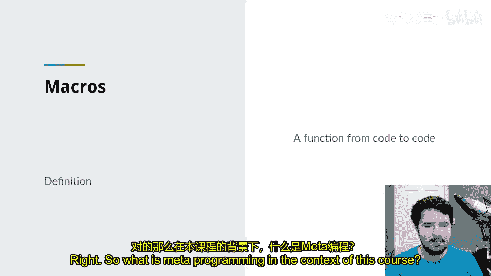

Lecture chat。嗯。Does 67，71 count？For sure， yeah。There's this is。Yeah， there。

 so C plus plus is a language。That has all kinds of meta programming ideas built into it。

s from it borrows the preprocesor mostly from C。And the preprocesor has sort of text text dual based meta programming abilities。

 and it also provides templates and templates also provide all kinds of meta programming facilities。

嗯。So that certainly counts。Python decorate a superiority。 Yes， so fundamentally。

 what meta programming is about is writing programs that produce， oh。

 let's say programs is maybe a little to broad。 Let's say like writing code that produces code。Right。

 so usually we write code to produce like an effect。Right， so like I write a code that prints。

 you know， writes print F hellello worldld or printlin Bang hellello worldld so that it will print hellello world to the screen。

A。So but this idea of meta programminggram is instead of code that。

 you know produces some effect or like does some task， we write code that produces different code。

 produces new code， and then probably we end up running that code instead。嗯。

So like what are the benefits of， of meta programming in this sense， Well， it allows us。 there's。

 there's a few sort of different scenarios。use cases for meta programming。 But it sort of。

 it can definitely open up possibilities that aren't possible without it oh。And yes。

 we might have had a hitch， but I think it looks okay。Buddy and Vien。

It's only prepress it comes from the prepressor region of France。 Otherwise it's just sparkling said。

 yes， very good so。Okay， great so。

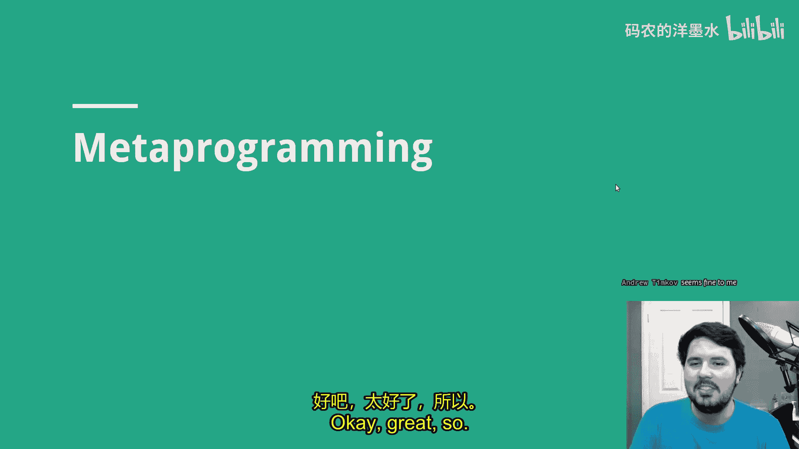

Yeah， at the like very simplest in the only sort of form of meta programming we're going to be looking at。

In this course is。 yeah， it seems fine。 is macros。 So this does not represent the sort of ceiling of meta programming。

 but macros are probably the most。Popular way people tend to interact with the idea of meta programming。

 you know， the way people tend to meta program。And at its very core。

 a macro really is a function from code to code right， so it takes in potentially some code。

 it might take in no code at all。's that's an option。 but most of the time a macro will take in some。

 you know， some bit of code。😊，Run something inside or do some， you know。

 manipulations and spit out new code out the other side。So in terms of those use cases。

 there's three sort of primary ones we're going to look at macros are often used for convenience right like this thing is rather annoying to do and like or I have to do it a lot and there's not an easy way to do this I end up needing a lot of boilerplate code macros can often come in and make things far more convenient。

😊，And often。With that convenience can maybe become sometimes a bit of reliability as well。

 potentially a bit of robustness in that if you're having to write the same boiler boilerplate code over and over and over again。

 but it's potentially relatively easy to screw up writing that code。

 having a macro that can only do it correctly might add a little bit of you know a little bit of reliability to your to your overall program。

 but absolutely they can also macros have a have a way of。😊。

Destroying a lot of reliability in the process in certain cases。 So we'll look at some of that。

 macros in some languages tend to can may often be used to simulate polymorphism。

 So we looked a lot at polymorphism in week  five。嗯。And the idea here is， well。

We saw in rust that programs are monomorphized。 if we recall this。 So the idea being， the idea being。

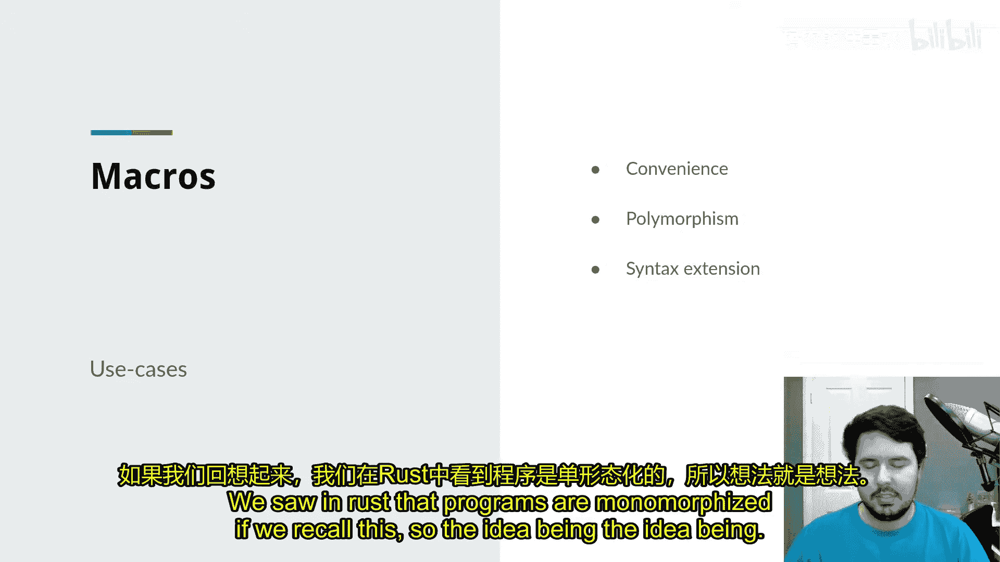

New text file if I have some function fu， which has a generic parameter T。Right。

 and I call F with an I 32。And then I call through with the float。And then I call F with a string。

 you know， all these different things， essentially what the Ros compiler is going to do is it's going to go。

 well， I'm going generate one version of F for an I 32 for an F 32 for a string and end up creating like。

 you know， F I 32。😊，F F 32 and P string， for example。

And then end up like calling each of these when they're required macros are very good at spitting out lots of code。

😊，Right and so you can use macros to sort of do the modernmorphization almost like yourself where you go。

 okay， well， I'm gonna generate the I 32 on the F32 on the string one。

 you know so on and so forth and go through this process manually yourself。

 You could imagine a macro that looks something like generate through for like the I32 type for the F 32 type and for the string type and these macros go ahead and spit out these you know the actual function implementations themselves like this。

 So it's something that we generally try and avoid in a language like rust because rust has quite good support for polymorphism in the language itself。

😊。

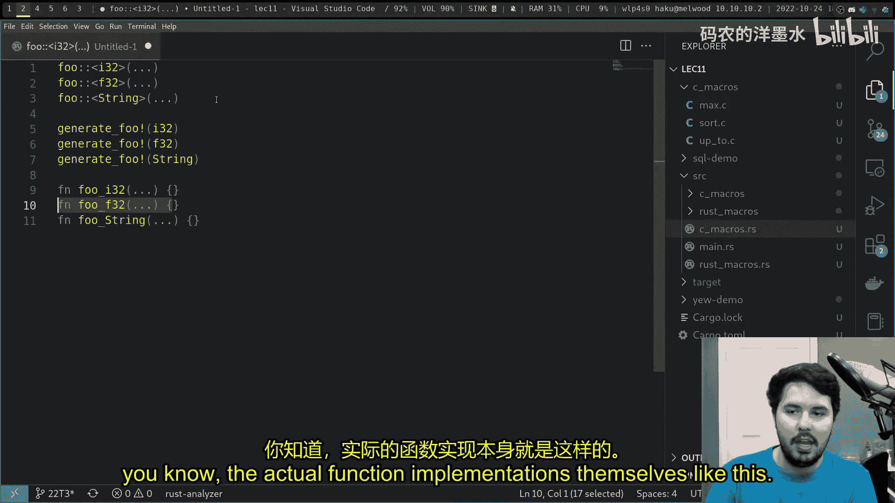

But it's certainly something that crops up in languages like C， for example。

 or potentially in languages like C++ if you consider C++ templates to be you can sort of choose which side of the fence you lie on in terms of if you feel they're more macro like or they're more polymorphic like。

 but there's certainly a school of people who may tend to think that C++ templates， for example。

 are more a more macrolike。Then， then sort of having a。

It looks's like an incredibly rich type system behind it， potentially。嗯。

And then something really interesting is this idea of syntax extension as well。

 So macros can help use。Almost create additional syntax in the language。

 potentially syntax that's more convenient。Right or more clear than like what you could achieve in the language otherwise。

And like this may fall under convenience to a certain extent。

 but it's probably a bit of a deeper idea。 like you can in。

 you with macros you can do things as crazy as embedding other whole languages within， you know。

 within another languages macros。 and that can also open up。

More avenues for robustness and reliability， and we'll have a look at some of that towards the end。

So， very interesting。Yeah， template in dodgy enough to be macro likes。

 900 lines of errors for a single typo。I， and it seems clear that I。

 I could take a good guess on as to which side of the fence Mi well has decided to fall on there。

 So before we get started with macros in rust。

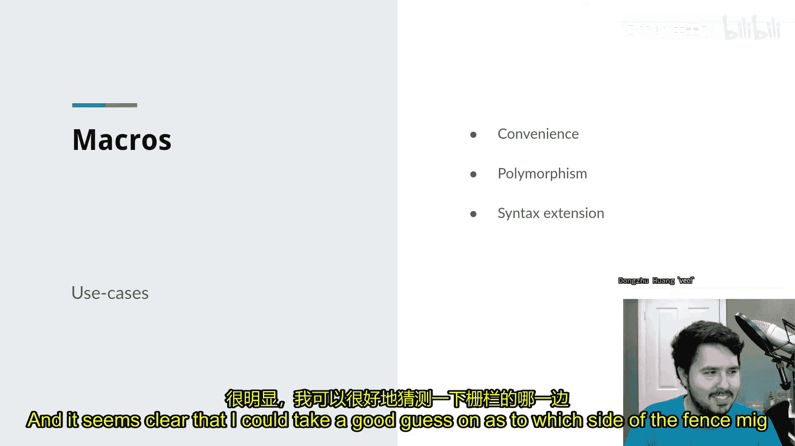

Let's just have a look at like a recap on what macros in C and you know you could you could achieve similar results in C++ if you so chose to。

 but it's probably not so encouraged these days to use the C preprocesor in C++ too much。

 but regardless， in C， you'll often find the preprocesor。

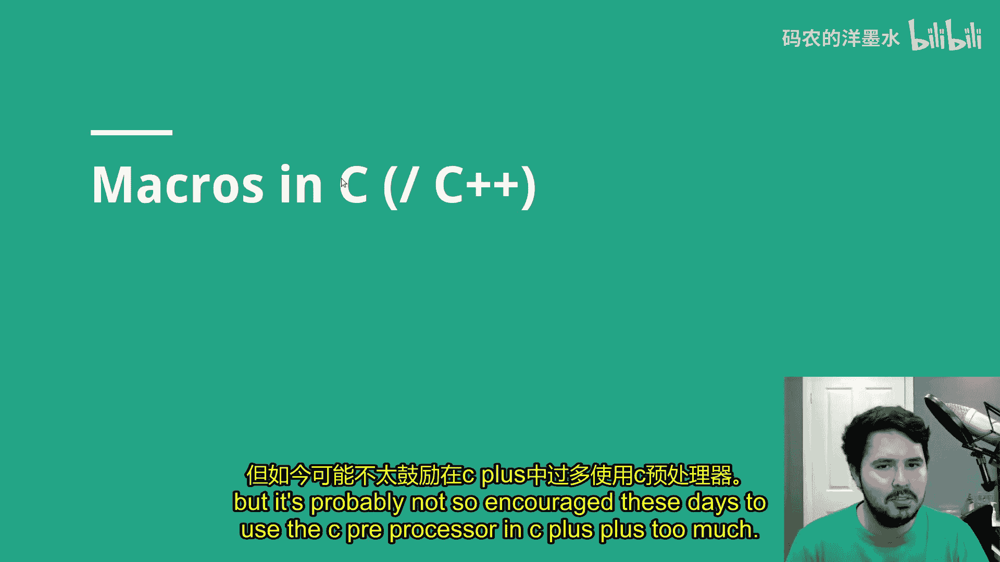

Having， you know the。Being liberally used， even in places like。

 I believe like the Linux kernel uses C macros quite a bit for。

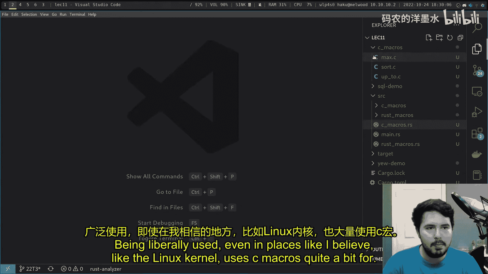

Basically all of these， you know， all of these use cases pop up one place or another if I recall correctly。

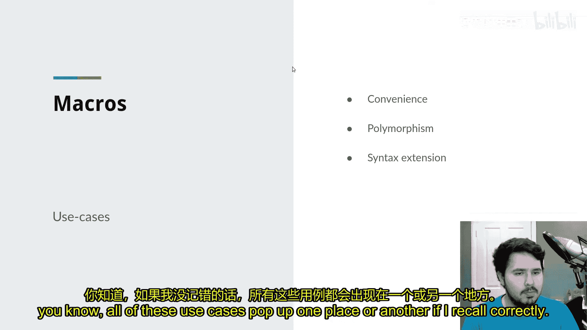

So let's start off with a very simple macro， which is the max macro。

 These examples were mostly stolen from these from some Yale examples， except they had to， they。

 they had some。A subset of particularly egregious bugs， which made the translations a bit fun。😊。

But anyway， so here's what we might see for like a max macro。 So you may。

 you may recall something like hash define my constant as 42 in C from， you know， say 1，5，1，1 or， or。

 you know。97。I if you see my head like ducking down here。

 it's me looking past and my speaker on my desk to try and check the bit rate。 but it looks okay。

And so you may have seen this， and you can just sort of type in my constant somewhere。

 and it will end up replacing this with the exact text 42。

 So often people refer to this as constants， but it's it's it is actually a macro at the end of the day。

 I believe C refers to this as an object style macro。

 an object type macro as opposed to a function type macro down here。

But the naming isn't particularly important。😊，But the interesting idea is that these macros can take arguments if you haven't seen this before。

 so it says instead of like writing max whatever， instead you're going to write Max with Pres。

 it's going to take two arguments A and B， and it says if A is greater than B。

 this is a turnernary operator here just saying if A is greater than B then give back A。

 otherwise give back B。😊，And so I call it down here max of 1042， max of 3。142。78。

 and I just print them out both down the bottom here。 So let's see if this works。Playing max。c。

And you'll see the maximum was 42。 The maximum was 3。14。 So this seemed to work。It's good news。

But why did like what's the advantage of this being a macro here？Right。

 I'm going to explain some more things are going that's going on here naturally but。😊，Like you know。

 going to the chat here。What would have I had to have thought about if I chose to implement Max here as a function instead of a macro like what a what are some like。

Potential say disadvantages to writing Max as a function instead of a macro。

So no function calling overhead Dong says， yeah， so if I wrote you know int maxs of inte int B。

 if or just like return a is greater than B， question mark A column B like this。

 there may end up being a little bit of overhead when we call this function。

In that it needs to go away and make a function call and then come back。This can be avoided。

 you know， most compilers， when you tell it to optimize， will go LLVM in particular。

 which is the back end of clang， which I tend to use as opposed to GCC， but even Gcc as well。

 but particularly clang is or LL VM is famous for inlining everything it possibly can。 In fact。

 there's there's a common joke that LVM's heuristic。For inlining is yes。

And then a heuristic is sort of like a， you know。Let's say a condition that guides some kind of decision。

 like maybe it's like if the function is short， then in line。

 L O VM's heuristic for inlining is basically just like yes。

 And so the function calling overhead is usually not too big a problem。But。

 but it definitely could be in certain circumstances。 but yes as well。

 So the other thing to think about here is I had to write types。

 When I changed these maxs and Macs down here。We see that this one worked because I've given it integers。

 but now this one here doesn't work because it's working on floats。 And so it's saying， hey。

 it's going to implicitly convert it。 This would not compile in rust because the types are very strong。

 they don't like to just be coerced around Well， I mean，' there are coercions， but they usually。

Pretty safe coercion。 This is a losssy coercion going on here， which is a little scary。😰。

But then yes， I would end up having to do something like Max like。

Int max and then maybe like a float max and you can see where if I wanted to make a whole bunch of max functions in C。

😊，It could get rather tedious。 So in this case， I don't need to generate a whole bunch of different functions。

 I could just write a single macro that works for any of these A's and B's。

 But you could imagine where you might want a macro to sped out a whole bunch of these implementations for you。

 We're going see that with the with the sort program in a little bit there。 So right。

 the one of the interesting ideas here is that there is no types。😊，In a macro， right。

 I didn't say A is an int and B is an int。 I just said that these are things。And essentially。

 what the C pre process is going to do is it's just going to like take the text here 10 and 42 and just like substitute them in here like this basically。

 B sorry。😊，It's going take this code here and just spit it out right there。

 like this is exactly how macro works。 the way I just did it there and it'll just spit this code in line like that。

 There's a nice command you can use to don't actually run the program， just expand the macros。

 just run the C pre processor， which is instead of。😊，You know， compiling like normal。

 I can say clang dash E。And you'll see here that's exactly what it's done。

 It's just taken this macro definition and modified this code， right，34142。78。

 and you can see it down there as well。😊，And。Thus， it's sort of revealed why this code compiles as a macro。

 but doesn't compiles a function as a macro。 It's just ending up as this code here。

 I can always do int is greater than int， you know， and like set an int here。

 I can do float is greater than float。 Like this operator here is the main sort of important one。😊。

And as long as I can do greater than or less than on。That kind of type， then C will be happy with it。

 things that I might not be happy with is something like a struct。

 But then like once the preproors run through it and you， you know， you've done maxs of mystruct A。

 my struct B， it'll expand it。 The compiler will run on this code and it'll go hey。

 I don't know how to compare like these twostructs here。And and yes。

 as before we don't we could we could actually tell the compiler explicitly to inline it as well。

 which I believe in C looks like this in rust it looks like this telling sort of hinting to the compiler。

 please inline this function always。😊，嗯。So okay， that's pretty interesting。😊。

And and this has maybe like helped us in this particular case， the the max macro。

So let's immediately begin here with what can go wrong。😡，Right。

 like this seems to be going relatively right。I very carefully wrote the macro。To be like this。

 as opposed to like。Like let's say if I just did， you know， A is greater than B question mark， A。

 colon B like this。In this case， oh， I'm trying to think。

The max macro might be one that's a little more difficult to demonstrate these edge cases on。嗯。

But I can certainly make another macro that demonstrates this problem。 If I said， let's say。

Let's see。 Yeah， let's say I had like a an。And。Let's see。Which way I want this way around。

 I want to have multiply by7 of some value x。And let's say I just turned this into。X times 7。

Like that， right？This seems like a pretty in macro takes something X and then spits out x times 7。

So then let's say I go int。My， let's see。In my number equals multiply by 7。 And in here， you know。

 I could give it 4。 We'll double check that it works。 Basically， printer sent the my number。

Like this。Clang， run seven， you， four times7 is 28。 that's great。

 So what if I do  two plus two inhale？😊，Suddenly， it's 16。

so macros are immediately a little dangerous。How did this happen If I go back to this tool here。

 which is saying just expand the macros for me don't run the code。

 you'll see it did exactly what it was told to。 X here is 2 plus2。 So you know we got two plus2 here。

 Great， I'm going to substitute that in for x。 and then I'm going take that code here and paste it down there。

 So my number is two plus2 times 7 and snap operator precedence comes into play。

2 times 7 has higher precedence than 2 plus2。😊，And so we get two times  seven is 14 plus the two here is 16。

So， a little dangerous。Now， how could we have fixed this？ Well。

 an interesting way we could potentially do this is what if I threw some pars in here。

 So instead of just doing a single set of friendss， I'd do a double set of parends。

You'll see I get 28 to it。Why is that， well， now the thing that gets substituted is this 2 plus2 ins。

And so it ends up getting two plus2 in brackets times 7。 So that's that's pretty good。

 But I don I don't want the user to always have to remember they have to do double brackets every time they call the macro。

 So sometimes you might do something like this。 put the brackets up here so that whenever they use some X here。

😊，Then。Um， it'll it'll always make sure it's it's in its own set apprenhees so we don't get any kind of operator precedentnce going on with this multiplication。

And you'll see we get the same effect down here， just with 2 plus2 that gets substituted into these pars here and then time 7。

So that works。啊。However， there's another problem that we might run into。

 which is what if I said like add， you know， add 42 of x？And I've learned my lesson。

 I'm going to put X in brackets now。And I'm going to say actually 42 is probably a bit big。

 let's do add five。And I'm going to write x plus 5 like this。So then I'll say my number equals add 5。

 I'll zoom out a little bit so I can see a bit more on the program。

 Add  five of the number two that actually give us 7。And then I'm going to multiply that by four。

And I'll print it out， so it should be 28 as well。But mistake， it's 22。We look at the， you know。

 the output to see what's happened here。 Well， it add five of two got turned into two in brackets plus 5 right like this。

But then the multiply by4 that I've got out here。 this multiply by4 just sort of gets spat right after it。

 And we've got operator precedes again on this plus 5。Right， oh， no。 So again， similar sort of trick。

 We could throw parentheses around this whole thing。

 So we get the two plus 5 first and then multiply by4。And naturally， that does work。

 But I don't want everyone to remember they have to put brackets around my macro every time。

 So I can also put brackets around the whole thing。And then。

And then we still get the same result and the same expansion like this。Sir。

This whole like set of examples here goes to show a couple of important ideas。

 You can now see why I've written it like this， by the way。 Anytime I've used the the， you know。

 token here， I've wrapped it in parentheses and then around the whole thing。

 I've wrapped in parentheses。 People tend to like program very defensively when they're writing macros and just like parenthesize everything to make sure nothing goes wrong。

 You might even get super paranoid and go。 I'm gonna put this whole condition in parentheses and then。

 you know， so and so forth， but。You know， you can never have enough。

 you can never have too many parentheses when you're when you're writing macros and C naturally。😊。

But so it goes to show two things。 One is macros can be tricky to write。

 They're like a really a different way of writing code。

 and they come with their own sort of gotchas and pitfalls and， and things to be careful about。

 But two， it also， I think， helps serve the。The reality of the fact that macros are about substituting like bits of code around。

 they're not about like， they're not。They look like functions， but they're not quite like functions。

 The function is something that'll get called with like well definedfin values and stuff like that。

 you know and actual values， actual terms， whereas macros are really operating on syntax in code right they're really operating on like not two plus two meaning four。

 but like number two plus number two like those actual like characters of code。

 that syntax of code ends up being what they work on。😊，And so。

It's it's a very important idea to sort of think about。

 There is another thing that can go wrong with this max macro here， which Miguel is。

 has pointed out in the chat there， but I'm going show it in a slightly different way。

 Imagine I had a function that was int print and return。It takes in some int X， it goes printer。

Print F， the int is percente。Is X？And then return X back。Right， pretty， you know。

 seemingly somewhat harmless function。If you're functional programming， you probably hate it。

 but that's all right。 And then let's say in this max code here。I say， print and return 10。And then。

 print and return。42。Right， so if this is a function that I'm calling， if I'm calling a function max。

 you would imagine that this would print out the inters 10。Print out the enters 42。

 and then it would call the function with 10 and 42。But we get something weird to happen one。

 since we're working with macros。😊，We see the int is 10， the in is 42， and the in is 42 once again。

Right， that's strange。 Why did that happen。 Look at the macro output。

 and you'll see it literally substituted it code wise， like text wise。Inter， into this thing here。

 So you get print and return 10 is greater than print and return 42。

 Then give back print in return 10 or print and return 42。 So because it's， you know。

 it's saying A B， A B。You end up like pasting this same code in all over the place。

And and so what happens is it goes， well， printing return 10。 like when this code actually runs。

 it goes print and return 10。 Yeah， that's 10， Pri returnturn 42。 Yeah， that's 42。

10 is not greater than 42。 So we give back this branch here， which is the print and return 42 again。

 So it'll give back the value 42。 but it ends up needing to print and return it again。

 And so that's another sort of like another like tricky thing that can happen with this。😊。

And does this have anything to do with lazy and eager evaluation？😊，In the normal sense， like。

 it's definitely the same idea in that this is like macros sort of almost act like very lazy。 It's。

 I probably wouldn't say it's like。You know what's the right way of putting this here like？It's。

 it's not sort of。M yeah， the words sort of escaping me and this computer is going crazy in the background。

It it's， it's。Not like definitionally lazy in the normal sense。

 where say like a functional programmer might think of， you know， lazy and eager because it's， again。

 it's not actually working。As code in the program， it's just like substituting text。

 but it gives that effect of being very lazy if that makes sense。

 like it's in terms to say like it's it's a probably a good way of thinking about it。

 but it's obviously like subtly different to the normal case because it's you know working on you know like code and syntax in text。

 that kind of thing。嗯。So yeah， that' that's our sort of simple work into macros and see。

 So this was mainly like a convenience one and also kind of like a little bit of polymorphism thrown in here。

 where we've made a macro that works with you know， anything that can be compared like this， right？

But it's not so heavily polymorphic in that it's defining its own functions。

 it's mainly for convenience。😊，Oh， I see。 So yes， I'm thinking of it in terms of like closures and stuff。

 sort of like where it's quite like literally defined， I I suppose。

 but it's definitely like the same feeling， the same idea， absolutely。😊。

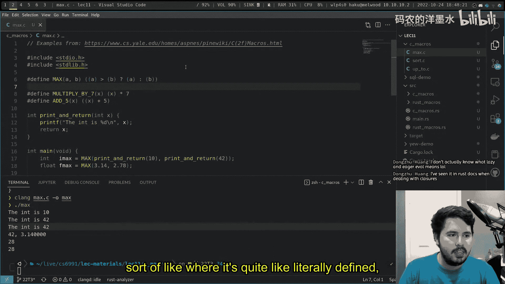

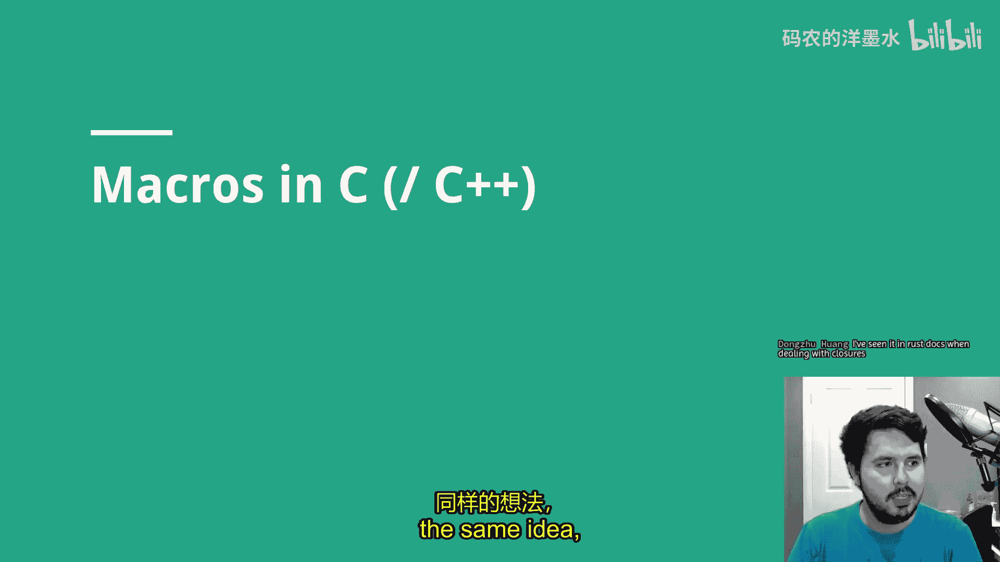

嗯。Right， and there's there's， so we'll look at polymorphism a little bit more closely with this sort example here。

 but there's also this idea of syntax extension。😊，And I've got an example here with this up to。😊。

So imagine you don't like the C4 loops syntax where you always have to write like four int I equals0 I' is less than 10 i plus plus like that。

And you go， well， I always do I is 0 and， you know， less than some number。

 And plus plus I want to automate that stuff away。 You can like make up your own syntax。Right。

 so this is an up to macro， I define int I and 10 here。

 which are the important parts of this for loop and also the body of it。😊，And。

 and this sort of gives me new opportunities of expressing different ideas in the language。

 So how did I define this macro I said it takes a type， an I and an N。 And remember。

 there's no like actual types here。 I'm not saying like this is like a type。

 This is an identifier or whatever， or like， you know， int， whatever。嗯。

This is just like bits of code that I'm just saying， you know， I want one bit of code。

 another bit of code， another bit of code。 I'm calling them type I N N for my own sanity。

 but they could， you know， you could call these anything。 but I'm expecting a type to come first。

 They provide int。 and that type gets substituted here。 So we get for int。Then I say。

 give me like the name of the thing that you would like to use in the body。 right。

 What are we iterating， What's the variable we're iterating over called， We could call this fo。

 and we'd have to change this food down here in the body like that。Let's say。

 and so it's going to substitute I here for food。😊，That becomes who。 That becomes who。

 That becomes who。And then finally， we have what would you like to iterate up to here， which is n。

 And that's we've just put in like substitute intent there。 Not this doesn't take the body。

 though in this， you know， in this codes case。 And this is mostly because the C pre processorcesor is like really wacky。

 It's like very permissive in the kind of crazy stuff it might let you do。 And in this case。😊。

I have just sort of ended the macro off before the for loop， even had a body to come after it。

 And I go， I'll just specify the body after the macro is done。

 So this macro ends up expanding into this part。 And then great。

 I've got a body right here to go with it。😊，Right， it' just sort of like works。So if I。

 if I go to or if I clang up to dot C。And run it。 You'll see the concrete version works。

 It prints out 0 to 9。 But if I go back to like the。The macro here。There。

 I guess I'll call this through to， for consistency sake。You'll see。That this still x 0 through。9。

Becauseuse again， and if we look at the， if we look at the。what it outputs。

 it literally outputs that full loop as we saw before， so this is a pretty tame example here。😊，嗯。

Like yeah， it's this is a quite a tame example in terms of like defining additional syntax。

 and again， this ties into like ideas like convenience as well for sure。But the like。

We're going to see in rust later in the lecture that you can really scale these ideas up。In C。

 it might be a little more tricky with the prepro of macros indexax。

But the the rust macro syntax and how you can define macros goes a lot further than what C the C prepro can allow you to do and we're going to see that there's some really interesting ideas in terms of defining your own syntax that can be really impressive。

Finally。We'll look at this， like quite heavily polymorphic example。 So what's going on with this。

 Oh my God。 let's do close others。So I've got the up to still in here because oh cool。

 we'll still here to use this， but like if I just show you main here。😊。

Like that I've got an array of 10 numbers， you know pseudo randomly shuffled and I say I want to sort this array of integers as you know here's the array there' 10 of them and the integers and I say you know print out the array。

 you know print out all the elements of the array。😊，And most people， you know。

 well some people in C would know that generally the advice would be to use the Q sort function in order to do quick sort Quick sort takes the array。

 the size of the array， the size of each individual type， and then a function。

 a function that knows how to compare elements of the array。Right， and this can be kind of tedious。

 Like if I want to say sort in sort floats， sort chas。

 then I end up having to repeat a whole bunch of the same code。

 So what if we made a macro that creates this int sort function for like whatever type you want。

 So like， say， declare sorts for float and float。😊，DeClclare， oops， declare how to sort。Doubles。

Deecclare how to sort jars。Right， all this。 And then magically。

 we just have like float sort available to us。 We can sort arrays of floats or char sort。

 And now we can sort arrays of chas， right， And the way it achieves this is by defining this。

 this like hash hash syntax is essentially。😊，Take the thing in the macro and like append its name。

With whatever comes next。 So we're saying here like the prefix is int。 So we're going to do int。

Undercore sort， right， That's the name of like， I've got a void int underscore sort。

takess in an int star， you know， an array of integers。

 how long the array is and calls Q sort with this function here， declare， sort， you underscore。

 declare sort， underscore， int， underscore， compare。Which essentially， just is like。

Some slightly generic code here。To compare two integers。😊，Right if we look at the output of this。

 not up to， we're looking at sort now。Right， this can get a little bit crazy。

 but you can see here it's defined this declare sort int compared， declare sort， float compare。

 double compare char compare。😊，And then also these functions here int sort。

 which just calls quick sort， the array， size the array。

 how big an in is and uses this function that' that it's created to compare the integers or to compare the floats or to compare the doubles so on and so forth。

 and so you can sort of get the sense here。That where。

Almost acting like Rus's monomorphizer ourselves。RightWe're actually saying generate each of these implementations。

 This is really what the rust compiler does when you use things like generic type parameters。

 So this kind of macro usage we tend to avoid， for the most part in rust because again。

 we try and make use of what the language in the compiler is made available to us。

 but it's a you know valid use of macros that appears in the wild and is a important idea you know for meta programminggramm in general。

😊，And again， to be clear。😊，This is really just like slinging bits of code around。

 These macros are also quite declarative。So declarative meaning we've basically said and see here's the name of the macro。

 it takes in these bits and it spits out codes that looks like this and we just sort of like throw in you know prefix and we throw in type and all that and it'll just like substitute the bits and pieces Those are the kinds of macros we're going to look at in rust。

 but there's also another class of macros called procedural macros So I think I have some slide on this。

😊。

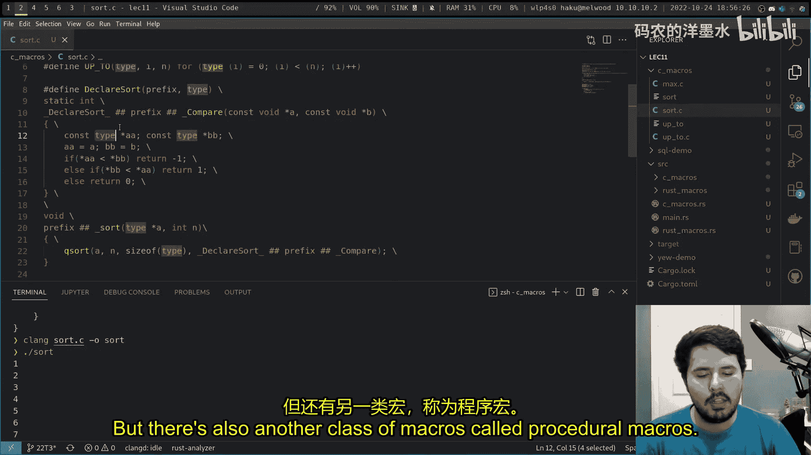

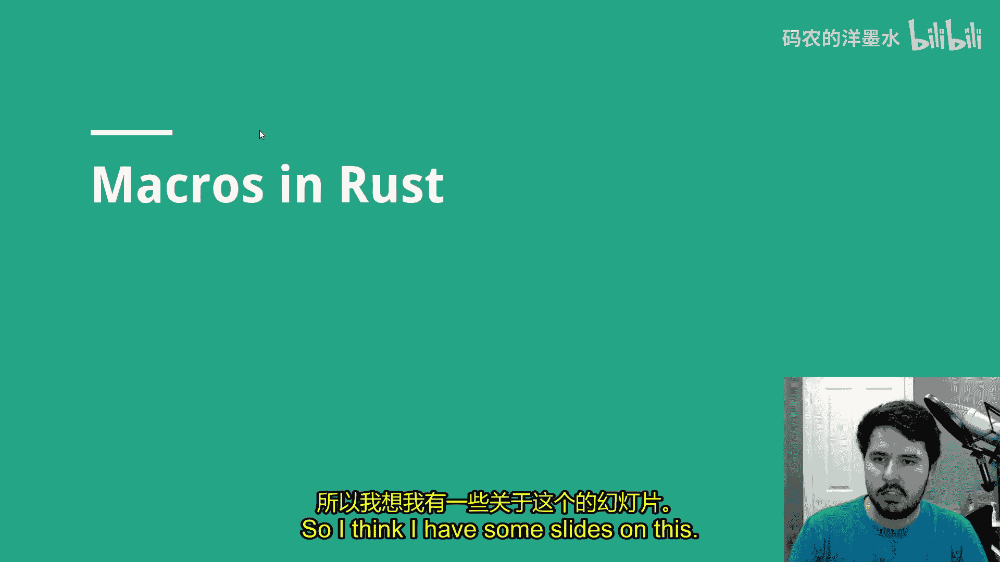

Right， so declarative macros in general are meant to be sort of easy to write， easy to read。

 you know， for some value of easy， have relatively simple semantics。

 but are sometimes limited in capability。 So these are often called macros by example in that you're saying like here。

 if if they called declare sort with a prefix and a type， spit out code that looks like this。

 And again， this is the kind of macros we'll be writing in this course。 However。

 there's also procedural macros。

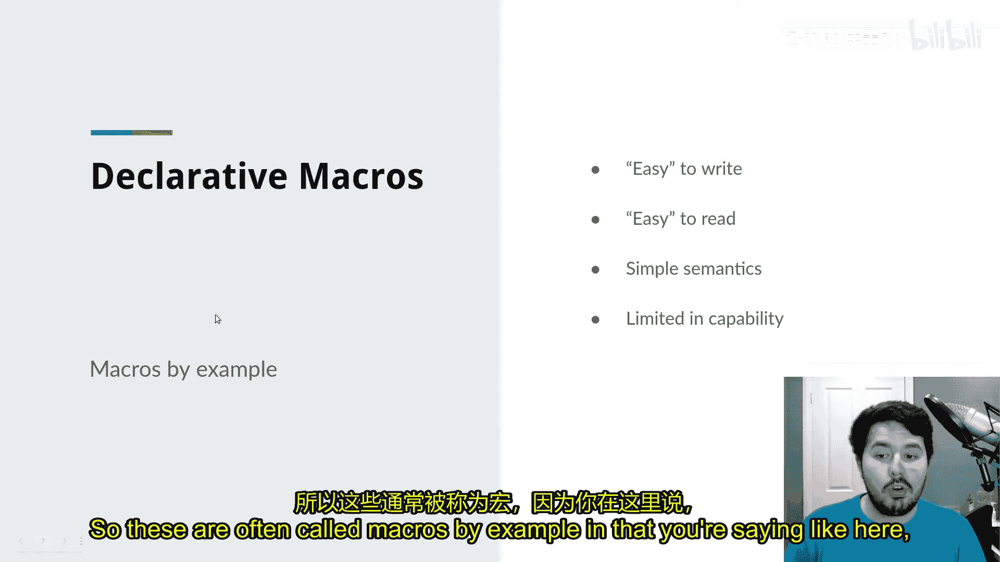

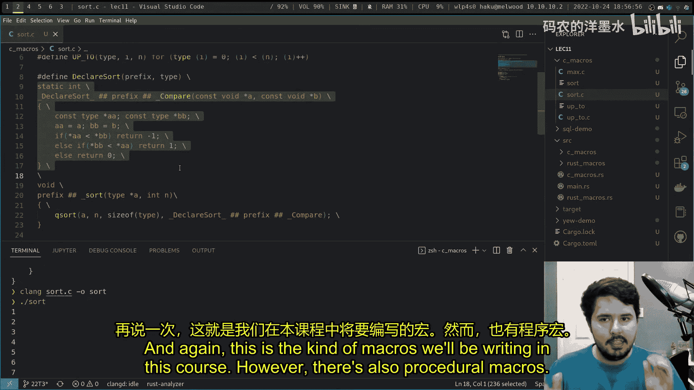

Procedural macros C doesn't really have a a built in， a built in。You know， equivalent for this。

 we often just call these proc macros， by the way， but in rust it's fully fledged rust code you can write a whole rust program whose only job is to take in a stream of tokens like tokens in the language and spit out different tokens in the language。

😊，Right， like， you know， take in a 42 then a plus sign then a， you know，1 hundred20 and， you know。

Do some operations and spit out new code that will then be fed back into the Ru compiler。

 Theyre sometimes very difficult to write， and theyre sometimes very difficult to read。 However。

 they are extremely powerful and open up all kinds of crazy possibilities that we will have a look at a couple examples in the end。

So Proc macros are definitely very cool。Let's do that。呃。う。I apologize for like one pixel of space。

 There we go。Perfect。嗯。Cool， so， yeah， what we've been looking at so far is declarative examples or macros by example。

 But it's worth knowing that there's also these ideas of procedural macros， which are like， again。😊。

A whole separate program that gets compiled and then run as your code is being compiled。

And it feeds in your program's code to this other program， it runs。

 that program spits out a new token stream and that gets spat back into your program it's some very cool things that you can do with that。

😊。

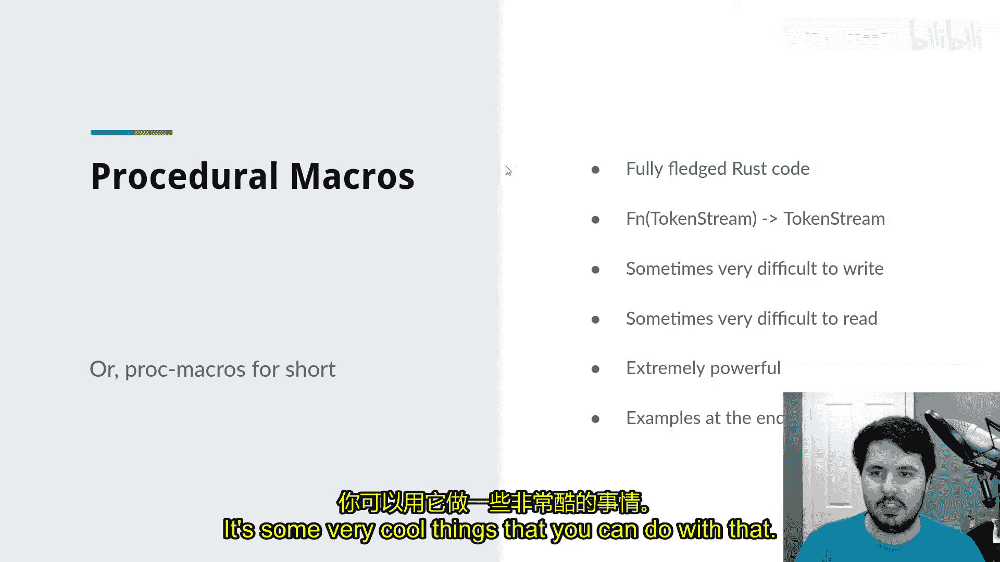

嗯。Okay。

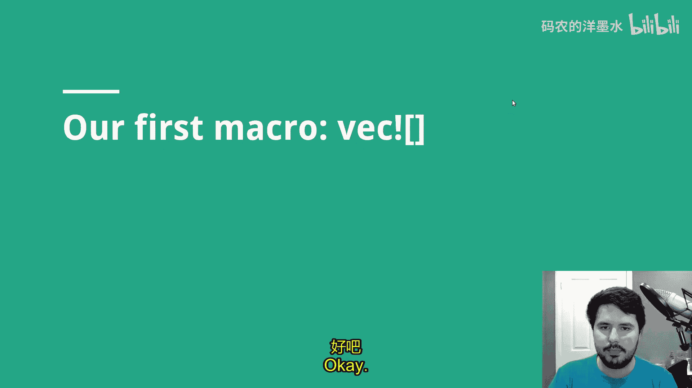

P。So。We're going to look at how writing these kinds of macros in rust works。In particular。

 we're going to try and remake the Vc bang macro ourselves because that's a pretty nice like getting started example that shows you most of the important ideas of macros。

😊，嗯。But we're like right up towards the hour， so I think it might be a good time to just see like。

 you know， catch up with where we're at so far。嗯。catch up with， yeah， how I're feeling。

 There's any questions or anything like that and then take a quick break。

 and then we'll write a bunch of rust macros。And look at some very cool crates that do some very cool things with procedural macros as well at the end。

😊，So are there any questions any？Questions， queries， comments， concerns。

From the chat before we have a little bit of a break。Or does anyone wantanna， you know， put a。

Put a crab moat in the chat。 So I know it's。So I know the chat's not completely dead。All right。

 we've got to cr remote。Alright， well let's say， let's， let's take a break。 Now。

 I'll leave you all the break to。To think of if you've got any questions。 and then I'll。

 I'll field how many there are after we come back from the break。 So let's have a break until 1904。

We'll come back after the break， answer any questions and。

And then continue on with the rest of the content。 So I'll see you at 704。

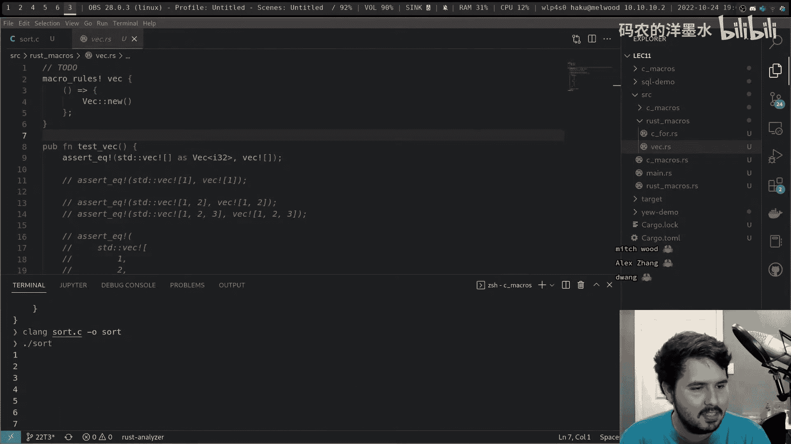

All right。So， it seems that they weren't any。Well， lectured questions， I suppose。During the break。

Apart from classroom run Stic， maybe not working。Yeah you'll I'll just have to get you to make a post on the forums with the output and stuff。

 it's totally believable that things are naturally going wrong with it。嗯。But yeah。Yeah。

 I'm sure you know the drill， throw it on the forum with some output and stuff and we'll try and figure out what's going on。

Otherwise。We shall continue on here。And have a play with this this macro rules V。Very cool。

 So one thing I'm quickly gonna do。Yeah， one thing I'm going to quickly do is I'm going to copy paste this。

Into。Main， I sorry into like yeah， main dot R S， mainly because。

Mainly because it plays better with a tool called cargo expand， which I'll show in a second。So， yes。

 we would like to make the Vk bang macro。 So if you， if you recall， we have the V bang macro。

 lets us do things like。I'm gonna have to comment it out。

 Lets us do things like let my V equals V bang of 1，2，3，4，5。Right。And if I print it out。

Print out my V。Am I in the right spot， nope。Yes is here cargo run。I have a Vck of 1，2，3，4，5， right。

 It actually like constructs me in this case of V of I 32s。Great。😊。

And this also works for whatever type it is。 Let's say strings a bit bad。

 Let's say V of strings where I might have hello world。It's me。Right。

 and this still just works and it doesn't care how many parameters you give it as well。

 You could have an empty vector。And it's got nothing in it。 You have a vector with just one element。

And it still works。 And as we saw before， we can have a whole bunch of elements here like hello world。

 it's me。But how does this work， right， how does this actually even work in the first place？Well。

There is a brilliant tool that can give us a bit of insight here called cargo expand。

 I was up yesterday working hard to get cargo expand working on CSE， and I am glad to say it should。

😊，I'd love to say it does， but I believe it should， so if you have problems with it let me know。😊。

But in fact， all the 6991 tooling I did a big update to as yesterday of the day before I can't really remember。

 so if anything like cargo or rust C or whatever is not working properly for you post on the forums。

 let us know。But you should be able to write code like this six hour and cargo expand。

I'm just going to write cargo expand myself here without six an mile because I'm working locally。😊。

And you， you can just run it like this cargo expand。

 or you can tell it a function in particular that you'd like to expand， but。

It it appears that the function needs to be in in the main dot RRS file。

 I'm at least from my quick experience playing around with it。

 I didn't know about this option until Tom told me about it recently to provide a function。

 but it only seems to work for me in main dot R S。 So you might have the same experience。

 but what cargo Sp does is basically the exact same as what。As what the cllang dash capital E does。

 it runs the macros， right， macro here， Vc bangang without actually running the code itself。

 without executing the code。 just show what the macro expands into。

 So you can see here the let my my Vec Vck of Atster equals。 All that stays the exact same。

 just like in C。 But this macro invocation here。 Vc bangang of this stuff got turned into this。

 essentially， got turned into something that creates a Vec out of hellello world。 It's me。

 This is a bit of a。😊，sYou know， sneaky and or tricky way to do it。

 we're not going to do it quite this way。When we were at AlveEC Mac。

 we will do it a slightly simpler way， I believe。But this is the primary idea。

 Whenever you see an exclamation point in rust， right， Vec bang here。

 you know that you're working with a function， not a macro。 And note I've done square brackets here。

 and most people tend to use square brackets， but you can actually use any of the three primary dis in rust to。

 to。Deliminate a macro， so you could use pers here， or you could even use oops。

 you could even use braces。Like。Such， and it's any of those can be used to yeah， to eliminate macros。

嗯。But yeah this exclamation point in the name tells us where working in a macro this is not going to be called as an actual function this is like this is going to be substituted worked on and new code is going to be spt out There's also other kinds of macros we've dealt with which look maybe something like this。

😊，Sttrouck food。It know something like that。Derriive clone here is a macro that will generate。

Some code that looks a little bit like this， simpleple clone for food。

 FN clone gives that a self where the string is self do string clone like that with a comm instead so。

😊，A hash drive clone will essentially spit out this exact code here。😊，Automatically for you。

 and in fact， cargo Exp should be able to give us this as well。No， but it doesn't show me on。

I'm gonna to get all the code out I'll see if I can oh here we go， that's al right。

 So you can see here it spat out this code here it spat that you know the  struckF stayed that was okay。

 but it also spat out this impple clone for fo， which just says no order to clone it。

 you need to create a new fo where the string is the selfstr cloned as well。😊。

And so this is also a macro working on your code， this one here is mainly for convenience because it's kind of annoying to write out all these very simple derivations over and over。

😊，And there's also attribute macros as well， where you can get code that will you know， modify。

 say function or。Or， you know， like a instructor or whatever。That isn't derived in particular。 The。

 the most common ones are things like web frameworks。 You might have something like my route that。

 you know， has some stuff in here and does some stuff there。 And you might say like。you know。

 get slash you know， hello or you know I'm just coming up with random stuff here and this might spit out a whole bunch of extra code in order to make your function here or might even modify the function itself in order to make it suitable to use in your web framework。

If you've done 153 on or something like that， you're probably familiar with this kind of idea。嗯。

And so there's all kinds of different macros that， you know， swim around and rust。But again。

 the main ones， the only ones we're going to get you to implement are declarative macros。

 macros by example。And not， not procedural and pretty much just in this flavor here with the like thing bang as opposed to。

 you know， attribute macros that work like this or like derived macros because these macros here you can't do。

 by example， these are only procedural。Which means that it actually runs some code again to spit out different or more code or anything like that。

So declarative macros instead's what we're looking at。😊，And I've commented it out here。

And this is like sort of baby' first macro that we've got going on here。

 Let me figure out what I want to leave here。That seems reasonable。 Yep。

 so baby' first macro we've got。😊，Is just macro rules bank deck， so。You write the text， You know。

 this is blessed text here。 Maccro underscore rules bang， right， If you're creating a new macro。

 by example， a new declarative macro， then you gotta start with this blessed text here。 macro rules。

 And this is， you know， some people tend to think this is like。You know this， this macro rules。

 this macro is the best， it's it's actually saying more like these are the rules of the macro。

 which we're going to see in a minute。😊，And then give your macro a name in our case I'm naming the macro V。

😊，And then some braces to eliminate the entire definition of the spec macro and then rules。

 these are the rules here。😊，So I could I can have as many rules as I like in my macro and they essentially say。

😊，When the when the code that's passed inside the macro， when the tokens， the syntax， right。

 that's passed to this macro look like this， like whatever is inside these parentheses here。 right。

 this stuff then。Spit out this code instead。So the first ruler is already like done for us here。

If no code is provided， so this would be the case that looks like Vec bang of nothing inside it。

Then simply spit out a new V。Right， with no elements， that seems pretty reasonable， right。

 that seems that makes sense， I think。嗯。And let's see it in action， if I go here。

Let's get rid of all the test cases for now， let my V equals V bang of nothing。

It doesn't know what type it is， though， let's say it's a vector of integers。

And I say cargo expandend。Test Vec， you'll see here。 this v bang of nothing turns into Vc new。Right。

 fantastic。 And again， the way it did that is it saw well， there's nothing in he。😊。

There's nothing in here， these match， and therefore I'm going to spinit out back new just like a match and match expression as well。

 very similar idea。😊，But then we might want to say that they can actually you know provide some elements that theyd like in the V。

 let's just start off with one element to get us started。So let's say they。

 we're going to say like they can give us an item。And then I would like to say， okay， you know。

 this macro， what is this macro going to like turn into， it's kind of a bit of a tricky idea。Right。

 because they've written my V equals this。 So like， I can't really just say like let。

Mute V equals V new Vc dot， push the item。And then， like。And like， you know。

 I guess they have the Vec here， like this just doesn't really work。If we expand it。

 we'll if I actually like pass an item in。We're going to see for the first reason。

It doesn't know what this 1，2，3 is。 I'm gonna skip ahead here。

 just like avert your eyes for a second。 right， imagine that was the same thing we'll talk about in a second。

We're going to see trailing semi call it Let。 Yeah， okay， it won't even expand the V for me。

 I was hoping it would expand it。 And we'd say it's wrong， but it's like it's so raw， Oh。

 there it is。 Great。 Oh， it is there。 great ignoregnore all the massive error at the top。

 We get let my Vec is a vva to equal to。😊，Like， let mute Vec Kegels V new like。

Its not like really working。 right， Like that doesn't really make sense as rust code。

So let's think about how if someone gave us deck of  one，2，3， oops。

What would we want this to turn into？Right， like how could we go from this into the code that we want。

 So this is the way I often like to write macros when I'm writing rust is here's like my case here。

 What should the code that the macro spit out look like。

 And if you need to define a right here that includes the element 1，2。

3 without obviously using the V macro that exists， How would you do that。

 And there is a trick you can use here， you can use that idea of blocks in rust and and blocks returning in expression implicitly in that kind of idea。

 So how would I do that， Well， I'd say first spit out some new braces。😊。

And in there I'll say let mute Vec equals a new vector。And then say V dot push。The item。

 which is one，2，3。And then。Give the Vec back as an expression at the very end here。

 So this is a block that'll end up evaluating into this expression here。 The Vc。

 And so it'll set that to be that。 And this is， oops， what have I clicked here。

 And this is something that we could spit out。 and it should， in theory do the right thing。

 So how we tell our macro to do that。 Well， the important idea here is we didn't actually tell it to spit out these braces。

😊，Right by default it's just going to like put the code right there。

 so I'm going to need to start off by saying， hey， I actually need you to create a block here。😊。

All right， so inside this expansion， create a new block that it will spit out。And then。

Give that V back as an expression at the end。Right。And if I go， let's forget about this code for now。

 let's see what this now expands into。You'll see， it expands into equals。Brace let mute V is Vec new。

 vectordo push1，2，3， Vec。Right， great。Now there was a little trick that I you know， I said。

 look avert your eyes for a second， I'm going to tell you about this now in C we would just write item like this。

😊，Right， item， V push item great， then you it works。But this doesn't work in rust。

 no rules expected the token 123， maybe we can have a look at the error message now right。

 no rules expected this token 123。So what's going on here is that in rust， you don't in C。

 you can just sort of like define parameters that it takes in。And， you know。

 separated with things like commas， whatever item， fo bar whatever。

 And these are all parameters in rust， you can actually say， like when I write item by default here。

 it's literally going to look for。Someone typing in the code ITEM comma right。

 like it's it's actually looking to match this exact syntax here。

So I'll show you if I write item fo bar。Into this。😊，Then it will work。😊。

Because it matches that rule and then it'll turn into， you know this with again。

 the literal word item， I told it to type out the literal word item and it'll go， hey。

 I don't know what the value item is。😊，RightSo Rus expects like the exact syntax。😊。

And these declarative macros like this。

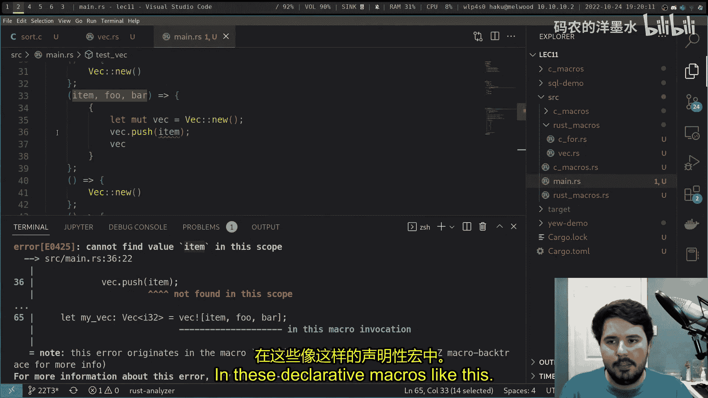

So that's the first thing that we sort of run into。 And then so like， you know。

 but macro is it's if you can only get them to spin out code。

 you can't give them any input other than just like， you know。

 other than just like fixed syntax that we type in here。 They wouldn't be that useful。

 We probably want to wait to be able to take you know parameters that a user can give us。

 and that's where we get into these macro meta variables。

 So I've stolen this big list here from the reference。

 And it shows us all the different sort of meta variables that we can use。

 I believe I have this open。😊。

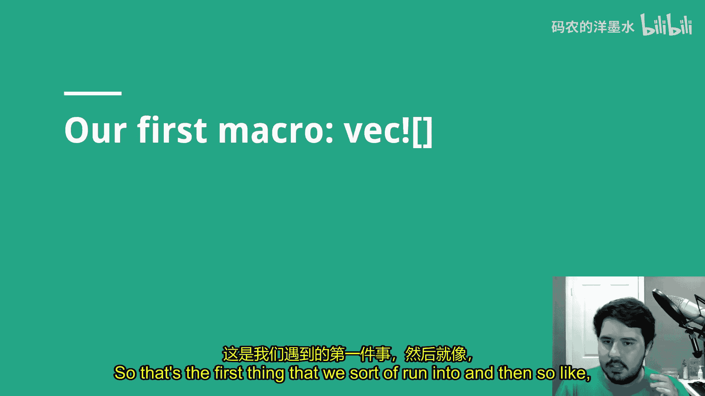

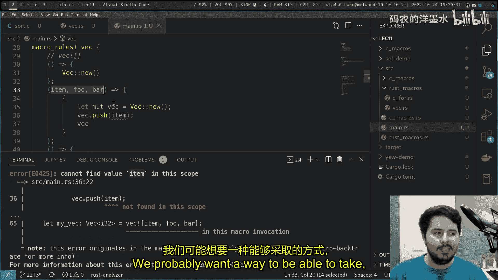

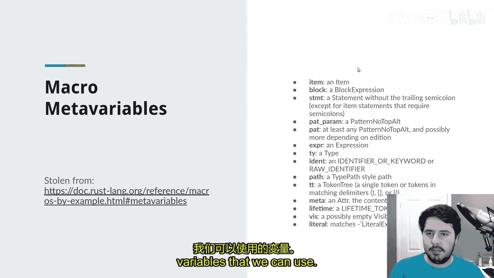

呃呃。The reference。Here， right， macros， by example， yes， here's the big list， great。😊。

And so if you actually want to take in a parameter。

 one difference in rust is that you actually need to tell rust what kind of piece of syntax to expect。

😊，Right， so， for example， we might ask for an expression。Right， an expression might be like。

 you know， an example of an expression might just be like 42。

Is an expression or say like 42 times 10 plus 5 is an expression。

 or like my like calling a function F is is a is an expression， or like my Vec here。

 just like referring to this existing variable my V， that's also an expression。 You know。

 there's all kinds of expressions in rust， even a block， right。

 can be used as an expression because the block will implicitly give back the last thing。

 So an expression is something that like a evaluates to some kind of value。

 whether it is just itself a value or if it's a more complex thing that you know。

 give back gives back a value， you know， later on。What else could we expect。

 we could expect something like a type， right， like I， I expect， you know， when you。

 when you call this macro to give in like I 32。Or like string， right。

 something that actually needs to be a valid type， potentially。Maybe some sort of identifier。

 you know， like foo or bar or v。Right。What other interesting things are there， a lifetime token。

 a literal， potentially。Statements， right， a statement being like an actual line of code， right。

 a line of code that someone might choose to type a block， right， like specifically a block。

With the braces and everything。Also this one token tree token tree is pretty interesting a token tree is like any token it's like really like match basically anything。

 but the gime is is like the catch here is that if I typed in like this。😊，Right。

 like let's say it the macro is evaluating this and it goes， I expect a token tree right here。

And there's like a whole bunch of stuff in here right。

 it's not just going to give me back one token like it might otherwise like say I 32 plus5。

 this is one token， this is oops， this is one token， this is one token， but if you have you know。

 like braces or parentheses or square brackets or something like that。

The token tree will be this whole thing here。 You know， there's。

 there's all these different types of things you can use and have a look out and play around with。

But we only need the the simple ones for like where we're going at the moment so in particular the ones that like you'll end up using quite a lot from what I found personally is Expa Exper is used all over the place。

😊，It's like probably the most common one that you'll end up using。

 and then less common things like type iddent。You know。

 still a relatively common block and statement， you know， sometimes appear around the place。

 and then token tree， when you're doing some pretty advanced macro stuff will will， you know。

 inevitably pop up and the rest are a little more specific。 and you can probably。You know。

 pushed to the wayside a little bit。Especially when you're getting started with it all Okay so。

we've decided that we want the item that the V takes in to be an expression， let's say， right。

 an expression which can be all kinds of different things， right， it could be a literal。

 It could be an array。 It could be a topple a struct， you know。

 or there's all kinds of different things that an expression can be。

And the way that we denote that with macro rules is you prefix the thing that you want to be a a meta variable with a dollar sign。

So it says that don't actually look for the syntax item or the syntax like dollar sign ITEM。😊。

Instead， this is something special and then use a colon to tell rust what kind of you know meta variable it is in our case we want it to be an expression。

Right， now down here， I can substitute it into the vector by referencing it as dollar item down here。

 So dollar item is going to be some expression。 So this branch should be taken if the user provides basically any expression。

And then we pushed that item into the V。But like down here。And so if I say a V of 42。

 let's see what cargo expand tells us。 and again， cargo expand is genuinely the best we use all over the place。

You'll see it substitutes this right，42 here is item。 It pushes this item in。

 you know as we expected。 And because again， expressions are really flexible。

 you can do all kinds of stuff in here， I can say it's a block that says like let x equals 42 x times 7 plus5。

 this is all still just one expression because a block is an expression that has。

 you know some statements and an expression at the end in it and all that it's all nice and very flexible and it puts the code together how it' expect to。

 remember it is still substituting code， syntax code It's not running this and then putting it in the V when you know when the macro is being worked on。

😊，The macro creates this code and then when we end up running the program it actually does the calculation and like inserts it into the back。

 I probably should have included some kind of printlin in here， my back。

Like that and it actually you know goes， oh， that's 299 or， you know， a Vic of 299。Great。

 so this seems to work。😊，But the problem is， it currently doesn't really scale。 And then if I say。

 let's go back to the simple example of 42。Let's say I won 43 in the V as well。 It goes， hey。

 I don't know what to do in a comma here。 Like I was with you while we were here。

 you threw a comma in and I don't know where to go from here。All right， 42 comma 43。

And so like how do we deal with that。 Well， we could just sort of like try and manually do this as best we can。

 Let's say item1 here， item 2 is then another expression。And then we're going to say。Push item one。

 push item2。And you know， that'll get us。Sorry， should have done the cargo expand。And that'll get us。

 you know， a little further along the way。 so now we can deal with no items， one item， two items。

 but then， you know， three and upwards we sort screwed again。

And so this obviously just isn't a very scalable solution。😊。

Fortunately macros allow us to do things such as repetition so what we'd really like to say is any amount of items here is okay and they're separated probably by probably by commas like a normal function call so we'd like to say like 42 comma 43 comma 44 so on know so on so forth like that and then for each of those items call V dot push right around here on them you know in that order。

😊，So if we go back to the reference here。It should say somewhere repetitions here and you can read all about this and all the different kinds of repetitions。

 but it's worth knowing that basically you can say how the how do you put this。

 you can you can say I would like to repeat this thing。

 you can optionally say if you want it to be separated。

 like if you want individual elements to be separated by by whatever。And。

And you can either choose for like zero or more repetitions。

 one or more repetitions or zero or one repetitions。

 those are your three options in terms of in terms of repetitions so zero plus one plus zero or one are your three options here。

So what we do here， we can say one or more expressions is fine in this branch here。

 and I can write that like this。😊，So I throw， I do dollar parends in this case to indicate that there's some sort of repetition going on。

I keep the item expert here。And then at the end here。

 I optionally say what I'd like them to be separated by。

 in this case we'll say I'd like them to be separated by commas。😊，Right， and then I say how。

 like what kind of repetition I'd like， either zero or more， one or more or0 or one here。

And we're going to say one or more。And so that works out。😊，So essentially the way to read this is。

One or more。Expressions， each called item， separated by commas。Right。

And then this doesn't work down here anymore because it's like item is still repeating at this depth。

 like I don't know what you want me to do with item here because item is actually a whole bunch of expressions。

 I can't just throw a whole bunch of expressions in push like you know。

 tell me what you want me to do。😊，And the way we tell it is we just throw sort of this same syntax down。

Where we say， you know。Repeating like that same one or more times。Inside here， say v dot push。

Each item。Right， like it's， it's， it's very much sort of。

 you can write up on all the rules yourselves， but it's like。Pretty。

Like vaguely intuitive in that you don't need a whole bunch of like crazy extra syntax in order to make this work。

 It's sort of just like like I don't need to say repeating for like dollar item in， you know。

 that thing up there， it's just sort of like， you know。

 that that same one or more times push each individual item。And we'll see here。That this， you know。

 expands to what we'd expect to 42， 43， 44。嗯。This one here。

 you can see it's now sort of like scaling to as many things as we want。😊，That's great。嗯。

We can probably get rid of this double one here and this stuff down the bottom now。 So yeah， again。

 what we've got is if there's if there's no code that they've provided us。

 then just spit out Vec new， otherwise we can have one or more items separated by commas each item is an expression and we'll turn it into a block that says let mut Vec is Vec new and then that same like for each of those items。

 push that item onto the V， give the V back and you'll see that's the code that ends up it ends up expanding into。

But doesn't it expect the list of elements to end with the comma。

 so actually specifically the opposite？😊，If I had to put the comma here。

 then I would be saying one or more times expect there to be an expression and then a comma and you'll see if I save this。

 it's going to go， hey， you're missing some extra tokens that are required and it requires that extra comma at the end when you put the comma here just before like how many times you say it repeats this is signifying to macro rules。

That you would like these things to be separated by comm。 Right so each individual。

Iteration of this should be separated by a comma。 And so it's a sort of smart knowing that， well。

 this is separated by this by a comma， this is separated by this from this by a comma。

 but there's no additional thing here。 So there's no comma needed。

But the sort of drawback that comes with this is that if I put a commr on the end。Suddenly。

 this macro doesn't work。Because I've got a comma sticking off the end here and it。

In't expecting a comma， you know， I put a comma in there now this works and then I take the comma away and now it doesn't work。

 And so you know it it's a little bit of a tricky problem for us to think about there。

 which is going to be this very bottom example that we'll talk about in a minute。But yes。

 theyre like well noticed。嗯。Cool， so that's sort of like our baseline vector macro。

 Let's see how it's going in our tests。 So I've just got。

 here's like testing it against the standard libraries vector empty one element，2 elements。

 three elements。😊，Let's I just， I'll say guess we go cargo run and it seems like there's no failures here just to check it's running it if I change V1 to V2。

 you'll see that's no good。So it is running those seems to be doing the right thing。

Why isn't it designed in a CML style？You're gonna have to help me along with that in a CM M L style。

 you'll have to help me with that one。 Ru still automatically expect anything within repetition to be of the same type。

 It'll expect anything in the repetition to be Oh so， so no， that's。

 that's an interesting idea is like， what if I give it3 wildly different expressions。 right。

 Like I give it one。 let's， let's do it up here。 actually，42。😊，String。50。5。

And then like crazy expression。 like， I don't know， like a topple of like 42，40，50 and hello， right。

 all these different kinds of things in here。If I go cargo run， then， you know。

 obviously things aren't working， but if I ask for cargo expand and I've got a whole bunch of junkie here now。

If I ask for cargo expand， you'll see the macro expands just fine because all it's asking for is that these are expressions and so it sees that it goes do this。

 do that， do this， do that And it's only once this code is run through the compiler It's only once this code has run through the compiler that then it sees a problem with it because it's going。

 hey， you're trying to you know push in types that just don't make sense expected integer found floating point number So it's actually like this step strictly comes first before all this like type checking you know before types are really even considered like that。

😊，So that's an interesting sort of you know， consequence of macros。Oops， that's not what I wanted。

I wanted to do this。嗯。And then， oh， command line argument style。Command line argument style。 Oh。

 do you mean in terms of like， why didn't they specify this the same What Like。

 why are they sort of using this syntax here。 That's like a little redxy and a little weird。

I'm not sure why they chose this exact syntax， but you know Rust has its own needs and stuff and I suppose they settled on this being you know relatively good。

 but yeah' there's certainly an argument to be had there in terms of what's the best syntax for something like this definitely。

😊，Right， so all these seem to work。 But there is this one test case that I've got down the bottom here that based on that previous discussion。

 actually won't work where sometimes you like to specify， you know， your arguments。

 let's say vertically like this， and it's nice to be able to provide a trailing comma。

 if you would like， whereas with ours， it's not expecting that token。

 And so it just simply doesn't work。 So notice it does compile for stood Vc。

 but doesn't compile for our Vc here because it's not expecting that comma。

 There's a relatively easy fix for this。 And there's， you know。

 there's a whole bunch of different ways that you could choose to do this，😊，But you know。

 a relatively simple way you could choose to is is just say at the end here。

 optionally allow a comma if they'd like。All right just optionally do that and recall that there's a repeater here。

 which indicates an optional fragment of 001 occurrences。And so I can just follow the same syntax。

 excuse me。Of Dola bracket question mark。Right， like I did here with like Dola bracket comma plus。

There's no separator for an optional fragment because it's not repeating。And then inside here， what。

 like what sort of tokens， what syntax am I saying is optional， just one comma。Right。

And notice that white space also like white space the actual sort of tokenization comes first before we before we get into the macro system。

 so things like white space don't matter right I can put a whole bunch of white space here and the macro rules doesn't care because it's already been tokenized before that point。

A。And so now this trailing comma is fine because it passes all of this as like the main stuff， one。

 you know， separated with a comma from two， separate with a comma from three。

 separate with a comma from4， separate with a comma from five。😊，That's the end of that list。

 And then it just says a commr and goes great。 That's the optional comma there。

 which just doesn't end up getting used， essentially。So yeah， that seems to work as well。😊。

And is's certainly an option。So that this is pretty much our Vc macro completed。😊，Very epic。

So what else did I have， right， Yes， and we've got some more stuff to look at naturally。

 But this is our Vc macro。 And this is sort of like。

 if you understand all the bits and pieces that are going on here。

 you're like well on your way with macros。We're going to write one more macro， which is pretty cool。

We're going to write one more。 and then again，ll I'll show it'll mostly just be showing code past that point。

Test back。 Now that one goes here。Ku。Don't need to do anymore。 We actually did it。

 This here is V bangang of， you know， 1，2，3， you know， so on like that， great。Alrighty。

And this one here is just that。Which I guess we don't need anymore。Okay。

 so are there any questions with the Vc macro before we。I'll show some。

 I'll show the C macros convert into like rust style macros。

 even if they don't really make a ton of sense in rust itself。 we'll write one more macro。

 and then we'll look at those， those very cool proc macros that I promised。

 But there any questions with what's going on here in terms of the our like home brewod V macro that we put together here。

Cib emoji。Alright， if you're typing out a question， then please continue to do so。

 I'm going to flick off for now and move on to the next thing。 But again， if you。

 if you've got a question， you。Working on talking it out。

 continue to do so and we'll jump back to it。Let's have a quick squeeze at these C macros we looked at before converted to rust。

 So in the case of max， the macro rules here I think is relatively simple。

 So macro rules max where we just go Do A like we take in Do A is an expression。

 Do B is also an expression。😊，And then this turns into the code。

 if dollar A is greater than dollars B than dollar A L dollar B。Right， and so if I。

 let me turn on the test for this one。If I run this。You'll see that as max of 4 to 100 is 100。

 so that seems to work out。😊，And if I cargo expand this。Oh， I didn't un the V stuff。max。Yeah， well。

 you can see this is where it got spt out。 It's also inside another macro。

 which is the debug bang macro， which I really like using。

 but it is very like it's a bit of a crazy macro。 But you can see here。

 this is where our code itself got spt out。 Oh the if sorry， the if as well。😊，This， you know。

42 was a，100 was B， 42 was A 100 was B， and so it's substituted the text as we'd expect。

But note that this does still suffer from that same problem， which is if I have say some function。

 print and return takes in I 30， oh let's say print and return of T where T is can be printed out。😊。

X is some t， we get back that same T， right， we've launched generics， we know how to do this。

So I'd say print out X and then give back X。And I do the same thing。 Pri and return 42。

 Pri and return 100。Cargo run， you'll notice that， you know， rust is。

 this is still like a pretty fundamental like problem in air quotes。

 like a pretty fundamental idea in macros in that this is sort of like your expectation in terms of if you know。

 if you wrote a macro like this， you'd expect it to do it because it's just substituting the code like this。

 However， in rust， because we have block expressions。

 we have some opportunity to get around this in terms of doing something like let a be dollar A。

 let B be dollar B。 And then if a is greater than B。😊，Then give back a else give back B。

So why does this help us at all if I do cargo expand again and try and track down that a little bit here。

ちちち。Where is it， Here we go。Right， now。It spits out this code here， let A equals print in return 42。

 let B is print in return 100， and then just does the comparison there。😊，Right， yes。

 and Dongyas do while zero。 Yes， yes， yes， yes， very， very， very true。😊。

But you can see that now we only call the function like once for each parameter because we can just like bind it and then give our thing back in an expression return。

嗯。So it's a nice little solution if you only want it to be evaluated once in Ru。

 you might do something like this。But yeah， it' something to be aware of， something to know exists。

But I'll leave it as the C macro was in this case。The up to。Looks a little like this。 we have。

 you know， in Ru， I can't just go like， remember in the C code。

 it just left the whole body of the full loop out。And then we just put like the full loop after the macro in here。

 it's like kind of a little crazy like that。Rust isn't gonna be super pleased about just spitting out code like that。

 Saly， with the macro system。 So instead we'll take the body in here。

 We'll take the body in as an expression， or this could I suppose this could probably be a block as well instead。

 maybe a block makes a little more sense。And then we just go for， you know， taking a identifier。

 in this case， I being the identifier that we'd like to use in our loop。

 Maybe you'd like to call it fo and fo， whatever you want to call it。

N being an expression of what we're looping up to and then the body of the code。

 which is just a block and this turns into the code for in this case like P we've called it for P in0 up to 10。

😊，Right， then spit out this body， printlin food。I can try and look for this one as well。

 hunt it down。 This is sorting up to。 There we go，4 F in 0 to 10。Right，4 through in 0 to 10。

 the body here and the body ends up just calling printlin Prilin is also a macro， as we know。

 because it lets us do this sort of。Clver stuff like this， like format strings and， and all that。

So that's the up to macro and rust and then the sort macro， which is naturally a little crazy。😊。

I'm not going to go too deeply into this， but it's there on GitHub if you'd like to have a look at it。

Again， usually we just use traits in rust like we would do it。If I want to sort something。

We look at like how rust is on it where it says to sort a slice。

 you just have to require that that the elements T inside that slice can be ordered。

 and then if they can be ordered， it'll just merge sort it using whatever their implementation of ad is。

Where you can compare two things and spit out and ordering， whether they're less equal or greater。

 And so we， you know， we wouldn't。We wouldn't really write code this way in rust。

 but you'd still have that option available to you and sometimes， you know。

 very specific requirements might mean that this is the this might be the way you have to do it。

 but it's there for you to play around with them to ask questions about on the forum if you would like to。

Okay， so let's write our one last macro。 In fact， I'm going to do what I what I did last time and copy paste it in domain。

Which is C4。😊，C 4， not C4 the explosive。 I'd like to， this is like this idea of syntax extension。

 Maybe I've come from C， and I really， really like the C4 loop syntax。😊，RightI like the four bh。

 you know， blahing， blaing blah thing and then the body of the for loop in like this three part initialized condition step kind of syntax。

 There is no equivalent for that in rust， but you know， worry not， we can do this with a macro。

 even just with a declarative macro a macro by example using macro rules。

 we don't even have to go to the whole procedural macro land and get all crazy with it。😊。

So how would I write a C4 macro？Well， first of all。

 we need to specify what kind of input we're expecting to the macro and then we youve got to decide what kind of code would we like to spit out。

😊，From the macro。 So what kind of input are we looking for， Well。

 we're expecting them to put a for loop in， right？ So a full loop starts with4 FO R。All right。

 so I'll type that in。Then we expect some parentheses。

Right C requires app parentheses and its for loops。 Then we， first of all。

 we'll get some sort of statement， right like something to do before the for loop starts。

 That's a statement there。 So we'll call that dollar in it。Is some kind of statement。

Then we expect to see a semicolon here。We expect to see a condition。

 the condition here being an expression， something that will， you know。

 give us back a true or false value。 So I'll call it the condition here。Condition。

 and it's just some kind of expression。And then finally we end off with another statement。

 no semi colonlon at the end of this statement though。

 which is just like what to do the end of each iteration。

 so I like to call this the step and that's just some kind of statement like this。😊，Finally。

 we expect to see the parentenshees end and the actual body of the full loop。

 which as we saw before is probably the best expressed as a block。

 so the body here is then going to be a block。😊，Right， and you can see。

The fact that there's no errors means that this passes。 right。

 Let's say I just turn the code into like the string hello， right， just to like test what's going on。

 And I run cargo expand cargo expand main。Nope， cargo span test C4。There it is。

 You can see it's matching all these tokens， as I've written it here because it's turning all that code just into the code string hello。

😊，So it's it's working。 now it is working。 We just need to make it actually do a full loop， right。

 do the actual looping that we'd expect。😊，And so what code should we put here？Well。

 we probably want to put here like how I would explain a full loop to a new C programmer。

 The way I tend to explain a full loop to a new C programmer is we have a few parts。

 We have the initializer。We have the condition， we have the step， and then we have in here the body。

And a full loop。At the end of the day， it really just is like。The initialization。While the condition。

The body。And then the step。That's generally how I choose to like you know how I explain to a beginner。

 this is how a full loop works， it's just a while loop that looks like this。😊。

Right if we like substitute the actual tokens here that we've got， it's going to look like this。

 we're going to throw the condition into the while loop here。

 we're going to throw the body of the while loop， which is this in here。

 and then we're going to throw in the step at the very end there。Right， and essentially。

 the explanation of how I just did that is all I need to explain to the macro。

 So how am I going to explain it to the macro， I'm going to say， well， first of all。Like。

 do whatever the initialization statement is there。 So throw that there first。Then next up。

 we're going to do a while loop， and we're going to while。

Our condition is going to be the condition that they specified here， right while the condition。

Inside that while loop， I would first like to do the body that they've provided here。Right。

 so throw in the body that they've given us。 And at the end of the while loop。

 whatever like the the step that they gave us us suppose here， this this I plus equals 1。Right。

And so like， I'm not kidding。That's it。That's， that's all the code。 cargo expand。 And you'll see。

 I mean， the print line here is maybe a bad choice。 If I just comment out the body for a second。

 you'll see we get let mute I is 0。 while I is less than 10。 the body goes here。 I plus equals 1。

Right， the printlin macro again throws in a bit of like some extra stuff here。

 but that's just like the body of the thing。Right， and then like， yeah。

 like I see something saying something about continue or break or whatever。

You could even use continue， you could use break。Like all of these will work because we're still in a while loop at the end of the day。

 which is going to function like the same way。And so lets let's run it。 I probably need to call it。

Test C 4。And you get0 through9， as would expect。All right， pretty cool。So this is the kind of thing。

 if you really like these four loops， if you really like this syntax。

 then you can bring that syntax into the language。😊，Right。

 so we've seen like convenience things here right this is a more of a convenience macro in that it helps you like very commonly you might want to create a V with some like predefined elements and writing like V push。

 push， push push is really rather annoying and functions。

 as we know in rust can only take a fixed amount of arguments。

 There's no concept of veryatic functions in rust， but with a macro。

 we can bring back that convenience。😊，And， you know， also with macros， we can do。

Even more like interesting stuff in terms of introducing additional syntax to the language。

 for example， with something like a C4。 And you can see when you've。

 when it's a relatively simple idea， a macro rules can also just make that very easy。 And like sure。

 you might look at this in like。It might take you a minute to figure out what's going on there。

 but it's pretty readable in terms of like if you know the syntax and you know how these macro macros by example work。

 you can probably read through and go like， oh， I get what's going on here。Oh， actually。

 that's a good point using continues to jump to the step， not back to the start of the loop dose。

 So continue might not work。 That's a very good point。 That's quite interesting。

 And so there might be like tricks that you need to， in fact， you could probably just do a。😊，Yeah。

Yeah， there's， there's some tricks that you might need to pull in order to make that work effectively。

 I think I could come up with a hacky way of doing it on the fly， which is maybe something like。

But then you have to worry about continue and not break。Yeah， okay， I like I think I could do this。

 and if you ask it on the forum， then you can， you can certainly bully me into doing it if you're interested in it。

 you can ask on the forum。But it's probably going to involve like throwing in like a fake pseudo loop in here and then using like the continuum or the break of the pseudo loop to inform what you want to do in the outside loop。

 that would be my intuition of the primary way to do it or alternatively。

 you could just have a look like this idea is is not exclusive to what we've seen here Some people like C4 loops。

 Nope， not C4 C4 right This is they don't do it in the exact same syntax that we've got here。

 but you know， other people have come up with this。

And handling continue。 oh， this is bad C4 warning。 This is broken。 Yep， exactly as you say。

 So they've got this example here， which I wasn't aware of。And then， they。

They they don't actually tell you how they do it。 But I guess we could look at this， this。

 And then we could see， yeah， they have like a a cheeky extra loop in the middle here is what I was expecting。

 First and continue。 They put the body in probably here。 Y。

 And then they use that to inform what to do in the the bigger loop。

 So the macro is a little more complicated because of that。 Oh， and also。

 you can have as many initializations as you want。 I actually forgot about that part of C as well。

 And they deal with that here。嗯。But yeah， there's all kinds of stuff that you can play around with。

 have a look at this macro doc。 Rs/ C4 for sure because's there's clearly some interesting stuff going on there。

😊，Alright， so that's LC C4 macro over there。 Let me throw it back in where it should be going。

 which is here。

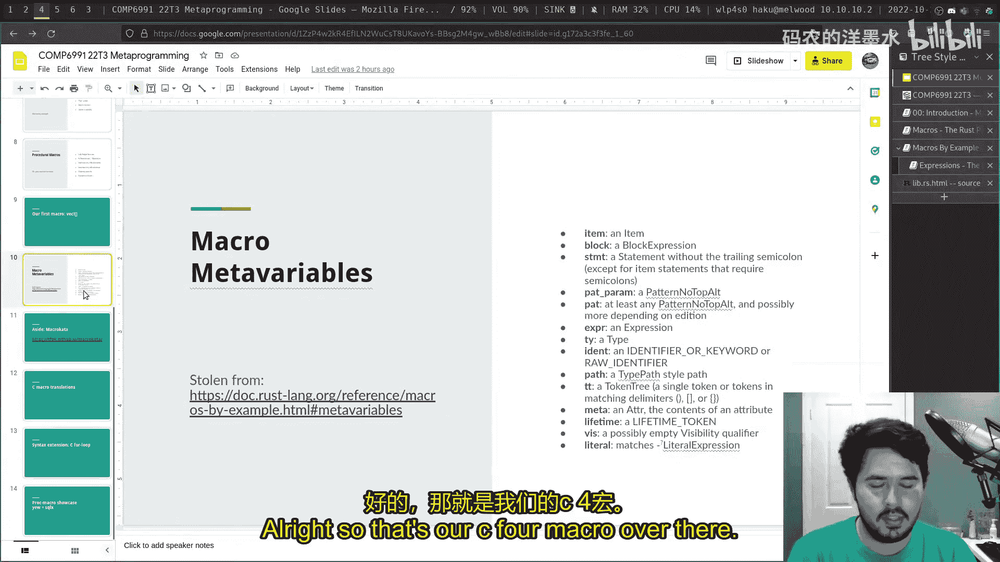

Great main throughout this and I can unment all of this now for you to use in your when you're playing around with the lecture examples。

😊，Yes， macros are very cool， but naturally， they can absolutely be abused。 There is like a certain。

 you know。Sor I like to talk about macros similar to how I talk about redxs in that a lot of the time you have a problem。

 you you write a macro to solve the problem， you now have two problems。You know。

 in the macros can often sometimes they can create more headaches than they're worth。

 but they also open up a lot of really powerful possibilities。Okay， so two quick examples。

 Are there any slides， Is there any information that I've， oh right， yes。

 there is something want to talk about。 So the C macro translations， the C4 loop， we've done that。

 Okay， two things left。 we might run a little over macro carta and the proc macro showcase。

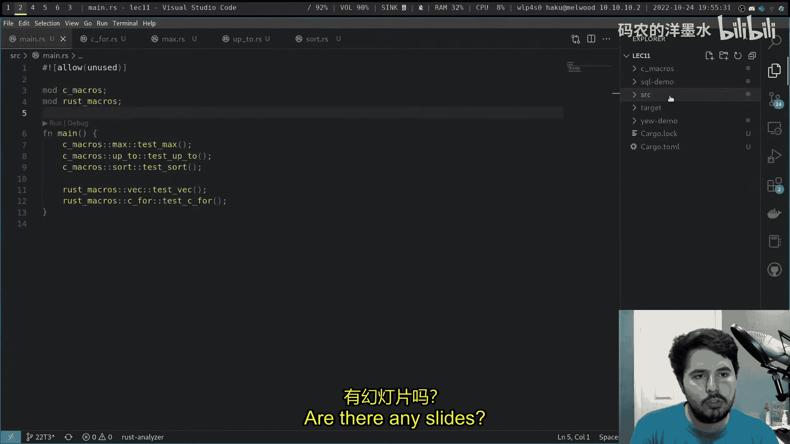

So macrocarta is a set of exercises which you can use to learn how to write macros in rust。 there is。

 I think，12 yes，1212 exercises because this isn't actually an exercise。

 There's 12 exercises in macrocarta。

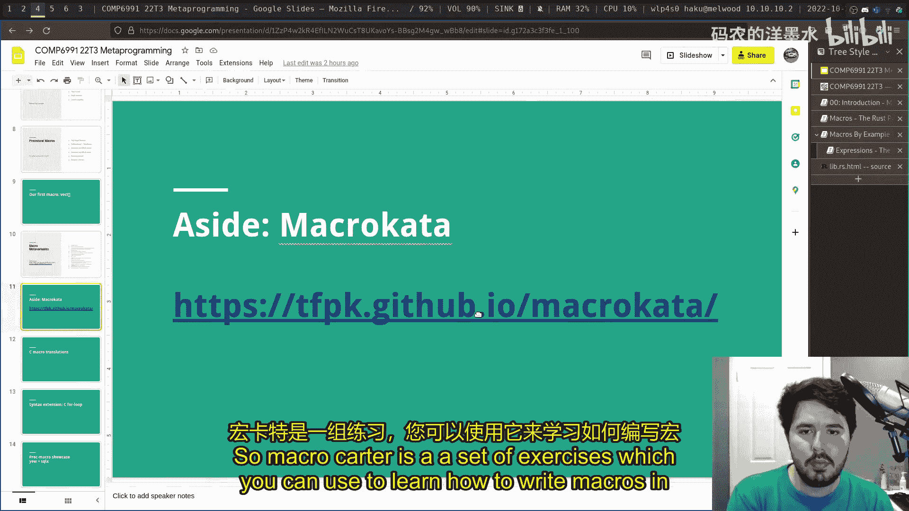

And they start you from like writing very simple macros all the way up to， you know。

 quite more complicated ones。

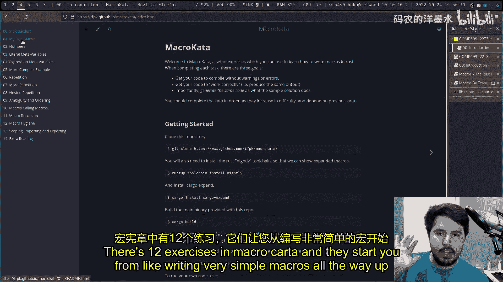

And in the weekly exercises， the weekly exercise repetition is simply exercise6 of macrocarta。

 So you could jump straight to exercise6 if you're feeling very comfortable with macros and like you know that's we're not marking your progress on one through five but one through five will help you also build up the knowledge yourself in order to complete exercise 6 that we're marking。

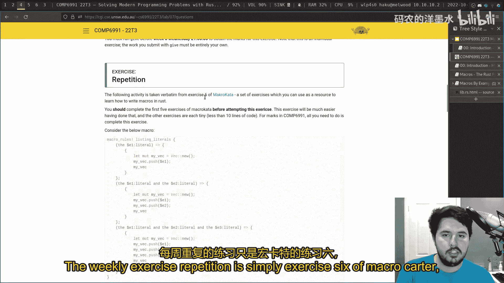

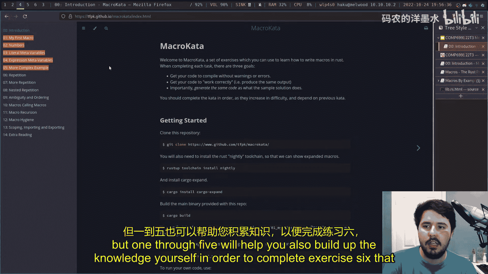

And then furthermore， we also have exercise 11 of macrocarta as a challenge exercise。

 so you can continue going on all the way up to to exercise 11 to get this cur example。

 which is certainly more complicated but can do even like cooler stuff for sure。

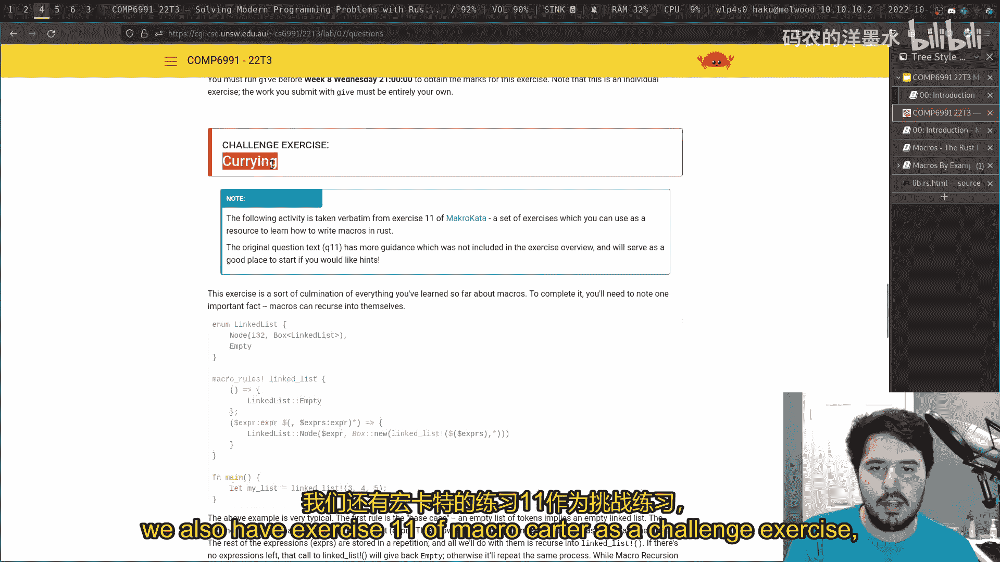

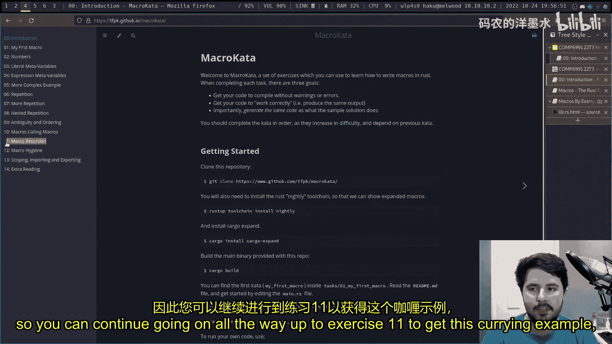

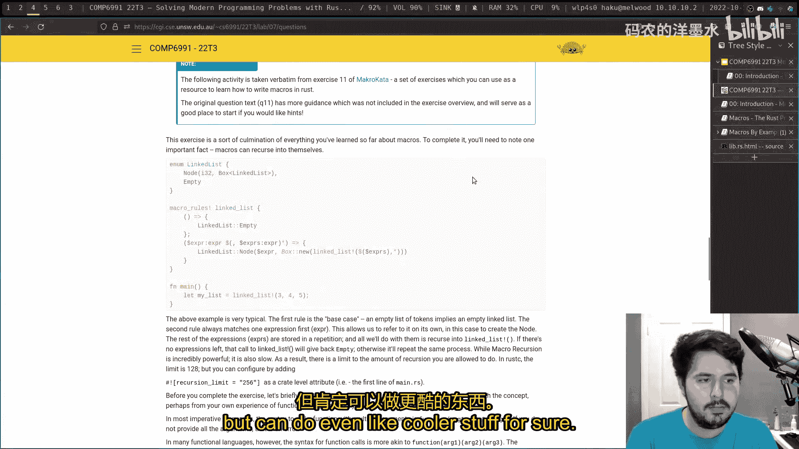

So I would suggest going through macro Carta yourself。

 follow the instructions and work through it in your own time and ask as many questions as you'd like on the forum and all that。

😊，It's a， it's a great。 And yeah， Tom wrote this very big thanks to Tom。 It's。

 it's a very cool set of exercises。 The marking for challenge exercises， it says something like。😊。

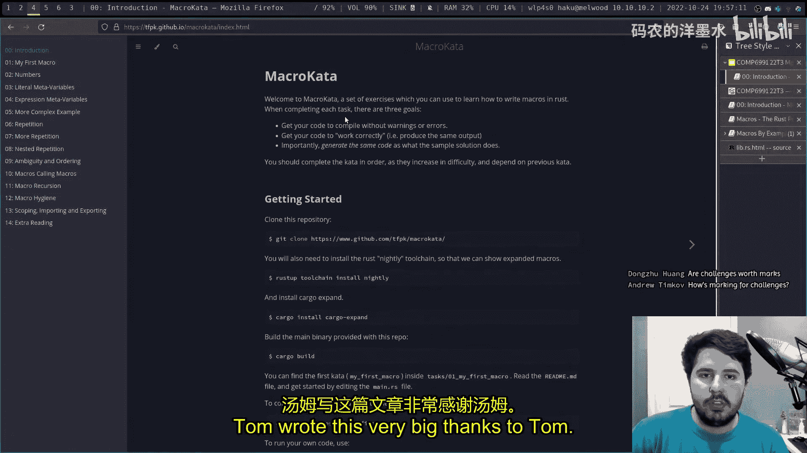

It says something like like da da da da da。 whered it go。Where is the mark， There was something here。

 There we go。It is a challenge exercise。 And if you do not complete the exercise。

 you will only use a small fraction of course marks。 So there。They are like worth marks。

 but probably not as much。mSo u yeah， like and that with we're， you know。

 making it very clear that these are， these are certainly challenging。

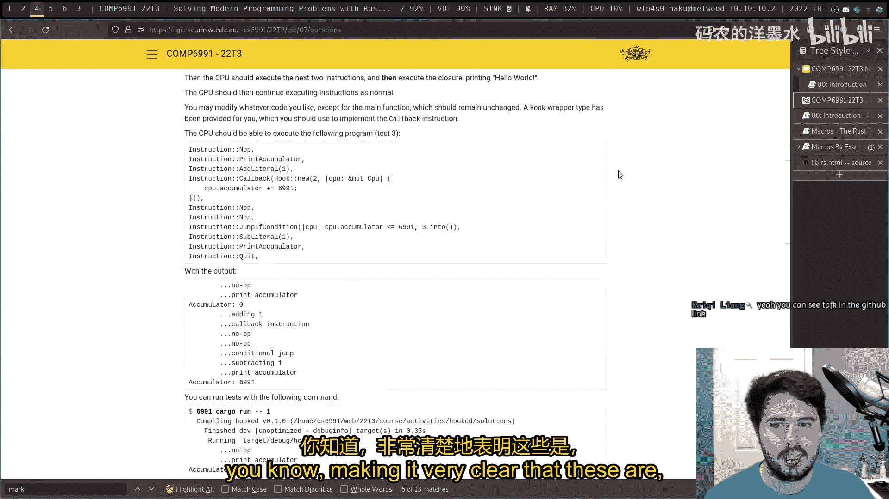

嗯。Great， so macrocarta， an amazing set of exercises。

 I would suggest just going through it and seeing how far you get on your own。

 no need to like no need to skip the first view or to stop at six or whatever。

 just go through it and if you get stuck somewhere then come talk to us and then you'll just be able to submit the ones that you finish on the you know through the the course exercises。

 the weekly exercises， right？😊。

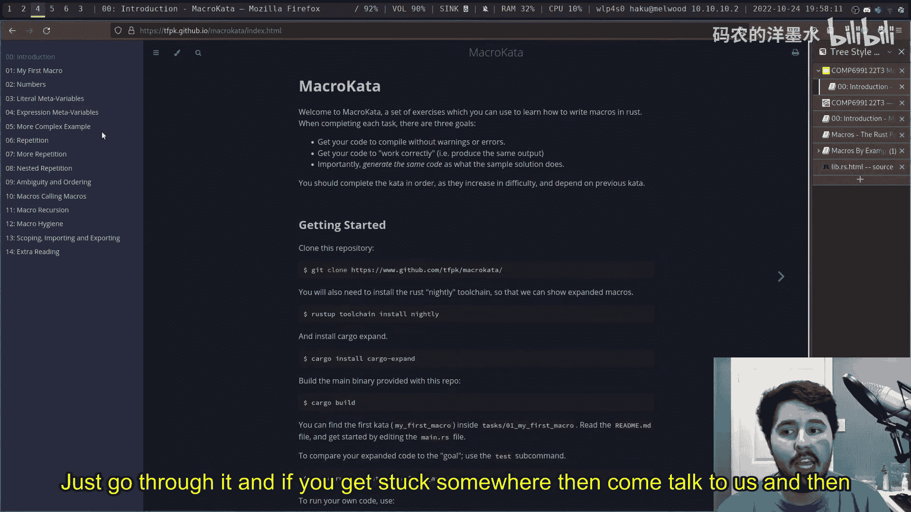

And the other half of the exercises are about function types which we're going to be talking about on Wednesday。

So macro carta and this these also link to macro。That's spt。Incorrectly。

linked to macro carta spelt incorrectly So yes， massive props to Tom for putting together this this practical。

 almost like self guided workshop and becoming familiar with macros。😊。

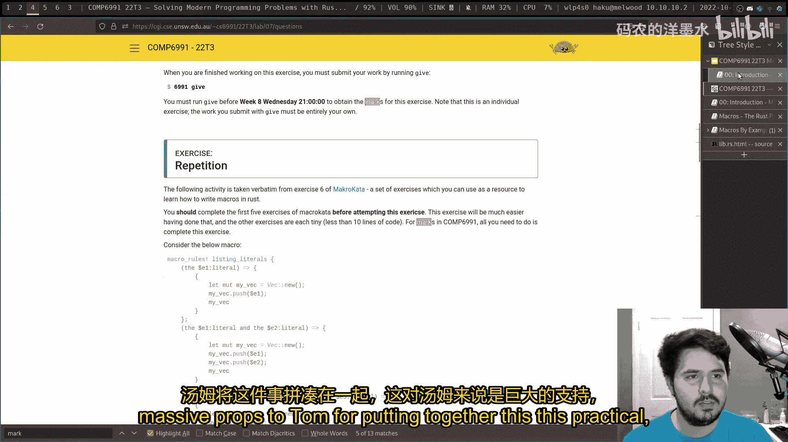

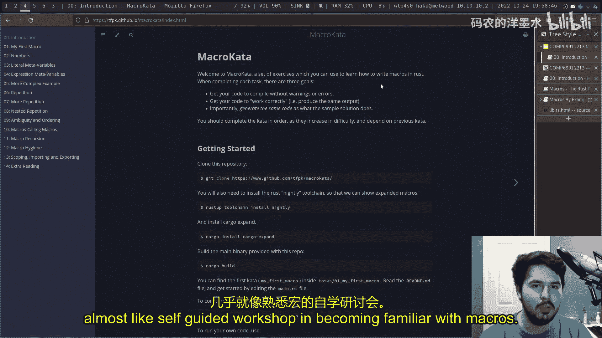

Alright， last bit is just a quick showcase of some really cool stuff you can do for。😊。

With with macros， these are all gonna to be procedural macros。

 which are the kind that like are general purpose rust code that can do。

 you know where really the sky is a limit in terms of like just write a rust function that takes tokens and spits out tokens。

 It means you can like as part of a macro。 you could do all kinds of crazy side effects。

 you could like ping the internet， you could go fetch something off the internet。

 you could read the file system， you can do you know it's actual rust code。

 So with a proc macro as part of the macro expansion you can literally do anything and spit out like literally any code makes them also a little dangerous。

 a little scary as well for that reason and。😊，Opens up a lot more avenues for abuse。

 but it also opens up a lot of avenues for really， really cool stuff so。😊。

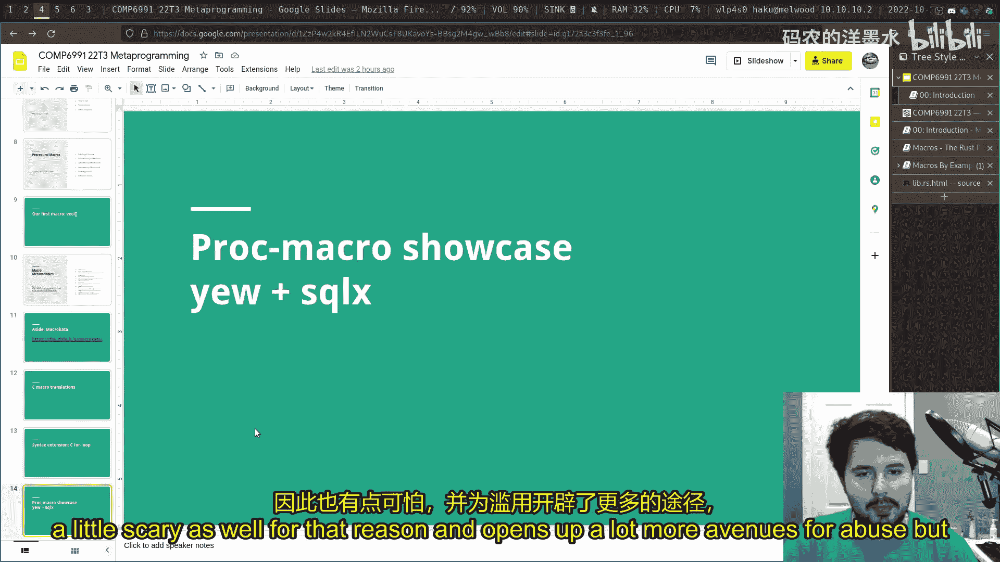

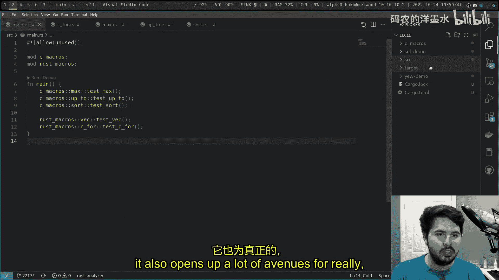

The two I'm going to show you is， first of all， something called you。

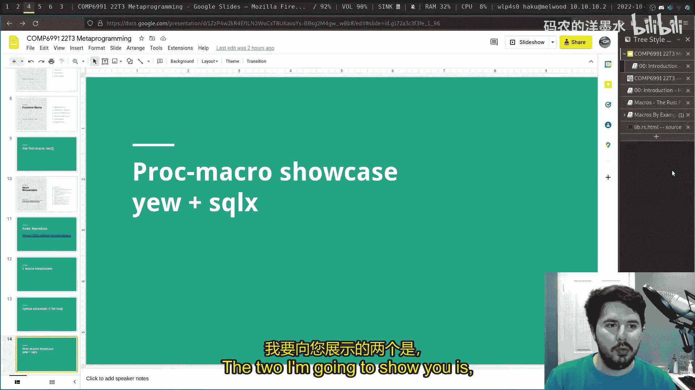

Oops， showing results for years。 Not quite what I。 Okay， fine， U dot R S。 there we go。

 So U dot R S is a web framework。Written in rust， so rust can compile to something called Web assemblyly Web assemblymbly is code that can run in a browser。

 it can also run outside of a browser， but the original kind of primary intention was to run in browsers and so you can actually write rust that you runs on a front end like this website I haven't you know actually check this myself but I'm assuming this website here is probably written in rust if you come from if you've done 152 on in the last couple years or you know you teach 152 on or whatever you'll be familiar with something called Npsywe which is again a rust application that runs in the browser through something called you。

Now， how do you get a rust program to like spit out HTML that you can see and and like yeah can that you can see and interact within your browser？

Through a macro。 So this is one of the like one of the straight up most brilliant inventions to come out of the land of rust Me programming is the HTML macro。

 and the HTML macros lets you just basically start writing HTML code。😊，mIn like in a rust file。

 if you're familiar with things like JSX。From like react and stuff like that。

 it's a similar sort of idea。 I'm literally writing HTML code in here and like mixing that in with rust code like I can say when you click this button print out button clicked right。

 the text of the button is clicky button， I have a hello there is a paragraph and then here's an a tag which says here's another message with some bold text in there as well。

😊，It's， it's just seriously cool。 And if we use， if we use cargo expand once again。You demo。

 cargo Expend。You'll see like this is a little wild at this point， but the my HTML。

 this turns into like you virtual dom V node， you know。

 and like it's actually like turned into a whole bunch of rust code。Right。

 a whole bunch of actual rust code that represents this like big tray of HTML。

It also means that like if I say screw up my tags like。

 let's say I actually accidentally wrote buttons here instead and then try and try and compile the code。

 you'll see that this closing tag has no corresponding opening tag right slash button here doesn't correspond to buttons there。

 and this is the rust compile like you know part of the compilation of the rust code that's getting us this。

 we're getting all the checks and guarantees and all that that the rust compiler gives us。

 But now sort of like pseudo applied to HTML， which is just like I personally think is like。😊，Insane。

 it， it's incredibly cool and very powerful。And so this is the basis know of things like Nepsyweb or you know just rust code in general being written in a web browser。

 and you can certainly get a whole bunch of guarantees around reliability。

 robustness through stuff like this， which is seriously cool。The chat， let me catch up。

 small question from last semester from traits。 I there a way I can have a default implementation of function defined in the trait。

 Yes， just to quickly explain that trait to function through。

 you can actually just provide a default implementation in line like this。 Like。

 let's say my default implementation is like。😊，You know， it's through time， right？

This will now be the default implementation for anything fling through。嗯。And yeah。

 you can't assume anything about the type of the trait as Simon mentioneds， yep。

 probably more to do inheritance a trace and want subtra sort of a strict influence the subtra it'll get the default implementation。

 but otherwise it won't。😊，This is probably getting outside the scope of the lecture。

 but if you ask on the forum， I'll be more than happy to have a look at that for sure。😊，嗯。But yes。

 this is， I I think this is very cool and it's it's all， yeah。

 thanks to the power of macros that we can just put in actual like， you know。

 checked HTML code in here。😊，There's one more to look at， which is this SQL demo here。

 So this is a library called SQL X。 SQL X is。Very cool。

And if you're familiar with like databases vaguely。I've got a database here。Test stop Db。

 it's basically just a database that contains， you know， some like。

 it's probably easier if I just show you。What the you know what the only thing I the database is is just got like first name。

 last name， email， phone number that you know I've just created a random database to show this off and this SQL X is a library that lets you query databases。

And they use a macro for this SQL X query bang right， And I type in my SQL here and， you know。

 ask it to do the work if I say cargo run， you'll see it spits out a record with this information in it。

😊，Now。What's good like there's there's nothing that impressive going on here。

 most languages have some sort of like SQL framework to help you talk to a SQL database。😊。

What's really cool here is。That every time I build the code。You know。

 can this is configurable to be clear in the SQL X library。 but， you know。

 the way I've got it set up， when I build my code， it will actually test this query against the database。

 Itll， first of all， it'll make sure this is actually a valid SQL query but itll also like actually test it against a database and make sure that you're not like you haven't say typo anything。

 So let's say I do like last nam instead of last name right。😊，And I build the code。

 look at this compiler error， no such column last nam。Right。

 it actually goes in queries a test database to make sure that like this SQL query is well formed。

 when I build it， when I compile the code。Which， again， is just really cool。

 I think Another thing that's going on here that's not super clear is that usually in rustt。

 I'm going have to like say what， you know what type it is。 I'm gonna have to。

 you'd imagine I'd probably have to do something extract record has like a first oops。

 first name is a string and a last name is a string and so on。

 And then use something like Cdi to do something like strive serialized。

 deialized that kind of thing。 Another thing it's also doing is it's looking at my SQL query and generating me astruct。

😊，Astruct that looks like this record like automatically for me as it's building the program So you still get all like the type safety and everything。

 So like the compiler knows that say account dot first name exists and account dot food does not but you don't have to go and write all thestructs as well so another just really awesome application of macros to make programming more robust and potentially easier。

😊，嗯。Very real phone number。 Time critic because that sends Zach Ferrises every 10 seconds。

 can't write any languages inrus at this point。 Yeah， so like， I know Mara has written a。😊。

Python in rust no not PY03 no Python macro in rust yes， mouse inline Python there we go。

 So this is a thing that someone called Mara Bse has as written and I think has a blog post about explaining how they actually went and made it。

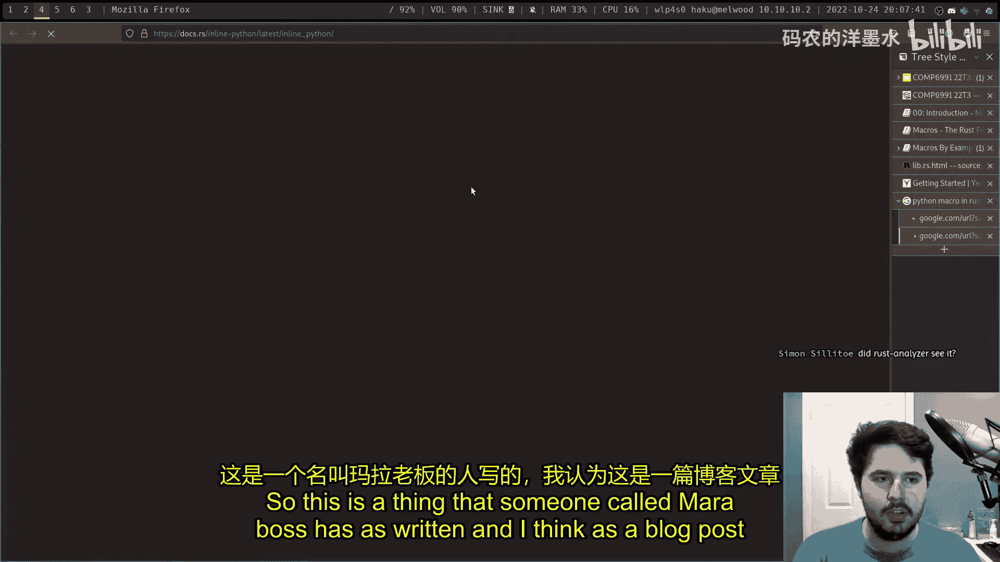

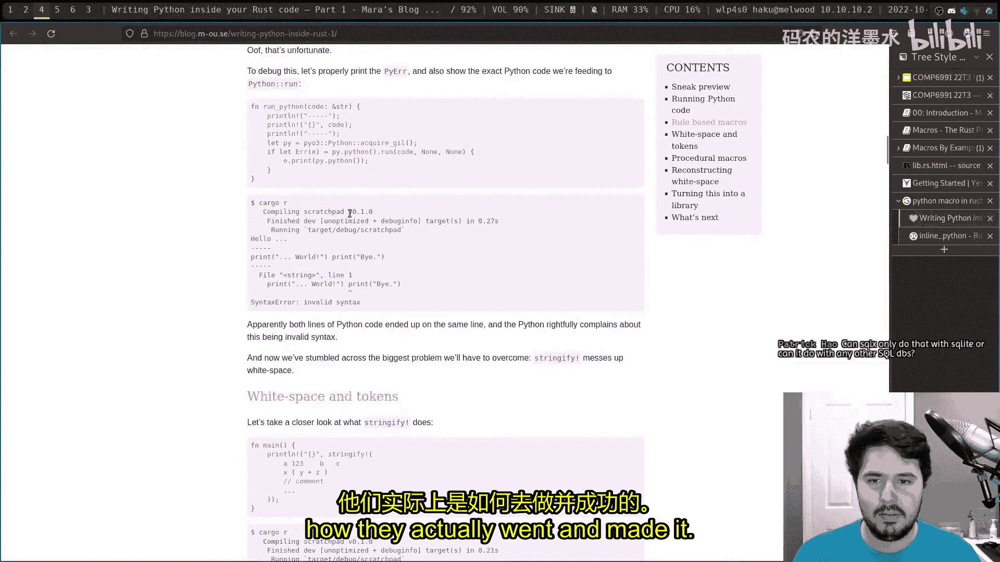

But here's a Python B macro where you can just like write Python code and it will spit this into a Python interpreter。

 which is just like again。I think so cool。 And people made all kinds of different languages that you can just embed the syntax into into rust。

😊，quite unlike the phone number that they wrote at the meed show。 Oh oops。

 write C that writes thrust that write C。 that's nuts right code the emails at the compiler every time you compile your code。

 Yes， would be possible if you threw it inside a macro。

 prefer pickle' method of doing queries where it represents the entire data Python。

 So I get the benefit of static else for type safety without naing the Db for it to be initialised So you don't there's there's many options with SQL X as well to be clear。

😊，嗯。I've set it up to live query against this SQLite database。

 but you can actually just sort of specify this it can infer the schema of the database and store that offline and just do static analysis without a live database to query against so you have that too type safety on the returnant is nice did Ru analyzer see the type I don't think so。

😊，Rust analyzer， this is like I think it's feasible that one day rust analyzer might be able to tell you。

 but trust analyzer sometimes gets a little confused。 I actually no。

 Ru analyzer is just not running in here because it's confused about I've screwed up the whole workspace situation going on here we can check at the very end if rust analyze like what a rust analyzer does in a case like this。

😊，Can do with SQite with any other DBs a whole bunch of DBs that it supports。

 Yeah Ru the one only language Fi doesn't even use a schema it generates the schema from the classes you create。

 Yes， I believe this is that's possible。 you generate it from the models as well in SQL X。

 So I think you could specify the schema yourself or it can generate the schema from the models that you type into your program if that's the way you you want to go about things So there is lots of options as well。

😊，嗯。Cool， but yeah， just just like again， the the。There is almost no limit to the kind of crazy stuff that you can do with rust macros。

When you're going really crazy， you usually have to step up to that level of proc macros。😊。

And they can again， be quite tricky to write。 But I think the book has a relatively simple example of a proc macro。

 Yeah， this might be worth just quickly showing you all。In that。They write a macro。 That looks like。

This。It essentially goes。 so it takes in， you know。

 a stream of tokens and spits out a stream of tokens。 And what does it do， It goes。

 well grab like they're specifically writing a derived macro。

 So it's expected that this is going to be。You're going to be putting derive on astruct or an almost something like that。

And so as says grab the name of the structum and then spit out the codeimple hollowo macro for you know that macros name。

 which you know does this， this could have been done into macro rules。

 or it couldn't have because it's a derived macro， but you could make a macro rules that does the same thing as this。

嗯。But oh， I guess maybe not though， because it would be tricky to turn that string。

 Oh no string if I would still work here in a macro rules。 So you could do this with the macro rules。

 but you could imagine between， say here and here， like you know between these lines。

 you could do anything you want。 You could literally again， like fetch from a website。

 grab like the joke of the day and then put the joke of the day and the code like this。

 That's probably a very bad idea to be clear。 but you you could， And this is in our cases。

 this is where you is you know checking all the HTML or SQL X is running the query against a database to check if it's okay and you know。

 all kinds of all kinds of stuff that you could do in here。But yeah， so that's， I think。

 mostly what we're on to talk about from the SQL X， Github， Postgres， MysQL， SQL X and MS S SQL。

 great。😊，Very cool。😊。

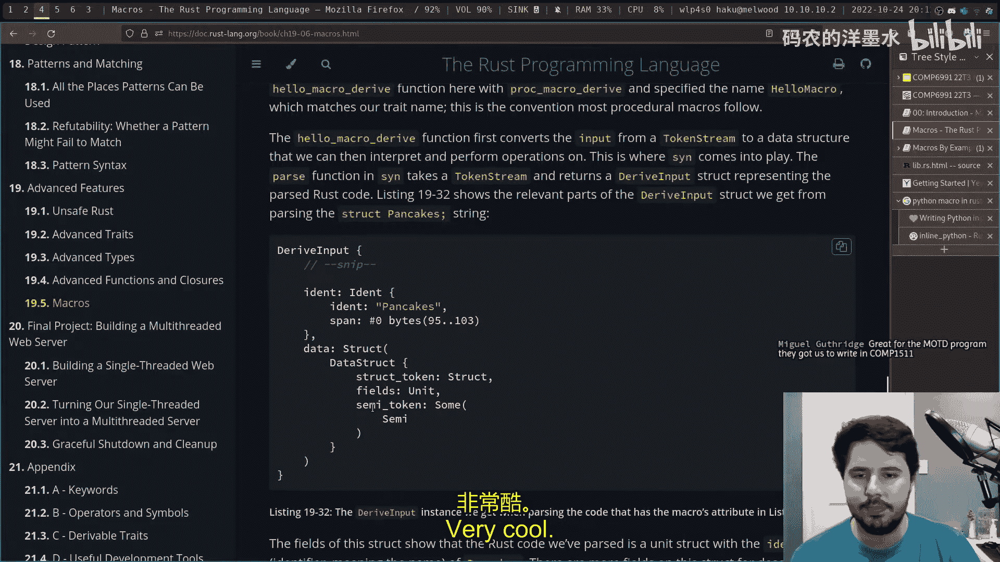

Yeah， so that's basically it。Naturally， if you have any questions as per usual。

 then feel free to ask them now， but we'll call this the end。

 I'm see I'm going to try and like spit this into its own workspace so we can see that question about what does rustt Analyr do with all this？

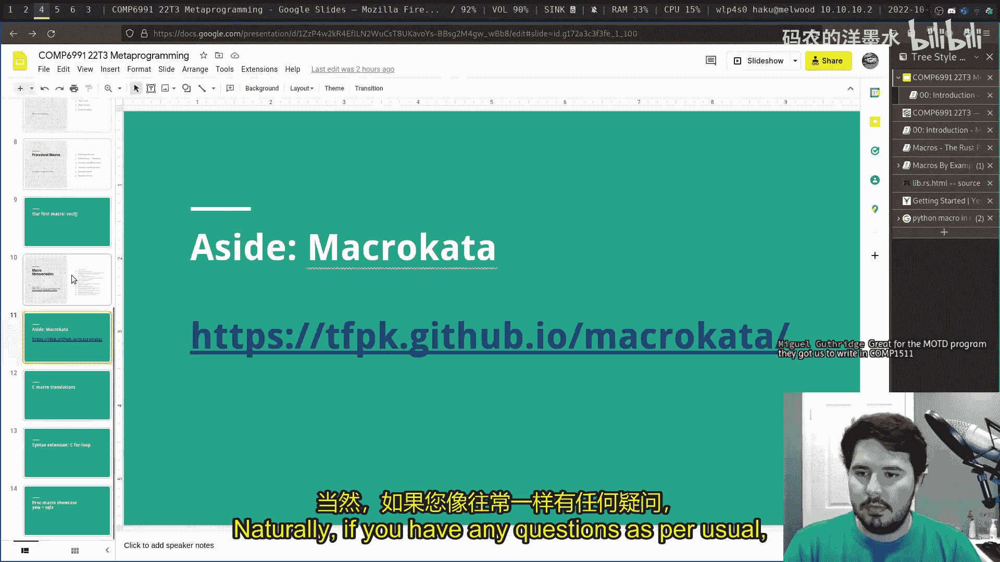

And I can do that like this。呃，说。Let's see what it does， Yes， I trust。Rss analyze is waking up。😊。

So any questions， I can make the compiler to randomize an insult every time my code doesn't compile。

 I think someone did that。😊。

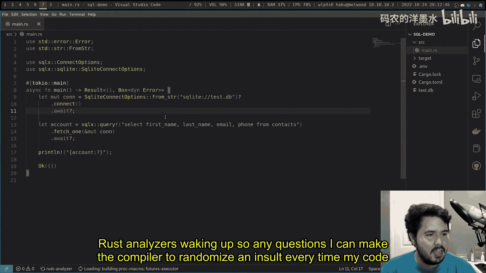

嗯。What was it again， It was like。哦。I can't remember。 I think someone did that， though。

Have a look for it。 If you can find it， put it on the forums。

 But I remember this like for maybe a year ago or so。

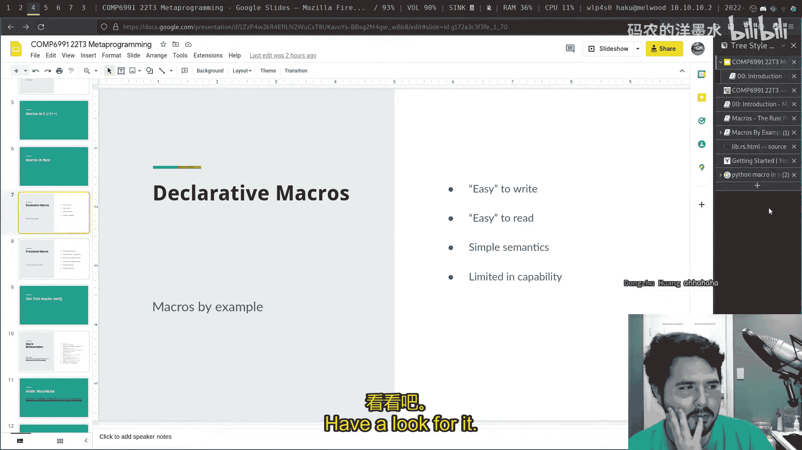

嗯。And doing it as a macro would be entirely unnecessary。Oh， cool。😮，Okay。

 so it sees that the has the type record， it can't find the definition of it。

 obviously it's just pointing us to main because it got generated by the macro。

 but it does see the type， and I wonder if it knows about the type， it does。😊，How cool is that。

 So it's got email。 It's got first name。 It's got last name。 It's got phone。

 even though I never defined that anywhere。Never to find it anywhere。So that's。That's like。You know。

 chef's kiss， like that's that's pretty cool。Anyway， macros are pretty cool。😊，It does work。

 It's just like， you know， naturally， cargo workspace stuff can get a little， you know。

 can get a little sad at times。But呀。Very， very awesome。So any other questions。

 I suppose I'll switch to a actually， let me， let me， you know。

 I I'm not sure if this is pushed up to get yet。 I'm assuming it's probably not。呃。Untra。Oh。

 dot slash， right， it's hiding here。嗯。Sure， that looks about。Yeah， we need that， yep。

 that looks right。Lck 11。That code is now on Github。

 You can write a macro to make the compiler play crabre when your code compiles。

 Yep you could have the marks for Christmas tree exercise and Po exercise been finalized， by the way。

 they have been marked and they should be released there might be problems with that。

 And if there is problems with that， let us know and we'll try and fix them。

 if you mean finalized in the sense of like the mark doesn't look like like you think the marking wasn't know entirely representative of the work you put in then it's just like reach out to us a lot of the time that's just like an auto marking thing where it's like oh was off by like a couple characters but or I got like halfway there。

 but it gave me zero and we'll go y， that seems fair we'll give you will'll give you 50% because you got halfway there。

 Oh it was just like a character off we'll give you 95% like that kind of thing where it's just send an email if there's a problem with your marks。

😊，What if when you get a compr， it automatically opens stack overflow with the error message in the search？

😊，You could probably do something like that， too。Indeed。Yeah。

 that people have done stuff in terms of like when the compiler does Blah do some other thing there's there's all kinds of fun crazy stuff that people have done。

 So yeah， go looking for some crazy rust macros and throw them on the course forum because I'm sure everyone would love that。

😊，Yeah， any other questions？😊，Any other questions？

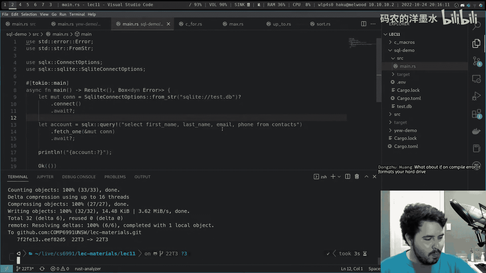

I'll switch to a Ferris background。Will give us another 30 seconds for any last questions。Yeah。

It's looking quiet。Saw the video some programs and see， oh， yes。That would be a。

 that would be a scary one。 All right， I'm gonna say there's probably no more questions。As as usual。

 ask as many questions as you like， please ask， you know。

 plenty of questions on the course forum and we'll。

 we'll get around to them and answer them when we can。 And yeah， thanks， everyone for coming。

 Hopefully， we had some fun with macros today。 And we'll be back on Wednesday to talk about functions and closures And it's that's it's gonna be tricky。

 but it'll be fun， of course， And I look forward to seeing you all then。

 So I'll see you on Wednesday。😊，Yeah， enjoy continuing working on your assignment。

 ask any questions that you'd come up with on the course forum， and I'll see you all then。

 So thanks everyone and catch you later。😊。

