# 【全集】新南威尔士大学 Rust现代编程 中英字幕 1080P p12 Lecture 12 - 函数与闭包 -BV15cf4BCEN1_p12-

All right。Hello， everyone。Hello， hello， hello， Dong Simon， Alex Mitchell， hello， everyone。

Welcome back to our welcome back to our lectures。Was now week 7 Wednesday。Hello， Tom。

 Tom's here as well。 Hello， Tom。Today is going to be a。What's the， what's the correct we put in this。

 It's going to be a challenging， but hopefully interesting lecture。And it's also， I imagine this is。

 this is a sort of point in the course where it's gonna。Pull back the curtains on in terms of。

There's some really interesting stuff in terms of。Why the ownership system and the borrowing system sort of is the way it is because when you bring functions into the mix。

 mostly closures we'll be looking at。In this lecture。

 there's some really interesting parallels between the ownership system and want and what you would want in like to have sort of correct closures。

Which we're then going to bring into concurrency next week So like this this is very much a lecture setting up the groundwork。

So when next week we bring in concurrency。It all sort of makes sense we've got a good basis with functions and closures。

And u yeah， it's it's really a point of sort of almost like culmination in terms of the whole borrowing system and and again。

 why a lot of the design decisions rust made in the language itself。

Happened to sort of be the way that they are。So yeah。

So are there any things we have to think about before we kick off at the lecture？😊。

Assignment one should have been due approximately an hour ago。

I believe that's the case an hour and seven minutes ago or so there was some questions on the forum around late penalties and stuff。

 the assignments， the weekly exercises， everything except the final exam follow the UNSW standard late penalty which is the vague idea of a5% mark reduction per day so essentially for each day you submit late you lose five marks we are a little generous with that penalty in particular in that we calculate it hourly as opposed to daily which you know on first inspection you might go wow that sounds worse。

Calculating my late penalty every hour。Why't you just do it on the day。 Well。

 if you think about it as soon as you're one second late with the daily with the daily late penalty。

 you've， you're already paying for like one days late penalty with the hourly one。

 we only make you pay that full one day late penalty at the beginning of the 20。The well 24th hour。

 I suppose， if the first hour is the second after it's due that's the beginning of the first hour only at the beginning of the 24th hour do we make you pay for the whole day's late penalty。

 otherwise zero in the pay the 12 hour is half a day。

 you know the sixth hour is a quarter of a day and so on。Yes。

 imagine submitting your examr day late and you only lose 5%。 So， yes， we can't have that one。

 But the assignments in the lab and weekly exercises。😊，Are under that。

 what I would consider to be a relatively flexible system， do recall。

 though that the standard penalty also includes a flat zero after five days。

And we we follow that as well。 So you can only submit up to five days late without， you know。

 without taking into consideration things like ELS or special consideration。

 so make sure if you are do intend on submitting late and taking you know a small penalty for that。

 make sure it's less than five days after the due date or。We're forced to give you a flight zero。U。

You know， everything else is as usual， you've got some weekly exercises。

 we've got the workshops tomorrow and Friday。 Yeah， everything else is is pretty much as usual。

Any questions before we get stuck into our content today from anyone in the chat？

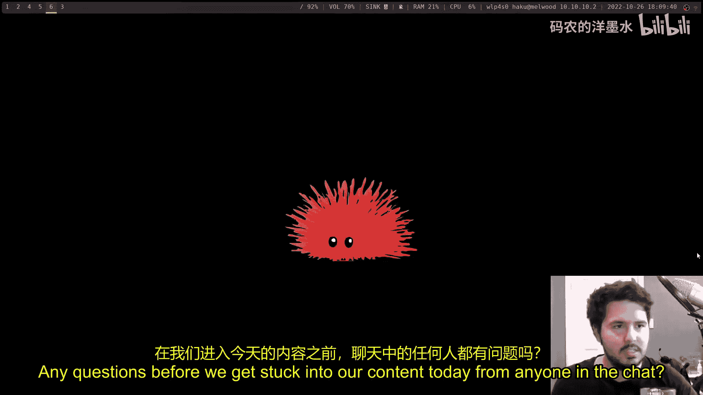

Any questions？And Tom is broken the crab pyramid， I see。Oh， no， all right。嗯。So functions， hooray。😊。

We're going to start off this lecture by talking about function pointers。

 which is sort of like our baseline idea of talking about a function in sort of like a。

Almost like a higher up view， you could imagine。And it's also sort of starting to think of functions as what we'd call like first class citizens in the language in that a function isn't sort of like a special thing that like special syntax in the language that can't be acted upon。

 but instead is like an object that you could pass around and use in your code like any other sort of piece of data or information。

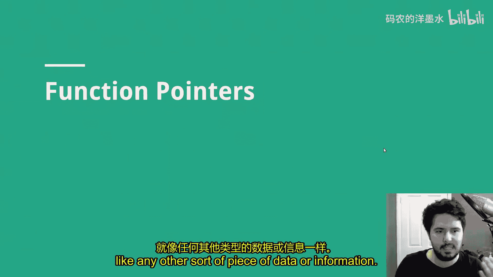

So most languages these days tend to have some form of capability for for for this kind of work。

 treating functions as values， treating functions as terms in your language and rust is no exception and as we'll probably learn through this lecture。

 rust is sort of very specific in how it chooses to。

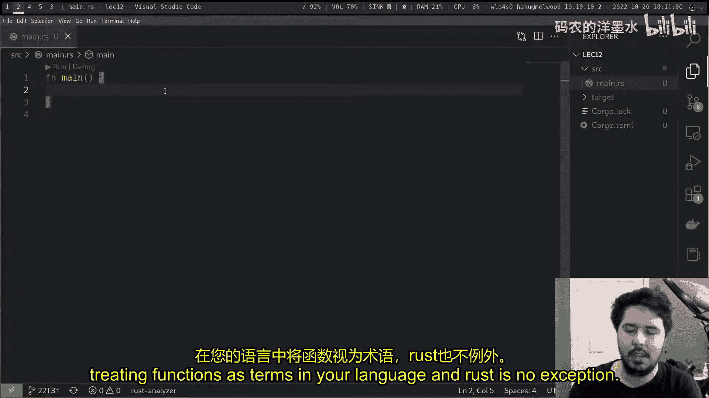

chooseoses to。Deal with the idea of functions as objects in language and a lot of that comes from the difficulty in the ownership system and how that translates into functions。

 but it means that we get very robust functions as well and it's pretty cool。😊。

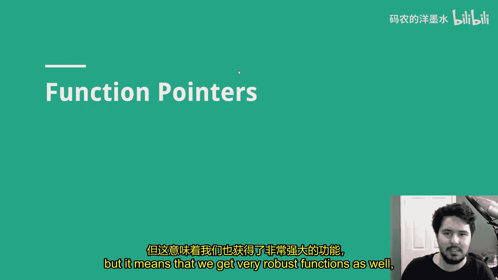

So what's the idea here， well， just to like kick things off。

 I could just say let my thing here equal to main。Right。

Main here being this function and therefore my thing is now like a function that could be called。

I could say then like call my thing like this and this would just result in an infinite loop。Right。

 so let me just demonstrate this hello from Maine。If I run this code。

 this is just going to be an infinite loop。Until it I is at stack because it's recursive。😊，So。

Like our first sort of idea is that， you know， I can use a function as a value here。

I bind it to this variable my thing。 and because my thing has this function type。

 I can then call my thing as if it were a function because essentially it is at the end of the day。

 If I had another function， let's say some function add。

takes in x is an I32 and y is an I32 and spits out another I32。And that just gives back x plus y。

Then I absolutely could say， let my thing equals add。And then say printlin。

 say two plus two equals something。And call that my thing of two and 2。Run it2 plus2 is4。

 So our first sort of basic Ho world example going on here。

And the important idea is that this my thing here does have a type。I can specify the type。

 it looks a little bit like this。Right， so the type of my thing is a function。

That takes in two I32s and produces an I32 as a result。

If let's say we had a function that didn't return didn't have any return value。

 maybe it was just like print to numbers。Something like that， and let's say in here， you。

 it actually did print the two numbers out。Then I could say。

 let something with the type FN of I 32 I32 be equal to print two numbers。Right。

 so the type here may include like if the function has a return type。

 then you'll have to specify that in the type， if the function itself has no return type。

 then you just emit that return type in the type Similarlyly， let's say if you have a return type。

But no parameters in here， like say returns 42 that just returns 42 back。

Then the type would look a little bit like this。 It would have an empty parameter list anizs a I32。

So note。You sadly cannot like emit the phenia and just have function goes by 32。

 you still need to specify there's no arguments in there and that will be the type of this you know function function pointer here。

 returns 42。Finally， the function that just says nothing。

 maybe it just says like print low produces some side effect。Printlin， hello。

That will just look like Fn。Print alert。Like that。So very first idea of using functions as like objects and variables and stuff like that in。

诶。In our code。Late class for out time， program safety。Okay， cool yeah。

 so we're just getting started talking about functions and just looking at some basic function pointers in rust。

😊，U and if you're familiar with say， you know， Java has ideas around this。

 Python has ideas around this， C even has ideas， C+ plus， you know， all these languages。

 it's pretty rare these days toem upon languages that don't have any support at all for using functions as objects in some sort of way。

 using objects as values or sorry using objects， using functions as values or you know。

 functions as first class citizens， whatever you want to call it。😊，嗯。

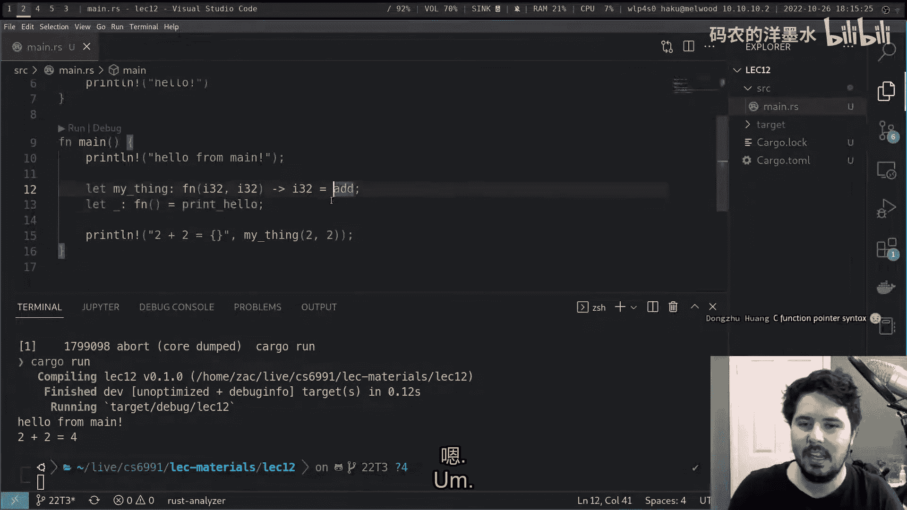

Great， so Rus has this as well。😊，And as we've seen。

 the syntax looks a little bit something like this when we're talking about the type。

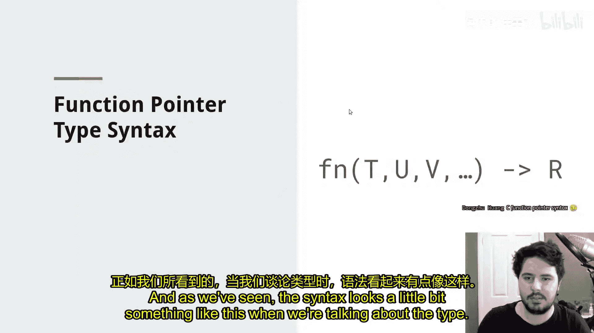

Right when we're talking about the type of a function， it looks a little bit like this。

 you write the word fn for the type， the parends， how many parameters like the types of the parameters that it takes in。

 this could be empty， this could be one thing， this could be 100 things and then optionally this return type on the right here if it returns something an arrow goes to the return type if it doesn't return anything then you just emitm this whole this whole portion in its entirety。

😊。

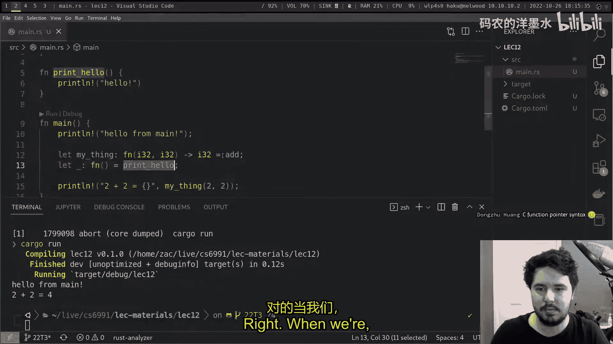

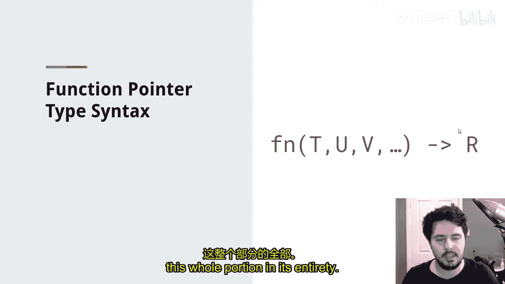

So why do we want to start off with the syntax for specifying a functions type Well。

 rust is a very you know， it's a statically type language you need to specify types everywhere and so to end up doing anything you know there's small examples where you might need not need to specify types anywhere。

 but to do most meaningful things you're going to need to know how to describe the type of them。

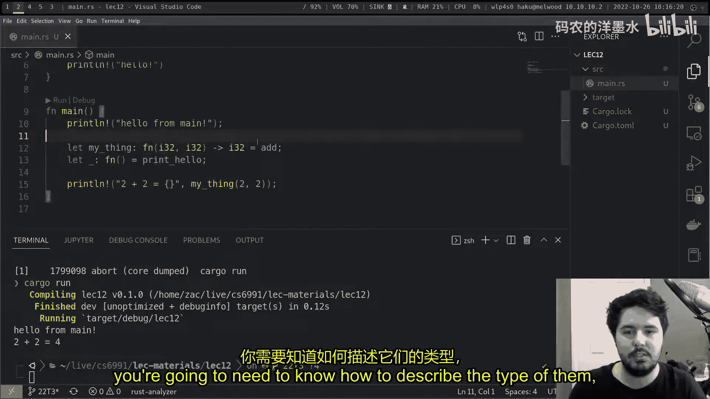

Like when we kick off this example that we're going to be working on through this lecture。

 which is going to be my map。

嗯。And yes， C function point is indextax。 So this is also， I should mention， it's interesting。😊。

Let's say string from hello。Right， like the functions。

 all the function families like type syntax is a little bit special in rust。

 Like it's a little bit magic in that most types。😊，You know。

 look like just like a word like I32 or string。You know。

 just comprised of like letters and underscores and and whatever。

 and there are some types that may contain generic type parameters。 So， for example。

 a V of I 32s might look like this。So some types also have。

 you know generic type parameters which which have these angle brackets where you specify types in there。

But these function types are pretty special in that they get to use things like parentheses and arrows and stuff like that and this is sort of like a bit of a hard coded idea into the compiler and it's specifically to avoid really gnarly function point a syntax that makes it hard to read I'm quite a big fan of the fact that they did special case the types of functions in rust just because reading them left to write and having them sort of quite clearly split out is a strong preference for me as opposed to say you know Java with it like T you know a function as a TR and a consumer takes a T and a producer produces an R like you could do all this stuff just with the generic type parameter syntax that is to say so like my thing they could have made the language say it's something like an FN with return value of an I32A32A32 or you know like。

😊，there's ways， different options they could have chosen。

'm glad they I'm personally glad that they took this approach。

 but it's time to consider when you're thinking about the language yourself， obviously。😊。

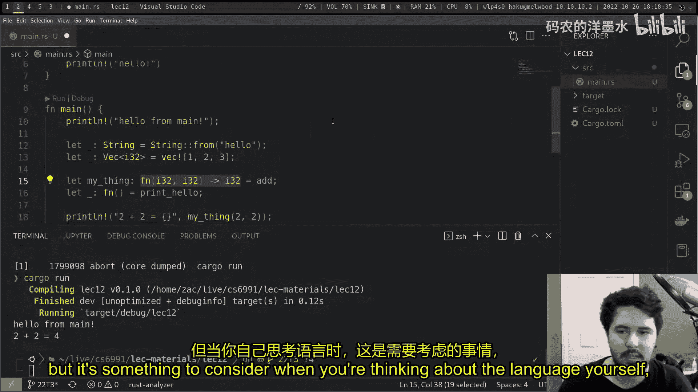

So。To get back on track， we want to kick off this mym example。

 So throughout the lecture today we're going to be working on the map like recreating the map function。

 So let me get rid of all the craft here for a second。 What does the map function look like， Well。

 it looks like this I can say create an iterator over some values， Let's say I have a V and it's。😊。

One， two， three， four， five。Right。And then I want to map over it， so I'll say let map equals V。

 I'll turn it into an it。I will map it and say for H X， I want to do， let's say， X as an F 64。

Multipliied by pi。This one， actually， let's do have 32 because they don't want to so many decimal places just clogging up our output and then say collect that back into a bear。

😊，And then maybe I'll just finish off by printing mapped out like this。

Carger run and you'll see I have like one times pi， two times pi， three times pi。

 four times pi and five times pi。So map is a pretty awesome function and then it lets us take an iterator over any type。

 right in this case where you've got an iterator over I32s。😊。

And then for each of those elements in that iterator， applied this function over it。

Right in this case， we have a function that says take in and I 32。

And spit out that I32 as an F32 instead multiplied by pi， so you know x times pi， I suppose。

And note that that this the output of this function is also a completely different type。

 we didn't just have to go from I32 to some other I32， like plus1 to plus5， we could do that。

But we can even completely change the type of the things in this iterator and then you know。

 keep doing other iteration stuff over it， whether I want to say filter all the ones that are like。

 you know， I could say like filter where x is less than 10 or something 10。0 rather。

 it's if x star x is less than 10。0， for example。Um。

's there's all kinds of different things that I can do here， I can keep you know。

 applying this iterator stuff or I could even keep mapping over if I'd like to as well。

So we'd like to recreate this map function ourselves。And yes， okay， callable pers return。

 void star star function， void starient。 Yes， there's， there's some very。😊，You know。

 every language makes their own decisions， I'm personally grateful for this one。

 but you are more than welcome to make up your own minds。😊，So。How did we get started with that， Well。

 we're going to start off with a function My map。We could sort of make our map as an extension onto iterators like so we could just literally go dot my map right here。

But that's a it's a little， it's not quite focused on exactly what we're looking for。

 So maybe we'll do that as an extension at the end if anyone's particularly interested instead we'll just make a function that takes an iterator So my map takes in some iterator right iterator is a trait so that's not quite gonna work。

And it's also going to take in like a function to like map over。Right。

 and then we'll just basically call it， I'll leave the standard library one in here。

It's not happy about that。 I'll leave the standard library one here， but maybe we'll do a。

Maybe at the top。We'll do the code twice like this。And this will be。Standard is this and my is that。

And we're simply going to call instead of like vector into the iter dot map。

 we're going to call my map of vectort into iter and the function here。Right。

 the syntax is slightly less convenient but it's it's effectively the same and it'll let us see。

 you know， we'll run into the same kinds of challenges。 Okay。

 so we've seen rusts like function point to syntax right。

 how to sort of take a function in and we've looked at traits in iterators and all that last week So I'm gonna just sort of start you know kicking away on this one So my map is going to need to take in some you know some type which implements iterator right iterators。

 we don't know what the type it is， like what the type of any concrete iterator。

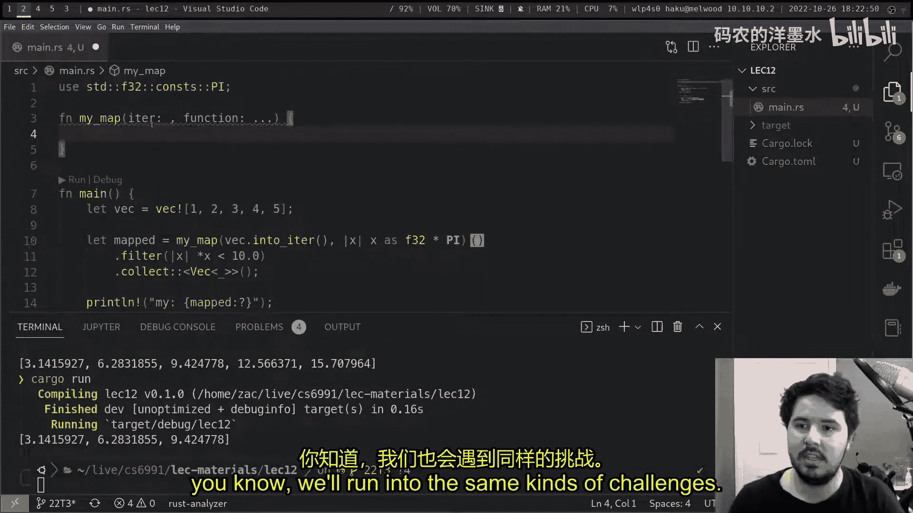

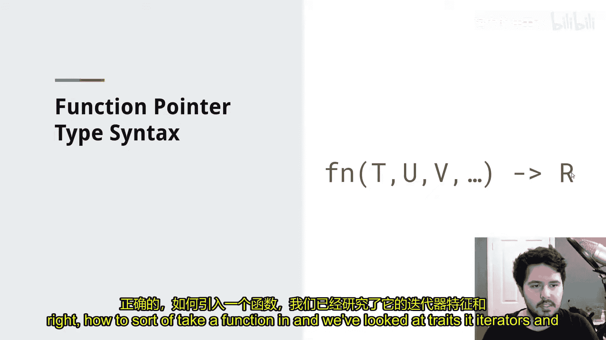

Might be most of the time when we're taking one in。Instead。

 we just want any type that implements that iterator trait。

 so I'm just going to make a generic type parameter here called I。

And the iterator we take in will be that generic type I。And then I like to put。

 I personally like to add in wear clauses at the bottom here and do all the。

 the trade bounds and stuff in the wear clauses。 But you could put them in， you know。

 in line right here if you， if you wanted to， where I is some iterator。Right。Fル。And finally。

 we want to take in a function pointer right， a function pointer。

 which is going to map items from from this iterator。😊，Into like new items that may be the same type。

 but we want to create an API interface， an API interface， you know， ATM machine。

 where we want to make an interface where they could be different types if the user wanted。

So how do I specify that like how am I going to specify this function signature here。

 well what we really want is a function from whatever the old item in the iterator was into some new item type like this。

Okay， so I can just introduce new type parameters for those。

 meaning this is some type here that's some type there。I， we know， is going to be an iterator。

 And there's one sort of additional thing that we want to include here。 new item。

 that's fine to be realistically any type， Like we don't care what the user specifies new item to be in a certain sense。

 but there is a restriction that we sort of need to place on old item like a relationship we need to express。

 Does anyone in the chat。Know what this or want to have a guess of what this what kind of restriction we need to place on old item here。

What kind of restriction do you want to place on old item。

Or like like kind of maybe like a relationship that we want to express。In terms of all the item。

Collection I on the right track for sure。 old item。

 So old item itself doesn't need to be a collection。

 but it has a relation to the collection here that's being iterated across， which yeah。

 Patrick's come across here is saying that like yeah， the iterator of the V。 Yeah。

 the iterator items。 We're all we're all sort of converging on the right path here。 now。

 the type of item that the iterator is currently， you know。

 currently gives you currently iterates across。That's got to be the same as old item， right。

 It's no good if we have a vector of integers and they give us a function that converts strings into a new item。

 right， This old item needs to be， you know， whatever the maybe maybe old item a bad name。

 maybe like current item is， is a little bit of a better name for it。 And I can specify this here。

 Iterator has a oops， Iterator has okay， Rus analyze is not playing ball with me。

 But iterator has this associated type item， like the type that the iterator iterates across。

 so I can use this syntax here。By saying that the item that is specified in the iterator trait must be the same as current item。

 just like that。Great， so now we have an iterator I， some iterator where the item is， you know。

 these， the item that's being iterated over is can otherwise be known as current item。😊。

And a function that takes those current items into new items， okay。Alright。

 now there's also one more like missing piece of this。

 which is iterators don't just like we don't mutate an iterator that we're given。 Instead。

 we give back a new iterator that applies this kind of transformation on it。

 I think we did a little bit of this。 Well， we。Yeah。

 maybe did a tiny bit of this last lecture jar with with the V iterator or the slice iterator。嗯。

But essentially what we also need to add on here is a return type。

Which is like the type that can be iterated over。 We're going to store this info in astruct。

 I'll call itstruct my map。And we're just going to make this my map function give back a mind map like this。

😊，And this is sort of the type。This is basically the type that is going to be held by the user by the person calling this that they can then continue to iterate over so an important part of this is thisstruct Mym we're definitely going to need to implement iterator for Mym。

Right， this is。Definitely to do here， we're going to need to implement iterator for MinMap。

So what sort of state do we need to maintain？😡，In order to like create this iterator that we're after。

 well， we need probably the most convenient is to just hold on to the iterator that they gave us and the function。

And every time we call next on the old iterator， it'll give us a new item。

 and then we can apply the function on that and pass it out to the user。So I'm going to do that。

 I'm going to say the my map takes in。The iterator， and it takes in the function， which was。

This new item。Like that。 I'm just like basically following the signature that we've got here。

 So this is going to be given iter， and it's going to give in the function like that。

But naturally my maps going to go， I don't know what I is， I don't know what current item is。

 I don't know what a new item is， so it's going to have to be generic over these types here。

 meaning my map in order to create a my map you need to have some type of iterator。

 some type of current item， some type of new item like that。And this all seems pretty happy。

 but I need to actually specify the return type here。

 it's not happy down there and that's why I'm not getting an area yet。

So I'm just going to reformat this a little bit。And it's going to get back on my map。Like that。

 So we've got a bit of anly function going on here， right， It's suddenly a lot harder to read。

 but it's got all the pieces we need。 My map is generic over an iterator K out a new item。

 takes an iterator， takes in a function and returns back this type here。 My map。😊。

Which is generic over all these things again。Which。

Will eventually be able to be iterated over so someone could just use it。And then say dot filter。

 dot collect， whatever it ends up being。Okay。So now it need to implement iterative for MyMap。Again。

 myMap has these three generic parameters。Right， the iterator of the current item and the new item and no matter well not quite no matter if I wanted to say no matter what these types were。

 we can still iterate over my map， then I'll just basically do it like this。

 I'd say this implementation will be generic over three like random type parameters I'm just giving you know these are just names essentially。

For any my map of I current item and new item。Right， and then it's just saying， hey。

 you need to actually implement the trait items itself so I can just say sure。

 throw them in there and I'll fill them out。And now we've sort of got an implementation of iterator going。

 We're gonna have to。We're going to have to like restrict things a little bit in a bit。

But we can start to fill in some blanks and figure it out along the way。

 so if we're iterating across something that we've you know we have some old iterator and then we have a you know we have a function that's mapping from the current items in that iterated to a new item that we want this iterator to spit out。

😊，What is going to be the type of the items that the map iterator spits out？Right。

 so this is a question for the chat。The old iterator， we know spits out current items， right。

 The old iterator is some iterator where the item is a current item。This Min map iterator。

 what items is it going to produce？It's gonna produce new items， right， Yes， that's right。

 So in here， I can just say what the item that a mind map iterator spits out is a the type of the new item。

 which， again， we know this function maps from current items to new items。 So that all makes。

 that all makes sense。😊，And now when someone goes， give me the next item from this iterator。

 how are we going to do that？Well。The way I'm imagining this is that we've got the old iterator。

 which is meant to spit out current items， we've got a function that goes from current items to new items。

 and we've got to give back a new item。 Well， an option of a new item but you know potentially a new item so we could write something like this let the current item equals self dot it dot next。

Right this will be like some item or potentially none if we've reached the end of the iterator。😊。

Luckily， we can just bubble up this nun。 if this iterator is not giving us any new values。

 If it doesn't give us an item back， it just gives us none。

 then we don't have anything else to give either。 So we can just return that nu back。 Otherwise。

 the current item should be， you know， an item that we has been spa out the iterator we need to give back a new item。

 And fortunately， we have a function to do that for us。 So I could say let new item equals。

Self do function。 And I want to call that with the current item。But note， this won't quite work。

 Fireright self dot function of current item。 It's actually gonna look for a function， like for。

 for a method called function， right， Like imagine Iple my map。

Imagine we had Iple Minup and some function cold function。Right。

It's looking for this function here as opposed to thinking about the field。

 This is pretty common in a lot of languages that have this kind of syntax I actually need to wrap these in parentheses to be like。

 hey no， I don't mean this this method function here I mean the field once it's got the field then call it then call it with the current item So it's a little bit of like ambiguity there and often you need to do this kind of thing when you're dealing with this stuff Finally we've mapped the old the current item into the new item。

😊，And we're ready to give that new item back so I can say here is。That new item。Now。

 something's not going to work。 I haven't saved the file。

 I've been very careful not to save the file yet because we're going to get an error right here。

Self doted dot next。What's it going to say， no method name next for the type parameter I in the current scope。

Right， dude， it sos the compiler is just too smart。It's just too smart。 It's。

 it's telling me exactly what I need to do。 But I'm， I'm gonna。Drag it out a little longer。

 naturally。 It's even pointing at this eye up here going like， hey， that's a little。

 that's a little suspect。 It might need to might have need to have an extra think about that。

Essentially， what we've written here is that。I want to implement iterator for my map with these three types being basically anything that you want。

 but that's not quite true。 There is a restriction that this I here。

 it can't just like I can't just be like an I32 or something or it can't be like a unit type or it can't just be just some crazy random thing。

 It specifically needs to be an iterator that produces current items We specify that up here in the function that creates a my map。

 but we could also just make a my map directly ourselves right There's no sort of restrictions placed anywhere。

 So actually we need to add this restriction as Daniel says in the chat。

 we need to have said that I is an iterator。 Yes， so we will only implement iterator for my maps of I current item new item where I itself is an iterator that produces current items。

 so I can do that with a wear clause here， only implement iterator where I is an iterator that produces。

Current items。Like that。And now this error goes away because， you know， it knows that on self。it。

 we can call any of the iterator methods on it because we know it's an iterator and it will produce something of type curve item。

So that is fantastic。Loading symbol， it seems fine。 I've got a bit rate seems happy。Might be。

 might be a local thing。 I think it's okay。 I haven't dropped any frames yet。 So that's good news。😊。

So， yeah。So now we've got we've implemented iterator for myM and it does indeed map over this note that if we like forgot to do the mapping and just spout out the current item。

 we'd obviously get a compiler error because it says hey。

 I expected you to give back a new item you gave back a current item so we know the compilers got our back and so this means hopefully hopefully this works。

😊，So let's try it out I've already got the code set up for my and standard library。And it does work。

 How about that。Mine stood。That's awesome news。Allright， so this is our first implementation here。

 and we're going to spend the rest of the lecture pretty much just iterating upon what we've started off with here。

😊，So。I'm going to pause for questions， concerns， comments， you know， queries， all of that。

Until we're like relatively happy with what's going on here and then we're going to move on to it it。

 iterating on this design。😊，There is one interesting thing。

Whi I'm gonna I'm going to preempt this question in the case that anyone might have it。

 which is I put the where bound here。 I specified that I need to be an iterator for my map to implement iterator。

 whereas I actually could have put that bound。ヒや。Right。

 I would actually still need to have it here as well。

But I could have put the bound on the str saying that my map is only valid to exist in the first place where I is some iterator。

Um，Sadly， I can't then just leave it off the impulse here because it's going to go。

You said implement with any eye for my map of eye， it see this it sees this eye on the left hand side as literally any type I。

 it sees this eye on the right hand side as an eye to go into my map and it goes。

 oh my map requires the I as an iterator you haven't expressed that this needs to be an iterator and so you would still need to put this bound in here as well。

😡，Which kind of makes this bound here almost like a little redundant。

The only difference being you could conceivably construct a my map with some eye that's not an iterator。

 and you would have a my map object， but you just wouldn't be able to iterate over it， which again。

 that that seems kind of weird。 It's like。I'm going to put the bound here just so I don't ever like run into that situation accidentally and you you honestly can。

 It's not really advised generally， you know， in the community idiomaticically。

Just because if you have a type that holds a my map inside it， like if I ever struck， you know。

 has a lot of stuff。And one of those things， you know has a whole bunch of fields in here right a whole bunch of fields and then one of those fields in there is some like map。

 which is a my map of I current item a new item Well no matter what you do you're going to have to bring these generic parameters across here。

😊，But if you specify these restrictions on the struct itself。

 you're also gonna have to bring these restrictions up into the struct holding it。

 And then if you have a struct that holds this， you end up needing all that stuff again。 And it's。

 it's what the community would refer to as like very inective in that yeah sort of。You know。

 generic restrictions on generic type parameters， trait bounds are very infective when you're holding them in something like a struct or an enum。

And so just to save a lot of that headache and having to maintain all kinds of crazy trade bounds when maybe mymap has some other purpose like like iterating is clearly its main purposes here。

 but maybe it has some other purpose someone does never want to iterate over it。

 but they just need it for some other reason it's a little more flexible to only specify the requirements specifically where you need it right I only need to be an iterator if you plan to iterate over mymap which is you know this is sort of the take of the community。

 I personally generally aligned with that as well， only specify the bounds where you really need it。

😊，Except， you know， but， but obviously， it's not really the case everywhere。

 I could actually leave off that bound here。 right， this the bound on the my map。

 but I would tend to leave this bound in here just because it's not infective like。

This isn't going to infect any other items with this trade bound and it's a good way of stopping the user from accidentally calling my map with something that's not an iterator and then being like why can't I iterate over it so it's it's you know？

😊，Every choice is its own decision naturally and you've got to think about them all individually。

But that's sort of like some background on the thinking behind these kinds of trade bounds as well。

Does Iing the tradeband make it easier for rust analyzer？😊，Over here。

It makes it different for rust analyzer。It's semantically different。

 So Rus analyzer will will be able to notice that， but I would actually。I mean。

 I don't think it makes too much of a difference if the tradeband is there。

 then anywhere you want to use it， you're going to have to like the compiler is going to force you to put the the wear bound in anyway。

Like the the trade found on it in order to hold the type， if you don't put it there。

 then you're going to get a compiler errorses and you like forget the trade found。

 you're going to get a compiler error saying， hey， that method doesn't exist。

 you might need to add this trade like we saw down here。

 like the compiler actually suggested the exact correct fix。嗯。

So I think it doesn't really end up probably causing much of a difference either way。But yeah。

 and what do I mean by infective， it's sort of like it's specifically the case where adding this trade over here right over like wherever is likely to make other people have to put those trade bounds everywhere in their code as well。

😊，And having to manage that can be quite a headache and so we don't want to we generally try and avoid infecting other people's code with trade downs and the most infective places are things like putting a bound a bound on like a actual  struck definition here like I is something and you know。

 current item is something because if any other struct inum ends up embedding your type in theirs。

 they end up needing to follow。The restrictions that you placed in there and if they have 10 types all with really crazy restrictions。

 they're going to end up with an essay just to define their struct。😊，And again， it's potentially。

 it's also potentially limiting in future in terms of what you might want to do with my map。

 maybe in the future， I think of a reason that， oh。

 actually I could be something else like maybe there's a different implementation of iterator for my map where I is not an iterator。

 but it's something else entirely。 you know， some other bound。

 and I still can implement iterator for this in this case here。 So there's and yeah。

 putting generic names everywhere is already getting annoying。 So it's something to think about。

 but it's a little more advanced。 So I think we'll leave it at that， you know。

 at that sort of level of detail there。 but I'm sure you can probably Google away like。

Rt trait infectivity， potentially generic infection， generic infection。 Yeah， there's a's a。

 there's at least two articles or like URL O posts。 Yeah， generics are infects，lah， blah， bla。

 So there's some， there's some interesting reading to be had。

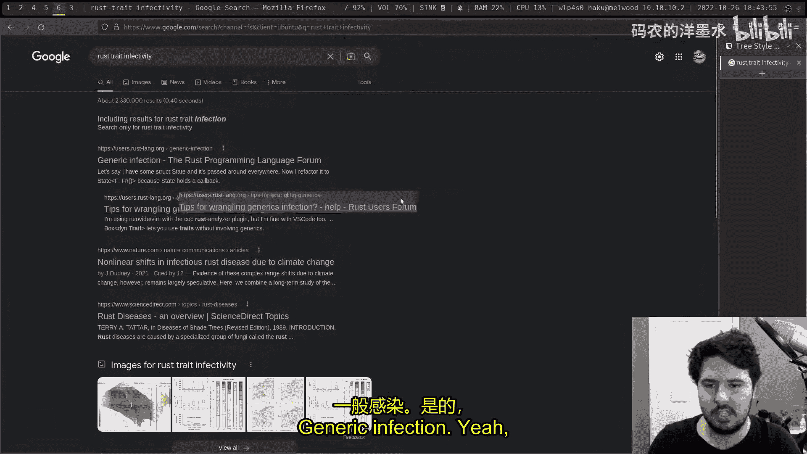

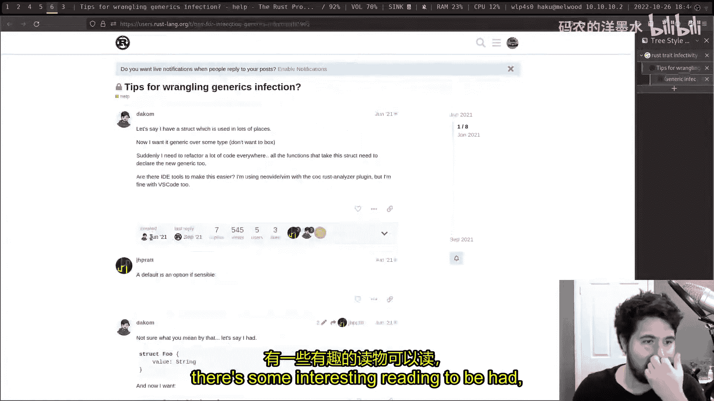

But again， a little bit advanced， so we'll leave it at that。Okay。

Rus genericrics are better than tables in terms of error messages。 and right， just。

 that's just sort of coming from the how the language semantically you know。

Definines these ideas and the fact that they're more restrictive and and more。

More closely integrated into the type system， let's say。

 as opposed to sort of just like raw substitution。

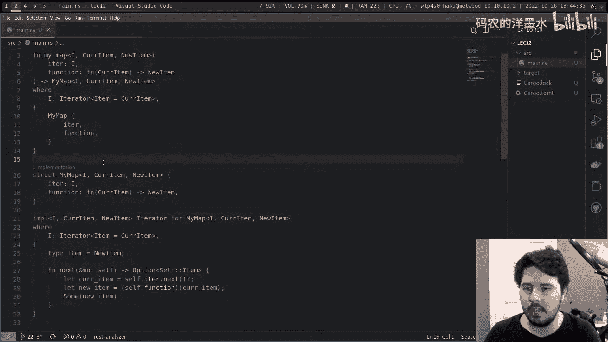

Okay， so that seems all right。However， there is a limitation here。

The limitationimitation on function point is no environment， so what is no environment here saying？😊。

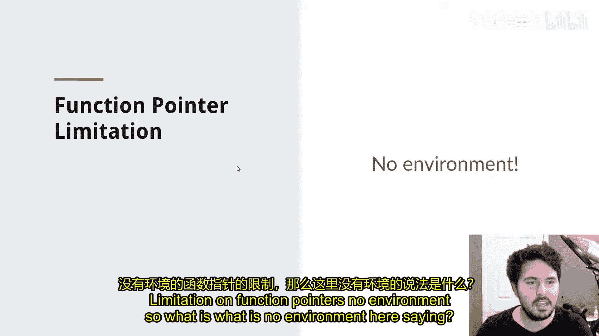

Let's expand our examples a little bit。And we're going to， what are we gonna do。

 Let's say I'm gonna add in like another factor。And I'm going to multiply all that I was by pi and also by this factor。

 let's say like 2。5。Right， in both examples， so x as F32 times phi times the factor。Times the factor。

Right， so。😡，Something strange has happened。 The standard library， still perfectly happy。

 seemed to compile。But our example is is not happy won't compile so let's just comment ours out for a second and double check that it's not like swallowing the error no it does seem to work so that's going to be 2。

5 times pi maybe we'll change the filter to be less than 20 now and yeah so the standard library deals with this fine but we do not Oh no sos what's going on here。

Let's do the same thing， less than 20。So this is where were we are now finally going to get to this idea of closures。

 so what is a closure a closure is basically。😡。

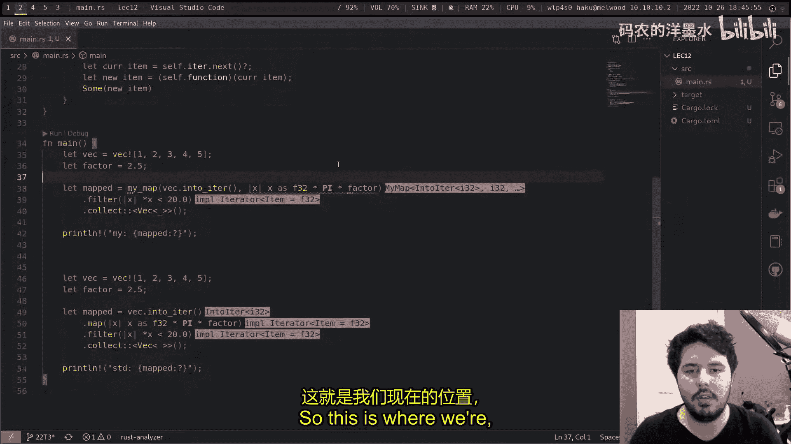

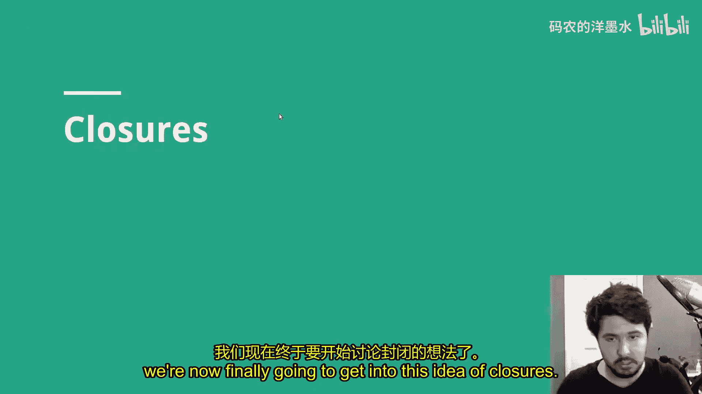

Like a closure。😮，Is just a function pointer？A function pointer plus an environment。Now。

 what is this weird， confusing thing environment， it's basically the environment is also often often known as captures like the closures captures。

😊，And I'm probably going to use these words a little bit interchangeably。But basically， it's。

 is there anything that this closure you know， refers to or depends on that comes outside of the like direct input to the closure？

Yeah， external variables you might want to use absolutely， so notice that in this closure。

Loud bird in this closure， the only variable， right， the only。

 the only thing sort of in memory that that the function is using is X。 Its input right there。 Now。

 you might go， what about pi here。 Pi is just like a constant。

 You can imagine this to just be like a hash define， right。😊，And so when before we had factor。

This is perfectly fine。Because it doesn't have any captures， any environment to it。

 but now we say actually multiply this by factor and factor is some like item， some variable。

 whatever you want to call it， that exists outside of the function here。In this case。

 it exists in Maine， but it could also you know。😊，Exist elsewhere， as well。So in this case。

 this has now promoted from just being like a pure function pointer。Right before， you know。

 a pure function pointeder is just like a function， these inputs this output， whatever。

 into a closure， there's a function that can be executed and also， you know。

 one or more captures from the environment。😊，So the environment is the things around it。

 and in this case it's capturing this factor， this factor variable here into the closure。😊。

So it captures a non empty means it's a closure and the rules get more complicated all of a sudden。

The rules get more complicated， so you got to buckle down and get ready for it。

So factor is out of scope， external variables you want to use。

 factor is lazily evaluated in the function。😊，It' it's a good question。

 so this is that question is sort of coming from the perspective of how other languages might deal with issues that arise with captures。

😊，嗯。And in this case， it is sort of like lazily evaluated in a certain sense。

 but there's a whole bunch of extra rules that we're about to sort of like you know plot our way through。

😊，Wwhich go like far past this idea of， you know， just just lazy evaluation and all that naturally。

 you know， we're in rust so it all needs to， the compiler needs to be absolutely certain of everything going on and all that。

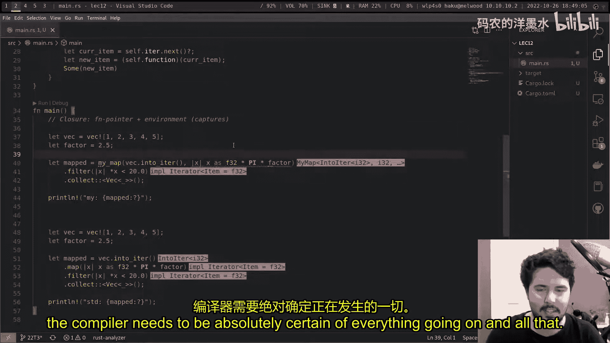

Okay， so the closure syntax， so with function pointers。

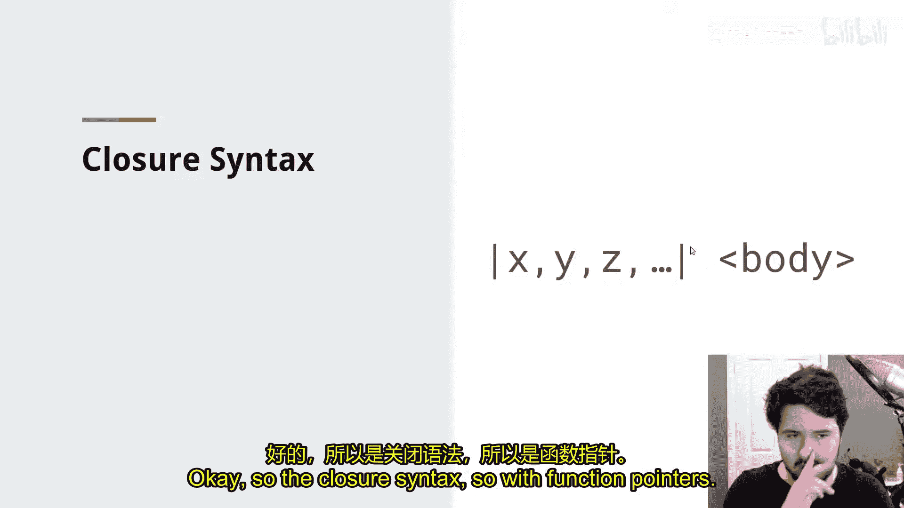

We know that we can have a function， you know， like a say a function food。

That takes in an I32 and spits out F64 I don't know something like that。

 and we could just use this function as a function pointer and there was syntax for the type of a function pointer。

And this this bar syntax here can also be used for a function pointer。

 but only if it has no captures。😡，Right， so only when it was in this case here。

 as soon as you bring a capture into the mix， it's no longer a function pointer。😊。

And so this was sort of， yeah， when we were at it at functions， we had functions like this。

 and we had closures like that。Sorry， we had the anonymous functions syntax， the lambmbda syntax。

If you will， then look like this。😊，With closures， you can do the same， so you can treat a how do I？

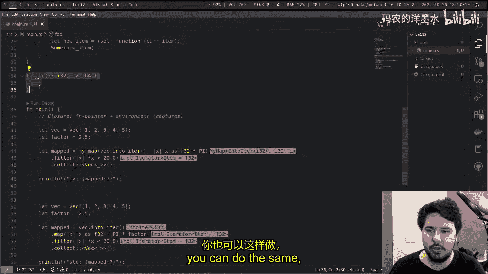

This is a little tricky to sort of say accurately， I suppose a function pointer。😊。

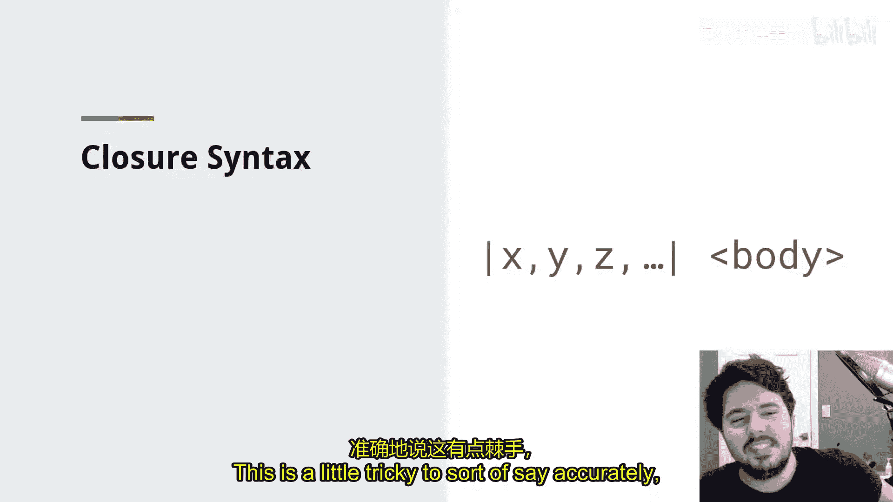

Must have no captures。😡，A closure can have zero or more captures。

 a a closure with zero captures can be treated as a function pointer。

 That's sort of like the cliff notes in terms of how these things relate to each other So I could use this as as like a closure if I wanted to。

 but almost always you're seeing closures with this syntax here So you know bar X Y Z however many parameters you want and then the body of the closure As we know the body you can just be like an expression if you would like and it'll implicitly return that expression back or you can use braces oops。

😊。

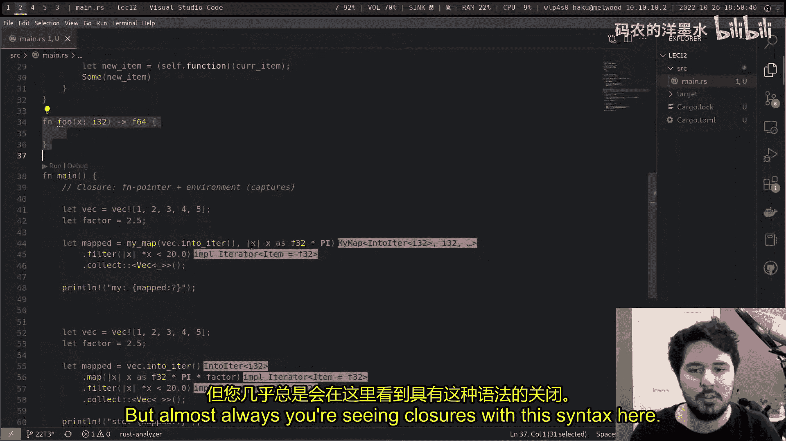

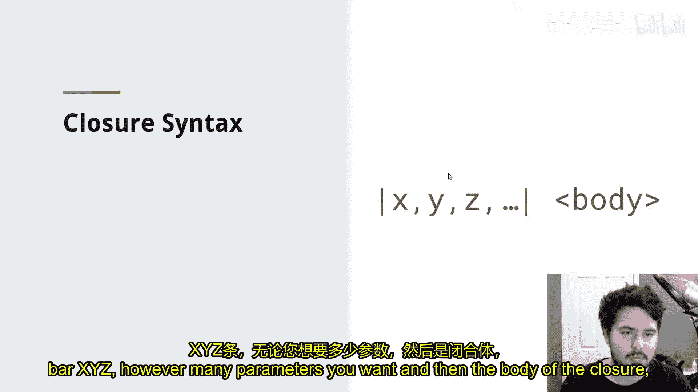

Or you can use braces like such and again， same sort of idea with the block it'll implicitly return the last expression in the block if you want to put a semicolon now it returns nothing it just returns a unit。

Or you could say the word return and this will also all do the same thing so a few different rise ways of writing what is essentially the same code。

I will leave it like this for now， because。

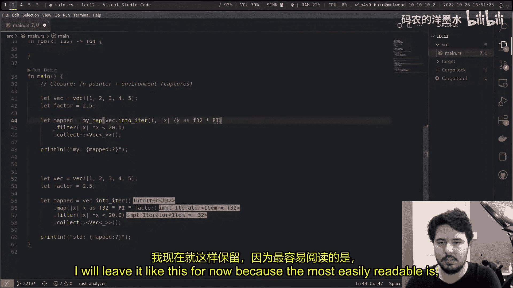

The most easily readable is， in my opinion， just in this scenario here。

And the type of a closure is the next question。 So before we saw this is the function pointer type syntax。

 how do we like specify the type of a function pointer？

Now we're looking for the type of a closure and let's see what rust says。

 so I'm going to follow this example here。😊。

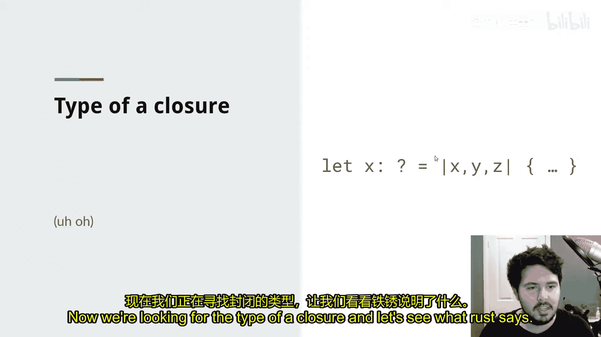

So let's say I had a closure that was like let X。Equal to a closure that takess in， say。

 an x and a y and gives back x plus y， something like that。

 Let's say x is an I 32 and y is an I 32 as well。 What's the type of X。I like to use this trick。

 I specifically say that x is equal to a unit type just to sort of force the compiler to go hey。

 the types mismatch， it actually is this type here and this is where I don't know if anyone notice on the slides it says u oh this is where theO comes in the type of this closure is this thing in square brackets with closure it source main do Rrs 44。

 174433。😊。

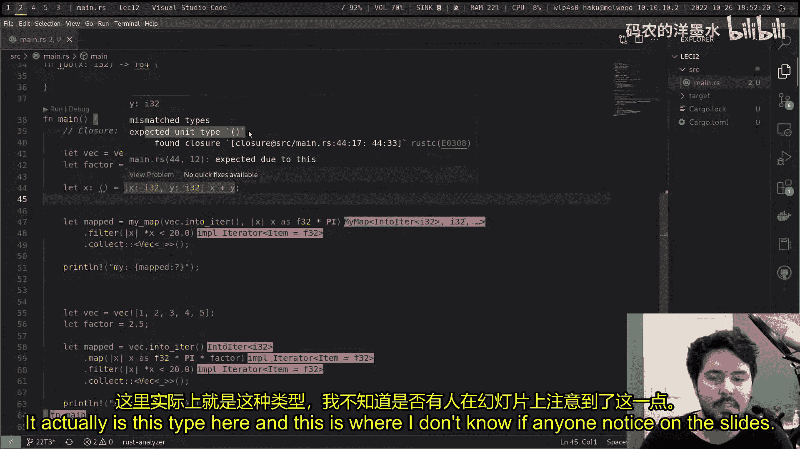

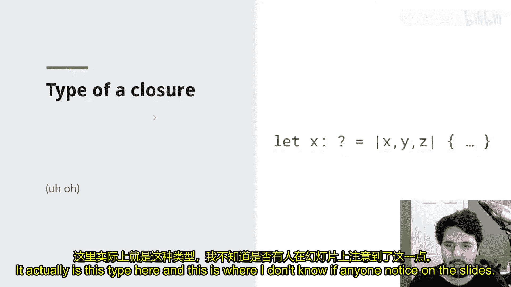

Like that's the type of it。And this brings us to our sort of first big problem。

 which is that closures the like concrete type of a closure is indeterminable。😊。

RightThere is nothing I could write here that would be correct。😡，It gives you the line number。

 Yes exactly。 so I could not fill in the type here。😊，Right， like this type here。

 I could not fill it in with anything correct。😊，I will always get a compiler error。

Note that if I leave the type unspecified， it's fine because the compiler internal。

 you can name the type， right And we saw it again， just to reiterate it。

 we saw the compiler name that type like this。 But we cannot name the type ourselves。

 What if you put in the line number。 Like what if we put in this here。 Yeah， not a chance。 So。😊。

So we cannot name the type， but the compiler can sort of reason about it internally。So。

That's a little like a little worrisome potentially。

You know what's going on here and this is actually， you know， surprisingly。

 this is an idea that exists in other languages， not being able to name the type。😊，Of closures。

but u it's it's so it's something that we got to work around essentially。

 so we can't name the type of disclosure closure， sadly， sadly， sadly。

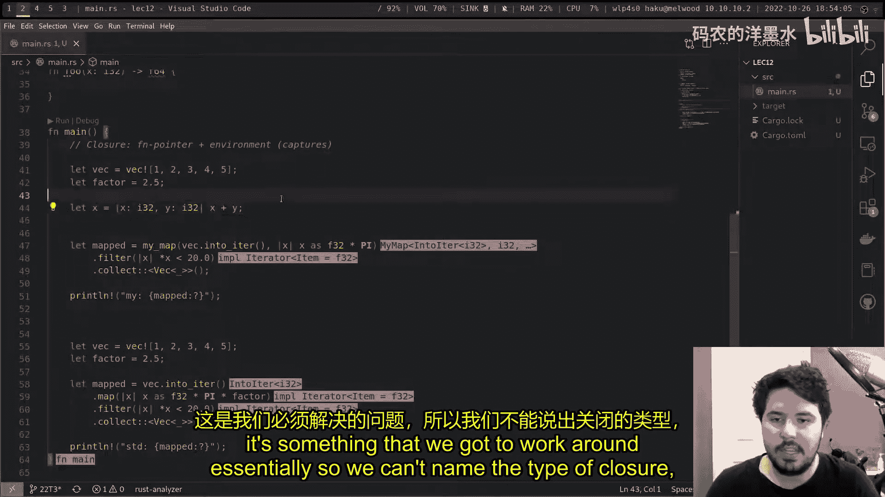

However， they do implement some funky traits for us to make use of。 So sadly。

 we cannot name the type of a closure。 However， the the unnameable type of that closure will implement some traits that help us use the type。

Right， imagine like， think of it this way when you write， you know。

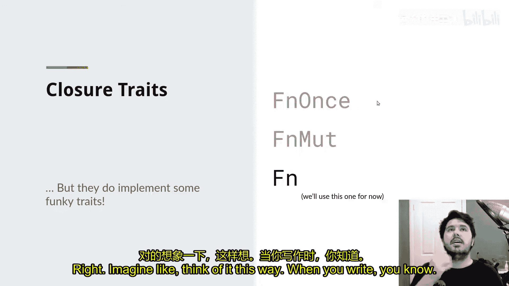

Let's say Vck of one，2，3 dot into it R。Dot map of x is x times times 2 dot filter on x is greater than 5。

 dot。 You know， I'm trying to think of other interesting things to do this， like dot。Zip。

 I don't know， zip with an iterator of two， four， six。

I don't know I'm coming up with all kinds of crazy stuff here， right， you know。

 whatever we get all there here。😊，How often do you think about what the type of this is。

 like if I was to say let X equals this？😡，Do you really care what the type of X is， I doubt you do。

 because that's the type of it。 right， It's a zip of a filter of a map of an intutor of a thing。

 of a thing of a that of a this。 right， This is genuinely like I could actually type this out。 Well。

 I'd have to get the imports， right。But I， I could in theory， type this well。

 actually not quite because it's got closures embedded in as well， but anyway。

 so it's got this really gnarly type。😊，But we generally。

 when we're writing these kinds of functional change， we change， we don't care about the type。

 All that we care about is that each of these things gives us back some type that implements iterator。

Right？The thing that really matters to us is that every time I call dot Intutor or I call dot mapap。

 or I call dot filter or anything like that。😊，That function returns me back whatever type it is。

 however crazy it is， something that implements iterator so I can keep calling more iterator methods on it right This is sort of the primary idea that I'd like to sort of get into our heads here because we can apply that same sort of thinking here Sure we don't know what type X is right we might not know at all what type X is but if it implements traits that are useful to us that can do the things that we care about。

😊。

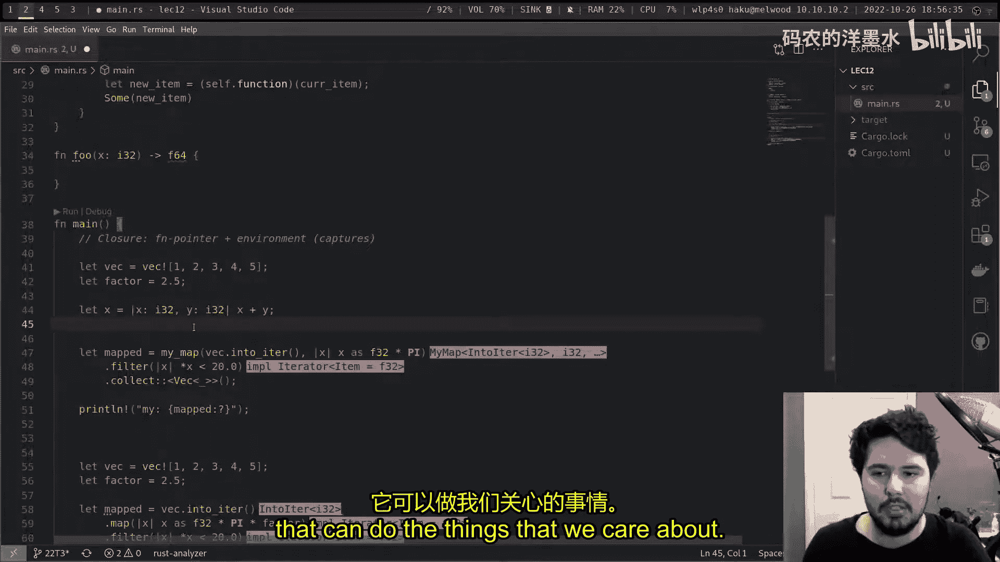

Then we can probably still make good use of it。So in our case， this lecture。

 we're going to be looking at the three function traits which are Fin wants Fin mute or Fin mut。

 I don't really care say it and Fin or FN again， call it whatever you want FN wants FN mutt。

 fN mute Fin mute， Fin mut， Fin fun， like I don't whatever。😊。

but these are the three traits that sort of describe。Function， functionality， right。

 closure functionality， whatever。 And we're going to talk about how they work。

And we're going to like play around with them。

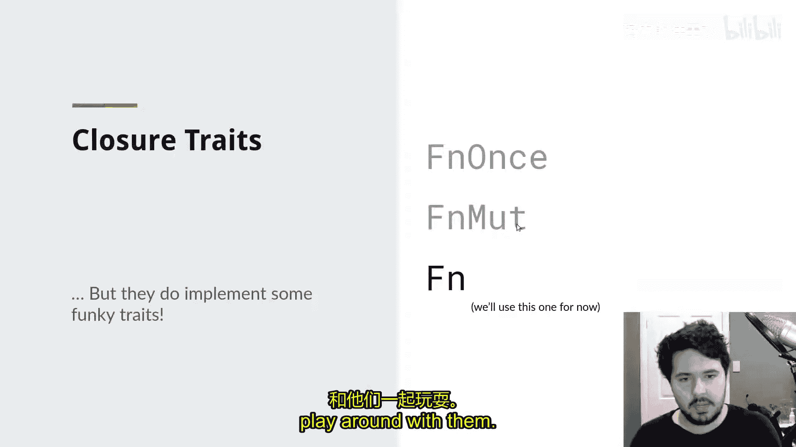

But yeah， I think we maybe be ready for a break。 but just to outline where we're going to come to when we when we come back from the break。

 so these。

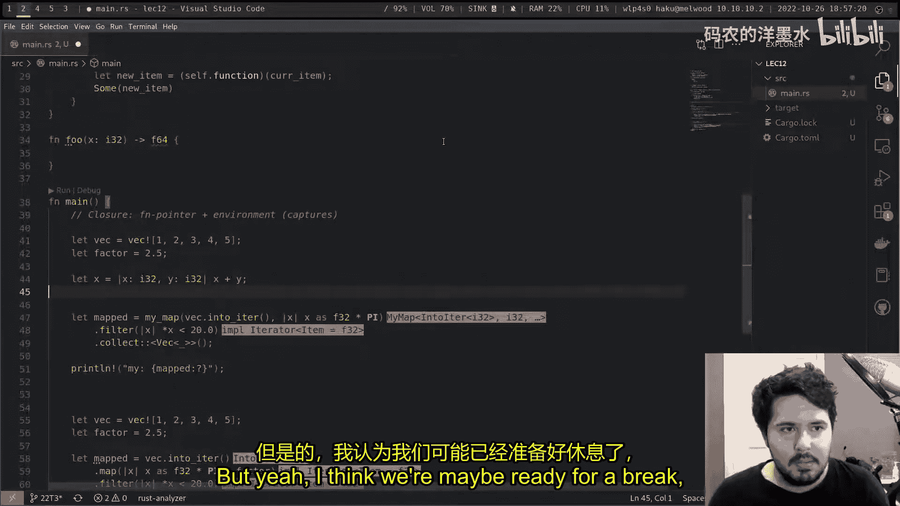

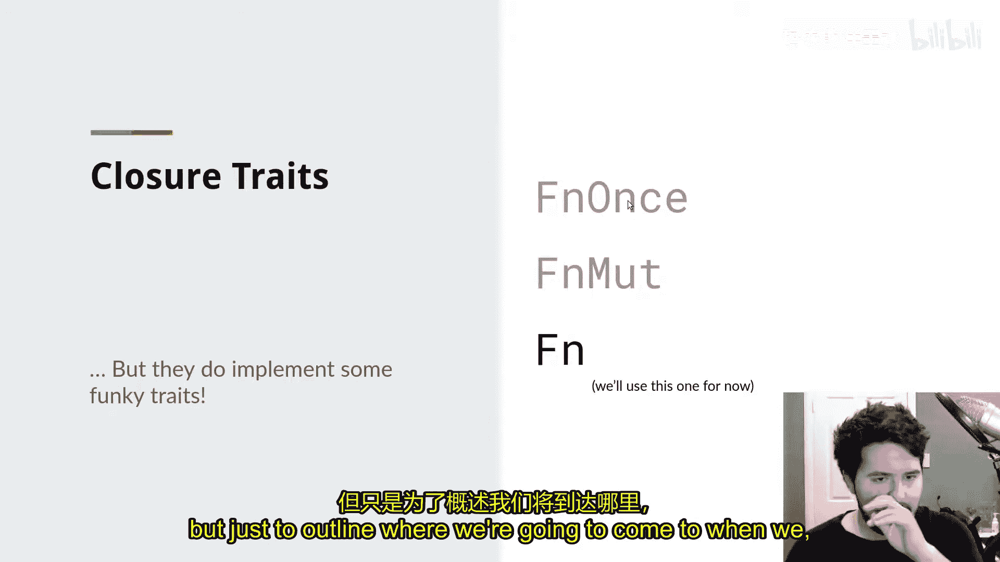

When we define a closure， it's going to implement some of these traits here。

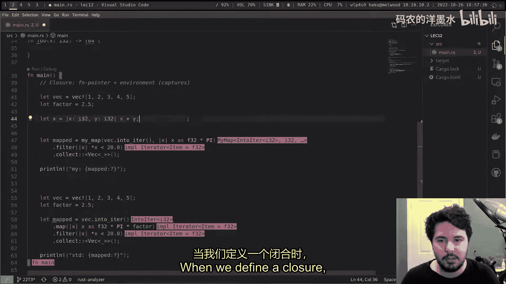

We're going to talk about the differences between them all， you know。

 in the like the latter third of the lecture。 But for now。

 we're just going to make use of this one here called FN and ignore the other two。And the idea is。

These represent these traits all represent closures。

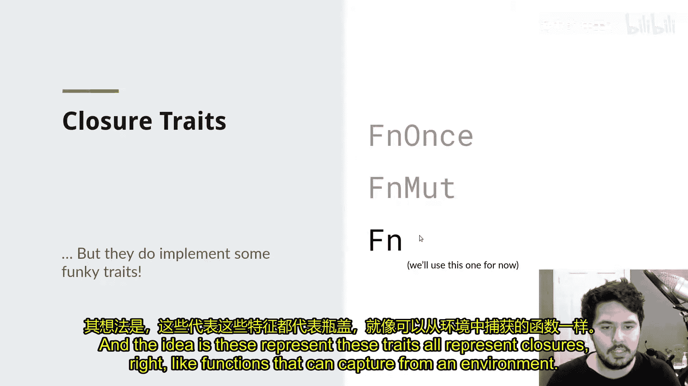

Like functions that can capture from an environment。Ie。 closures。So in our case。

 I could tell you that this X here does implement this FN trait。Right。

 this X closure here does implement FN。 in fact， this isn't even a closure at the end of the day。

 this could be a function pointer because it doesn't come from the environment。

 but let's say it was like x plus let's say this returned an F 32 and it was x plus y times factor。

 I don't know something like that。😊，And it doesn't like that because this it doesn't like。

It doesn't like， oh， right。 It doesn't like that because this。As if。32 like that。😊。

So this here is no longer a function pointer because it captures something from its environment。

 but I can tell you for now that it will implement this FN trait。

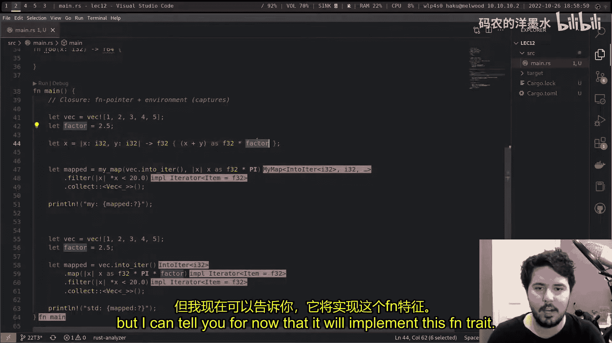

And。😡。

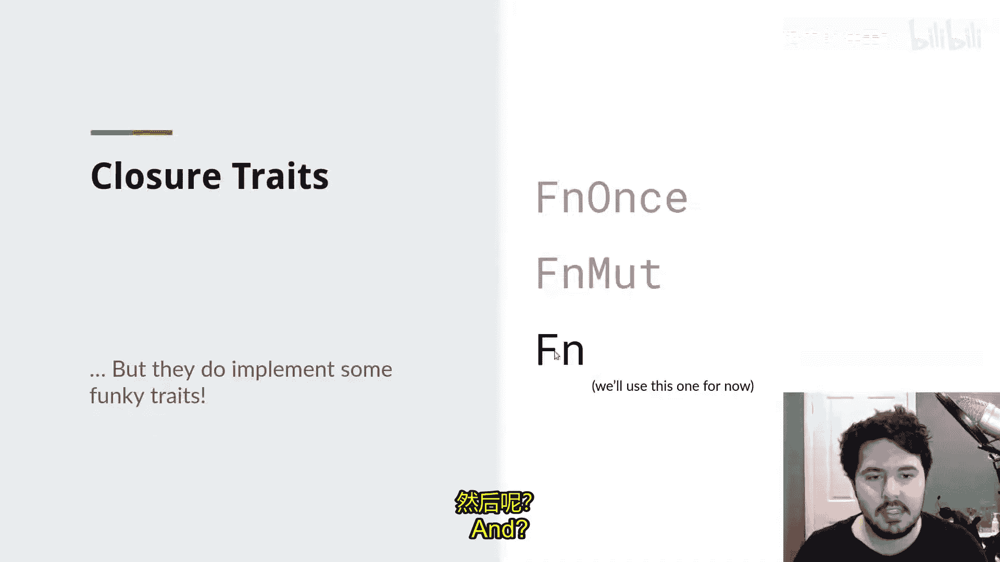

One of the most important ideas of these traits is that。😊，If you have some type T or like。

 let's say some type F that we don't know。Right， and F is some F。Right right now we know。

 oops from where right now， we know that you can't do anything with this F really because we haven't specified any restrictions on F could be literally any type so。

There's just like anything I try and do with it is just not going to work。However， if I said that。

I placed a restricture on the type F that it must implement the FN trait。It must implement an FN。

 then here's the real big important part， you can call it。

Or let's say FN that takes an I32 and I 32 and produces an F32 oops。

Then you can call it if you give it like some two numbers in this case。All right。

 I can pass F X here。Right， do we sort of see like I have never named the type of X anywhere here because again x has some insane crazy type。

 here's the insane crazy type again。😊，But。I have been able to pass it to a function and even call it from that function without ever naming the explicit type of it right I've just said it's some type F where F implements this trait that says this trait fn of I 3532 into an F32。

😊，And since I've placed this requirement on it that influences this trait。

 the compiler allows us to call it with the correct arguments and assuming the correct return type。😊。

Rt equals this， and we know that rat is going to be enough 32。Right。Internally。

 it's calling this function here called call， which is it's a little bit， you know， strange in stuff。

 but it's essentially like saying F dot call， but there's some special syntax on top of it to special sugar and stuff to make this a little this process a little easier。

 But you can imagine this is a trait that defines。The idea of calling a function with an environment。

 essentially， and same way that iterator is a trait that defines。You know。

 iterating across some kind of sequence， this is a trait that defines calling a function with some captures。

 with some sort of environment。嗯。Okay。So when we come back from the lecture。

 I might try and spend a little bit of time talking about how this what this these sugar is into might be a good quick idea。

 and then we're going to follow on in terms of refactoring this。

Post any questions that you have so far or especially with the stuff that we've just looked at here over the break。

 we'll come back at five pastt and we'll continue onwards so yeah， think of any questions。

 I might even leave this code up instead of the usual break stuff I'll just turn my webcam off here which is here and I'll leave this up during the break so you can have a look at it see if you have any questions and we'll come back at five past。

😊，All right。So。Disasociate momentarily and I'm very lost now。

Let me give you the ClNot summary of the last little bit here， the important bits。Which is。

We're used to we're sort of happy with function pointers in that they can be constructed out of like some function。

excusee me， that you might write。It just does some stuff。Or out of this sort of Lambda syntax。

Where it just only uses the things that it's given。And we introduce this new idea of a closure。

 which is a function pointer plus some captures that come out of an environment right so in this case capturing the variable factor。

And so that's we hopefully you can see that this is a。

Sort of like a super set in that it can do all the things。 function pointers can do。

 but also more in that it can read from variables that aren't defined inside it。

 It's something that you might want when programming。

 And we've sort of run into our first issue here， which is that the type of a closure with its。

 you know， captures and everything is unnameable。 We don't know。What type it is。

 we can't like actually write the type of it into our code。So instead， but fortunately。

 the compiler will automatically implement。😡，At least， you know。

 it'll implement a subset of these traits here on that type automatically for us。

And using those traits， using those trait bounds， we can then end up like calling it again later。

 So in our case， we're saying fo takes some type F。 We don't know the the concrete。

 the real actual type of F。 but we're requiring that F implements this FN trait。

Specifically the FN trait of you know2 an I32 and I32 and returning an F32 and with this trait bound。

 we can then call F as if it were a function with 2 I32s and it'll give us back in F32。And again。

 the compiler implements this fN， you know FN or FN mute FN wants， you know。

 these traits automatically for us， you actually currently cannot implement them manually yourself in stable rust。

 you can in nightly， but it's it's all a bit tricky in stuff。😊，So yeah。

 it does it all automatically for you， and we've essentially skirted around the fact that we couldn't name the type of disclosure closure。

😊，Um you know， using this technique and we're going to make liberal use of this technique for the rest of the lecture。

So random question， what is the meaning of plus tick static and wear clauses for generics？😊，Sort of。

 in summary， means that the concrete type。Yeah， let's say some T is some trait whatever plus tick staticatic。

 let's say the concrete type T must not have any burs that are shorter than T staticatic that have a lifetime shorter than tech staticatic it's useful in sort of pretty specific scenarios。

 but we're also gonna be talking about this ticktatic on you know on generic parameters， in fact。

 Ttatic on on a function parameter in in next week's lectures。

 so I'll leave that on there or if you want a longer answer you can ask on the forum and I can give that to you sooner than then。

And do closures set up the function call stack identically to normal functions。

 or do they do something special because of the whole environment thing right。

 So let me show you this now so。😊，I'll just show you some quick like you know back of the neck can be sugaring in terms of what this roughly looks like。

 but when I say let X be this function here， this is the way it sort of write writes this code out in a certain sense So the first thing it does is the compiler will generate a new struct itself。

 I'm going to call this like main X closure captures something like this。

And you'll notice since I've used factor in here， it's going to borrow factor from main。

 so borrow factor。Is going to be a borrowough of an F32。As we know in Rus。

 you can't just say like in a structure， this is a borrowough。

 we need to throw a lifetime on that tick A。And so it generates this main exposure captures like this。

And then it implements， in our case， the FN trait。 and I just like implement F N of I 32。

 I 32 goes to F。32。For main Ex closure captures a tick you know， of some lifetime。

And then it goes function call with like x is the I 32 y is an I 32 and give back gives it back an F 32。

 and it sticks our body in here。 But wherever we call factor， it's gonna sneak in self dot oh sorry。

 I've forgot got the self in here。😊，It's going to sneak in a self dot borrow factor like that。

So and then it turns this whole thing here， let x is blah blah into let x equal main X closure captures where the borrow factor is a borrow of factor。

This is essentially what it turns it into。😡，I'll bring back the original code as well。

 So this is the same essentially the same as saying let X equals take in an X and a Y producing an F 32 that looks like x plus y。

😊，肚皮。As F32 times times the factor。So the compiler is not going to like this， you know。

 I'm very sorry compiler， but you're going to have to deal with it。嗯。

But this is essentially what it turns it into。And that's why we can't name the type。

 The reason we can't name the type， like I didn't want to。You know。

 just give a reason that I couldn't really explain before， but now I sort of can say it。

 The reason this type is unnaable is because the compiler needs to generate it。

Like the compiler needs to come up with a name for it itself and so you know。

 since the compiler comes up with that crazy name for the type， like we can't use it。

 we can't use that type ourselves So the compiler has gone and done all this work for us and it goes and does all this work in this specific way because it can leverage the existing type system in rust It can leverage the existing ownership and borrowing rules and all that。

And we're going to see how that works。Okay， I'm glad okay。

 we're getting head explosions Inter making so much more sense。 That's good news， all right。😊。

I guess maybe I'll leave this down the bottom then if people seem to like this。Hohoops。Okay， cool。

So right， we've got something stuff that influence this and then we can call it like that and we're all happy。

😊，Okay。So right， we want to make myM be able to support using an environment right where our problem here that we've got is that factor here doesn't work because this takes a function pointer。

 which function pointers are literally just like a pointer to a function。😡，Rsas as we saw down here。

 if you're capturing stuff， you need additional data in order to like hold on onto those captures to be able to read those when the function is being called and so if this is like you know some known type with a known size。

 how could I pass different functions all that might have different captures in them different amounts of captures of you know different sizes and all that？

😊，And， and like， you know， how this work。 It doesn。 It doesn't work in in， in short。 Instead。

 we need to be generic over any type such that the type can be called。

So we're going to introduce a new type parameter called F。F for a function。

And say that text function is going to take in an F hereO。

Where I is the iterator and F is a function that takes in current items and produces new items。Right。

 so an additional little thing there， naturally we're going to have to change my map as well。

 ifF current item new item。😊，And then we're going to have to you keep changing all the way down。

To pass in this new parameter， F is a function of current item to。

Current item goes to new item like this。This is upset because it doesn't know this right。

 and now we get to thisarrow which I was waiting for。😊，Which is that now it goes， hey。

 I don't know what current item And like， you don't actually use current item a new item anymore。

 I don't even need to know what they are。 And so， okay。

 we'll follow its advice saying you don't use them。 You don't need them。 Okay， we'll get rid of that。

 We'll get rid of them over here。And the compiler is still happy， in fact。That's it。

 it's building again。 and look， it's building with this。Right， like， I didn't。

 I didn't remove that factor。 Let me。I'll just move this code down to the bottom here。

Well we're not gonna need it anymore。It now works。It's got the same result。

So that was actually all it was was just saying no， it doesn't actually mean to be a function point。

 it's just going to be this FN type here。Right。And so like because this we we don't know what type self dot function is。

 you know， some F here， right， but what we do know is we've placed this restriction that it must be a type that implements FN from current items to new items。

 and so we can call it。😊，And it reads cleaner， okay， great， I'm glad we like it。In fact。

 we could even take off。What could we take off here。

We could take off current item as well if we really wanted to。 if you're trying to like， you know。

 Min Max the the code you're writing here， you don't actually need current item as a generic type parameter because current item is also is like specified through the iterator。

 So like， watch this trick here。We don't need to be generic over a current item anymore。

 and we'll just say I is some iterator， right， forgetge about the item。 and then the function。

 this is a neat little trick。 The function needs to map from whatever the iterator produces to new items。

And I can actually do that by saying， take the type I and you know treat it as an iterator。

 I have to write this I as iterator here because you could imagine I could implement a whole bunch of things。

 it could implement iterator， it could implement debug。

 It could implement clone like all these different things and I need to specify Oh， okay。

 connection was dodgy for a second， but I think it's allright。😊，I just need to tell it specifically。

 hey， I'm treating I as an iterator here。And then grab the item like whatever type the item is in that iterator。

And I want to function from this type here， the the item that the iterator produces to new items。

 and this also works。 You may not like like this is genuinely like。If you you might not like this。

 be like that looks more complicated， even though there there might be like less text and that's perfectly reasonable or you might go。

 oh， I like that a whole lot more than having， you know， current item item equals current item blah。

 blah so。😊，It's it's your choice here。 I'm not going to tell you what's right or wrong there。

 but it's an option if you're， if you're interested in it， and it is kind of a reverse turbbo fish。

 Yeah， where is the function trait。I think that's fine。 Where is the function trait defined。

 It's defined in the standard library。呃FN。FM Nope， yes， trait stoodops F M。

 And it's like a little bit gnarly。 You're not meant to use this trait directly， right。

 You're meant to use all the sugar on top of it to like deal with it。 But there is a， you know。

 there is progress that's being made over time to let to help users use this trait directly if you would like to。

 but it's it's just not like the language isn't quite at that point yet。 But again。

 it' rust is a language that's very iteration happy。

 It's very happy to like put something out now that we know we can commit to and then slowly improve it over time。

😊，Um， so they， you know， the language will get there， but we're not quite at that point just yet。

All right， so that's pretty cool。😊，Let's bring in our next problem。Back to my map。Okay。

 now I'm going to run into the problem first before we move on to that next slide。

 which is watch something else that the Sta library can do that we're not quite good enough at。

 So let's forget about this stuff for now。 I'm going to write a slightly different example。

And this example is going to be like let。喂。People no， let greeting equals。A new string。

I'm going to say grab a。A line from standard input。And put it into the gring。

let's call this I'm going to do something in a second， I'll call this line。

And then I'll say let greeting equals trim the line because it， you know。

 brings in a new line off the end and all that， which is kind of annoying。All right。

 this is going to return a result， so just forget the result， you know panic that goes wrong。

And now I have a greeting from standard input。Now， I want a list of names。

So this is going to be like some common COVID up here， I suppose。A list of names I'm going do， okay。

 who's in the chat。 You got Miguuelel。We've got Mitchell。 We've got Patrick， We've got Dong。

 And I remember Tom was here early。 We'll throw Tom in there as well。

 So we've got a few different names。And so， now I want to like iterate over them and do something a little fancy。

 So I'm gonna say let。Greed equals names dot into Ed。Dot map these names。

Into I'm going to use like a body here。And then just collect them back into a V。And then print out。

My， my map。Is greeted。Okay， great。 And what am I going to do in this map here。

 I'm going to do something pretty cheeky。 I'm going to say let mute n equals one。And then， say， let。

Great。Name equals。AndYou know， number n。Is。A greeting。For the name。や。Nth plus equals one。

And then give back that the greeting for that name back。To the map。 And this again。

 this could be return， great name， you know， whatever you prefer。

 But this is just very slightly more idmatic like this。And this。This should not work。

 but it seems to be compiling。 Did I do， Oh， I did。 This is the standard library ones。 Okay， great。

 sorry， this is stood greeted。 I was like， what the heck， Why is our code like working。

 That should not work， And I'm gonna paste it again for my map。

And I'm going to swap out names into it a map。For my map of names dot into iter。Into。

To iter and the function is going to be this function here。Like that。Okay。So these are the， this is。

My map here， and this is the standard。Standard libraries map over here。

So let's just comment out mine for a second because it's not compiling as I was hoping。😊。

And see what the sound library does。 So it's going to wait for us to type in some some greeting。

 So I'm just going to do like hello there。And the standard Library spits out number one。

 hello there Miguuelel， number two， hello there Mitchell， number three， hello there Patrick。

 you know， so on and so forth。😊，Right， so it you， gives it assign like the number that it's the end person that it's greeting。

And specifically， it's like mutating that end there at the same time。Right， so that that all seems。

 you know， well and good。But suddenly， when I。Os， when I uncom this。I get an arrow on this line。

Can align to Nth as it is a captured variable in an FN closure。Okay。

 so it's it really doesn't like the mutation on this end。 and， you know。

 we've all been using rust for this is our seventh week now， right？😊。

Rust is like pissed off about mutation， like what's new。

This you should be pretty comfortable with the idea at this point that like rust just gets pissed off when you're trying to mutate something a lot of the time and this is this is just this again。

 So something's gone a little wrong。😊。

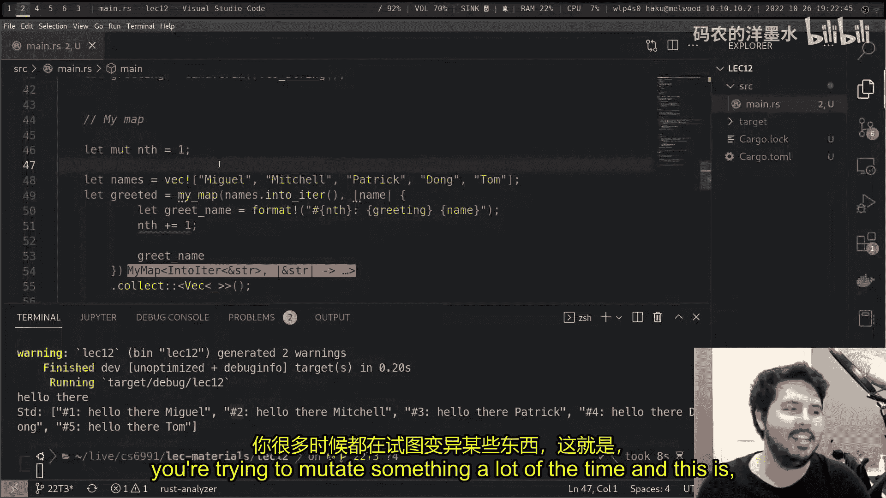

And we're going to get a little bit more background。

 So as an aside to help us think about what we're about to what we're about to learn here。

We're going to recap like the ownership system。 So consider the the the idea that we have like astruct fo。

 which just， I don't know， has some stuff in it， whatever。 And we implement some methods on fo。

We implement a function fo owned that takes self。Foo exclusive that takes an exclusive borrowough on self。

 like an ref mute on self and fo shared。😊，Which takes a shared bar self or a ref self。Right。

And it doesn't really matter what else they do， but like these are the function signatures here。😊。

What are the restrictions on calling fo owned，F exclusive and food shared？Right， so imagine I've。

 I've created a foo， right， I've created let F equals some foo， whatever。

 And I want to call some of these functions。 Let's start off with foo owned。

 What's the what's like a restriction that we might think of。😊。

In terms of calling this method here foo owned。To be clear。

 I'm going to assume that like all these functions I can， I can call at least like， you know。

 at least call those functions once。But there's， yeah。

 so Daniel notes that it transfers ownership of self。Right and yeah。

 so Simon is pointing out exactly what I was looking for here。

 which is since given it transfers the ownership away as Miuel says， yeah。

 you need it needs to take ownership here， it sort of implies that you can only call food owned once。

😊，Right， like I have a foo。 I have a fo。 if I want to call fo owned， I can only call it once。

Does that make sense like in terms of if I tried to call this function two times。

 the compiler would give me an error and say， hey， when you called it last time you actually moved out of your fo？

😊，You transfer the ownership， you know， away into that method call。

 so therefore you can't call it again， you don't have ownership anymore Does that principle make sense？

嗯哼。😊，Okay， cool。 and that also points out we've got about like probably a 10 to 12 second delay or 10 to 15。

 maybe Okay， we're happy with that Now let's get on to Fu exclusive。😊。

So what are the restrictions on calling through exclusive， I'll get us started。

 we need like exclusive access to self。Right so it requires that we can take an exclusive。

 we either have an exclusive borrowough on the F or we can take an exclusive borrowough on the F right so like that's our requirement。

But what does that sort of imply， Like， what real world restriction does that imply？

 And this is kind of like a tricky question for me to ask right now。

 because I'm sort of predicating this a little bit on what you might find out。

What you might find out like next week when we're really playing around with concurrency and stuff。

 but yeah， so that function sort of like kind of like owns self for the duration of that function。

 yeah， so for the duration of that function it can it must be the only thing with access to the to the fo is a nice way to put it。

😊，嗯。So it's， you can't have a shared borrow。 You can't have another exclusive borrow or anything like that。

 for the duration of food exclusive， it needs exclusive access on self。

 Nothing else is allowed to possibly access self while the function is， you know。

 running while that function is been called。 So one of the restrictions you might think of is that。

You can't like you can call this function。 you know。

 the previous one you could only call the function once and then you're done for。For F exclusive。

 you can call it as many times as you want， but those function calls can never， ever be overlapping。

Right， in terms of let me grab。

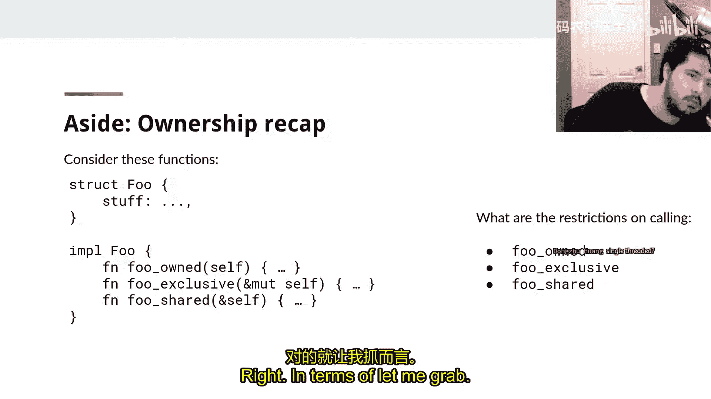

Oh gosh， I hope this works。Y， it seems to work in terms of。

If I was like calling you know the exclusive function and it took this amount of time。

And then the function returns back to me， so I call exclusive， it starts running。

 and then it finishes and it you know returns back to me and I keep going， then I can go like。

 okay call exclusive again and then it comes back and I say call exclusive again and that's all fine。

😊，But we can't ever have something like this。😡，Right。

 where we're calling exclusive and as it's running。

 it's like overlapping with another call with that same borrow， right。

 calling exclusive with that same fuel at the same time。

 Now Dong is absolutely right in mentioning single threaded here because this is a very tricky it's a very tricky situation to run into when when you're single threaded it is technically possible with something called continuations or like asy  wait as you know Mitchell points out here。

 async also comes into this， but very sadly， it makes me very sad to say it's a bit too much for this course。

 it's like too hard for us to bring in from you know at least what I think this in terms of this offering。

😊，so it's pretty rare to write into a case like this on a single thread。

 but next week we can bring a concurrency when multiple threads can be acting at the same time。😊。

This is dangerous， right， this is no good， we can't have two functions。

 we can't have it like overlapping and call because we'd have two things with exclusive access at the same time。

 essentially， which goes against the whole point of exclusive access。

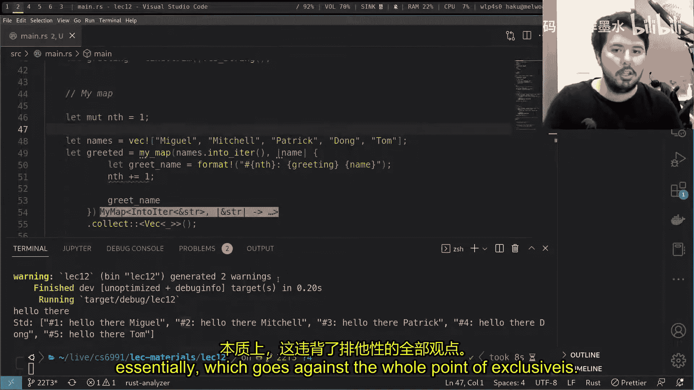

嗯。And then we have food shared， right？And fo shed。Well there restrictions on that？Well。

 we can definitely call it。Once we can call it more than once。

 we can call it as many times as we want， like for exclusive。😊，But also。

 we can call like fo sheds all overlapping with each other at the same time， like that's all fine。😊。

The one restriction as you note is that we can't have yes。

 someone else with exclusive access right like no one else can be mutating or taking ownership of it or anything like that。

 you're allowed as many sharedd borrowers as you want and they can be all you know occurring at the same time and doing same stuff。

😊，But we but nothing else can have exclusive access or ownership or like。Oh yeah。

 let's just say exclusive access or transfer the ownership away while we're borrowing that while we have that shared borrow。

嗯。Right， and also you can almost imagine like so we're saying， oh。

 no mutation can be done and that's that's absolutely true。😊。

There's also another point though that's like that's more of like a restriction on mutation itself you could also consider that as like it's not really a requirement that in order to have a shared bor you can't be like mutating it at the same time。

 but in order to mutate， you must have exclusive access。

 nothing else can have access if you want to mutate so you can it's perfectly fine to consider to be restrictions on both of them or you could also just consider restriction a restriction on on a mutation on an exclusive borrowor。

Okay， so we all seem up to speed on this， you know， pretty much。And now we get the another。

 hopefully a bit of another brain explosion moment。嗯。What's this， Oh， we've already seen this。

 So like， yeah， we saw that we can specify the traits syntax like this。 And there's also， you know。

 FN wants an f and mute， which we're about to have a thing about。We've just looked at FN。

But there's actually two other things， FN Newe and FN wants。

And what these trait bounds mean in terms of like some closure implementing these traits。

 FN once will be implemented on a closure that can be called once。Right。

 and that's like every closure。 If you like， cannot call your closure even once。

Right if your closure cannot even be called once， it probably doesn't deserve the name of like a function。

Right。That'''s a nice quote from。What's his name， he's a engineer who works in New South Wales actually and was a previous Ru team member。

 I will remember the name and I'll try and post or I'll mention it and in the next lecture or something but yeah。

 he's got some fantastic articles on closures as well。But yeah。

 FN wants means it can be called once every closure implements FN wants。😊，Now， Fn mute。

That's implemented on a closure that can be called indefinitely like as many times as you want。

 but can never be called simultaneously， not Tim Mcnama， actually， someone else。😊，嗯。

So it can be called as many times you want， but never overlapping， never simultaneously。

 and then Fn can be called indefinitely simultaneously， right？

This this sort of like does this ring a bell to what we were looking at a little earlier？Right？嗯。

HopefullyHofully it's like it's ringing a little bit of a bell。Now。

 how can it determine like what like which ones it can like if it think something can only be called once or if it can be called indefinitely。

 but never simultaneously and so on so forth。嗯。It's determined by NFN wants if a closure moves something out of the environment into its captures。

😊，Right if it actually like moves a variable that exists in the environment。

 right so like there's a variable here， let's say greeting and it actually moves it。😊。

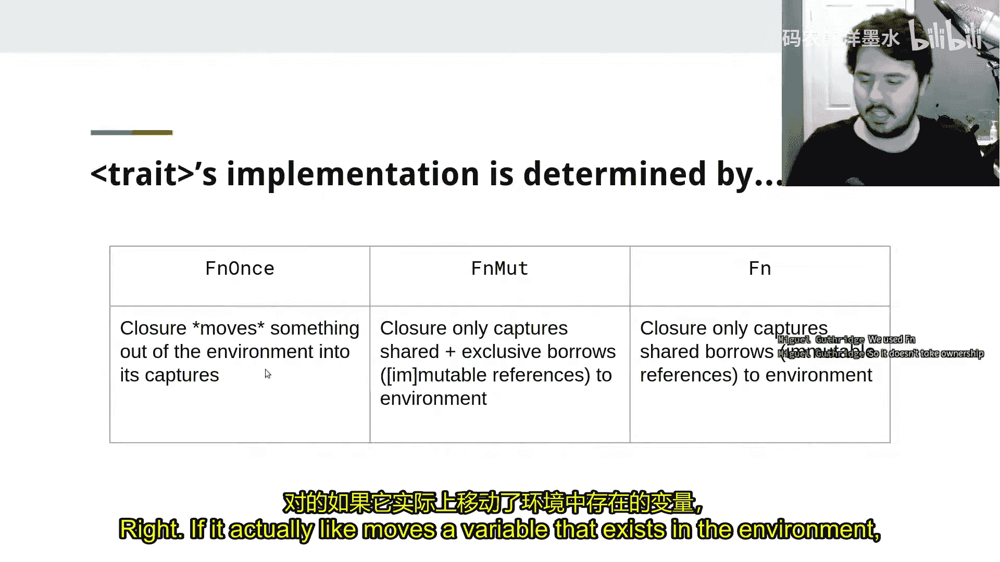

Into the closure， then that can only be called once。

Right that could only be called once because the first time you know it's moved it away。

 it's put it into the closure， and so you can then use it there the second time then you the second time you try and call the function there's no more like thing to move out of essentially So that's a little dangerous。

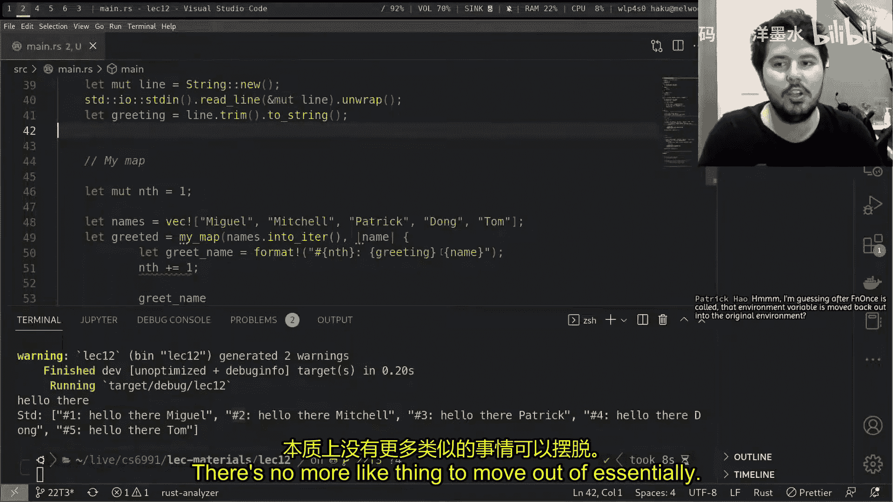

FM mute。Is the closure only captures shared and exclusive bors， right。

 so like references to the environment。嗯。It doesn't move anything right there's no like moving going on that could be a little scary。

 I think this I might need to rep on this slide a little bit。

 I think it's actually slightly inaccurate when I'm like saying it out loud in front of the lecture。

 but I'll have to have another quick think about it after the lecture again。

 but this is it's close enough for us now I'm sure。嗯。And。So right， and FMme， there's。

 there's no sort of ownership problem going on here。

 It's only dealing with shared and exclusive borrows of the environment and an FN。

Only captures shared borroworers to the environment。 Right。

 So it's only like reading with shared borrowers from the environment。

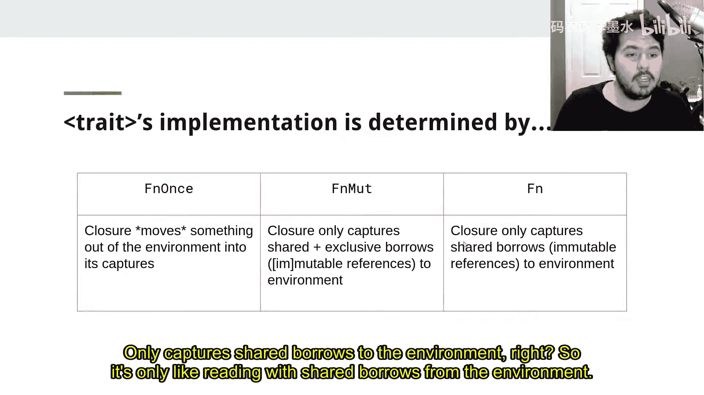

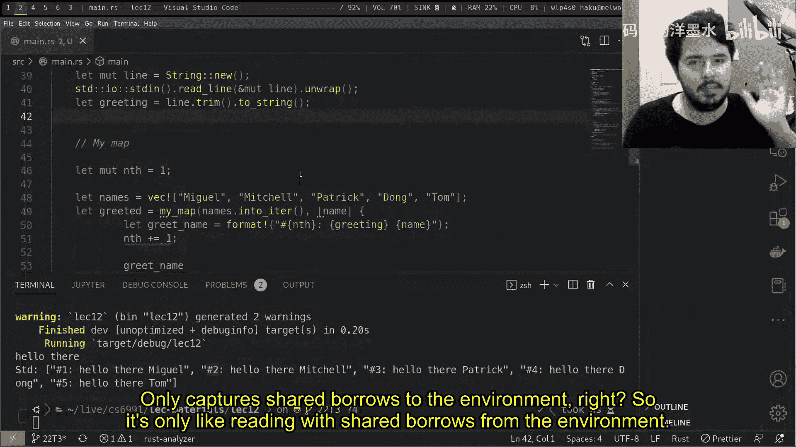

And this。Almost perfectly， like basically perfectly corresponds to the ownership system in terms of self。

 exclusive borrower on self and a shared borrower on self。Right。

 so if we think about the requirements and like the cases that you're running into， well， this is。

 you know， fN is only shared borrowers， right， Sha Borougher and self Fn mute is shared and exclusive borers to items for at mute self and ownership is you know。

 transferred through self in the example that we saw before。 Furthermore。

 can only be called once is tied to self can be called you know。

 can be called indefinitely but never simultaneously at mute self can be called indefinitely and simultaneously is a shared borough self。

 It all sort of like lines up with the ownership system。😊。

So this is what I was like just putting together there。😊。

Is that if you have some type T that you have， you know， self at self and and shared self。

 then you know， these are the restrictions that we talked about。In terms of those。

On a function trait， it's essentially the same things， it's the same ideas but applied to functions。

 and so it actually ends up using the exact same ownership in order to enforce these ideas on functions。

😊，嗯嗯。So let me just see what the chats saying。 I'm guessing after F wants is called that environment variable is moved back out into the original environment。

 No， so it， it actually doesn't。 There's some。Kind of technical reasons for it。

 The short answer is that the if you have a closure that's moving something out of the environment。

 it's perfectly conceivable for that closure to outlive the environment。嗯。

So you actually wouldn't want to force it to transfer it back into the original environment。

 whereas with borrows， it always needs the environment must outlive the closure because you know you're borrowing from the environment。

But yeah。So if， but a little technical， a little deep。

 probably the course forum for that kind for that one。

I thought it'd be consumed by the closure Where F me would return afterwards。 Yeah， and that's。

 that's sort of how the borrowing works there。 Yep， for sure。 So if we do something like like。

 like let message equals greeding in the closure， that is F wants。 So that's a really good question。

 The answer is surprisingly like， kind of no， but it's a little surprising as to why。😊。

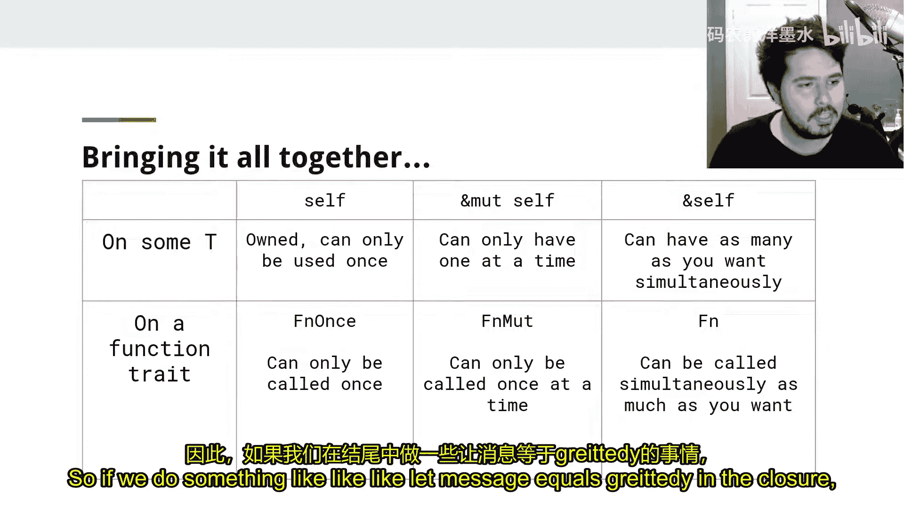

So。Let's say I do that there。 Let message equals greeting over here。

It actually just likes straight up。Can't move out of readinging it。 Oh， this is。

 this is for another annoying reason。 Let me go over here。 closure。Let message equals greeting。

Like this。We should see that。嗯。This is。Let underscore。This equals that。F check then once。Of F。

 I'm not going to get nerdni too hard here。But I'm just going to quickly double check for once。let X。

Sck and wants of X。Yes， this is what I expect expected of once closure found unit。Oh， right， yes。Yes。

 oh right。 Yes， yes， yes。 Hang on， yes。Oh' know， but they're often once that's kind of annoying。

 I want to check， check the mut。And then， this is。This only influence when wants， okay， yes。

 it does end up moving。 I was thinking oh。で？Oh。Okay。

 I've got to double check some stuff after the lecture。I think so it seems like yes。

 correct in that it is moving out I was expecting some similar but slightly different behavior。

 which is why I'm like oh it's a little confusing， but also I'm in like lecture brain mode which often means that I'm like missing rather obvious things I'm have to poke at that after the lecture again and do something on the forum probably but from my quick thing there that was slightly surprising yes。

 you've moving into the closure and so the closure will only implement F once。😊。

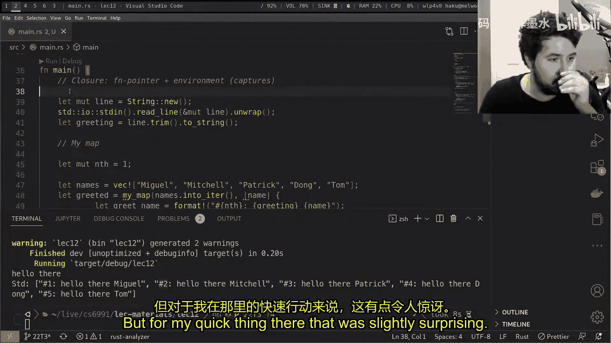

What I was sort of going to get to here is that。Allin wantss are in mutes。 Sorry， sorry， Ro around。

 All like function pointers can be treated as an fn closure。

 Just like imagine a closure with no captures from the environment。

 All fns can be treated as fN mute。 All fn mutes can be treated as f wantss， right。

 Like the easy sort of comparison of being fn once because the only requirement on an fN once is that it can be called at least like it can be called once and all of these functions。

 right， every single one of these can be called once， And so therefore。

 you can treat any of these things here as ifin once and it'll still be happy but you can't say treat something that's only if in once as say like an fn right。

 it doesn't really work the other way。😊，So。A hot tip for good API design。

 There's some asterisks on this on this tip is that。

You want to be as flexible as you can to the people using your API。

 like let's say if I'm designing a map function here， I want to be as flexible as I can。

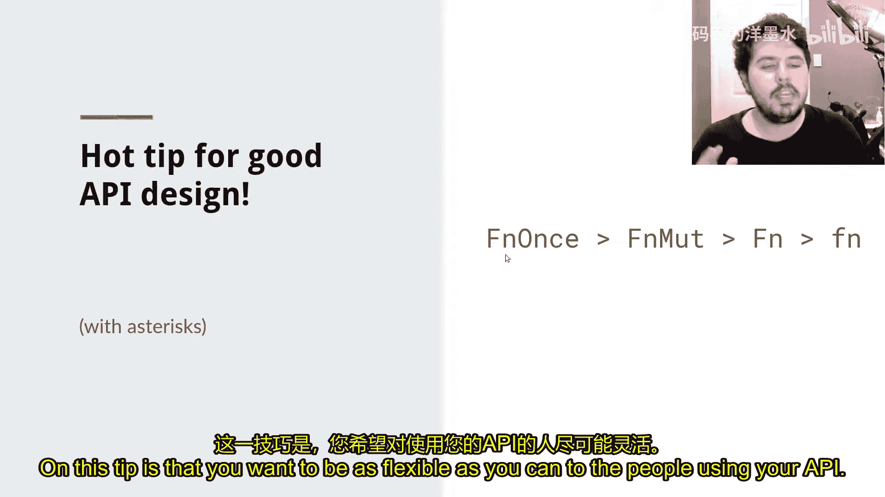

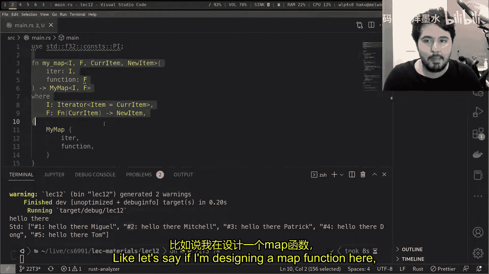

And you so therefore you want to start with all the way on the left here。

 like if you can accept a F once and it will work， then just take a f once because that means any closure。

😊，That a user could possibly create any function anyclo， whatever。Your API will accept。

And only move sort of rightwards。😊，As you need it， as you sort of have more complex requirements。

Right， so。The thing that would drive you from a f once over to a F mute is if you need to call that function more than once。

The thing that would drive you from a finee to a fun is if you need to call that function multiple times simultaneously。

RightLike you need to be able to call it you know at the same like more than once at the same time。

 which is usually when you're get into concurrency and stuff。

 that that would drive you across to FN here and then moving from fn to a function pointer is like there there's pretty specific reasons。

 mainly to do with things like limitations on traits and stuff and type parameters or you need to know。

 yeah， you need to load the exact size and stuff like that。

 and yeah because you get less and less ownership as you go。

 Sure and that's a perfectly reasonable way of thinking about it is that here they can they can do whatever they want for the ownership all the way over here。

 like here they can't take anything from the environment here they can only read from their environment here they can read and write and here they can actually take ownership from the environment。

 So you want to start here and move rightwards。The big asterisk here is you know something you might want to consider as forwards compatibility is that like if you accept a F once and then you go actually like you've released the API people are using it and then you go like damn it I actually need to call the function more than once you'll then need to update your API to take a fun mute and you might break a lot of people's code that was already existing so there are some cases where you go actually I only need a F once but I'm going to accept a for mute because I think I might need to call it more than once in the future these kinds of things to like potentially think about。

😊。

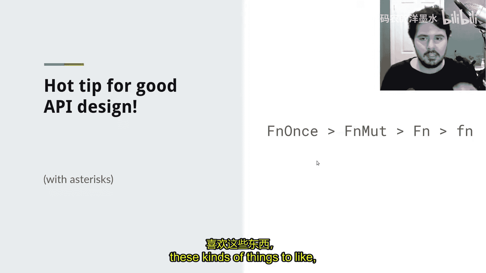

So what should my map take？😡。

Right out of these options here。Right， this Fin wants F mute and funn。

 we just like chose Fn because I said so like at the beginning of the lecture， I was like。

 we'll use this one。😊。

What should my map like take if F once is the best and like F or function pointer are the worst in terms of like。

 you know， flexible API design， What should。My map take correctly。

 like what's the correct level of function trait here for my map？

I think it should take fme since it gets called multiple times and can't take ownership of a variable more than once。

 right yes， so F once definitely won't work for us because we need to call the function more than once。

 like some iterators might have zero or1 values， in which case a F once could work。

 but we need to be able to support iterators with any amount of values which includes two and upwards in which case a Fin once just simply won't work。

😊，So we need to step at least across to and mute now the question is。

 do are we happy with only calling it once at a time？😊，And like in our case。

 this this is there's a genuine discourse to be had here in that the way it's written right now。

 we only ever call it once at a time because next can only be called once at a time。

 where guarantee that because of the exclusive borrow onse， right， we know that we' down now。

We know that next can only be called once at a time because we have an exclusive borough on self and we can't have two exclusive bors on self you know。

 existing at the same time， so that's good。嗯。There is potentially something to say like so so yeah。

 a Fi mute should do for us because we're only ever calling this function here once at a time。😊。

Maybe in the future you go actually I want to make this iterator be able to do all the items all at once on a whole bunch of different threads for performance reasons。

 and then you might need to think about using a fun as we've done here。

 but for now in our like single threaded sort of quite specific context here。

 we should be fine to get away with afin mute。😊。

Oh， true， if we allowed it to be called multiple times， we could asy away it， which would be awesome。

😊，So let's switch this across to a mute。The mute。 The mute。And we'll find that。 our compiler error。

Is gone。 right， if I just do undo， undo error。Rdo， redo， Eragon。Right， and let's try it out。Actually。

 let's uncomment the oh， this zip code is uncommented。 Great， let's do hello there。😊，And you'll see。

They both seem to do the correct thing。So this closure here is in fact mutating its environment and that's fine。

😊，Another great thing about the Rus compiler here is that if I screwed this up。

 like let's say I went actually I can use a f once and it will be fine。😊，Compilr error。

Right why do I get a compiler error Because in order to call self dot function。

 like in order to actually call it with this current item， I need to be able to take ownership of it。

 That's how the rust compiler ends up proving that the function can only be called once。

Because in order to call it， you need to transfer ownership into that call into that function call。

And。Oh go， like therefore。You， you only can call it once through that ownership system， as we know。

 right， it's， it's this like whole parallel once again， or like， you know。

 how we were thinking about this example here。

You can only call food owned once。 You can only call a Finnin once once。

 because like if you look at the trait， and this is like if youre like。

 if youre really interested in like the the sort of nitty gritty details and stuff。

 the F wants trait takes self owned。😊，Right， it takes cell phone whereas f mute。

Take self as an exclusive borroworough。And Finn。Takes a shed bar of self。

So this is like the borough required in order to call。😡，The the in order to call the closure。

 and you can see that that fn requires funme and finme requires fn wants as well。

AndF once has no additional requirements。And so in fact。

 we could just sort of look at the signature and go， well， next takes an exclusive borough and self。

Right， next takes an exclusive borrowough on self。So like exclusive bart is what I can do。

That's like sort of my best offer。Right。And it works。Pretty cool。😊，So yeah。😊。

That's our like main distinction here between。 So what should my mouth take。

 It should take a and mute， as we've seen， that's like the。

Least restrictive that can be again， Fin once is the absolute least restrictive。

It's too restrictive for what we need to do as the API design。 They's sort of like a tug of war here。

 API designer averse。You know， person wanting to use the API and the API designer wants to like give themselves the most flexibility。

 right， F N here being very flexible for the API designer because you only need shared access in order to call it。

 you only need a shared borrower in order to call the function。

But then it's very restrictive on the things that the API consumer is able to do。

 like they can't say， mutate their environment as part of the closure。So there you go， no。

 I want Fin once， like I want Fin once because then I can do anything that I could possibly want to do。

But then the API designer goes， well if I do fun once。

 then I can only call the function once over here and that won't work for me。 So it's again。

 it's sort of this tug of war between the API designer wanting to give themselves the most flexibility and the API caller wanting more flexibility for themselves。

 And you want to find that in middle ground that's the perfect sort of spot for both the API itself and the code that's calling the API。

 So you know fun little bits to think about there。😊。

m awesome。

Poor Fin once hasn't had a turn yet。 time function。 Yeah， let's do that。

 So we haven't had a chance to look at Fin once at all because like we we used Fin， then we used Fe。

 we haven't actually done an example with Fin once。

 So waterfos making a function that was like that let you time。

Time time sum like closure or whatever， See it just like prints how long the closure took to execute。

So it wants to take in some function。And let's say it gives you back the duration。

 like how long that function took to run。Right。So we might say something like let now equals instant now。

Then so this will give us the exact time that is now。Then we call the function。And then we say。

 let duration equals。Now， like the time now after the function is being called dot duration since and maybe now is not a good name for this。

 maybe before。Duration since before。And then， in fact， you know。

 I'm just going to end up saying give duration back。 So I guess I'll just say。The this啊。

Give me the duration since this。 Now this is going to say， hey， I don't know how to call F。

 what are you talking about？So I can simply say where oops？

Where F is some function that can be called once。 right， So F N would work for me here。

 F N mute would work for me here。 F N mute would。Work for me here。But in fact。

 FN wants is probably the best because it gives the most flexibility to them。

 and I only need to call the function once anyway。And so now any closure will work with our time closure function and we'll be happy。

And we can also use a bit of syntax sugar here。To， you know。

 save some characters with that imp trait syntax。Like this。

 just say F is some type that implements the fun one straight and do away。

 like forget the generic type parameter。 And this， this ends up basically turning into。

It's very slightly different in the things that allows you to do。

 but it essentially de sugars into the exact same code that we just wrote like this code here。

UThe only practical difference is that if someone wanted to specify the type F with like that turbofish syntax we've seen a few times。

 it's not able to with this syntax。But that's fine in terms of。

Function types because they're not going to be able to specify that type anyway。😊，USo great。

 we've got time closure。😊，And let's give it a go。 So I guess just around all of this。

 we could just say。Time closure。Of。All of this。Oops a little further。All this。And then we'll say。

 let。The duration is equal to that。Priinntlin。Our implementation took。Durion。Like that。

And does it work？Hello there。Our implementation took 20 nano I think it's nanoseconds。Might be Mi。

 I'm not a physicist。But yeah，20。I think maybe nanoseconds。Microseconds， Okay， yes。

 this is and there's the proof。 our exploitation took 20 microseconds， fantastic。😊，And it just works。

😊，Could you make it return a tuple with the result of the return value of the closure， Yeah。

 for sure， So we could say that this function returns some has some type parameter T。

 The FN once can return any value T and we'll give you back that T and also the duration of the function。

😊，So I'll say let T equals this and then give back T and。That duration。And then， we could say。

I an overturn， 42。Let。Preturn valued。And duration equal this。

 our implementationation took that and returned。Returned， return value。Hello there。

Took 29 seconds and returned 42。So yeah， the code up here was any type T is fine， we don't have any。

 you know， we don't care about what this T is。😊，The F once returns that T and then we'll give you that T back。

 And again， if we don't return anything from this closure， that's fine。 That's perfectly fine。

 This will just end up being unit。😊，Right， and if if we change this to a debug print。

 we can even print that out。 and it's just gonna say。And returned unit returned nothing essentially。

So it's we're not limiting people by introducing this change。

 that's actually a fantastic change to make。😊，Because it， it doesn't stop anyone， you know。

 from using the function， it doesn't restrict anyone away。

 but it adds more information for the user to use。 So that's that's a that's a very nice change for sure as well。

Cool。嗯。That's。Honestly， most of what I wanted to look at in the lecture today。

 I think that's the end of our slides。

Yep， that's it， slide 21。U。And we're at 54。 How incredible？In terms of what the different。

 I guess I can show you this as well now。😊，The different types of。Clossure captures essentially。

 just change。What this looks like。 So this， if we had a f mute that was like mutating something in the environment would look like a reftic a mute F 32 and then would imp Fn wants of atmute self。

And so now because it has exclusive access on self， it can then mutate self borrow factor。

Right it can know you get exclusive access to self， which means get you can get this access to。

 you can mutate through this exclusive borrow in self。

And then you can mutate the environment through that so that works quite well。

 This needs to be at mute。And then this also needs to be wait I just。Oh， I changed the wrong one。

 That's over here。Yeah， great。 So this works fine。 And then if you were。😊。

If you are making use of moves。This would have no capture instead。 This would just be an F 32。

 This would be， oh， sorry， don't write FN once here。 I meant to write Fn mute。This would be FN once。

This would be self。And this would be the owned value factor。

And so that's essentially what the compiler will turn all of these different cases into。 Oh。

 another thing that's worth noting is that what if I， let's say I had。

I made a closure and I captured one thing in the environment like I captured a whole bunch of stuff in the environment。

 some of the stuff was shared borrowors， some of the stuff was exclusive bors。

 and like one or two things I actually took ownership of。😊。

What do you think it will what do you think that closure will implement in terms of the function traits Anyone in the chat want a have a crack at that？

So I have a closure。Some a whole bunch of shared stuff from the environment。

 some exclusive stuff from the environment and also takes ownership of one or two things。

What function traits will that closure implement。FN once since your own stuff won't be available for another call absolutely Yes。

 absolutely correct。 Actually I'm not going to be able to change dieel I'm not very good good at V S code。

 So like if I had a whole bunch of stuff here。😊，And I said， let。X is a closure。And then it goes like。

 let。A1 equals， you know， a shared bar of S1。So it takes a whole bunch of shared bs of some stuff。

Like this。It takes in some exclusive bs。S 5， S 6， S 7。Right。

And then it also takes a couple of them by ownership， S8 S9， let's just leave S 10。Who needs it？

Then what will this closure implement will only implement F once。

 and I can do a cheeky little check here by just saying function check。If and once。F is ample。

Timple and wants。Like that。Check if F N wants。 check if FN might F， check if FN。

F then and F then mut。Here we go like this， I can then check if it's fn wants X here。

And you can see it still builds。 So that's fine。 Check if it's Fn Mo of X。

And the error appears up here。Essential， it's， this is to do with like how the types line up。

 I could no， it's still gonna infer through a scope as well。 Saly， it's a little tricky。

 This is to do with rust's particular type of type inference。

 The fact that the error comes up here as opposed to down here。

 But you can see once I check if it's for mute， It's no good anymore。

 It was only FN once because it takes this ownership。 I comment out the ownership parts。

 then it's happy， but I've just moved out of X。 So， you know， it's happy。 I check， if it's。

If it's FM。Then again， we get this error because it's capturing it's capturing some exclusive barsors。

 so it can't be an FN it can only be an FN mute。Comment those out and now everything's happy again。

 so it's a neat little trick to sort of check what kind of function traits a particular closure implements。

嗯。Cool。I mean， yeah， I'm just like sort of poking it little bits and pieces thatum。

That's sort of coming off the top of my head。 But that's。

 that's all I was sort of looking for for content。 So I'll once again， as usual。

 I'll field questions as long as everyone has them。U。Yeah。

 field has many questions as long as you want to keep answering them but otherwise。😊。

Thanks for coming to the lecture。Hopefully we've learned a little bit and we've got some background on using some function traits and closures and all that。

 We've made a map function that's basically， you know。

 pretty interchangeable for the with the standard library。😊，You know。It's looking pretty good。

What's assignment 2， You're gonna have to wait until。

Sometime towards the end of this week or very early next week for that one。

I saw some people were like， oh my gosh， we've， we've hacked in and we found the。

 the assignment through like given stuff。 that was， that was there， you know。

 as the when we were still booting up the course。Yeah， nice try。That's try but not quite。😊，嗯。

I guess one thing we can do while I'm just waiting for any questions。 So again。

 we'll call end of the lecture。 Thank you， everyone for coming。

 I'll do the thing where we actually put my map in in the in like the stood iteratorca that seems kind of fun to finish off with so that we can actually call。

 let's go to the time closure just to。😊，Get rid of some of the craft so we can actually call it like this names dot into it。

Dot my map of。That。That seems like a nice little thing to do。

 so think of any questions otherwise I'll do this for anyone who is interested in that。😊。

It's basically just going to look like。😊，嗯。Tight。My Mac。Stension。Defins this function here。

With these bounds here。Like that。Then we say I。For any eye， my map extension on sorry。

 not on for that eye。Where。I is an iterator。And the way we do that is like this。

This eye has already used yet， so we don't want this。 we don't want。嗯。Oh， sorry I yeah。

 I'm going to have to get rid of the eye parameter of this。

 so my Mac extension is going to be generic over some iterator type。M Mac extension。

 all of that iterator。And。What are you upset about？You're upset that。

Into itR down the following rules， functions must have a self parameter。 What have I done。 Oh。

 I missed a self here。Right， yes， instead of this being。Eta I。

 this is now going to be on an iterator itself， so we can actually just do self。 actually。

 so in fact， we don't even need the iterator here。That's going to that might piss off our。

 our bounds down here， though。This is going to be self。This is going to be Itda is self。Okay。

 and that's happy Now， the scary thing of taking this eye off is then then I have to deal with these。

Bounds down here。And its yeah， things are going a little nasty。Think。Could you take this eye off。

 You might be able to take this eye off， but I'm not going to do it in the lecture because this should work for now。

And yeah， now I've got names into it， Adt my Mac。😊，呃，Hello。Yeah。Cool。

 so that's a little extension trait trick there， essentially saying define the function in this little trait Mym extension for using it elsewhere you're probably going to want to make that public as well。

😊，Which it's now really upset about because thisstruct here is not public。Which it now is？

And then say implement for any iterator， for any iterator I， this extension。

Which shows you how to call that function on an iterator。

 And so now whenever I have an iterator and Ru can see this trait in scope。

 which if we're in a different thing would just basically look like， you know。

 importing the trait like this。Yeah， then。It'll happily just use dot my map like that。

 So that's pretty cool。Al right， I' don not see any other questions。

 so unless anyone has any questions about this last little， you know。

 last little additional thing that I did here。😊，嗯。We'll， we'll start to call it in。

 So is using rust format and its default settings a hard requirement for the assignments。

 I don't only saying one， but I wasn't a fan of of a few of the formatting changes that made another random question。

 I am very much in that same opinion space as you。 There is a subset of people who strongly believe that。

 you know， code should be like always run through an auto format。

 And there's very good arguments for that in that。😊，It enforces consistency， you know。

 two people might have different ideas about how code should look。

 but still and both be correct and still be upset about the fact that some people might write code some way and some people might write code another way。

You know， in the face of all of that， when I'm working in a code base of my own。

 I still tend to prefer to do my own formatting but I can see the appeal of enforcing。

 you know rust format or like any kind of standard format in you know larger projects and you know if you're looking at the industry and stuff like that with all that being said。

嗯。With all that being said。

I am we are perfectly fine with you applying your own formatting。 I think we have。

 I'm in the tudtor mode assignment2 leaked。😊，Let me just hop out of there before I make a mistake。😊。

With all I said， I think we actually mentioned， let me just double check what we said this year。嗯。

A formatted with rust format。Yeah， I okay， maybe we may not say this。

 but I'm going to say it because this was， you know， originally part of the plan。Is that？Format。

 format， format， format F。 Okay， is that。If you choose to just like let rust format format your code。

 then we will not deduct any style like this mechanical style here。 There's then like no problem。

 If you format your code with rust format。 and in fact， like， I think。You know。

 even even clippy in this case as well could maybe fall into this bucket， but not quite as keenly。

 If you choose to deviate from rust format， it's sort of like at your own risk。

 but if it's like a sensible decision then we're not gonna penalize you on that。 if it's like， oh。

 I really wanted to you know line these function calls up like call some function and it has like PR1 per2 per3 and then you're calling this function like four times in a row with like things that are like slightly different lengths and some that are like a little longer。

 I am you know， I personally like to do things like this and like line it up so you can see here's here's where they're the same here's where they're different kind of thing。

 if you did something like this and rust format goes no。

 they should all be like you know one space afterwards。

You we wouldn't penalize you for something like that we go yeah that's a fine decision that you've made to go against trust format and we're not 100% enforcing rust format for the assignments。

 but if there's some sort of particularly egregious style decision that rust format would have fixed that you chose。

 then we sort of reserve the right to mark you on that。

 but we're sensible is what I'm sort of giving you here。😊，U。Okay。Ts used clipy。

 forgot to test the quest time plan sleeping， okay。So， yeah， that's。

 that's basically where we're at with at。 The same rules will apply for assignment to as well。

 The thing I was gonna say with clippy is sometimes clippy is like。

Most of clippy's li are pretty good in general clippy's li are very good。

 but occasionally it's like it might be like overly restrictive or overly pedantic about certain things and like again we'll maintain a certain sensibility for this kind of stuff。

😊，But yeah。We're not we're not sort of looking to just take marks away from people for no no good reason。

 essentially。Cllipy was the most helpful lincher I've used。 Yeah， okay， that' that's nice though。

 Cliy really doesn't like unwrap ore。😊，Does it not like unwrap or when you're calling a function inside the orwe out of interest？

嗯。Loves an elses on that。 That's， it's actually like a smart lint in that if you have。Let X be some。

 like some 42。 And I wan to say x dot unwrap or。Actually， 42 is bad idea string from Ho world。

Unwrap or another string。Like， you know。Goodbye， weld。

The funny thing with unwrapport is that it will always construct this string。

 it'll always go and do the malor and create this string and copy the vites in regardless if it's some or not。

 because it needs like rust doesn't see this function as special or anything。

 it just sees that it needs this parameter so I'm going to give it this parameter。😊。

Whereas if you do or else， you just throw like a closure in front of it and unwrapper else will only actually run this code in the case where there's a nun。

 like in the case where the unwrap ends up failing and so you only end up sort of paying for this string in the case that you need it。

 I do believe that when you're not calling a function。

 like if I already have some if I already have this string elsewhere。If I just do unrap or S。

 I don't believe clippy will link that， it'll go like， okay。

 well you're not calling a function so it's fine。😊，But where。

 where it sees that you're calling a function anyway， it's like， okay， well。

 you're already calling a function just like。Pass the function into un else。

 so you don't pay for that。 And there probably won't end up being oops。

 there probably won't end up being any additional overhead in。You know。

 this function anyway in like making it a closure because again。

 we've talked about LLDM's inline heuristic being yes and that it'll just find the code for string from bh and just paste it straight into this。

 you know， paste it straight into this function anyway。😊，So it's， it's pretty， it's。

 it's actually like pretty coollin and stuff that it'll that'll。😊。

It'll give you for that kind of stuff。Some of the suggestion were frustrating when tiny boxes and stuff that were there to make the interface nice for other parts of the code。

 yeah。😊，There is also like， you can。Toggle things about clippy。

In that you can say things like how do you toggle clippy stuff。 It's like allow， I I think yeah。

 allow clippy Col colon is the kind of thing。 So if you go clippy， you know。

 shut up about like borrowed box or something like that。

 Then you can just say allow this pattern in in all of my code here。

 and clippy will stop complaining about it。 It goes the same for other comprs。

 I often do allow unus when I'm in the lectures because。

To not clog up warnings about things not being used。

Why does unwrap or exist if underscore else is better because sometimes there is no overhead in the unwrapor and the overhead of a function would be just like sort of senseless in the like the first example where I was writing about example in the case of something like Lx equals  sum42 x do unrap or 1。

2，3 there's no allocation there's no function doing a lot of work going on here anyway。

 it's just passing like a byte to the function whereas if it told me to unwrap or else with a closure now I actually like the overhead and having a function there and having to call it is slightly more and like for a programmer like looking at this is also just less clear probably than simply this。

😊，So that's that's generally why Ru often lets you choose convenience or performance and or like。

 you know， lets you pick and choose where the performance makes sense and stuff like that when you're writing it。

I had an unknown tile type which became unused when I implemented everything instead of deleting it I allowed unused since that way the code isf for future cool。

😊，Alrighty。So yeah， any more questions， any other questions before we before we cap things off？😊。

Naturally， thanks again everyone for coming。Hope you enjoyed。Okay。

 no really seem much more in the chat， so。😊，Thank you again everyone we'll see you in the workshops。

 we'll see you in the workshops this week， we'll see you in the lectures next week and we get to finally talk about concurrency。

 which Rust makes you know Rust has some really really really very cool things to say about concurrency。

😊，So we'll see you all then and yeah， bye for now Ill see you later。😊。

