# 【全集】新南威尔士大学 Rust现代编程 中英字幕 1080P p13 Lecture 13 - Rust并发编程 -BV15cf4BCEN1_p13-

Okay， hello， hello， hello。嗯。Sorry， just one second。Okay。I think that's the right。Hello， everyone。

Well done with your， your crab pyramid。I see it's a。An exponential crab pyramid now。Hello， hello。

Cool。Soir。I like to usually have the cors outline and I didn't have that one。嗯可。Awesome。

Fibbonacci crab next。 Yeah， you you have to wait till till Wednesday to throw in a Fibonacci crab。

Cool， this one， so。We've made it to week8。😊，Did I， did I say ferris to the moon。

I did not say Ferris to the moon， I don't think。嗯。Should I say Ferris to the moon。

 So we've made it to week 8， Ferris coin， We've made it to week 8， which is， concurrency。 I mean。

 parallelism sort of a pretty small part of this。 It's， it's really like 90% concurrency。

 And we'll talk a little bit about parallelism at the very end。

But it talks about his idea of fearless concurrency threads， sink primitives。

 send and sink traits and rayon is that little tack on of。

 of parallelism that I gave like a bit of a sneak peek to。

One of the workshops I gave a little sneak peek and something to with rayon Yeah， earlier this week。

 sorry last week rather。m， but yeah， so we're looking at concurrency parallelism， which is。Certainly。

 a topic that。Is like， you know， every， every year that goes past。

 it seems like concurrency is becoming a bigger and bigger。

Just a bigger and bigger idea in that everything is moving towards concurrency。 And， and if you。

 if you， you know， get out of un and you don't understand what concurrency is， you're gonna。Well。

 you you'd you'd have a good bet on the fact that you'd have to learn pretty quick if youre going out into the industry。

 Yeah， so concurrency is really just sort of infecting everywhere slowly。

 One of the last places that concurrency is still sort of。

Working to show up in things like web front ends and stuff， but even that's that's actually no。

 web frontends has had concurrency for quite a while with browsers supporting things like asyer weight parallelism has only just showed up recently。

 I should say， in things like web workers finally been to standardise but anyway。

 it's it's really just becoming a bigger and bigger topic。And the problem here is that concurrency。

Is is a is。At its base， a pretty gnarly topic， there's a lot to understand there。

 and there's certainly a lot that can go wrong with concurrency in terms of writing a program and most programming languages。

Have lots of pitfalls to fall into regarding concurrency。 So even just you know。

 even when we were looking at closures last week， there's pitfalls in almost every language about closures。

But then like and you usually thinking about like often closures get involved when you bring concurrency and there's 50 other。

 you know， pitfalls or self， what do they call？啊。I thought it was like。Self gun sounds wrong。

 but like you know， just。Foo guns， sorry is what I should be saying。 There's and， you know。

 yeah plenty of foot guns， you know， to do with concurrency， it's very easy to make mistakes。

 and oftentimes the compiler sort of won't be there to help you out。In rust， obviously the compiler。

 naturally， like following the trend of the rest of the course。

 the compiler has a lot to say in terms of concurrency。

And it really does try its best to make sure that if your program compiles。

 then it should be all safe and do the right thing。And yeah。

 so concurrency is not an exception in that case。 And we're going look at all the different things Rus does to try and safeguard you against the many dangers and pitfalls of concurrency。

 And we get to look at some other languages。 you know， it's most languages。

May have like a little bit of stuff baked in or sort of restrict you to certain ideas in order to try and limit the scope for things to go wrong with respect to concurrency。

 but it's a relatively new idea having like very high performance safe concurrency at compile time。

An example， by the way， of a language trying to safeguard you from pitfalls in concurrency by restricting the kind of programs that that they get you to write would be something like Google go。

 So the go language。呃。Generally does not favor the pattern of sharing state between different threads and instead gets you to send do sort of message passing through channels and sort of helps safeguard in that kind of way。

Rust will give us both patterns for us to play around with and you know。

 try and maintain that safety。 So we're going to play around with all of that。

So did assignment 2 get released， no， not quite yet when assignment 2 is released。

 itll just pop up here。Tom and I were smashing away at a whole bunch of assignment to stuff yesterday。

 And it's we think it's ready to go。 but we just wanna like。

Double check a whole bunch of stuff before we release it to try and limit the scope of breaking changes we might need to do our goal is you know I'm going to keep poking at some stuff after the lecture today our goal is hopefully like tonight maybe that we might be able to release sum to like late tonight after after the lecture。

Okay。So。Concurrency， concurrency refresher， right， So that's what we want to start off with。 Now。

 yeah， I've used the terminology refresher here in that。

So I've also lectured 1521 in the past and in 1521 we now talk quite a bit more about concurrency and it takes you know the better part of probably like the better part of four hours to really talk about you know what concurrency really is in this course right you know comp 1521 comp 6991 we sort of aiming at a different caliber I suppose and so I will probably spend I think oh I should turn my notifications off as well。

嗯。We've got， yeah， okay。 so it's quarter past。 Maybe we'll spend， you know，20。

30 minutes just talking about concurrency generally before。

 before like digging into a bunch of like rust stuff here。But unfortunately。

 we can't really go through like a full on novice beginner。

 nothing assumed kind of thing I'm going to have to probably move a little more quickly than I would otherwise。

And sort of reduce the scope for things to look at。

 And so if youre if you come out of this going like yeah。

 I'm really not getting concurrency like in the first place at all。

 then we might need some sort of like you might need to supplement some self directed learning in terms of just sort of catching up with some ideas in concurrency itself。

I'm okay， so。Very sort of primitive my tablet's upside down。

 very sort of primitive ideas in concurrency。IT this on as well。Right。

 so usually we think of our code like if I have， let's say a program here。

 heres like the lines of code in my program。We think of our programmers going like。

 let's say here's like main over here。 you know， it has some code and then it says jump to like this function here。

 We think of our code as sort of like executing in order right， so we go， okay。

 so it program starts it goes to main and it goes run this line here。Oh， I've， I see what I've done。

呃。This one， it says， go to this line here， then this line， then this line， then this function call。

 which means go to this line， then this line， then this line。 And it's sort of just like。

 execute our code。In order one thing at a time， right？嗯。And this， this works like fine， right？

 This is， this is how like our， our sort of typical。ideadea of like the， the。

 the single threaded program， right， It's just a program that。Goes in order， you know，1。

11 line at a time。 you might think of it as one sort of like execution point at a time。

 but that's not necessarily how a program may need to run。 So let's think of like。

 like problems with this model in particular， just sort of in abstract。Let's say。

 let me get rid of some of this random craft here。 Okay， so let's say we have main。

And mainine needs to call three subtask。 Let's say it's over here。 task 1 over here is task 2。

 and over here is task 3， like three things that Maine needs to accomplish。 and notably， right。

 an important part of。An important sort of property of these tasks is that none of these tasks are necessarily like reliant on the previous one right So it's not like if if you changed all the ordering of these tasks it would no longer work。

 we're assuming that no matter what the order of these tasks like a called from in main。

 it'll the program will still behave correctly it doesn't really matter maybe it's like this one。

 like maybe they're all just sort of getting creating some calculation right So task one does a whole bunch of stuff and then produces calculation one task  two produces some calculation2 and task 3 produces some calculation 3。

And then they all get sent back to Ma calculation one， calculation two and calculation 3。

 and maybe Ma just goes， wait for the， wait for all three tasks to be finished。😊。

And then sum up the calculations and print that out to the user。

 right So this is our hypothetical program。And so it doesn't matter if calculation 2 was first and then calculation 3 came back and then calculation1。

 main doesn't care which order attend's just going to wait for the point at which all of them are complete。

😊，This is not scary noise。Um，Cool。😊，So if these are just doing like general computation。

 let's let's for now just assume we have a， I'm also going to introduce the idea of a CPU here。Right。

 our CPU。 and we're just gonna think about a CPU very abstractly。

 right This is the computing device that like executes your code。 you know。

 as far as we're going consider it。 and we're just going assume the like standard single core CPU。

 meaning that this CPU is able to do one thing at one time。

 If you're like that's what I thought CPUus can do， they do like one thing at a time。 then great。

 CPUus can actually like most modern CPUs come with an idea called multiple cores and stuff。

 if you know what multiple cores are， we're going to leave that out of the picture for now。

 we might talk about it a little later， maybe even next lecture or something。 So just。😊。

Ignore that if you're trying to like consider that in our situation。

And if you don't know what they are， fantastic， you're already with us then。

So this CPU is able to do one thing at a time。 So if we're doing like。

 let's say each of these tasks is doing like some mathematical operations or something like that。

 Like it's doing a lot of like number crunching stuff。 then in this system and this is。

 I'm drawing like the number crunching in here。😊，Let's say we're considering it in like approximate thirds。

 so it's like， you know。Like however much computation there is to be done。

 however much number crunching I'm just splitting it into thirds here。😊。

You could imagine not only mean like doing the tasks out of order， task  two， task 3， task  one。

 or  one，2，3 or3，2， one， whatever it is。You could even imagine mean like the overall sort of CPU executing this code doing like a little bit of each task。

 you know， in different orders， like I'm just coming up with a random ordering of how it might have completed that just now。

And in this kind of situation， there is really very little benefit to be had in trying to like in rearranging the task orders or splitting up the tasks into smaller things。

 because no matter what you're still going to have to do all that number crunching。

 you're still going to have to do all that calculations and trying to switch between different tasks as you do that is just going slow you down in the time that it takes to like if if I just did these sequentially right。

 just one， two and three。😊，Then that's going to be faster than going like a little bit of one。 now。

 a little bit of3， now， a little bit of two。 now some more three。

 some more one and jumping around because jumping around between different tasks might take a bit of time in order to do that。

 so。You know， traditional number crunching code like this in the situation we're in。

There's not really a benefit to thinking of tasks as like smaller pieces， let's say。And yes。

 that idea of switching between different bits of different tasks is generally known as context switching。

😊，But let's say that these like calculations here aren't necessarily like calculations at all。

 Instead， let's say they're doing something like asking a website for some data right。

 So let's say T1 here。Instead of like doing number crunching and stuff。

 it's going to make like a query to Google do com。 let's say。 So this one here goes to Google do com。

And it searches for like some question， right， like Q equals dott dot。Goes off to the Internet。

 right。 And， you know， here's， here's my Internet over here。 It goes off to the Internet。 Eventually。

 that sends back some response。 And then it sends that back as calculation 1。Right。

Let's say T2 is Twitter's been popular recently。 Let's say it goes and talks to the Twitter API and it tries to see like how many how many followers I have on Twitter Should I try and draw a bird or is this gonna be horrible Yeah it's horrible who would have guessed and it figures out how many followers I have and then T3 goes and reads like a really large file on our file system。

 let's say So it goes on to like the hard drive， reads a whole bunch of file stuff and then sends back some calculation based on those files And then with all of this main can in theory。

 do something useful is what we're imagining。Now， does the same premise still apply that switching between tasks doesn't make any doesn't really make much sense or add much value。

 Well， let's consider that talking to the Internet maybe like Google do com， let's say really fast。

 It only takes like 0。5 seconds for it to do the whole thing， go to the Internet， make the query。

 Google runs the queries， gets the results， spits it back out and like the round trip to Google and back in this function takes half a second。

 let's say let's say Twitter or Twitters， you know。

 firing all their engineers or you know whatever whatever that stuff was going on there。

 And now without our their engineers， Twitter suddenly really slow And so let's say Twitter takes3 seconds for that for that you know。

 to go talk to the API and for that to come back from the Internet。

 And then this I've got a really slow hard drive。 let's say as well。

It's like being beaten up and it takes forever to read off my big files。

 to play my video games and everything， So let's say it takes like a whole second to read off this file from the hard drive。

Now。Before， you know， even with like a large amount of number crunching。

 maybe the whole program only took like a second in total to run。And yeah。

 doing like different bits of computation and different orders doesn't really stand to help us very much。

😊，However， if we know that task 2。Is going be waiting for3 seconds for Twitter。Then we。

 we can actually start to think about some optimization because think about consider this， right。

 We have our CPU， which is a tool that is like it is a tool in our computer made for doing work。

 right， and it can do like one little piece of work at a time。😊。

And let's say it goes task1 and that finishes it goes and you know。

 runs task2 next and task two basically looks like。Like， you know。

 fetch the Twitter document from the Internet。Right， and then once that's done， it's like， you know。

 par that response。And return that response back。Where is the work really going to be spent here？

Well， the parsing part， you know， that that's gonna to be some work for the CPU。 Maybe that's like。

 you know，1 hundredth of a second， right， then that would still be a lot of work for， you know。

 today's today's kind of CPUs returning。 that's incredibly quick。 We're。

 we're talking like we're talking a lot of zeroes here in terms of you know how much time that might take。

 Let's， let's throw one there。But the fetching， right， this part here， which is just， you know。

Asked Twitter dot com for this information。 We know is going to take three whole seconds。 right。

 So where is the time being spent in this task to here， Well， pars takes a hundredth of a second。

 Return takes a millionth of a second。 Fech takes 3 seconds。 Right？ This is the。

 this is the bottleneck here。 And that this takes a lot of time。 Now。

 what is the CPU you doing while we're waiting for these3 seconds。

 Is it spending those3 seconds doing a whole bunch of work and crunching all these numbers and thinking really hard about all this stuff。

No， it's just sitting there waiting， sleeping。 Yeah， exactly。It's just sitting there， going， like。

You know， is it done yet， No， okay。It's done yet。 No， oh， okay。Done， no， are we there yet。

 Are we there yet， Are we there yet， Are we there yet， And finally， Twitter comes back and like。

 okay， and then back off to the races and doing， you know， getting that work going。Right。

 and that whole like， are we there yet， are we there yet， are we there yet。

 are we there yet is like a massive waste of time。Right， see if you could be doing so much more。

 But it says just sitting waiting for like a server halfway across the world to to come back to it。

 Right？ So what if we said， okay， here's an idea。 It only takes like in this fetch time。 Like， let's。

 let's explode out what this fetch kind of looks like here with this button。 There we go。

 Let's say a fetch。😊，Looks like where the time is spent looks like this。 So it's like constructing。

Constructing some sort of like a request。AndThat might be the first thing it does。

 it then sends the request off。Sends a request off it then waits for the response。

Waits for a response in the web server。 And then finally， it， it like， you know， creates。

Like constructs the response object。Rides for the programmer to use something like that。

In in this whole system， once again， this overall thing we're looking at taking something like three seconds。

 it's probably something along the lines again of like 0。000001， something like 0。

001 This part here waiting for the response is like 2。

999 seconds and then creating the response objective with're talking about another like very small amount of time。

😊，Right， so this part here， waiting for the response， doing nothing。

Is taking so much like time off the CPU。While literally just waiting， just， just sleeping。

 essentially。 So what if we said， great， do this。 Like， let's say we're， we're entering task2。

And we said， yet， we want you to do this。 We want you to do this。 Now。

 when you get to this wait for the response part。Don't just sit there waiting。 I want you to like。

 go， like， remember where we're at。 right？ So like， commit to memory。Like where， like。

 what's the current state of things。And then once you're like， okay。

 I know how to come back here later on， go do something else。Right， go work on task one。

Or go work on task 3。Right， while you're like waiting， just just spending this time doing nothing。

 go work on something else。And then every now and then， every now and then。

 when like another task is， okay， you know， that task's run for a while or this task。

 we're just gonna do something that we're gonna to wait for。

 like waiting for Google dot com or waiting for our hard drive to to read a file， Right？

 When you end up waiting every now and then just come back here。 right， restore this state of things。

 Check。 Is it here yet， No， it's not。 okay， that's fine。 We'll go off and do something else again。😊。

Right， go do some other work that could actually be useful。You know， other stuff， other stuff。

 other stuff， and they eventually come back， iss it done， yes？😊，Great， it's done。

 And then I can do the next part。 That's easy。 And then the rest was， you know。

 we saw the rest up here， which is just like parsing， returning great。 And。

 and we're done with the task。 Now， it's still going to take， you know。

 from the time that T 2 is started from the time that T 2 is finished。

 it's still going to take at least， you know， it's going to take at least 3 seconds。 no matter what。

 we're not getting around the fact that like we're not just going to make Twitter。

 give us the information faster。 The difference is， previously， if it took， say 3。1 seconds to run。😊。

It took 3 point seconds of our CPUs like work time。Now， if we're able to switch to other tasks。

 it's still going to take three seconds of you know clock on the wall， right。

 imagine a clock that's tick tick ticking on the wall。

 It's still going to take three seconds of time on the wall， but as far as the CPU is concerned。

 right， as far as the CPU is concerned in terms of like how much time it's spent working on task too。

It's probably going to be something like， you know， 0。1 seconds。

Because that time though it was going to spend doing nothing。

 It ended up going and doing other tasks， so。That's one of like the big ideas。In concurrency。

 and if you understand like the premise of why you might want to do this。

 then you essentially understand the the baseline of concurrency。Right， the baseline being。

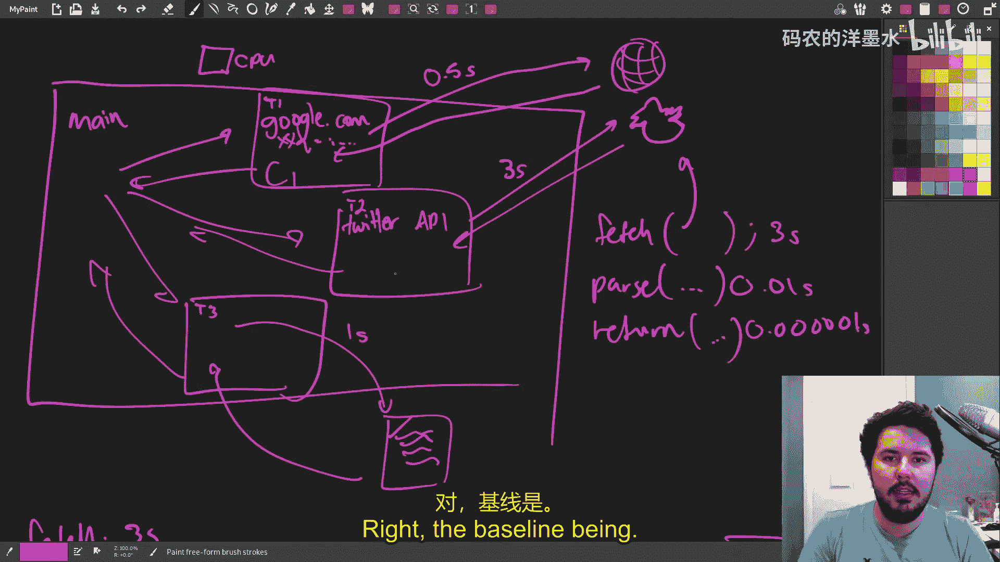

We actually， there's， there is there is a nice ro Pike quote on this on concurrency， actually。

 Rob Pike concurrency。

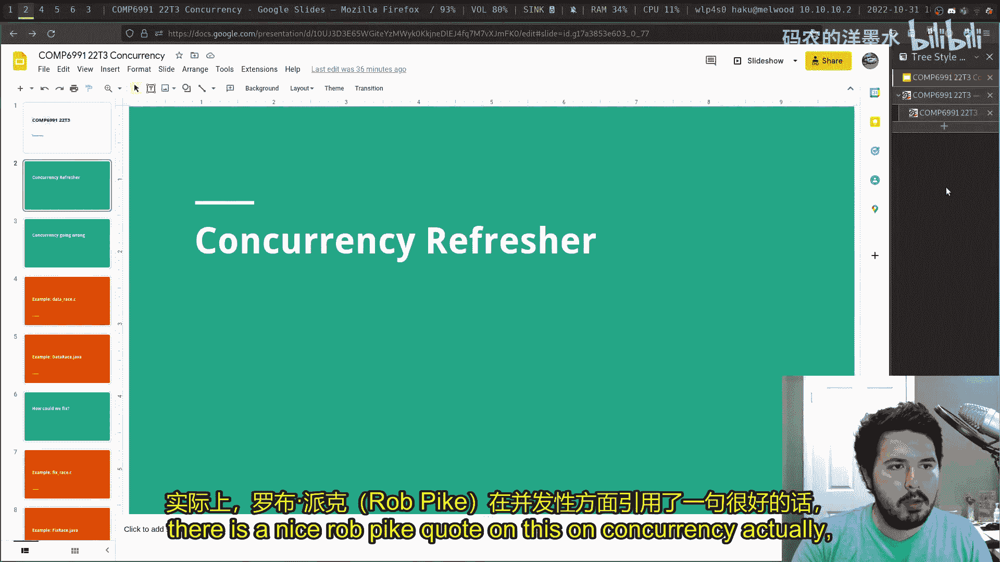

And he says， oh， Rob Pi concurrency。 Where is this quote。

Concurrency is not parallelism。 Yeah， yeah， yeah， yeah， yeah。 We know， we know。 is it on Wikipedia。

 Wikipedia。Concurrency， according to Rob Pike， here we go。 Now we're talking。 According to Rob Pike。

 concurrency is the composition of independently executing computations and concurrency is not parallelism。

 Okay， whatever yeah Lo it are， This is the good stuff。

 Concurrency is about dealing with lots of things at once。

 Paraism is about doing lots of things at once。Okay。So we haven't really talked about parallelism。

 but you can imagine that like。We're not talking about doing like all this stuff literally at the exact same time。

 right， like if I took a slice out of time， like the time heres。

 here's like a timeline of the time it takes to you know。

 to go from the very start of main to the very end of main。

I am not saying we take an instant out of time and go we're actually working like the CPU is executing instructions for all of T1。

 T2 and T3 at the same time。😊，Right， this is something that most modern day CPUps can do。

 but it's not what worth talking about here。Instead， it's more like I take a slice here。

And I see that the CPU is working on T 1。 I take a slices， you know， very soon after。

 it's now working on T 3， Another slice it's working on T 2， Another slice。It's working on T 3 again。

 another slice it's working on T1 again。So on and so forth。

 So it's essentially switching between all these different tasks， you know， very quickly。As a way to。

 you know， slowly to to make progress on them all。Almost at the same time， right？So again， the nice。

 the nice notion there of。Dealing with lots of things at once。 It's。

 I think it's relatively fair to see that before when you're just talking about in a single threaded context in terms of like。

 we do task1， it finishes we go back， We do task2。 It takes three seconds。

 It finish as we go back Like you're not dealing with lots of things at once。

 You're just doing one thing at a time。 This， again， no single thing is like at no point in time。

 Are we necessarily performing work like CPU work on two tasks at the same time。

 But we are dealing with all the tasks at the same time to minimize， you know。

 the costs of all these sort of external。These external performance hits and stuff。And CD。

 we will absolutely so not talk about CD in this course。😊，嗯。Cool， Sir。

That's sort of big idea of parallelism， sorry， not parallelism concurrency。嗯。😊。

Never thought about the difference between concurrency and parallelism。 Yeah， great。

 So we will talk about parallelism， but I think I'll save that probably for Wednesday。

 The very like quick cliff notes of it is that parallelism is like， you know， concurrency was cool。

 We can deal with a lot of things at once。 Paraism is like， great。 Now that we've got that。

 let's actually do multiple things at once。 And parallelism is almost， always。

 like it's almost always like a， an optimization in a certain sense。 It's like we want this thing to。

😊，Work faster。 Concurrency is often used in terms of like an optimization。

 like we're thinking of it as an optimization here in like this example system。

 But it's more of a way of like structuring programs and often it doesn't really necessarily come down to Like sometimes you might use it as an optimization like here。

 But sometimes it's because you need to deal with different like multiple things at once。

 And that's really like the core idea of concurrency。

 is that we're able to deal with completely separate ideas at once。 This is also really important。

In fact， this is actually probably a great time to talk about this idea quickly。

 It's really important when it comes to this idea of a blocking function。😊，A blocking function。

 right？This is I'm writing it in big letters because this is blocking function， blocking call。

 you know， whatever you want to call it。This is a really big idea and it's also going to be very important in terms of your assignment too So does anyone know what a blocking call means like what a blocking call refers to。

Yeah， JS is concurrent， but not parallel because it's single threader but has ay weight to handle blocking。

 Absolutely， that's absolutely right。And I've just spill water out over my tablet。Hopefully。

 it survives。嗯。This idea of a blocking coal。The tablet survive yeah， seems to work。😊。

Let me try and alright， let's see。 when you're saying a blocking calls when your CPU is idle because it's waiting for something。

 Yeah， yeah。 So when you call someone and they block it， yes。

 so an example here is something like stood I O。

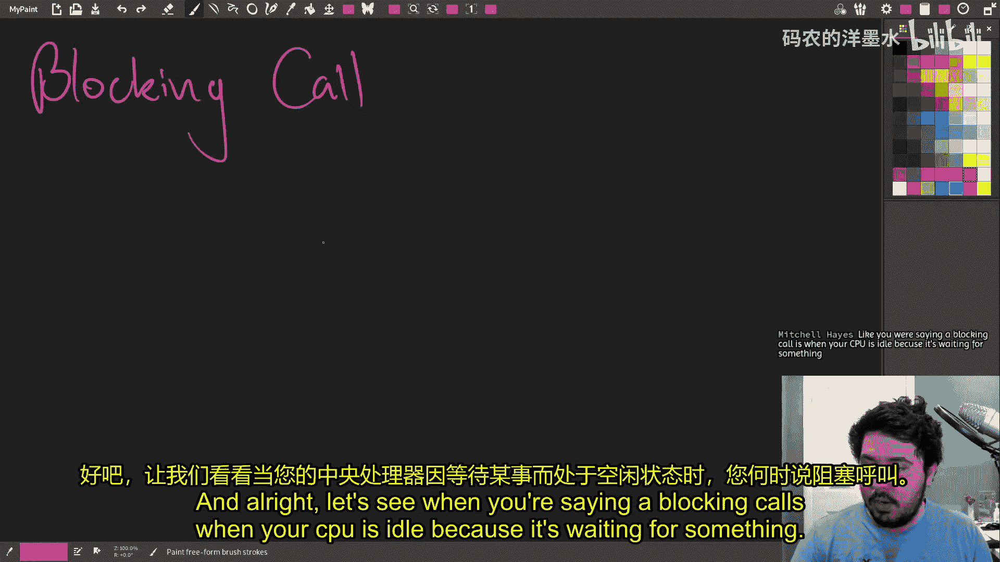

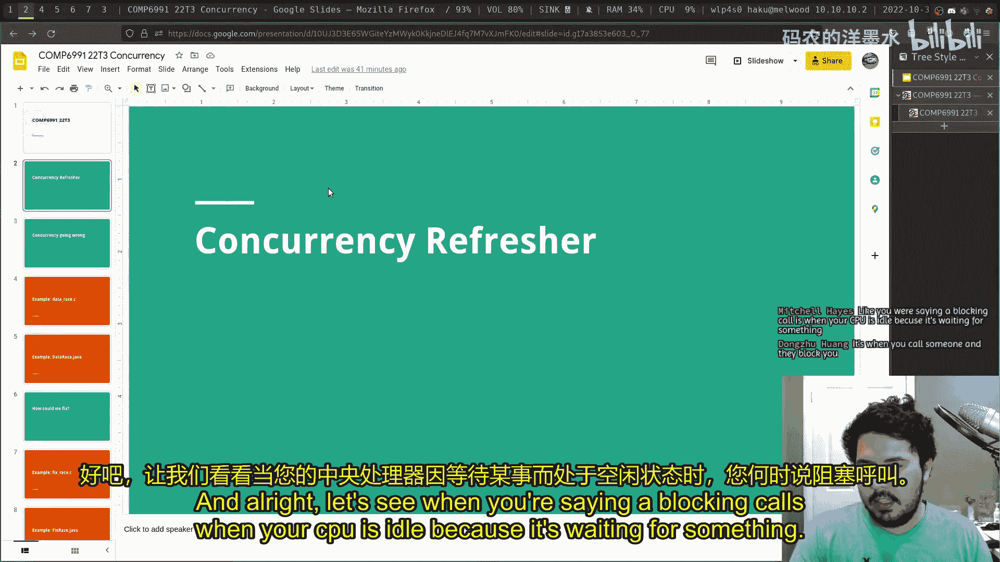

Standard inputput。tread line。Something like this。 Let mute。Lion equals string here like this。Right。

 so I is doing read line and I imagine that if we go to the documentation for this read line function。

 it's probably going to make it pretty like if we follow a couple URLls。

 it's probably going to be like by the way， this probably blocks。😊。

So locks a handle reads a line of input for detail semantics， see this one。

Read all bytes until that's reached， you know， the function will read bytes until E OF。there we go。

 This function is blocking and should be used carefully。

 This function is blocking and should be used carefully。

 So this idea of a blocking function is or a blocking call， is quite an important one。😊，嗯。😊，The idea。

 yeah of a blocking call is that most functions like when you call， say like some function Fo。

 you're expecting that like I callF， it's going to like use you know the CPU is executing the code right I jump into Fo it's gonna execute execute。

 execute execute execute and it's like a certain amount of work needs to be done right a certain amount of like code needs to be run and then Fo will go back to me and be like allright I did like all the the work I need to do and here's the answer or you know I went and did something for you。

But not all functions are like that。 So some functions in particular。I will call this function。

 right， I'll call some function。 Let's call it bar in this case， some function bar。

 And bar is just going to like hog the， the， the sort of current。The current。

 I wan to say thread of execution。 If you know what a thread is， then you probably know what I mean。

 The current sort of like path of execution， right Like I'm executing my code， my code， my code。

 then call bar bar probably executes a little bit of code。 And then it's just sort of like。Waiting。

Right， waiting， waiting， waiting in our case， we're looking at the function read line。Right。

 so you'll notice if I run this code here。Cargo run。The program is just like waiting。

 doing nothing because this function here， redline is waiting for a line of input to be you know presented in standard input。

 So once I type in you know through enter， then the code can continue right So this is a pretty important idea。

 this function might wait， you know， sometimes like indefinitely some blocking calls are maybe indefinite。

 some blocking calls you know， have like a timeout and upper limit。

 but the primary idea is that this function is not simply like just doing work。

 and like once that work is done it will return， it might block to go do something else like completely outside the realm of like you know the CPU that we're executing in。

So ideas of things that might be like a blocking call。Is something like waiting for input， right。

 printing like a reading input from a user， making a like talking to the Internet， let's say。

 like say I want to like fetch something from Google dot com。

That's going to be blocking because it's not sitting here doing work in the bar function。 It's going。

 hey， what's Googled like Google dot com， I need some things。

 And that takes time to travel through a wire across， you know， across the earth。

Google needs to do their own computations and then they need to send it back over the wire and you know Linux needs to go。

 okay that's for this program we're going to send it over here like this takes a certain amount of time before it gets back and then can continue doing work。

U。Now， if you want to make a blocking call， but you also have other important stuff to be doing。

 you sort of necessitates this idea of concurrency。 So what's a good example。

An example that I like to use is what if you want to like read input from a user， right。

 you want to read a line of input from a user while also like printing some stuff out once a second。

Right， like if I said， get a line of input at the user。 But while that's happening。

 I also want to like infinitely print out like。Hello there。Like that。Right。

 and this won't work because it's infinitely printing out Ho there， or maybe we'll also say like。😊，诶。

You know， once per second。This takes the duration probably。Duration。Seconds， one， okay。

So like I want to print out hello there once per second。 Hello there， General Connova， Yes。

 very good。 And， but also be waiting for some input from the user。😊。

And you'll see that like even if I type in like a whole bunch of input。

We're never going to get to this line， so I go， okay， well， that's no good。

 maybe I'd switch the lines around。😊，And I switched the lines around。

 but now we never see the like hello there once a second。Right I have to wait until。

 you know this line of code here is blocking。Until， you know。

 we can continue on and do something else。Like the program I want to write here is that it's printing out hello there once per second and also is like waiting to read a line of input from the user and without concurrency。

 this is you know， and with with a blocking function to read a line of input， this is a really。

 really， I mean， it's basically an impossible program to express without concurrency。

So how can I use concurrency to solve this problem。

 The idea is that I need to sort of create two separate paths of execution and thread sleep is also blocking。

 That's a very good point as well， yeah。嗯。Because it's literally like it's。

 it's almost like the definition of blocking and that it's。

 it's just like do nothing for one second or for， you know， however， whatever duration that is。

 really。Although I suppose it'll be non blocking for。It'll be non blocking for a duration of0。

 potentially。 But yes， in fact， if you go this and it goes this。

 this function is definitely blocking。Specing zero duration returns immediately， there you go。

But on Windows， it it， it is blocked。 That's so funny。 So a0 duration。

 like I was just saying on Uni platforms like Linux is non blocking。

 but it might be blocking on Windows if Windows interrupts you。😊，That's funny。

So how do I express this， I need to express like different parts of my like different sort of this sort of different tasks that we're looking at here right in the main here was saying I want to be able to execute all of these you know。

 switch between them as as you need if you're not going to do anything go work on something else the the core primitive here in terms of splitting up different tasks is something called a thread。

Right， and this is also like often， you know， a thread of execution you might hear it talked as execution。

 that's a horrible you。 So one you know， individual thread of execution is one sort of like task that the program can be working on essentially。

Right， it's one task that the program can be working on。 So in our case， how do we structure this。

 we probably say main create a thread for T 1， right， thread T 1， create a thread for T 2。

 create a thread for T 3。And once we create those threads， it'll go off and start working on them。

 you know， just in the background。If you know that's potentially if your computer has these multiple cores and you can do different things at the same time。

 might work on them immediately if you're just operating in a single core system like we are here。

 it's probably not going to like start working on them just yet so's just going to go right these tasks all exist and then mainine will say like wait on T1。

 T2 and T3。Noting here that weight， like waiting on each of these， which we generally call joining。嗯。

Is blocking as well。 So now main is blocked。 Main is blocked because it says I need to wait for these three things to finish。

 And so then it'll go off and start working on other stuff because not because main said。

 wait for these three things。 Like it doesn't go， oh， I need to specifically work on T 1。

 T 2 and T 3。 It's far simpler than that。 It's main called weight on these things here。

Those things are not already yet。 And so man is blocked。If mean is blocked。

 it means go work on some other threads of execution。 and it says， oh， in this system。

 we currently have four threads。 There is thread 1， thread 2 and thread 3。

 and also this main thread here that you sort of start off with by default。

UAnd so it says main is blocked， right， the current thread is blocked， go work on something else。😊。

Since there's three other things。 If there was nothing else， by the way right。

 we haven't spawn any threads and it's blocked， say like waiting for a line of input。

 then it won't go and work on something else in terms of the program space。

 More likely the operating system， like Linux will go right。

 Then I'm just gonna not think about your program for a while。

 it'll like put our whole program itself to sleep in the context of like the many programs that run on a computer。

 But if we're just thinking in like a single like imagine a computer that was just running our program and just had this oneco。

 then it would basically just be waiting like in a loop or something like that。 When you said。

 wait for this user input， it's just gonna to be like is user input here is user input here。

 is it here， Is it here， is it here， I it here， is it here， if had nothing better to do anyway。😊。

But in our case， right， we see。Wait for these things here。 They're not finished。 Mainine is blocked。

 Go work on some other stuff， and it'll probably just like。

Relatively pseudo randomly pick a task to do some work on。 So I might go task too great。

 If I is off to the Twitter API does that like fetch。Right， and it says， okay， great。

 I'm blocked while I wait for Twitter。 I'll go work on something else。 It works on T1。

 sends a request after Google， I'm blocked， go work on T3。

 or maybe like maybe even that point it goes back to main。

 Are they is main ready to go yet No maybe now T3 goes and reads starts to the file I'm blocked check T2 Twitters back now。

 do the rest of T2 T2s done and the T2 thread might die at that point。

 So we have four threads three threads remain， which is main T1 and t3 then it goes great。

 maybe we'll check main now nope， mains still not ready to go。 main still blocked check t3 t3。

 the file done finishes that stuff sends the computation back T3 is dead。

 says two threads in the system we check main nope， main still blocked。

 It's waiting for T1 we'll go off to only other thread that exists now Google's come back great。

 do the rest of the computation。 Send that back。😊，And T1 dies。

 there's one thread left now it's main main see a they're all you know all those threads are finished。

 I am unblocked， it'll continue to working， maybe print out some output and the program finishes so it's a way of thinking about these different tasks and the way we think about them is as threads。

😊，Right， each individual like。

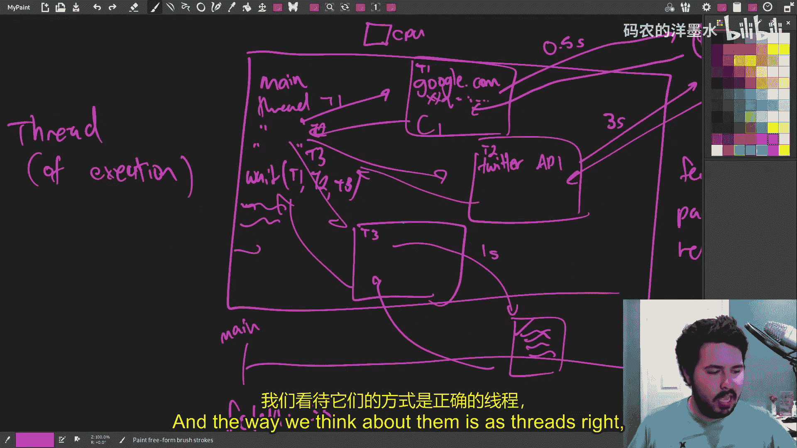

Task path that may be executed。 we think of as a thread in a system。

 So how do we solve our problem here。

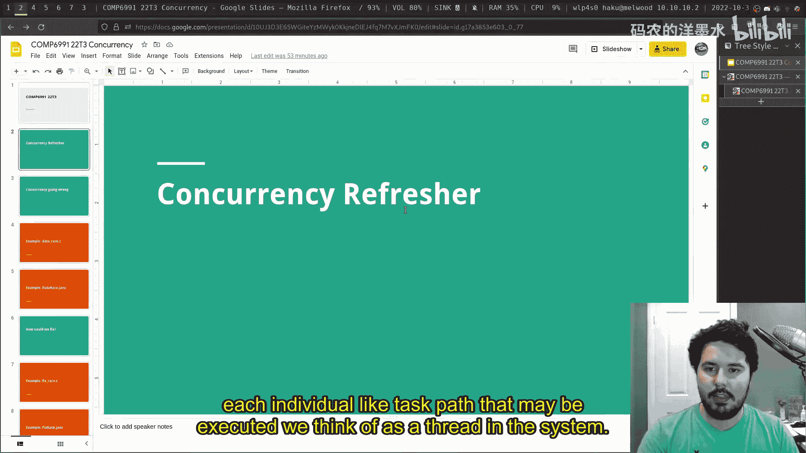

The idea is， well， let's wait for the input。On one thread and do this printing on the other thread。

 All， Now we've already got one thread in function main here。 right。

 The fact that we have function main means we already have one thread going。

 So Like we could spawn two new threads like one thread for this one thread for this and then wait for them both on main。

 That's perfectly reasonable。 We could go well， main we'll get the main thread to do the the looping and printing and we'll get another thread to read the input。

 I'll just do that one for now because it's just less code。 And the way we do that as we say in rust。

 I would say spawn a new thread。 right， you might prefer to just import thread。😊，嗯。

So threads spawn and then you pass it a closure。Thread spawn a closure。

And inside disclosure closure is the task that that thread will be in charge of。

So let's like make sure we have a way of actually seeing that this thread did something。

 so red line line。Like that， maybe。And cool， let's see if this works。

So you see we're straight into the loop。Even though again， there was this threads spawn first here。

 the threads spawn didn't block Ma， it just goes right。

 this is another task we're going to fire off in the background。And most likely right now。

Every time this thread goes to sleep like this print line。

 the print line in fact may even be blocking in itself。

 but let's just assume this is it's really quick to print line and it doesn't need to block。

This is definitely very blocking and most likely in this time here， you know， in this sleep。

 it's going to go check on this thread and see how it's going because this thread is stuck right here waiting to read a line。

😊，If I type inF and I know the output's getting messed up here because terminals mix their input with their output。

 but I've typed in FOO and hit enter， you'll see that that thread said red the lineFo and that thread's now gone。

Right， it finished executing that， got to the end of the thread the thread now died。

 So if I type info again now， you'll see it didn't print out red line。Right。

 we could make this thread infinitely read lines in potentially just by throwing it in a loop。Right。

 say this thread will also just look forever doing this。And then I could say I could say fo。

 I could say bar， I could say vaz and both threads will continue to do the right thing。 So again。

 concurrency is really about a way of thinking about programs。

 right and the sort of expanding the possible programs you can write。😊，And in this context right now。

 it's also really useful and in the context of one of the big contexts of your assignment too。

 it's also very useful in terms of taking a function that is blocking， right。

 taking a function that is going to like pause execution of the program and being able to do other things at the same time。

😊，Very important idea。Okay。Cool。So。That's our rough idea of concurrency。

We're going to try and spend the rest of the lecture understanding this。Right。

 so spawn takes in this function here。And this here says this f is a fn wants from no parameters to a t plus send plustictatic。

 so the send andtictatic here we're we're going to try and figure out。😊。

How do we join the result of the threads back together That's a great question so we can make our thread return something when it's finished。

 so in fact we could even do something like when this thread finishes give this line back。😊，Right。

 give this line back。 And so we could just do that by saying like return line。

Or like we know in Rus that this is just implicitly line like that at the end of the closure。嗯。

And thread spawn here will return something called a join handle In our case。

 it'll be a join In our case， it'll be a join handle of a string because this thread gives back a string once it's finished。

 you can see if I get rid of that， it'll just be a join handle of unit。

 meaning there's no sort of data that it could return back。

 but this is just like a very first way of getting a thread to sort of give some data back。

 we could do something like when you wait for this thread to finish， handle dot join。

Then and like the thread could have panicked potentially so we're going to assume it hasn't panicked then you can get that line back let line。

 which is a string be wait for the thread to finish。

But the problem here is that joining the thread waiting for that thread to finish is blocking in itself。

 And so we immediately run into a problem where we're struggling to do this at the same time as waiting for the thread to finish I'm not sure if Ros has a try join No。

 I don't think so because I don't think Posss threads。😊，Necessarily support such a beast。

 but there are ways that we can sort of support this pattern later in particular。

 something like a channel is probably the most appropriate here。

But we're going to leave that for a little bit。Okay。

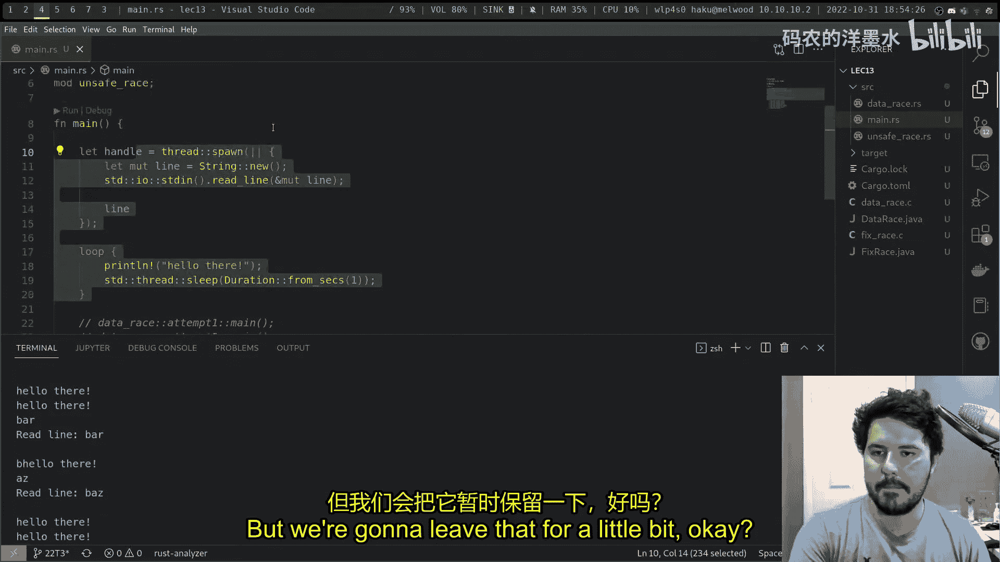

So concurrency going wrong。 So concurrency seems pretty cool and lets us do some cool things。😊。

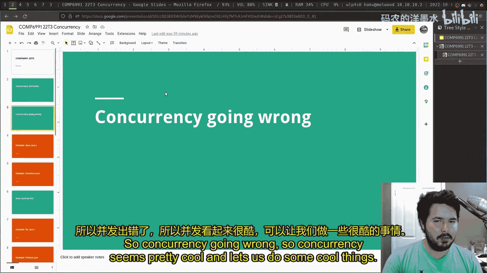

But concurrency can go wrong。 Let's look at a C program。Oh no， not a C program。 I'm sorry。

 so consider this program here。Now the yeah， I'm not expecting everyone to understand all the different bits and pieces。

 So I'm gonna guide us through it。 I want this program here。To create 50 threads。

Right50 threads where each thread this is basically like the closure and if we are thinking about rust here。

 what is each thread going to do， it's going to say n increments times right I0 is us in increments i+ plus in our case。

 it's 100000 times。😊，Add one to this global number。 My number is 0。

So each thread is going to increment my number 100，000 times。And then I create 50 threads。

I want to create 50 threads each which do this operation。 So 50 threads。

 each which increment my number 100 thousand0 times。 And so I go， I say， create。50 threads。

Wait for all of the 50 threads to be finished and then print out that final total and what we expect it to be。

 So we we're expecting it should be 5 million。Right，50 times 100000。 each thread is， you know。

 there's 50 threads each thread coin 100000 times。 So we should see the final total being 50 times 100000 or 5 million。

啊。And we print it out at the end。 so let's see what it does。So I'm going to build this data race。

 I'm on C， so I have to add in this dash P threads flag to enable the threading APIs。

And when I run it。😊，Oh， no。I don't get 5 million， right。 I don't get 5。 I get 293420。Oh， whereabout。

I mean， we're almost 5 million short， to be honest， we're like 4700，000， which is almost， you know。

 5 million in itself， increments short。What if I run it again。251350。Again，2，870003，560004。

67000 Hz going up。 We're getting there。 it's going back down，338000。Okay。

 so something is going horribly wrong here。🤢，A。In particular， this this kind of behavior right。

 So we're losing a whole bunch of increments。 We're expecting 5 million we're getting a few hundred thousand。

 but you know C is a really gnarly language right See。

 it's so easy for like C to freak out and give you crazy garveled numbers。

 What about like a real programmers language like Java right， old reliable Java。

 here's the same program。 and threads is 50 n increments to 100000。😊，My number， each thread， oops。

 each thread is going to add one to my number。And then I say create all the threads。

 each thread is going to call this function here。Start all the threads。

 Wait for all the threads to finish。 Print out the total。Let's see。 Come on Java Data race。And。Oh。

 it did better， you know， better in quotes。😊，2。871841000。 Come on this time， Java。Ts okay K。

 it's getting worse，2。6 million，2。8 million，2。6 million，2。5，3。52。7。 What about that1，1。7 million。

That's the worst so far。Right。No， Java， no。You are our hope Java。Try Python。

 I haven't got the Python one set up here， but yes， the GIL might。

 might come to your favor in Python。So okay， yeah， kind makes a good point。

 And that it's at least 10 times better than C。 For the most part。 Yes， very true。

 The funny part is with C is that if you compile the C code to run really， really fast with with。😊。

Optimizations， it often actually does get the right number。

 and I'm honestly not 100 cent sure if that's because it's the compiler。

 this is like such a simple case that the compiler is that， oh my God。

 this is gonna go so wrong and you know， basically throws in a fix or if the code's just running so fast that it doesn't really have the opportunity to run into like the the thing that might go wrong。

😊，Whihi is interesting， but you know， we're just you know。

 running it how anyone might end and it's doing the wrong thing。😊。

So maybe C is actually better than Java in some cases， funnily enough， so anyway， danger， danger。

 danger， okay。😊，So what's gone wrong here。 Anyone in the chat wantanna have a crack。 or actually。

 you know what， it's on the hour。 someone find out on Godbat。 Sure， yes， So let's take a。

 let's take our usual four minute break。 We'll come back at 704。

 spend the time thinking about why this went wrong。 If you already know， then。You know。

Maybe type out and answer in chat and affirm your suspicion。

 but we'll come back at forecast and have a think about why this like what's gone wrong here in the meantime。

 So I' we'll see you in a few minutes。

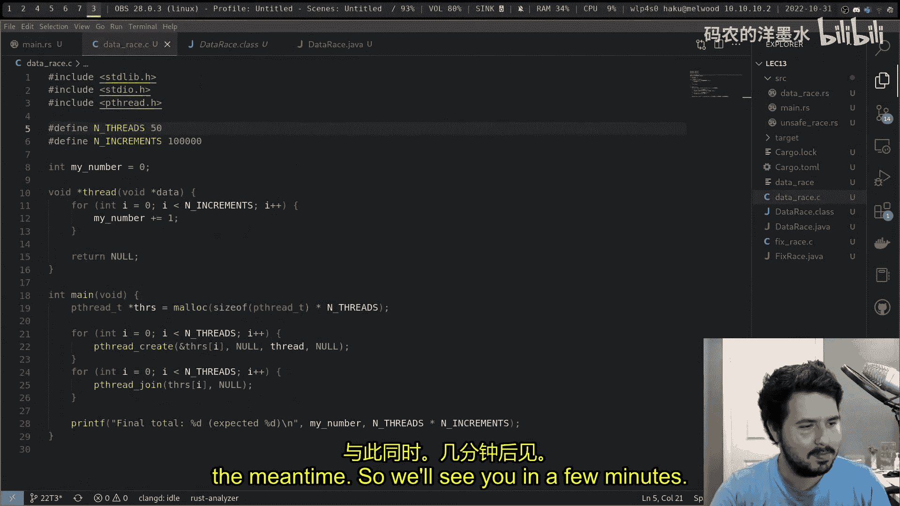

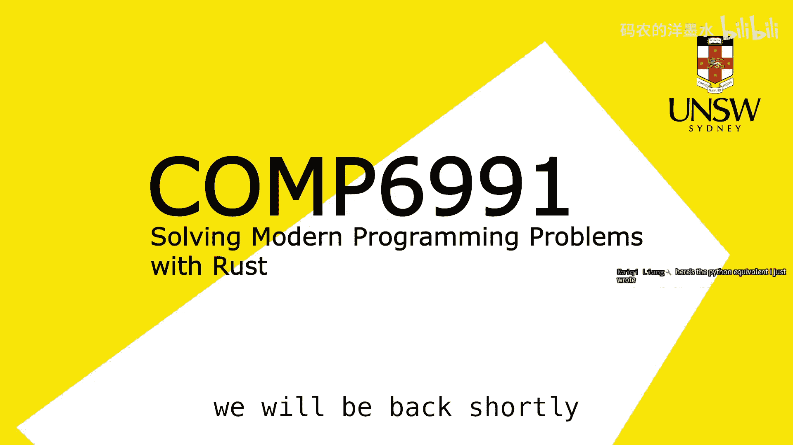

All right。There we go。So what do we think？Concend， oh， what？You might need a gist。 and like a。

Or like a paye spin or something and send URL， or is it not letting send URLs？I too many characters。

Data race go Yeah， yeah yeah so。😊，I mean， we're not really going to get into the low level details of everything that's going on here if you want that。

😊，Come join us in Comp 1，5，2，1， Computer systemss fundamentals。

Where we'll teach you MIPS assembly and show you， you know why an assembly this the raw instructions of this operation is very dangerous。

But we're going to keep it。 we're going to keep it very simple。 Wellow， that's a cool course。

 We're going to keep it very simple。😊，In how we look at it here and basically。😊。

This video has no ad warning reported to YouTube。Oh， I see。 And basically。You know。

 two threads mute like mutating data at the same time。 Very dangerous。 two threads， you know。

 one reading the value， one writing the same value at the same time， Very dangerous。

2 threads reading the value at the same time。 actually， O， no problem with that。 Everyone's happy。

 Wow， what does that sound like， They't want to， anyone want have a guess like what that kind of sounds like。

Two things reading at the same time。 all good，2， one thing， reading， one thing， writing bad。

 one thing， writing， the other thing， also writing bad。Where have we heard this before。

 shoved in our face with red error messages a billion times， mutable borrows？😊，Yeah。So yeah， I mean。

 like Ru's rules exist like this for a reason。And again。

If you want the low level details of exactly like what causes this kind of issue to crop up you know such on a very small scale。

 then the internet will bring you that or you can ask on the forums and we can give you an explanation as well。

But essentially， yeah， this is this is a very， this is a specific case of something generally called a race condition。

ItIt's a specific case of that known as a data race where one thing is mutating some piece of data at the same time as something else is either trying to read or also mutate that data and you are bound to have very wacky results sometimes people will say。

 well， like what kinds of wacky results like。You know， will I just， will it always end up lower。

 Like if I'm adding to a number， willll always end up just like the same or lower or like， you know。

 what else will happened。 Well， like technically speaking。

 the most common cases like this where you end up with a lower value like。In essence。

 a lot of the increments get like missed in a certain sense， they don't like work。

mBut u realistically， the answer is any like any value from my number。

 not only met any value from my number， but any behavior of your program。😊。

Is usually like acceptable behavior。Or even like correct behavior to put it bluntly once you have an issue like this in your code。

So this comes back to an idea called undefined behavior In a lot of languages。

 a data race is undefined behavior in that now like once you。

Once you have written code that could potentially cause a data race。

 doesn't even necessarily have to cause the data race。

 if you write code that could potentially cause a data race。

Literally any behaviour of your program is now correct behavior as far as。

 you the people who write your compilers or the people who write you know the programming language are concerned。

😊，Which is a dangerous idea to think about because like the right answer， like what your program。

 what you expect your program to do is， you know， is correct a correct output of this program。😊。

What else is the correct output this program， The wrong answer。 Okay。

 so that's what we've mostly seen here， the right answer and the wrong answer。 What else is。

 you know， acceptable behavior once undefined behaviors in the program could just exit just no program is the fastest program。

 And you've actually we've seen programs do this in that so there's some really sneaky undefined behavior lurking in the depths and the compiler goes。

 oh well that can't be right I'm and it goes but a compiler's job is often like make the code run as fast as it can。

 And it goes， well if that' can't be right would be undefined behavior。 I'm gonna make this。

 know piece of the code really fast by just like deleting it the fastest code is no code。

 And then it ends up like sort of ca gating forever。

 And people see like the compiler builds their code。 And when they look at the compiled output。

 all the functions are just blank because it I made the program really fast you proud of me' it's not doing the right thing。

 It just does nothing And it goes， yeah， but underfin behavior So that's acceptable behavior。😊。

It's a little more like complex than sort of I'm than I'm putting it here。

 Like this kind of thing can happen， but it's like a little more nuance。

 usually like the compiler isn't just straight up your enemy most of the time。

 but it can get confused and be like， oh， well this is know kind of on you。

 And so it doesn't really matter at this point。 like once you've got a data race， all bets are off。

 So like another acceptable behavior to like this is the classic1 if people go it's acceptable for like the computer to catch on fire and demons to fly out of the computer and enter your your soul and stuff like that。

 that's acceptable behavior as far as the compiler is concerned once you write code with some undefin behavior。

 maybe my way to use race conditions to create a crappy random number generator yeah。😊，U。😊。

And then acceptable behavior would be just to spit out the same number every single time if the compiler was a little nasty like that。

😊，There we yeah， sorry， I've got my my hook to open up a。

Open up some blinds at the top of the top of the study， okay。So very dangerous， very bad。

 How can we make this not happen？And say like see or Java or something like that。

You know what's what's the sort of canonical fix here， And at the same time。

 I'll open up Ka's thing here， data range， Python import threading。Let's see here。Data race stop pi。

Remember， kids never run someone else's random code off the internet。Data race， stop5。Oh， cool。

There you go， Python sucks too。😊，No， I'm kidding Python's getting very close， it turns out。😊，嗯。

How interesting？I was I was assuming that the JL might actually save us here。

 but'm I'm not necessarily a Python expert。But yeah。

 see the same issue exists in almost every programming language that supports concurrency。Atomic int。

 right， yeah。 So atomic int is a perfectly reasonable way of solving this。A。

So we're going to start with probably like a slightly higher level solution than atomics。

 but I think we'll talk a little bit about atomics just at the very end of this lecture。

But a very sort of common canonical example here is something called a muttex。

And a Mutex it's named such MUT EX， the MUT stands for Muual and EX stands for exclusion。

Mutual exclusion， meaning like I am a thread。And like I can now sort of define a region where other threads are excluded from being in this region at the same time as me。

 right？And this that region that other threads are sort of excluded from being present at the same time as you is usually called a critical section。

 critical section。嗯。😊，So the way a mut text works in a lot of languages， is not。

 this is really not necessarily all languages。But in a lot of languages。

 the way a Muex works is it it's an object that you can create and see here I can create a new Muex with this P thread mutex initializer now I've got a mutex and then they usually support two main ideas locking and unlocking。

😊，Right， locking the mutex meaning， so I say P through Muex lock here。😊。

Meaning if the muttex is not currently locked。😡，Right and let's just assume we've just entered the programs the first time it's called the Mutch starts off unlocked。

 so great。😊，When the Muex is unlocked， mark the mutex as locked and allow me to continue。

Right so this doesn't block it all。 It just goes great。

 set this like lock over here and set this to be locked and then continue on to the next line of code。

😊，And then unlock here is also non blocking。 it just goes， great。 Now we're finished with the mutex。

 unlock it。😊，Right。Now the trick is if another thread comes along and it goes Pro Mu text lock。

This muttex。And another thread is or rather forget the other thread。

 the Mutex is already locked right now， what that implies is that another thread is probably like somewhere around here。

😊，You know， a completely separate thread is working on my number。

And we call lock while the Mutex is currently locked， then the call will block。

RightSo it's non blocking if the Mu textex is currently unlocked。

 but lock is blocking if it's already locked。😊，And it will block until the mutex is unlocked until the mute text sort of frees up。

So the other thread will go， okay， great， unlock the mutex。

 then hopefully our thread gets a turn another turn soon。And it goes， oh， great， it's our turn。

 the mutex is not locked now， so I'm going to lock it。😊，Add one and then unlock it。

 unlock will never block。Because you just there if like it's assuming the muttex is already locked。

 If the Mutex is unlocked and you call unlocked， then you've probably done something wrong。

And but yeah， so the idea here being that now with this system。

 only one thread will ever be doing the exact operation of my number plus equals one at the same time。

Right the looping code， they can all do that at the same time because they won't affect each other。

 where they're going to affect each other is in mutating this global state， my number。😊，Lock。

 do that， unlock， so only one thread will ever be able to do this at the same time。

I don't know how loud that is in the mic， but I've got the window open because it was absolutely。😊。

Boiling in here and it looks like a storm is brewing。嗯。Okay， cool。

 So that's kind of handy and doesn't fix the program。 F race。で？Bix race。Yeah， same block。Yeah。

 that seems like enough。Yeah， looks like it's fixed the problem。And again。

 the fix here being that now only one thread at a time will ever be mutating this。

 you don't get two threads simultaneously mutating you know a read sorry a right right conflict。

 although there's other conflicts like right read， we talked about this at the very beginning of like I think like lecture one even。

😊，At the beginning of the course， great， so that solved and how was the solution look like in Java？😊。

So Java， you， as Ka mentioned， you can use a synchronized keyword， sadly。

 I can't synchronize on my number here because it's a primitive。

But I can basically the trick is in that job the trick is that in Java any object can be treated as a muex。

 which is a little weird， like you don't have to specifically create a mutex like we did like we did here in C。

😊，Any object is like it just can be used as a mutex。

It also means that every object you're kind of paying for the muttex usually。

 which is also just kind of weird。But you know， Java chose that。

And so this here ends up being the mutex that we use which is just like a random object random。

 you know yeah just a random object really and but Java writes it in a slightly different way Java uses this idea of synchronized synchronized so it's kind of like a step up here in a certain sense and I'll explain why the synchronized block here says。

This block is the critical section。Right， so what that means is before we enter this brace。

 lock like call Mutex lock and when we get to this brace here called Mutex unlock。😡，Right。

 so this here is， it's the same sort of effect。As the C code here。

But it does it with like a language construct in this case where it says this does lock。

 this does unlock over here。Now， why is this maybe better than what Cs got Well， in C。

I could just like forget to lock the mutex， let's say， or I could just forget to unlock the mutex。

 And both of those are very bad。 Like in this this little sort of example code。

 it's pretty difficult to see like forgetting that。 right。

 But imagine a much bigger function much more complicated。

 and you might have say three or four mutexes to think about。

 It's feasible that you forget to lock one of them or you forget to unlock one of them。

What happens if I forget to unlock a mutex if I forget to unlock a mutex in a loop like this？

Then the code will just never finish because what happens is the first thread will say lock it。

I don't I't remember if P thread Mutex is a reenttrant by default or not。

 but we won't talk about that。 One thread will say lock it。

 It'll do its thing and it'll never end up unlocking it again。 So that mutex remains locked。

 Any other thread that then comes along and tries to lock the mutex will never require the lock because no one will ever end up unlocking it。

 So that's that's dangerous is something called a dead lock when your program just can't continue working because everyone stuck waiting。

But potentially even more dangerous if you forget to lock it。😊。

Is that we've got that same old problem again。 It's like your boss goes， hey。

 the program's broken I need you to fix it。 You go great， I'll throw in a mutex。

 You forget to lock the mutex。 It goes out production。 And then like， you know。

 production crashes and and everyone screaming at you and and you're fired。 No， I'm kidding。

 but it's obviously not， it's not a's not it's not good。

 So this is sort of the danger and forgetting like doing one half of it but forgetting the other。

Or even like putting them， you could do sort of。Wacky things like getting them in the wrong order And again。

 as the program gets more and more complicated， you can imagine that like maybe there's wherere a couple like if statements deep and you accidentally threw the unlock over here when youre meant to put it on the line below and now only sometimes it unlocks and just like all kinds of hell can break loose because there's no sort of。

These are just like functions that you call really at the end of the day。

 It's just like this is a function to lock of music。 This is a function to unlock a Mutex。

 the language and sort of the way it's written has has no support for this idea of like this is a lock that should be held to establish a critical region。

 So Java really has a step up in that sense and then it goes， yeah。

 we have Mutexes and we establish them through this like critical section。

 So you'll always you know you'll you'll lock it at the beginning and we'll unlock it for you at the end。

😊，But there is still a danger in Java， there's still a danger in Java。

 which is like you can still just forget。To use the muttex at all。 Right。

 So let's just see if the Java works。 Java C fixed race。Jobr 11。ああ。F。Fix rice。And。

I'm going to say that works， right？😊，But notice that like， so， you know， it's always gonna unlock it。

 It's always gonna unlock it。 We can't have that case in Java where we like。

 we just forget this brace right， we forget the brace to unlock it because we're going to get a compiler error。

 This isn't like the best compiler error of all time。but we're going to get a compiler error。

 which is great， that's good news as far as I'm concerned。😊，But。

Java semantically sees no relation between my number and lock。Right。

 like that's on us as a developer to go， like my number is guarded by lock。Please， please。

 please make sure you。Lock。Lock。Before accessing my number， right。

 because this is only working because we're accessing my number while we've locked the lock。

 but like we could just forget that， oops。We could just forget to do that。And then， again。

We've got our problem back again。 And like you might go， well， okay， we just put the lock in。

 we're not gonna forget to do it。 Yeah， but like maybe someone else add a function later and they go。

 oh， I'm just gonna read， I'm gonna if my number is equal to 42， then do this and you go， no。

 you dummy， You needed to write synchronized lock。 How could you possibly forget。

And the compiler is not gonna have your back and there's not going be a thing at runtime saying hey。

 by the way there there was like a you forgot to use a mutex it's just gonna probably do the wrong thing and it might only do the wrong thing in a very small set of circumstances and that very small set of circumstances might not crop up until six months into production when when all the customers come in。

 you've got a big sale and all the customers come in and the business people they rubing their hands they're about to make millions of dollars and then you forgot to do a lock the website crashes。

 no one buys the product， the company dies and you're fired。あ。So its。

 sos there's still some danger to be had， essentially。😊，Okay。But。This is a reasonable fix for now。

Now， as per the chat， what's the cost of a mutex。 So the main cost of a mutex is time。

 Mutexes make your code slow。 I mean， basically any sort of concurrency primitive is almost certainly going to slow your code down to a certain degree。

 Some are worse than others， Mutes are like relatively bad But like it all depends on your use case。

 Like if I'm writing a program that needs to go really。

 really fast and can't be stuck waiting in certain circumstances。 then yeah。

 I probably care about throwing a mutex in randomly。

 if you're writing like Jo blows e-commerce website in your favorite Java web framework。

 and the boss needs this by next Friday。 then like， no。

 you're not gonna care about a mut textex really。 there is also another cost of a mutex is also complexity in that you know once you throw in more and more muttexes and your codes。

 you know， becoming concurrent。The code is going to be more complex。

 It's going to be harder to write correct code。 And especially when other people get involved。

 other people start reading and writing in your code base or， you know。

 the code base that you've introduced this into。It's just going to be a lot more complex to get the program to do the right thing。

 which is， I mean， that's a real big part of this course。 like a huge portion of this course is like。

 can we establish systems to make writing correct code or no， not writing correct code easier。

 writing incorrect code harder， right， Russ doesn't really make writing correct code easy。

 but it does make writing incorrect code a lot more difficult。

The trick is that the correct code is also is more difficult to write。

 but the incorrect code is really， really， really difficult to write in the case that like in the sense that you really have to be trying or is in Java or C or。

 you know， when you're doing this kind of or even Python here， when you're throwing in a you know。

 something that's becoming really important over time， but is still very complex， like concurrency。

It's it's they are almost inviting you to make mistakes at times。

 And so that's that's a big thing that we can that we care about。

 So I believe it Mut as the threads that don't get the lock get put to sleep by the scheduler。

 So when the lock is available， there is a fair amount of overhead away from the threads again， Yes。

 very true。嗯。And yes， Java is generally slower than C and when you bring a currency。I mean。

 Java over time can outperform C once you get Jit optimizations and stuff like that involved。

 but yeah， in certain environments， you can absolutely see this kind of thing putting a real hit on your performance for sure。

Concurrs get fired， yes， but then the problem is the Vosco's hey。

 we need this to be concurrent we need to be able to print out a prompt once every second and also read input from the user like Andrew。

 we need you to we need you to do this like the business relies on this and you go no I'm not doing concurrency。

 you're still fired。😊，So， you know， there's， therein lies our problem。 Okay。

 so we've got like half an hour left。 So let's finally talk about some rust。 really。

 that makes sense。 Yeah， okay，03 is faster because it pre calculateculates the loop to 5 million。

 That's really funny。😊。

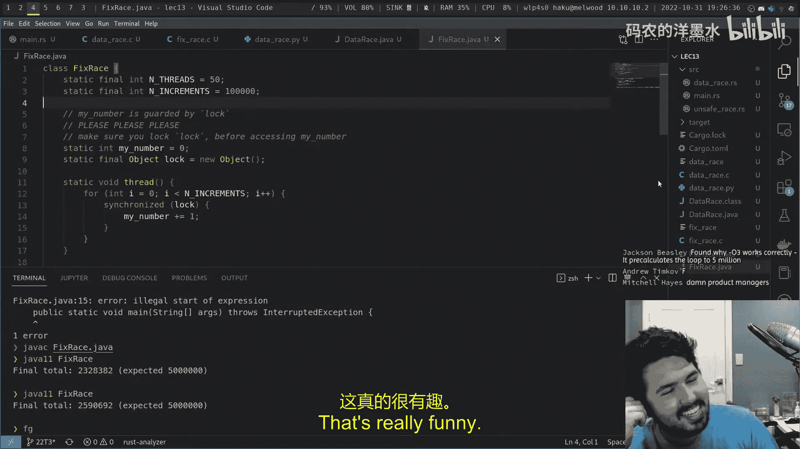

呃。That's， that's very funny。 Thank you for， for finding that out。 Okay， so we've seen this。

 How do we fix it。 We tried a new text。 That's great。 Let's make the same issue happen in rust。

 right， All these different things we've been talking about。 Let's make it happen in rust。😊。

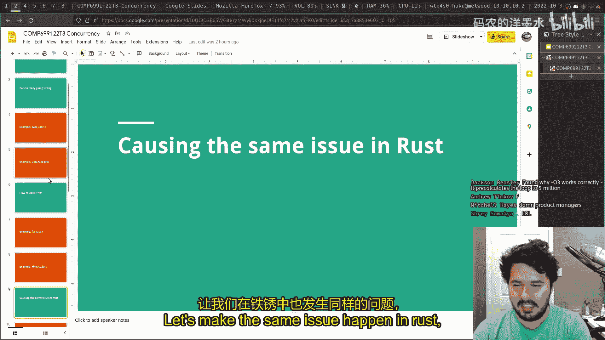

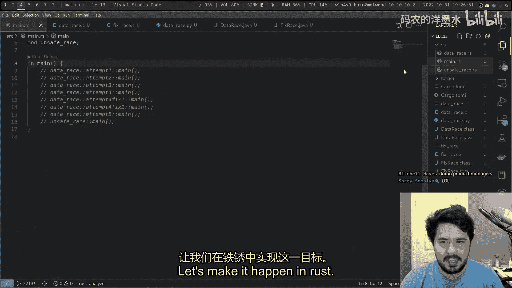

Awesome， so。Examples attempts1 through three。

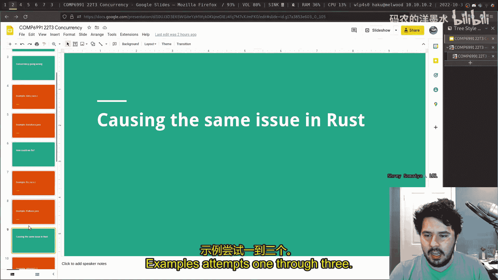

All right， so here's the same rust code。The same rust code n threads is 50 and incrs is oh 10000。

 I've gone easy on us， 100，000 rust should be put to the same standard。😊，嗯。😊。

And I've written the same code， so we have my number is zero。

The thread here says for0 and n increments， add one to the number。 We create that， you know。

 we we spawn n threads with stood thread spawn of this thread here。

 Wait for all the threads to finish and print out the total。 All right， great， Yes， let's see。

 Rus is gonna get the wrong answer。 just like everyone else。 stupid Rus。 You know。

 let's build the program。😊，啊。Okay， so Russ is going to stop up it says cannotnot assign to a mutable static item mind number。

So this is not really to do with concurrency。 This is kind of us being like， hey。

 so we heard you're doing this， it's probably not good。

 essentially saying like this is a static thing here you're trying to mutate it。

 I didn't even care if you're in a thread or not。Russter really doesn't like globals that much。

So like we could say static， like mutable my number and then。Oh no。

 use of mutable static is unsafe and requires unsafe functional block。

Note mutable studies can be mutated by multiple threads。

 airesing violations or data races will cause undefined behavior。RightSo're also going， hey。

 this is probably also bad， still probably not what you want to do。Maybe a little dangerous。

 And you go， okay， like， I kinda get it like， I can get what you're upset about this。

 but I still need to do this。 So， okay， maybe that one doesn't work。 That one won't build。

So we'll move on to our next attempt。 Let's go。 Okay， fine。You got us Ru。 Globals。

 They're not that great。 Globals can go wrong。 Let's use a， let's put the number in mainine。

 It's not a global anymore。 We're gonna get rust now。 It's not a global anymore。

 And then we'll just pass like， well， we， you know。

 we can't pass it a U 64 because then like it's gonna be modifying a copy。

 We can't pass it a shared borrower because rust won't let us modify a shared borrower。 right。

 to mutate。 you need a mutable reference。 an exclusive borrow。 Great， So we'll give it that。

 Look the threads。 It's happy now。 we're gonna get it。😊，And。So let's build the program， cargoBuild。

Here， cargoBuild， no， what's it say， Let me get my head out of the way up here。I'll put it there。

What's it say， can I borrow mutable my number as mutable more than once at a time？😊。

So it's saying so also I should I'm shown a little more background so I say let my number and I say spawn the thread which like I can't just call thread anymore because I need to give it this thing here。

 I just say spawn a thread which calls the thread function with exclusive Brow on my number。

 a mutable reference to my number。😊，as goes， hey， yeah， kind of this isn't okay。  honestly。

 like if you think about the rules， I'm just not going to let you do this。

 So it says can't can't borrow it as mutable more than once at a time。

 It says you used my number in the closure here， right， Okay， that's true。 That's fair。 We did。

 Then my number was mutably borrowed here in the previous iteration of the loop。😊。

And so what it's saying is like you're calling this multiple times and in each time you're calling like each iteration of this loop。

 you're doing an exclusive borrow， often that's fine。

 Like if I just like got rid of all the thread stuff here。😊，And just called thread。

 then it would actually be okay with it。 This is just a random other type pair that's not really relevant。

 It's actually like fine with it。But then when I bring in like the thread spawn， it's going， hey， no。

 because like it's fine before because still only one exclusive b is existing at a time。

 it calls this thread function exclusively Then the borrow ends。 and it goes back around。

 But Rus is somehow seeing that making a new thread with this exclusive brow is going to last longer than just calling the function here。

 Like it， it can see that this exclusive borrow。😊，Lasts longer than that。Cause it will。

 the thread will go off and start doing work on it。 And by the time we create the new thread。

 that previous thread is it's very unlikely that it's going to have finished。

It might take way longer in the programme before it's， before it's done。W I can Russ see that。

 it sees argument requires that my number is borrowed for tick static。😊。

What my number bar fatiguetatic。 What's going on there。Let's time to time to look at some docs。

Thread spawn。So when we create a new thread， when we spawn a new thread。

 we need to give it a closure。Right， and that closure is a FN once that can produce any。

 any output T， any value T。So we know the functions is just going to be called one。

 and we know that because it's just going be like。That'll be what the thread runs from a。

 from a separate thread。 And only it will just， it'll just call that function once。 So that's fine。

 And this T here can be literally anything。😊，I mean， we'll not quite。

 We're gonna see that in a second。 but like， you know， if you don't want to return anything。

 it'll implicitly be unit， right， empty topple， But if you want the thread to give something back when it's finished。

 say a string， say a V， say an integer or whatever， then you can do that。

Here's the really important part。 F is send plus ttatic。 F is send plus ttatic。

 So this is saying that the closure that is relevant to the thread must be send。 must be ttatic。

 We're going to talk about send in a little bit。But the tick static part here is saying these are basically bounds。

 right， these bounds here are applying to things that the closure captures。

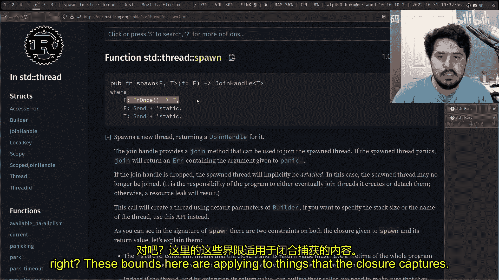

Right， so this closure here， we learned about captures last in the last couple lectures。

 it's capturing my number from main。

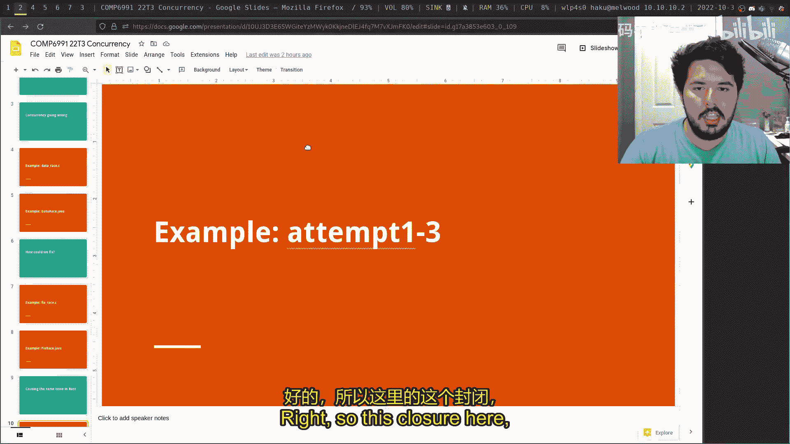

Right， it's capturing my number from main。U because that doesn't。

 it's like not an input to this closure， it's coming from outside in the environment。

So what Rus is saying is that the captures all must be send and texttatic。 So send again。

 we'll talk about in a bit。 The ttatic here is saying。That it sort of says two things it says。

 first of all， like we haven't run into this problem yet。

 but it says that the data must be able to live until must be able to live as long as it could ever be needed。

 essentially， it's a bit of a wonky way of putting it。

 but like if I want to use this value if I want to use this tick staticatic value until the very end of the program。

Right， until right before the program literally exits， I should be able to do that。

 And if you can't do that， I won't build your program。

So it takes that it necessitates that the thing that's borrowed must live。

For as long as it could possibly be required to live。

And that's actually we've already violated that requirement to be clear。

 because my number will be dropped at the end of main and there's still potentially time that the program is running between the end of main and between the program actually finishing。

 But we're not even running into that requirement yet。

 the other thing that Tstatic saying here is that。The it sort of helps rust infer that this lifetime。

Is it's sort of putting a it's defining the flow of this lifetime。And then it sees that this。

The thing that's being captured here， my number， this lifetime flows into ticktatic。Right。

 which essentially means that you can like it's a way for the rusts compiler to consider like the worst case scenario in terms of this spawn function and that the worst case scenario is that spawn holds onto this value until the end of the program and so therefore it's going to assume that it's held onto until the end of the program and so it's going to say。

 hey， this mutable borrowrow is basically going to last until the end of the program so when you try and when the loopt comes around and you do it again like too bad thats last that needs I need to assume that that is it borrows exclusively until the very end of the program so that's why the rust compiler is seeing that when we call spawn this borrowing pattern is not okay。

😊，It's this ticktatic bound right hereel。mOkay， and we're going to run into the other the other problem as well that I was talking about with Txtatic a little later on too。

嗯。Okay， interesting， so the rust compiler won't let us do it。

It just won't let us write this because it sees that two exclusive bors might be taken at the same time。

 which we know is true， two exclusive bors might be taken at the same time for sure。嗯。

So the compiler stopped us this time。 All right， what about I've heard of some interesting types。

 Someone told me about the cell type recently， has anyone heard of cell， the cell type here。

 I think you might have had a weekly exercise where you had to use cell before。

 but cell is pretty cool。 So we can't take too exclusive borrowrows。

 We can't take two mutable references to U64。 And we also mentioned that we can't just take a shared reference because it won't let us mutate a value through a shared reference。

 You need a mutable references， but there are some types in rust that let you mutate values through shared references。

 These are generally known as things like cell types if you've heard of cell if you've heard of ref cell is another one。

 but cell is the simplest one that we're gonna look at today。😊，And， essentially。

What cell gives us is it lets us so we can get the value in a cell。 get with a shared borrow。

 Give us the thing inside the cell。And we can also set the thing inside the cell with just a shared borrow。

😊，Just a shared bar。Right。That seems weird。 Rust usually doesn't let you change things with just a shared borrow。

 Like， how could this possibly be okay。But it， but it exists。

 And this is the signature that it provides。 So like， what if we just。

What if we just made thread take a borrow of a cell of U64？Set to get plus one， right。

 get the thing in the cell， add one to it and now set that， which only requires， again。

 a shared borrower。And then we'll just create the cell and pass the cell into the thread。Bike。

Why don't we just do something like that？呃。Stillilled it。Oh， I went way too far。

 Why don't I see that all that， okay， it got rid of all my space here。That's annoying。

 cell cannot be shared between threads safely。Oh， no。Cell cannot be shared between threads safely。

 So that's why cell can exist。 right， We've said that this is a dangerous pattern because， because。

 you know， like you could get simultaneous mutation and that kind of thing if we allow this pattern to exist。

 but somehow cell。Is like there's maybe the compiler has a special case。 If a type of cell don't。

 you can't use it in thread spawn， that kind of thing。 No。

 there's really no special casing here going on at all。 In fact， it's this。

 The trait implementation says cell is not sync。Right， so essentially。

 cells specifically does not implement this trait known as sink。嗯。And。Well， this is。

 and then we've got send over here。 This is a little tricky。 So like， bear with me。

 essentially this not sink bound here， right， The fact that seller is not sync means that this send requirement。

Is not fulfilled。 Now， you might go hang on， but it does implement like I looked on the line above Zach。

 and I saw it does implement sand。 And that says Sam， so。Why does it not work And like， okay。

 yes it's it's。We're going to have to get a little bit in the weeds here。

 but essentially these send and sync traits help define which types are safe to be， you know。

 sent or shared between threads。And the cell type only exists， right， This signature。

 the way that like the type works here， this interface。Is only like safe to exist in rust。

 specifically because it doesn't implement sink。And so it can't be used with a thread to create this kind of data race。

 and you'll get this compile time error because， you know， the traits， the types don't line up。

 There is also another important thing with cell， which is that it's only valid for copy types。

 It's only valid for。It's only valid for copy types。 Where is the bound here。Im losing my mind。

A copypy。Right。You can only get the value out of a cell there。 That's where the bound pops up。

 So it only， it only puts the bounds like really like where it needs it。And。

It's it's decided that it would put it on get。 so sells pretty useless if you can't get the thing back out of it。

 and so the two things that make a cell work is that it's copy and also that it can't be used between threads。

Okay。So that's our sentenceencing traits， how much time we got I think we've probably got enough time to quickly talk about sentencing。

 we might go into more detail ons lecture Wednesday's lecture。😊，But send and sync， send。

 these are marketer traits。 So it they are traits。That don't don't define any functions。Right。

 so they're only really used to like mark that certain types implement this trait and certain traits don't。

 Sorry， certain types don't rather。And it's also an auto trait。

 an auto trait means that send and Ser automatically implemented on types that it seems that it seems like appropriate to implement on。

 so in particular， if you create a structure an enum，😡。

And all the things that are stored in your structured are say send。

 then your type will automatically implement send as well。 If you have one。

 you know type in there that is not send， say like sell， for example。

 then the whole type is now no longer send。 the same applies for sync。

 they're both just these sort of auto traits and they're both market traits meaning there's there's no like behavior associated with it。

😡，嗯。Now。Send and sink， there was something in my brain that I wanted to point out。

 there are also unsafe traits is what I also wanted to mention。

 which is essentially that you with what we think about rust right now。

 you are not allowed to implement these traits yourself。

So if you have a non sendend or a non syncnc type in your struct inum。

 then the compile are going to go I'm not going to automatically implement send or sync in whichever case for you。

 you can't just go Iple send for my type yourself。You're not allowed to do that。

You are allowed to with this magic onsite Kword， we'll talk more about it in week nine。

But that's like a very sort of low level idea that we'll talk about， you know， in week9。

So you can't implement these traits yourself， they just get implemented based on the things that your types hold。

Okay， now what do they actually mean？😡，What do they actually mean。Send。

Refers to types that can be transferred across thread boundaries。

 transferred across thread boundaries。 Basically， what this means is is our type safe to move from one thread to a different thread。

 say like is it safe to send this value here of some type T。

 is it safe to send that value from say main thread into thread1？

Or is it safe to move this value from thread1 into thread2。

 or is it safe to send this value from move this value from thread 2 back to main， for example？

Most types generally are most types are safe to transfer across thread boundaries。

 but there are some types that aren't， so things like RC in this case I think it's probably worth talking about why RC is not send it's probably worth talking about that in Wednesday's lecture as opposed to right now。

 but there is this ARC oops R here which is basically the equivalent of RRC but but is send。

In particular， there's a lot of examples here。 if I search just for not send。

 then youll also see a whole bunch of different things that are not valid to send across across a thread。

And then there is also sync。So this is send was about moving some value of type T from。

Thread A to thread B。Sink is whether it's okay to share。A type。Between two threads。

 So let's say one thread like owns a type。 is it safe to pass on a shared borrow。Of that type。

I iss it safe to pass on a shared b of that type into another thread Like I'm still going to own it。

 but I'm going like lease it out to another thread to read。

 So T switch it is safe to share references between threads。 So for example。

 is it safe to share a reference to a integer。 Yeah， that's fine。😊，And again。

 it's also like unsafe auto market rate， all the same things as send。 Is it safe to share a。

A borrow of， say， a cell， a cell between threads。 No， not okay。

 The precise definition also is a type T is sink。 If and only if a b of tea is send is actually like a really nice way of putting it as well。

Right， if I have。Like a bur of a tea。Is it safe to send that bar ofvaate to another thread？

Rightright， that's essentially the same thing as what we're saying here。

 is it's safe to share references between threads and so。

That basically is what determines whether the type T itself is sync。

 I it safe to share between threads as opposed to move to another thread， In other words。

 is it safe to send a borrow of this T into another thread。As one would expect。

 perimeter types like U8 F64 are all sync。😊，And simple things like tuples， struxineum are sink。

 lots of other sink types， things like box， T， V T， whatever。

 types that are not sync are those that have interiormutability in a non thread。

 say form such as cell。Right。So essentially the trick here is that。This here。

 we weren't sending the cell into another thread。 We weren't moving the cell itself into a different thread。

 We were actually sharing it。 were we were sending a shared borrow。

 So the real requirement that ends up coming up is is a borrow of a cell send In other words。

 you know， and we know that is a borrow of cell send is the same as saying is a cell sink。

And if we go back to that documentation for cell， you'll find that a cell is in fact， not sync。

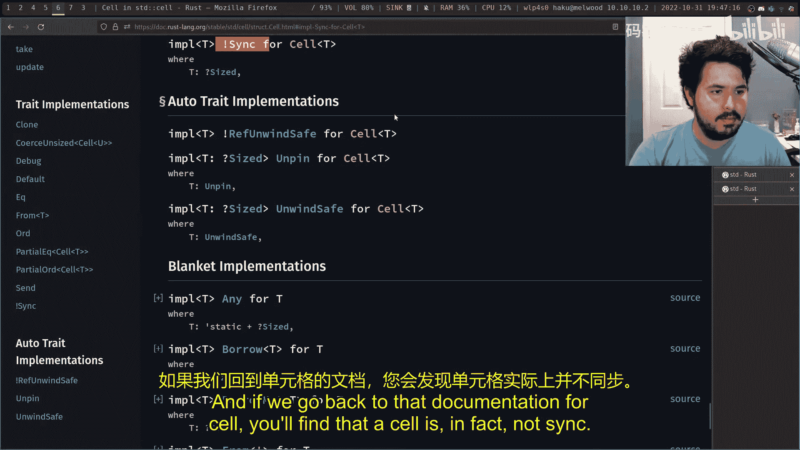

Right。And so the RoOSs compiler rejects it。😊。

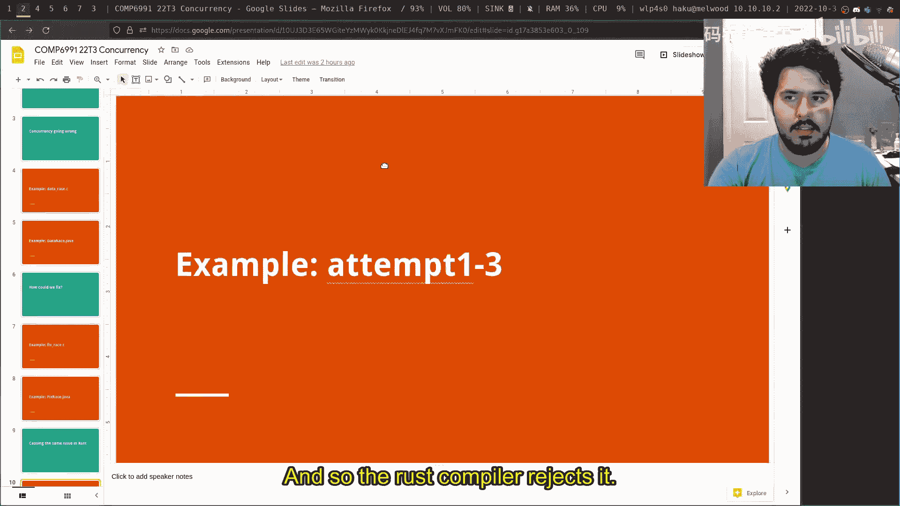

It see this cell type is really only valid in the context of single threaded execution。

 otherwise you'd be able to run into things like data races。

 you'd be able to write code exactly like this and so the compiler stops us so the compiler is once again like kind of doing us a favor here。

😊，Let me catch up on the chat as well quickly。 Don't care where else compiled you're fired anyway。

 Ill see compilers smarter than we thought。 product managers。 Okay， I'm caught up there。

 so you really be like， just know the solution Lo， unsafe。 if you change n thread to1， the compile。

 Does the compiler pick that up。 That's a good question。😊，We change n threads to one。

 Does the compiler say that？The compiler does not because you know this in this case here a cell is still just never safe to share like that。

 but what about in this case？This previous one here， it sees that。It actually might be okay with it。

 but there's a completely separate problem going on here as well to do with the borrowing because of the tech static so it might be smart enough to recognize that。

 but I honestly like can't remember。Okay， so cell type。

 the cell trick didn't work because the type system is there for us。

 Send sync the sort of big ticket ones there。

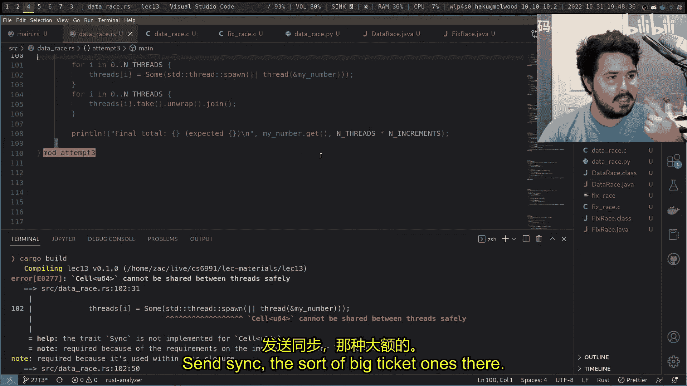

嗯。

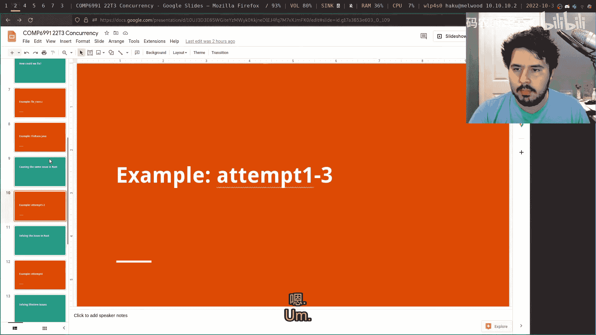

So how do we even solve the issue in rust？ Well， I mean。

 we were trying to create the same issue for the past three attempts to be honest。

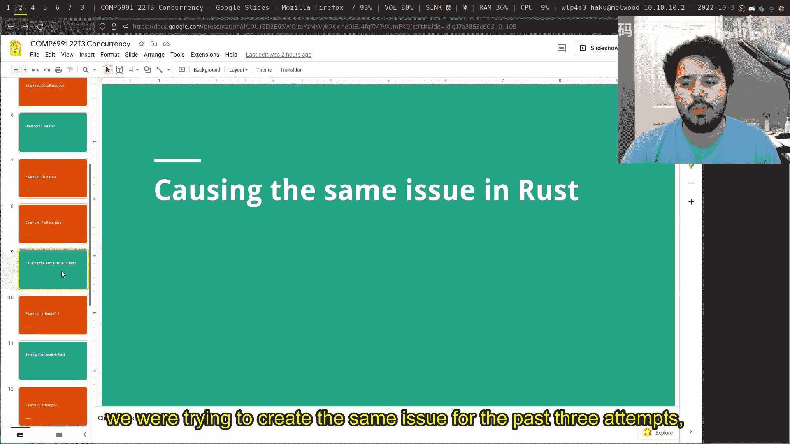

We were trying to just let the code through and my thesis here is saying that like the thesis here is that the rust compilers should be able to stop all these attempts at compile time。

 so you shouldn't be able to run into the same issues that we've seen in the other languages。😊。

And like in the sense that it will stop you from even building the program。So， that's kind of cool。

So how do we solve the issue in Ratwell， what if we used a mutex？😊，Right。

 we saw in these other examples that a Mutex solved it and rust has muexes。

 so how does a muttex work？😊，Mutual exclusion primitive useful for protecting shared data。

 so I can create a new mu text， it seems like create a new mu text。

And that gives me a new text that I can call lock on and stuff。 So that's that's good。

 It kind of looks like C， but it's got this T here as well。😊。

Creates a new music in an unlocked state ready to use it。 It's got this T。

 I need to pass it some like something of any type T， right， any type T here。😊，To create the muts。

You know， what's going on with that？Well， in rust， the way that they've like designed the interface is that each Mutex has a type parameter which represents the data that is protecting。

 The data can only ever be accessed。Through lock。And Trilock。

 which guarantees the data is only ever accessed when the mutex is locked。Okay。

 so like let's see what's going on here。😊，I can create。My mutex， right。

 Mutex of U64 is a new Mutex creating the starting value。 Like my number is now Muex that guards。😊。

A R number， starting off from 0。And then I can pass the muttex into each of these threads or you know a share。

 they can each borrow the muttex， a shared borrow the mutex， and then they lock the mutex。

 and when do you lock it。😊，It basically gives you a type back。This mutex guide here。

Which this is not a good way to look at it。 When you lock it， it gives you this mut text guide back。

Which importantly implements DF and DF mute。For that inside type T。

 which essentially means when when a type implements Df and DF mute for some T。

 it means you can sort of access the inner T。You can't necessarily like move， well。

 you can move out of it kind of through cheeky mem swapping kind of things。

 but essentially it means that。You know， you can access that T through the Mutex guard。

 but you still need to do it through the Mutex God itself。Right。

So I can I make the new mut text here and I pass it in， this says my number lock。

 there's also a dot on wrap here to do with something called lock poisoning。

 which were is not really going get into at least for this lecture。

 but this now gives me something here that can be DF muted into a like into a U 64 essentially。

 So I say de referenceence it and add one。Right， that's essentially what's going on that。

And the trick here is that I never needed to write lock， unlock， you know。

 I never need to remember to write dot lock and then unlock at the end because。

When the Mutex Guard goes out of scope when it's dropped。When it's dropped。

 it will unlock the muttex， so you'll see that when the Mutex card is dropped。

 it'll say unlock the mutex itself。Forget the poisoning。Right。

And we know that we can't actually access the inner without that Mutex guard。

 so it's also not possible to get this inside value without having locked the Mutex。

So in a certain sense， this design has fixed the problem in C where you just straight up。

 forget to lock or forget to unlock。😊，Right， or like you， you like miss one or the other or whatever。

 something like that， because like the， or let's say， let's just say the unlock cases。

 let's say you forget to unlock it or something like that。

 It solves that problem by unlocking the mutex specifically like when it when the。

Lock guard that is returned， goes out of scope。So that's great news and it also fixes this problem of like just straight up forget getting to lock。

😊，Forgetting to actually lock a mut text for some object by essentially guarding。😊。

By guarding that value with the muex itself。 So it's just not possible to access that inner value without calling lock。

And then if we look again， a couple other things to note here is that in the Mutex itself。

Locking right which will can give us exclusive access into a T only requires a shared borrower right that's an important idea。

 It doesn't require an exclusive borrow it's sort of like sell like that but the way sort of the implementation behind it is very different to sell and that it'll make the thread weight until it's the only one with access and then it'll get it there and also importantly Muex has implement send and sync as long as the inside T is send essentially。

Um， like if you have， you can't say like give me a mut text of a cell or something like that because then you could still cause the same kind of issues。

Or actually， Mutex have a borrow of a cell essentially because you could cause the same issues。Um。

 so， u you know，s it's still got a little bit of restriction。

 but generally Mu text will be send and sync， which means you can use them between u threads as you please。

😊，So that's great。It seems to do what we want， but we've still got a problem and this is still that tatic problem essentially。

诶。So essentially it's saying here that the muttex might not live long enough is what it's telling us the thread might go on forever。

 the Mutex is only going to live as long as Maine。And so the mu text might go out of scope before any of the threads are finished。

 which is like we kind of know that that won't happen because we join on the threads here。

 but if we forgot to join on the threads， then that's genuinely a potential vulnerability or even if we just miss one thread that thread could keep executing after main finishes and it's never too late for someone to hijack your program through a memory vulnerability and so it's genuinely a security vulnerability so there's one last thing to sort of think about there。

😊。

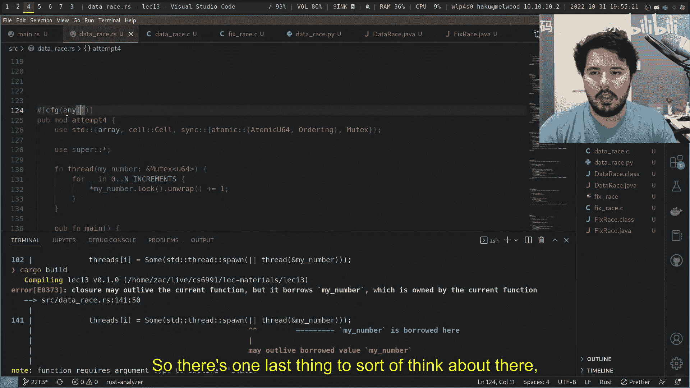

Which brings us to。Which brings us to。Sollving the lifetime issues is attempt to fix one and two。

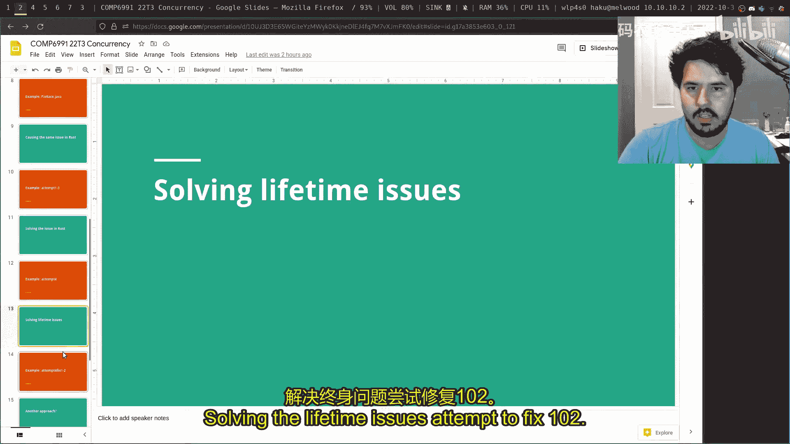

So attempt to fix one。We say we use something called an arc here， right。

 we were looking at Arc a little earlier， Arc is a reference counted type。😊，What's。Pull that up here。

Essentially， it's a type， it's like a mutex that protects a certain type T。 Instead。

 it's sort of like a life hack in solving lifetime issues for a T。😊。

The way it works is you when you create like the first arc of some T standing for RC standing for well here we got atomically reference counted。

 when we create the first arc with the data T then it holds that T and then gives us back this arc T handle and we know that an arc will implement Dre to give us shared access to the inside T。

Just shared access， not exclusive access， no mutation。

And the trick here is that there's no lifetime on this anymore。You know， if I create a muttex of T。

 then you know it'll it'll。Then we don't need to like borrow from that muttex in order to be able to like get a borrowed access into the T an Arc will always be able to give you borrowed access into the T and the other trick here is it implements clone。

Giving you a a like which points to the same original object essentially。The way it works is that。

It keeps an internal counter of how many things are still looking at this one object。

And so you might go， okay we've got when you start off the count will just be one。

 one thing's got it every time you clone it instead of cloning the data itself。

 it just adds one to the count so now I've got two，3，4。

5 things accessing the same thing and then as these individual arcs get dropped。

 it'll go subtract one from the count 4，3，2，1 until eventually if it subtracts one and it gets count of0 finally then it'll go great。

 there's no one else looking at this T anymore so I'll actually drop the inside T I'll actually go we're done with the T and like free at de it。

 drop it whatever you want to call it。😊，And so here I can say。Instead of just giving me a mutex。

Put it like make it a an atomically reference countered type。

 I have to use Arc here instead of RC because RC is not safe to be sent between threads we looked at that a tiny bit before。

 but not really。So take my word for it。And then for each thread。

 I'm actually going to clone the original archaa。😡，I'm going to clone the original one to create。

 I just give it the same name here。 My number is my number dot clone。

 So each thread gets it is essentially increasing the reference count by one and getting its own arc。

 and then we pass that arc by like ownership。😊，Into this thread。 Now。

 this thread's not borrowing anything。 There's no borrowing going on。

 And even if main finishes and main drops the original archaa。

However many threads still have those arcs will still be able to keep them forever。 Remember。

 the actual mut text of U 64 now， in this case will only ever get dropped when all threads have dropped。

 Like when when every single arc has been dropped。 So there is no， even if main finishes。

 the threads will still have access to it as long as they still have their arcs as long as they still have that。

 And just the last person to drop their arc will end up dropping the inside mut text of U 64 as well。

 So it really is just droppingping it in an arc。For each thread， giving them their own arc。

 which again， this clone isn't really cloning data， it's just incrementing account。Passing in that。

 And for the first time。 And this is really， I know this is just the way with rust for the first time the rust program runs。

 sorry compiles rather。 And if I tell it to run that code。We get。This thing here， Cargo5。

Mion in our case。 noticeice it's still pretty slowca we are still using a muex at the end of the day。

 I can build it with release optimizations， which makes it a lot faster。just means like you know。

 actually do all the optimization and stuff， but it's still relatively slow we are still using a mut text at the end of the day。

😊，Similar performance designed C from C。Cool， so this actually worked。😊，Nice。

But this isn't how I would personally do it。This is like it's a good pattern to know this Arc Muex is a bit of a running joke in the Ross community in that like oh my I've got send sync static issues。

 everything's breaking， oh my gosh， just throw it in an arc Muex and suddenly everything everything works so it is a running joke and the single thread of equivalent is RC ref cell essentially。

😊，嗯。But you know， we don't really need reference counting here because we know that the threads are going to be are going to finish before main actually goes out of scope。

 It's just that the compiler is not really able to reason about it the way we've written it here。嗯。

But yeah， we're still going need the mutex anyway。 So can we get rid of this arc and potentially clean up the code a little bit。

 We sure can。Using something called scoped threads。

So this is how I would write this and you can see there's suddenly a lot less code and it's genuinely pretty just simpler I think so now I just create the muttex Mutex New0 and I use this stood thread scope St thread scope is something that's appeared in the standard library oops。

😊，It's just appeared in the standard library relatively recently，163。

 I think that's even the current。Build of rust。嗯。But it gives us a scope for spawning scope threads unlike noncope threads。

 scope threads can borrow non-tictatic data as the scope guarantees all threads will be joined at the end of the scope。

 so essentially they provided this pattern here where I can just create this scope scope here for INN threads scope spawnn thread borrowing from my number。

😊，And the trick here is that at the end of this like inside closure here。

 where we spawn all the threads。😊，Scope will always call like thread dot join on all the threads that we've spawned from it。

😡，Right so the trickier is that scope spawnn does not require ticktatic。

 it only requires the lifetime of the scope itself。

And this is essentially just letting the compiler reason about the fact that we're planning to join the threads you know afterwards anyway。

😊，And we then also don't need to write the code that like remembers the threads and then like we push the thread and then join the thread like in every other language instead we just go like spawn the thread。

 it'll keep track of all the threads we spawn and make sure it waits for all of them to finish before continuing after this and it means that things that outlive this scope itself。

 we can now use in our threads。So this is a very clean way of writing it。

 I'm a very big fan of thread scopepe。😊，It's not suitable for every application。

 which is why we still need you know thread spawn。U but u yeah。

 using scopes can make your code a lot simpler and often you don't need to worry about lifetime issues and things like say reference counting to deal with lifetimes。

😊，Nice， very good。So let's also see， does it work？Tgo run。Yes， and it's approximately as fast。

 I would expect it to be slightly， very， very， very slightly faster because it doesn't have the overhead of reference counting anymore。

 but we're talking like microseconds at that point， the real time sink is the muttex。

Which is why I believe it was Dong mentioned earlier。

 What about atomics as well and I understand we're three minutes past。

 but I've got like two quick little things to show and I'm only going to spend two minutes on the each could we use atomics And the answer is yes。

 Rust has support for atomics Atomics are basically types that make use of very special instructions in CPUs that it's almost like as if atomic U64 is almost like a U64 inside of Mutex but there are a lot lot faster than muttexes because it's just very simple data that they're acting on。

😊，And I can just say， excuse me。Add one to this。 you know， my name would got Fet Chad1。

 do all the same stuff。 I don't even need scope threads anymore because I'm not sharing any data to the thread。

 I can now actually use a global static like this。And then just load that number at the end and see what it gives out。

And we'll see。That that runs way faster。 And in release mode， it's like essentially instant。

 So atomics are a lot faster than New Texas in general。 And they're another great option。And。

Just to like hammer the point home， the trick that's letting this work as well is that if I want to say add something to anatomic value。

 I only need shared access， the reason I only need shared access is because the special CPU instructions will guarantee that there's no kind of data。

 data race or data safety issue in terms of modifying anatomic type with multiple threads simultaneously。

S。Another really great option and also gives you a lot more performance as well a lot of the time。

Okay， so that was basically it。 the last little bit I wanted to show off was this unsafe race。

 which is like。What if we just like made rust， like can and we make rust do the same thing as C and Java。

 like I know you've shown us Zach， I know you've shown us this whole time。 wow。

 we tried all these different ways and rust stopped us every time。

Is there really a way to do it Like， you know， Stop playing games with me。 Can you do it。

 The answer is yes， You can make this mistake and Ru， but it requires this unsafe keyword。 unsafe。

 basically meaning like， I know what I'm doing here。

 Like I know better than the compiler and that this is actually okay。

 There is like three or four superpowers that unsafe blocks give you。

 People think unsafe blocks just like turn off everything in the compiler。

 It's like you can do whatever you want。 ownership borrowing lifetimes。 everything just be damned。

 Not quite true。 unsafe only gives you like genuinely like three or four superpowers that you can look up。

 In this case， one of the superpowers that unsafe gives you is being able to mutate a global variable。

😊，And then also， well reading and writing to a global mutable variable。

So I need two unsafe blocks here。 This is not okay。 This rust program now has undefined behavior。

 but we're going to see it anyway just to see what it does。 and you'll see that。

It makes the exact same mistake as C and C and Java and Python and all that。

 But you needed to write unsafe to get there。 And that's that's a big point that we're going to talk about in in week9。

 I actually wonder if it does the same thing as C in terms of unrolling it。😀哈哈哈哈。😊，Actually。

 but the numbers are not quite right here as a we。So it does the same thing that De were mentioning the you saw on Godbalt where the compiler just goes。

 I know what the answerts will be and just inlines the entire ant straight in here and because Rus uses the same sort of compilation backends as clang that I was using before。

 oops， clang that I was using before called LVM it actually does this same optimization which is pretty funny。

 but it's still not okay to be clear， even though the compiler you know。

 very clever in doing some clever things， still not okay。😊，Anyway。

 that was it So I'm going to catch up on the chat I'm going to be here to answer the questions as long as you have them。

 but otherwise that's the end of the lecture for today。

 we've sort of seen playing around with threads and how rust prevents thread safety issues and how we sort of write threadafe code with rust you know get around the compiler and actually do what we want to do。

😊，And we've got to see some primitives along the way， things like threads， Mutexes， Arc， cells。

 you know， just all kinds of different things along the way， which is pretty fun。😊。

So is there a way to restrict a thread's lifetime， not static， like。

 say if you had a thread to web server and could guarantee yourself that the main thread without not live all client handling threads。

 ya， So you were actually on this idea before we even got there。

 but that is exactly what thread scope is， yeah。😊，Muttics knew my number。

 I'm assuming that was a something from earlier。😊，About the alternation I might say1 million only reads writes 50 times instead of 50 million times。

 so it's still undefined apparently I can't read W write once。😊，Cool。Now。

 that's a very awesome investigation as well。Okay， so yeah， I've got up on the chat。😊。

Are there any further questions that we have？That we'd like to ask before Id switch off the screen again。

 lecture over。If you， you know， it's go， go， you know， enjoy your night and stuff like that。

 but if you have questions then Ill I'll happily answer them as long as you have them。😊，嗯。

And in the meantime， I'll just get this code ready to push up。To ready to。Push up to Git。

Let's say that look right？Y， that looks good。So this card is now all on git。

For you to play around with， if you would like。Any questions at all， quiet chat？It's quiet。Cool。

 I'm also very glad that I made it through this lecture alive because I have been battling a very nasty headache all day。

 So hurry， we made it and everyone's blocked， everyone's locked in the chat。 Well， great。 okay。

 if we don't have any questions。 or if you come up with any questions later on。

 we always have the the cause for for later。😊，But thank you all for coming。

 We'll call that the end of our lecture。So yeah， thanks again。

 And I'll see you all on Wednesday when we talk about some more。😊，You know， random。

 it's gonna be like we've talked about a lot of the main ideas today。 We'll talk about some more fun。

 stuff， interesting parts of rust play around with some things。 Talk a little bit about parallelism。

 rayon， one of my favourite libraries， favouriteite crates and rust。 rayon， so good。😊，Yeah。

 we'll have a look at all that stuff on Wednesday。 So see you all later。

 Thanks for coming again and I'll see you on Wednesday。😊。

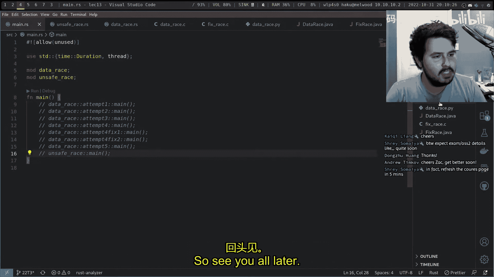

拜拜。

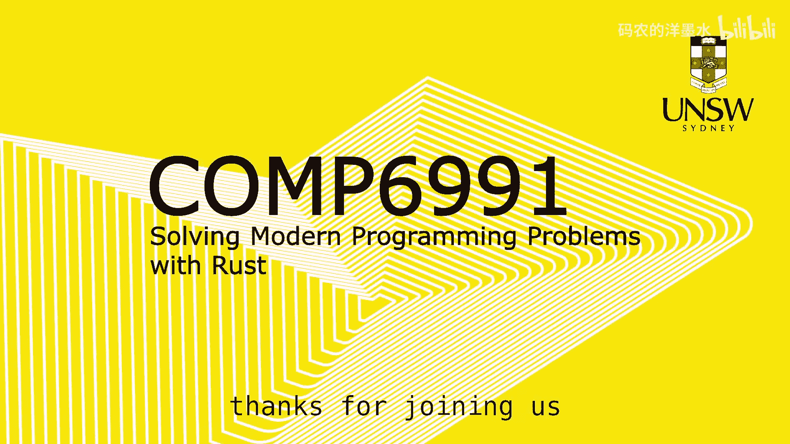