# 【全集】新南威尔士大学 Rust现代编程 中英字幕 1080P p14 Lecture 14 - Rust通道并发 -BV15cf4BCEN1_p14-

Okay， sorry， sorry， sorry， I know we're running late。Let me just。Move this around。Okay， hello， hello。

 hello， everyone。And wow， that is a fantastic pyramid。 You've all managed to。😊。

Make today in that you like names all got slightly shorter。😊，So。

 so it actually end up like a very professional looking pyramid。 Well done。Hello， everyone。So。

Welcome to our two slide lecture。The， the reality of things this week is that like。I mean。

It might genuinely be like the time to sort of give you give every give all yourselves like a pat on the back。

For having， you know， made it this far because。嗯。Where。

 we're really towards the tail end of the course now， I think last lecture was really like。The， the。

Sort of big culmination of stuff。Talking about how rust managers。

 like all these sort of things we've learned about， come together to provide us safe concurrency。

 which， again， as we talked about last lecture is a。Is a。You know。

 growing and growing is growing and growing in size in the industry。 and， you know。

 more and more things are becoming increasingly concurrent。

And so to be offered that kind of safety and assurance in a concurrent setting。

Is something that I think at least I think is， is very valuable。And yeah， I mean。

 we talked about most of the concurrency stuff。 I， I would have， you know。

There is a whole sort of separate section of rust known as if you've heard of like async rust。

What we're doing here in the concurrency topic is asynchronous。

 but it's not like asy in the sense of asynch rust。 It's a slightly different thing。

Something that I regrettably believe that we don't have time to talk about in this course。Although。

 you know， if we can find a way to slot it in somehow， then， you know。

 it'd be fantastic because it's another sort of really interesting， you know。

 another really interesting thing that Rust has a lot to say about naturally。😊，But yeah。

 we really covered most of the big sort of the big ticket items in concurrency in the Monday's lecture。

Talking about concurrency in general， how it works。 We looked at threads。

 We looked at the bounds on a。On a thread spawn closure。

 it was FN once plus send plus tech staticatic。嗯。What else did we look at。

 We also looked at scoped threads。

As a reminder。Stood at。That's the real thing。 Apparently， Doss there we go。

 We looked at scope threads。Whi was where this signature has been changed a little such that now you can borrow things from like your outside scope。

 like say in Maine or something like that， whereas previously when we tried to borrow things from Maine。

 it would always tell us， hey， the thread might outlive Maine and so you can't borrow stuff from Ma and threadcope was a nice tool that basically said you can spawn threads within this scope。

And through that， you can then borrow things from main like this a variable here。

Borrowing's all fine the lifetimes I check out because one of the really important things the thread scopepe does is for all the threads that you spawn throughout it。

 a threads spawned here， a threads spawned here。 once the scope reaches the end。

 there is an implicit join on all threads that you've spawned。😊。

Which means Mainine is going to sit right here waiting for both of these threads to finish before it continues on。

And as such rust is able to guarantee safety in terms of the in terms of the borrowing。

 because these， essentially， these threads cannot outlive the outside scope。

Which is why we call this thread scope， we're essentially limiting the threads to this sort of inside scope here。

嗯。And if you plan to just join on all the threads you spawn anyway。

 like if you're sort of doing like a spawn， spawn， spawn， spawn。

 spawn a whole bunch of threads and then join， join， join， join。

 join all the threads just sort of hoping for all those threads to you know run concurrently with each other。

 then this also saves you having to like remember all the threads in a V and then join all the threads afterwards and all that。

 Instead you just get to it just sort of does it all automatically for you and you get the bonus superpower of borrowing from the environment。

😊，And I mean， I don't know if we looked too closely at this signature here。

 but really all it's saying is scope defines this tick end。

Right which is a lifetime relevant to the environment。

 And then you provide a function F that would be this one here。

This is just a function that will only be run once and it's even this is just run on the same thread it's run on。

 let's say we're in the main thread here， it's just running the main thread。

These here are where we're actually going to end up with other threads coming about。

 And it's simply a function。 I mean， it can produce a T， but it we don't really。

 it's just sort of passes this T along。 We don't really need to worry about it。

 And it just says this function should be able to take a scope in。

Scope has two relevant lifetimes tickcope tick N， which we'll be able to look at if we look at the scope type。

 note that it is a b of a scope。RightThis S here is a borrow and that borrow must be valid for any lifetime text scopepe。

 we haven't really seen this syntax here before， something called higher ranked trait bounds。

 is a little complex and you shouldn't I don't think you should need to run into this in the course yourself but it's essentially saying this FN wants the must satisfy that like wherever it uses a tickcope lifetime which is here and here。

It must be able like it must be valid for any lifetime tickcope。

And its occasionally it comes into use， but again， we shouldn't need to use it ourselves in this course。

 but then the important part here is looking at how things like scope and that relate。

 and so we know that scope maintains the lifetime of the scope and the lifetime in the environment。

 notably the lifetime of the environment outlives the lifetime of the scope right so lifetime of the environment。

 lifetime of the scope。Right。And it says that when you want to spawn a thread。

Right on the within this scope， you give it an F。 that F is an fn once that is， you know。

 produce a T， maybe if you want it。 again， we've we've seen how it passes the T through。

 but the important bounds here are not send and ticktatic anymore like a normal thread spawnn。

 It's now send and tickco。嗯。Which is cool。😊，So now we can actually borrow from the outside scope and again。

 the whole reason that like Rust didn't do this for the standard threads spawn and it was able to do it for the thread scope is because。

 you know， they had to think about the lifetimes you go， is there ways that you could you know。

 run into memory on safety or lifetime issues with threads spawn， there's very little guarantees。

About what happens with that thread after you spawn it。And so they have to be very conservative。

 whereas threads scope， it has this sort of built in nature where it will wait for all the threads to finish。

 and thus it it's sort of more restrictive in what it lets you do with the threads you spawn。

 but in that greater restriction。Comes more flexibility in what itll it's you know it's certain that you could do in these threads that will always be safe and also potentially a bit of convenience if that restriction is something that you planned to already enforce yourself。

But now there's additional reasoning that can come along with that come along with that restriction that you can take advantage of that you wouldn't really be able like the compiler won't do any sort of crazy reasoning to go oh。

 they， I know the thread could maybe live on， but they do join it there。 So I'm just gonna like。

 I'll be， I I'll say it's okay this time。 I'll let this one slide。

 we I think we're all very familiar with the the thought that Ru is， is。Very rare to say things like。

 I'll let that one slide。

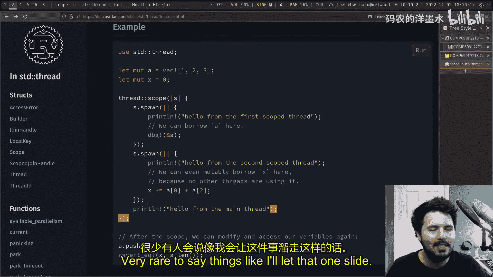

Yeah， so we learned all about scoping threads and all that。😊，And we also talked about send and sync。

 those traits， we'll probably be talking about them a little more today。

 but the main idea being a type T， these are like automatic traits so you don't implement them in yourself。

 The compiler looks at what's inside your structure what's inside your Enum and derives it based off that。

We and they're both mark traits， they don't define any like methods like most traits do like the clone trait says you need to implement the clone function or the iterator trait says that you have to implement the function next to get the next item from the iterator these don't define any functions at all。

 they're just used to sort of mark that a type is okay in some context and in particular send denotes the idea that some type is safe to be sent from one thread to another。

Right so like for example， a string is send in that if I have a string on thread A and I go actually I'm done with this string。

 I'm going to send it over to thread B and it can own that。😊，That's fine。

 we can send it from thread A to thread B。And then it'll have no problem with that。

And then things like the sink traitd as well。 So I mean。

 send and sink really common on close pair sink specifically meaning is it safe to send like if I have some type T and I want to know。

 is T sink。Well， the question is， is it safe to send a b of tea？Right。

 like this is to be clear at a shared borrow， a read only borrow， a shared reference。

 whatever you want to call it right， what's the other one， immutable reference， you know？

Whichever terminology you have， then be comfortable with that。

But whether it's safe to send across a thread boundary， a burrow of the tea that we care about。

 a shared b。And I guess， like sentencing are。More interesting in the things that don't implement them rather than the ones that do。

 given like the set of types that implement send and the set of types to implement sync are quite large and the set of types you know however the set of types that don't implement them is more constrained and so maybe we'll also play around with a couple types that don't implement send and sync or maybe think about like you know why would it be dangerous for said types to implement send and sync。

And we still have a couple other things to look at， so here's our to do list。😊。

Move closures are something a little interesting that might end up helping you in your assignment。

 Oh， did I mention， I didn't mention assignments 2 has been released as well。 Ass 2 is out。

 Here it is。Assignment 2， oh。Asstic， there it is。Implementing a rust IRC server IRC internet relay chat yes IRC is very cool so assignment2 is out and we're just gonna be looking some stuff that might help you with assignment2 so in particular move closures I think should should probably help you with assignment to channels will help you with assignment to and rerd lock like maybe I can't immediately think of a reason you might want to read write lock for assignment2 poisoning is just sort of generally good to know about how it works S in syncnc will look at a little more closely and rayon is。

😊，Again， potentially my favorite rust， crate。And I will have to have a look at Rayon。But yeah。

 I am anticipating， okay， it's 20 minutes past， meaning we have like an hour。😊，3five is left。

I am anticipating that will probably be like through most of the stuff we want to talk about early。🤢。

Right， like Im I'm anticipating that it's probably only going to take us like。I don't know。

 maybe like an hour or something or an hour a 10。To get through most of this stuff here。

 so we'll also have plenty of time at the end for things like Q& A or or just sort of general yeah general questions on older topics or generally about rust I think we should have room for that probably this lecture so start to think think if you have any of those。

Otherwise， we continue as normal and。Work through our little to do list here。 But like， yeah。

 I think， I think we've reached a。

A bit of a turning point in the course。 we've reached sort of like a bit of an apex in terms of like。

You know， difficulty in concepts and that kind of thing。嗯。And so we can like， sort of start to like。

 chill out a little more， you know， some more room breathing room for assignment。

 too and that sort of stuff。And yeah， and have some fun with it。So， move closures。

And maybe we can briefly talk about asynncch crust。 Yeah， we'll have to， we'll have to see。

I'll have to， I'll have to also think along the way if there's a。

A nice sort of like brief way to talk about async rust becauseuse， you know。

 I could make a 10 hour giga series talking about async rust， but。

I don't know if I could how what the best kind of like 20 minute brief are on it would be。

 but maybe we can， we can have a look at it。Right， so move closures。This is more about like。

How do you deal with。With the compile of being angry at you in a case like this。

A lot of the time the compiler is really smart， we'll tell you to put this here。

 but we're going to sort of figure out like what's going on here so。😊。

You might have written some code that looks a little bit like this before。

So we have my string is hello， I'm going to spawn a new thread。

 the thread is going to do this stuff and I just say wait for the thread and unwraprap any like panics or anything like that。

嗯。And right， so I just say let my string is my string。In fact。

 like this line to be clear is is not necessary at all。

 but it sort of helps illustrate something we'll see's let's even just leave it as printlin my string and we'll see that this doesn't build。

This does not build。Sir。What's the issue here， closuresure may outlive the current function。

 but it borrows my string， which is owned by the current function。Okay， this is like。

A little bit of a weird one。 A little bit of a weird one。 The reason， first of all。

 that I liked to put in this let my string equals my string here。

Is because macros can do weird stuff。In terms of like。Often when I write， like if I have。

Something owned。I have an own string like this， and I say printlin out。This and pass it owned， right。

 not like a borrow owned or an exclusive borrow owned owned itself。 Usually in Ru。

 we know this is like， oh， this is gonna to take ownership， you know。

 and now I won'll be able to use owned again。 So if I throw another printlin in。

 this will surely fail。 But if I compile it。Compile is actually happy with this and that's because printland the macro ends up compiling this down to a shared borroworer essentially。

😊，UmAnd so， you know， when we're looking at lifetimes and weird issues going on。

We want to avoid trying to like replicate specifically inside of printlin。

So I have this like this seems to be enough to trigger the issue。

 but we'll keep the printlin here to sort of have a purpose， I suppose。嗯。But we're just saying like。

 take that my string from mainine and put it in my thread。Okay， so this doesn't work。

 It's telling us to like， oh， maybe a move closure is what you want。

 Let me show you something that's like， looks like the exact same threat thing。Right。

 so we're just going to forget about this my string and let my string be an owned string type now and save。

And it compiles。Car个 run。Yeah， it prints out。Right， so this builds。But when it's this string here。

 it doesn't build。 right， this string。Which is a， like。Reftticstatic string。Doesnt build。 so strange。

Now， get a load at this。If I put in the little letters here， M O VE。It works again。

So these four magic little letters seem to solve this borrowing issue。Right， that seems to work。😊。

All right， now。What's going on here。So closures in rust， we talked a little bit about them。

 and it seemed like the chat seemed to quite like when I showed how closures tend to de sugarug。

 So in our case， the de sugaruging looks something like struck like my closure， I suppose。

Like you know， the way I've written it here。Is going to look。A little bit like that。

And then it says I and once for my closure。My closure of whatever lifetime we don't really care。

 And like。There's some bits in here。But essentially these sugars into this。

And the problem here is that like the so you might go why did it like throw a lifetime like this and not just say like reftic staticatic stir essentially。

And the reason here is that Rust saw that this is a burough。

This here is a borrowed at an inferred that it's essentially like reborrowing this into this closure。

And that if I wanted to say printlin of my screen down here again。Then it's like。

 perfectly happy with this。And we're sort of reborrowing it into here。

 and in this process of reborrowing， it's a little bit like of this is kind of like a bit of a rough stupidity in this case in that。

 you know this string might have like a， you know， might have a tickstatic lifetime might be able to live forever。

But Russ isn't really seeing this because of the way it's borrowing into the closure like this。嗯。

And this kind of borrowing， you know， this sort of default behavior of borrowing in a closure will always occur。

When the thing you're trying to like capture into the closure is a borrow in itself。

 So like to give her another example here。Let's say， I had let。Or here。

 let me give you a slightly different example。 If I said let x is 42。

And then we're going to spawn another thread。Dot join dot unwrap。It says let x ref equals a b of x。

And then say into out X breath out like that。This also won't work for a relatively similar reason。

Excuse me， so。In this case， it sees that we're capturing X as a borrow。Right。

 like we're capturing X here， but the fact that we take an immediate like borrow of it。The。

 the thread kind of sees like， I see。 they're not really trying to take ownership of X。

 They would like to just borrow from it。So I guess an orange type is probably best here。

They just like to do that。 And again， same example down here。

 If I want to print it out after the string is x。Then this should still be fine as far as the compile is concerned。

 however， if I got rid of this aman here。Now， the threat is okay， but this is no good。Right。

 this is like， let's， let's sort of like forget about the stuff up here for the moment。

 we'll come back to it。 This is our sort of important example to look at here for now。

If I have this owned string X。And then， I spawn a thread。And I capture x just like this。

 like let x f equals x。I have then moved X into this thread。 Essentially。

 I've sent it into this thread。And then I'm like printing it out if I try and use X down and here it goes。

 hey， that's no good， like ownership was transferred over here。If I put in a borrow here。

 then this thread is this closure is set to。Sort of capture a b of x。In this exact same kind of way。

And that the de sugaruging of this closure， like the captures of the this closure is going to look like this。

😊，It's going to say， oh， it takes a borrow like a reptic a of some string and now the thread gets pissed off about the lifetimes it goes。

 hey， it might not live long enough， blah， blah blah， we've seen the usual stuff。😊，m now。

So why did it work when I put it like this， obviously it breaks down here。😡。

That would be because if this is like struck my closure one and now I'm going to show you what the other one D is into。

Instead， it'll look like this。So this closure is going to de sugaruger into something like this。

Right， and noting that it owns that string， I've sort of like explicitly moved that string into the closure。

And so now this closure。Owns the string。 And then like the function， you know。

 when the closure call does like a call， you run the call function on that closure。

 it's gonna grab self dot my string， you know， which which it owns， and it can print that out。

 and it's happy days。 But now Ma is not so happy anymore。 But， you know， that's maybe to be expected。

 so。😊，What if I want my code that looks like this？To still like work in the context of the thread。

 though， right， So now again， we've put this back in here。 it says oh， they just want a borrow of X。

 So we've gone back to this de sugaring here。But I went， like。

 let's pause and think about this for a minute。What if I said the closure object itself？😡。

The closure object itself， what if I want the closure object itself to own the string like we've written here。

 but the body of the function to just borrow from know borrow from the closure essentially。

 So I still want this code here， but I want this de sugaruging semantics。

And that's where this move word comes in。So what the move word here means is that anything that it sees。

 anything the closure sees as being captured by B right like this here that by default closure we'll see that and go a yeah。

 okay， they're they're trying to borrow that X， so I'm just going to capture a borrow like this。😡。

I'm now overriding that behavior with the word move here and saying no， no， no。

 I actually want you to move this X into the closures ownership。😊，And then the。

 the closure's body will borrow from it。 So in this simpleple F N once， it's going look like。

 in fact， let me。Throw this output is nothing。And the body will look like this， this， this。

 this self dot。I guess we called it my string。Like this。 And I apologize for all the， the big。

Red squiglelies， I can get rid of them if I just do。だ？So you see now。That the closure， my closure to。

 that should be my apologies。My closure， too， now owns this string and only when the function is called。

It， like， borrows from it there。As opposed to the previous behavior without。

Without the move word here， it ends up looking like this with my string and X F is just selfd up my string here。

 That's going to be， well， I guess it's still an FN once， I suppose。And like these actually。

 like if I wrote these two sort of implementations out by hand。

 these do really mean quite different things as far as Rus is concerned， right。

 One thing borrows from something。 One thing owns the other。

Usually closures are pretty good at figuring out what you want for each thing。

 But like when you have thread spawn。What you really need is when you have threads spawn。

 what you really need is a function that doesn't borrow anything。And so throwing a move like a。

 a move closure whenever you're doing stood threads spa is like。Like， pretty decidedly common。

And that it's like almost always what you want。It'll， it'll just like。

It will describe what you're looking for better， most of the time。

And so move closures are really handy for that kind of purpose when you just want to say to the compiler。

 I know you're good at sometimes seeing I'm moving here， I'm borrowing there。

 but like really I'd like you to just move all the things。😊，Now they're， they're。

 they're working on an idea for some sort of syntax in terms of like。What if I had。

Another string here。And I wanted to move X， but not y。

 Like I wanted x to be captured by value by moving it。

 And I wanted y to be captured still by a borrow as a normal closure interprets this as they're working on some syntax to look like something like this。

 I think was the latest proposal or was like the proposal when I was looking at it like a year ago。

In that like just move X and don't move， you know， do the default semantics for y。

 But there's not really a good way to express this in rust these days。 Instead。

 you would have to do something like。Generally， the trick here is to before you spawn the thread。

Override the name Y with a borrow to this Y。 There's a lot of why is going on here。 But essentially。

 here's why。 right， the original thing。 Now we're going to， in this scope。

 override the name Y with a borrow to Y。 So then when we move Y in here。

 it's really just this y over there。 This， it's already a borrow。😊。

And so this is like a trick that some people might use to actually still borrow by moving sorry。

 still capture by moving rather。If that's what they're looking for。But yeah。

 so move closures are handy when you need it， I guess I can hover over in here and rust analyze it to see if there's anything else sort of important。

😊，CConts any variables captured by reference or middle reference to variables captured by value。

 ie by moving。Move closures may still implement FN or fN mute。

 even though they capture variables by move， this is because the traits implemented by closures type by what the closure does with the cache is not how it captures them。

 So this is are also a really good point here in that if I have let's let's rewind a little bit here。

Or not rewin too far。 I have。This， this， this。Great， actually， let's。Say。Let's do like this。

F is an input for mute。Okay。So imagine I had a closure。That just does like a， you know， print。

 Prince then， hello。Like that， I like to write a little function like this let me go this stuff it's erroring。

 I like to write a little test for mute function here。

 which basically just says my the thing that I'm past will implement FN mute。So that I can tell。

 like， if this closure doesn't implement for mute， then the compiler will get angry at me。

 Like I to say let x equals x here， it'll say this no longer compiles at all。

Because it doesn't implement FMme。If I didn't have this here。

 then Rus would just infer that this is an FN once and be fine with it。

So it's a nice little trick when you're trying to figure out what a closure implements。嗯。

But the important thing that the documentation was trying to say there is that。In this function。

 like let's say I said。I wanted to call another function that takes a string by ownership。

Takes in a string。Thanks to stringing ownership and I passit X， right？This is not an FN mute。

 an FN mute meaning it can be called indefinitely but never simultaneously with itself。

This is not an FM mute because this can only really be called once。

 This function takes a string by ownership。 The first time this has run， it moves that string away。

And therefore。you know， Ergo， if we run it the second time。

 it won't have ownership anymore to give to this function。

 and so it doesn't make sense to run a second time。嗯。So like one might look at this and go， yes。

 this is an FN once then。 And the way the Ru compile might tell is because this is because it captures x by value here by like。

 you know， owned x equals x。And because it captures it， you know， captures own X by ownership。

 it must know that it's an FN once， but that's not quite the case because we can still use a move closure to。

Take ownership of X。But。Just because the closeize ownership， it doesn't mean it needs to move away。

 move that ownership away in the body of the function。If all this function does is print out like。

 this sharedd bar of x。Then it is still an FMme note that the like program is compiling now。

even though it moves x away and if I un this line， it's still not going to be happy。😊，Right。

And that's because the closure object will hold on to like the closure object itself will hold on to that own value of x。

 And each time you call it， it's just like calling the closure with a refe itself。Right。

 and so like that X， this string here that's owned by the closure lives in the closures fields will live on。

 you know， indefinitely。嗯。And so， and yeah， so the owner。

 it doesn't actually transfer the ownership away。 And so this can be promoted to an FN mute as opposed to an FN wants。

 In fact， it can even be just an FN。In this case， because it's not because。

It's only like reading this X here。So that's the the way that they word that was。

Note that move closures may still pin FNR F and mute， even though they capture variables by move。

 this is because the traits implemented by a closure type。The traits implement into our closure type。

 meaning FN F mute and FN wants are determined by what the closure does with the captured values。

 not how it captures them。So it's an important one to sort of consider。

 and you'll probably like play around with this and get a better feel for it over time。

So if we go back up to the previous example。That wasn't building。

 essentially Russ sees that this is a brow， it infers that the type of this is a borrowrow。

And so it goes， great， I'm going to capture this as a borrower when really we can actually move this reftic static stir in here instead。

 even though we don't necessarily need to like move it you know， within the thread itself。😊。

And now things are suddenly working again。So yeah， a neat trick when you're spawning threads usually what you want is a move closure。

And so if anything else， that's a nice takeaway in terms of。I'm sporting a thread。

 Rust is angry at me。 You know， you can try and move closure。 And like。

 what's the worst that'll happen。 You get another compiler error。 It's like， okay， well。

 maybe that didn't work。Maybe program builds and you're like great solved now。 So yeah。

 you you'll have ample opportunity to play around with these things and stuff like the assignment。😊。

Okay。So。Any questions on。Like sort of， you know， back towards closures or anything on move closures specifically。

Before we talk about rewride lock and poisoning。A quiet chat today， as well。Quiet chat today。

Maybe something's， maybe something's happening on on a Wednesday evening。Hm。😔，Fine。

 keep your secrets。 Co。 No， that's no problem。 So we'll move on to read road lock and poisoning。

 I guess。

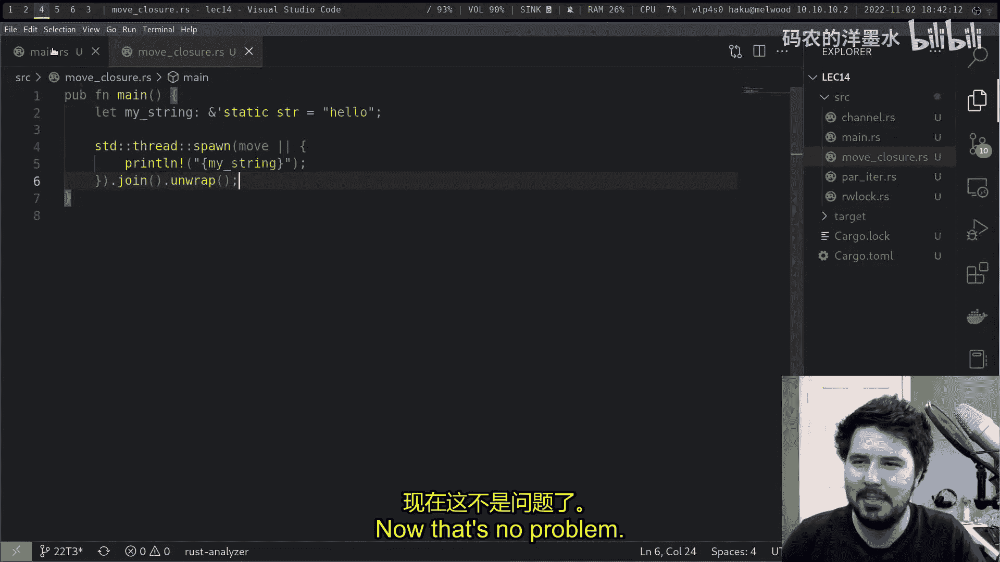

Maybe we'll just briefly talk about poisoning first it's a I think a relatively simple idea but just one that's like nice to be aware of so we talked about Mu Texas in last lecture。

The idea that a mu text guards some value T， when you create a mut text。

 you need to give it that initial t value， right， they say like zero in this case。

And then the trick is you can call lock with just a shared B of the Muex and also a mutex is sendend and sync generally。

 this bound here might be actually interesting to talk about in a little bit。

 but you so you can share a whole bunch of mut textexes across a whole bunch of threads。

And you can lock it with just this shared borrow that many people may be able to do simultaneously。

But only one person will actually be granted this Muex guard at a time， the Mutex guard。

 which actually gives you access to this entityity through like the DF and DF mute。😊。

Basically just like how a box does it， if you recall box。

 box lets you access the thing inside it just by the de referencing into a shared borrow or de referencing into a exclusive borrow。

And the trick was that when you when the Muex guard that you've like， you know you've called Lock。

 you've got your guard， you've used the entity for a few things eventually when you're done and the muttex guard goes out of scope。

 In other words， it's dropped internally， it will unlock the muttex。😊。

Itll unlock the mutex and then someone else can have a turn accessing that inner a T。Now。

 there is one sort of。Annoying thing to work around here that the standard library sort of models in its design that sort of forces us to think about is that when you lock a mut textex。

 it returns a lock result。A lock result is basically just a result with potentially a poison error。

Poison error。 So you're talking about poisoning， poison error， y， this is where we're at。

So what like could go wrong， what could go wrong when trying to lock a mutex if we look at the error section it says here。

 if another user of this muttex panicked while holding the muttex， then we'll get an error。Okay。

 so essentially， if some other thread or， you know。

 whoever else it might have even been the same thread。

 but if someone else has gone like has acquired the new textex。

 they've called Locke and they successfully got back the guard。But before like giving that。

 before being done and， you know， dropping the guard normally and stuff， the their thread panicked。

 like， let's say they they accessed an array out of bounds or they like unwrapped a nun or unwrapped an arrow or something like that。

 And it panicked。嗯。It'll start like unwinding their code and like， you know。

 collecting a trace back like a stack trace of， you know， where the stuff went wrong。Naturally。

And in that， it will end up like dropping this mutex guard at some point。

But it doesn't just like by default， unlock the mutex。 It doesn't just go like， oh cool。

 they're done with it。 I mean， they're done with it in a bit of a bloody way like they've got their battle scars and everything's blowing up in front of them and we're like。

 okay， cool So that's unlocked now it will it will sort of see that that happens and then go okay。

 something bad might have gone wrong。 I'm going to poison the lock。😊。

So poisoning the lock mean like so thread held the lock before it was able to release the locket panicked。

The mutex now sets itself to be poisoned， such that whenever anyone else tries to lock it again in future。

 now that this， you know， some other thread is panicked while it held it。They won't get like okay。

 here has the guard back instead they'll get hang on a second， it's current， it's been poisoned。

Most the time you like。It sort of exists to aid in correctness in if someone needs to like。

Make sure that they fix something up if a thread panicked while they held a lock。

 they have an opportunity to do that in a lot of like consumer code where you're not writing a big library or anything。

 you're just like trying to get stuff done。 You often don't really care about the poisoning。I mean。

 there's a good chance that if a threads panicked anyway。

 like you're fine with the whole system coming down with it because you don't really want it to be panicking at all。

 you'd rather see a big bright thing flashing your eyes going panic， panic。

 panic things going wrong so you can go fix it。😊，But at the end of the day there there is also like this clear poison which says oh okay。

 the lock， you know I tried to lock it， the lock was poisoned and I want to go， no。

 I want to make it unpoisoned， sadly this is nightly。😊，RightThis is a nightly only experimental API。

I am trying to recall if there is a。

If there's a stable way to unpoison a mutex。嗯。Whether is。I have I have a way that I usually do this。

 but I'm not sure if there's in the standard library， a very good way of getting around it。

 and it seems like maybe the answert is probably no。 So like once a mutex is poisoned。

 it's like kind of screwed。 it seems you sometimes you might be able to like replace the mutex with a new one。

But it's a little like annoying occasionally。This poisoning and it also means that because lock doesn't just return you the guard。

 you can't just go like lock now do some stuff， you always have to throw in something like an unwrap if you don't care about poisoning。

 which just says this unwrap here really is saying I assume that the lock won't be poisoned and therefore this will be fine and now I'll have access to the guard。

But yeah， it's kind of annoying。Notably the standard Library didn't have to do this。

 this isn't like a requirement for like safety in general in rust。

 it opens up more patterns for people to make you know more safe abstractions but it also gets in the way quite a lot and some other libraries like parking lot for example。

 parking lot is a library that provides implementations of muttex readr lock convi and wants that are smaller。

 faster and more flexible in particular one of the things they chose to do is their Mutexes have no poisoning。

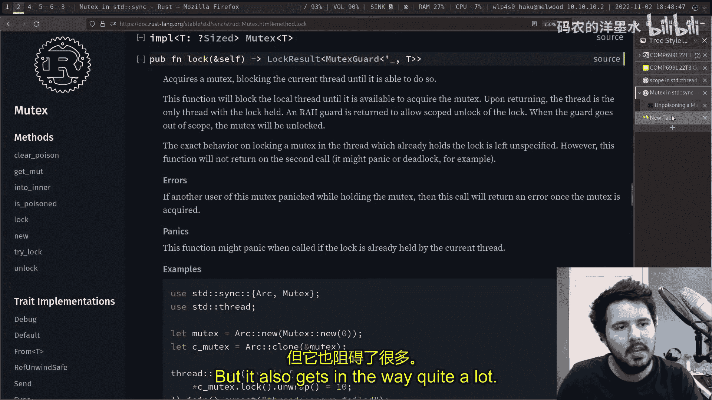

When if there's a panic， right， if a thread is holding the lock and it panics。

 then it just releases the lock as as normal， essentially。嗯。So， yeah， I mean， that's where is our。

Where is I oh type definition， right， Yes， Here we go。 Oh， I'm on the latest version。 Oh。

 it wasn't on the latest version， whatever， that's fine。 in the sense that， right。

 so it doesn't poison。 And here's what I was looking for。 Great。 you'll notice little a lock。

 Just give us back a new text card straight away。😊，And so yeah。

 the the parking lot API is quite nice as a consumer， I often reach for the parking lot API。

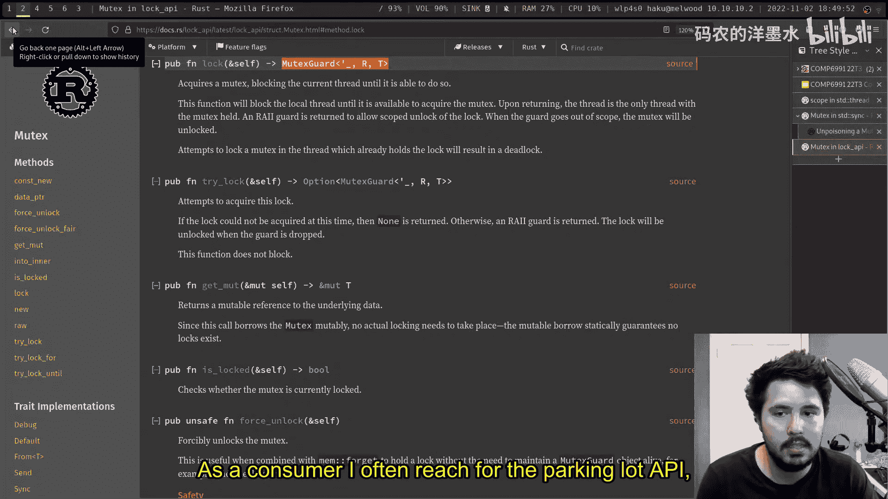

嗯。But at the end of the day， the the main idea that I'm trying to present here is that the standard library types do have poisoning。

 It is something that you have to deal with。 It's something that can be a bit annoying to deal with。

As of current， based on， you know， things like clear poison being nightly。嗯。But yeah， it's， yeah。

 this is， this is what we've got。 poisoned。 here we go。 Oh， right， Oh， sorry。

 the poisonarrowtype has an into inner method， which will return the guard that would have otherwise roads been returned on a successful lock。

 Right， Okay， so this is the bit that I was missing here。😊，A poison error， which is。

 if we go back here and see we lock a muttex， that gives us to lock result。 maybe there's an error。

 here's a poison error of the guard。The poison error then gives us access to in inner。

 right poison error of T。 And we had a poison error of a guard。

 And so we can get the guard back through the poison error， but it's。Just。

Kind of generally a little annoying， most of the time。Is what I would say。😊。

But it's a choice they made for increased flexibility for library designers， for API creators。😊，嗯。

Anyway， so that's poisoning in general。Just good to know about。And again， the， the varied sort of。

High level cliff notes is thread holds a lock。Paanics before it returns the lock before it releases the lock。

And poisoning signals to other threads， you know， anyone else that tries to take the lock again that someone panicked last time。

 you know， when the lock was held。哪个。Cool， so that's out of the way。

Any questions on poisoning or anything， feel free to throw them in the chat as， as you get them。

Another interesting。Sync primitive in the standard library is a read write lock， read a write lock。

 however you want to sort of talk about it， read a write a lock， readW writeite lock， RW lock。

's how it's commonly pronounced。嗯。And a readr lock is kind of like a mutex。

 but like a little more general。嗯。In that， this type of v allows a number of readers or at most one rid at any point in time。

Right， so a mut text is kind of like a read write lock where every time you lock it。

 it always assumes you are a writer。Essentially。

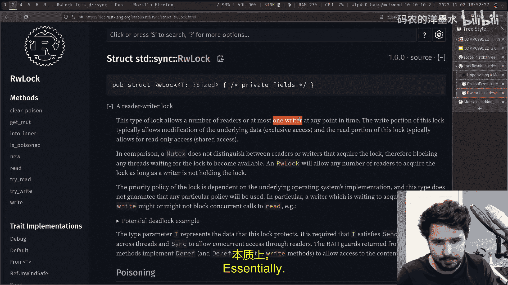

嗯。So the difference here is that imagine we had a mutex， right， we've seen a。

 we've seen a mutex here。 Imagine we had a mutex where sometimes like when you。

 when you rather when you lock the mutex。When you lock the mutex， you get a mut text card。

 that mutex guard gives you exclusive access to the inside T through a DR mute。

What if I wanted to lock the mutex， but say。Hey， I'm gonna lock it。

 but I'm only interested in reading the value。 I don't actually need access to like D ref mute。

 I don't need exclusive access to the T。 I just only plan to read it。And so the mut text went， okay。

 what if I give a second method here that's like we have a lock。

 but also like it maybe se as like lock and lock mute。

 or it's like lock is just if you plan to read from it。 Lock mute is if you plan to to say mutate it。

 you know， you need exclusive access to it。What kind of optimization would they be able to make in that case。

 Well， the trick here is that in Rus， you can only have one exclusive borroworer at a time。

 but you can have as many shared borrowers as you want at time。 So if you add lock and lock mute。

If you have， if you' are looking for a lock mute， you need to be the only one with any kind of locking access to the thing inside。

But if you only need lock。 and let's say there's like another person who's already just。

 who's already has the lock， but is just， you know， just has a lock， not a lock mute。

 then you should also be able to lock at the same time as them。

 You shouldn't need to wait for them to finish because like you're not going to get in each other's way just by reading。

 right， just by having shared access。 I mean， it's shared， right， Sha access。 So you could imagine。

With， if you split these up in between like， you know， lock and lock mute。

 you could have a million threads all locking something。Or just like one thread doing a lock mute。

 whereas like in the case of a mutex， it's only ever going to be one thread at a time。

 So there's genuinely some like considerable， you know。

 concurrency and performance related advantages to be had by having a more flexible API like a read write lock。

 So in particular， you'll see that instead of just having a lock function， it has a read and a write。

😊。

Right， they both similarly take shared access just like a mutex and the right。

 it will give back the lock result。 right， This lock result here is the exact same thing with poisoning。

Right， poisoning here。 So we have to think about this result here。

 but otherwise you get this right guard and that gives you access to that gives you access to Df and Df mute。

so now you have exclusive access to the inside T。Whereas。Whereas when you read。

You get back a read guard， and this read guard only gives you D ref。 no D ref mute。

 So you only have shared access。 But yeah， it just means that if you have very high read contention。

 meaning there's a lot of like a lot of time threads want to read from it and only very rarely。

 Does anyone want to write to it。Something like a readrite lock might be what you're looking for。

 There are catches， though， in particular， one of the really scary things about a read writeite lock is that depending on the its internal policy like the protocol on how it sort of deals with。

 you know many people trying to lock， you can end up in really weird deadlocks。

 So here's an example here。Imagine you had a thread which accidentally locks， you know。

 does a read lock twice， essentially。🤢，嗯。The scary idea here is that if we say， okay， lock read。

 it goes great。 The lock is yours。 You're now welcome to read。 And thread2 here goes。

 I would like to write。 Well， okay， that's fine。 I see that you would like to write。

 but you're gonna have to wait for this read to finish。 right。

 You're gonna have to wait for this read to finish once the read is finished。

 Then I'll give you exclusive access on your own to write to the thing inside the lock。 So it goes。

 okay， that's fine。 I'll wait。 So that blocks。😊，And then thread1。

 let's say thread 1 without releasing this read guard， right， the the read lock here。

It calls Lock Re again。 You would probably imagine it goes， okay， well， what have we got right now。

 One person's reading the lock。 There's someone waiting to write to the lock。

 but they're they're waiting。 They haven't got access yet。 So it might go great。You're it。 We。

 well let you read here。 And it does sometimes like that。 And that's perfectly safe to be clear。

 But the problem here is that if you have a system where there's。

There is like a way more reads than there are rights。 Like。

 let's say there's for every like time that a thread tries to write。

 There's like  a thousand times that threads are trying to read from the lock。

You can imagine this right might have to wait a really long time until there's no threads reading at all。

 If it just goes， yeah， read， great， go through， read， go through， read， go through， read， yep。

 go on through， read。 Yes， go through。 right all this time while writeright sort of just like hanging out like。

Okay， is it you know， can I go in， No， sorry， there's still some res inside， you know。

 res are all exiting the building like they're， they're flooding out。

 but there's just so many coming in that it's just incredibly unlikely for their ever to be exactly zero。

😊，Sometimes the read write lock will implement a bit of a policy that goes， okay， the。

 the person's waiting to write here。 Let's not let any more reads through for now。 Like。

 let's say there's 400 reads in the building。It'll go。

 we'll wait for them to all shuffle their way out， and then we'll let the right in。

 right any more people who are like waiting to read in future。 they'll， you know。

 usually we let you straight through。 But like we're going to say actually hold up for now。

 We're just， we're just trying to make some space for this right here。And then， you know。

 the reads all shuffle of the building。 finally， there's zero readers left， the right goes in。

 does the exclusive， you know， writing。Exits and then all the hundreds of raids flood back through。嗯。

If that policy gets enacted and this might be operating system dependent。

 it might be context dependent， potentially， this kind of thing might deadlock。And we go。

 Readta has access。😊，The writer goes， okay， I'd like to write and it goes， okay， no worries。

 holdd on。 Like， we're gonna block you for now， but we hopefully you get through in a little bit。

And then。The original thread， which is still holding this read law goes， I want to read。

The policy might go， actually， you should wait too。You should wait to。

Because we we're trying to let this write out， but because it's waiting to read this， you know。

 to acquire this relock here。It might not ever。Like it's it won't basically。

 it basically won't be able to release this lock。Until it acquires this。Right。

It can't release this lock until it acquires this， it can't acquire this lock until this lock's gone through。

 and this lock can't go through until this locks released。

So you've got like a love triangle of readwrite locks that won't have a progress。

 and so there's potentially quite scary dead locks that are hard to detect based on the priority policy of how the lock is working。

嗯。So like you might go like， why would a thread ever like acquire the relock twice， though。

 Like that's kind of like you're kind of shooting yourself in the foot there。 And like， yeah， true。

 you kind of are shooting yourself in the foot there。 like you probably shouldn't be doing this。

 but it's like pretty understandable to like see how something like this might happen。In that。Like。

 if I have somestruct fu andstruct fu has like X is a readr lock of an I 32。And then on fo。

 I have some function through。And some function bar。And they both need like read access from x。

 let my x equals x dot sorry self but x dot read。Dot unwrappped， forget any poisoning errors。

 And let's say Bonnies do the same thing。Yep， and they like both do their stuff with X。😊。

They both do this stuff with X， and this is like generally fine。

Like there's there's not a problem with anything so far， but then we go， oh all this code。

 like I wrote a whole bunch of code in both of these， let's say like the lines of code。

 the lines of code looks something like this。😊，Right。

 and then I write some code in bar this function here。And I go， like。

 let's say these three lines of code is C D and E are like basically the exact same。 And I go， oh。

 don't repeat yourself。 Don't repeat yourself。 That's a good design pattern， to keep in mind。

 C DE here is just bar。 So I'm just gonna throw in like。Just just call self up by here， right。

 don't repeat yourself。And then you， you know， what you didn't realize is that ba。Takes in。

 does like a read on X。 Food doesn a read on X。 and that。

That alone can cause the old program to deadlock if something else ends up trying to acquire a right lock in between this one and this one going off right in between basically this line and this line here。

So。They're a little dangerous， a little you have to sort of keep this thing in mind in terms of like how you would maybe solve a problem like this。

 I would be saying something like， well， my X is a read write lock， read guard。😊。

I would say like bar inner。To find another function here that takes in a borrow of that I32。

Let's call that my X， I suppose。 and the actual code goes in here。

And then this calls self dot barina of my X like this。My X D ref。And similarly for food， who in up。

So。My x is this。And it does the same stuff self dot4 winner of my X dot D。And then。

This self bar here instead would just call self bar inner passing at the my X it's already got。

 This is like the standard approach to fixing this kind of dead lock potential with a readr lock in that you only do these reads and writes at the sort of very surface of your API。

 And then when you're like repeating yourself or calling things internally。

 you have like a separate space of functions。 It might even make sense to put the functions all at the bottom like this。

 a separate space functions that can all call each other and be happy。😊。

But there's like dangers to be aware of， essentially。 and。

 and things to consider in using a lock like this。 But it's a pretty cool design。And yeah。

 we can basically just like see it through the types， how these things work， right。

 like what the guarantees it gives us are and what it lets us do through the API surface。

 so it's pretty cool to be able to look around at it and yeah， just just see what's available to us。

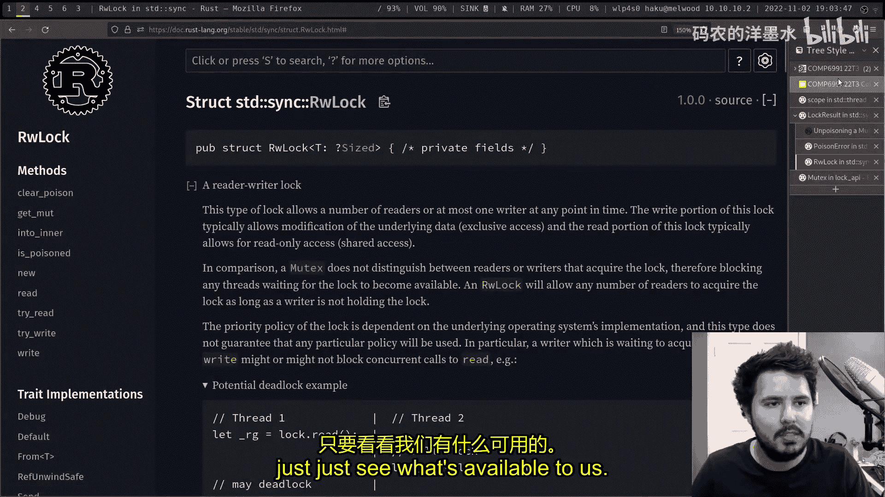

Okay， so move closures， rewrite lock， poisoning， done。Channels send sync Rayon。

 We'll have a break and we'll come back to these channelsnel are the most interesting of the bunch。

 I think Rayons like a。Probably five minute demo and send and sync like we've already talked about them a reasonable amount。

 So it'll probably just be like clarifying questions and stuff that anyone has or just like poking around at standard library docs。

 So I think we're probably still on track to know finish with things relatively early。

 continue to think about questions that you might want to ask and we'll have you know。

 probably have some time for Q& A and or maybe as Kay says。

 time to talk about maybe async rust or stuff like that at the end。 we'll have to see。

 but we'll take a quick break。😊，Let's let's come back at let's come back at 9 past，709。And yeah。

 we we， we'll be back then。 so see you in a bit。All right。Oh， no， it's 10 past。看吧。Let's see。

 this one。Cool。All right， so。Channels send sync Ray。Oh， I guess， oh， here we go， a question。😊。

So Mutex is deadlock 2， EG thread A locks Muex 1， then Mutex 2， thread B locks Mutex 2。

 then Muex 1 could end up blocking， waiting for each other。 Ab， Yes， they definitely can。😊。

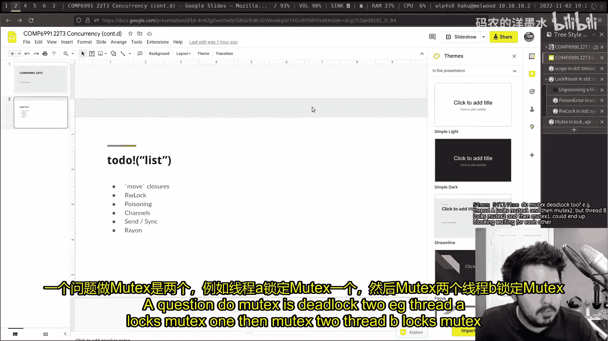

嗯。I'm sure we could quickly throw together a deadlock here。 if we just say Mu text1 is。A new muttex。

Just holds no data。 just a unit。Then we say thread go。S。Scope， dartt， spawn。嗯。For underscoring。

 you know， up to like， let's say。10000 times。Do Mu text 1 dot lock。New text 2 dot lock。let。

Im just a underscore one equal that underscore 2 equals that。And then the other way around。Like that。

 two and one。I'm hoping that these threads。Maybe we'll do like a。呃呃。Stood thread。Sleep。

For duration of from。Like nanosecond， just one nanosecond。I reckon thatll deadlock。Yeah。

 that looks like it's deadlocked。嗯。Given if like if I get the locks the right way around。Yeah。

 it takes like a second or so to run。Yeah， approximately one second。

 And if I throw the locks the other way around。Yeah， that's deadlocked。 So， yes。

 Mutex can also deadlock too。Mutex deadlocking is like pretty sort of like relatively well understood in the greater field of concurrency。

 It's obviously still an incredibly hard issue， but people have sort of techniques to get around it and to work around to to know。

 work in the presence of， you know。These kind of issues whereas read writeite locks are a little more gnarly and they can deadlock in more unexpected ways。

 I would say， compared to a Muex， but yeah， absolutely you can still get deadlocking with Mutexes in rust as well。

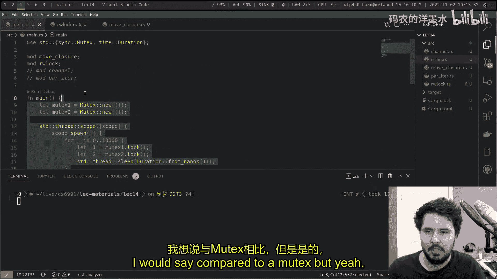

Okay， oh， that's right。 There was one thing that we wanted to have a look at。

In the standard library muttex。Which is。The implementationations ofcend in sync。So notice， oops。

 that a new text don't implement send and sync like no matter what。

They'd only implement send and sink。If the tea itself is send。

So it's only okay to have a mutex of something。If。The thing that the Mutex holds is safe to be sent to another thread。

 Now， why does that requirement make sense。Well。I mean。

 essentially what Mu textex has open up the opportunity for you to do。Is if I have here is like。

 say my main thread。I it here。And then I have， say， thread1 over a here。If Mutex is just implemented。

 send。Send without like regard for what the inside type is。

You could end up like sending any type from one thread to another。So like let's say I hadstruct。

I'm going to call this dropped danger。Now struck danger is trivial to create。

 It's trivial to create one， but it's very unsafe for a struck danger to be sent from one thread to another。

 So if a mut text just said you know impulse send plus sync。For sink for muttex。

 regardless of what the T is。 So like I for any T any T， essentially send and sync for mutex。

 how could we create some sort of like you know， danger in the type system。

 Well imagine main created a mutex。 So it's let's just going we'll say mainine has a muttex of danger。

Then it passes a borrowough of that mutex。Into T1。Mutex of danger， which， you know。

 in this system is okay because Muex will always influence sending in sync regardless of the T。

And then thread1 here can say on that mutex call lock。Right， that gives me a exclusive borrow。

Of a danger。Right， at mute danger。 And now here's the last trick T1。

 So this is the danger that came from main， by the way， right T1 can construct their own danger。

 right， It's always fine to create your own danger。

 We were saying it's just very unsafe to send it across a thread。

 And once they've created their own danger。 they can。Grab an exclusive borroworough of their danger。

Now they have an exclusive bor of their danger and an exclusive borough of Ma's danger at the same time。

 and if you ever have that， here's a function you all might not know about just yet。😊。

But a really fun function， really fun function， nonetheless， mem swap。

So if you have an exclusive borroworough of some T and another exclusive borough of that same T。

Then you can swap their location in memory。You can swap their location in memory。 So what would。

 what would。Thread one over here。 Do it would say swap， right， swap。Main's danger， which is here。

With my danger， which is here。 And so simultaneously in what essentially happening is that。

Main's danger is replaced with T1's danger。 T1's danger is replaced with the danger from Maine。

 And so now they've essentially sent each other their dangers。 And， you know this。

 this will work for any type， which is not send or sink for any type that's not send or sink。

 We can now send that across thread boundaries。Through this， through this API。

 which just breaks the whole point of sentencing， essentially。

Like this is to say if Rus like put in this implementation on Mutex。Then。By using a mutex， you know。

In a， a bit of a cheeky way。You would be able to trivially send and sink。

Any type regardlesss of if its sandal sink， whether， itss send sink or not。嗯。

Which is like that defeats the whole purpose of send and sink。 So instead， they actually have to say。

 no， it's only for teas that are safe to send across a thread boundary。

That Mutex will fl send and sink for。So that like the like shore。

 you can still do this with a mutex as it's written today。

 But only on things that are safe to send between thread boundaries。

 and all you've essentially done is sent one value to one thread and another value back to the other thread。

 So that should all be sound and safe。 I believe there was a point in time where the standard library accidentally implemented send and sync on a mutex for all Ts。

It was something like Mutex send has wrong Mutex send has wrong like requirements。Right。Do we see。

 Can we find this rust issue。Mutex and maybe someone can like find this。

 or maybe I'll have a look for it as well after the lecture and try and find it。

 but it was pretty funny。That someone just like found this。 They were like， hey， that looks wrong。

 I feel like I can do some pretty bad stuff with that。 And they were like， oh God， you're right。

 There's been like one or two times in Rus's history where they've just made like a pretty serious blunder and have to go like。

 okay， well， you know， we're pretty committed to backwards compatibility。 But in the case where like。

 we accidentally just like tore our language a new one。 Yeah， we'll， we'll， we'll revert that change。

😊，But yeah， I'll try and find this off to thelect and yeah， but it's pretty funny。

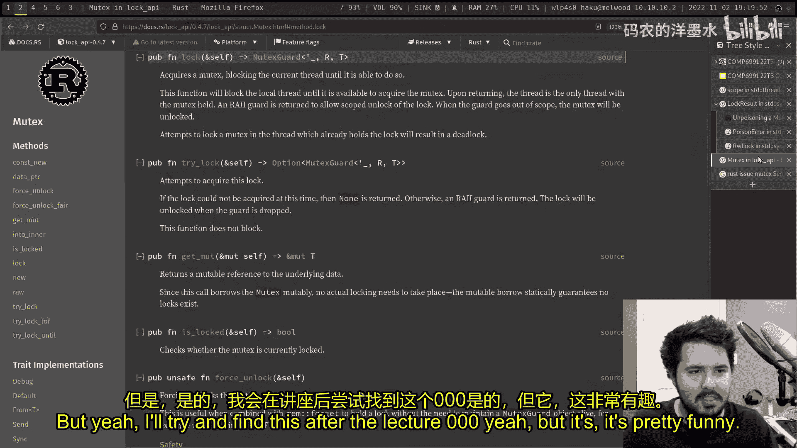

So yeah， I mean， like send and sync of just generally pretty interesting traits。

 if you have any questions about send and sync， just throw them in the chat or if you're like still not feeling comfortable with send sync at all。

 you know。

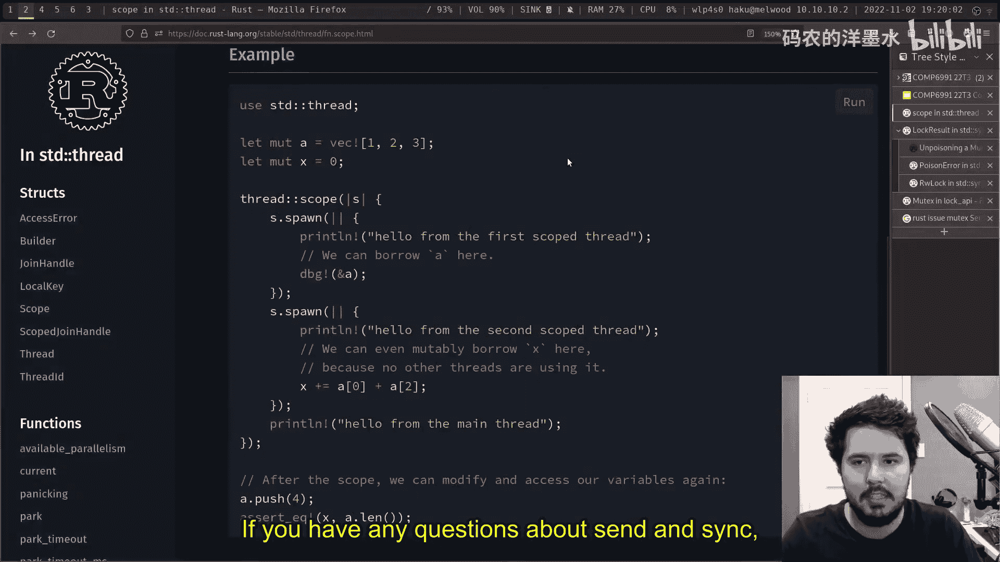

Any way in which I can sort of help to sort of help to leading towards a bit of comfortability there。

Otherwise， for the meantime， I guess we'll have a look at channels。

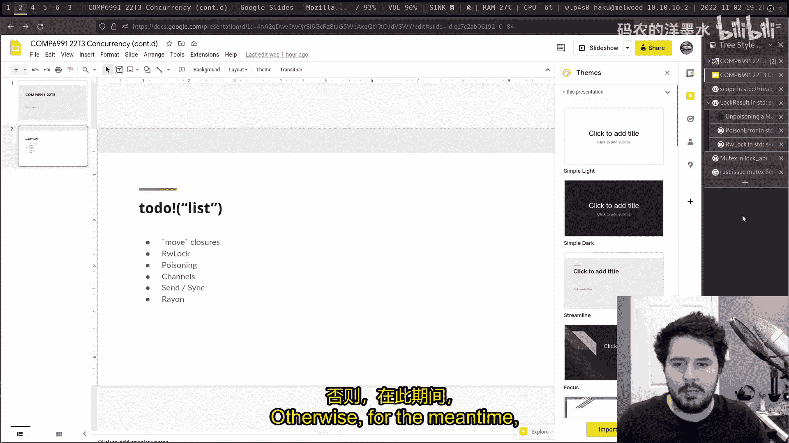

Channels are awesome。So channels in the standard Library appear in the MPC module。

 MPC standing for multipro single consumer。And in particular。

 channels give us a way of passing messages between， well， usually between threads。

They don't technically need to be across threads， that's just where it's you know it's very commonly seen。

And so the idea is。Let's go back to our old faithful over here。 Here's Maine。

 That's probably not going to be nearly enough space。Here's main。 Yeah， there we go。

 That's a big man。And here's some other thread， I'm going to call it T1。Great。

 and Maine can create a channel。And a channel， like let's say it goes like， yeah。

 create a new channel。And this channel essentially looks like it looks like a queue。Right。

 I guess I'll draw the Q。Something like this。 I like to sort of think of channels。

 kind of like pipes。And the channel has two ends of it， it has the receiving end。

So this here is the receiver and it has the sending end。

The sender and each of these like basically define two quite primitive。

Methods like they define more than one method， but the they really define one。

Seriously important method each， like a mut text defines。

 say lock in the asender implements the send method。And the receiver implements the receive method。嗯。

So， a channel。Like when I create a new channel， I need to tell it like what I would like this channel to send through the pipe。

 So let's say it was like strings， for example， channel of string。

Then what we get is aender can call dot send。Of some string。Right， and whenever they call dot send。

 it'll basically know push this item into the pipe and so it'll like end up here ready to be received。

And then a receiver can call receive。And that function will block until there's a string， you know。

 that's been pushed into the channel。And， you know， once the sender sends something through。You know。

 you'll be able to receive it out the other end of this。 If the sender calls send。

 you know five times really fast， then we might end up with like five strings in the pipe。

And then each time youll receive， it'll grab this one， grab this one， grab this one， grab this one。

 and grab this one， and sort of like， let them be passed through to you。And so like again。

 you could technically use this with one thread， but it's most commonly used in like a two thread system or like an n thread system。

 really， where one。One thread， let's say the main thread in this case， is responsible for receiving。

So it holds on to the receiver。And then it passes out the sender to other threads。

 So like this sender value。 and so like main might launch thread 1。

Thread might do a whole bunch of work。 And then when it's done， it goes， right。

 grab that sender and send back。Some like important information。

And Maine is sort of sitting down here on like waiting， blocking on receive。

Waiting to get that information back。 and then it goes， great， I got it back。

 Here's that like string or whatever I was after and it can continue on。嗯。Now。

 if we look at the name a little more closely here， multipro single consumer multipro。

 a producer is a thing that can send。 a consumer is a thing that can receive。

 So these generally support as many threads as you want like as many senders as you want。

 So you might have 1 thousand0 threads。Like this T1 here， imagine you had T1 all the way up to T1000。

All with their own sender that are all able to send values。

 but only like one receiver is allowed in this case。

 main would hold onto to the receiver and every time it calls receive it you know in a block until something' is ready and that might have come from thread 1 that might have come from thread 2 that might have come from thread 1000 right each time it gets something out of that queue。

A。And so that's a it's a really nice， it's a really nice interface。

 and it's particularly helpful for things like I don't know， like， say。

 implementing some kind of internet relay chat server channels you might find to be。😊，Pretty handy。

 Yeah， maybe it's， it's obviously up to you。 But when I was like doing some work on the。

On the on the assignment2， the IRC assignment channels definitely came to the rescue in a lot of cases for me just being a very nice and handy interface。

 So how would I create a channel for myself。 The main route is the channel function So I like to import like just personally and I like to importmpC and then say MPC channel you could just call the channel method directly if you wanted and this channel function。

We'll give you back like it takes no arguments。 It does have that type parameter T。

 so sometimes you you might want to like turbbo fish specify it here。

 but other times most of the time the rust compiler can infer what's going on。And importantly。

 it gives back a couple of two things， a sender and a receiver， both which relate to that same type。

 right， it's basically saying。You know， things are able to send in Ts。

 the receiver is able to pull out T's。 It wouldn't really make sense if there are two different types because it's meant to be sent in one end and received out the other。

And so most commonly you'll write something that looks like this let sender receiver equalsmpC channel it's upset of because it doesn't know what the channel sending。

 I'll just say strings for now and now I have a sender which is able to send strings and a receiver which is able to receive strings。

Cool。So let's spawn a new thread。Stood threadds spaorn and let's say this thread。

 let's imagine this thread's doing a whole bunch of work。Sorry， a thread。Sleep for。Let's say like。

From， let's say，30 seconds， something like that。 Slate for 30 seconds and then send across， send。

String from。Heres that work？You asked for。Right。So it does a bunch of work。 And then it goes， great。

 here's that information that you wanted for me now。We've got an issue。 We've got a compiler error。

 Send here takes a borrower of self， a shared borrower of self。

 So what is the compiler inferring about sender here， right in terms of the borrowing of sender。

have a quick think about this yourself。What is the compiler going to infer about how it should capture sender within that closure if it's only calling a function that takes a shared borrower itself？

Well， it's going to infer that that it it should capture as a borrow capture by reference。

 but that doesn't play nicely with threads spawn because threadhs spawn needs to make sure that the data is going to live you know。

 as long as it might need to And also yeah I guess there's also sync here going on。

 That's what it's complaining about first。 but we'd run into that anyway。

So in our a nice new trick here， do a move closure instead。

 So therefore like the sender will get moved into this thread。

 this thread will be able to use it and then send that， send that data onwards。

 Now it's giving us a warning here saying， hey， that could be an error here。

 this error is basically like if we look at the send here in the okay variant。

Right in the okay variant， it just goes there's nothing more to do like you sent the message it worked。

But if the other end of the channel has like hung up。In the sense that like。

 let's say this receiver goes out of scope， No one's on the other end waiting to receive。

 Then it gives you your tea back。 like the tea that you sent， it goes， hey， sorry。

 no one's ever going to get this because they've， they've left everyone's left。

 I'll give you your tea back if you want it。 But， you know， you might want to be aware of this。

 In our case， we know that。Well， I mean， as is' written right now， it definitely could happen。

 but I'm just going to throw an unwrap there in terms of we're going to assert to ourselves that someone will be waiting to listen from them。

 to hear from them。And then on this end， we can say let message equals receiver dot receive。

Dot unwrap again。 unwrapping。 If all the senders have hung up， there's no more sending to be done。

 which we know shouldn't be the case。 And finally， we can say something like。Ohops。

 we can say main received。A message that says。Message like that。Carer run。呃。

I guess I never saved that。Oh， no， sorry。 It takes 3 seconds。 Of course， takes 3 seconds。

 I'm also gonna get rid of the read write。 Oh， and it's also doing all this stuff still。

Get rid of this stuff。 Okay， cool。Right， so it takes three seconds。

Then it sends this message and Main is basically just waiting down here。

 It ends up waiting for those three seconds until finally the message gets and it sent and it goes。

 great， there's that message。Now。What if we wanted to receive two messages。Right。

 so we have another thread that needs to sleep for four seconds， let's say。And it says。

 and I'm done too。And we'll say Maine can will like wait for two messages。Something like this。

 Or even we could say。Actually， no， we won't do that in a loop。 Oh， we could do like a4。You know。

 two times。Grab a message。And tell us what it was。But now we've got a problem。😊。

Can anyone guess what our problem might be？It's going， hey， you had a sender。 You moved that sender。

 It's moved into this closure， right， Here's where it was used。

 and it was moved because you wrote the word move。 right， That's all this。

 Now you're trying to move it into this here。 It's already been moved away from。 So sorry， buddy。

 out of luck。 that's not going to work。But hang on， the documentation said this is multipro。

Many people can send through this channel。Like what gives it's not working the trickier。

Is that if we look at sender and receiver。Right， send off。And we look at the trade implementations。

 What does receiver implement debug， y， pretty normal drop yeah。

 might need to check some stuff when it goes out of scope。

 you can iterate over the messages that it receives and then it says you can send it but you but it's not sync okay。

 you know whatever just pretty normal stuff sender。Debug drops San not sink Ga usual clone。

 It implements clone。Ha， it influence clone。Yes， as Simon says， clone。

 I was hoping that there would be some documentation there， but it must be here we go。

 both senders are cloneable multipro， such that many threads can send simultaneously to one receiver that single consumer。

😊，Great， and so cloning doesn't really do a legit clone here。

 it's not actually like cloning all the memory instead it's basically just creating a sender to be sent to other threads that all sort of like you know join in the fun。

😊，In our case， okay，'s there's a reason that going on here。

 the arc is sort of the dead giveaway here， but it's know a little too advance for what we need right now。

😊，So the trick is。😊，Like before we spawnn this thread， let's just start a new scope。And go。

Let's sender equals sender dot clone。Os， start quite。Like this。

Because now what we're saying is this first thread。Instead of taking the sender itself。

 I'm just going to override that name with with like a clone of it。

So now that that send is intact and within these braces， within these color braces。

 sender now means another sender that we can use， so when we move it in。

 we're only moving in our clone here and this one's still valid to send into this thread here as well。

So great。 Now we've got two senders。 let's see if the program works。Main message。

 Here is the work you ask for， and I'm done too。Yay， great。

Now using strings and stuff is not that handy like I mean。

 well maybe it is maybe you want to have a channel that throws strings at each other。

 but a really common pattern is something like Enum like message。

 or you could imagine like the ISC server， some kind of IRC event， right？That's maybe something like。

 hey， this happened。And like， here's some associated data， which is maybe a string or like。

This other event happened。And actually， the associated data here is like a Z ID。And， and there am。

 because I always loved using those as our， as our like。Examples。Right， or like， actually。

Maybe hang up now， like maybe exit now or something， right with no associated data。 right now。

 if our channels are passing through these messages。

Main can sort of be the overall like conductor of what's going on， right。

 Mainine is conducting the orchestra。And all the threads are off doing all like the busy work， right。

 Maybe that's like。Listening for messages from IRC clients and like， you know。

 responsible for all kinds of different work。But it's main that goes like， okay， I got this message。

 this message， this message， this message and it's able to sort of process things in some sort of order。

 channels make this kind of pattern a lot easier than they would otherwise be with shared state。😊。

And so yeah， channels are a really great tool for concurrent programming。

 especially for something like your assignment you might want to consider channels。😊。

In just in like when you're thinking about design， not to say you have to use channels or if you don't use channels。

 you know， you lose marks or anything like that， that's absolutely not the case。

But like when you're thinking about how do I want to do this， this should like be。

 this should pop into your head， be like， h， maybe a channel might work。 Let me， let me consider it。

There is also so we looked at the normal channel， which is just a standard channel。

 asynchronous channel。There is also sync channel which takes this bound here This is like an interesting idea it's probably not relevant to your assignment。

 but essentially it says when we create a channel by default。

 you can imagine that this pipe here that holds like all the the messages that are like waiting in the queue to be something like a V deck。

In that， if we like only have capacity for4。Thing 4 elements in the v deck。 And someone goes， hey。

 I'm gonna send another message before anyone's been around to receive it。 It'll go fine。

 That's great。 I'll like up the capacity to 16。 It'll， it'll grow and it'll be happy， right。

 The problem potentially is that what if your like threads are sending way more messages than the receiver is able to keep up with。

😊，Let's say the threads are like altogether sending1 thousand messages a second。

And the receiver can only deal with， like one message a second。Right。

 what will happen if we just have this like infinite v deck here that can。

 that can go as big as at once。manan， I'm really bad at grab， there we go。

 I got the call what'll happen？Well， it's just going to slowly use more and more memories。

 like the cu is just going to keep increasing。 like second one，1000 messages were sent。

1 message of the received。 There's 999 in the Q。 Second2， another000， so at 1999。

Messages in the queue，1 message is received。 So 1998， right， So like this here。Is like a bit of a。

Dad patent。In terms of like， if we're just looking at this pattern of like how much memory is being used。

To， to store like to。Keep a buffer from this channel。

You're eventually probably going to run out of memory as it just keeps growing and growing growing when it can't keep up with it。

 So maybe what you want is something called a bound channel， which essentially says。Like。

 maybe I make a channel。A channelnel with a bound of like 16 or something。 What that means is like 1。

2，3，4，5，6，7，8，9，1011，12131415，16 messages can fit in the queue。And then on the 17th one。

 like this is assuming that a receiver hasn't come through yet and popped one of these out。😊。

The 17th send that some thread does might block。It might need to wait like this thread might be stuck waiting until there's room in the queue。

And so like it's waiting， waiting。 oh， the receiver comes through and swallows a message out。

 Now there's only 15 messages in the queue。 And so this send becomes unblocked。 It， you know。

 pushes its message in and it can continue on with this work。

 And it's actually quite a neat way of essentially letting like like if we're considering this to be our main thread on this side。

 And like a whole bunch of threads on this side， for example。

It's a nice way of sort of like synchronizing them between each other in that these threads aren't just going to run away way fast than man can ever deal with。

😊，If Ma falls behind， everyone will like slow down a bit to give Ma some time to clear stuff out。

Right， because if you think about it， these threads are gonna end up like blocked waiting on it。

 And so in a certain sense， they are just sort of like， you know， okay， alright。

 we'll chill for a second， catch up and then we'll。

 then we'll keep giving you some more stuff to work on。 So this is a bounded channel。

There's some nice tricks you can do with like a bound size of0， for example。

 a bound a bound size of0 is otherwise known as a rendezvous channel。

Which essentially means that if there's no space in the queue。Right。

If there's no space in the in the backup queue， if I say like we already know that if I call receive and there's nothing in the queue yet for me to take。

 then I'm going block and wait。The trickier is that if someone is not blocking with a receive yet。

 and I call send。Of some value， I'm going sit waiting here because again， there's no buffer at all。

 So there's not。 there's no like。B in the middle here that I can sort of store it into and keep going。

 I'm immediately going start blocking until right at the moment that another thread ends up calling receive。

 And then again， no buffer in the middle here， it just goes great。 You're waiting， sending。

 You're waiting， receiving。 we'll send it immediately across with no buffer in between And now you can both continue。

 And so now you're sort of walking in like a lockstep motion where it's like， okay。

 like you know whoever calls the thing first waits for the other person to catch up。

 whether it's receive first or send first， they're waiting for each other to catch up。

That's something called a rendezvous channel， which is kind of interesting as well。Anyway。

 channels are a really great yeah， a really great tool to make use of。

More general idea may be something like message passing if you've heard of message passing and that kind of thing。

And so ask plenty of questions about channels and all that on the course forum。And we'll。

 we'll help you， you know， in terms of if you want to understand anything about them or have questions about how they work and all that。

 then yeah， we'll be able to help with that。

But that's basically channels。

Again， questions are always welcome。Otherwise， I guess I'll just quickly like show off Rayon being like pretty cool。

嗯。And and we'll yeah have plenty of room for questions and stuff。So。Rayon， rayon， circle。Part it了。

Is there a multi consumer version？ Yeah， that's a great question。

Should have probably anticipate that for that that question。 So in the standard library， no。

 So if we look in the sync module。You'll find that there is the MPC module here。

 multipro single consumer。 So in the standard library， no。

 there is no multipro multi consumer channels， but there are in some crates。 My brain is going to。

Cross beam and or parking lot。Let's see。So crossbeam definitely has a multi producer， multi consumer。

嗯。I'm just very'm usually very bad at reading things。Where did I see it or sorry。

 I guess that they are multipro multi consumer by default is what I recall。

 So if I go to functions right unbounded。 Here we go。 unbounded。 Yes， there we go。

 Crossbe channel unbounded gives a cier and a receiver and the big thing here is that receiver should implement clone and there it does。

So cross beamam is a very popular crate。A very popular crate。For concurrency primitives。Right。

 just like it goes a little further than what the Stan Library does。In terms of the， in terms of the。

Concurrency prim that it provides in particular， crossbeam also。Like scopepe was， in a certain sense。

 ported from crossbem into the standard library。So like most， a lot of people used to take scope。😡。

Like sorry， like add cross beamm as a dependency just to get access to the scope function。

And scope only just landed in the standard library itself rather recently。 So， you know。

 people who just were pulling in crossing for scope shouldn't really need to do that anymore。

 It also works slightly different in the way that it can。Give back errors， I suppose。

But you know they they're there for the same sort of general purpose。

 I'm not sure if parking lot has channels at all though parking lot is you know smaller faster well generally smaller faster implementations of the typical the typical concurrency primitives as compared to the standard library。

 but I don't think there's channels in parking lot No that's not。

 So yeah cross beam formpMC would be my recommendation。Cool。Yes， Pireta。 Okay， great。

 So consider this program here。This program sums up。The first。That is 100， a million， a billion。

So that should be the first 10 billion。Integers。Somes of the first 10 billion integers note that it's like very imprecise because it's using floats just so we don't end up with like overflow and that kind of thing。

 we'd have to worry about that。 But it's like the premise that we're trying to get here is that it's like it's like a shit load of work like summing up 10 billion integers is no small feet。

嗯。And so we'd like to see， you know， how this program performs。

 So I say grab one to a 1 to 10 billion as an iterator。 So that'll be an iterator over 1，2，3，4。

9 million，999，999999，10 billion。And I say， just treat them as F64s instead。😊。

Just to for the arithmetic just arithmetictic wise and sum the mo， print that sum out。

And let's run this。 I'm going to run it in release mode。

And we're gonna see it's probably gonna to take a while。 Josh says。

 what's the downsides of parking lot compared to Stud sink primitives。

 given there smaller bus is probably a trade off if it's not in， there has been consistent。

 relatively consistent effort to move some of the things that parking lot does into St。

 But at the end of the day， Stoo has different goals than then say like the parking lot project might generally have in the。

Stood。Studs like primary focus is usually compatibility。In that， like。

If there's some bizarre platform that we said that like， hey， we want to support this platform。

 then they like better damn well support that platform。

 And so stoods usually rather conservative in the things that are you know。

 the kind of things that it'll do and or。And or like， you know。

 make use of necessarily in that like parking lot might make certain optimizations。

 like I think parking lot， for example， uses like spin locks in some like cleverly placed locations as far as they。

 you know， found。In order like because they found oh。

 actually it's a lot faster when we just like spin here for a little bit as opposed to like relinquish into the operating system and like letting it do the scheduling。

 which is not something the standard library would really want to do because that's often like quite operating system dependent or it might be like people might be able to construct programs that like how do I say it parking lot might be a faster like you know say 40% faster I'm just pulling up a random number that might be like reasonable for 99。

9% of programs， but it might be like1000 times slower for that 。

1% of programs and so would you rather like from the standard library's point of view。

 would you rather。

嗯。Your， your API be， you know， a bit faster for almost everyone。

But then at the cost of being absurdly slow for someone with a more niche use case and the standard Library's main focus is to support everyone essentially。

 Yes， and I believe that's the case with parking lot。 I believe parking lot has faster general case。

 slower pathological case。But someone one could certainly prove me wrong。

 This is just like from what I from what I recall having looked into parking lot again。

 probably around a year ago or so。 it was the last time I looked really closely at it。But yeah。

 but parking was pretty cool。 And like I'll often use parking lot。

 even just to dodge around things like poisoning that I don't that I usually don't really care about。

And because in the kind of。Scennaos， programs， platforms I'm writing for parking lot might have something to offer to me that the Stan Library needs to remain a little more conservative with。

So yeah， that's pretty cool。😊，Right， and we saw this。 It took 7 seconds。

 Let's just like double check it。 We'll go time release。Lck 14。

Just to like get a slightly more measuring， actually， the other thing I wanted to do was show you。

This， so yeah，6。7 seconds。 I'll come on。Oops， that's odd。 not what I wanted to do。I wanted。h this。

 this， there we go， great。😊，嗯。And how we get rid of this thing， I need。Do that。 Okay。

 so here's what I want to show。When we're running this program， keep an eye on like my core up here。

 So my， my computer has 16 cores。嗯。And most of them are like not working particularly hard right now。

 there's there's probably one or two working like relatively hard for OBS to push this the live stream out。

And otherwise， there's really not much else going on。 When we run this program。

 we'll probably see one core。Goes like a little crazy。

 That core is gonna move around as the operating system schedules it in different places。

 That was kind of like， a bit of a。Bad go。 Let's just like run anything。 Yeah， there we go。

 See this caused at 100% while everything else is doing basically nothing。And， you know， it takes 6。

6 seconds as usual。Now， the question is， like， great。 that went really hard on corere 14。

 and corere 14 was able to do this calculation in， in 6。6 seconds。

 But I have 16 cores available on my computer， which essentially means my computer can paralyze like。

😊，You know， a program running。In a certain sense， it can paralyze like the execution of code across 16 different like physical threads in a certain sense。

That is to say like we usually think of a computer as just sort of like executing one thing in a row。

 16 cores means I have like 16 spots that it can be like executing code at the same time。😊。

And like this job here。Summing the numbers from 1 to 10 billion， like。You could split that job in。

 two。RightYou could say， what if you add up 1 to 5 billion， I'll add up 5 to 10 billion。

 And then at the end， we'll just add our answers together。Right， adding together。 the other press 2。

3，4 to totalgg off the other base of the。A， awesome， thank you。😊。

except now now my head's in the way a little bit， I'll move over here。

So like I could if if I was splitting up the job of adding up 1 to 10 billion with Josh。

 that seems like a pretty good scheme， I'll go， yeah。

 Josh you know I'll I'll take the slightly harder part of 5 billion to 10 billion you add up 1 to 5 billion and then once we've got our answers we'll add them up。

😊，And so， like。What if Rusk could take advantage of that， What if Rusk could go， okay。

 what if we split the job off。Right what if we split this job up and？And you'll take， you know。

 corere 1 will take the first 16th or so Core 2 will do the next 16th。

 Core 3 will do the next 16th and， you know， split it up into 16 pieces and really make use of all the hardware I've got here。

 right， This is a bit of a case of like， I paid for the whole CPU。 I want to use the whole CPU。

 Right， It doesn't。 It doesn't make like me any happier。My CPU like getting off easy。And， you know。

 not doing much work， I'd rather like the CPU work as hard as it can to get me the result as fast as it possibly can。

I don't need to go easy on it， right？And so usually， like this is doable， but it's like。

 usually a pain。 It's pretty commonly a pain。 Like， let me pull up some lecture slides from 1，5，2，1。

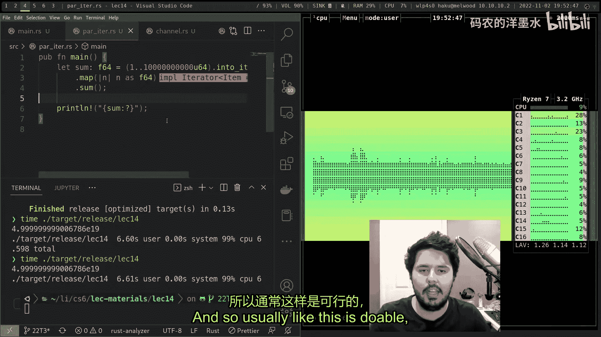

嗯。呃。Hereや。Of how this works in C。RightSo this is this exact same idea of how to do it in C。

 this is the code。诶。

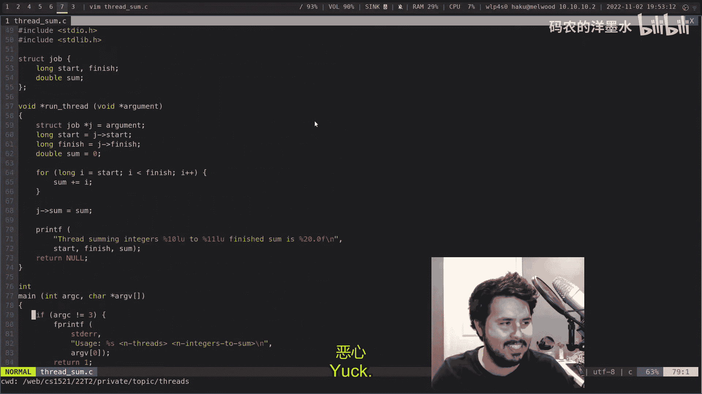

Yk。Like， you can imagine like writing the code that looks like this in C。

 like just adding up one to 10 billion。 It's obviously not going to be super pretty。

 but it should probably be like four or five lines of code。

 And now we're looking at 125 lines of code。

To like do it across end threads because it's like it does usually suck to do concurrency and parallelism and that kind of thing。

But even though like my requirement， like conceptually， abstractly what I want is relatively simple。

 I just want to split this up over as many course as I can。

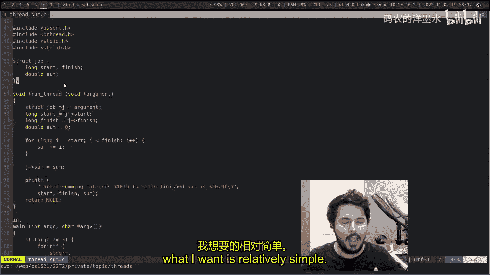

Right， now enter my favorite Ru library， my favorite Ru library。

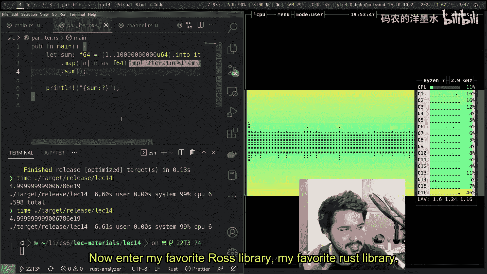

嗯。

I think I well， I think it's my favorite at least， Rayon。Ron。

Rayon is a data parallelism library that makes it easy to convert sequential computations into parallel。

So rust defines the iterator trait， which， you know， is a trait that lets you go like， you know。

 this thing， then this thing， then this thing， then this thing， you know。

 spit things out sequentially and also compose operations sequentially。

 rayon also defines a parallel iterator trait， which looks exactly like the iterator trait。

 like it's got all all the fan favorites are in here。 We've got， we've got map， we've got filter。

 we've got we've got min， we've got reduce。 we've got some。 we've got zip， we've got all like。

 you know， all the normal iterator methods are all in here。😊。

But the trick is whatever you do on this， it'll automatically parallelze across as many CPUs。

 you know， as many causes you've got。😊，Just like it's like magic。It's seriously so cool。😊。

Another like fun thing to quickly look at here is， so like， let's say we have a map。

 like when we're mapping some values， we know that on an iterated trait。

 it's going to go the first thing map it。 it's got that。 The second thing， map it， it's now this。

 The third thing， map it， it's now that， right？ And so if we look at the。😊。

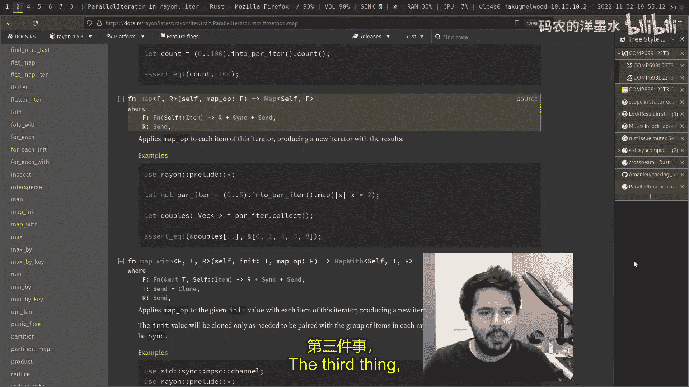

At。This here， if we look at the definition of map on an iterator。

 we'll see that the function that maps items from item to this new item is an fN mute。

Why is an FM mute， Because we know that map will never get called at the same time， you know。

 for two different elements。 It's always sequential。 It's item 1， map done， item 2， map done， item 3。

 map done， but rayon。Well， if we're mapping with rayon or something now。

 suddenly we might get it being run like， you know，16 times at once across 160 different chords。

 So this like doesn't seem to hold up。 F and mu doesn't seem right。 If we have a look at rayon map。

 Oh oh wait， I already had it。 rayon map。

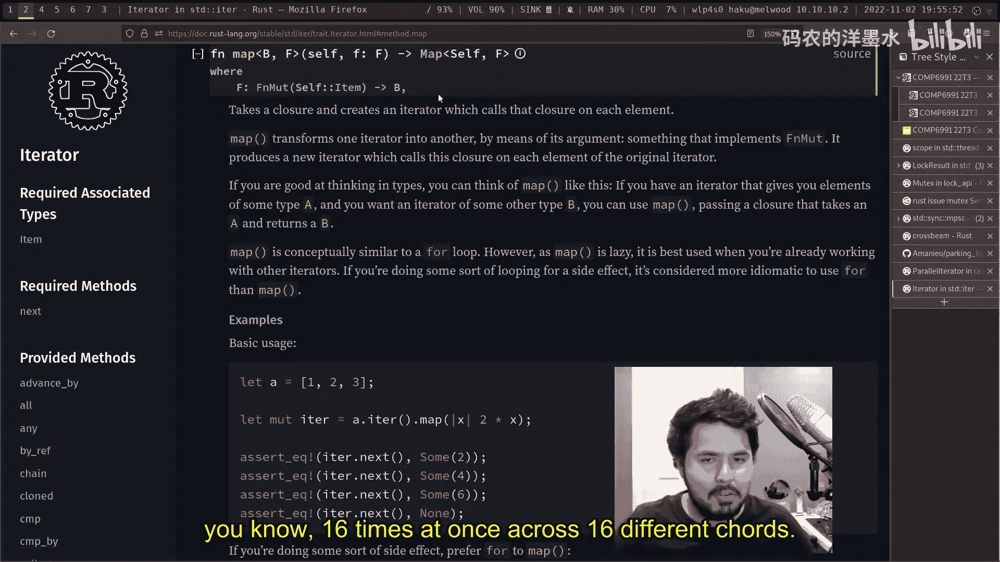

It's an F N。 That's how it guarantees that it's still going to be safe。Right？So it's like， you know。

 these pieces are coming together。It it this ray will guarantee that nothing will go wrong with the parallelism because it makes use of rusts。

 you know， F N type in this case， as opposed to F N mute。

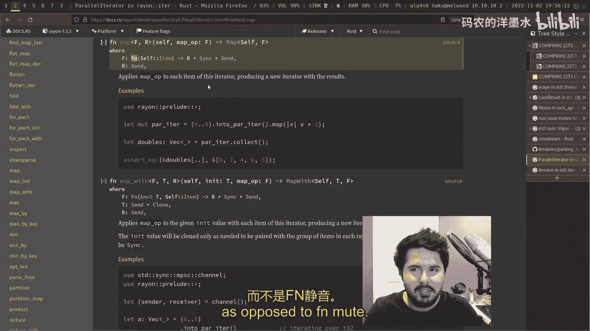

Right， so， okay， let's use rayon。 Let's I'll show you。 So I'm gonna say cargo add rayon。

To add Rayon as a dependency。Cool， it's I've got Rayon now。And then I will import rayon。

 So I'll use the two rayon traits that are important to me， the trait to rayon。えっと？Two， yeah。

 rayons into parallel iterator and the parallel iterator trait。

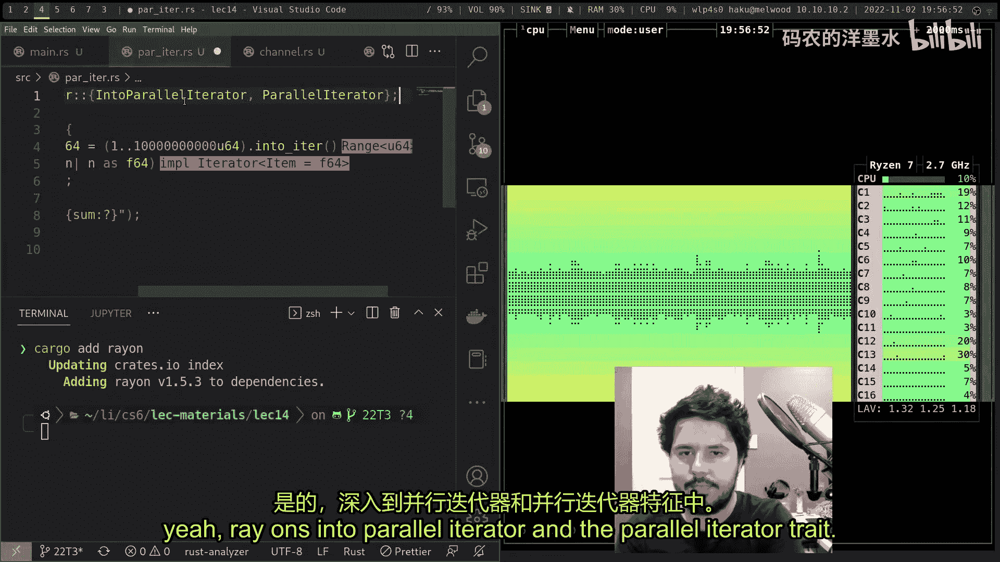

So I'm just going to pull these traits into scope。😊。

Rust requires that a trait is in scope to call a function from that trait in particular。

 like the initator trait， there is an into parallel iterator trait which basically just lets me say instead of into iter into parallel it like this and then in order to call map which is defined on a parallel iterator。

 it needs to see the parallel trait in scope the reason you don't need to do this with like rusts into it or into or just like iterator traits is because they get pulled in by default for you which is which is pretty nice like there's something called the standard library prelude。

And it just pulls in things like option， things like result， iterator， clone。

 like all the stuff that you would just always use Ru program you don't want to like have to import every time。

 But you know， now that round's a separate crate， we have to pull in these two traits and literally like like just to make this home like hammer this point home。

😊。

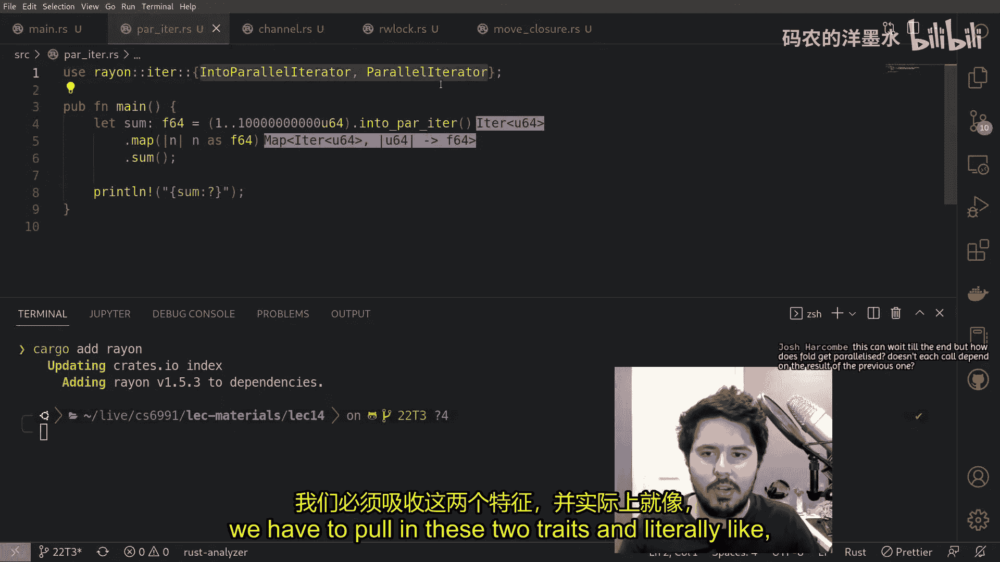

If I run the program， cargo or this one。Right， one call， one call is going crazy。And it takes。6，6。

67 seconds。Right， I insert four more characters， underscore PAR。Save， oops。

 I just best accidentally fat fingered control X。Right， I've just added the word par。😡，Build it。

And now running it again。And look at that。Less than a second，0。7 seconds。And I just。

 it just like it works。 It's， do you see that， And look at that。 All the cores were being used。

It's kind of like tricky to like time it when this when this window like updates what it's looking at。

 I don't know how much bigger we can go than this。I guess we can go at least that much bigger。

Oh yeah。 how good does that look？I hope this OB S still has some room。 Yeah， that's all it takes。😊。

It's so cool。 I love Rayon。This going till the end， but how does fold get paralysed。

 Doesn't each call depend on the result of the previous one。

 There's a good chance it might not get paralysed if if it's something that's like non parallelsable。

 just sort of。By standard logical reasoning， then itll probably just provide an implementation of it in case someone wants it。

 but just like not parallelze it if it can't。

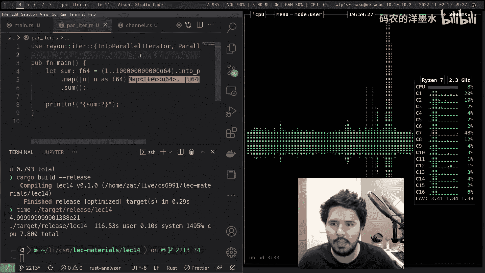

U。But yeah， I， in fact， like we can maybe it might even say something parallel fold is similar to sequential fold。

 except the sequence of items may be subdivide of a forward is folded。 Consider a list of， okay。

 look there's。They've written a bloody essay on this。Dooc。

rs/rayon and have a look for this fold function。And like feel free to post any questions you have on the forum and if you post a question on the forum。

 I will also go have a look at it and see if I can， you know。😊。

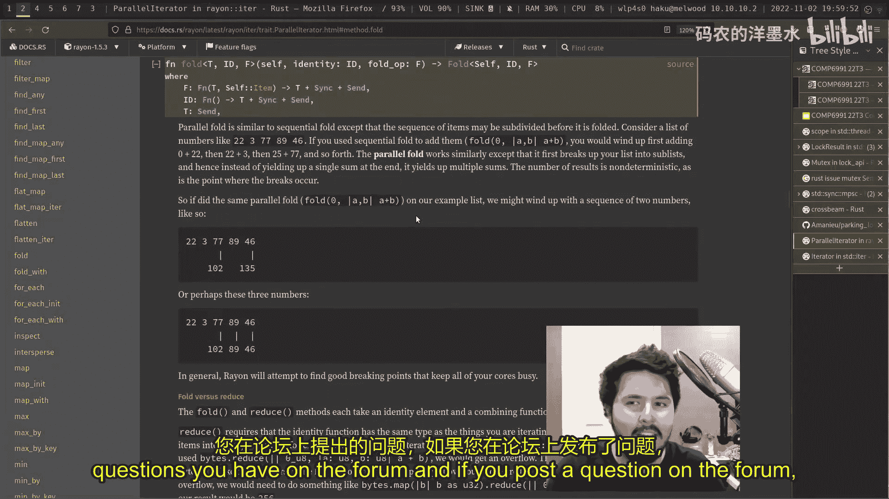

If I can derive anything from what they've said there。

 but it seems like they have quite a bit to say about parallel folding， it seems。😊，But yeah。

 this is just like。This is a beautiful picture。😊，Just all cause all doing。 Oh。

 you didn't even get to see it at the bottom。 I just realized， oh no。

 you did'cause it would have been like， it would have been like here， I guess， but yeah。

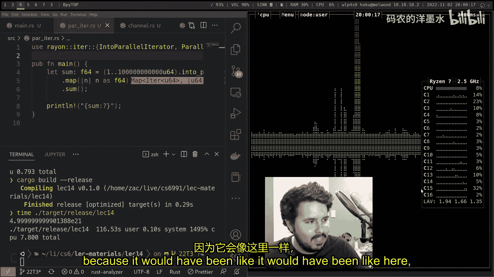

Such a cool library， I love rail。

Yeah， all right。Let's call it there， Rayon's awesome， Rayon's the best。😊，I mean。

 and Rayon really can only exist the way it does because of the way。

 like the way rust is written and the things it's provided as a language。 and the fact that like。

Someone could even write a library like that in the first place。

RightThe language sort of is flexible enough for someone to just like do that is pretty cool。

 I think。

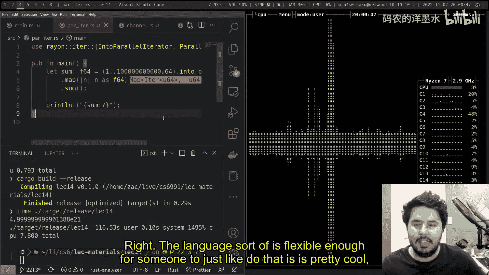

It's pretty cool that this can。 this can just like exist and be a thing。 It's also made by。

Niko Matsakis， who is a fantastic， like rust。 he he works on like the rust compiler and。

 and like it writes some great blog posts， baby steps。😊。

Is his is like his rust。嗯。What would you call it This blog is where I post up various half baked ideas that I have usually usually about rust。

 They're often a little more advanced， but but it's， you know。

 it's a great a great little blog here as well。😊。

嗯。Yeah， anyway。 So any questions and stuff before we， before we cut things off。As always again。

 we'll call this the end of the lecture。 Thank you everyone for coming。 Hopefully。

 there was you know， some enjoyable things to have， you know， learn about or played around with。😊。

Any questions before， before I hit the stop stream button。I'll give us a minute。

10 hour async giga stream now， please。No。😊，嗯。😊。

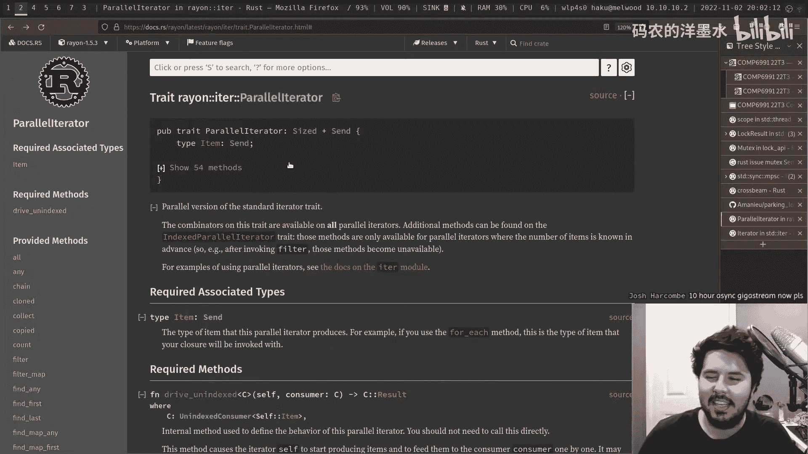

I don't know。 So I guess we can have a look at like what the so like we've just finished this。

Meaning we have this is week nine here and this is week 10。Unsafe is like a pretty cool idea。

 I'm not sure we'll be able to talk about unsafe as a concept for sure。

 which is I think the most interesting part about unsafe。Which is basically this dot point here。

Riding some unsafe rust ourselves， I think we'll probably try and pick a type that's like。

That needs unsafe to be written， but is still relatively simple。 And try and play with that。

 And then it's just sort of like FFI is about calling to other programming languages like C or C plus plus。

Which is interesting and requires unsafe to do so because C C plus plus， you know。

 other languages is inherently out of rust control and so could do some very naughty things。

 And then just about like tooling and stuff that's available， which is just， you know。

 sort of vaguely relevant。 And then week 10 is just like not much scheduled。

 So maybe we'll be able to like talk about asy and stuff as a。As like a bonus thing that。

We'd explicitly say like this is not assessed at all， but just like。As opposed to me。

 sitting in front of the camera， staring at the， Well， yeah。

 staring at the camera for two hours straight with nothing to do and and asking any questions。

 Maybe we could like， just talk about unafe generally here or maybe just write some unsafe code。

 Another interesting thing that in in this， in like in the room that we might have to be clear。

 we might go actually。Unsafe goes way over time and or like exam details took6 hours。 right。

 Maybe there's not as much spare time as it looks like it there should be to me。But we can like。

 plan some contingency things in terms of like， if we don't have any time， then fine， we forget it。

 But if we do have time， then we can plan to do this instead。

 I think a fun thing for that might be some sort of like live coding thing， potentially。😊。

In terms of like a。You know what would be what be interesting to sort of fill time and still be useful。

I'm happy to like sort of sit in front of everyone and fight the borroworoughche of myself a little bit and you know。

 write some kind of a program from scratch。You know。

 think about what you might like to see in the lectures and if you have any ideas。

 just let us know in the course forum。But yet， otherwise。That's basically it。

 I'm not really seeing any other questions， so we'll call it there。So thank you everyone for coming。

 hopefully we had some interesting fun times and we'll see you in the workshops this week。😊。

Tomorrow and Friday？Yeah， we'll see you all then。 And good luck getting started on your assignment to IRC server。

 Yes， awesome。😊，Minecraft and rust， live coating。That's a great idea。Cool， but yeah。

 best of luck getting started on your， on your assignments。😊，And yeah， we'll see you later this week。

 So thank you， everyone。 And yeah， bye for now。😊。

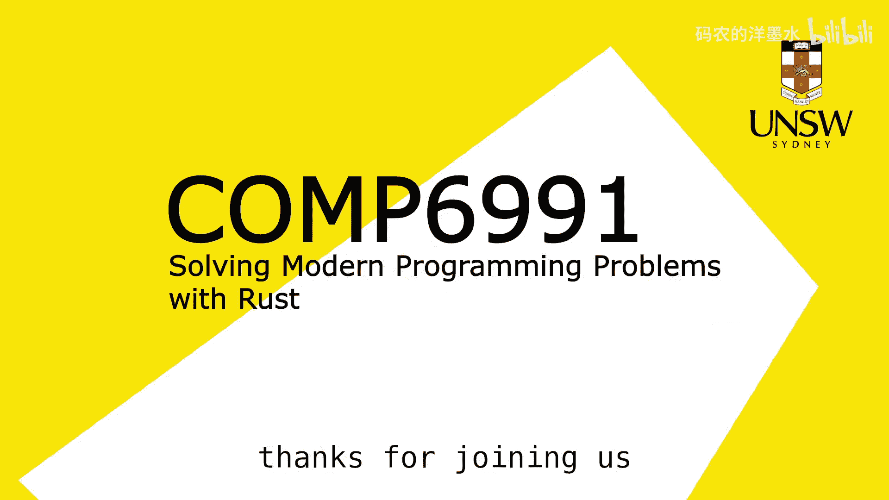