# 【全集】新南威尔士大学 Rust现代编程 中英字幕 1080P p15 Lecture 15 - Unsafe与内存安全 -BV15cf4BCEN1_p15-

Alrighty。Let's see。

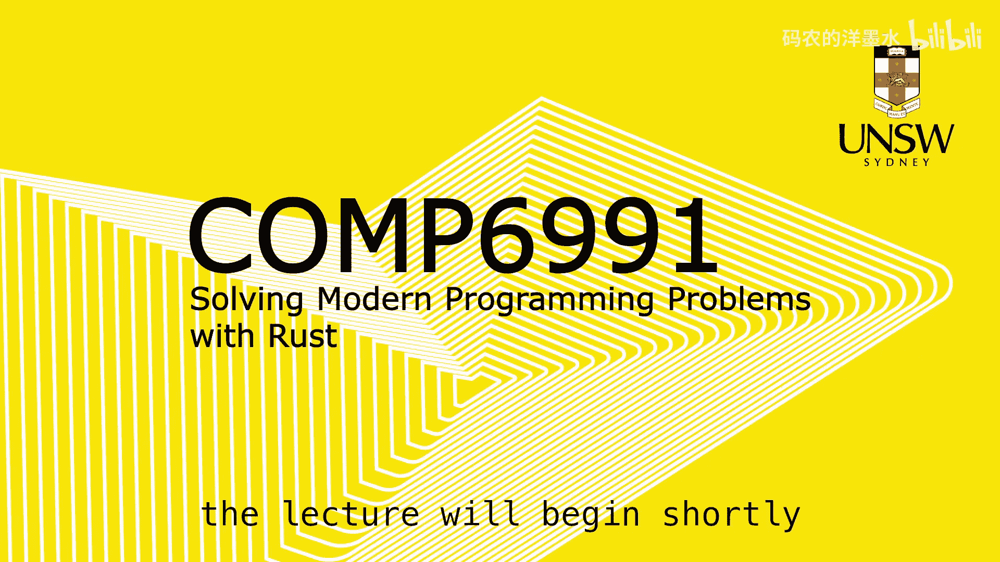

Hang on， let me wrangle O B S into submission。Yeah。There we go。Hello， hello。Hello， everyone。

I see you've all been having fun in the。In the chat by ourselves。But cool。Welcome to W 9。

And welcome to our last。Well， I guess in theory， I lost like a real topic。Of the course。

So we're finishing off the course with unsafe basic FFI FFI is it's a initialism that stands for foreign function interface。

 it's something that is not it's useful in rust to communicate between languages like C and C++ with rust。

But it's not possible to， well， it's not realistic to use FfiI without understanding Isafe first。

So we're going to lead some of the groundwork for unsafe today。

 we're going to try and write a library with a lot of unsafe in it and hopefully get it correct。

 but you know， sometimes like C sometimes like C++ it can be difficult to know for sure and we'll talk all about unsafe you know and write some unsafe code today。

And then， on Wednesday。We'll， we'll look at FFI as well。

Is there any prere knowledge from last Wednesday because you haven't watched it yet？

That's a good question。I don't think so。 One of the things I was considering might be interesting to like implement under the hood would be something like a channel or something like that。

 but we're going to try and implement Vc ourselves later on instead。

Only really just like some arguments in terms of background， probably。 so like。You know。

 it might be like we have to consider this because concurrency is a thing exist concurrency is a thing that exists and therefore we have to consider it maybe in this context。

 blah， blah， blah， and maybe just a little bit on sentencing traits because they are actually unsafe traits which is interesting but nothing hugely relevant from last week's lecture。

 nothing like super duper breaking。Ooh， does FFI let us interact with functions from any other programming language provided that the interface is defined。

Yes， it lets us interact。 It lets us interact with functions and values type you know。

 functions and values， really from。Other programming languages that have a like an understood。

Binary interface。So Rust knows that the two probably most common examples of this would be C and C++。

And some other， some languages have better。ABI application binary interface stories than others and it basically just represents how an actual program binary program exr might want to talk to another program or library。

 but we'll we'll save that for Wednesday， I think but it's definitely we're on the right track there for sure。

Okay， is that determined at the language level or architecture level。

 We'll save that question for Wednesday。 It's a great question， but where we。Not even close yet。😊，呃。

But it's a， it's a great question。 Allright， so。As I said。

 we're going to be laying the groundwork for unsafe rust。And so it's。

 it's worth just getting us off on the right foot here by mentioning。

Or everything that we've seen in this course so far has been what's like considered to be safe rust。

 safe rust。Which essentially means that。You like where it was essentially you've never had to use this unsafe keyword that's a part of rust。

And we're going to look at why。Why someone may want to broaden their horizons from what we've been using in the course so far。

 the implications on the language， how we might use it， why it might be important。

 that kind of thing that's what we're looking at this lecture。 So what we've seen so far， Sa Ru。

What we're getting into now is。Is unsafe for us。 and we'll talk about the relationship with each other as we go along。

So。Before we really get started， we're going to recap on the importance of memory safety。

So safe rust that we've been using so far is a memory safe language。

So memory safety in this context means it's free from things like reading say uninitialized data。

 dangling pointers， segmentation fault double frees use after free like all these really gnarly or what's the the fun one latelys been buffer overflows again that's a really fun one。

😊，Safe Ru is free from all these horrible memory issues that crop up in lots of different low level languages。

As are many languages， in fact probably the like vast majority of languages are memory safe。

 at least like largely by default， your pythons， your jas， your Java scripts， your type scripts。

 your you know insert language here， your hasskells are generally memory safe Now a lot of these languages will expose some kind of escape hatch。

 which is sort of similar to what we're going to be talking about today。

 but most languages these days are you know most popular widely used languages tend to be memory safe。

Because memory and safety， as we've you know， sort of looked at and played around with。

 is a particularly gnarly issue。U。So when you're writing anything like a non trivial C or C++ program。

 maybe C++ to potentially a slightly lesser extent， but it has its own pitfalls as well。

There's just a lot of onus， a lot of burden on the programmer to write the program correctly。

Lest they face the wrath。Of of the language's compiler。

Or even just like walking headfirst into a horrible issue themselves and you can have absolutely dire consequences from a memory safety issue you know。

 the worst of which a incredibly small memory safety issue can often like given enough time resources。

 energy and knowledge can be exploited in order to gain like say entire system access or just essentially take over your program and a attack could take over your program with realistically whatever。

Kind of program they wanted， given， again， the right circumstances， time， understanding， knowledge。

 whatever。So memory safety is particularly。It it's a bit of a particularly scary thing and one we like to maintain。

Or rather， in a certain sense， one we liked to have the compiler maintained for us。So。Okay， anyway。

 I think it's fine， so。In particular， a correctly written C or a correctly written C++ program。

Will be memory safe。 The language isn't just like injecting memory uns safetyafety for， for fun。

 right， It's， it's only like writing an incorrect program that the that is。😊。

Not quite incorrect enough for the compiler to recognize that it's incorrect。

 That's the really scary program for us。 So like， let me put it this way。

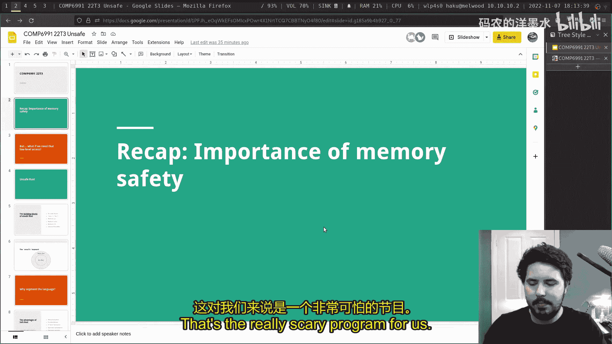

嗯。Here is。The this is， let's say， the set of correct。Programs。So programs that work you know。

 entirely correctly。And then we have the set of incorrect programs。

So let's and that should be disjoint。 So it'll say it's like here。

 So this is the set of incorrect programs。Right。And then there's the set of compileilable programs。

And the set of rejected programs。 right， So like， I， I guess for now， I'll draw them separately。

 So like the set of programs。Which。Compile。And the set of programs that don't。A set of programs。

And don't compile。Right， and so like， what do we want the relationship between。You know。

 all of these sets in these directions， what's like our goal here？Well， I mean。

 like the absolute best case scenario， assuming， you know， little burden on the。

 on the programmer would be that。Or the set of correct programs is equal to the set of programs which compile and the set of incorrect programs is equal to the set of programs that don't compile。

 right？That's like， that's like an ideal world。 but it's it's not really the like world we live in This is。

I mean， yeah， if someone had a language that was that gave these benefits with very little burden to the developer。

 they would really be onto something for sure。 you might think of things like fear improving or formal methods to get you close to an idea like this。

And the argument there is that there's definitely a huge burden on the developer when it comes to things like formal methods or formal verification and。

I'm not a formal methods person。 And so anyone。Theres there's almost certainly students in this course who have far better understandings of formal methods than I do。

 but my understanding is that there is also overlap between these two categories even with formal verification where the programme may be correct but the verifier may not necessarily be happy with it and reject it so what do different languages maybe be look like。

So so far in Ru， what we've seen is if we're modeling like， maybe I'll do these as like boxes。

If we're modeling。This is， I will do this correct。And incorrect。Programs。

 Ru tries to make sure that all the incorrect programs don't compile。

 So maybe I'll do in like a dashed line here。And this is， you know。

 there is there's a big fight to be had here on the definition of correct or incorrect。

 but maybe if we're thinking about something like memory safety。

 this here in the dotted lines is what Ru would say reject。Like these programs。

 Rust would say doesn't compile and these programs over here， Rust would happily compile so。

Rust is happy to。Reject a lot of programs， as we know。And， you know。

 and it wants to compile as many correct programs as it can。

 but there's certainly spillover where there's programs that you might go that should be correct。

 but the compiler is going to go， I can't， I can't see it Like I don't see the reasoning you do。

 I'm gonna have to say no on this one， but this is not okay。

The danger potentially of languages like C and to maybe some extent something like C++ is that if I draw the same diagram。

We probably find our dotted line somewhere like here。Where this is this is the correct programs。

 this is the incorrect programs。And these are the programs that don't compile。

And this is the program set of programs that do compile， right？In that。

 there are there's like certainly a set of incorrect programs that the compile will happy to compile。

But it does mean that all the like generally， generally speaking。

 this is not always going to be true。 And neither of these are entirely true。 They're more like。

Sort of。Generalizations， in a certain sense， the set of correct programs should usually compile in a more flexible language like C or C++。

Right， and this is sort of the trade off that we're getting right here is that there is going to be a set of incorrect programs that might do the wrong thing that may still compile。

嗯。And so。This is certainly nice for us in a language like rust。 right， It's certainly nice for us。

 If we say compared this to a language like， let's say， Java。

 and we're just thinking within the scope of something like memory safety。

 Java might get a lot closer to this line like this， but it has its own trade offs。😊，You know。

 it's probably a more flexible language in Ruin。This program looks a little leafy， but， you know。

 I'll still， I'll still allow this thing to， to work。

 whereas Rus need wants to have a very sort of high degree of。Certainty in a certain sense， I mean。

 the the， the the more you sort of zoom into this diagram， the less sense it ends up making sadly。

 again， because it's really just a broad generalization of this kind of idea。

 But it's a point to be considering the remainder of what we're learning about in the context of。嗯。

All right， so。This here is a serious problem for us， though， this little box here。

Because there certainly is。Correct programs， like programs that should work， that should not exhibit。

UnSafety or this undefined behaviour that we've sort of been hand waving throughout the term。A。

There are there are programs that do not exhibit that bad behavior that should you know therefore should be correct that the compiler is not able to reason about。

The compiler will say， I can't tell what's going on here and I'm going to be conservative and say that I will not build this program。

And this is a serious problem for some users。😡，So for us in Com 6 90 and so far for most students。

This probably shouldn't be a。This shouldn't have been like a necessarily massive problem so far in that usually when you're on this in this like region here。

 either it's actually in this region and you haven't realized and then you go， oh。

 I get what it's telling me and it's right， this is wrong， I need to move you know over to here。🤢。

Or you are in this region。 and a tutors come over and gone。 Yeah， I'm sorry。

 This is like a mental model thing。 Rust thinks about things in owners and borrowing your program is really hard to think about。

 like the way you've written it， it's hard to designate owners and borrowing and that kind of stuff。

 And so although maybe your program， your program probably is okay。

You're going to have to just restructure it a bit and change around your lifetimes， your borrows。

 your ownership， that kind of thing so we can get it over here。So for us in the course so far。

 I don't think that it's。This has been a huge problem for us， but there are a。

 there's a very like particular subset of programmers that this is a massive problem for and this comes into the realm of systems programming。

😊，Systems programming。So this is like if you've heard of the terminology like programming at a low level。

 you know， usually you're in a language like C， maybe in a language like C+ plus or you know。

 hopefully in a language like Rus， but we haven't really seen how yet。

These kinds of this set of programs is really important to you。

 So what a systems programmers care about， what do you often value when you're programming at a low level。

You you sort of need that more fine grainined access right say access to raw addresses。

 pointers in memory and moving memory around yourself and and doing the dirty work in order to satisfy some constraint there's plenty of different constraints that one might have say for example。

 like a really maybe simple constraint is you have some really tight performance constraint and you tried writing it you know not in a systems programming way。

 not at the low level， you tried doing that and there's some problem that means you need to get down into the weeds to go a lot faster compilers these days。

 especially particularly advanced compilers like say the rust compiler which also makes use of LLVM is you know got to shout that out as well a generally pretty good at making programs go go pretty fast。

But that's not like a， it's not a perfect solution。

And sometimes you do just need to jump down to that lower level and start working in the nitty gritty details yourself。

 You might also be limited by the part of the system or the system itself that you're writing for。

 So this is where I really love to have my。My little props that。I think are in my other room sadly。

 but Id like hold up a little like device here， a little Arduino or a little microchip or something that doesn't have all the luxuries of a modern computer with a big operating system and stuff like that。

And you might， you might be severely restricted in what's available to you to write code for that little。

 you know， for this little microchip that you're working on， right？🤢。

And so you might only be able to。You might not have say mallicin free right you might not be able to allocate memory dynamically。

 therefore you need to you know be able to work without box， without Vec， without string。

 without you know these all these sort of things that we often take for granted。Or alternatively。

 you might be on like a big desktop computer， right， Id lift up my big desktop computer。

 but then I believe the stream would probably turn off when all the cables got ripped out of it。

 You might be on a big desktop computer with all the fancy， you know， bitts and junk in it。

But you might be working at the very core of that computer， right。

 You might be working in the operating system kernel。In which case， again。

 you're the one providing those building blocks for the rest of the system。

 you might not be able to provide those building blocks for yourself。

 you might need to write code that works on constructing the building blocks。And so again。

 this is certainly a subset of programming， systems programming。

 low level programming if you're writing you know a website for a business or like some like service to talk to a database or something like that。

😊，This probably isn't a value of yours。 And so what we've seen with Rust so far may or may not work for your use case。

 right， Rust has plenty of other trade offs that we've been talking about throughout the whole term。

 but in terms of this you know low level thing， that's not going to be a priority to you。嗯。

But there is still that set of people who it is a priority for。

 and Rust wants to find a way to accommodate for them， too。

 So this is why people often refer to Ru as fundamentally a systems programming language。

And that's at the very least partially true， I think it's a little subjective。

 and I'm not sure exactly what my mind is on this either， but the subjectivity comes into play where。

You know。Rust is has so far been making us think about low level details along the way， right， It's。

 you can't just have 1000 owners of something。 And you might go， well， that's because of like。

 memory。 and we don't want to double free。But equally so there's high level concepts that the same sort of know ownership system and borrowing and stuff applies to。

 like， say knowing when to close a file right， if you open a file to read or write from it。

 you want to close that file at the correct time。 you don't want to close the file twice you probably don't you might not want to be able to write to the file at the same time。

 This is true and say Python， Java， you know Javascript。

 Typescript anything like that as much as it is in a low level language like C C plus plus So。

Rust makes you think about the details a lot， whether that makes it like exclusively a systems programming language again。

 is for you to make up your own mind on。嗯。But it certainly aspires to。To。You know。

 how would you say it aspires to accommodate the systems programmers alongside the others as well。

 and whether you decide rust is suitable for programming outside of low level or systems programming is really up to you but。

You know， people have called rust a high level language， people have called Ru a low level language。

 people have called Ru a middle level language， people have called Ru an all level language。I。

 genuinely don't mind what you want to think of it as or what you call it， but it's about knowing。

What you know when rust works for you， when your values for what you're working on line up with rust's values and how it operates and so this is the kind of thinking that we want to be you know training and working on and stuff。

Soir。Rus needs to accommodate to these people。And one of the big things that these people want is I just want a pointer。

 I just want to be able to go。 This thing points to some location in memory。

 and I want to be able to do stuff with that memory。 This is important to me。

 I can't do my work without it。 but naturally， that's really scary to rust。

 right Rus has all kinds of guarantees。 Rust has like lots and lots and lots of guarantees that it bakes into the language。

😊，And as soon as someone can just go like I change this memory to that。

 I read this random dress over here and this pointer and blah。

 bh like you can really quickly just turn into disaster territory。

 which is essentially like the problem， you know， the big problem with well。

 problem in quotation marks with languages like C and C plus plus is that it's relatively trivial to just grab a pointer do some crimes and now the system's in like a very hard to understand state。

But again， the fact of the matter is sometimes this is pretty important。In particular。

Let's say you're working in a system where you know how to like allocatecate memory and you know how to deallocate memory。

 right， similar to something like malicin free。If this is what you've got access to。You might go， oh。

 a nice abstraction that I could build on top of， say。

 this Maikin free is some sort of sort of growable or shrinkable list。

Write some kind of global or shrinkable list。 And Ru， we call this a Vck。Right， a vck of tea。

And Vec needs to be built on top of these kinds of primitives。

 It's not exactly Maequin free themselves， but like the way it talks to the system， right。

 Maikin free ends up being the same sort of thing。So you can imagine that rust had melicin free。

Not quite true。 Maicin free provided by the system。And using that， they went。

 we want to make this V T for everyone to be able to use。Right。But。

Maik is just going to give you some kind of apointer free is just going to like take in a pointer。

And rust just doesn't have from what we've seen so far。

 the tools to just deal with these random raw pointers floating around the system。

at all let alone in a coherent and sort of safe manner。So。If we're in a language。

 another memory safe language like Java， Javascript type， script Python， blah， blah， blah。

 and we want to implement this， this kind of like global， shrinkable list。嗯。How do we even do that。

 how do they do that， right？And the answer is。Like to the best of my knowledge is that Eva。You know。

 let's say in Java， Java's equivalent would be an array list。Right。

 and it's just a different name really for the exact same idea。嗯。

They would make use of another feature of the language。

 which is that they can just sort of create arrays Willie Nelly。

 like give me an array with 18 elements， and it'll do that。 And then like either。

 it'll lean on something else in the language。Right。

 so either the way they made their V just leans on another feature in the language。

And then that feature。Like considering that feature or alternatively another language where it they're like。

 say list， you know， their list type doesn't lean on some other feature in the language。

 it needed to be implemented themselves。 So this part or this part are usually just like blessed constructs of the language in the sense that like they're implemented like in the compiler itself or part of the language runtime or something like that usually where like。

They like if they're， if this is say Java。Java doesn't like。

Have the know how to just like using say this Maikin free that's pro to the system。

 writing Java code to interact with that， to create an array。 Usually instead。

 it's going to be the compiler like。Does the work in here and in or the runtime for a language。

 say like Java or Python。 So in Java， it's probably the original。

 I don't know JVMs are still written in C these days。

 but I'm pretty sure the original JVM was written in C。

There's C code that talks to Maikan free and then talks to the Java code in order to like create this kind of interface。

 And so literally they just couldn't do it in their language。 And so they went。

 we'll just make a little bridge here and we'll just you know for the other sort of blessed things in the language that it doesn't really know how to do within the language itself。

We'll just get like we'll write some C to do that。 We'll write some C plus plus to do that or something like that。

 right。And Russ could have done this， too。 Russ could have gone if you want to do this low level access。

 write some C code， and then we'll make it easy to talk between C and Rust。

 But that wasn't the choice that Rust made。 Rust instead said， no。

 we really want to be able to implement Vec ourselves out of like the raw materials。Because。If we。

 if only we can do it， then we need to anticipate every single possible， excuse me。

 every single possible use case and constraint。Of like any systems programmer or else there will be systems programmers that would like to use our language。

 but cannot right， if only the compiler is able to do this in a very blessed way。

 then then we're going to be restricting users from making use of our language。 So no。

 we would like to be able to implement F ourselves。And in doing that。

We're hoping that it means other people can implement whatever they need themselves。All within rust。

So this is what we're going for。And the way Rus achieves this kind of idea of getting access to this low level stuff and doing these low level operations。

 while still trying to maintain what is overall aspiring to me， be a very safe。

 sort of rigorous language is with this unsafe keyword， unsafe。Okay， so that's where we're at。

Let me catch up on our chat here。Okay， Ru， A BI FFI from Ru to rust。 nice question。

 If you can remember to save that for Wednesday， there's actually an interesting answer to that。

 or also the forum is also an option there。 thought the AI is defined by the processor architecture。

 I'm not sure anymore。We we'll leave it for Wednesday， but in short。

 it is partially defined by the processor architecture。

 My Cco for logic code base runs when compiled normally but Se false when compiled with data。 Yes。

 that's a fun one。 full methods。 Yes， cool， great。 was an example of memory and safety in garbage collected languages like Java。

 So yeah， that's I'm assuming that was related to this diagram here。

 And I was mentioning that you know， the more we use this diagram and the closer we look probably the less sense it starts making。

😊，You can cause memory on safety in Java through like similar。

 similar processes to what we're going be looking at today with unsafe。

 But generally it's going to be through dangerous APIpis that are exposed。

 I know Java has some I think through like Com dot sun packages。

 there's some pretty gnarly APIpis that you can call waks and havoc with。 but memory on safety。

 I I'm not sure if it's entirely easy to trigger。Particularly memory on safety and something like that。

 You can certainly make the JVM crash like the virtual machine that Java is running and crash and get plenty upset。

 Not sure about memory safety exactly， though， but you also can call things like C code from Java to interact。

😊，In the Java code's environment。 and that C code can definitely be memory unsafe。

 And I believe the methodology for that in Java is something called J and I。

 It's like there's there's J and I either describes C to Java or Java to C。

 I think J and I is Java to C。And there's another name for this。

 but I'm forgetting the exact terminology doubly linked list time one over zero， not myafe， yes。😊。

Ja's objects of pointer could be null， yes， but the presence of null doesn't necessarily imply the memory and safety。

 that's absolutely correct。Low level quick3 invest square Algo， John Cararmack， the goat。 Ru。

 certainly one of the languages。 I I certainly sadly don't recall what it's one of the languages in respect too。

 But it isn't uncommon to see people are going to see as a high level language。 higher engineers。

 Highland assembly crimes to commit with the pointer go if we're going to do some crimes。

 and to recap what are all the high level things。 What what are all the high level things does unsafe allow you to do since it doesn't allay to some and demons。

 Yes， great， we're gonna talk about that。 That's a good question。 Okay。

 so let's see how many slides weve got our way through。 so memory safety， something we like。

 it's good to have。 But when you can just do wild， crazy stuff with pointers。

 you lose your memory unsaety。 So like you know， what if we need that low level access。

 This is our sort of like our tug of war today is that we want memory safety because it makes programming。

 there's a lot less burden on the programmer。😊。

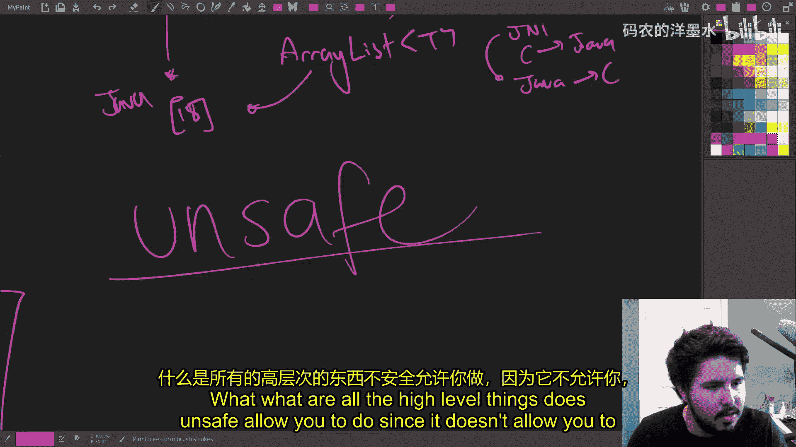

To write the program exactly correctly。But we still want that low level access。

 we want access to pointers to be able to do scary stuff。Thus， introducing unsafe rust。Okay。

 so what are the building blocks of unsafe rust， Like what is the click to add subtitle。

 What are like the important points that we're going to be playing around with over this week。

 Certainly the unsafe keyword， right， unsafe keyword we're going to be playing around with a lot。

we're going to be looking at raw pointers。 So that's this star constant T and star mute T syntax。

 You might recognize that as looking a little bit like。Looking。

 looking a little bit like at tea and at mute tea。嗯。But instead these are actual like raw pointers。

The don't follow the same sort of normal rules of rust。 We're going to talk about those。

 There's also the stood pointer module， which gives us a lot of operations and and functions and macros and stuff for us to use on these raw pointers。

 St Alc gives us raw access to things like allocation like that。

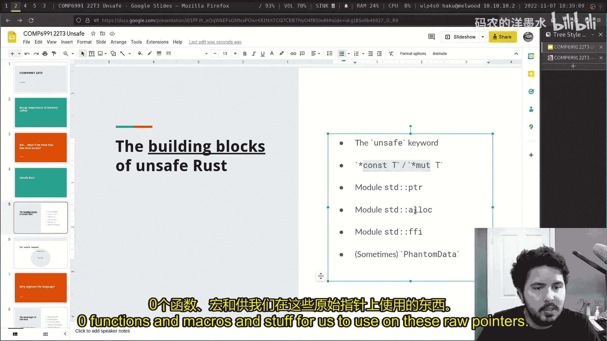

Like malikan free， but rust equivalent， which is aoc and Dalc， I believe。

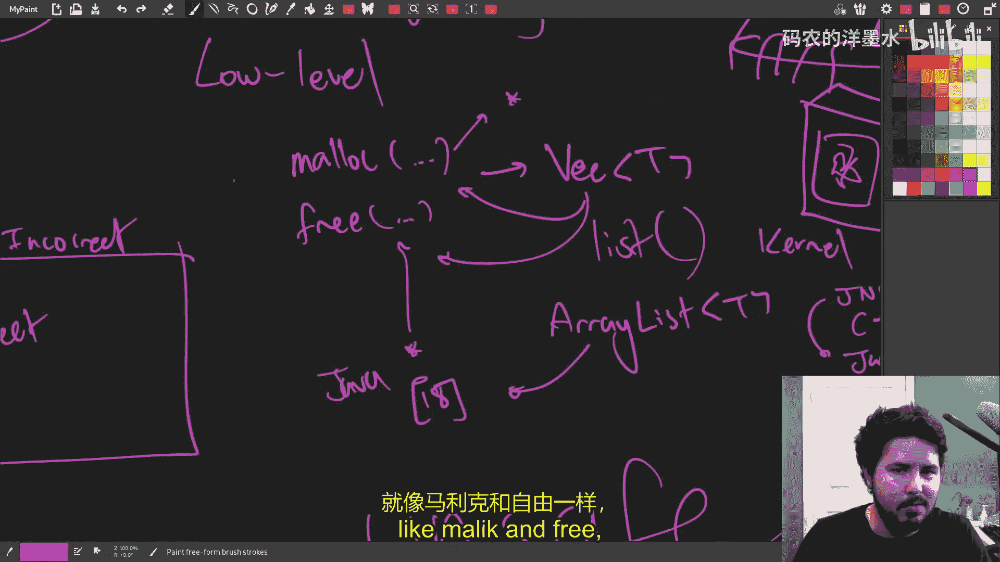

FFI state FFI we're going to look at on Wednesday， which helps us call things like CNC++ code or vice versa。

😊，And sometimes we end up needing things like phantom data there's other like random things you could throw in the bottom here that might be relevant。

 but we may or may not run into phantom data specifically today。

 which helps us write correct unsafe code， but we'll get there。J and I is kind of two way。

 You can call code from compiled C。 But then in the C。

 you can also interact with the driver elements。 Yes， okay。

 J and I was the right one that I was thinking of。 I believe there is。

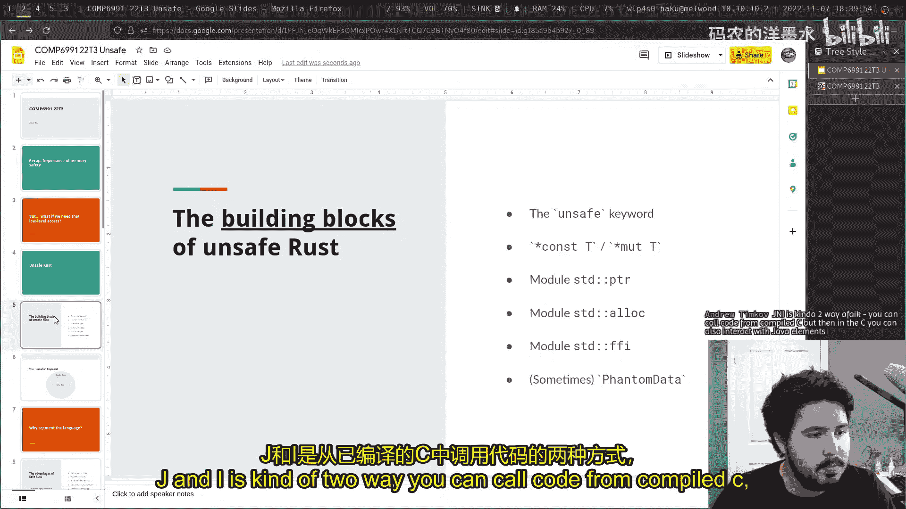

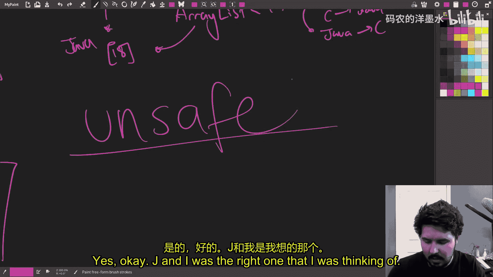

Still one for C to interact with like a live JBM that isn't。Necessarily talking to it。

 And it has a very similar but slightly different name， but I can't quite remember。 Otherwise， yeah。

 I have to look after the lecture， but it seems like Jane and I was was the one I was thinking of at least。

Okay， so here's our building blocks。😡，And this is the big idea of unsafe。Right。

 the unsafe keyword and unsafe rust is that safe thrust is a subset of unsafe rust。

Or unsafe rustt is a superet of safe rust。Okay。Soir， why is this。

Even desirable why segment the language。Right， so there's an idea here。 like this is， I mean。

 maybe this is drawn to scale。 It's hard to say。 like someone could argue， actually， the scale。 oops。

 that's not what to。 Maybe the scale is， is more like， you know， safe rust is like。

Almost as big as almost the whole thing that's little bit of unsafe。Maybe if you did the math。

 you'd find that there's a surprising amount of unsafe。 It's， it's hard to say。

 but if we think about this。Unsafe rust can do anything that safe rust can do。Right。

 so anything that's valid safe rust is valid unsafe rust。

 but there are operations that are only legal in unsafe rust。That's not present in safe rust。

 So this is the way to think about it。We've been operating in here。😡，Right right。

 we've been operating in here for the course。And we're now starting to look at this outskirted area here where there's some some crazier you know magic tricks that you can do on the outside。

Another interesting thing is。Throughout this whole course you've actually been making a lot of use of uns for without never having written it yourself。

 and we're going to look at that in a minute as well。Okay， so why segment the language。

And what is safe rust， though， remember looking at stir string sauce and theyre all using unsafe。

 That's， Yeah， okay， I think， oh， Lo， I think I think I may have just answered that as you were asking it。

 But when I say like safe rust here， what I'm really talking about is。

Rust that you can write without writing the word unsafe。Without making use of the unsaife keyword。

 So that should be every student in this course up till now is I don't think anyone's had a reason to write unafe。

 Maybe you had a good reason in an assignment or something like that to use it。

 And maybe we will be the judges of that。 But up till now。

 you should have never had have to have written the word unsafe。

But you have still been making liberal use of unsafe without having realized it and we'll look at how that works a little later。

Okay， so into segmenting the language。So what are the advantages that we've talked about in terms of safe rust or in other words。

 this like restricted language that doesn't just have pointers flying around and doing crazy stuff。

We've got our memory safety。 We have no undefined behavior， right。

 So just a quick recap on undefined behavior。 It's essentially。Behavior， like。

It's a set of unallowable behavior。Such that if you slip up， if you make a mistake。

And write code that would exhibit this illegal behaviour。

 The compiler is now essentially free to do whatever it wants。 It's like。

And this seems it's a really weird way of putting it， but like okay， bear with me for a second。So。

There is a set of behaviour that the compiler doesn't want to have to deal with。 Like， for example。

 C doesn't want to deal with you dereencing null。 Let's say that's， that's generally considered bad。

 So what C says is we're going to say de referencing null is undefined behavior。

 What this means is the compiler is now allowed to assume by default that your program will never dereence null。

 Now， is that a is that a。Safe assumption to make。There's a question there in that it's certainly a dangerous assumption to make。

 I would say， based on like just statistically and how humans tend to write code。😊。

But for better or for worse， the C compiler assumes that you will never de reference not。😊。

What that means is like it answers the question to the compiler for the compiler asked if you de referenceence a pointer。

 what should I do if it's null？Right， what should I do if the pointer is not？

And they said we don't really have a good answer for this。

So we're going to say you're not allowed to do it。And if you do do it。Any behaviour is now allowable。

 So this is sort of like a they couldn't。 They don't want to like pick and choose。 like。

 I will do this specific thing if you de reference null。 Instead， they say， if you de reference null。

 any possible behaviour is now correct behaviour。 so that no matter what the compiler chooses to do。

 it's still correct。 Any behaviour is correct。 So no matter how they end up dealing with it。

 it's still correct。Now it's a bit of a weird。Like way to frame undefined behavior because it makes the compiler seem adversarial。

 It makes it seem like it's a fight between you and the compiler where as soon as you write one incorrect thing。

 the compiles like gotcha。 I'm going delete all the files off your computer。

 I'm going like I'm gonna you know， run the CPU to Max until it catches on fire。

 I'm going destroy everything right and like that's not how it works。 you know， they don't write。

 say Gcc or cllang to try it to like look for the first hint of undefined behavior and then and then ruin your life。

It's more that these， they impose those restrictions so that the compiler has assumptions to work off。

In order to， generally， in order to optimize your code to make your code run faster。

 if you can't assume like anything， like， let me， let me just。

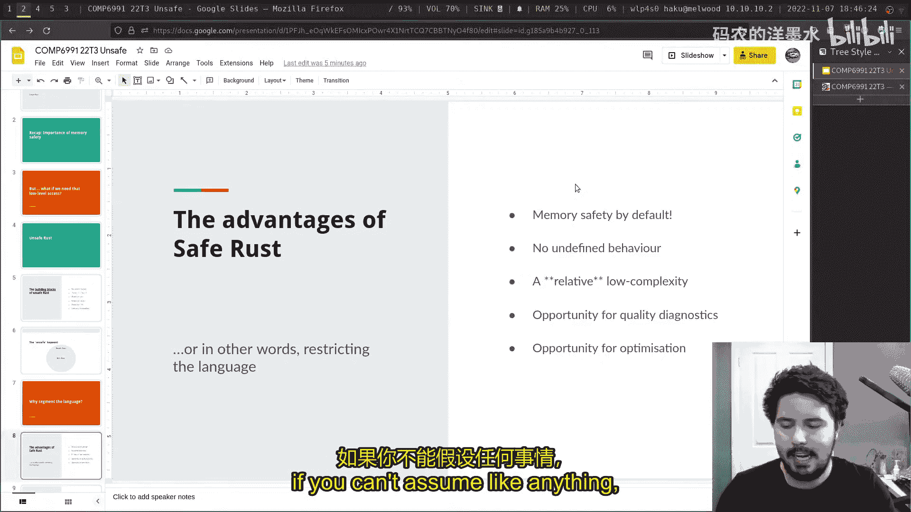

I mean呃。Like， let's say I have a C program here。Right。

 and it says like int x equals 42 int y equals 123 print F。X plus y。Now if you're a compiler， okay。

 if you're a compiler， you're going to complain that I didn't hash include Sto。Okay， there。 Now。

 if you're a compiler， how would you optimize this code？Like if I said。

 I want you to make this code run as fast as you can， what kind of optimization would you do？

Youd probably start off with something like this， you would go。Well。I can see。😊，That。X plus y。Right。

 X plus y here。 Well， I know x is 42 because of that line。 Y is 123 because of that line。

 I could actually just do this calculation now。😊，So it's going to go x plus y 123，42 is 165。

And it might just throw that number straight in there and get rid of X and y， int X and in y。

Entirely。And you know， a silicon compile compiler will do this。

 It's just like why do the addition now when I already know what the answer is and I could save the program some time when it's running。

A。Now like， but this only works because the compiler is able to make the assumption that， you know。

 in X is 42 and y is 123。 when we add them up， x is still going to be 42 and y is still going to be 123。

 no matter what。But like that isn't quite necessarily true。If。

 if the system is even like slightly more complicated， like， let's say it calls some function fo。

It calls some function fo that it knows nothing about。 Like。

 let's say this fo is defined somewhere else。 The compiler isn't able to reason about it。

 What's to stop foo from tracking down the pointer of this， like to this value。

 the pointer to this value。 And then right before this printf goes off。

 it just goes and modifies them to whatever else。Right。

 if the compiler couldn't make assumptions about how your program runs。

 it wouldn't be able to apply this optimization without worrying about。

Performing an incorrect optimization。Right， maybe this fo function that modifies these values is something that you really wanted。

The programmer really wanted。 So instead they have to have a set of behaviours that they say this is not okay。

 You can't do this。 You can't just like grab a pointer and modify it without even caring or anything like this。

 Like you can't just go hunt down the where the memory for main is living， hunt down these variables。

 and then just change them。 That would be undefined behavior。

And so the neat trick here is the way these problems usually manifest is that if you do that。

It probably like just will print out the wrong value， it'll probably print out 165。😡，And like。

 that's not the number you are expecting， but it's still correct behavior as far as the compiler is concerned。

The compiler goes you are the one that like that like had illegal behaviour。

 had undefined behaviour in your program。 therefore all bets are off。

 Any behaviour is now correct behaviour， so therefore no optimization is incorrect anymore。

No matter how you optimize it， it'll have some behavior and that behavior is now。

 no matter what correct。That's sort of the big idea here。嗯。And so。And so yeah， so C。

 that's why C has this list of or C and C plus plus have this list of undefinunded behavior because they need to have some set of guarantees。

That they can work off in order to。Do anything really meaningful with your code， essentially。Right。

 but like， what's the danger of this？ Well， if I scroll down a little bit。

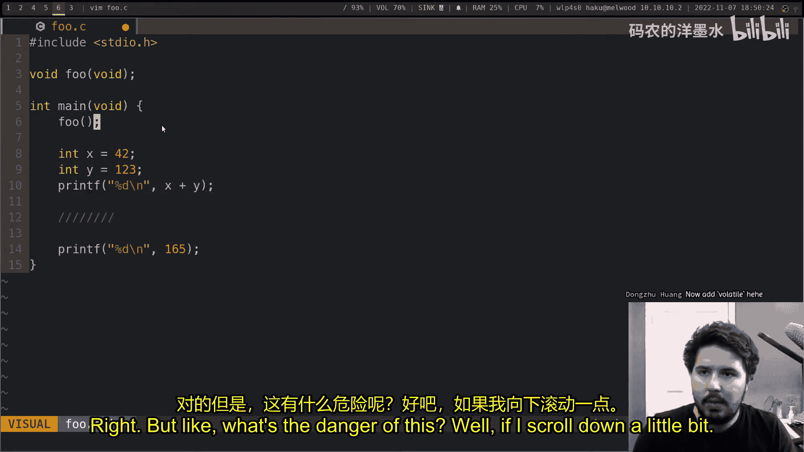

If I scroll down a little bit。Have a look at this。 this here。Is comes from the C specification。

This behaviour is undefined in the following circumstances。 So here's like a list of。

 I'm not even certain this is a this is a。What's the word， I'm not even certain this is like a。

Summative list that this is a like the total set of all undefined behaviors in C。 I'm， it's。

 it's certainly going to be a subset of it。 I'm not sure if it represents the whole set of undefined behavior or not。

 But like， let me just like， scroll through。Yeah， still going。 Still going。Still going。There we go。

That's the undefined behavior in C and to like look at one a little more closely。

 an MB state T object is used inappropriately。Sorry， exhaustive。 thank you。

 That's the what I was looking for。 I'm not sure if this is an exhaustive list or not。

The argument corresponding to an S specifier without an L qualifier and a call to the FW printer function does not point to a valid multibyte character sequence that begins in the initial shift state。

Okay。All right， yes， of course。I mean， some of them are pretty reasonable。

 The first argument in the very first call to stir talk， right， I've used stir talk before。

Is a null pointer。 If you pass null in the very first call to stir talk undefined behaviour。 Okay。

 I get that。 But like in order to be an effective C programmer that has any degree of like， has。

 has a strong degree of certainty that their programme will work correctly。Like。

You've got to understand this。😡，And I'm telling you， like， I。

 I think I'm a relatively good C programmer。 I don't have， I don't know this whole list。

 I don't have this whole list committed to memory， right？ And on top of that。

 as soon as you bring in any other like libraries， let's say， like there's some。😊，You know。

 vendor provided C library that you need to make use of for something。

They might have conditions on their functions。 They might go if you call similar to how the spec says。

 if you call。Where were we if you call St。With a null pointer in the very first call for the first argument。

Then that's undefined behavior。This other depend might have its own huge list of things that are undefined behaviour。

 Like don't call this function like this。 Don't call this function on the 2 December at 454 in the afternoon。

 or while the Mars is in retrograde right or like little the undefined behaviour， like。

Once you sort of expand your horizons a little bit。can be really worrying to。

Try and create a program that doesn't exhibit any kind of undefined behavior so。

Like this list should be scary。 That's what I'm hoping that like。

 I'm hoping a subset of the students in this course are like， I am a good C programmer。

 And then I scroll through this list and go。😰，😀え。😊，Yeah， I'm I'm a good C programmer。

 I' really name every source of undefined behavior。 You should see this and be like， oh no。

 that's it's a little scary。😊，嗯。So。That's， that's what we want to like。 I want to scare you just。

 just for now in terms of here's the undefined behavior。 Again。

 C needs this because it needs to be able to like perform optimizations， make your code go fast。

So how is rust being like rust its its performance parallels C， C plus plus， right。

 these these low level languages。Whereas other languages like say， you know， Java， Python， you know。

 even even languages like go， go is a language that compiles to binaries。

Comps to like a program that's run as opposed to being run in a virtual machine like， say。

 Java or Java or something like that。Go is still not in the same performance tier as languages like C。

 C plus plus and rust， generally。So what how was Rus able to match this kind of performance without undefined behavior。

 How is it able to。Have assumptions to work off in order to optimize your code without undefined behavior。

I'm asking， I'll ask the chat。Who else have a guess， How was Rus able to optimize its programs？

You know， have assumptions to optimize your program based off without this concept of undefined behaviour。

Yet。Oh no， he's yet， no， I mean， yeah。😊，Define all the behaviors， zero cost abstractions。

So zero cost abstractions is certainly。Certainly an important idea here in the overall thing。

 but I'm more thinking on a bit of a lower level。😊，嗯。

Say even if they weren't like these abstractions on top necessarily。 Yes， right。

 So check at compile time。 So rust， right， If we go back to this diagram over here。

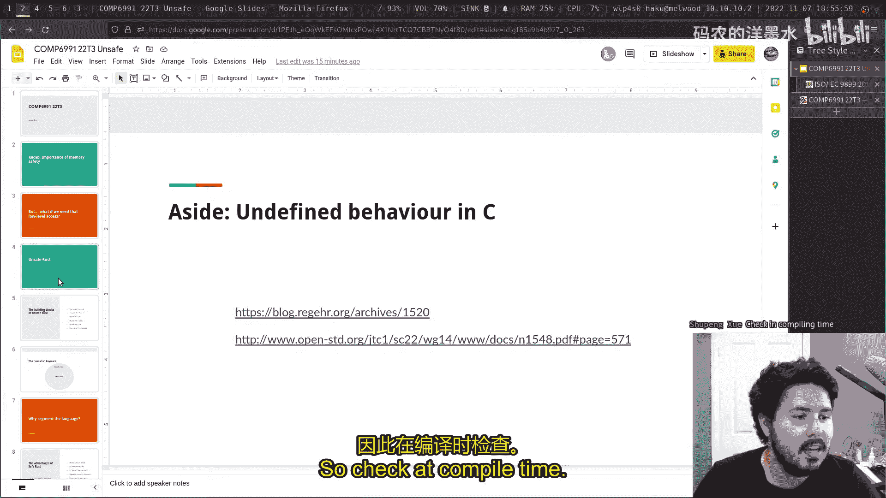

There is like Rus only compiles a small set of programs， right。

 Rus has very strict rules for what programs can even do in the first place because CNC++ are more willing to except more programs that are more sort of flexible manner with a greater degree of allowable behaviors at compile time。

It needs to have some way to impose restrictions beyond the system it's created。

People like to think that like C is portable assembly， people like to say C is portable assembly。🤢，嗯。

Meaning that I don't like writing assembly code。Assembly where you're literally writing in sort of the raw instructions yourselves。

I like to write C because it works for whichever assembly I want。

 but I still get just as much control as assembly。And like， I feel like the。

 the real like massive experts on sea。Tend to get a little like iffy and worry on a phrase like that that C is just portable assembly。

Generally， because C has a lot of rules。 Like， right， this， this big list here。

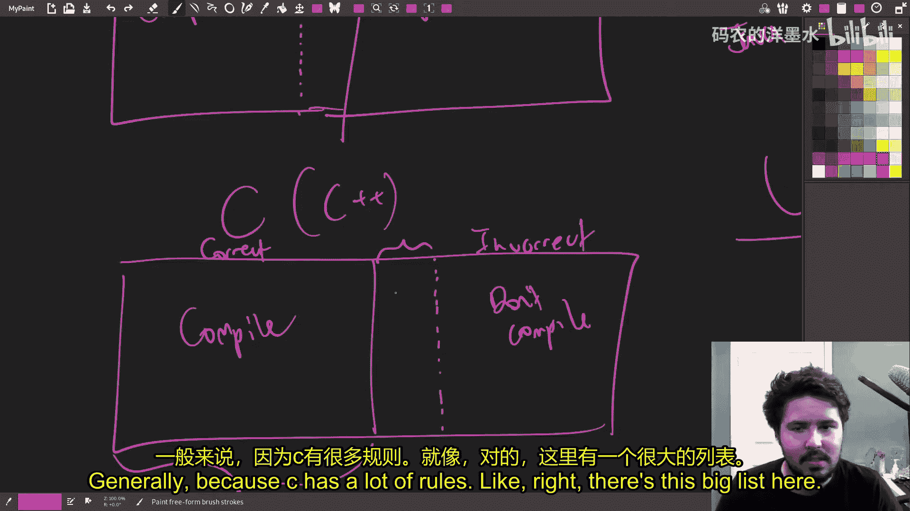

This big list here， there it is。Right， C does still have this huge amount of rules。

It's more that like it just isn't that great at checking them most a lot of the time。

Like it's not able to statically determine in like every case that these rules have been followed and therefore it needs to just sort of assume that the programmer knows what they're doing。

Right， whereas rust goes。

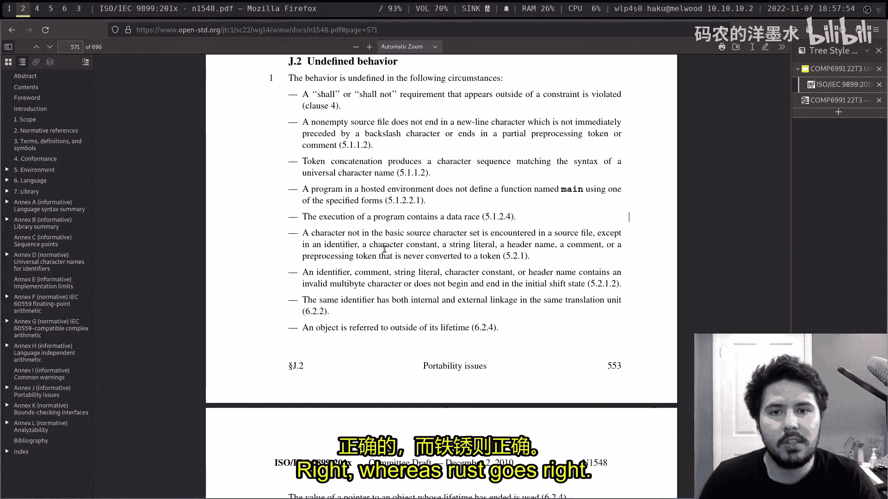

Alright， the tradeoff we're gonna to make here is that the language is gonna be。

Like more difficult to make compile。Right， going from nothing to a compiling program is just almost certainly going to be more difficult a lot of the time。

But what we give you is that if it compiles， you don't have any of that undefined behaviour or memory on safety to worry about。

Right， C C+ plus。If you go like， oh， my program's compiling， I can run it now， it must work。

Like that's you're stepping into really dangerous territory。Probably like usually with C and C+ plus。

 getting the program to build is one of the first steps。 And then it's about testing。

 and it's about sanitizing， fuzzing， like doing a lot of work to make sure the program that built is actually correct。

 like does the right thing。The idea is that in rust。

 getting the program to compile should hopefully be one of the latter steps。

 There's still a similar set of testing that you need to do。Right。

 like to check that your program is correct in like a a logic like logically correct does the right thing as opposed to even operates correctly at all。

So like there's still some testing to be done， but you hopefully get to， for the most part。

 skip out on that testing that's like fuzzing and sanitizing and checking did the program build。

 but like realistically it shouldn't have built it's you know the program violates some some rule of the language or something like that。

 right。

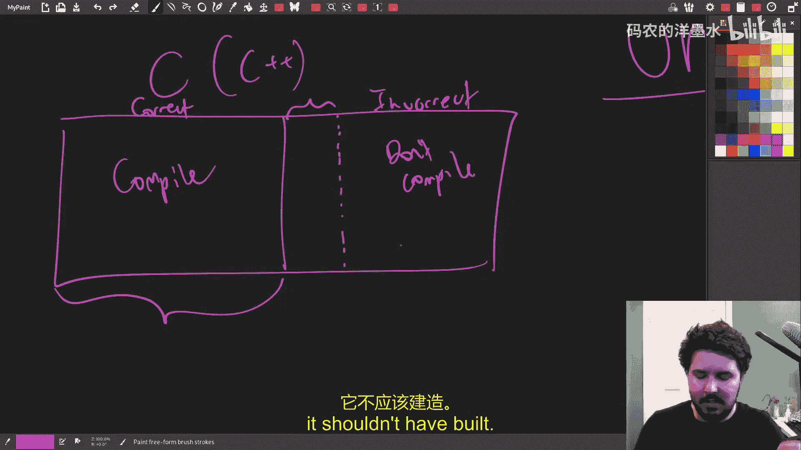

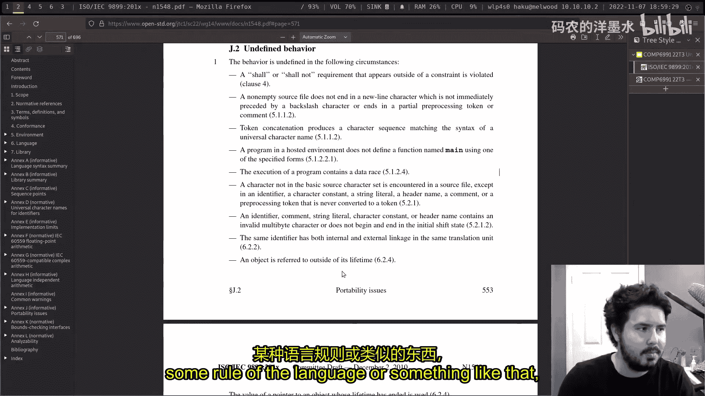

So that's how that's how rust。You know， it still has these， these。

Rules to work off and rust being a very restrictive language。 potentially like。

 I would say more restrictive than even these rules， you know， of underfi behaviour and C or。

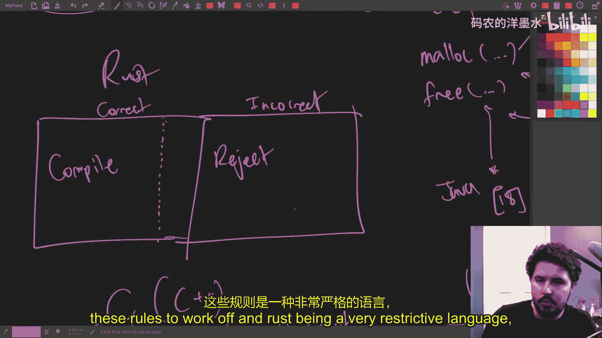

The equivalent， I think， even less clear set of rules in C plus plus。

Rust is probably still more restrictive than either of those and therefore often has more room to make assumption guided optimization and as programme and optise。

 like the people writing optimizes get better and better at writing optimizes。

Roas code tends to get better and better over a time， which is pretty cool。

The rule that says the program does not contain a data race。Let's go to here。Here we go。

 undefined behavior， data race。The execution of program contains a data race。 That's a good one。

 Well， well spotted Ka if your program contains a data race， undefined behaviour。

 anything's allowable behavior now。Oras， you know， Rus's ideal is。If you， if you have。

 if there's a possibility for a data race， I won't build your code。Okay， so。

In terms of segmenting between this safe rust and unsafe rust， Ru has memory safety by default。

 no undefined behavior， right， when operating safe rust。

 it is generally not possible to create to invoke undefined behavior to invoke illegal behavior。um。

With two slight caveats， one is compiler bugs。

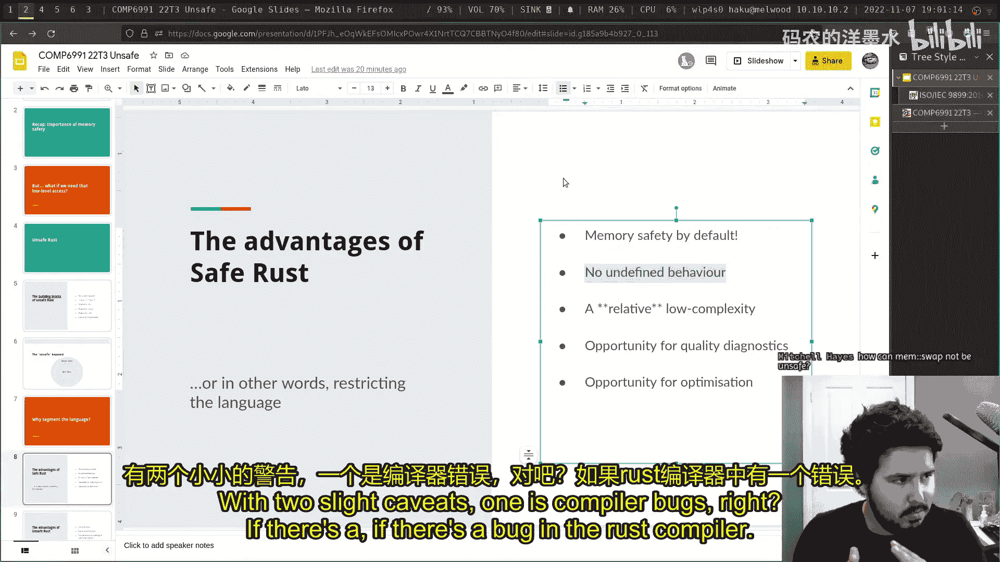

RightIf there's a bug in the rust compiler that is out of your control。

 then that's certainly a possibility， oops， that's not what I wanted to do。

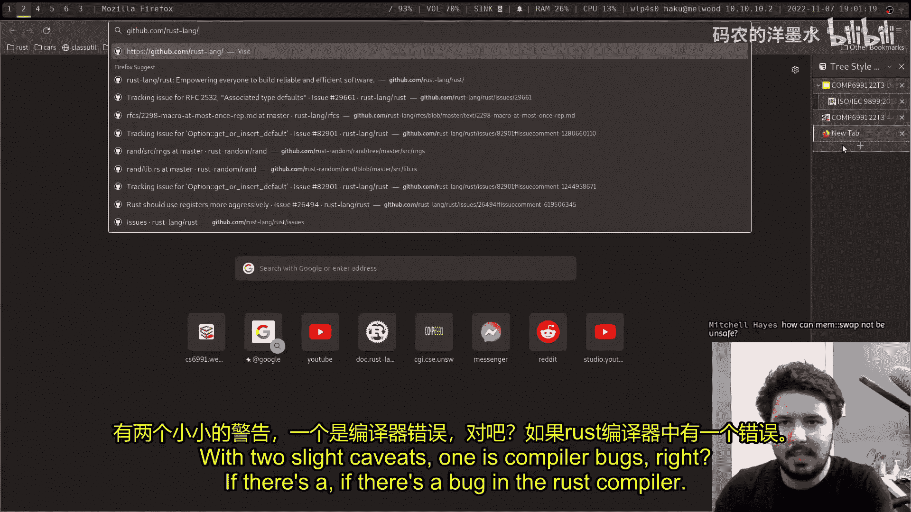

And I can show you if there's any of these。These kinds of bugs。

 there's probably approximately four in the compiler right now。

 generally things that issues in the compiler that might lead to this kind of thing are labelled critical like critical issues in the rust compiler itself and it seems okay。

 this is this is not that this is rust crashing on a weird target risk5 this is。

Like looks like a crash based off the linker this。Is unclear test failures could mean really anything。

 lifetime problem on build。 This might actually be some sort of undefined behavior。

I expect to see the code building。 Oh， in fact， this is actually， that's not too bad。

 This is code that should build。 that doesn't。 Well。

 that might be equally as bad depending on what you value。

 But I tend to really not like the idea of memory and safety and undefined behavior。 So right now。

 it seems like there's no recognized critical bugs。 I know there was one recently。 And by recently。

 I mean， like。Mth or two ago， but I'm not sure if。I'll look for like 30 more seconds。

 then I'll give up。It was like a pretty bad one。嗯。Maybe I'll try and find it after。Anyway。

 that was an interesting。No， I don't think its one。 There was。

 There was an interesting bug in the rust compiler where it's like。

 you can basically make a safe transmute now， and it's， it's very dangerous。 But okay。

 so caveat one is sometimes there's some critical compiler bugs because the language does move quickly。

 but they usually get fixed quickly。

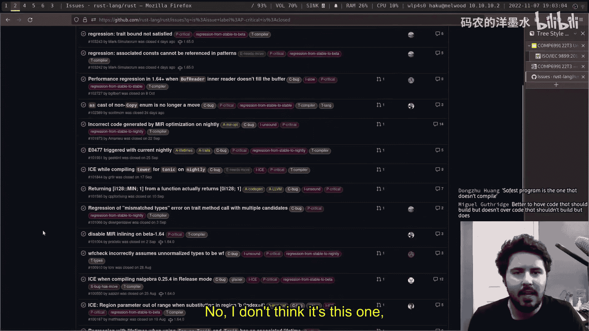

And two is bad unsafe code， which we'll talk about later on。So other advantage of safe rust。

 a relative low complexity。 Now I know don't like put your pitchforks away。

 I know rust has been complex。 It's been hard。 I'm not detracting from that。

 It is the complexity is low relative to unsafe rust to imagine if rust just let you throw pointers all over the place。

😊，The， the complexity of working in safe rust is relative to unsafe rust， low。Also。

 you have opportunity for optimization because the language is relatively restrictive and because the language is also relatively restrict。

 you have opportunity for high quality diagnostics in telling you。😊。

Like what exactly went wrong and why it went wrong。

 whereas languages where there's a lot of room for you know。

 programs to do crazy stuff might need to be more conservative in what they。

 what they tell you in their diagnostics when something's gone wrong。But。

If we give you all the weaponry right and you're in this unsafe rust land。

 what are the advantages of that， you get low levell control。

 particularly sometimes like raw access into the system if that's what you need and fine grainined access in pathological cases for optimization Ru you know the rust compiler might do a pretty good job optimizing most of the time but it might be like sometimes it's not able to it's not smart enough to make some kind of optimization for some reason。

 and so having that low- levelvel access to go and do that kind of optimization yourself is going to be important to to a subset of programmers。

The disadvantages of safero being it sometimes isn't flexible enough for your use case。 So。

 for example， not many would dare to write a kernel device driver in Python。

 I know you can write route user and device drivers in Python if you're particularly crazy。

 but I haven't really heard of any kernels， you know having being written in Python generally。

 just because Python is it's not maybe not possible to really port there。

 Python makes use of too many like high level operating system features。

 And so if you're trying to work on an operating system itself。

You might not you might just not be able to have your favourite language in there necessarily。

But Rus wants to have some sort of flexibility for these kinds of users。 So disadvantage for there。

 The disadvantage of safe rust is that it threatens。Basically。

 all the advantages of the safety in the first place。 So for example。

 once you have pointers flying around and all this。😊，Bmary on safety， undefined behavior。

 and this very high complexity open themselves back up。

So we want a way to maintain the flexibility and guarantees of safe rust without limiting the users。

 like without， without limiting the use of our language。 right。

 So in the sense that we want to support users with this low level requirement who want access to the system who want access to pointers and stuff。

We want to accommodate them， but we still want to maintain the flexibility and guarantees that we have in safe rust。

Okay， good time for a break。 We'll come back at 10 past。

 Think about this question while we have a quick break。

I'm guessing I've upset the Python people saying that you can't write， oh， stuff in Python。 But okay。

 we'll take a break。 Come back to 10 past。 We'll see in a little bit。Oh， it's 10 past。 Okay， sorry。

 I'm back。 Here we go。嗯嗯。Okay， so I didn't upset the Python people。

PONQ is pretty popular for writing embedded Python fit。Zililix， silicon on chips。Very cool。

 I am going to assume I'm gonna take a a a solid guess here and say。😊。

Potentially a subset of Python that's being worked in maybe。That is like。

We we borrowed the syntax and restricted the semantics。

 and we managed to get this thing to work on an SOC， but probably not like Python， you know。

 plain old Python 3， as we know it， I would imagine。🤧嗯。Soir。

We want to maintain the flexibility and guarantees of safe rust。

Without limiting who is able to use our language， we want to support this， the crazy。

 unsafe people that that need to use our code。 So the big。Big idea here。Unsafe implementations。

Of safe abstractions。Wu。😔，All right， so。The idea here is， well， let's， let's。

 let's look at a couple more slides。 So right now， the way we see rust is that。We write our。

Brust code hand off to the compiler。 The compiler will either like go， yep， the safety checks pass。

 which includes things like being able to infer a type for every value。

Check that all the types line up。 the traits old solve。And then it checks， you know。

 you past a T to this and it required that T was clone and T is cloned。

 that's all good borrow checking， you know， all kinds of safety analysis or safety Ana check fails and it gives this diagnostic to a user right So the compiler does as much as it can in terms of this kind of checking。

嗯。It does as much as it can in terms of this checking。

But there's some things that the compiler is out of reach for the compiler to check。So。

 and that that。Specific， you know， set of things that the compiler is。

 is out of reach for the compiler to do this kind of safety checking on is。

Particularly like the code that we're going to be interested in in today。In particular。

Like reading and writing just random pointers that it has no knowledge of。

It's got very little that it can sort of offer in terms of analysis on that。 But， you know。

 like we mentioned before。

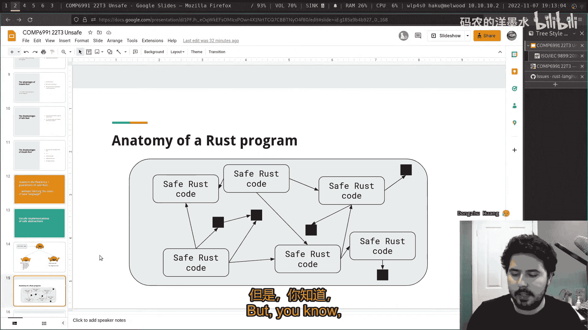

Rust might want to be able to implement a Vck and and。Genuinely。

 Vec is implemented in rust itself using， you know， things like malikin free。

 So it wants to be able to implement this kind of stuff itself。But it's， you know。

 if it needs to mangle these raw pointers around， it's out of scope for the compiler to do the same sort of level of checking on everything。

 And so you'll notice that I've put these little black boxes around our program。

 So we've got all tons of like safe rust code talking to each other in this， you know。

 this anatomy of a rust program。 So this is all rust code that。

 you know has no mention of the word unsafeware in happy fairyt land。

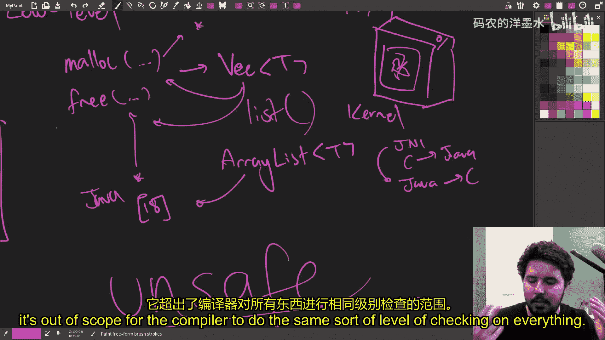

Then there's these black boxes that the program talks that know different modules talk to or maybe talks to modules。

And in these black boxes lies the big secret。So inside the black box。

 it essentially has a name tag at the top that says， I am safe。 This is a safe box。

 I swear you can put things into the box。 You can the box。😊，Here's an arrow the box spits things out。

 great。But on the inside of the box。There's unsafe crimes， unsafe crimes。

 So the unsafe keyword usually lives within this box。And that's where the crimes are performed。

And that's where the magic really happens。Note that。Well， no， we'll talk about that in a minute。

 I suppose。So the primary idea of this pattern here， the safe， sorry。

 unsafe implementation of a safe abstraction is that no matter what a user puts into this， right。

 whatever input a user gives， this box， this， you know， safe box here。 this is。

 I'm not talking about like box of tea， by the way， I'm just like， it's just like a box。 I'm just。

Like a imagine like a cardboard box， a black box， whatever。

 no matter what kind of input a user gives， this box should never misbehave。

 It should never cause undefined behaviour。 It should never cause memory un safety。

 It should always do the right thing。But on the inside。

It might need to make use of this unsafe keyword。嗯。But the big idea is。

 no matter what you do inside this box， it should be a safe abstraction。

 What's an example of a box in the rust， you know， say the rust standard a library。

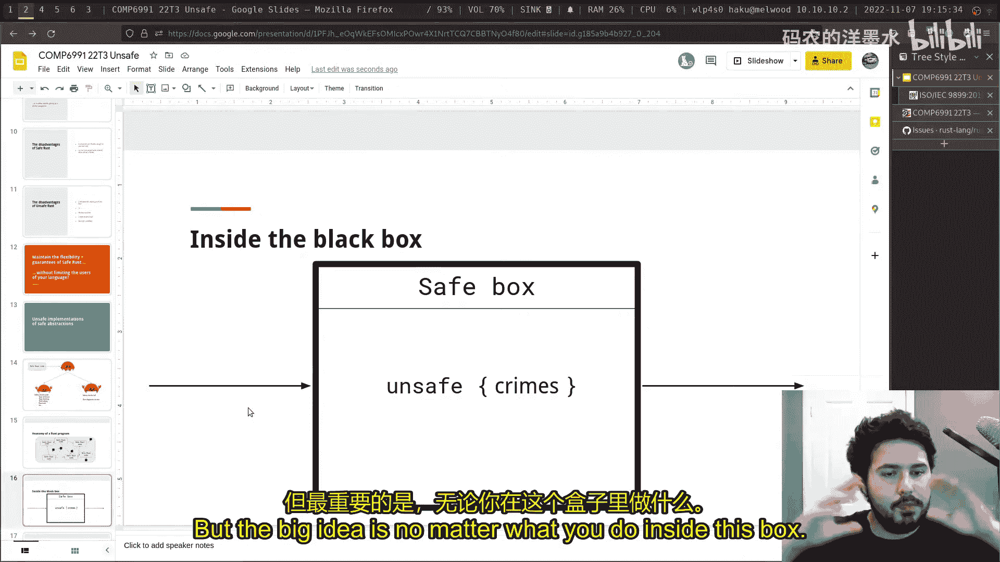

How about， how about。Vk， right， or how， how about。Fox。Right so。something like Vec。

 let's say it's not possible to misuse Vec。Such that it creates memory and safety or it causes undefined behavior。

 right， Like you're not worried if you go push， push， push push and get get， you know。

 say get the thousandth element。 you expect it to panic or you expect to receive like a nu value back on an option。

 You don't expect undefined behavior because that's not like how we program in rust。But。

Even with that in mind， get， get， get E F。Oh， right。 fineine。 dearar F target is tea。Get， right？

Even with this in mind that we know get is like impossible to misuse。 F。

 I'll think of a different one。 pop， that's kind of like get。 You'd expect if the array is empty。

 you get none。 Sorry if the V is empty， you get none。 If the V has something。

 you get that element back。If the V is empty， you're not expecting it to have some sort of undeified behavior。

 memory on safety。Yet if we look at the implementation of P。

 we are bound to see unsafe on the inside。RightSo there's an unsafe operation。

 an unsafe implementation in what is a safe interface for users。

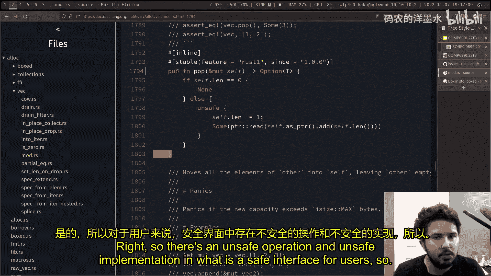

This is like what we're starting to work towards here。Right。Okay。

 so now let's finally talk about what does Unsafe actually even let us do， like， for example。

 why they even used unsafe over here。

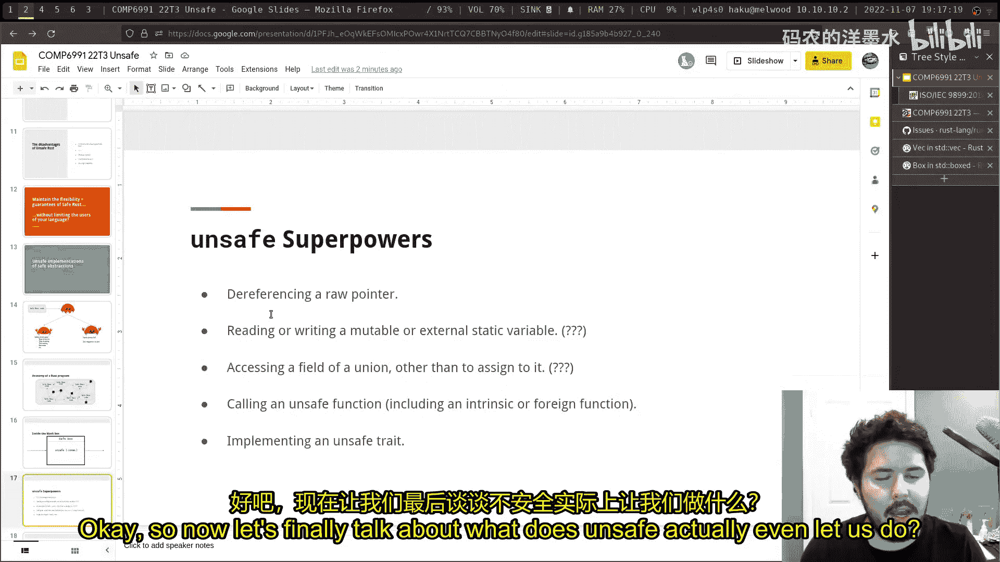

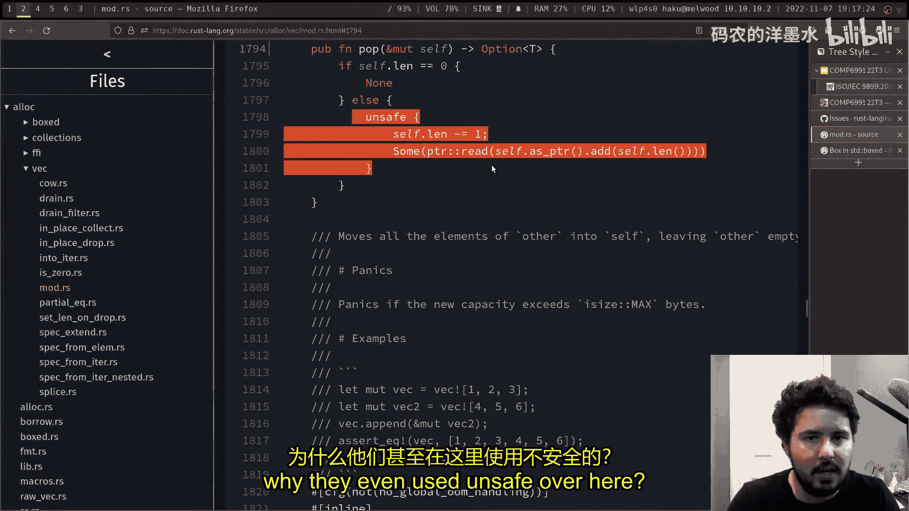

Right， so unsafe lets us do five things like some people like to think that unsafe turns off the borrowche or the compiler stops checking unsafe code。

No， it lets you do 5 things。 like 1，2，3，4，5。 That is it。 That's what unsafe does。

 So it lets us de referenceence a raw pointer。 Now， yeah， admittedly。

 those five things are like pretty， pretty wild， pretty gnarly。 So a raw pointer。

 This was mentioned a little earlier。😊。

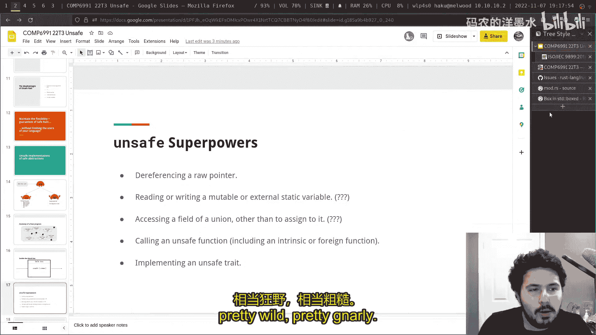

A raw pointer。Is basically just like， oh my God。 there's gonna some people in the Rus community would hate me for saying this。

 but it's kind of just like an address。Um， you know， point of provenance。

Put to the side and saved for like a course， maybe like three courses beyond this。

But it's basically just an address and memory。And it's safe to create these raw pointers like whenever you want。

 So， for example， if you have a reference， right， a b of。Something like this。

 you can always turn that into a raw pointer。In safe rust。 and it's completely it's completely safe。

 You don't need this unsafe superpower in order to create a row pointer。

 even to create things like a null row pointer。Right。Function null gives you a null pointer。

 That's perfectly safe。 There's， there's nothing wrong with that。Because。

Because you're not really able to do anything with it in safe rust。

You're only able to do something with it once you go to unsafe fors。

 And that's where the issues will really exist。 right， creating a pointer to some random spot memory。

Not really a problem in terms of a raw pointer。Using it potentially very big problem， reading to it。

 writing to it， potentially very big problems to open up there。

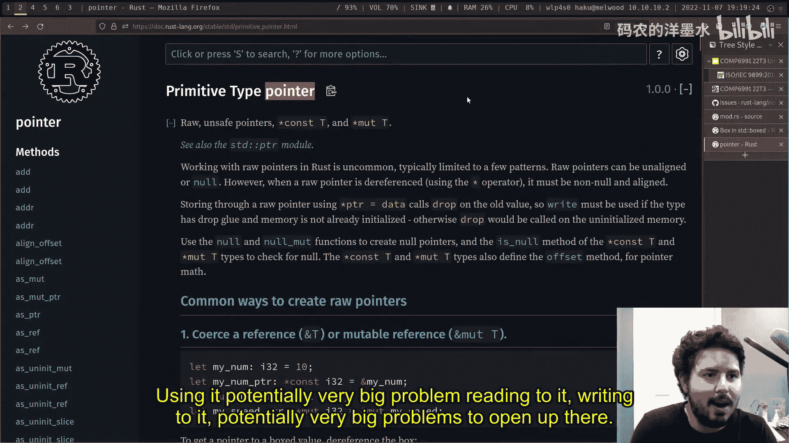

And so dereencing， in other words， like reading or writing too。Usually， a roll pointer。

Only can be done with unsafe。Now， what are the other four？

Reading or writing a mutable or external static variable。 I've put question marks here because wait。

 Rus has static variables like globals up。 Yeah， Rust has globals。

But you can only have like read only globals in safe rust so or you can even you can still have mutable globals in rust。

 but again， you just can't use them in safe rust。 but once you're in unsafe。

 you can read or write a mutable or external static variable a mutable global。

 So it gives you that superpower。Another question mark ask accessing a field of a union other than to assign to it。

 a union Ru has unions like in C。

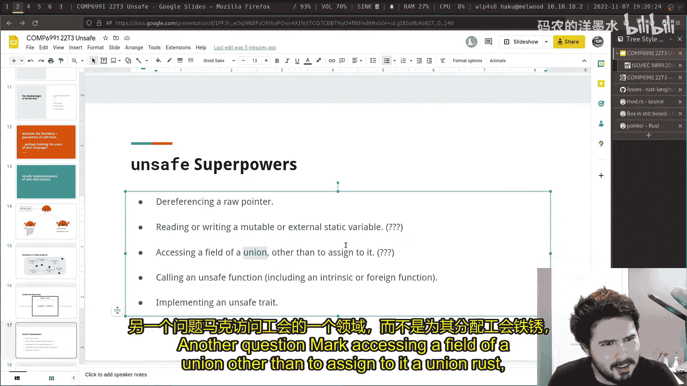

That crazy idea that some like nut came up with in C of a union。 What Russ does have unions。 It does。

And you can create unions。 You can create a union， and you can write to a union。

All in safe rust as well。 But you can't read from a union。Unless you're an unsafe frost。

 The question marks again， what the heck rust has unions。 Yes。

 they're very rarely used in in in reality， but it sort of needs to exist for Ru to be able to talk to see。

 which we'll talk about again on Wednesday。

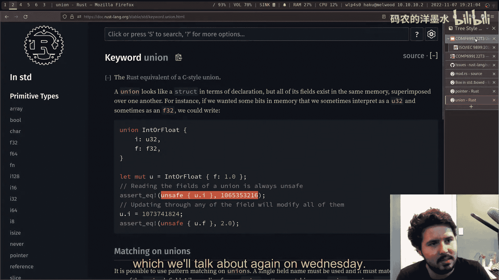

So。That's a whole thing， but again。Asign creating a union， assigning to a union， Ru see no problem。

Only reading from a union。So then the last two here is calling an unsafe function or implementing an unsafe trait。

 and these are other really big ideas。Calling an unsafe function， implementing an unsafe trait。

 These are the last two superpowers。 So like these two like kind of crazy。

 we probably didn't even know that these existed prior to this point。 So， you know。

 you don't need to worry about these ones so much。 The referencing a raw pointer is the real big main superpower of unsafe。

 It's really like the one big superpower。 And then these ideas here。 Unsafe。

 lets you call unsafe functions and unsafe traits。Unsafe functions， unsafe traits。 So， for example。

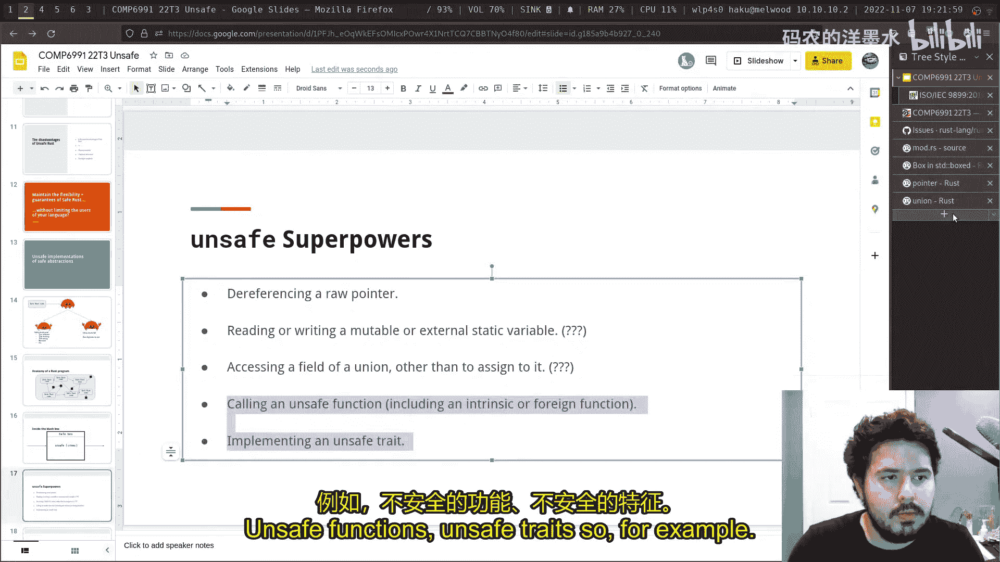

Let's say you wanted to write a method on Vec。That is really dangerous could lead to undefined behavior。

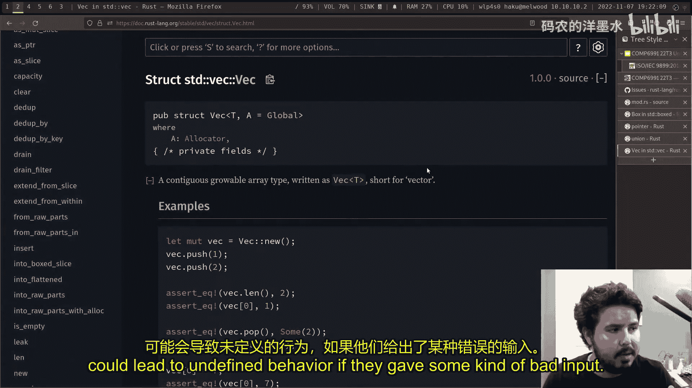

If they gave some kind of bad input。 So I mentioned here。

 I mentioned on this slide that no matter what input the user gives you。

 if you're saying I am a safe box。Right if you're claiming I am a safe box。

 I'm a safe thing to use a safe abstraction。You have to be able to deal with any scenario that you're given and not cause undefined behavior or memory on safety。

 If， if something that someone can give you。could lead to undefined behavior。

 you've broken the whole point of rust essentially。Right。

 because now someone without riding unsafe anywhere could call your function and give it something bad。

 cause undefined behaviour and go what the heck。 I thought Ru was saving me from undefined behaviour。

 So that's really important。But like， there is still a set of functions remaining。

 a set of abstractions where。This， we want to be able to provide an avenue for users to do this。

But it's only valid to do in certain cases， right， In some cases。

 it will just create undefined behavior or memory on safety， right。

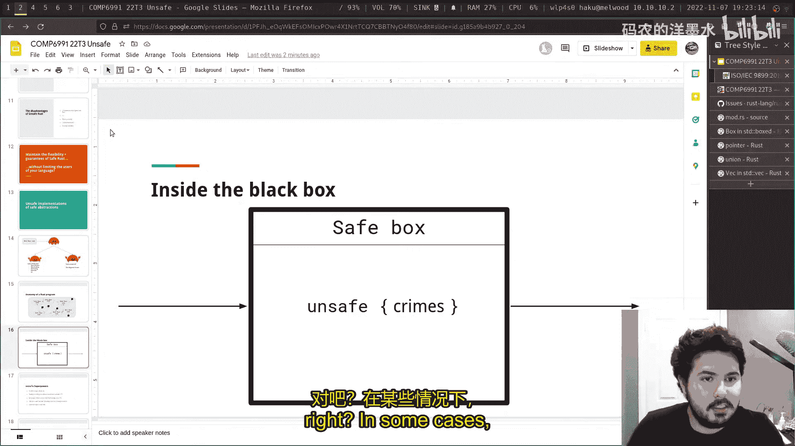

And so。For those kinds of functions。We'll generally mark those functions as unsafe。

So what's a good unsafe function。From raw parts is unsafe， but that's kind of annoying。

 I think string is maybe an easier example。 So for example。Here from U TF8 unchecked is a good one。

So。If you have a bunch of bites， right， a bunch of。You know， you ates bites and you go。

 I actually those bites are a string， I want to turn them into a string。Generally。

 you'll look at a function like from UTF 8。 So from UTF8 takes that that vector of bytes and then。

Maybe gives you a string back。Why does it maybe give us a string？ Well。

 it maybe gives us a string because。Not all bite slices， not all sequences of bys are valid strings。

String， right， this type string。Guarantees that it always contains valid UTFA。

 which is a certain way of encoding text， a certain way of encoding characters。嗯。

And so that gives us things like emojis， it gives us like other languages， you know， Chinese。

 Japanese， like European languages， Swedish， right， French。

 you get all these different characters in this big character set and of course you get emojis as well。

 but again， it's a certain encoding and not all bytes produce valid encodings。And so。First of all。

 there's this overhead in like the fact that there's a result here you need to deal with if the thing was not valid UTF8。

A。But let's say you absolutely knew for sure。 Like right here。

 like you've typed the bytes into your program， you are absolutely certain that this is valid UTF8。

Rust is still going to do the checking because like， that's what the code of this function does like。

Okay， fine， it calls another function， but that function。

Like is they typed the code to check fit its valid UF 8。

 it's not just going to magically not do that， right？嗯。And again， because， for example。

 you could just give it。Incorrect bytes。 And that would just return you back an  error。

 like bytes that don't represent valid U TF8。But。😡，Like， let's say this is your use case。I want to。

 I have a bunch of bites。 I absolutely know for sure that it's valid U TF8。 I want a string。

 and I need it fast。 I don't want you to do any of this checking and stuff。 I know that it's okay。

From UTF8 unchecked。Takes a vck of bites and always gives you back a string。

That's a dangerous looking signature。 takes a vck of any like set of bites and always gives you back a string。

And this is the kicker。 It's unsafe。 So when a function is unsafe。

It means that you aren't able to call this function from safe rust， right。

 If we are operating within this subset here。

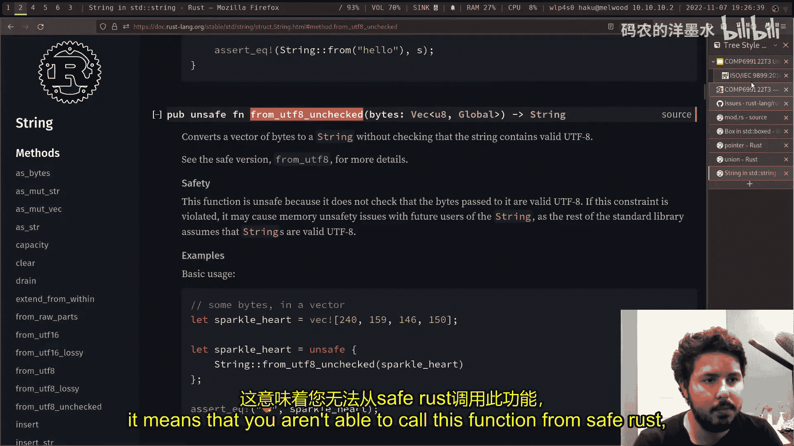

From UTF8 Unchecked， lives outside our subset， it lives over here。

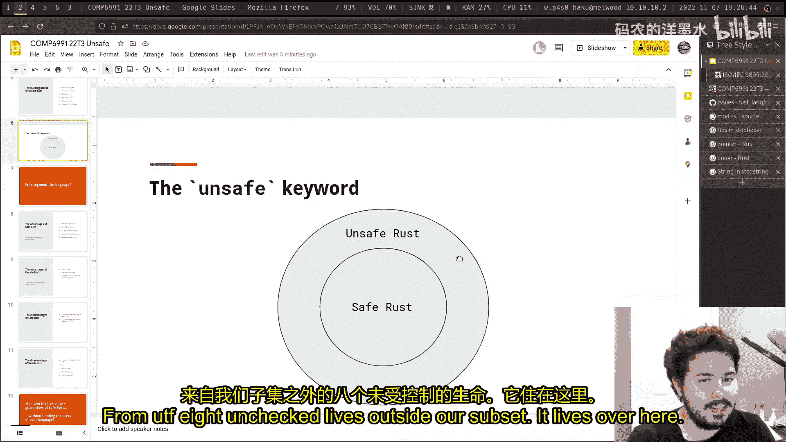

So this， as far as we're concerned while we're in safe rust， this function doesn't even exist to us。

 it's not an option。However， if you're okay with the idea of throwing in this unsafe block。

 one of the superpowers it gives you as a reminder。

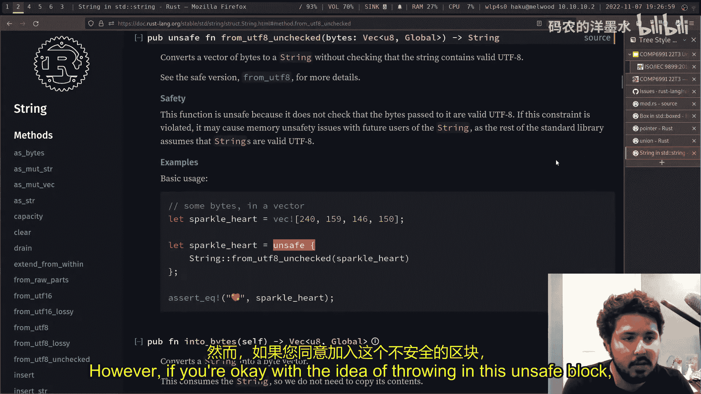

One of the superpowers it gives you is calling an unsafe function。

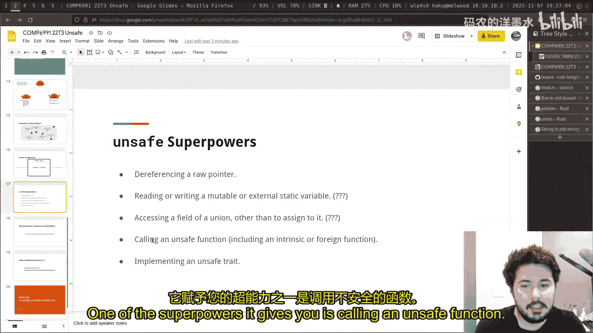

Call in on say function。 So they say here， I've written in the bytes。

 Let me call this function string from UTFA unchecked。Right， and。They。

 what they should have is a comment right right above this line here that explains why this is actually safe to do。

 This is a really big， a really important point for unsafe。

It's a bit of a potentially bit of a stupid word for bit of a stupid keyword。

 Unsafe being up here makes perfect sense。 The fact that this keyword here is unsafe。

 This function is unsafe to call。 You need to make sure like and it says here。

 there's a safety section。 This function is unsafe because it does not check the byte surpassing in U TF8。

 If this constraint is violated， it may cause memory and safety issues with future users of that string as the rest of the sound library assumes that strings are valid U TF8。

 I mean， this is also， this also comes down to this idea of a data andvariant in that the type string。

😊，Maintains an invariant that the， the text it holds， like the bys it holds are valid U TF8。

 They've made it very clear that。This will always be true invariant。 This will always be true。

 The bytes in the string are always value U T F8。 If you violate that invariant。There be dragons。

 If you violate that invariant， expect undefined behaviour， Exp memory on safety， right。

 So they say this is the only safe way to do it。 So unsafe， the word being unsafe up here。

 perfectfect sense。 Love it。 It being unsafe down here。 Maybe it really should have been called safe。

Right， because this is not unsafe。 is not there for you to be like。Whatever horrible idea I have。

I'm just going to do it。 And you're going to put up with it。 Rust。 Oh， no， no， no。

 Rust has lots of rules， too。 In fact， probably more rules than C or C plus plus and probably more poorly specified rules than C or C plus plus。

Just because mainly because rust is still a relatively new in developing language。

 and they're still trying to decide on what like。What even categorises undefined behaviour in quite a few circumstances。

 right？ So， no， this isn't for us to just go buck wild and do whatever we want。

 It's here for us to say， I know this looks bad。 and I know the compiler can't check this automatically。

 This is without。 this is out of scope for the compiler to be able to reason about this。

 But I have reason about it myself。And for this reason， like， you know， in a comment， safety。

This is my reason。Doing this operation is actually okay， this operation is actually safe。😊。

Even though it looks unsafe， that's the big idea。Right， not like， do whatever the heck we want。

 I promise this is okay。 I checked it myself。If it goes wrong， that's my fault。

 not like the compiler's fault or rust's fault。I mean， in essence。

 this is essentially what you're doing when you're writing in a language like C or C++ anyway。

You're essentially saying。Like the the compiler is going， you know， if you screwed up。

 I'm probably gonna give you the wrong answer。 I'm probably gonna， you know。

 I there could be memory on safety。 There could be all kinds of things。If you messed up。

 there's probably going to be undefined behavior。And you're asserting by like。

 building the program and running it that。Id， I've checked the program。 I wrote the program myself。

 and I know it's okay。Don't stress。Right， don't worry about it。

What unsafe gives us in rust is a way to restrict the domain in which the programmer is making that assertion。

Right。What unsafe gives us is that it allows us to restrict into smaller pieces of our program。

The spots that a human needed to manually checked need to manually reason that something is actually okay。

 something potentially dangerous is actually okay。Right， again。

 C C plus plus those kinds of languages。Like it's， it's often any line of code could， in theory。

 be unsafe， could in theory， do something horribly wrong。

We're trying to limit the scope and like that's you know why things like code reviews and stuff and tooling is really important for CNC++ code to make sure that you're not putting any critical vulnerability into production。

All we're trying to do in rust。Is。Restrict down the scope for where that checking needs to be done and needs to be reasoned about into and like the great thing is。

 is that you can go into like whatever Ru code base and Gr for the word unsafe。

 just like do a search for the word unsafe。Loob birdss。嗯。And like that will give you the rights。

 the right sort of。Spots to start checking。 And if you look at each of the uses of unsafe and go like their safety comment stands to reason。

 and you go， yeah， that seems like that'll be true in all circumstances。Then in general。

 it should be say， obviously， like a dependency could still just do something horrible。 Like。

 I could just release like Zack's evil library， right。

 Zax evilvil library dot R S that just goes like。I provide one function， function fo。

 public function fo。 It's not unsafe or anything， and it just goes like unsafe。Stood。Pointer， null。

 grab a null pointer and dereference it。Right， that's undefined behaviour。 Defite not allowable。

 And I could write a program like this。 So you still need to have some understanding of your dependencies。

 but。The the reasoning here， like the sort of culture here is that this is not an okay Rus program。

Usually someone would like be looking through the source code。 They'd look for unsafe and go。

 that is wildly unsafe。 And like no one， like everyone。

 avoid using this library until it's fixed kind of thing。Recording myself， committing crimes。 No。

 don't say it。 Ive， it's gone。嗯。So， it's。That's the big idea here。

 Rust hasn't eliminated the whole idea of undefined behaviour。

 But what it has done is that for the vast majority of people that just want to like。

 consume libraries and write normal code， you don't have to think。

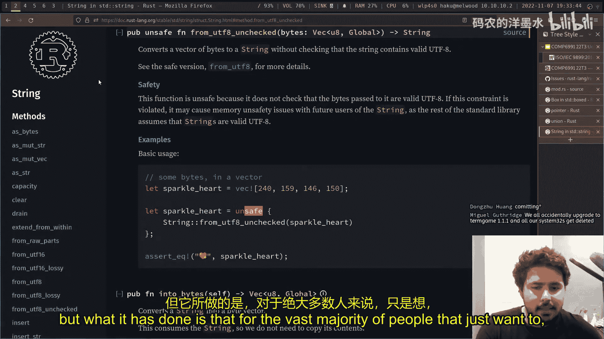

About undefined behavior or memory safety。Right， and if you ever accidentally run into a function。

 right， this is Rerul was saying earlier。The speck here。

 the C spec says things like like it was the stirir talk one， right。

 like the first argument in the very first call to stirirt is a null pointer。Right， it's just， it's。

 it feels strange。 It should feel a little strange that they've listed out every single function in the standard library that could be used incorrectly。

 right， like。Shouldn't that just be like part of the function。Right， like the function tells you。

 hey， by the way， you should only use me like this。

 But like they've had to go out and list out every single like function that could be used dangerously。

 in a sense。In rust， we might need to do the same thing。

 but the way we do that is a part of the language。

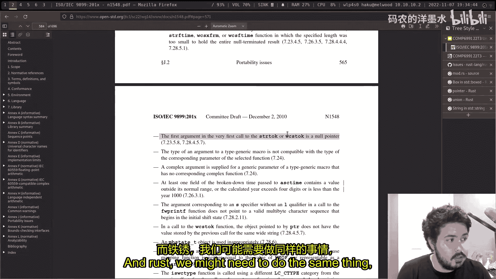

It's a part of the language， and it's this unsafe keyword。

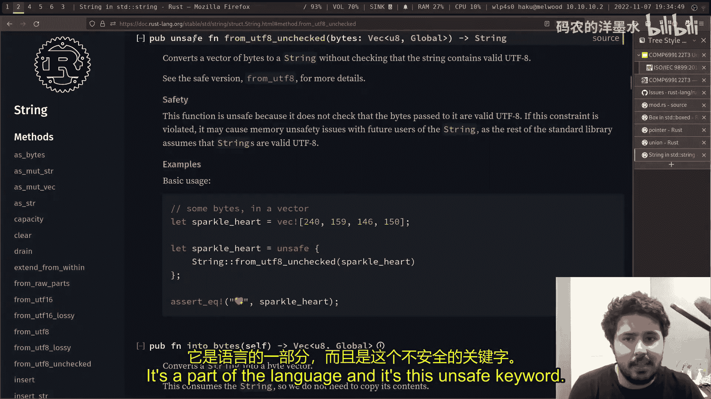

So unsafe meaning， hey， like， you know， feel free to use this function。

 But like there would be a safety comment， right， this safety comment here that says。

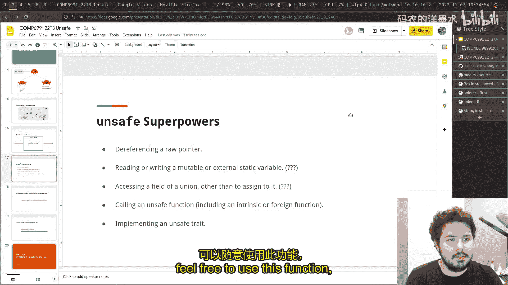

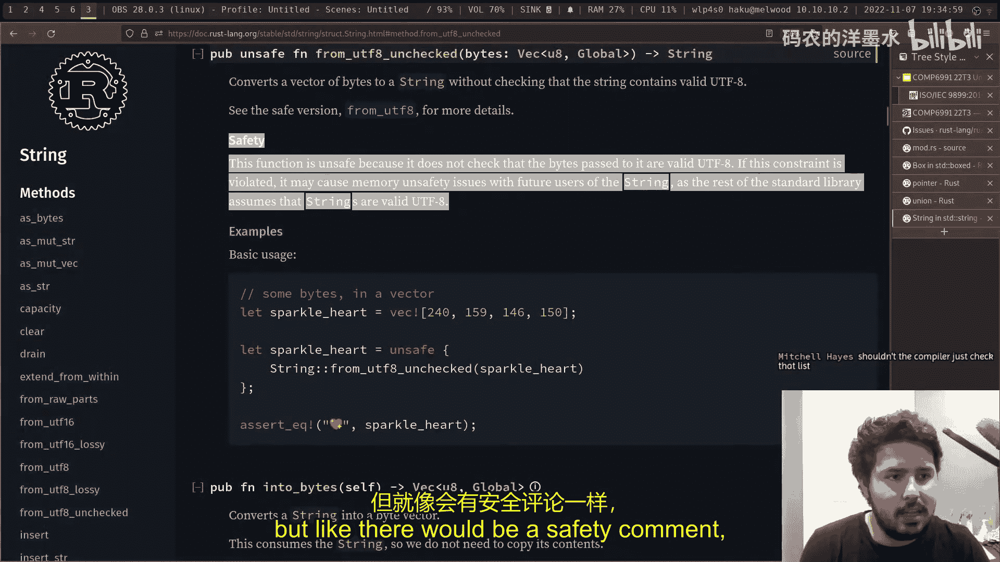

You've got to make sure that the very first argument in the very first call to this is not null。

That's our big idea。Shouldn't the compiler just check that list， I mean that it would be great。

 wouldn't it， and like it's not like compilers again。

I don't want us to think of compilers as adversarial， as in it's like a battle between us and them。

 And they're trying to let cause unde find behaviour and do the wrong thing at any opportunity。

 It's more that like。If I grab like here's， here's a way that the compiler is not going to be able to check if it was say。

 C is， let's say this fo function gave me back a。

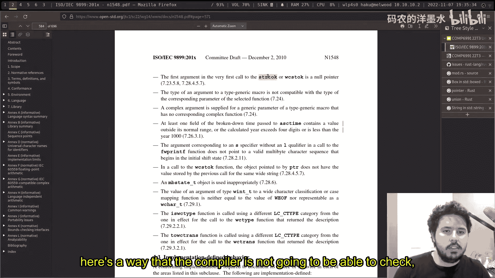

Just star。And I say cha star x equals P stir talk of x。Right， is that safe？Well， it depends this。

 like we might not know whether this X here is null or a valid pointer until the program is actually running。

And so。You know。The compiler will do its best if it sees that you straight up right Stirtok null。

 even then it probably doesn't know because it's only they say it's only the very first call to Stirtok。

😊。

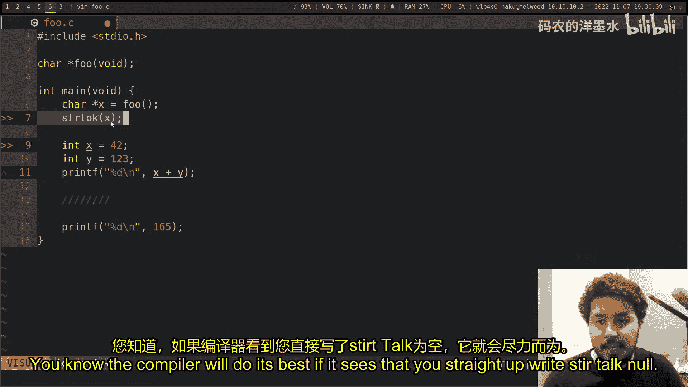

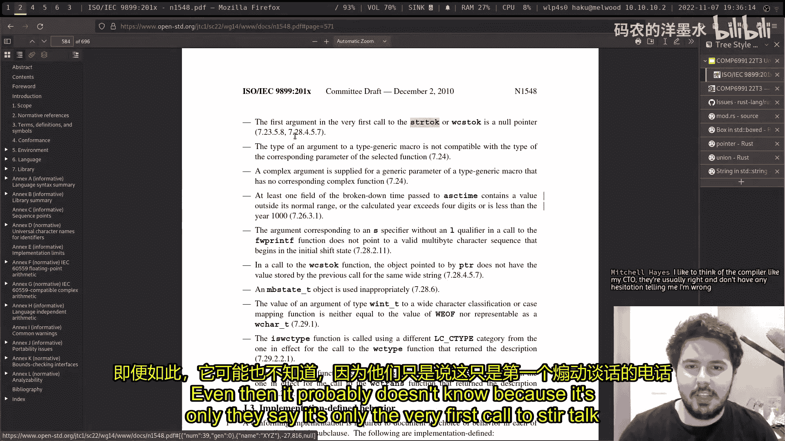

Right， you might have called Stir talk earlier than this at some point， so like。

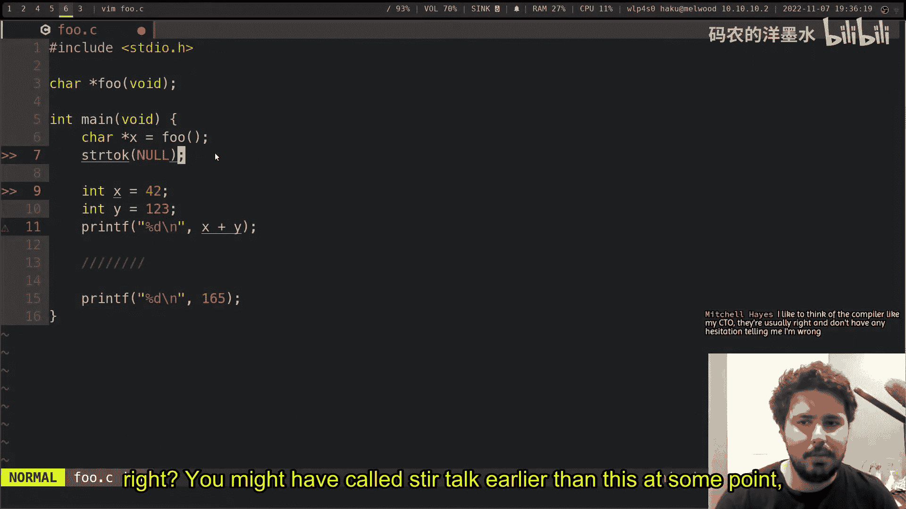

Often the the reasoning that the compiler is able to do in that kind of situation is pretty limited。

But， you know， it's certainly going try at least。 And things like W， W， O， W。 pedantic。

 that kind of thing can certainly help to。To get that the compiler to signal to you if it thinks something is gone wrong。

I liked the other compiler like my CTtoO。 They usually write and don't have any hesitation telling me I'm wrong。

 yeah。But， I'm sure like CO， theyve， they， you know。Like the CTO， they're human too。

 they sometimes miss things， you know， maybe not maybe not so much human。

 but they definitely do miss things sometimes。😊，And so， you know， that's， that's why we're even。

 that's why we're here this course for a， for a large part of it。So， yeah。Unsafe。

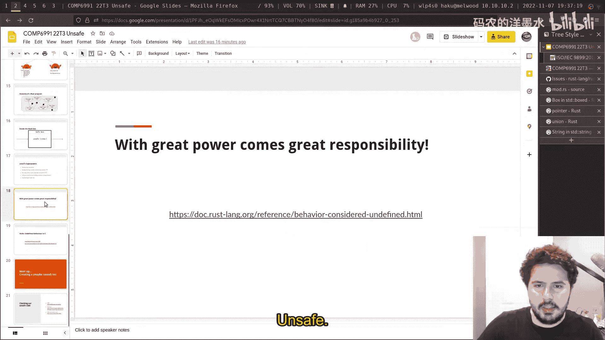

Naturally， with great power comes great responsibility。 right， that was， that's， that's， you know。

 the， the evil func program that I wrote with the just de reference null。

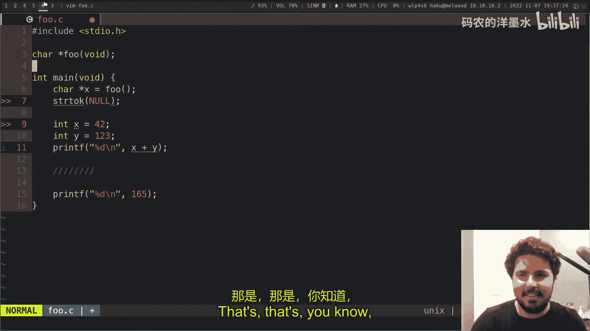

Still not okay in rust， you know， as rust as it may be。Still not okay。

 Still just as bad as C or C+ plus。

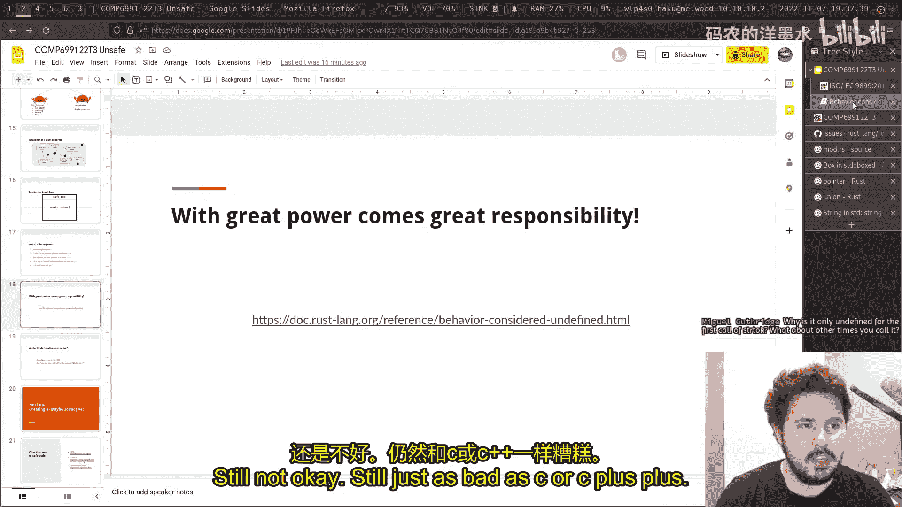

So rust does still have behavior considered undefined， otherwise known as undefined behavior， right。

So， but generally。So lets， let's even read this。 Rust code is incorrect if it exhibits any of the behaviors in the following list includes code within unsafe blocks and unsafe functions。

 unsafe only means that avoiding unfined behavior is on the programmer。

 It does not change anything about the fact that rust programs must never cause undefined behavior。

 So like CN and C+ plus programs， Ru programs must never cause undefined behavior。

 It is the programmers's responsibility when writing unsafe code to ensure that any safe code interacting with the unsafe code cannot trigger these behaviors。

 Safe abstractions over unsafe implementations。😊，Unsafe code that satisfies this property for any safe client is called sound。

 right， So your unsafe code is sound。 It's， you know， kind of like correct。 It's， it's it's。

Fine to exist， if。It will never cause undefined behaviour， you know。

 from if a user will never be able to cause undefined behaviour from within， say， safe code。

If unsafe code can be misused by Sa code to exhibit undefined behavior， it is unsound。And。

The behavior being unsound means you like that's very dangerous。

 that code should not exist generally。And warning this following list is not exhaustive。

 there's not a formal model of rust semantics for what is and is not allowed unsafe code。

 so there may be more behavior considered unsafe。 The following list is just what we know for sure is undefined behavior And then they say please read the rust andomicon This is another great point as well。

 The rust andomicon is a really nice book helping you understand how rust works and is probably a precursor really to writing writing unsafe code yourself。

😊。

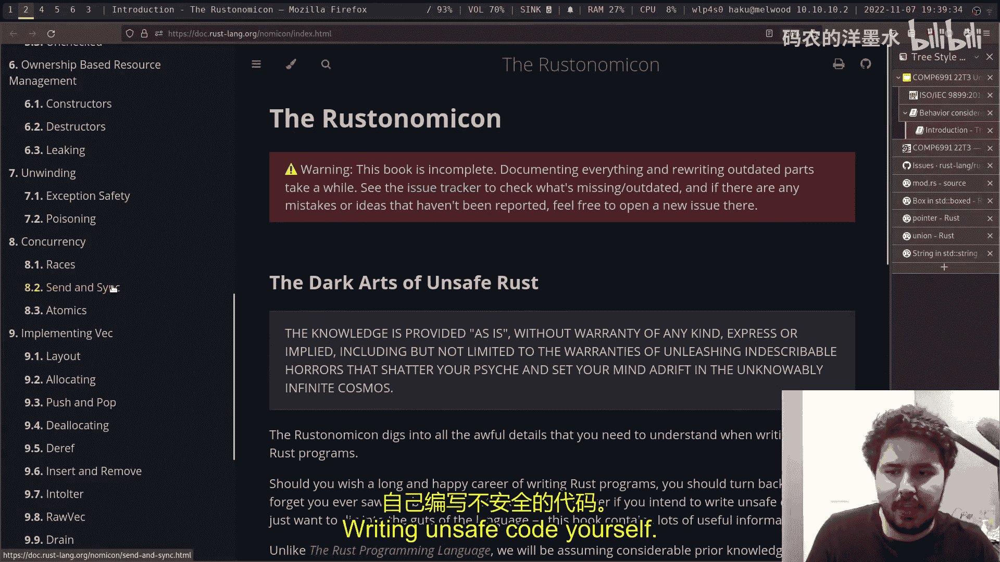

This knowledge is provided as is without warranty of any kind， express or implied。

 including but not limited to the warranties of unleashing indescribable horrors that shatter your psyche and set your mind adrift in the unknowably infinite cosmos。

The Rascinomicon digs into the awful details you need to understand when riding unsafe rust。

So here's another like tidbit that I'm going to point out like very clearly。

Unsafe rust is almost certainly more difficult to write than。Like unsafe C and C++。

Rust is a language that's way more restrictive， has way more implicit rules。

Then say C or C plus plus。 So writing unsafe code is like really difficult。

 A big mistake that a lot of people， systems programmers coming to rust。

 may immediately make is like I've， I've made some crazy C programs before I go I know pointers C plus plus I've done some insane things in that like。

I know what I'm doing here。 I'll， I'm just gonna jump straight into unsafe。 It's like， no， not quite。

 You'd probably want to do some background reading。

 You probably want to understand a little more about rust itself because it there's。

 there's more to consider in a in in a language like rust， potentially。

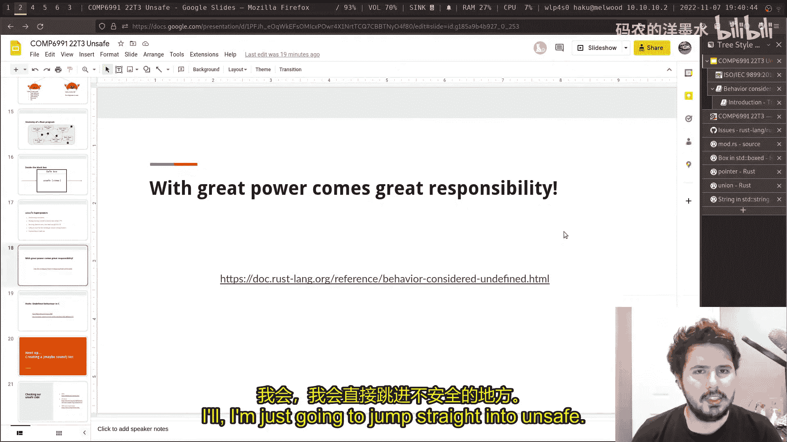

UmAnd like again， a lot of the behavior considered undefined。😊，We see from the same thing as C。

 things like data races， right， unsafe code should not cause data races。

There's a relatively big list here。Some of the， the list is partially smaller because， again。

 some of the。

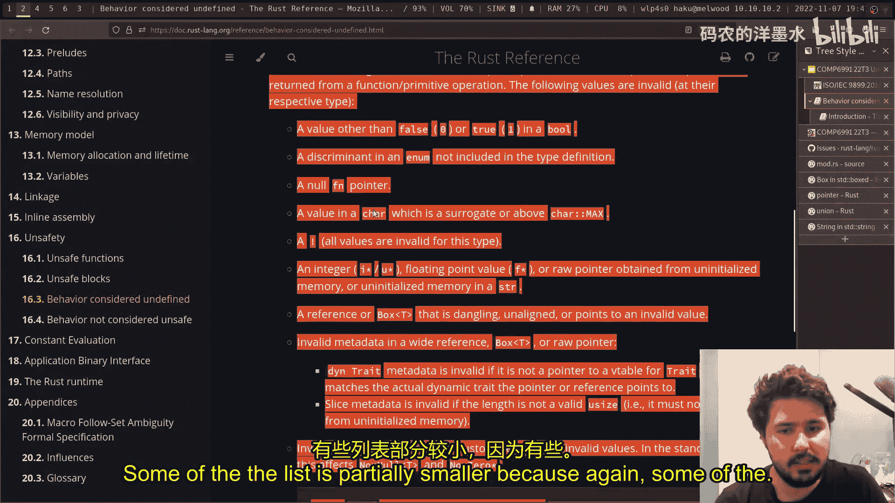

Some of the undefined behaviours。Like may not be understood yet。Potentially。

 but also because a lot of these C ones here in the C spec are about like in specific functions and in rust when it's know about a specific function。

 we mark that function unsafe。😊，And then generally。If we have an unsafe version of a function。

 we'll generally have a safe version as well that maybe does additional checking and returns like an optional or result or something like that。

 and you choose between speed， performance and potentially knowing for sure that you're correct。

 or just like playing it safe， staying and safe for rust and making sure you never run into undefined behavior or memory and safety that kind of thing。

Why is only unde for the first call St talk。 What about the other times you call it， I think you'。

 it's intended that you pass null to it the second， third， fourth times。 So it knows that。

Stirtox is an absolute dog of a function。 Stirtox sucks。It's really bad。

 It's just a stupid design for a function， to be honest。

 but they need to differentiate between give me the next token。

In the string that I'm currently tokenizing thus， I want to tokenize a new string essentially。

Go have a look at stir talk and the man page and that kind of thing。 if you want。 But it's。

 it's not a nice function。Honestly， writings correct。 So safe。

 unsafe rust or otherwise otherwise known as like sound， unsafe rust is harder。

 But there's still room for people to just be careless。 Like， yes， yeah， that's， that's still。

 that's still absolutely true。 So that's why， like， you know， things like code reviews or。Oh yeah。

 let's say code reviews。People are going to want to。

Like that pay close attention to wherever unsafe pops up because it sort of signals that this needs special care。

Can rust do inline ASM， it actually can do inline ASM， yes， unsafely。So it's。so， yeah。

Rust also has similar tooling。To CN and us in terms of spotting undefined behaviour or memory and safety。

H we've got 15 minutes。Well， okay， so as an aside undefined behaviour。

 we've been looking at this standard library。 Oh sorry， standard。

 the C standard list of undefined behaviours。 There's also a great post from John。

Oh， boy。 John Raer， I believe。I， I think I don't know how to pronounce anyway。

 Fo John Ragger on Twitter。 He's got a great Twitter going。

If I guess I think people have been jumping off Twitter or something there recently。

 I need to catch up， I suppose， but there's a blog post which is also I think an actual paper that was published。

 which tries to like iterate C and C++ undefined behavior and again it's this huge list of like things that can go wrong。

There we go。You know， it's， it's a whole thing。And any his overall conclusion is CNC++ are mostly taught the old way as if programming in them isn't like walking in a minefield。

 nor have the books about CNC++ caught up with the current reality， these things must changed。

 So this was written in 2017 and John is absolutely a massive expert on CNC++ and if I recall correctly has done a lot of work in tools like Kang and LLVM And this is just a great post to like read the bits that you're interested in。

😊，And there's also like there's even more， there's even more posts like a three part series about undefined behaviour in other respects as well。

 which you could find if you Google for just looking for C undefined behaviour in his blog is called embeddedd in academia or just like putting in his his name here。

 but just yeah， very interesting to have a look at as well。

One of the things I want us to do is to create a maybe sound implementation of Vec。

I say maybe sound because like again， writing on safe code is is very difficult。I think like I。

 I've implemented like， I've implemented Vec before。I think it's probably sound。But like， you know。

 I， I don't necessarily have the。I don't necessarily have the。Theres is， there's a very。

Particular word I'm looking for here。嗯。嗯。呃。I， maybe that's that's that's。

 that's what I'm looking for。 I don't necessarily have the arrogance to claim that it's certainly sound。

The Nomicon does have a full chapter on implementing a V from scratch， which is very cool。

 I believe it's down here implementing Vec。

So。This is a nice part here， but it also goes into some pretty crazy stuff。 This looks the yeah So。

 so like the problem。 So okay， how do I say this。😊。

Maybe sound should be like。Probably unsound。But like usually sound。

Creating a usually sound deck because I can think of。😊，Pieces of micro that's probably。

 probably could exhibit U， but like。In the cases that we're looking at almost certainly won't。

 one of the big takeaways here is that writing unsafe code is really difficult。

 particularly when you're making a large， complex abstraction。

 especially when you're like generic over other people's types and stuff like a you know a Vec tick all those boxes。

😊，And so writing a。Absolutely sound in every situation。 Vck is really， really difficult。

 but we can sort of like restrict the space that we're operating in to sort of be like here's what it would kind of look like and then go there's still soundless issues with this and here's where you can look to like see those other issues。

 So we're probably gonna do something like that。We clearly are not going to have time to write a whole V today。

But I can talk about how we can you know work on checking if unsafe code is sound for the end of the lecture and then because there's not an absolute buttload to talk about with FFI on Wednesday。

 we can spend something like the first hour of Wednesday trying to implement a usually sound V。

And then the second hour we're talking about FFI。 if， you know， Yeah， and that that should be fine。

 I think。So I think that's a good idea。In terms of checking our zip code， click to add subtitle。

 the two sort of primary go to things are Mi and sanitizers， so sanits。

 if you're familiar with CC++ you're probably already very familiar with these this idea of sanitizers。

It's essentially a code that gets instrumented into your program in order to check things as the program runs。

 So the most popular sanitizers are address sanitizer。Memory sanitizer is a bit of a like。呃。

it's like， I think a little newer than ASN address send。And like。

 support some slightly different use cases， but as。

Also like there's a reasonable amount that overlaps with memories address sanitizer thread sanitizer is massive as well to help try and detect data races and theres there's a few others leak sanitizers sometimes used for you know。

 a place of like Valel grind or something like that and then there's some other like really more specific sanitizers that。

I have never personally used， for example。And so these。

 you pay a slight performance penalty at runtime for them。 usually the overhead is。I w to say， like。

Like 2 to 10 times something like that。

Okay， address sanitizer for example， is typical slowdown is about two times。

 so your program will probably be about twice as slow if you're using a address sanitizer thread sanitizer typical slowdown is five times to 15 times to try and check data races and it also uses about five times to 10 times the amount of memory。

You know， so on and so forth， each of them have their own sort of costs。嗯。

And so like sometimes you can afford to run a sanitizer in production to try and like make sure nothing goes wrong in production。

 you'd rather maybe have a crash than actual like memory un safety or undefined behavior or whatever it's checking for is's also you undefined behavior sanitizer is another sanitizer for Cnc C plus C and maybe I think also C++ but doesn't exist for rust because rust has different sets of undefined behaviors that's interesting。

 They haven't listed listed it here。But so you may not necessarily want to use a sanitizer in production。

 but you're almost certainly going to use a sanitizer in testing。C++ send sometimes rust。

 depending on what you're doing。嗯。And so again， the most popular here is probably address dress sanitizer。

 So I guess I can show you。Da。Like， let me just show you。

Like address dress sanitizer hopefully may be working。So like if I go FN D reference， null。And this。

 again， this is bad。 You shouldn't be doing this。 D reference to point null。No， yep。

And this dere referencing an null pointer warning。😊，Anyway， and then call the reference null。

If I then。So I'm going have to run this on nightly as well。They've got a command here that I can run。

rust。Flag Z， So to use these like Z flags， you need to be running on rust nightly。

IfWe throw on a plus nightly like this， I'm also going to have to build the standard library because this sanitizes instrument at compile time。

 so don't mind as I just build the rust standard library we as we go here。😊，And it runs。

 Asan didn't catch it。

Is it running， Yeah， it's running address sanitizer。 Does it dress sanitizer even。Try to catch。

Maybe it doesn't even try to catch what you gonna call it null D or F。 Does memory sanitizer。Let's。

 let's just try it。 I mean， you know， what the hell。 What's， what's the worst that can happen。

Check memory sanitizer。And so， I mean， this go， this should already serve to show these sanitizers aren't like foolproof tools。

😊，They're not like just gonna like save everything and all that。 First of all。

 you need to run into the issue while the sanitizer is running and then you know， only certain cases。

 the sanitizer itself might actually pick up， but they are very actually like they're pretty commonly used out of bounds access to heatap stackack and globals。

 Okay， I can do that。I can pause that one so if we go。This returns a pointer to an I 32。

 We say let X is 42， and then return back。RF X as a pointer。So then main says let the bad。

 the evil pointer is this。 And note again， everything's fine so far。

 it's fine to create a raw pointer to whatever you want。 It's only using it that causes the problem。

 So now I have a dangerous pointer because this X should have like disappeared by now。

 So if I say like print then。Unsafe。Do you reference the pointer？This。

 this address sanitizer really should catch。 if ASN doesn't catch this， I'm going to be really。

Worried for it， but I'm all of a sudden it should catch it。嗯。So it's gonna go ahead and do that and。

It also didn't print it， though。 Oh， that was a built。 Oh my God， I've been building this。

It probably did。 It probably would have caught the noie reference before， but I was just building it。

 I wasn't actually running it。My mistake， I was like， it didn't print out the number。 Yeah。

 because you're not running the program。 You're dummy。 Okay。

 so now we see this is what address sanitizer looks like。 It tells you， hey。

 this memory access is no good。 blah， bla， blah bla， blah。

And now I'm just really quickly curious to say it really should have seen this like that。

If I actually do a cog。Okay， well， never mind。 you know， forget that， I guess， but okay， great。

 we've we've seen what address on sanitizer might actually look like。

 And so that's a tool that you might want to consider when you're doing this kind of testing on unsafe code。

 If you're not using unsafe code， it's not really typical to use these kinds of testing tools。

 generally， as soon as you have like one unsafe block in your code。

 you want to start thinking about sanitizing。 And what I think is potentially an even better tool is Miri。

😊。

We get spoilt with with Mi in Ru land。 and yes， it's the same address and we're using CN++。

 that's right。So Mi is an interpreter on rust code。😊，So Mi。

 like similar to how like when you have some Python code。

 you run Python3 of this code and Python interprets that code almost like line by line in a certain sense。

Miary does that。 but for rust code。 So again， you would never actually use Mi in production because it's going to be like way slow。

 I don't even think they bother listing the like performance。Or like slow。Like。

 I don't think it even tell like bothers telling you。

Here's the typical slowdown because it's going to be massive， like thousands， tens of thousands。

 hundreds of thousands of times slower。But usually， your programs are running in， you know。

 microseconds anyway。 So waiting a second or two for Mi to test your code is almost certainly worth it。

 So it will interpret of your code and try and look for like。Whatever it can。

 it tries to find basically any kind of undefined behaviour that it can notice。

And it's pretty easy to use， so I should just be able to go。

We get all these rust flags and crazy things going on here。So it only works on nightly。 in fact。

 you have to。ComR start， you'd have to add it to your rust tool chain like this saying add this。

 like install the mirror component so that I can use it with my code。 And then it should just be。

Cargo on the nightly channel。 Mary run。 And you can say Mary build my code。 Well， probably not bill。

 but Mary run my code。 Mary test my code， run unit tests with Mary。 But if we run this under Mary。

 it'll say undefined undefined behavior pointed to Alec 1547 was dereenced after this allocation got freed。

 This indicates a bug in the program。 And it caused undefined behavior， which is awesome。

 That's so nice。 And like， I really， really， really， really imagine that if we go back to this。😊。

Mary will catch this。Yea， go Mi。Under fine behavior dereencing pointer failed。

 null pointer is dangling， it has no provenance， I mentioned in provenance and once before in this lecture but you're not expected to understand provenance。

😊，嗯。

But still， it catches that。 So Mary is really awesome。

 and Mary is very well loved by the rest community。😊，And yeah。

 the fact that you can get it to work with running your program as a binary or running unit tests。

 that kind of thing。

Really awesome。 Mary's a great program。There's also loom， loom is so cool as well。😊，So。

If you are writing a concurrent program like we were talking about last week。嗯。

You might have a program where it only does like the incorrect thing。

 it only operates incorrectly or like say deadlock or produces an incorrect answer or maybe even produces undefined behavior if like a certain order of executions happen like this thread gets the lock and then it releases it and that thread gets it at the same time that the thread gets this lock and like you can imagine a very specific situation needing to occur for like the bad case to happen。

Loom is such a awesome crate。 Loom is a tool for testing concurrent programs At a high level。

 It runs tests many times permuting the possible concurrent executions of each test。

 according to what can constitutes valid executions。😊。

It then uses state reduction techniques to avoid combinatorial explosion of the number of possible executions。

 So basically what loom does is if you have a program that works concurrently。

 so they have a program here that creates an atomic use size of0。

So essentially meaning a number that can be modified across threads safely。

They throw it in arc so they can share it between the current thread and the thread they plan to spawn。

Arc 1 and arc 2 is， you know， including the arc。 And one thread says store the value 1 into it。

 right， It starts off with the value 0。 They store the value 1。And then they say assert that it's 0。

RightAssert that when they read it through this side of the arc that it's 0。

 So this will sometimes be correct if the assert goes off before the thread finishes。

And it will sometimes be incorrect if the thread goes off before the assert， you know， is reached。

And usually in testing， if you are testing this program， it will。

Like most of the time I would imagine， it probably says the program's fine。

Because the thread being like booted up， like gotten ready and then executed in its entirety just before like one line of main of this function the current threads code runs is pretty unlikely。

So most of the time， this would pass， but。What they tell you to do is where you've done like stood sink arc or stood thread。

 that kind of thing， sorry， not stood sync arc， stood atomic u size and stood thread。

 You swap them out for loom's atomic U size and looms thread。And then， when you。

You can throw this test under loom model。RightAnd here's the closure。

Loom will run this closure under like every permutation it can possibly see。 so it'll make sure one。

 you know， one execution where the thread waits and then this line of code runs or， you know。

 the thread goes and this line of code runs so on and so forth。

And it'll find the the test that fails and tell you， hey， your code is incorrect。 So loom is an。

Just a mind boggling crate， the fact that they're able to do this。

 it should be noted that it's based off of。

It's based off of CS checker。Checking concurrent air structures written with C slash C plus plus atomics。

 which is another pretty cool like a it's， it's like a paper that it was based off， but。

I don't really see CDS checker actually being used in the that's not I wanted being used in the real world like all that much。

Like it's from from I could be wrong about this， but from my understanding。

 it's more of like a research project and doesn't really appear in production， in the real world。

 the the industry all that much。

Whereas Lom sort of basically used the same idea and looms genuinely use quite a lot with like when you have heavily concurrent programs you'd like to test in rust。

I think mainly just because of the convenience factor。Ay， I figure。But yeah。It's pretty cool。

 And like， oh， I have to change all my looms and like my stooduds for looms， stood for loom。

 stood thread St Tommy， you says there's this nice trick here where you can say if loom is being run。

 then use this import， if loom's not being run use the standard library version。

 which is also pretty cool。😊，Yeah。

Anyway， we'll leave the Vex stuff for tomorrow。 sorry， not tomorrow Wednesday rather。

 creating a usually sound V with unsafe code。 but yeah。

 we'll call that the end of our lecture three pretty cool ideas to check unsafe code and not and this is with loom。

 it's not even necessarily unsafe， but you might want to like。

 I'm not I think you can combine Lom and Mi in the same execution。 I'm not 100% sure。😊。

Rust， merry with lom。嗯。ああれあれな。

I think it works。But。It could be proved wrong。Anyway， we'll leave it for Wednesday。

 So any questions that you have feel free to feel free to get them out now or save them for the course forum if you'd like。

😊，But yeah， thank you all for coming。 Hopefully， this was interesting。

 It's all good to share workshop code on the forum。 Work yeah， yeah， yeah， absolutely。

 No worries at all。😊，Am。Yeah， cool。 So any questions you've got。😊，And get excited for some horrible。

 unsafe code。And and on the Wednesday lecture， are there workshop exercises for week 9。

So yes and yes， given there is， I guess， yeah， neither of them are there yet。

 the weekly exercises or the workshop questions。 So yes and yes。

 the weekly exercises haven't come out yet。 There's。

 there's still some a bit of work to be done on them。 Oh， yeah， I guess in case。

In case anyone missed it， Srey is no longer working on 69，91。Not。

 not on bad terms or anything he's left to left overseas for the next couple months。U。And。The well。

 yeah。 And so he usually works on the the weekly exercise and stuff。

 So I've got a little bit of catching up to do。 I'll try and get them out as soon as。

 as soon as I'm feeling that they're， that they're of a reasonable quality and。

I'm'm also happy to push back the deadline on the week night exercises as well to potentially till they'd like compensate a bit for what may be a slightly late release。

So I'm happy to be flexible there， note that the week 10 exercises won't be worth marks。So notably。

 if we look in the course outline。The weekly exercises。Exclude weeks 6 and 10。

 So obviously there's no exercises during week 6 and week 10， there won't be weekly exercises。

 Instead， we're going to give you a sample exam。 So no marked exercise during week 10。

 we will give you a sample practice exam。For you to practice Fi final。

And that will obviously not be worth marks at all。Are efforts being made to potentially ease rust restrictions。

 but maintain the same guarantees all the time。All the time， absolutely， for sure。嗯。So like。

 they have to be careful to like。Easase restrictions in ways that are like backwards compatible。

 but for example。Even just like， I think， two days ago。 No， it was on Friday。 So it is Saturday。

 Sunday， Monday， three days ago。A new version of rust came out， which supports。

Some more crazy stuff in particular that supports this idea of GATTs， generic associated types。

 which I'm not going to like delve into right now because they are somewhat complex。

 but they enable patterns that were previously not possible to describe in rust。

That was and there was a， there's been。Five years of work that's gone into that feature。

It's not like every feature necessarily takes five years， small sort of convenience things can be。

 you know， can find their way into rust within， you know， months realistically。

But it was such a really。A large impactful feature that a lot of people wanted to weigh in on and had a lot of discussion and a lot of testing。

 and what not that planning， designing， testing that all needed to be done。For it to come out。

 but it's out now。 And rust is now because of it less restrictive。 There is。

 there are more programs you can now write that you previously couldn't。

嗯。

Which I'm assuming we can probably see here。 so their example is this idea of a lending iterator or a point of family trait。

And now with this new syntax， in fact， there was even a question on the course for a miracle。

 Someone who said， I want to write code that looks something like this。 And I was like， sadly。

 you can't。 Now you can。 It turns out。As of Friday。m but yeah。

 so they're working they're always working to try and make rust less restrictive for sure。😊。

Same two days's assignment too， see it like that's I mean。

I feel like even though this is， this is an interesting thing that like we， we。

 we considerside when we're like working on core stuff is that like， let's say， we have here's like。

His now。And here's assignment to due date。Right。If let's say week the exercises。

 week 9 exercises get released here， then until like whatever the span of finishing is is the like period you'll have to do it。

 it seems to us that students tend to appreciate this more like the due date being a bit before the assignment2 due date as opposed to。

 So this is like， let's say this is like option1。As opposed to having the due date。

Like overlapping right here， even though like necessarily this is this is a subset of this。

 it seems like having sort of discrete deadlines tends to be a preference。

So I'm considering maybe saying something like the Thursday here and leave the Friday for exclusively assignment 2。

 If you don't feel this way， if you go no， I really would like。A further deadline。

 like to have them do at the same time， then like， make your voice be heard， make your voice clear。

 whether that's the feedback form， whether that's the forum， whether it's anything like that。

 But I'm probably anticipating something more like this by default。

 unless I I hear somewhat strongly otherwise。嗯。Cool， any other questions？I'm going to assume。

Probably， I'm gonna assume， maybe not。But if you do make sure you get that in， let me close this。呃。

I will save it。Will there be an opportunity for feedback on the practice exam？

Let's。Let's talk about that in week 10。 Let's talk about that next week。 It's a good question。

It's a good question， because I know that marking the actual exam is going to take。

Probably on the order of， you know， something like 80 to 100 hours。

I'm not sure we'll we'll see if we can figure something out。

 So remind it me again in week 10 if if I forget to address the question then。

 but we we'll leave that we'll leave to talk about that next week。啊。All right。

 I guess there was a little bit of stuff in here as well。So we'll push that up， but otherwise。Okay。

 personally， it's interesting fine with either。 Okay， cool。😊，Alright。

 Well thank you everyone for coming。 We'll call that the end of the lecture。

 Any questions that you have either you recall or watching and recording。

 just post on the course forum and let us know。 Otherwise， thanks for coming。

 and we'll see you later。 We'll see you on Wednesday。 Bye， everyone。😊。

