# 【全集】新南威尔士大学 Rust现代编程 中英字幕 1080P p16 Lecture 16 - Unsafe封装与FFI -BV15cf4BCEN1_p16-

Allright， let's。Let's kick off a little earlier than usual。Here， there we go。

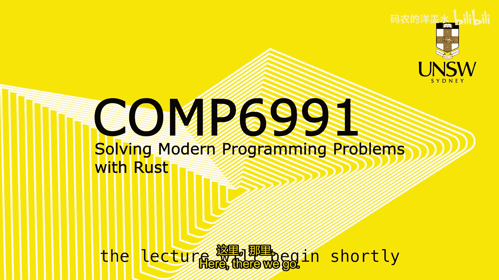

Man， that is some poor lighting。Hello， everyone。Yeah， let me pull out my magic。Courat hang a stick。

 there's the。Theres the decent lighting。There we go。Hello， hello。Let me make myself big。 Actually。

 no， that'll ruin the chat。 No， will， whatever I'll stay small。Hello。So。

Welcome to what is effectively。Our like last content lecture。In 6，9，9，1， I think。

So we have you know we still have week 10 and there's still lectures set during week 10。

 but there's no like accessible scheduled content so we're still I'm still trying to decide you know what we should do with week 10。

You know， one thing I， I can mention is that when we would， you know。

Still in very much like the planning phase of the course。

You knowve been we've still been planning the course over the you know the year or two before before you know。

 the start of term。And the Sebastian Sequoia Grayson， who you and I study very smartly snatched up。

 gave a very nice piece of advice when I was chatting to him one time about about 69，91。 he said。

 make sure you have absolutely no scheduled content in week 10 in case everything goes horribly wrong and things start running over time and all that。

And fortunately， we I believe we've made it to， you know， well。

 I guess we've almost made it to week 10。 and we haven't we haven't totally crashed and burnt。

 And so we're actually in like the good case here where it turns out maybe we don't have too much to worry about next week。

 This is also going to be our last week of weekly exercises。

 So the weekly exercises have been released。 they were released a little late。

 I mentioned on in Monday's lecture that Sre has now。😊。

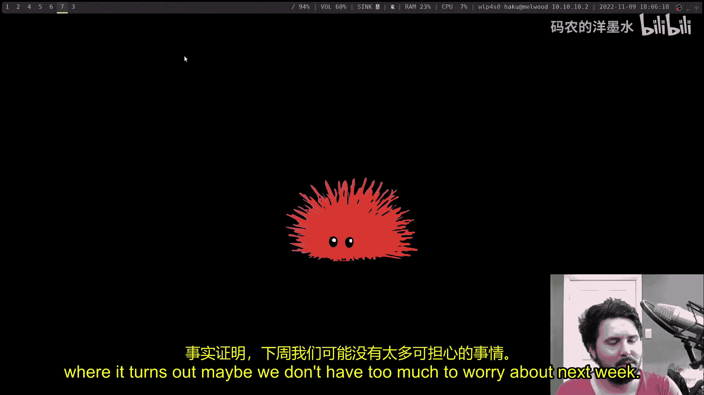

Disappeared overseas， excuse me。And he was usually in charge of the weekly exercises。

 so Tom and I had to we ended up picking up some of the work there， but it's now already。

 we've got three exercises viewed this week rust to C。

 which is about calling a secret C function from within rust。Unsound unsafe， which is about a broken。

 unsafe program that has some undefined behavior in it。

 which you are meant to patch up and then my RC where you actually get to make the RC type yourself。

 which is also pretty cool。😊，Now， because we were a little late in reallysome。

 usually they come out Sunday night， Monday night， something around then we don't really anticipate many students end up doing much exercise work on say the Monday。

 Tuesday or even Wednesday really just because we usually haven't covered all the content necessary。

 so hopefully it doesn't disrupt your usual flow and plans too much but as a bit of a courtesy we have extended the deadline by a day。

 I have mentioned that I have no real problem with changing this to be week 10 Friday as well。

 like adding another day onto that but again we've usually found that students prefer to have very separate distinct deadlines for assignments and weekly exercises and that sort of stuff。

So this is just what we opted for。 We can't do a weekend or a Monday deadline， sadly。

 But if you would strongly prefer。This to be a Friday deadline instead， I'm happy to extend that。

So just make your voice heard on the forum， I think there is even a post on the forum currently。

About this， which I believe is extending the deadline till Friday or Saturday。

 We can't do Saturday again。 But if you agree with this， if you want to see the deadline Friday。

 just， you know， maybe give this heart a post sorry， this heart a post。

 this post a heart or like reply with any of the thoughts you have。

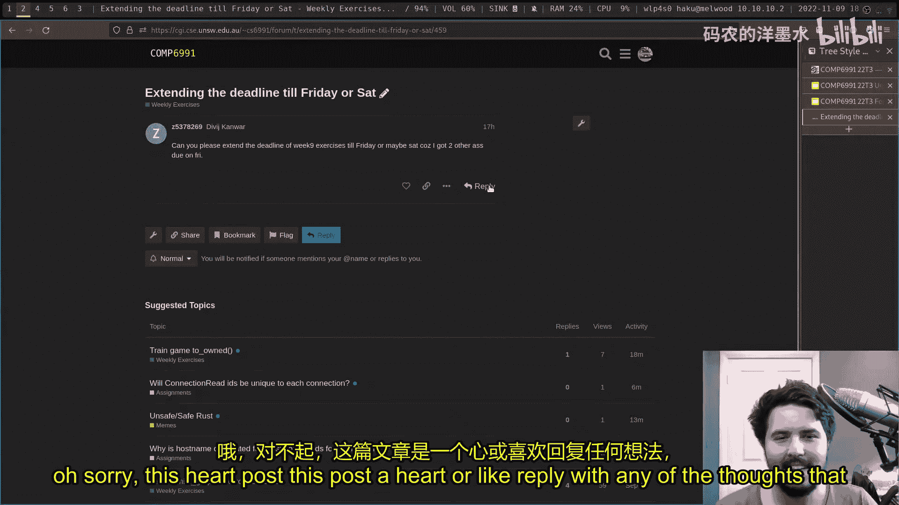

And if there's。Significant support， I'm happy to bump that to Friday as well。So。

We're talking about two things today。 This is I， I think this is going to be a really fun lecture。

 if I'm honest， we're talking about two things， which is finishing unsafe that we were talking about in on Monday and then also talking about foreign function interfaces or FFI。

 and it's gonna to be like a bit of a。😊，I， I think it's gonna be a bit of a psycho mode lecture。

 P psycho mode in that we're gonna be writing like some pretty psychotic code， some pretty。

 some pretty。😊，Maybe it's slightly egregious， dangerous code。

 which is it's always fun where there's some risk and some you know some unafety involved。😊。

And we will absolutely take some shortcuts in some places to make the lecture fit and all that。

And it's， it's gonna be pretty fun。 Things will probably go wrong。 Im。

 I'm relatively excited for this one。 So we're gonna start off where we left off with unsafe。

 which is trying to create a sometimes usually sound Vck。😊，Which is basically to say。

 like I'm not 100% certain that this is going to be so I am certain that it's there's going to be unsoundless in certain cases。

I think I'm reasonably confident that in the usual cases it it should be sound like what we write should end up being sound。

 but I would be more than happy to be shown or proven wrong And so I think we're just we're really just going to be having fun with it。

😊。

And yeah， just just really playing around。 So， oh， another quick note。

 I mentioned last week that the primary tool for testing unsafe code， unsafe rust code is merry。

 the rust mid level intermediate representation interpreter。

 which basically interprets over your rust code and looks for naughty things。

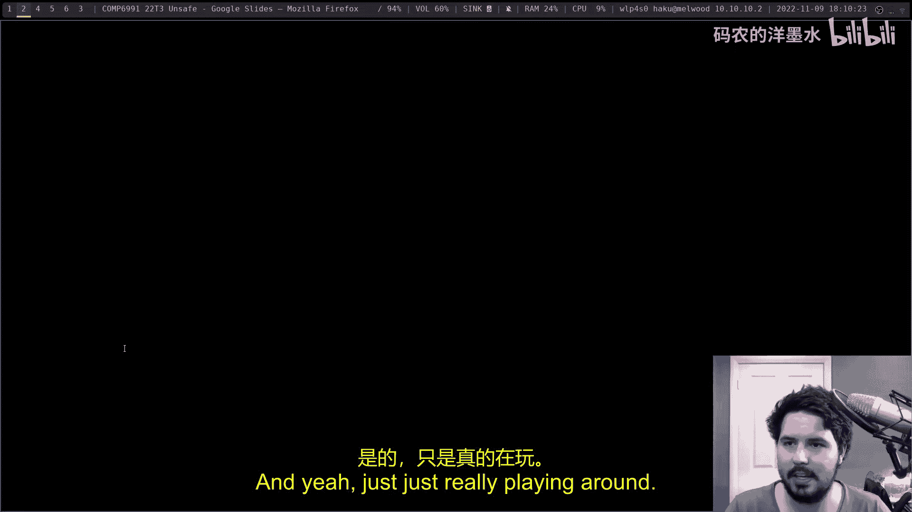

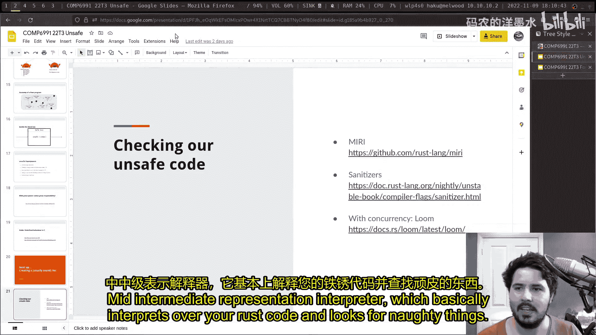

I did。 after a lot of pain and suffering。 I did manage to get Mi installed on CSE。

 So you should be able to run 6，9，9，1。Cargo， plus nightly。Miary run like this， essentially。

So Mi is a nightly only tool because it uses a lot of unstable rust features so you need to tell it to run on the nightly channel and then you should just have access to Mi Run。

And this， you know， I would， if you're working at home， I'd suggest installing Mi yourself。

 which usually looks something like rust up plus， yeah， Ru up plus nightly component ad mirror。

 something like that。And you should be able to run Mary then at home yourself。

 but running Mary on CSE is also now a possibility Also some of the auto tests run Mary so the unsound unsafe runs your code with Mary to try and check to check that the undefined behavior is fixed it might actually be sensible to run the myRC auto tests with Mary as well now that I think about it。

But I don't believe they do yet because I ended up。 it It was a real big。

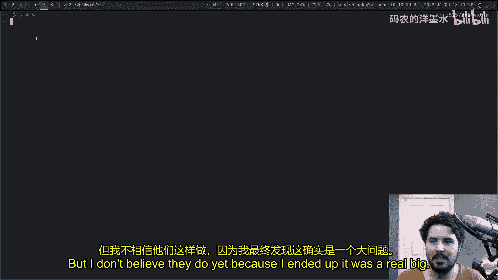

It was a real big escapade getting Mary working in auto test as well。

 so I might actually update the RC exercise potentially after the lecture to use Mi as well because that seems to make a lot of sense。

 maybe running that even just both normally and with Mary might be a good idea。Anyway。

 let's write some P psycho code。So our idea is that we'd like to make sort of like a minimum viable V。

😊。

So we should be pretty familiar with Vec at this point。U you know， in the sense of we have our list。

 we can push things， we can， we can pop things， we can get things in index， something like， you know。

 all this kind of stuff。😊，In terms of what we'd like to write ourselves。Well。

 let's do cargo new live。 Let's call it。I'm going to call it Vec insane because we're just sort of going insane with it。

 And it's， it's not really， I'm not expecting us to take this， you know， as absolute gospel。

 It's more like this is， you know， me doing， you know， mostly my best here。

 And I'm probably going get some things wrong。 And， and that's okay。

 We're writing a bit of like slightly insane code。I guess we'll keep。 we'll keep this。

We'll get rid of that。 Okay， and so we'd like to make some kind of like my V of T。嗯。

And what would we like to see on like， what would we like our API to support。Well。

 we're definitely going to be able to make need to be able to make a new V。

 So pub the new goes to a Vck。We definitely want that。What else should we support。

 Because we're not going to write all these functions to be clear。 that would be seriously insane。

 What's pretty important， I guess push push is pretty important。

 So we're going well want to write that。Pub and push at Mu itself。 value is some T。To do。

And if we're implementing push， I think it sort of makes semantic sense to also implement P which basically just removes the last element from a vector and gives it back right and if the vector is empty。

 then it returns none instead。So， pub and pop。At itself。 and that gives us an option。Of a tea。To do。

What else is pretty important， probably like getting the the like get method。

 get me an element at bh index。The alphabet is hard。 Oh right， And they get get in this case from。

 from a trait implementation， which would be index。I believe get comes from。

 Does get come from the index， Am I crazy。I think it does。Index。Yeah。No。I mean， we can find it。Oh。

 slice。 Oh， of course， Of course， I'm silly。 It's coming from a slice。 So Vec， you can。

 when you do like Vec dot b， it implicitly can dereence into a slice。 and then the slice。 Okay。

 so we'll just implement get ourselves。 So we'll have a pub and get。

Takes a shared borrow of self and an index， which is going to be some index into the V。

 and that should give back some option of a T， okay。So let's say this is the API we'd like to create。

 but we don't want to just like do this by going like， you know。Take someone。

 someone's already written， you know， Vec and then just use Vec and inside。

 We wanna actually pretend as if we were making Vec ourselves here is the big idea。

 What are you upset about， Oh okay， not using T yet。 That's fine。Great， so， I mean。

 we can start with a test as well。 Now， like we've got our API surface。

 so we should be able to write some sort of a test like Pubfinin。 sorry。

 not pubub just like a function。😊，It works， it's fine by me。

And we'll just say something like let mute Vc equals my V new。We'll say V dot push。Hello。12d。啊。

 you know。です。I。Com 6，9，9，1。 And then we'll just say like 4 I in 0 to 10。Something like that。

 print out。The debug representation of V dot get of that index I。 So we've done new， we've done push。

 we've done get。 We haven't done pop。 So maybe V dot pop。

And I guess it makes sense to print out anything that we pop。I'll just say like pop this。Like that。

 pop three things off and then maybe just do this whole index loop again。And I mean。

 this is not a particularly good test to be clear。Not a particularly good test at all because it's not actually testing anything really。

 apart from the absence of panics instead its just like it ends up printing stuff out。

 but like I'm fine with that in principle just to sort of help us like just to help us see。

What how our V is working if it's doing the right thing。Okay。

 so we've got a little test case ready to go。 but right now it's just going to immediately break because we haven't written my back so。

How should we implement。A v。I guess it's a good point to oops。

 it's a good point to probably hop onto a drawing tablet。And think about what a V might look like。

 So we have my Vc。Of tea。So like how should we end up structuring something like this？You may so。

We should probably stop by saying like laying down some principles in that a Vec is very dynamic。

If we just sort stored like， you know， values is like a T here。Thatd really be no good， because。

Like when we're sort of storing something in line here。

 right without using a box without using Maikin free，Essential。

 we could only store like a fixed amount of these values。 So even if we use something like an array。

 like we could only we'd have to write a number in here， you know，4096 T's or something like that。

 And we have to store exactly 4096 Ts。 So that's really not going to work for us。Instead。

 we're going to need something like a pointer to some box allocated sorry some box allocated memory or something like that。

 just memory that's been allocated for us。That can grow and shrink over time。

 So we might start off by saying we have like four elements。 You know， like here's， here's a T。

 Here's a T。 Here's a T。 Here's a T。 And when they go to push a fifth element。

 we expand our allocation。 So it's， you know， can hold。8 teas instead，1，2，3，4，5，6，7，8。

 and just sort of manage a pointer to this。 right， manage some sort of address of this overall。

Allocation， right， an address of where we're storing our Ts。Far away。

And just mess around with that allocation as required。

 And then we could probably use a couple other fields to keep track of what sort of the current state of the V is in terms of like how many things we have and what our allocation looks like and so on and so forth。

 So does anyone want to suggest。 I'm not sure how many chatters we have today。

 But does anyone want to suggest， I'm going to say we probably need two more fields。

 If this first field is some kind of pointer out to where we want to store the Ts。

 There's two more fields that would be particularly useful to us of some， you know， name， some type。

Does anyone suggest a field that might be helpful if we're trying to implement that ourselves？嗯h哼。😊。

So Mitch and Alex saylen and size， which I think are really the same thing in this case。

 La size both fine。 I'll go with size I guess， So size and that's gonna to be of type probably use size here。

 which is just how many elements are currently like stored in the V like the user calls push once。

 there's one element in the back the user calls push twice there's two elements in the back。

 but we also need to keep track of you know if we've only sort of allocated room for four right now and a user wants to push a fifth on the end。

 we need to expand how much room we have So as Simon mentions it's probably worthwhile to keep track of a total capacity as well。

 which is how many elements are we potentially able to store right now with like this pointer here maybe I'll just call this like pointer or something inside this like allocation that the point is pointing to how many things could we possibly store until we need to grow the allocation。

😊，So how many elements has the user actually put in the thing。

 How many can we possibly store at this point。 So that all seems pretty good。

 Let's throw in the size。 size is a U size and capacity is a U size。Now。

 what type are we going to use for this， right？ It's a pointer。

 And I've mentioned in the lectures before pointers are kind of like references in rust。

 So is this going to be like a reference to a T but they might want to modify it or something。

 So maybe we need a mutable reference to a tea。 but then we're going to need a lifetime in here because it's in astruct and you know。

 this is all getting a little complicated。 maybe we could do like a box of a tea。

That could maybe work， but then a box of tea only lets us store one tea sort of similar to the rest of these。

 you know， this is all。A little too restrictive。 And as Alex mentions。

 what we probably want instead is just a raw pointer。 right， So as star something of a T。

 there's two generally two options here， a star constant T or a star mute T。

 And these are just like it's an address。's， it's some kind of pointer to some location in the memory。

 And there's very little semantics past that。嗯。It's that's a rather untrue statement that I've just made there。

 There's rather little semantics past that。 In fact。

 Rus still requires that you're following a lot of， you know。

 very particular rules as we come to learn throughout this course and those rules。

 all those rules do still apply in the context of working with raw pointers。

 but they sort of let us opt out of all the static information in a certain sense。

 like life excuse me， Lifes or， you know， boxes model of things and so on and so forth。

So really just like a raw point up。Now， what's the difference then between star con and star mute。

Im I'm sure like， okay， so let's just choose one of them star con starmi。

 I guess we'll just do the first one。 starcons T。 and it seems to compile right。

 It's just a pointer to in fact， this could really be a pointer to anythingca again。

 the pointer doesn't really carry many semantics， but we're sort of signaling to rust that this is going point to maybe a T most likely we're going be looking at T's at least from this pointer。

嗯。But， you know， so so what's the difference then between a star constant and a star mute？ Well。

 let's say I had a T here。I can easily create a stock on stage just by saying， let。My let。

 let's say let my pointer equals。Grab a reference to that value and then turn that into a star cont T like this。

And that's fine。Now you might go， oh， let's say you want to make a star mute T。

 You probably have to do like a ref mute value or something like that instead。

 And let's see if this works。Okay， fine。 It's， that's， that's just a little thing。 Right。

 And that seems to work as well。 What might surprise people a little bit is that。This。Well， okay。

 fine， you're not surprised yet， oh okay， that doesn't seem to compile there。😊，If I do this。

It does compile right， that's what I was getting to。 You might be surprised to see that this works。😊。

Take a borrower of value， turn it into a stock on tea。

 and then turn that into a star mute tea with no unsafe or anything like that yet。

Ha that's interesting。 So like， I suppose that means if I have this star constant， my pointer。

Then I should just be able to take that star honesty that I had before and turn it into a star mute。

 And， yes， I can。 in safe rust。 mind you。 So that's， that doesn't feel very rusty。 You know。

 I can just take a cons pointer and turn it into a mute pointer straight away like。

This is feeling a little suspicious。 So let's go to the the。The pointer primitive type here。

So roar unsafe pointers， Starcons10 star mute blah， blah， bla， bh， blah blah， blah。

 I thought there was some。Where is the dot， There is some do。Hello， okay。

 there is some documentation on。Yes， I know。 Provience， yes， Proence， very cool。Where is the。

There is some documentation on the difference between star constant starmute。But。I am missing it。

R star con first。Where are these。Am I crazy， Maybe it's。Maybe it's not in the standard docs。

That seems weird。 Anyway， So basic， there's， there's very sort of。Like。

There's very specific differences between them that are like quite。They， they don't really。

How do I say this， There are some very。Like in the weeds differences between star constant star mute。

 but they are generally effectively the same。 So one of the things they vary in is something called their variance。

 which is kind of funny。 They vary in their variance。

 which I'm assuming S overflows probably going to talk about here。呃。Do they talk about it， Yeah。

 the only other difference is the variance of the types。 And I think that's all there is。 And。

 but right。That's okay fine。 That's so basically like the only primary difference。

 apart from the variance idea， which where we might not even have time to talk about today。

 is just sort of signaling their intent in a certain sense。 When you write sarcons。

 you're sort of signaling that you're probably just going to be reading this thing。

 Maybe you don't even necessarily seem to own it。 it's more of just a signaling， hey。

 is this is roughly what I plan to do。 but it doesn't really mean anything because you can always just turn it into a star mute at any time。

 So it's just more of a communication thing and star mute kind of signals in like the opposite sort of sense。

 I' maybe plan to mutate this thing。 maybe I actually plan to sort of own this thing and be responsible for it。

But， you know， we're in Royal pointer land。 So we've thrown away all those nice safety。 Well。

 we've thrown away some of the nice safety guarantees of rust and。

 you know all the code that's being written here needs to be like pretty careful。

 And I serve and use the point yet。 So it's still okay without unsafe。 Yeah， that's right。

 So if I had tried to actually like use either of these pointers at any point。

 Ru would be very upset because that's the part that's really unsafe。

 You can do all kinds of horrific crimes with pointers。

 It's only really like a serious problem once you get the thing at that pointer essentially。

 And that's how rust models this with unsafe。 So。😊，Star constant star mute T。

 what do we really plan to mean here， probably star mute T signals a little better what we want。

It does actually give us the incorrect variance， again。

 something that we may or may not have time to really talk about。

 but that's something that can be patched up later with another type known as non null。

 So if we don't get time to talk about this， you can do your own reading if you're interested into things like non null and how that can sort of fix our variance problem here anyway。

 So a raw point to this allocation seems relatively sensible。嗯。Great。

So what would we like to do next？ Well， let's start off with new。

 So how are we going to make a new one of these。I guess well write Sefio。In fact。

 let's get rust analyzer to fill out these fields for us like that。 Oh。

 why would you put them all on the same line， You horrible tool， Okay， there we go。

 that's much better。 Okay， so when we create the Vec。 One of these fields is really obvious。

 The size is0， right， The user hasn't pushed any elements in。 So the Vex should be empty。

 so that seems all right。What should we start the the pointer and capacity off as， And here。

 there's maybe not a necessarily correct answer。You could start it off with， say， like， let's say。

 come up with some default number。 Maybe that number to you is like one。 Maybe you go， oh。

 one is who's ever going have a V with one element in it。

 Maybe we'll start it off with four elements，8 elements，16 elements， something like that。

And that's certainly an option。 the option that the rust standard library takes。

Is actually to start off with a capacity of zero。嗯。I think it's documented in new。

 The vector will not allocate until elements are pushed onto it。 So the idea is。

 maybe you have a whole bunch of empty vectors and you only push to them every now。

 like only some of the vectors get stuff pushed into them。

 you don't want to have a whole allocation for a whole bunch of vectors just to store 0 elements just to store nothing。

 So instead， we'd like to start the capacity off a 0。But if there's， you know， no current capacity。

 There's no allocation。 What are we gonna make this pointer。

 Maybe just we'll start it off as something like null。 So I can do stood pointer。

 There's two functions here。 null gives us a null pointer as a star constant。

 null mute gives us a null pointer as a star mute。 So null mute makes our types check。

 and we have implemented my Vc nue。 So we can create a new vector。 And so far this seems allright。

So you're not really going to be able to do much with it yet。

 So I guess the next thing we'll think about is if we want to push into the vector。

So we're immediately going to run into a problem， which is so far for what we've written。

 if we push to the vector， it's always going to start with this with no capacity。And。

So how are we going to like push to a null pointer， right。

 We need to have some sort of way to expand our capacity， right。

 So there's two cases where this happens。 We might have no allocation yet at all， right。

 It's just being created new and there's no， you know， there's no allocation like this yet。

Or potentially we have allocated some amount of space， maybe  four， maybe eight， maybe 16 elements。

 something like that， and we've filled up what we've got and we need to make more room In both of those cases。

 what's the relationship between size and capacity。Right。

 like what's the what's the like in the case where the vector has nothing yet and the case where the vector is now full。

 what's like unique to those situations in terms of a relation between the current size and the current capacity。

Ovalk。Size is equal to capacity。 That's right。Sir。We can say something here like if self size equals self capacity。

Then we need to expand。We need to expand like we need to like， well。

 we need to like allocate more memory regardless。So that seems like a good idea。So。

This is our public interface here。 We might need to write some more sort of private helper functions to help us do what we want to do。

To like to make these public functions work。 and so a function we might immediately start to think about is something like expand capacity。

So maybe we say something like expand， expand capacity will double the capacity of the MyVec。

If non empty。Or allocate。Room for let's， let's， let's。Maybe make some。The constant default capacity。

Oh， like maybe that should be called， something like first capacity。Man。

 I'm thinking about a name's initial capacity seems like the right one here。

 initial capacity is gonna be like eight。 maybe let's say you can if you all want a different number you can give me a different one。

 maybe we'll do four so it's easier to test， I guess。

 allocate room or allocate room for initial capacity。😊，Elements， if。There is currently no allocation。

If allocation fails， this function will panic， let's say。Okay。So。After like no matter what happens。

 after calling this function， you should have room for more elements。

 you should have room for at least one more element， I think is's fair to say。Because if it's empty。

 then we'll have room for four elements。 And if it's not empty， and we call this。

 we'll double whatever we have and say doubling。The current capacity of four will give us room for eight。

Doubling a current capacity of 8 will give us room for 16。 So we'll always end up being like。

 if we just。Right， that is to say if we just write self dot expand capacity in here。

 then now now we're always safe to push one more element。Is what I'd like to say essentially。

So if the self size is equal to the self capacity， expand the capacity。

 that'll always give us at least one room no matter what。

 and so then we're safe to push that element on。😊，All right， so expand capacity。

I mentioned before there's two cases here。There is the case where。We haven't allocated at all yet。

And there's the case where we have allocated， but we need to expand our allocation。Okay。

 so now we get into the fun stuff。 and let me like be， let me be completely transparent and say like。

I'm， I'm not coming into this lecture， not having attempted to write my own V before。

 I have a a bit of a crappy little implementationation on the side。

 and I'm absolutely using it for like notes to refer to。 if you see my。

 my eyes dininging across my screens。 I'm double checking what I'm doing because writing on safefe code is tricky。

 I made a lot of mistakes along the way with that one。

 So like I'm not gonna not to pretend I'm the big genius here， I'm consulting my notes along the way。

 So so， yeah， anyway， we'll， we'll get there。 So。😊。

Roust has a allocation module in the standard library， which helps us just allocate raw memory。

 It's pretty handy。 The functions that it has here that are of particular interest just to us are ac realalc and Dalc So this is allocate me some memory。

 reallocate is here's an allocation that you gave me previously。

 I actually need a different size for that now。 So usually this is like give me more memory。

 but it sometimes can also be I actually am using more than I need so you can shrink this down now。

 but let's consider the case of I need more memory。

 What it'll do is it'll try and grow your allocation where it currently is。😊。

And if there's room to do that， it'll go great。 All done。 you've got more room Now。

 If there is not enough room to grow your allocation。

 it'll make a new one of the total size that you would like and copy all your old data into the new into the new allocation。

 So it's a nice handy function for us。 And then Dic essentially lets us free the memory we're using When our V is eventually dropped。

 right， dropping。 that's probably something that we can think about as well。

 So something like Iple drop for Iple for any type T drop for my V of T。😊，And。Drop to do。 Okay。

 so probably here we're going to want to like free our free our deck and stuff like that。

 So we'll consider that a little later。Alright， so in the case where we haven't made any allocations before。

 AlEC is probably the function we're looking for， so it'll allocate us some memory。😊。

It wants to take memory through thisstruct layout， which essentially just lets us say heres here's how much memory I'd like to allocate and C you might be used to like Malick in C's case just taking some amount of bytes It's a pretty similar idea。

 but we're just construct the bytes through this layout you can just pass layout straight up like an amount of bytes。

 but you can use a little bit of extra convenience with it。 So I'm going to make a new layout。

And there is a layout array function， which is pretty handy。 So it will basically tell the。

It'll tell the allocator。Sorry， we， we just give it like how many elements of a certain type。

 Let's say T that we would like to include that we'd like to allocate memory for， and it'll give us。

Not only how many how many bytes that'll take up， but also the requirement on alignment is is what we're talking about here。

 which is essentially。呃。Some types require themselves to start on a， like。On a multiple of N bytes。

 essentially。 So some types don't care at all， place me at any address， and I'll be happy。

 but a lot of types need to be stored at an address， say divisible by 4 or an address。

 say divisible by 8 or divisible by 2 stuff like that。 So this it'll end up handling all that for us。

 which is pretty nice。 We tell it wed like to lay out an array of How many T's are the initial capacity Ts。

😊，Cannot find initial capacity。呃。Are you crazy。How I spell it wrong with something。Initial。

Initial capacity。呃。Self colon and colon initial capacity。I didn't know that the。

 the constant scing was， was weird like that。 That's interesting， cool。So lay out that many things。

 it also returns a result， why will it return a result。

 Because if there's some sort of arithmetic overflow if the total size would exceed the max of an eye size。

 these are the kinds of things we're really not going to care about in in this like demo and we're just going to say unwrapped a lot of these things and go screw it。

 it'll be fine hopefully。😊，So now we have a layout and we can say。😊，So stood aec。

 call that ac function， pass it this layout。 and hopefully that gives us back some kind of pointer。

And it's going to probably be really upset because this is unsfe。

So we're going to throw this in an unsafe block。And our safety。Is well。

 what are the requirements on ALEC？Safety C global acalc safety。

 it's unsafe because you need to make sure the layout has non zero size。😊，嗯。And so that seems fine。

 Safety layout has non0 size。 So this is why this operation here is actually safe to do。

So that seems fine。 And finally， we now have a pointer to an allocation with that much capacity so we can set ourselves accordingly。

 Self dot pointer is going to be this pointer。 Self do capacity is that initial capacity。😊，Like this。

Cool， now it seems that this is actually like Alec gave us a pointer back to U8s。

 We're expecting a pointer back to a T。 this all doesn't really matter to us。 Like。

 we can cast between pointer types as we like。 And we know it should be fine to hold T's there。

 So you can just say， well， I could write the full thing here。 pointer as star mute t。

 But the compiler is smart enough to see what I want to convert it to。 So I can just say cast it。

 You know what I want to cast it to。 And so I just throw an underscore here and it infers what I want。

😊，Cool， that seems pretty good。So now we should have a default capacity and in fact。

 I think we're okay to start testing for up to like four elements if we and we can maybe leave this other case for later actually we'll just do it now we're already at like aEC and stuff like that。

So。If we already have an allocation， then we'd probably like to just double the current capacity。

 right， Reallocate what we have with double the room。

And so we'd like to do something like self capacity times two。

 This can like technically overflow if it gets so huge。 it's like it can't fit anymore。 blah， blah。

 blah， we might as well just do a checked multiplication of two。😊，And if that happens to overflow。

 right， Check mo check mole gives us back an option。 If it doesn't overflow。

 then it gives us some of the result。 If it does overflow， it'll give us none。 and we'll just say。

You know， if it goes wrong， then capacity overflow and we'll say， let new capacity equals this。Okay。

So then we would like to call that realalic function。

 We've got a current allocation because we're in this else block。

 but we need to double the size of it and keep the old memory that's that's already there。

 So we want to use realalc。Shrink or grow a block of memory to the given new size。

 It wants the pointer to the allocation。 Great， We can get that。 That's， that's fine。

 It wants a layout， and it wants a new size。 So what is this layout for。

 It says the block is described by the given pointer and layout， right。

 So what it's telling us is that the the。😊，The layout must be the same layout that was used to allocate the original block of memory。

 So that's basically it's wanting like whatever layout we made for the previous thing。

So maybe it's a good time to make a bit of a helper function down here。So something like layout4。

That just takes。Like N elements。Is some u size and it gives back a layout。

And we're going to take all this stuff here。Like that。 So this is layout for self initial capacity。

 This here is going to be the layout， layout in array of n elements。

And now that we're going to use this should be cell layout for。

 now that we're going to be using the same layout for function everywhere。

 we can probably say something like let old layout equals。The layout 4。The current capacity。

 So that was， that should be like what was used， you know， the layout that was used when we。

 when we wanted to allocate previously。So that's the old layout。

 we've got the new capacity that we want。So the new capacity。

 I'm going to have to turn that into a a new set of sort of size and bytes。

 So we'll just make a new layout is going to be， again， layout for the new capacity。So actually。

 maybe， maybe we'll do it like this。So here's what we want the new capacity to be。

The old layout looked like this。 The new layout should look like this。 Now， hopefully。

 were ready to do a reallocation。 So I wants to know。

 what's the pointer to the allocation that we're reallocating。 that would be self do pointer。

 which we know is a star mute T。 It wants a star mute U8te。 So we'll just cast that away。

 That seems fine。😊，We'll give it the old layout。 That's what it was allocated with。

 And the new size and bytes that we want。 Well， layouts。

 we can just look at the new layout that we want and grab that size and bys。

And that should be pretty happy。 So new pointer is going to be called this unsafe operation like this。

And it seems relatively happy with that。 So let's check the safety。 So we have another unsafe block。

 So we want to argue our safety。 The pointer must be currently allocated by this allocator。

 We allocated self do pointer our。😊，The layout must be the same as the one that was used to allocate that block of memory with。

With a layout， equal。To old layout。Okay， sell pointo oops。New size must be greater than0。呃，你。

And the new。New layout。Ha is greater than 0 by in size， for sure。

And the new size when rounded up to the nearest multiple of layout line must not overflow。

We'll just say， and we assume it doesn't overflow。And I'm gonna add like a cheeky emote here just because like this is not a safe assumption to make。

 If someone makes a really big v， then they definitely will run into undefined behavior。

 So this is like， this is definitely an unsoundless warning right here。

 But this is like sufficiently annoying to check for。

 that we're just gonna leave that in here for this lecture。

 But this is what I mean where it's gonna be like sometimes sound will like mostly sound。

 But there's definitely gonna be some holes in in what we write。 And that's why we use， you know。

 the libraries that other people make。 when we can， because， you know， because it's。

 it's not entirely trivial naturally。 But great。 now we've got a new pointer。 And so same thing。

 Self pointer is the new。😊，Poinト。Cast that as what we want。Self do capacity equals the new capacity。

Awesome。Okay， so now we have a way to expand the capacity。

And generate like the current layout for and elements。Awesome， so this expands the capacity。

 We're always now safe to push one more element。 So any questions about the， you know。

 the crimes we've committed in this expand capacity function before we go back and keep working on push。

😊，I'm gonna double check my notes in the meantime time， as well。I mean， if I'm honest。

 that's like probably the hardest code right there。I mean。

 there's some gnarly stuff and we can sort of tune how far we go with this。

 but that's like the the sort of most difficult part in doing like the actual allocations themselves。

 So Im super happy to take a pause for any questions or whether you feel like it's you know related or not I'm super happy to field questions。

😊，Shouldn't we just add the initial size again rather than doubling every time？

 That's a really great question So the reason I've sort of opted to double here is that's what the the standard library vector opts to do I'm guessing is there a here we go capacity and reallocation。

 So blah， blah， blah。yeah， it automatically increased， for example。

 blah blah bh blah blah blah blah blah blah bh blah， blah。Double no， okay， they don't really specify。

 I know they do do this， but they maybe they don't talk about it here because they don't want people relying on it probably。

But they choose to double， as opposed to just add， say。

 another four elements or add another n elements because it tends to scale better。

 So allocation and you know especially this reallocation in this case can be really expensive in terms of performance。

 And so you want to allocate as infrequently as possible generally。

 but you also need to balance that with not using more memory than you necessarily need。

 So in our case， like we could really minimize allocations by just going allocate memory for a million elements straight away。

 and that'd be great。 we probably only need one allocation like all the time。

 but we'd also like waste so much memory， because even if the fact only uses three elements where're paying for a million elements worth of memory。

So that sort of balancing act。Not allocating too frequently， but not wasting too much memory， the。

 the multiplying by two strategy is relatively good。 So if it's getting bigger。

 it will likely get much bigger。 Yeah， that's the big idea here。

 is that if a user has 1000 elements in their V。Is that like is the difference between having zero elementsilments and。

Let's say having is the likelihood from a V having zero elements to 10，000 elements。

 the same as the difference in likelihood between a V having a 1000 and 20000 elements， essentially。

Which is probably not true like some Vex generally will stay relatively small。

 Some Vex might end up with an absurd amount of things in them。

 And so we try and balance for the things that are going to remain quite small and the things that have an absurd amount of stuff in them。

 But it's again， this is not necessarily like the right way to do it。 It's just like an option。嗯。

Okay。And I guess the， and I can sort of argue the。The if we were adding for each time。

 another way to think about it is the difference between going from zero elements to four elements or say。

 four elements to like 8 elements。Is that roughly the same sort of， you know， does it。

 Does that feel the same as going from a million elements to a million and four elements。

 So that's sort of maybe a way to think about it。 But again。

 not really necessarily a right answer anywhere。Okay， so here's our expand capacity。

 now we're ready to write push we know after this comment。😊。

We are like if we go to this like the if we follow this pointer here and move like size T's across。

 there will always be room to insert a new T at the very end there。 So we should be happy there。Now。

 I， in my implementation， I wrote another helper function， which might be a good idea。

Which is function pointer to Elm。So it takes a borrowough of self。

A borroworrow itself and a index and produces a pointer。To8 so essentially。

Using this pointer that we've got in here。Create， I would like to create a pointer to a specific index。

 So when that index is 0， it's probably just going to be the pointer itself。 But if the index is 1，2。

3，4，5， it's probably like past。 that's the start of that pointer。And this seems relatively simple。

 It's grab that pointer， and we want to add on some amount， this like count here。Units of T。

 So a count of three represents a point offset set of three times size of T bytes。 So essentially。

 we're saying。You know， add on to this pointer。Index times like index Ts across。

 which is pretty nice。Note that this is unsafe， though， right， Self point addd is unsafe。

 That's a little interesting。 Why is self pointer addd unsafe pointer addd。Here， so unsafe as we see。

 what's the safety here。 If any of the following conditions are violated。

 the result is undefined behavior。 Both the starting and resulting pointer must be either inbounds or one bite pass the end of the same allocated object。

 So the pointer sort needs to remain within like。It's logical boundary per like the allocation it's probably pointing to。

 It can't overflow。 We've seen that， and it can't wrap around。 So this is all about overflowing。

 So overflowing we don't care about。 but this is interesting。 It needs to。

 the pointer needs to remain within or one by past。

 like the sort of relevant allocation it's pointing to。I like， you know。

 I thought that we could make pointers wherever we wanted。 and it's fine。But it's。

 it's just when we use it that that it's unsafe。 like this doesn't seem to sort of add up。

 And this is actually， this is， this is all still true。And there is an explanation here， which is。

Consider right this one here。 So the only advantage of this method is that it enables more aggressive compiler optimizations。

 So this is interesting。 There is another function wrapping ad， which does the same thing。

 but is not unsafe at all。😊，Right， this operation is always safe。

 but the using the resulting pointer may not always be safe。 compared to add。

 which is the one were just looking at。 this method basically delays the requirement of staying within the object。

 Add is immediate undefined behavior when crossing object boundaries。 Raping ad produces a pointer。

 but still leads to undeed behavior if its dereferenced if it's out of bounds。

 Addd can be optimized better and thus is preferable in performance sensitive code。

 So it's really up to you which one you use。 They're basically saying like there's still going to be undefined behavior if you screw up either like now or later。

 and we probably plan to dereence whenever pointer we get up， get out from this。

 So it's just up to you like where the unsafety occurs。

I think we're fine to say that this is we'll just like use add here and throw an unsafe block in。

And the compiler seems happy with this， but we need us， we still need a safety comment。

 And this safety comment is maybe a little tricky to argue。 If we go back up to here。

 we need to make sure that the starting and resulting pointer must be inbounds or one by pass the end。

😊，But a user could give us an index that's like， completely ridiculous。

 they could give us index that's just not valid at all。HSo we have two options。

 We could say if the index that they give us is greater than or equal to our current capacity。

 then like， do something here， like， you know， refuse to call self point or addd。

 and that might be maybe sort of。Pvents undefined behavior。 So yeah。

 that's exactly what you's saying there are God clause like this and just throw some sort of error。

What's another option that we have here If we don't want to have any guard clause and we， but like。

 we don't want to like， violate。You know， we don't want to write really bad rust that makes everyone angry。

 There's actually one other option that we can do with this function here。

And not have to worry so much about this unsafe。Do you dont have an idea？Sorry。

 I accidentally swallowed some mice。Doess anyone。HMaybe someone's typing something out。

 But what I was looking for is we could also declare this function to be unsafe as well。And like。

 note some sort of safety gar， like safety requirement that says index must be a valid index within our。

Current pointer kind of thing， something like that。

 which essentially says we're not going to check it。

 so you have to you better make sure that it's actually okay。

And then that saves us on a bit of code that needs to check it every time at the cost of， you know。

 more people having to be careful with using this unsafe。

 I think just to demonstrate the idea of having an unsafe function here。

 I'm fine to keep it like this。嗯。But it's it's you both options are perfectly valid。 Okay。

 so now we have a function to get us appointed to some element。And so in push。

 we should be able to write something like self dot pointed to element。

So let some pointer be self do pointed to element， and we currently have self dot size elements。

 So the index to like the element that we're interested in is actually to self dot size。

 If the user currently has three elements in their array indexes 0，1 and2。

 we're going to insert into index 3， which is is just the size itself。

 So this will give us a point to that， it's unsafe。

So we have to put an una block and we're gonna write safety。 We just expanded the capacity if。

 if required。And so。And so self dot size will always be a valid index。Something like that。 And again。

 this is the process of us essentially checking on behalf of the compiler where it isn't able to check these things。

 so we do that。😊，Now we have a pointer， and finally。

 we should be safe to store that user's value at this pointer。

 This pointer should be the location of some of that T。 So we should be able to say something like。

 well， I'll forget the unsafe for a second。 at this pointer。 store their value。 Now。

 it's gonna say this is unsafe。😊，So we're going to say unafe here。

And our safety argument is something like the pointer oops。

The pointer returned by self up pointer to Elm。Is is a valid pointer within our。Vk allocation。So。Oh。

 no， this is not safe。 This is actually not safe。 This is kinda cool。 In fact。

 do I get this right in this one。 Okay， okay， okay， I did get it right in in the other one。

 This is actually not safe。😊，Oh， this is a really tricky reason。 So you know。

 it's always a valid point within a regular location。 so we're safe to write to this value。😊。

They were right to this address rather。This is a really sneaky source of undefined behaviour for us。

嗯。On safetyfe is in， yes， we're going to talk about that as well towards the end of this。

This is a really dangerous line of code right here， which is， again。

 this is part of why writing onsafe Ft is really particularly tricky。 Does anyone。

 maybe this is a good thing to break over for the next few minutes you can think about。

Why is this line of code unsafe。 So let me I'll， I'll point out like what I。

 what you can assume for sure， The pointer is genuinely a valid addressed to a valid location that we can write bys to。

The value that they've given us this T is a valid T that's you know， fine to be written there。

One thing I will say is that the stuff at this point are。Value can have any size。 Well。

 value is given。 It is still a T。 So T's can't vary in size。 if they could vary in size。

 This is actually an interesting thing in rust。 Anytime you have a generic down like T。

 it by default， implies this。 It requires that T has a known size。

You actually need to specifically opt out of that saying that the team is optionally not sized。

You know， doesn't have a stable size， which things like box actually do。

So if we look at something a type like box， we'll see that T is allowed to not be sized。

Which kind interesting， but we haven't saidre we're not allowing onsized types here。

 So T will have a known fixed size， and all the sizing should be correct。

 So I'm giving you this for free here。 Pointer is a valid pointer and address within our allocation。

 That's fine。 Value is a T That's correct。 The location that we're trying to place it is also correct。

 alignmentment。 we don't。 and we're not going worry about today。 So that's all fine。

It's also fine to write to this place， but the thing to think about。

 the context to think about this in is that currently， well， yeah， currently at this address。

 there may be uninitialized data。Right， like when we say allocate， when we say aoc or realc。

 the memory it gives us will be uninitialized。 We don't know what that memory will be。

And there is something really sneaky in this line here that will actually try and read that uninitialized memory When we say at this location。

 store this value。😊，For some reason， and this is what I'm asking the chat。

 Try and think of what this reason is over the break for some reason。🎼This。

 like star pointer equals value will end up reading the value at the pointer。

Learn of reading the value at the point are before the value gets written in for a certain purpose。

 what is that purpose， why does it try and read what's there first？And I。

 I'll also one more thing I'll give you is that it's not just like some silly syntax thing。

 So I like， oh， if you wrote it slightly differently， like this star pointer reads it or something。

 No， like this genuinely is a valid line of rust that says。Read sorry。

 write value into this address here。 There is genuinely a very fair reason that Rus does write。

 Sorry， read the value that's there。At this address before inserting this。😊，Have a thing about that。

 See if you can come up with any ideas。 I'll see you all at， let's call it 9，08。 Alright。

 so see you after the break。

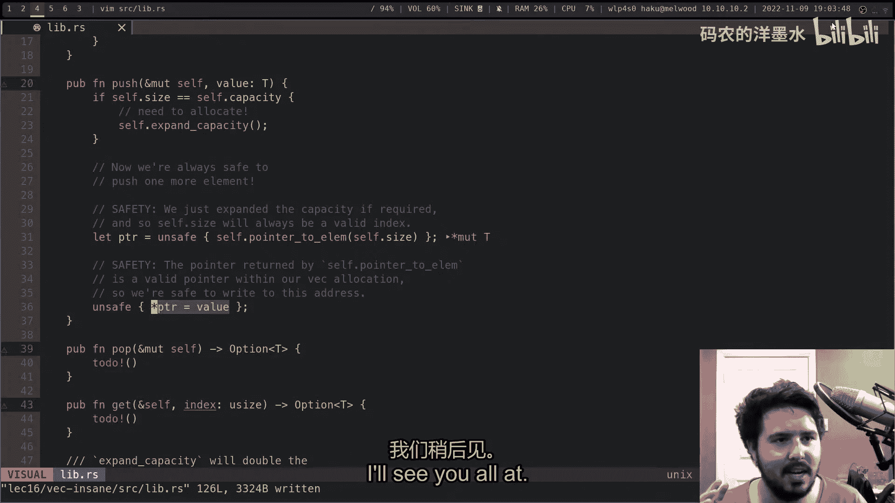

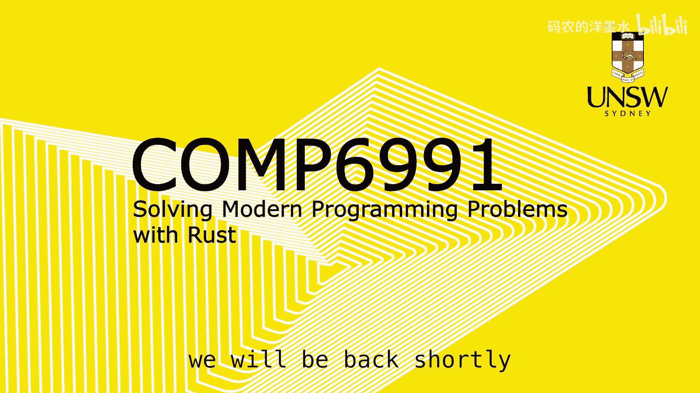

All right， so we're back from our break， and I seem to have stumped the class。

 but that's okay because it is a really gnarly thing。The trick here。

Unless if anyone wants to take a lost stab， you know， is' coming from back from the brake。嗯。In fact。

 I can even write a little example while if anyone has any last ideas。What of my feet。呃。Cant。So。

I don't see any other ideas， so I'll explain it now。When this function fuel is called。

 it creates two allocations。 box new 42 box new 123 like this。

 When fo finishes when F the functions you know， scope ends。😊，These two values will be dropped right。

 D here being the trait that we've talked about a few times。

 which is custom code within a destructor when a value is no longer needed。

 rust will drop that value E G when it goes out of scope and drop lets you run some code when that value is about to be。

 you know， when it's about to be。I don't want to say dropped。

 I guess when it is about to be dropped in a certain sense。 So for a box。

 that's really important because what does a box want to do when it's what does a box want to do when it's dropped right。

 let's say a box has some value T And when that box gets dropped。

 it wants to free its allocation right， It did Malick when you said box new Malikme room for 123。

 Malek me room for 42。When that box gets dropped， Ru wants to free it so you don't get memory leaks。

 Now， if I write the code here， A equals B。Set A to be equal to B， two things have happened here。

One is that we've taken this B and put it into A， but in doing that we've overwritten A。😊。

Right do we see that in that like this box New 42 doesn't really exist anymore。It was in a。

 but then we overwrote A with B， so。Like the two things will happen in this in this line。 Sure， yeah。

 it's going to set a to be， you know， the contents of what a B， whatever B is。

 but it also needs to make sure we don't end up with a memory leak here in that A's value doesn't exist anymore。

 So when you know， the drop code runs down here， like a literally like this box new 42 doesn't exist anymore。

And so we can't like to get to drop it。 So right before it says a equals B。

 it will drop the original value of a。 So you can imagine this turns into what is effectively。Drop a。

A equals B like that。That's essentially what it does。 And I assume this。Oh， typically， where is it。

It said， the most common way is when it goes out of scope， but it doesn't really。

 maybe it doesn't say otherwise。 Okay， whatever， that's fine。

 But writing like this a equals B will implicitly drop a in case， you know。

 there's some important code that needs to run there。 Like it's， you know。

 freed or it needs to get freed or something like that。 So then the problem with this is that if。

T has some custom drop implementation， like say if T is a box of something， and it needs to be freed。

 then de referencing， you know，' saying set this T to be this new value。

It'll go access this potentially uninitialized memory and try and drop that。 And that's， you know。

 immediate undefined behavior。 So on assignment， the pointer attempts to free whatever was previously living at that address。

 Yeah， that's absolutely right。 So that could be a little dangerous。 And so Rus thought about this。

 and they have a pointer right function here， overrdes a memory location with a given value without reading or dropping the old value。

 which is pretty handy。So it doesn't drop the contents of that old destination。 This is safe。

 but it could leak allocations or resources。 So care should be taken not to have right an object that should be dropped。

 we're not going to carry out this case， to be honest it's， it's safe to， to leak things。

 like leaking things is not unsafe and rust because it's not going lead to uned behaviour there was a huge fight in the rest community a few years ago about whether like Mem leak。

 There's there is a function literally called。呃。No， forget。Stoo men forget。

 which essentially like leaks a value。 This used to be unsafe because it was like this is a stupid function and it's probably going cause you headaches。

 but it doesn't cause it won't ever cause undefined behavior。

 And so there was a big fight for a while over whether that function should be unsafe or not。

 And eventually the rust commutericide it won't cause undefined behavior。

 so therefore it it should be safe and they made it they changed it from unsafe to safe before Ru 1。

0 was was birthed anyway。 So we're going to use right instead。

 which is a little safer for us little more sound pointed out right。

 but naturally it's still definitely unsafe。 And so we need to we need to have this safety argument。

And this on block。Great， that should genuinely be pushed done。Awesome， so pop and get us still to go。

😊，And then we then we'll test a whole bunch of it out。Okay， so to pop the last element off the there。

 we should just be able to like。Decrease the size by one。 Give them the that value back。

 We also need to make sure the V is not empty or we could end up with some unsoundness。

 So if the current size is 0。Right， if they have no elements in the vector。

 then Pop does shouldn't do anything and shouldn't give them anything back。However。

 if there is some elements in the vector， then we should be fine to do this。

 So we can say self dot size subtract one from that。 So we're taking the last thing off the end。

 so the size will decrease by one。Then we can do we can grab a pointer self dot pointer to which element。

 Well， now that we've subtracted one from size， it should just be the self dot size of element essentially。

Right， so if they had three elements in the vector， that would be index 0，1，2。

 We subtract one from the size that gives us2 The last indexes is 2。 So that seems right。

This point to element， as we've noted， is unsafe。 So we'll want our safety argument， safety。

 we checked。That the Vck is non empty。And self do size。Solf foot size。

Now represents the lost valid member。Of the Vck。Due to。The minus equals one operation。

So that seems fine。It's just getting upset about it not returning the type yet， so that's fine。

So we've decreased the size by one， so we should never end up like using that value again。

 so that's fine。We've got a pointer to it， so now we should just be able to read that pointer。

 which is very unsafe as well。So we'll say let the value equals read that pointer safety。

 I guess we can just say same as above。 It's really like the same argument。

 This is a valid pointer T to read because it represents a valid member in the V that should have been pushed on over here。

So read it， and then finally， we can give back some value like that。And that should be pop。

 Pretty happy。Cool， finally， I guess we just have get to go here。 Get nice。

 So just get me a single element。 And this should honestly be pretty similar to pop。😊。

Like they're both in essence， reading it， but like slightly in slightly different ways。

 this one takes an index， but they're both giving back an option of t and also pop modifies the size as well。

 I suppose So I guess we're going to go there's still a case that's bad in our case it's if the index they provide us is greater than or equal to the number of elements they've got then that's not a valid index to get something from otherwise don't modify the capacity。

 sorry the size just we just want to get it pointed to element of index so we just checked that the V or that the index provided points to a valid or not points to represents。

A valid element in the V。So that's fine and same as above。 And that seems all good。How we go get。

Cool。😮，I guess we get rid of this function too。Let's test it。Is there any errors， No。

 I think there's any errors。 Oh， drop。 I guess we haven't done drop yet， but。We can。

 We can do that a little later。 So does this work。Cargo test。All nuns， none， none， none， none， none。

 none， none。 Okay， that's not ideal。All nuns。 Why have we got all nuns？So what's this doing。

 It's going V dot get and V dot pop。 So it seems like these are always returning none。

 This is checking if self size is0 and this is checking if index is green or equal cell size。😊。

Can anyone see the bug that we've forgotten here？😊，Can anyone spot the bug。

 Why are we always getting back none from pop and from get。Something we've missed right around here。

 size not incremented。 That's right。 Yeah。 So I've just forgotten to do self do size plus equals1。

Right， so you can imagine if it was forgetting this one， that could really be like in our case。

 it's just the V is not doing anything useful。 It's not giving us the values。

 If I forget the selfsize minus equals1 here， that could actually be a serious soundness issue So this self-size minus equals1 is really related to the validity of an unsafe operation that we're doing down here。

 which also ties into this idea that unsafe is a little infective as Mitch mentioned earlier in that this unsafe operation kind of makes what we're doing over here unsafe in that it like really relies on it。

 And if you deleted this line of safe code。😊，It's， you know， it's now un unsafe。

 So uns safetyfeety really needs to be considered in the entire context that it's working in。

 which we're going to talk about again in a little bit。So hellello well， this is comp 69，91。

 and then the rest of the indexes were nothing。 Then we got popping off69，91 is this。

 And then the vector just had hello worldld and a bunch of nuns left。 So that looks great。

 It actually looks like it's working correctly now。😊。

Let's try and get a bit of an idea for undefined behavior， so let's run this。

 let's test this under Mi。And Mary seems to say that it's O like it seems to be working like theres there was no undefined behavior along the way。

 So let's let this test case pass in this case。

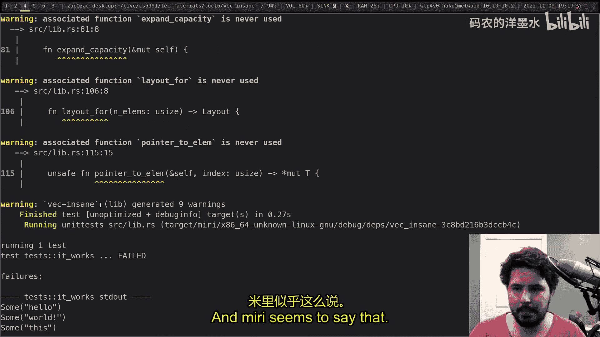

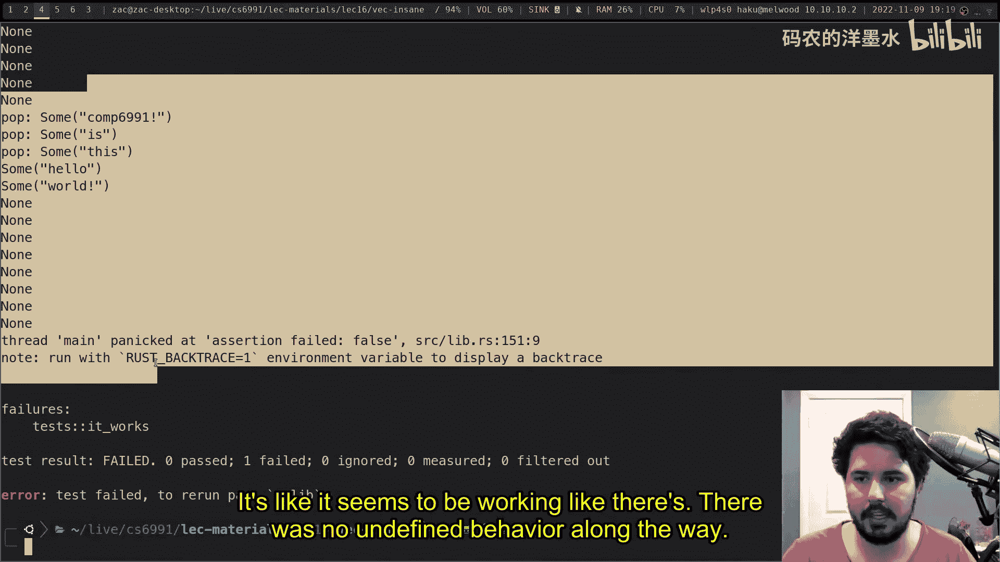

But Mi does notice an issue now now that I don't just like panic the function before it has a chance。

 Mi noticed that the memory gets leaked。 So the following memory was leaked。 Oh， yes。

 we haven't done any like dropping in the Vck。 So we， we probably need to consider that。

 Otherwise we're just gonna leak all these allocations that we're making。So。What can we do in here？

 Well， we know that we have our allocation here， this pointer。

And I think we should hopefully recall a little earlier， we saw that there was ac， right。

 to allocate memory， realalc and also Dalc or like free。

 saying that we're now done with this allocation and it just takes a pointer and a layout and you know we've sort of done this little dance here before So we'll say the layout used to allocate what we've currently got is going to be self dot self dot。

In't it layout for， that's interesting。 So layout for， are we going to be able to access this。No， no。

 no， that should be fine。 Self thought。Why is this not saying itself。Layout 4。Self thought capacity。

I it just。No method found for。Oh， right。 Sorry， Se calling calling my out for。 Im， I'm being silly。

 This doesn't actually take。 This doesn't need to take self at all。

 And so we need to use the slightly different calling synax。 Sorry。

 I was confusing myself for a little bit。So get the layout that was used for whatever we've currently got。

And then we can say Alc Dalc。Like this， we want to delocate the pointer we've got with that layout。

And this is unsafe。And a safety argument is that。We allocated this pointer ourselves。嗯。

Using the using the layout provided。Whatever， a bit of a weak argument。

 but it's probably good enough。 and we just need to cost this point to so it's happy。Okay。

 so that should delocate the， the， the memory that we stole for the vector。

 So let's see if that fixes。Mary's memory leak。It does fix Mary's memory leaks， but it。

Probably shouldn't， I'm surprised。Like that should fix one of the memory leaks。For sure。 Oh。

 because these aren okay， great。 So that fix our memory leaks。 Great， great great。 Okay， awesome。

 but we still have potential for memory leaks。😊，Does anyone have an idea where memory leaks could still potentially appear？

So they don't have any idea why memory leak could still potentially appear。

There's something that this drop here is actually potentially missing。 If it's a v of point Yeah。

 if it's a v of things that might need to be dropped。 So what if these here。

Roll actually like strings。Like not stirs， but like actually own strings that allocate their memory。

 right， If we test this again now， Mary's pissed off that， oh。Okay。

 was de reference off this allocation got freed。This looks to me， like。啊。ああ that's。1，47。

 it's saying that this got freed。Why does it think that that got freed？嗯。Do we have some Ubi right。

 It looks like， yes， when we pushed it here， it's still， we're like writing this value。

 Like if I go to stood pointer right。Stood pointer right。 It takes。 Oh， no。

 this one takes a source tea。It does not drop source。Why is source getting dropped？Let me see。

 Does dot right do the same？Yeah， without reading， Oh， that's the old value。Let me just。

So this is what I think is the potentially the correct thing to do here。 No， but this was moved away。

So， why。That's a little strange。Why is is it thing this has already been freed。pushush。啊。Okay。

 that's a little weird。 Maybe we'll save that for a little later on。

 But the idea here that I wanted to look at was before we actually。

Before we like actually free the the container that holds all these elements。

 we want to drop the elements themselves in case they need to like do something。

 So I could say for index in0 to self size call like drop right And the trick here is to stood pointer。

 drop in place is essentially like drop me a value that I get from a raw pointer。Something like this。

 essentially， this is unsafe， yes。Like that。 And you're upset， because。For index。

 is that actual underscore。 Yeah， that was an actual。What do you。Upset about。I'm going crazy today。0。

Expected， oh， missing the in。 Oh，4 four index 4。 Okay， great for index in。 There we go。 That's it。

Then basically just drop。The like the H element in the thing。

 This is not gonna make Mary happy because it's already pissed off before we get to that point。

 But this seems。Really rather strange to me that it's。This， this is the kind this。

 this undefined behaviour I was not particularly expecting to， to show off in in this lecture here。

 Is there anything weird with pop。Read the value。And then give it back。嗯。That's really strange。

 It does not drop source。嗯。Okay， well， I think we're going to say that is a fun bit of undefinunded behaviour that I'm going have to look a little closer at after the lecture because we still have other stuff to talk about。

 sadly。But like， look， it's still， it still lacks， right， as soon as it doesnt。

 as long as it doesn't have。呃。As long as it doesn't have。Types that， you know。

 might be reliant on not being dropped or something like that。

Anyway that was the last sort of important thing there are more things that you can play around with like I said changing this to a non nu T is an interesting idea。

 changing this to be a no dangle T with the droprop check eyepatch。

 there's all kinds of sort of improvements that you could make that goes a little past what we're probably interested in in 6991。

😊，And there's still a little bit of unsoundunderness hanging on here that I will have a bit of， yeah。

 that I'm gonna have a fun time poking around at and then amending in something。

 I guess we don't have a good place for amending in lectures。

 But I guess probably updating the git page for this。

 And also maybe like an announcement or something like that or an email。 I don't know。

 I'll figure it out。 But I'll have to figure this out in my own time。😊。

That's where I'm happy to leave our insane unsafe for now， because we have some insane FFI to。

 to do as well。😊，Before the end of the lecture。 So do we have any questions。For like what we've got。

 So far， I know， there's one more thing that I really wanted to talk about。Which is。

This is actually really dangerous， as is written right now。Because。We could write some unsafe code。

Sorry， some safe code that just like seriously breaks like our current program。 So for example。嗯。

Find a function fo that's like create a new MyV。Let V equals my V of new。 And let's say， okay。

 V dot push 42， something like that。 Let mute V。Like that。 So this is all fine。Technically。

 this code right here could write something like V dot size equals 100。And also。

 V dot capacity equals 100000。 right， Like this code， this safe rust code could write this。

And that would be really rather bad。 And this is another idea of this。

 Un safetyfey is inective in that。MyVec has a data invariant that this pointer must point to， well。

 points either as null with a size of0 and capacity of0 or it points to an allocation that has room for capacity Ts and has currently know size valid Ts stored there。

But if another， you know function can come along in safe rust and just destroy those things。

 it can cause some horrible unso。 That's just by saying like， you know， V dot pop here。

 this would lead to undefined behavior。 And so generally what we like to do is when。

 whenever we have some kind of unsafe abstraction， wrap it in its own kind of module。

 So I might make like a myvec module that wraps around all this gnarly unsafe here。Right。

 and then grab all this code that all gets indent indented across。 and then we say。

Like make very clear which parts are public。 So in particular， these fields here are not public。

 They better not be public because otherwise people could screw up our data invariant and our unsafe code would would do horrible things。

 Okay， fine。 we'll put that in here。 just to make you happy。And so now if we go down to this F code。

 which I seem to have stupidly deleted， did I actually just delete that， Okay， well， F and F。

 if we do let mute V equals my V of my Vc new and B dot push 42。

If we say V dot size equals 1000 here， now it won't work because we don't have access to this private field and therefore we can't change it。

 So that's actually okay now。So you could still get away with putting this fo function inside the module here。

 but at least it's not getting mixed with actual code that's meant to be like genuinely safe。😊。

It's pretty clear that this here is like。You know， unsafe module over here， you know。

 safe code could potentially break invariance， but we've sort of cornered off to the minimum viable section。

 essentially。So yeah it it's very common to wrap your your unsafe code like your unsafe abstraction in its own module。

 so it doesn't infect the of the rest of your module， the rest of your crate， whatever it is。So yeah。

 that was that was the last really important thing that I wanted to talk about there。Okay。

So any questions you have about this， feel free to throw them in the chat as long as the question is not why is it unsound right now because I don't have the answer to that question right now live during the lecture。

😊，But otherwise， if you have a question， type it out and we'll jump across to it。

 but otherwise let's just try and start to speed through a bit of FFI as well。😊。

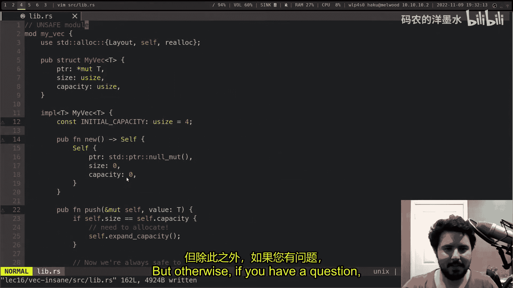

So。FfiI is pretty cool and essentially well let's just sort of talk about things generally。

If I'm writing a rust program and I want to talk to some external program。

 some other you know code that might not have been written in rust， how would I go about doing that？

There's。A few sort of like here's some existing ways of potentially talking to between different programs So you might want to spawn that other program。

 you know， let's say this it's a Python program or a C program you spawn that program as a child of your program and then communicate through say like standard inputs down output if that program wants to talk to you maybe you want to like be spawned by them and communicate in a similar way。

 there's other methods of communication as well you might want to communicate across say a file system right so like I interact with this program not by like you know running each other or calling functions on each other or stuff。

 but we just like read and write files that we both know about or maybe we communicate over a socket like you know talking over a network right so it might be like send bys over this port you know 42 and I'll listen on that port and I'll talk to you on that port。

You might go a little further and go like， oh， you know。

 dealing with these raw sockets and bits and bites is so annoying， let's use something like H TTP。

 which is essentially an abstraction on top of something like a raw socket。And and go， you know。

 I'll send you a request that looks like this。 and you send me a response that looks something like that。

 You know， many people opt for something like this。 You could go real crazy with it and send。

 you could tape a piece of paper to a pigeon's foot and fly the pigeon across to the other program。

 maybe a little less effective。 But there's， there's。

Odles of options on how you might want to talk between， you know， different programs， but。

What about performance， you know， with all this stuff spawning， B spawned。

 fast system socket HTP carrier pigeon， they're probably going to be relatively slow， you know。

 compared to what we're going to look at in a second。

 And so like you know in terms of how much memory it uses or or you know how fast it is to communicate。

😊，You know， you might it might be a little too slow for you It might not be available like what about platform availability like do all these options work in say like a embedded or like niche。

 you know small microchip spawning yeah， probably not file system you might not have one of those sockets networking。

 you might not have that either carry a pigeon I doubt an Arduino is gonna start learning how to talk pigeon and so you know sometimes when you care about stuff like this。

 you might want to consider Ffi which is busting through the wall here。

So FfiI is really just a way to create a like program。😊，That has。

You know that that allows different programming languages to talk to each other over a common a common interface。

 in this case， a foreign function interface is what it's called。

 so it's essentially allowing different languages to call each other's functions。

Through something through a shared understanding， essentially。

 a shared understanding of how someone ought to call a function in a program which is known as an ABI an application binary interface so。

C， you might， you might look at C and go C is a programming language。 I know this。 What's C。

 C is a programming language that lets me write code， and I can compile it and run it。 And yes。

 that's all true。 But C is also these days very much like an A BI in that。

It's a very common like lowest common denominator between a lot of languages right if I want rust to talk to C+ plus or if I want Ru to talk to the operating system or if I want you know C++ to talk to I don't know。

 maybe like zig or something I'm not sure often people will just use C as like the common ground between everyone and like make a function that looks like how C would do it and then I'll be able to call it through that。

And so we can compose together C code and rust code and have them talk to each other across this FFI boundary。

Right， so like the rust code has， you know the strict rust parts， the C code has the strict C parts。

 and then they expose like an interface in order to be able to talk to each other。And yeah。

 that interface is what we generally call the foreign function interface and it lets you call functions between the two and we're gonna to go psycho mode with writing some ffi code as well because that's really fun So some useful resources when you're looking at ffi。

 the rust deomicon， which was that unsafe dark arts book that we looked at the other day has a has a section on Ffi that starts off or right pretty easy and then gets gnarly at some point。

 there's the rust standard library ffi module itself as well。

 which you know it talks about things you might want to care about if you're learning about ffi there's an unofficial ffi guide by Michael F Brian which I think some people tend to use but is also somewhat incomplete So your mileage may vary and also the LibB C Cate。

 which essentially Ffi is the whole C standard library Ffi bindings to Lib C。

 the C standard library is also a pretty interesting crate to look at。😊。

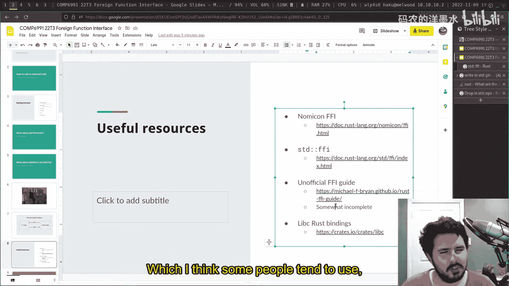

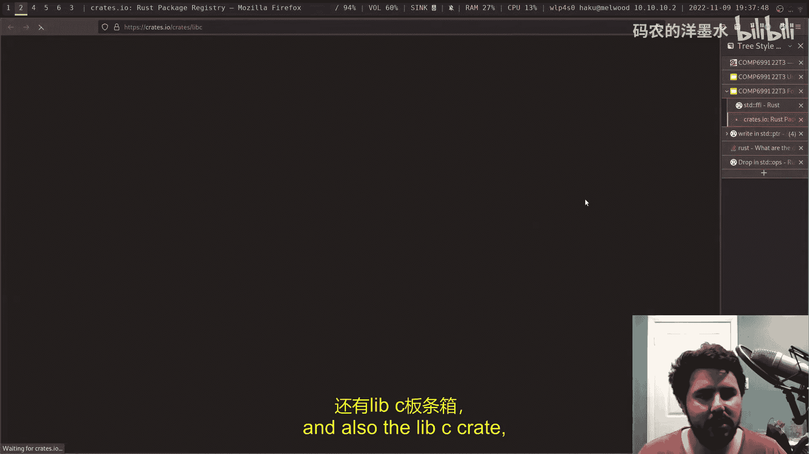

When you're trying to talk with C is your common interface。

So。Has anyone heard of curl？Has anyone heard of K。Curl is an awesome program that I can put in like a。

😊，URl like this， Google dot com。 and it'll go and fetch that web page。

 So it's saying Google spititz vaccinationation email it says， hey， this page actually。

 we don't use Google dot com here。 We use wwdo dot go dot com。

 And then you'll get the actual like page itself right。

 This is like the code that runs Google dot com And there's all kinds of different。

 you know websites you click get here。 YouTube dot com。 Yeah， there it is。 my personal website。😊。

In devev just spits out high there with a tiny little piece of secret HTML Does anyone have any like particularly interesting websites that they want me to pull down with curll It's a pretty good tool It has an insane amount of like options in how you might want to fetch a web page Mitch uses it all the time。

 And so yeah， curlls like curls awesome It's you know very famous is probably one of the like most important libraries of all time one of the most important tools of all time for you know computing on Linux and stuff。

😊，And it will note here that it says curl is powered by lib curl。Right， Libco。

So I don't have a man manual entry for Lib curl sadly， but I do have lip curl installed on my system。

 So I can do package config list all， and it says， I have the curl library。

 So the way that curl operated is。

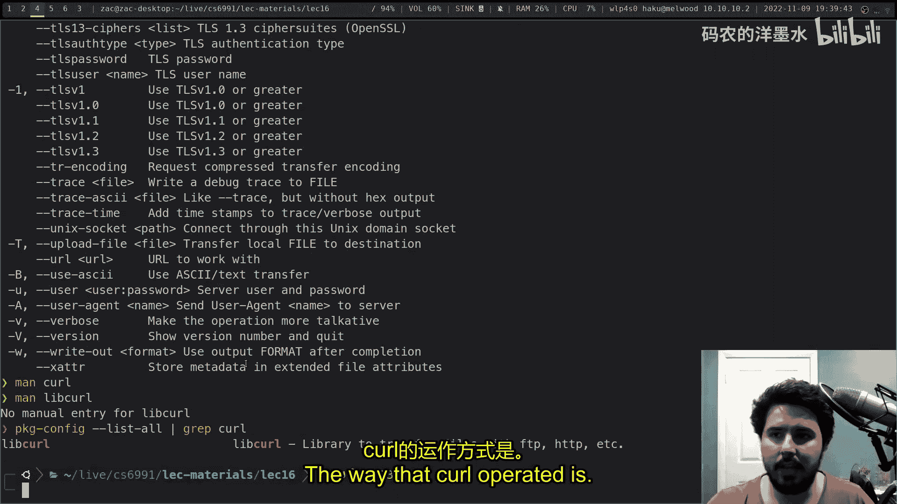

It created a C library。

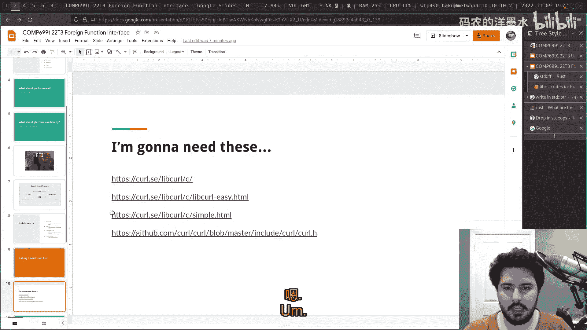

Right， like literally written in C。And let's like look at an example here。

 let's say if we're trying to get something over HtTPS。嗯。

So it does it like wrote a C library that you can， you know， call their functions， curlb， curl this。

 curl that curlb and use that to get information from the internet or from whatever like network you're going over。

And then they wrote a command line tool called curlL that uses the Lib curl Library in order to provide a convenient command line interface for like people you know working on Linux。

 systems， administrators， users， developers， whatever。

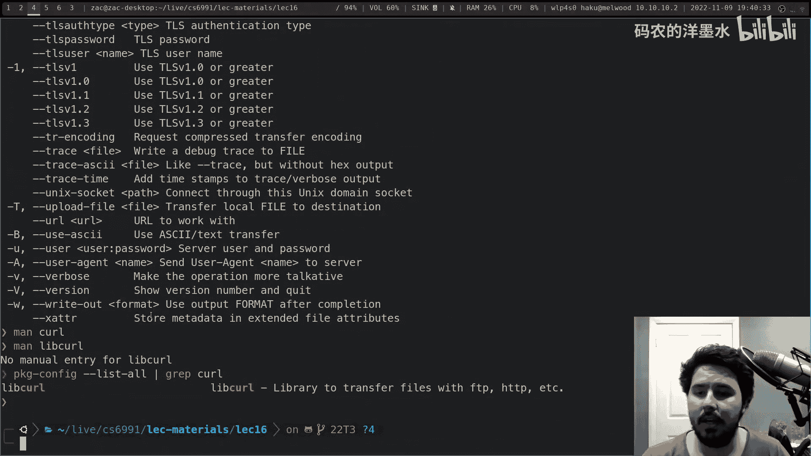

Now， this coal library is written in C。 But what if we would like to use that in rust instead。

And the answer is， we can。And I'm gonna get really insane with it。

 And we're gonna probably like take some shortcuts that are not okay to take。 And it's gonna be fun。

 So I'm gonna grab a few things。 One only one of your exercises this week is talking to a function over F I。

 And I think it's， honestly， like pretty easy。😊。

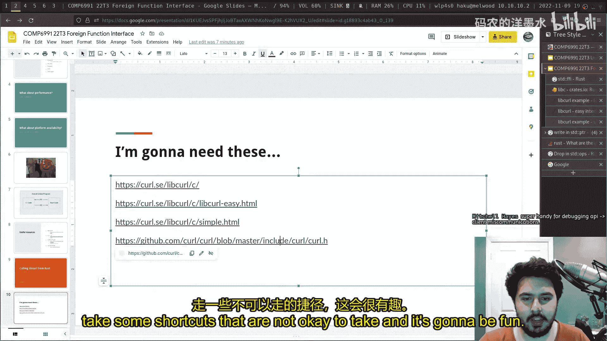

嗯。But we're going to talk to curl over a fire， and it's going to be really hard。

 and it's going to be fun。😊，So let's do cargo new， we did V insane， this is going to be curl insane。

嗯。Great， now。嗯。Let's look at the simple， this is like curll's sort of simplest example for how to get a web page in C。

And we would like to do the same thing。 but from a rust program by calling this C code directly。

So there's a couple things I need， I definitely want to have this simple example just to show me what things I'm going to need to tell rust about I sort of need to tell rust here's like the different functions and the types and stuff like that and it will go look for that function and then link it for me essentially it'll go link oh when you call this rust function it's actually not going to be the rust function at all it's actually going to go off and call this C function instead。

And I can can start us off doing that by defining an externalern block。So I write X to say， like。

 I'm gonna define some functions in here， Right， I'm gonna define some functions。

 but I'm saying they're coming from somewhere else。 And I need to tell it what sort of A BI， what。

You can imagine like the language of calling functions and stuff， what it pertains to in this case。

 it's C， and it's honestly usually C most of the time you see an external block it's going to be C。

And then in here， I just define the functions and the signatures and stuff that I would you know like to be able to call and using Unsafe。

 I'm able to call these functions from C。So in particular。

 it seems like we need this curl E in function， curl set option to tell the URL I want and curl Ey Per to actually perform the request。

Maybe we'll look at cleaning up if we can be bothered to slulash half time。

 but cleaning it says always clean up， we're going we're insane with it so we can maybe be a little crazy and not clean up。

Okay， so。Let's start copying these function definitions in。So we need to write it as a rust style。

 So the return type doesn't go here。 It goes over there。 Oops， that's not what I wanted。 I wanted。

That。And also， it's， we don't write curl pointer like this。

 We would say something like a raw pointer to a curl。And so that's fine。

 But Ru doesn't know what curl is。 So I might go hunting in the headerophile。

 So C programs often come bundled with a headerophil， which tells you like。

 here's all the functions and types you have available to you。

 And a headerophil can be really handy when generating these externalern blocks over here。

 So I need to tell it to call this function， this function is gonna return a star cons to curl。

 What is a curl。 And I would go looking through this， you know。

 this headerophil looking for curl here。 I believe we have type def void curl。

 So when they give us a。😊，Pointer to a curl。 That's just a void pointer from C。

 which basically just means we don't know what this pointer points to。

 but it's just going to be an address。 And fortunately。

 Rus has types to help us out with this from this stood ffiI module， we can get things like C void。

 So we know maybe it might make a little more sense to write something like type curl equals C void。

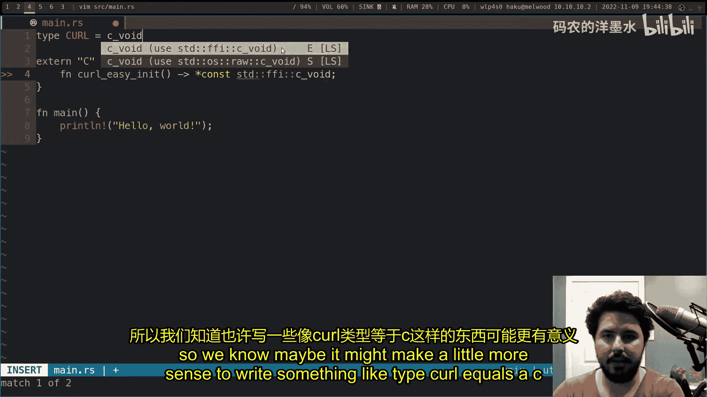

Right， I and like， I got this from here。Curl is a C void value。 And so therefore。

 when they return as a pointer， maybe this is more like a star mute。

 I guess it doesn't really matter。 That's going to be a star mute。Kurl like this。

 which is just a sea void pointer。 So Ru is already happy。 It goes right， Okay， cool。

 So there's gonna be a function that looks like that。 I trust you。😊，Alright。

 so that should let us initialize our curl。 We then need this set opt function。 Okay。

 so let's take the definition here。And reorder it to look a little more like rust。Col star handle。

 This really should be written as handle is a。Handle is a not a star curl， but a oops。

Star mute curl like this。 curl option option is the same as saying option is a curl curl option and parameter here。

 What the he parameter doesn't even have a type。Well， that's annoying。 What is parameter。

 The parameter can be a long， a function pointer， an object pointer or a curl off T。

 This is our first step of we're gonna go a little psycho with it and go like， okay。

 it's saying that it'll be happy to take anything of any of these types。

 Do we really need all these types。 Like， let's look at this example。 curl off URL。

 So that's a pointer like a string here being a char pointer。

 So that's gonna be some kind of object pointer type。😊，This here is a long follow location。

 if it's redirected， follow the redirection， let's just say we don't care about that， to be honest。😊。

And like， just assume it'll be fine。 So let's just say， I。

 I bet it'll just be like a some sort of a pointer。 And we'll just say it's like a。Cvoypointer。

 it'll figure it out if it's close enough。😊，In this case。

 we can go we can go a little psycho with it it still doesn't know what a curl option is or a curl code is。

 so we are still going to have to consider that。😊，嗯。So curl option。

 What does thatet used as we have curl opt URL curl opt follow location。

 Let's look in the header file。 So was this curl option。Okay， so they say that curl option。

 that's this thing here。No， boy。 At's long。 It looks like there's lots of curl options。Is a。Enum。

Kurlopin is an enum， and it looks like of a whole bunch of things。 What's this curlopt？

It's a macro that says。Takes an NA， a T and an N U， and it says NA equals T plus N。Okay。

 so what is essentially saying is that for each of these things that it writes here。

 it'll say something like curlloped right data equals。

Curopped type C B point plus1 or curlopped string point plus 2。

 So it's essentially defining a whole bunch of constants with these names on the left equal to this number plus this number。

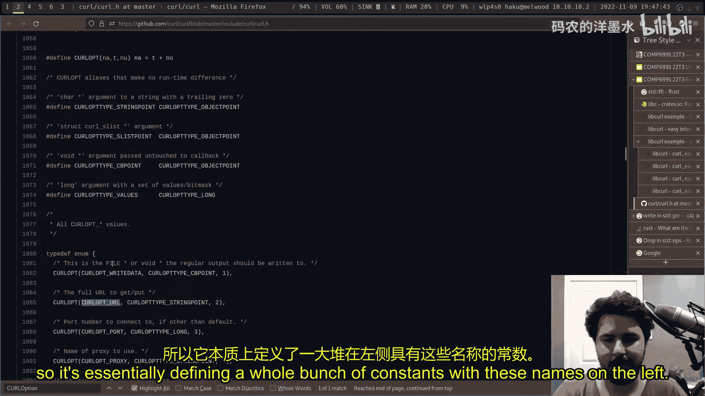

And like， okay， so in rust， we could write something like Enum curl option。

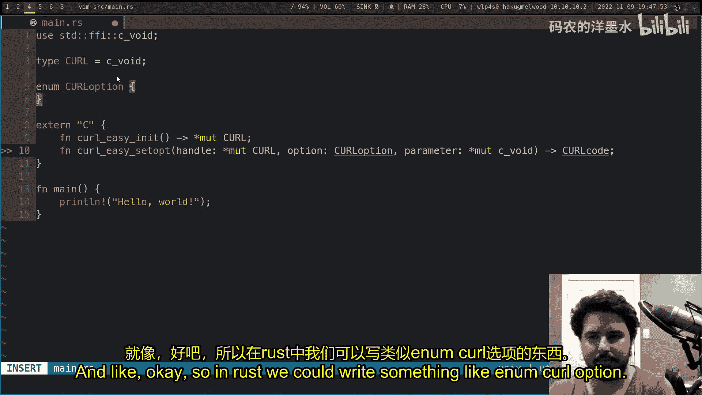

And like， do we really need to keep all of these Like probably not。

 We can just go a little psycho with it and go like。

 this is really the only one we need here to specify the URL。 So go， oh， there's curlop URL。

 So curlop URL is going to be equal to。Collop type string point。 Str point is an object pointer。

 Object pointer is this number here，10000。

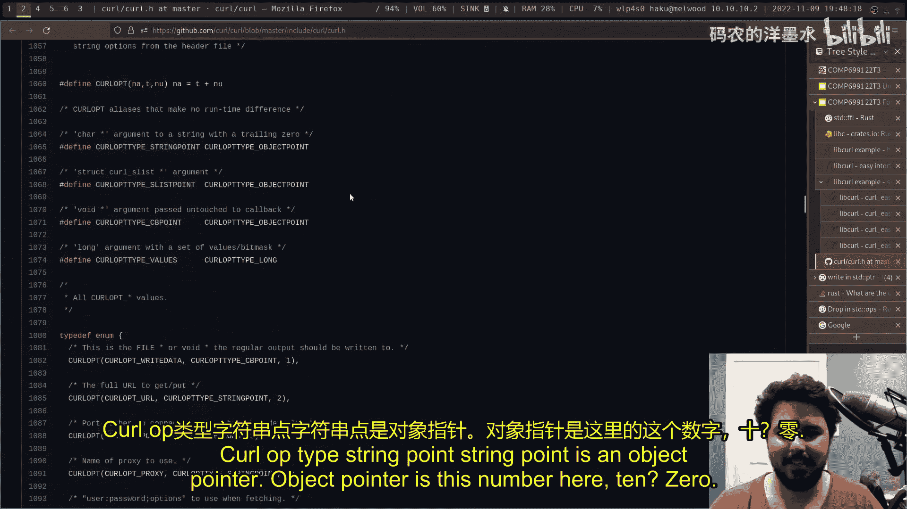

Plus 2。10000 plus2。 So this is just gonna be 10002。

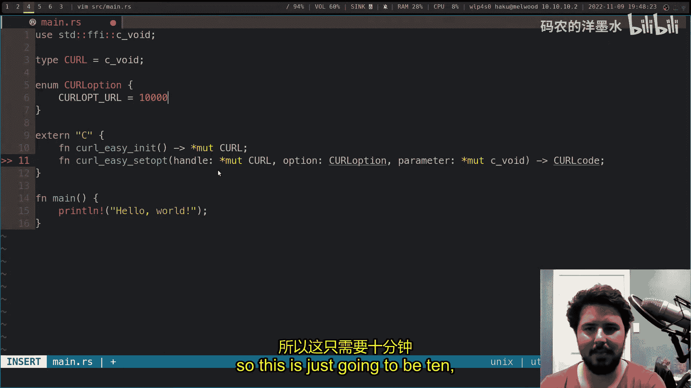

Right， and like we could put a whole bunch of more options here， if we needed them。

 But I think we only need the URL just to sort of do our proof of concept。

 And this should have the same layout。 It's just gonna be a number。Right， and this is just expecting。

These curl options are also just expecting a number of， you know， one of those numbers there。

So we've got our curl option and then we need to consider what is a curl code。Coco。呃。Here。

 there it is。So this is actually just an enum of all these values。 And actually。

 there's no real macro magic going on here。 So it's， again， just another enum。

 But since this looks like syntax that Ru should be relatively happy with。

 I'm happy to just like grab this one and go。😊。

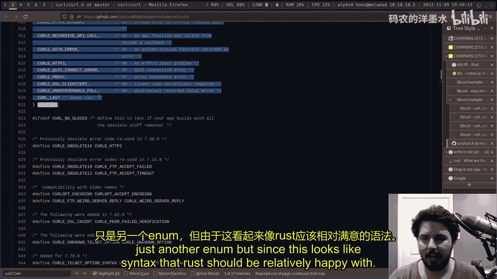

Enum curl code is going to be this。That seems reasonable。

 It's complaining about the camel case stuff。 so we'll just go like。Allow non。Camel case。

What's the noncal case types。I think， yeah， that gets rid all these warnings unused。

 whatever we'll forget about it， just throwing like a stop warning me about every little thing Ru。

 please。Cool， and now we have an enum that should be compatible with this。Okay， now， interestingly。

Rust doesn't guarantee exactly how it's going to make these。

 you know these types that we defined here look。Because it wants to be able to reorganize the types in future if it needs to in order to like optimize and make things work better。

 so we actually need to explicitly tell rust， I would like you to lay out this type the same way that a C compiler would and we can say that by writing Repper C so essentially lay this type out like if a C compiler wroteor。

 which is exactly what we're looking for given that this was like fed into a C compiler here and we're trying to make our rust code look roughly the same。

Okay， cool。 So that seems to work set opt What else have we got here curl easy perform。

 so we can look at that one。 or， in fact， we can like just to be clear。

 we can also look at these okay， apparently not。😊，呃。

Curly's perform doesn't seem to appear in this header in this header file。

 It probably comes in from another one， which is annoying。

 but we'll just go it from the docks instead。So， F N curl， easy perform。呃。Lay this out like rustwood。

Cow star， that's going to be this。This is a b， that's this。Al right， something like that。

 And actually， we've already got all the types already set up for us。 so that seems all happy。

Awesome， I guess how bad is the clean up tie。😊，Clean up。 I think this should be fine。 So FN。

 this returns void， which in rust， we just like specify as not returning anything。You know。

 avoid and see this meaning I don't return and can heal。And this just does clean up there。Cool。

 so now we've specified that all these functions are going to come from somewhere。

 but generally in rust， we need to tell it where those where these functions are going to be pulled from。

 because it's not just going to like， look across my whole system for like where it might find any of these functions So we can specify that with a link at the top of this external here。

😊，Where we say， look for a library called Lib curl。 Note that you don't put the lid there。

If you wrote Lib， it would actually look for Lib Lib curl， essentially。But you， so you leave off the。

 the lid and。We write， hey， this is meant to come from curl。

 It'll search on the system for Lib curl and hopefully find these functions from there。 if these。

 if it can't find these function definitions or they don't seem to line up from what it's seeing。

 will get an error out of like rust C or the linker where it says， hey。

 these these linkages don't really line up。 So we're hoping that， in fact。

 we can even just test this now by saying cargo build and it seems to build。

 meaning it probably finds curl and finds these functions if I wrote like curl are like typo it。

 you'd see this huge linking error saying， hey， I don't know what L curl is。

 So you are still like somewhat you know save from。From writing these little mistakes like this。

Let's grab that example。And see if we can run it from rust。 So first， they say run curl easy in it。

So let curl equals curl easy in it。Right， and calling。Another function of graph is definitely unsafe。

 Why is it unsafe， It's unsafe because it's not calling like a separate programme doing a separate thing。

 These are now， like we look at the slide again。

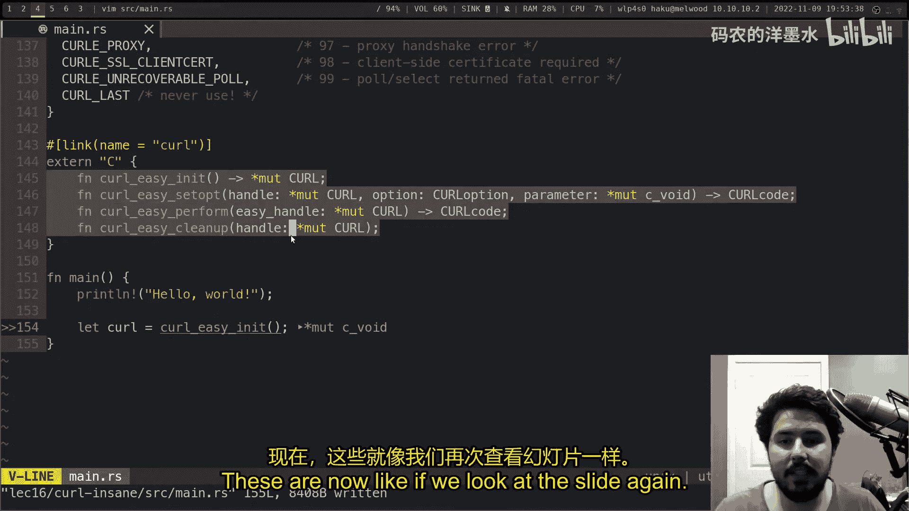

These are now like in the same program。 So as soon as you're calling out to something like C or C plus plus or any other language。

 as far as Rush is concerned， all bets are off。 That's really dangerous' because it could screw with all our memory。

 We're living in the same program now。 So this is always。

 always like calling over our fire is just always inherently unsafe。

 And just to save having to reason about every single unsafe。

 I'm just going to do a huge unsafe block and and you know， go a little insane with it and be like。

 yeah， it'll fine。

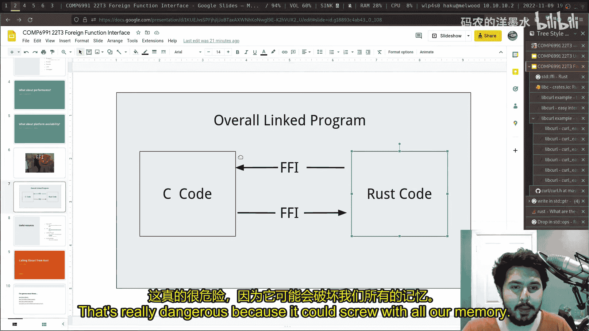

It'll be fine， sorry。 So next we want to tell up the website we'd like to get。

And I love that this just like this I paste the C code in there and it just like works。

Let's grab my website。Oh， no， it didn't quite work。 Saly， curlop URL。 that's probably going to be。

Curl option， curl opt URL， because we're in rust。Kl option， what do they call curl option。Why is。

There we go。 Co Op Co URL。 There it is。And also this here expects to like some sort of pointer。

 but we've got some reftic sideto here， we need to create a string compatible with how C views strings and fortunately there is this C string type from FfiI。

Right， St FFI， this is specifically a module to help usop help with interoperability between this and languages like C。

So let's say create me a C string， which is my website。It's only valid。

It's only valid if the C string doesn't contain any nullytes because C uses an nunator to denote the end of the string。

Um，So I'll just， that's why it returns a result and I'll go， it's fine， just unwrap it。

And pass it in the string as a C stir。As a pointer， as whatever kind of pointer you want it to be。

 again， going a little psycho with it。 So we've got a C string here， which is like。

The it's analogous to like a string， which is sort of heap allocated and stuff like that。

 We want to turn that into a C stir， right， as C stir， which is analogous to the stir type in rust。

 which is just forget having a size and a capacity and that sort of stuff。

 Just be like a pointer to a string。And then get that as an actual row pointer。Turns。

 turns this into a raw pointer， and then we just say convert the pointer types as you like to make it happy。

 that this should be pointing to the correct kind of thing for curll to deal with。So otherwise。

 that seems okay。😊，And then we get to perform the， we get to perform it curl， easy perform。With coal。

Like that。 And I guess at the end， just say co clean up howco。So， let's see if this。

F is over to curl and performs a web request。How cool is that。How about。Www do Google dot com。哎。

Right， so this is actually like， oops， that's what I want。 This is actually going through my system。

 and it's finding curl when I run cargo build。嗯。Now， is it going to be statically linked or dilink。

 I think by default， Ru will statically link it， but we can check。 We can do LD of target the bug。

Curel in。And。We should see Lib curl somewhere。 Lib curl。 There we go。

 So it looks like it is dynamically linked in this case。

 So it's essentially saying this thing that we've that we've compiled here， insert。This is， you know。

 very vague。 this is very hand wavy。 insert like the code for Lib curl at this address。

 and you can grab the the library for it from this location on my system。Which， you know， points to。

 you know， points to a slightly different one there and so on and so forth。

 But this here is an actual like the curl library that we can use。

 And we can just pull this in from our rust and do crazy stuff like like this。

 So your one of your one fFI exercise this week。Already has the link set up for you and the code should be able to discover the library that we've given you。

 we've given you like a secret C library that does some secret calculations。

 but we've given you a head of file to show you how one would call it and your job is to write the function definition and then call that with unsafe in your thing so this might be a good reference in order in terms of just like playing around with what FFI should look like and roughly how you should do it。

 but it should only be like a five lines of code kind of exercise not like a huge crazy thing。😊。

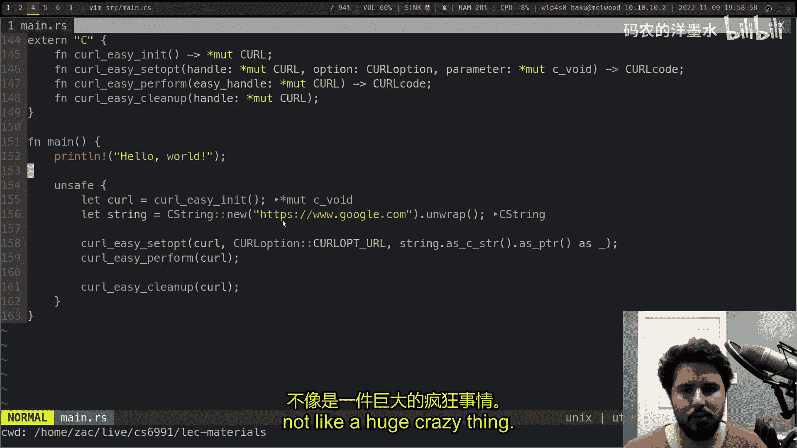

嗯。Cool， but yeah， this is I think this is just a really fun program in general。😊，嗯。Yeah， so there's。

 I think there's a couple more slides here。So that was what I needed to help me do that。 Now。

 in terms of the parts that sucked about writing that example。

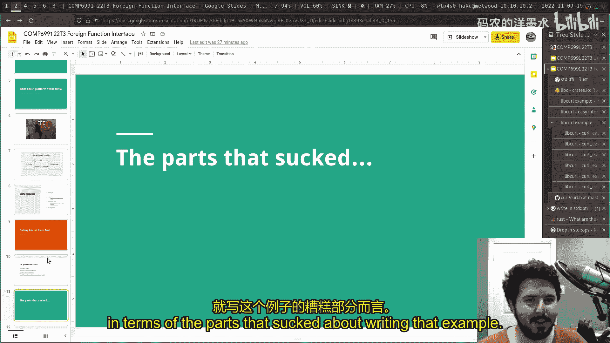

I don't like having to like write。And this is， this is true for me。

 I don't like having to write all this myself。 right like function bs。

 this and function bla is that and generating all these types and stuff。 that's annoying。

 I hate that。 Fortunately， for you， there is a tool to automatically generate rust ffi bindings to C and some C plus plus libraries。

 That program is called rust bind Gen。😊。

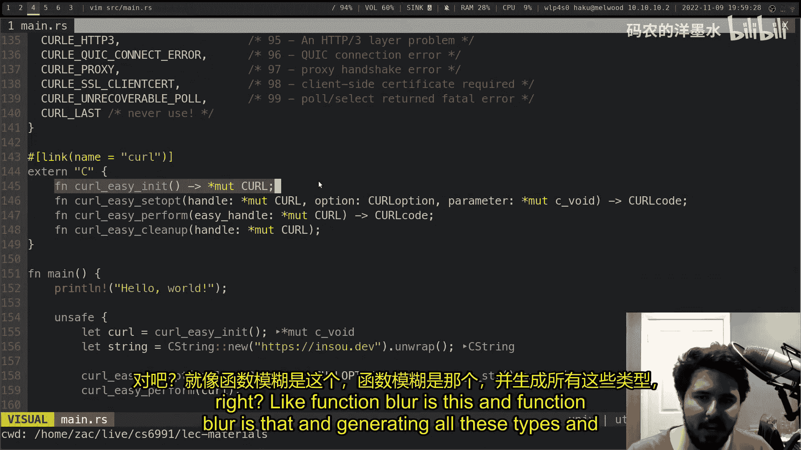

So if you don't like doing that manually， then probably a program like Ru bind Gen is what you're looking for there and it can just take a C headerophil and spit out here's the rust code to talk to the C library。

 which is awesome。 you can also do this from the other direction which is if you write rust code that you want people to be able to call from C or C plus plus a program called a project called C bind Gen will generate C or C plus plus headerophiles in order to talk to rust libraries which expose an API to be called So that's sort of like the other direction around we were in rust code calling C but if you're in C and wanting to call rust code。

 then you can do that the other way and automatically generate all that yourself as well So that's pretty cool。

 We were thinking of getting you to do this but that would also involve students having to write C or C+ plus which we don't really want to force you to do so we don't have any assessed exercises or anything on you writing that。

😊，Next thing that sucked。I don't want to use C bindinggen。

 I don't want to have to do all this work and you know figure out how this program works。

 I just want to be able to use a C library。 Well， the good news is someone probably already has used C bindgen or bindgen in our case。

 these are generally known as rust bindings。 And so， for example， in the case of curl。😊。

There's a crate called curl sis。Right， and this is literally just a crate that sort of generates those fFI bindings so your rust program can talk to curl。

Which is awesome。 So we should be able to see things like functions。

 What functions are where it curl easy in it， curl easy set opt curl easy in it is here。

 curl easy set opt is there perform is here and clean up is here。 And like。

 here's the externalern C functions。 all just sort of laid out like this。😊。

And so you'll be able to call those and use their types。 So for almost every like popular C。

 maybe like C+ plus library， someone's probably already done the work in generating those rust bindings another popular project that came to my mind was SQLite which lets you do a SQL database through a file through a program called SQLite and here's like SQLite someone's made bindings for it already。

 which is pretty handy。

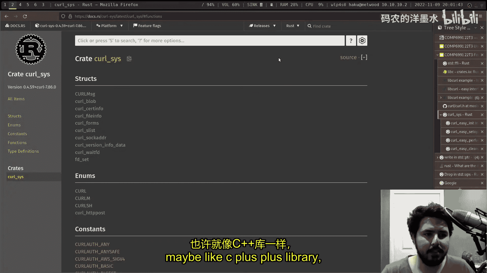

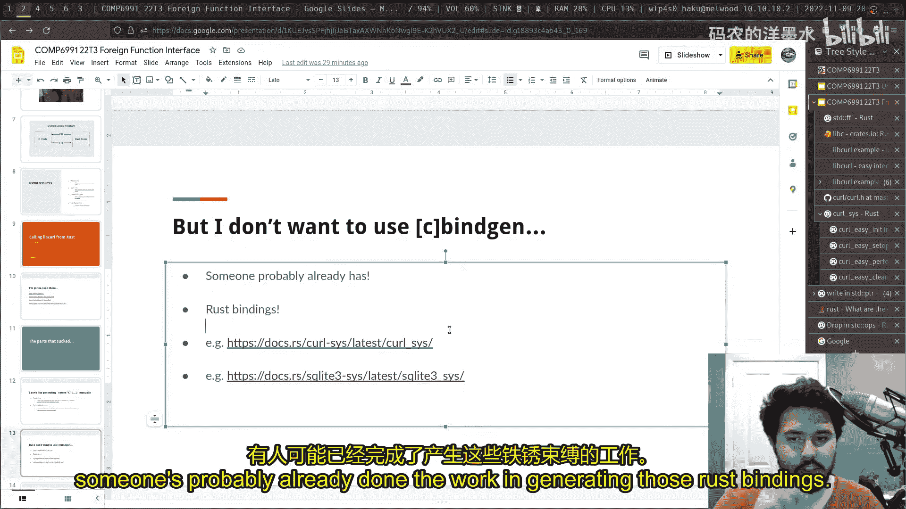

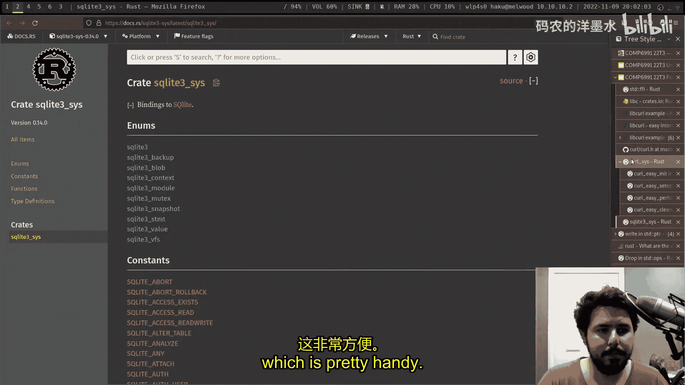

Next thing that sucks。I don't want to use the C types everywhere。 Like it's。

 it's annoying having to convert， like use C strings and raw pointers and all that pain。

 Like even if I'm using someone else's bindings， right， like curl cis here。

 these functions are still in terms of like raw pointers， Ra pointer， you know， C strings。

 that kind of stuff。 that can be annoying。 right， you don't generally want to do that， if。

 if it're gonna be avoided， you have to do it eventually。

 because eventually you're gonna have to talk to the library if you want to talk to it。

 and you're gonna have to speak its language。 But again。

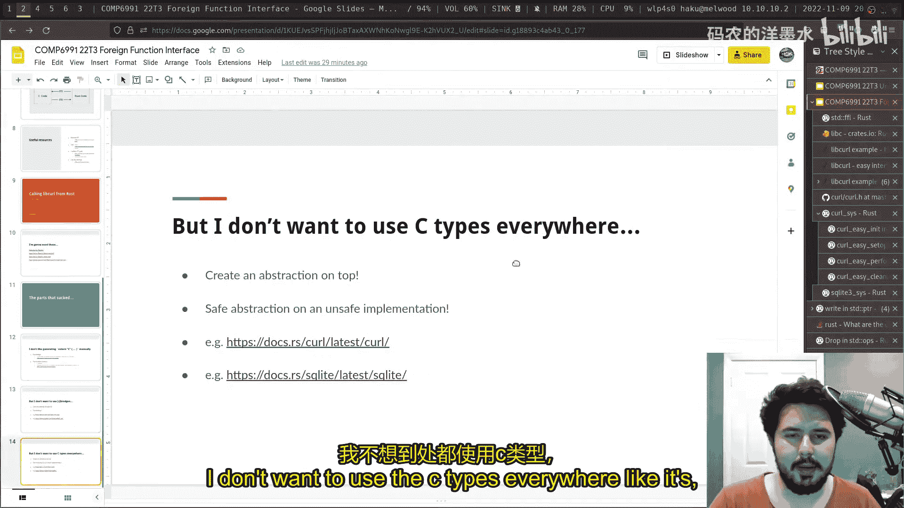

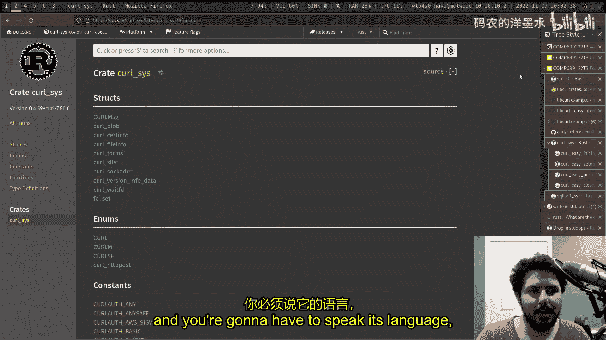

If you don't want to use those C types everywhere， you could just make an abstraction。

 an abstraction that takes like you know， stuff in Rukland and then does the unsafe， you know。

 has an unsafe implementation that goes to talk to the sea。 creating a safe abstraction on top。

 And before here we had curll ciss and CQl 83 ciss。

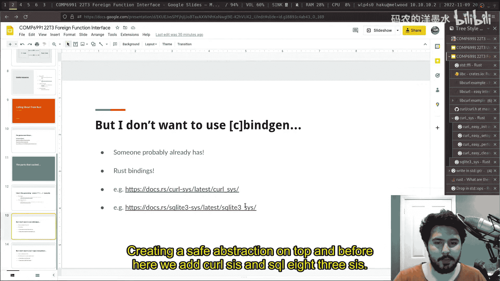

How about curl and site。 So if we look at these crates， curl and slite。

 we'll see that these basically make like legit rust types that make it easy to use that C library from within rust。

But at the end of the day， like it， it's going to be powered by Lib curl。

 and it's going to have to use the curled cis cr。 So this crate links to curl cis。

 which is responsible for linking to the Lib curl library。 And if we look at probably how say easy。

 easy， let's look for like perform or what do they call it。 Yeah， perform。That would be here。

 We're probably going to see that it ends up calling self do perform， self inner perform。 okay， well。

 like， yeah， this is， they've made it really fun for us naturally。

 I'll see if Oh and easy goes to an easy to screw you。😊，Easy to。

Does this have an easy three inside it， There is this， right， Here we go。

 That's what I was looking for。 Eventually， you'll see it this thing here is actually using those。

 those raw bindings from curl cis。😊，嗯。And but like it's made a nice abstraction on top of that so we don't like every person doesn't have to end up calling curll easyper with the raw pointers and stuff like that。

 So that's sort of like the last layer here generally once you're at that point。

 you're all the way back in rust， but you're using things written in completely separate languages pulling it all into one common program So FfiI is a pretty cool and fun idea。

 it's very dangerous because as soon as you're leaving the blessed land of rust all these safety andvari and all that can easily be absolutely destroyed and so we want to be careful with ffi it's an unsafe operation by its nature。

 but it allows us to it allows us you know lots of things that wouldn't otherwise be possible like talking to a lot of existing libraries and it makes it possible to integrate rust into an existing C or Cpo codebase you know over time which is what things like rust was originally being developed for something。

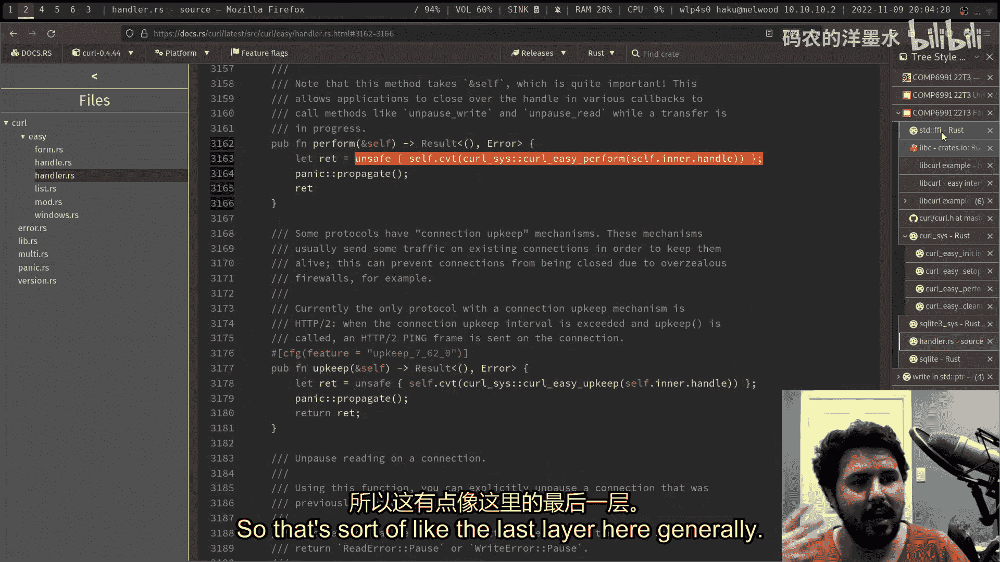

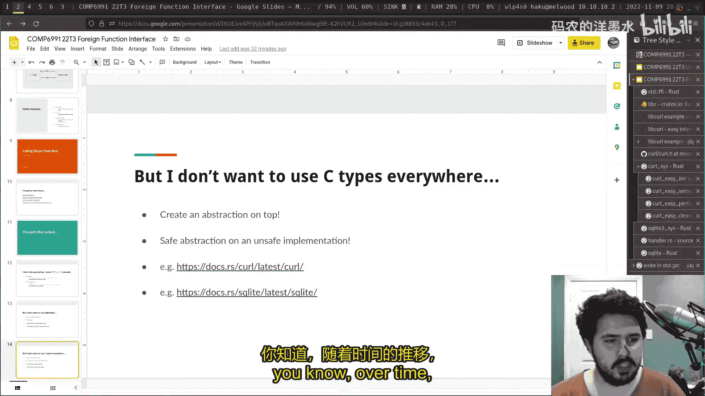

And called Servo， which is a browser engine， which I believe Firefox actually uses these days to it was like a。

I want to say something like a CSS engine or something like that。

 that was heavily parallel because it's really funny。

 It was written in C++ originally and they kept wanting to parallelize it take advantage of concurrency and thread safety and all that sorry threading and all that to make it run a lot faster and every time they tried to parallelze their C+ plus they always got these horrible errors and like people reporting bugs and crashes and all this and they could just never do it because it was so hard to write that C+ plus correctly And then they were like let's what about like we use this sort of like this is Firefoxes under a company called Mozilla。

The rust project was also being incubated in a certain sense by Mozilla and they were like。

 let's develop Servo and rust sort of hand in hand。

 And so Servo informed Rut a lot and Ru was you know。

 a big chunk of rust was created to create the servo project which is pretty pretty interesting。

How does versioning work with Ru trappers overs libraries like curll。

 that's a great question I don't like it's going to be different for every individual crate。😊。

Of you know， for how people do it。 But you can see that this， this crate， in particular。

 celis have opted to create。This looks like， you know， probably it's like 0。4。

59 is maybe like this Cates version and it's compatible with curlL 7860。

 probably and like oh maybe I need to use this one if I want to use curl 7820。

 but it's really I guess it's probably down to what you do we can see here SQL light is not necessarily the exact same thing。

 but usually libraries are pretty careful with their API and how they how they affect their API over time through updates and stuff like that。

 usually to remain backwards compatible and to not break existing cases you know your bindings in a sense get to take advantage of people taking that care most of the time。

Yeah， cool， good question。

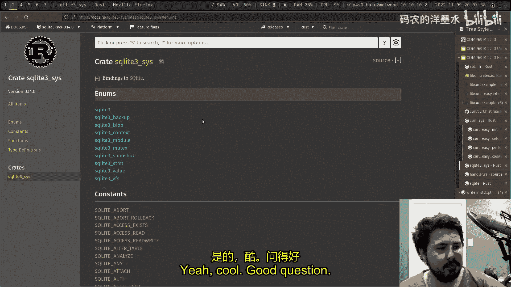

All right。Let's call the lecture there end of lecture and I'm happy again as usual to field questions for as long as you want。

 and then once I switch off the lecture， I'm going to be going back to that V code and figuring try and figure out where that undefined behavior is coming from。

😊，But yeah， any questions that you've got？I am very happy to hear them。

For as long as you've got them， basically。嗯。啊啊。My sample implementation doesn't。Have this。

Doesn't have the same undefined behavior。嗯。A cargo nightly， Mary Ron。Yeah， that's interesting。

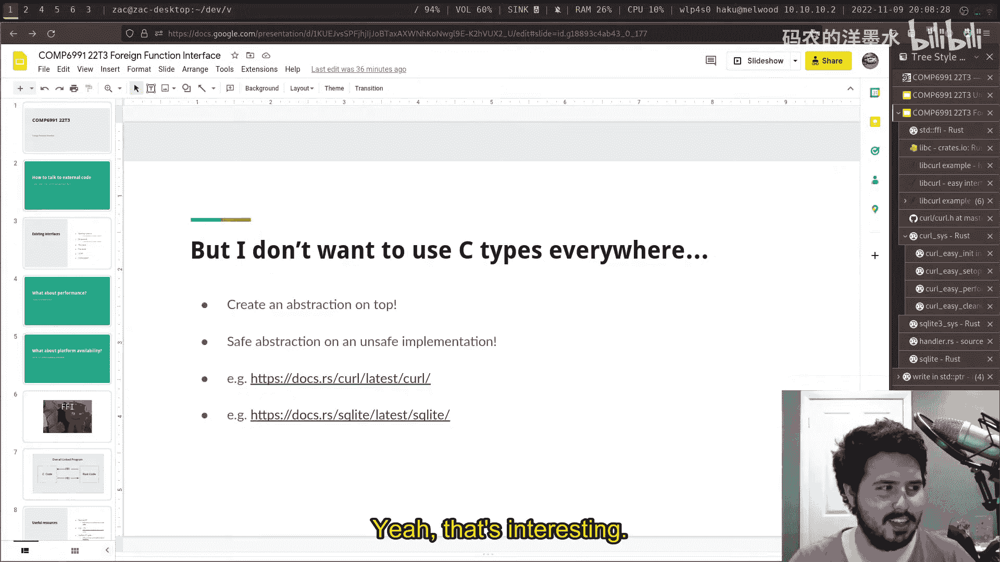

Oh， so I've got one version that does work and one version that doesn't work。

Oh that that like has undefined behavior。That's quite interesting。Where are we here。

Is there something like micro rust for running rust code on and embedded devices without stuff like mal etc ceter。

 Yeah， Ru is built to do that， which is pretty cool So that's sort of like a default feature of like rust to the language as opposed to sort of having to like fork the language or make extra language libraries and stuff to like specifically support embedded and platforms without allocation and stuff like that and the general way that you would go through doing something like this is using something called no stood。

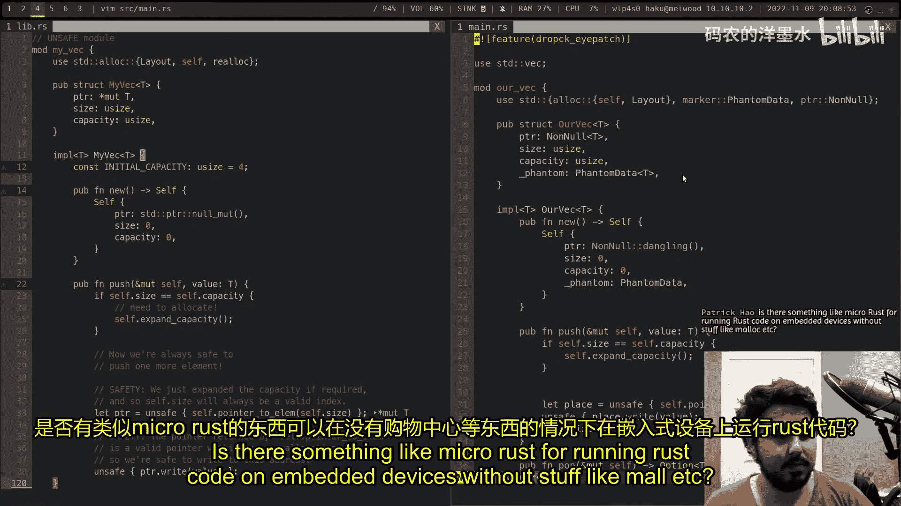

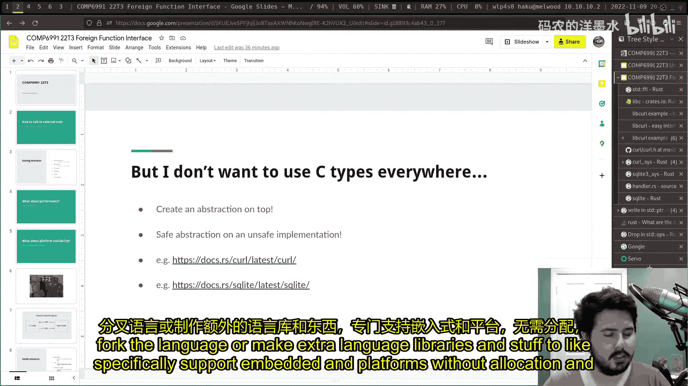

So rust by default， supports writing rust code that。In like a headless mode。

 essentially running without the standard library。And in fact。

 you can even like pick and choose bits of the standard library that you'd like。嗯。

So when you go no stood， right， no no standard library by default。

 all you get access to is this is the core library。Which is essentially like the standard library。

 but way more minimal。 And it can be like， you can。Take away everything that does heat allocation。

 no concurrency， no IO that kind of thing。So core tries to be able to run hopefully anywhere you want if you're in a place that。

 you know stood， you're working in say like OS code where a standard library is absolutely not going to work for you。

Right like needing a file system and that sort of stuff when you might be the one writing the file system。

 but maybe you do have things like allocation， like keep allocation and stuff like that。

 you can bring in the core library and also the allocation library which pulls in things like string and V and stuff like that and box for you。

 which is pretty handy。But even in this case， like core relies on very little， like Mem copy。

 Mem compares memet， Sterland， rust， like panicking stuff and this EH personality。

 like it relies on very little， but you can also still even run rust without core。

 which is called rust， no core， unsurprisingly。And this。Why is this tracking rust， There is a。

Where is it， rust。Rus no core。Blog， someone wrote a a blog post。On。No core oxidizing the technical。

 Yeah， here we go。 This is what I was thinking of。Where you can even go， yeah。

 take out the core library and implement like the really basic stuff of Ru yourself。

Which is pretty cool。 And this is made by Michael Gotoi， who's also a a very。

A very knowledgeable member of the Ru community who you should similarly follow on Twitter。

 If you're still using Twitter again， I need to catch up on all that。 obviously。 But yeah。

 Ru is very flexible in allowing you to only pick and choose the bits you want。

 which means you can in general， hopefully run rust like almost anywhere over time。

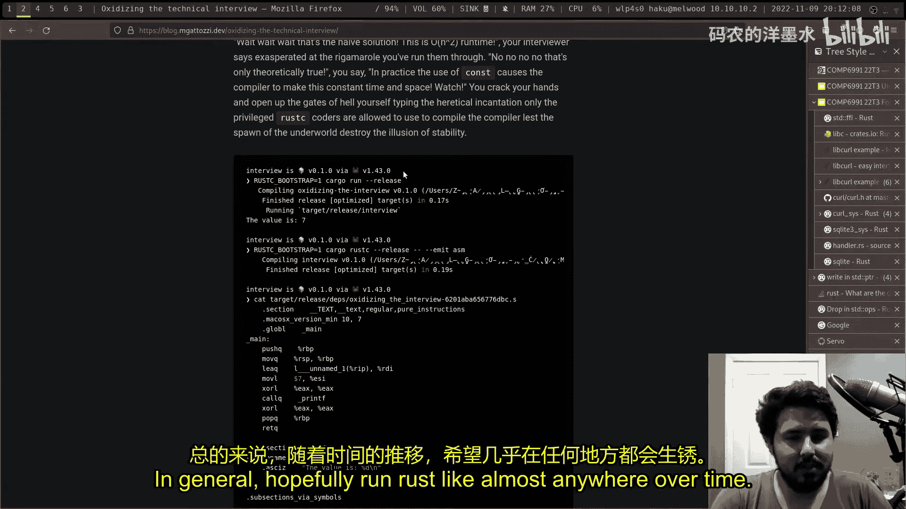

So yeah， it's definitely a pretty cool thing。Go。Any other questions before I。

For I'd try and delve a little bit into。What the heck is going on here。That seems fine。Yep。

 write the value。Yeah pop。That seems about right。Yeah， that should have。

 That really shouldn't be any difference。But I'll， I'll just do it anyway。So， that's fine。Get。Oh， oh。

 that's the problem。 That's， that's what I've done。 Oh， yes， yes。

 that is absolutely undefined behavior。 Oh， okay， I figured it out。 Okay， cool。

 I can just address it at the end of the lecture now。 Okay， that's the undefined behavior。😊，Right。

 so。This here， no， not this one。 Pop Pop is perfectly safe to return an owned tea because it's actually like effectively taking it out of the v and giving you ownership of it。

Gett can be called like time and time again， on repeat。Right， you can go get the fourth thing。

 get the fourth thing， get the fourth thing。 And you should also。

 you should always be expecting to get something back， but probably not ownership， right。

 Probably not like an owned value of that tea。That's like otherwise， you call get three times。

 and you now have three copies of that same own value。 So this is absolutely undefined behaviour。

 It should not be this at all。 Instead， get should return a borrow。Yes， get should return a borrow。

 And then this point to read， I'm gonna replace this with。

Dereference me the the thing at that pointer and then like borrow that in line there。Right。

 so this safety was not really same as above， Same as above。

 And it is safe to borrow since we have a since。Since it is tied to the lifetime of。

The borroworough onse。So that's fine。 And this is same as above。 And it is fine to take ownership。

Of the T， because， because we are effectively。Removing it。From the Vck。By decrementing the size。

Right， O。 yes， I was just missing that argument in its entirety。 And now I bet Mary is happy with it。

Mary test。Hey， how about that。Os。And it's still testing everything， Yeah， great， that's it。

Hopefully os， hopefully that makes sense as to why that was undefined behavior。

This is just like nothing's really going stop you from doing that if you're going through raw pointersca Rust won't make really a ton of assumptions about it。

 but if you screw it up， it's still gonna like Mary will still tell you hey。

 that's undefined behaviour it's probably not going to do the right thing。

 So that's that's great that that we've managed to see that one and hopefully the fix here makes sense。

😊，Cool， then that's really it。 I don't even have to do this after the lecture。 That's great so。😊。

Any last questions？ We haven't say anything in the chat in the last few minutes。

 so it seems like people are generally happy。I hope。Cool， I'm glad we have to fix that。

 I'll push this up to git。😊，Noe， not this。Yes， that Le 16 co plus V plus co。

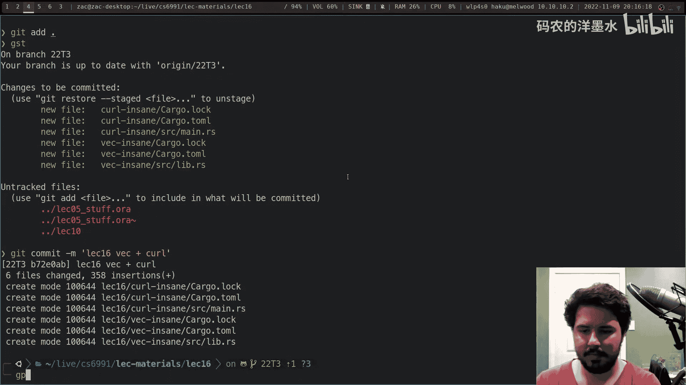

So that's going up there now。 So that should all be accessible to you So you can play around with that code。

 And yeah， Mr。 An， All， it seems like we dont have any other questions。 So thank you， everyone。

 for coming。 Hopefully， this was a bit of a fun lecture， doing a bit of crazy stuff at times。😊。

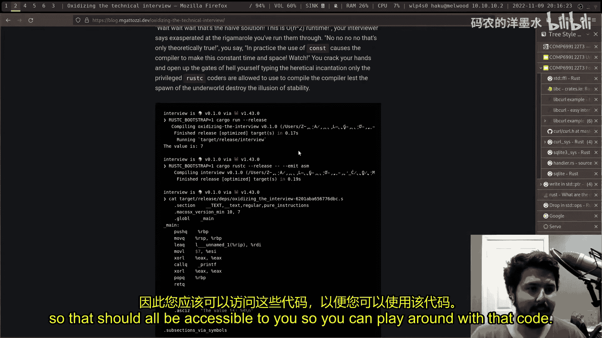

And yeah， thank you all for coming。😊，And and congrats through our content。 Yeah。

 so I guess week 10 is still up in the air in terms of what we might want to do in the lectures as a default things like revision like going back over some some bits and pieces that people weren't super confident in is something we absolutely can do other interesting topics that we can like rule out of assessment。

 but like I'm interested in this thing just out of interest and we'd like to you know play around with that stuff is perfectly on the table as well So if you've got any thoughts for what you'd like to see revision or other interesting topics or otherwise just throw them on the course forum。

 you know throw in a new topic with any ideas that you have and we'll figure it out。😊。

ItWould it also be cool to see how we can use F I to call Ru code from C。 Alright， great。

 that's a nice idea。 If you like， actually， let me， let me， let me make a thread now。

 that seems like a sensible thing to do。 Letures， week 10 lecture topic ideas。😊。

AComment below with any revision topics or new non accessible。

Topics that you would like to see covered。During our。Currently， relatively。3 week，10 lectures。嗯。Yeah。

That seems good。Yep， go away nonacsable。 Yeah， I'm pretty sure I got that one right。 createate topic。

 Allright， post your ideas here。 If you want to see ffifi to call Russ code from C。

 just leave a comment here。 if if you're able to Patrick just so people can like hard at and if if they if they like that idea。

 But post your ideas in here and we'll aggregate them and figure out what to do for week 10。

 So great。 Thank you， everyone。 and I'll see you all I'll see some of you in the workshops this week and I'll see the rest of you in the lectures in week 10。

😊，All right， byee now and see you later this week。

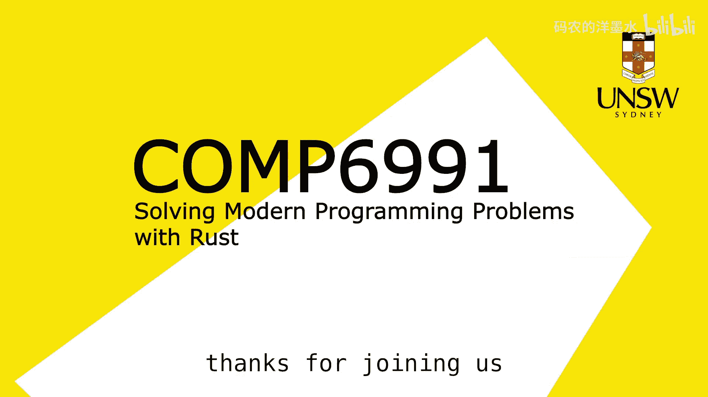