# 【全集】新南威尔士大学 Rust现代编程 中英字幕 1080P p17 Lecture 17 - Rust异步编程 -BV15cf4BCEN1_p17-

Okay， allrighty。One second。There we go。The camera is looking down quite a bit tonight。 there we go。

Hello， hello， hello。

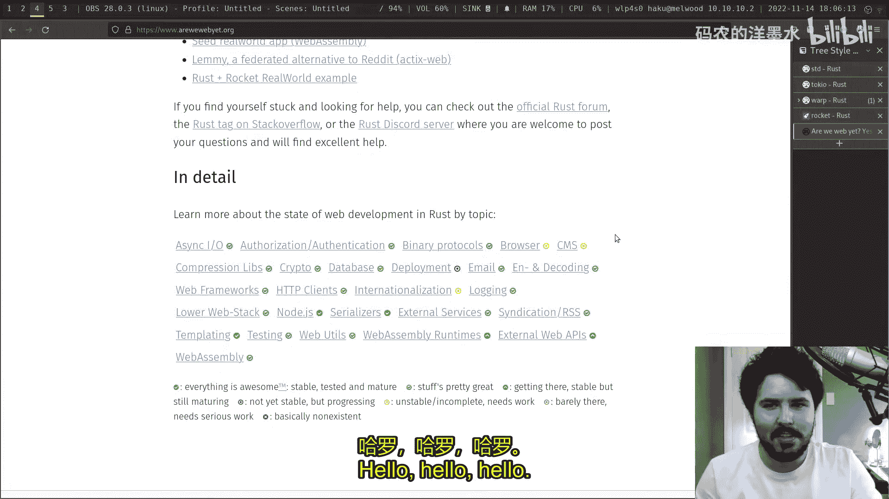

How are we all？Hello， everyone。So， welcome to。Week10。 we've made it。The very last week。

That's exciting。 I am great。 Thank you， Mitchell， and I'm glad you are great， too。 And hello。

 everyone else who have been。😊，ho've been having fun putting your crab emojis in the chat。All right。

 So welcome to week 10。What have I got to get out of the way before we get started？

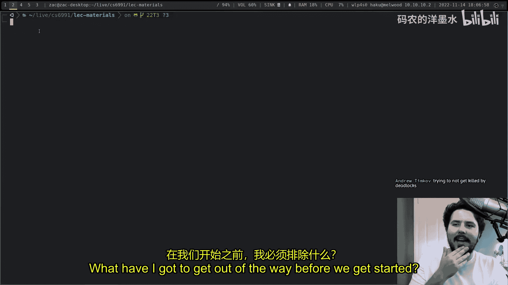

Well。Your assignment 1 marking should now mostly be released。

There was some like when we were actually releasing the marking rather than I say we when Tom was you know who has been putting in a lot of really hard work was was doing the work to release the marking it turned out there was some internal issues on our end with some of the marking and so a few students didn't may not get marks or we may have had to send an email saying hey we need you know this from you or that from you or that kind of thing if you happen to not see marks for it like don't freak out it's almost certainly not even your fault at all but you should be able to collect your marks here or using a command on a CSC machine。

嗯。And overall， everyone， like the vast majority of students did really well on assignment1。

 so congrats to everyone。嗯。It was， it was really sort of fun seeing。😊，Especially like when I was。

 you know， marking my portion， reading through like mark requests and seeing you all sort of like talk about your designs。

😊，You know， it might just be me sort of reading into it too much。

 but I sort of got the impression that a lot of for a lot of students， they were like， you know。

 sort of somewhat passionate talking about their design going oh， you know。

 I did this for my quest system and I think it really made like a nice design。😊，And， you know。

 I made it really generic and flexible。 And， you know， blah， blah， blah or like I used， you know。

 this， this feature over here in my adventurers term terminal game。 And it just seemed like。

 you know， when I was reading it， I personally got the impression that， you know。

 a good chunk of student seemed to be having a fun time with it and would， you know。

 genuinely happy and proud of the code that that they spt out out of the， you know。

 that you ended up submitting。 And it was great to be able to do， you know，😊。

The vast majority of like the submissions that we got be able to go you know， great work。

 great work and's here's know a lot of marks to reward that。😊，So， yeah。Great work to everyone。

 have a look at like what you've got。 you might have a small amount of feedback。

 Some of the so you may find throughout your code， there might be some like quad slash comments where when we're marking if we feel it's necessary to add some sort of like inline feedback we've thrown in like a quad slash。

😊。

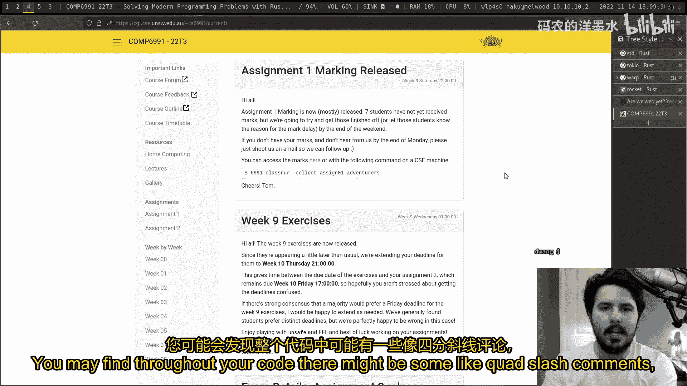

To sort of distinguish your own comments and your own rust do from things that we may have added。

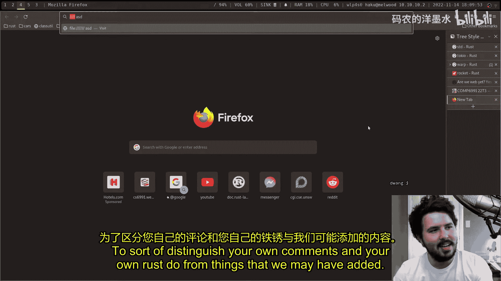

So if you're looking for there may be some inline feedback。

Particularly students who did particularly well might have like quite little inline feedback and just the overall sort of marking and you know。

 some there might be some high level ideas briefly talked about in the marking like the。

The marking file， final marks， dot text or something like that。But yeah， have a look at that。

 You know， take on， you know， if you think it's reasonable。

 take on the feedback that you've that any feedback you've been given for your assignment too。

You know， continue working hard on that， ask any questions， clarifications。

 that kind of stuff on the course forum。😊，But yeah， just once again， congrats everyone。

 And good luck finishing out your assignment twos， which are you。😊，I want to say Friday。

 but I'm going to double check。And the course website is。So yeah， week 10 Friday。

 So this week this week， Friday at 5 PM。 So don't miss that one。 remember5 PM。

 some people got this a little confused。 I think next session we might make sure our weekly exercises and assignments are due on the same hour mark。

 but just be very clear it's it's 5 PM。😊，Although， you know， even if you end up submitting it。

At 9 PM， or yeah，9 PM anyway，4 hours is。Such a small reduction off your mark， like。

4 hours is4 out of 24 times like 5% per day。 You're looking at like an 80% of like one。Like how to。

80% of one mark in this assignment。 And this assignment is worth， I want to say，25 marks in total。

Something like that assessment is worth yeah，25 marks in total。 So like， yeah， and you'll。

 so you're looking at a quarter of a， a quarter of this for a course marks of， you know。

It's you really like， take on the maths and you're like， okay， this is such a small。

Portion of anything， but。Just be aware of all that don't forget your week nine weekly exercises which will be which are due not the usual Wednesday they the Thursday instead just because we release them a little bit late。

 but there's three exercises and it's been noted that these exercises don't involve writing a ton of code。

嗯。R to see is yeah， probably a couple lines of code at best。

 like maybe five lines of code also unsound unsafe is literally like maybe two lines of code。

 My RRC is probably like maybe 10 lines of code， something like that。 So these exercises overall。

 you're probably writing 20 lines of code also between the whole week。

 but it's about writing the correct code and trying to make sure that you're。

That what you've written is correct。Make sure you've had a crack at that。 the week 10。Exercise。

 right week 10 is released。 I just need to do a hard refresh。 If you don't see week 10。

 you might also need to do a hard refresh。 I did control shift R。And it is a。Well。

 it says live exercises。 It's a prac exam that we've given you。 So this here is a。Is like a mock。

 you know， exam。Based on what your final exam will look like。

I would suggest trying to take this yourself under exam conditions。

 given we've already finished the content of the course。

Like the official accessible content of the course。

 I would suggest everyone to take this like as soon as you as soon as you are reasonably able to。

Because the sooner you take it， the sooner you'll be able to start working on the bits。

 the bits that you might have had more trouble with or to ask questions about or bring you know questions and stuff into the workshop。

 so I would suggest giving this a crack whenever you you know have the time to do it。

 notable points are that the exam is open book。It's you know standard otherwise pretty standard exam conditions。

 you're not allowed to communicate with other people。

 you're not allowed to work in pairs or groups or anything like that。

 you're not allowed to write to the internet so you're allowed to access the internet open book meaning I guess there is a distinction between open book of like just your own notes or open book you're allowed to access the internet。

We are saying that you are perfectly allowed to access the Internet。

 but only to like read resources right so you can Google how to， you know。

 how to implement trait in rust and go to stack overflow and see someone else's ask a question and go。

 okay， that's that's I just needed to jo my memory there it is。

 but you can't say go on stack overflow yourself and ask a question。

 how do I implement a trait and rust So you can't post anything to the internet。

 you can't essentially write to the internet You can only read you have a shared borrow on the Internet。

's that's nice another way of putting it。 You have a shared borrow on the Internet。

 not ownership and not an exclusive borrowor。Yeah， that posted be delete device stack of F months。

 that's true。Yeah， and so the exam is。I think I've mentioned this in a few workshops is。

Far more heavily theory than you've seen throughout the rest of the course。

 theory and quotation marks here。This is because like we， we were considering， you know。

 the course not even having a final exam at all when we were， you know。

 constructing the course originally， but the final exam。Basically exists to， you know。

 we're gonna get you to do some form of implementation。

 but a big part of the final exam existing in the first place is so we can ask you written questions and and that sort of stuff that sort of draw upon what you've learnedt throughout the term and and you can sort of answer and you know。

 freely in that kind of thing。I don't want to spoil the the questions themselves。

 So let me just double check the the ratio here of what we've got the ratio between theory and practical questions。

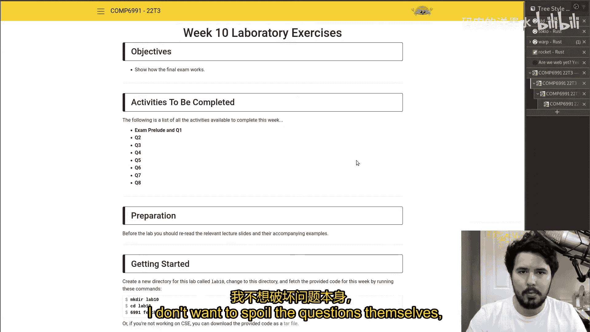

So question one has and I'll note that some questions have subparts。So for example。

 without showing you the question itself， you can see question1 starts with 1。

1 which is worth two marks。 Question 1 has four subparts that are all written theory Question2 is a practical programming question Question3 is a practical programming question Question 4 has three subparts that are all written theory。

 Question5 has four subparts that's all written theory。

 Question 6 is practical programming Question 7 is two subparts theory written and questionstion8 is is no subparts but written So I think in total I counted three three practical exercises。

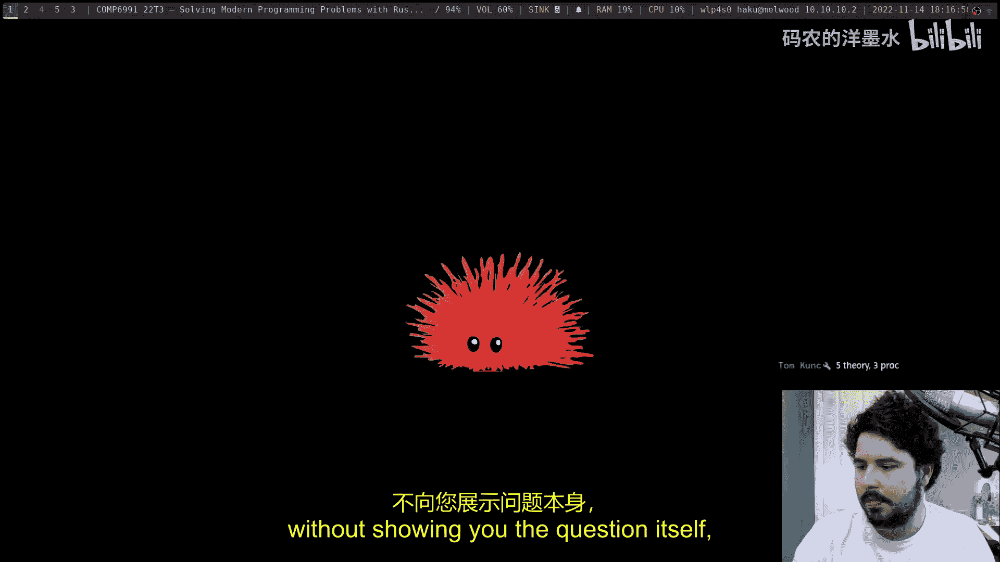

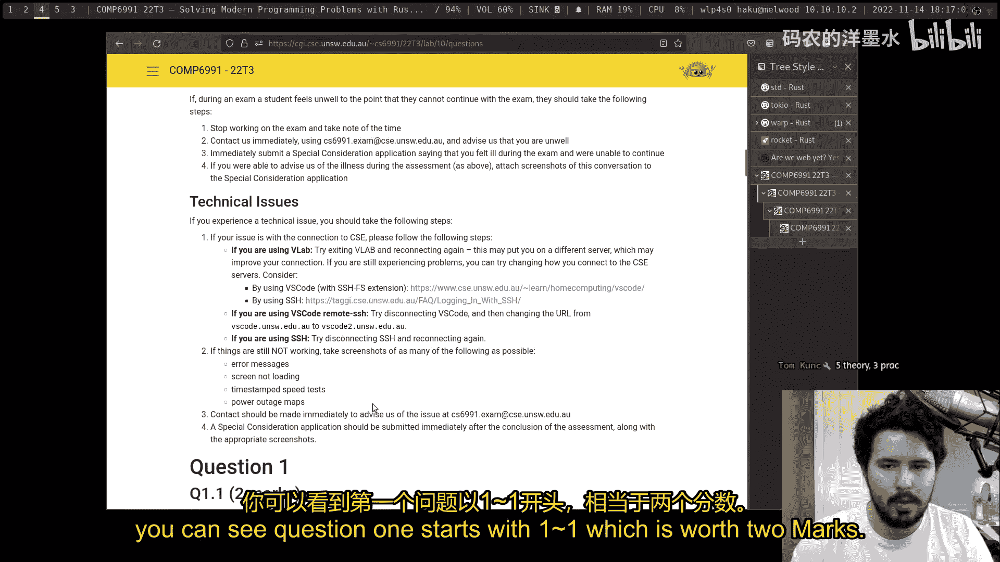

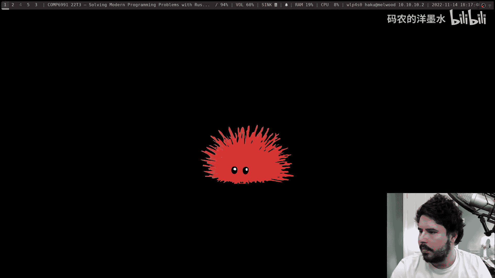

Yep， that seems right and five five sort of written theory based questions that are that may include subpart sub questions that we're asking。

Shedva name， yes， yes。Writing info to Google Anatics。 Yes， so there is a， there is。

Certainly a limitation of reason that we ascribe to the idea of writing to the internet here。 yet 5。

 theory，3 Pra going to be like old school 1，5，2 on exams。 Yeah。

 I guess you could think of it that way。 Yeah， yeah。Also。

 we're not guaranteeing the split of subpas will be the same。

 but the split of PraC theory should be cool， there you go。

So it should be genuinely a pretty good representation of what your final exam will actually look like so again。

 the best way to get a gauge for how you're looking for the final exam is to set this practice exam yourself in exam conditions。

Cool， it's worth noting。 Okay， so earlier I said I put theory in air quotes。The reason I put theory。

 you know， pra slash theory theory here in air quotes is because we're not we don't plan。

 So the this may be the case。 like some questions， this may be the case。

 but we don't generally plan for all our theory to simply be。Tell us like what this thing is in rust。

 right， like a a sort of theoretical question that has a pretty well defined answer。

 So you can imagine a theory question from like a mathematics course being like。

 here's some equation solve for this variable， whatever。 in which case you're going to write some。

 you know， you're gonna you're going to write some stuff and find a value。

 And there's generally going to be one correct answer。

Whereas we're planning to ask for the most part， with these theory questions。

 as you'll see when you take the exam the practice exam yourself， they're far more openended。

 They're more about asking you to sort of share your opinion on a given scenario and to back that up。

 like substantiate that with arguments based on what you've learnt throughout the term。 So。

 for example。You might come into the final exam or into the PRAC exam here。Going， I really hate rust。

 like this whole term， this has been an absolute nightmare for me。

 and I I think Rust has just gotten everything wrong。

And that's okay as long as you have like good reasoning as to why that's， you know， the way you feel。

You might have gotten here going， oh， Ru is the best I really love Ru and I love the way it does everything and in sort of the same vein to this。

😊，Just going through the exam being like Ru is amazing isn't is also not going to get you marks。

 So you're not going to lose marks by being like I don't like rust。

 You're not going to get free marks just by going I like rust。😡。

So it's about like hearing a scenario and going this is what I believe right。

 this is the way I sort of feel about this situation and here's why and and you know if it's a you know if it's a well supported argument。

That backs up your position， then you the arguments is where we're sort of giving you the marks in this case。

嗯。Now， there might be a small amount of questions， like especially just sort of easier questions that we're just trying to give you some sort of。

More like freebieish marks sort of。😊，Maybe leaning you into the exam。And， and， you know， just。

 just giving out some sort of。Yeah some easier ones we might just ask straight up questions where there's expected to be some sort of answer and like so you need to be able to expect and deal with things like that but that's not going to be the dominant theme throughout the exam is what I would say。

嗯。Okay， so just really， since this course is new， you guys have to write two exams。 Yes， we do。

 And the workshop will have some sample questions。 Tom says， yes， it's been。

 it's been very fun for sure。Honestly like， yeah， exam stuff has been has has been surprisingly fun because I think writing questions that actually put you in these hypothetical scenarios and and get you to do thinking and reasoning is。

 is pretty fun。😊。

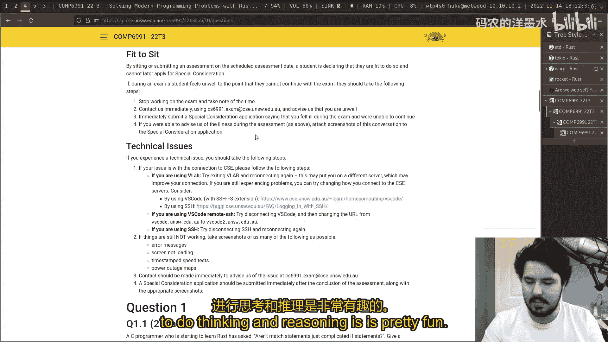

Cool， is there anything else that we want to。Call out about the exam， Tom。Most just to be clear。

 most practical questions， you'll get some sort of starter code。

And your job will be to like implement something。嗯。呃。Most theory questions， you know。

 I went through and I was reframing them as sort of like， fun， you know。

 changing the questions from like， tell us about this to like。

 Steve is trying to write some rust code to do blah， blah， blah and does this。 You know， here's this。

 Oh， actually， he realizes that he needs to do this instead。

 give an example of blah that Steve might be trying to do where the first thing is not good enough。

 but the second one might actually work and explain us。 you know why that。 You know， that it's。

 it's pretty fun。And and if you go through the pra exam and there's things that you find that you really didn't like about it or things that you found confusing。

 you can also let us know that and that could potentially to a to a like minor extent influence the final exam and that we're not looking for you to go I really like I really liked the questions that were around like the week one and two topics and we'll go great we'll make the whole exam on that。

 but it might be like I didn't like the wording of this question and and we can try and make sure we you know potentially avoid that kind of thing。

In the final。Mention what Q8 is。Alright， Why not？ If you don't want to know what Q8 is。

 then you might want to。You know。Switch off the lectureor for a second。

 maybe I won't show you it entirely but。Q8。For the PC exam。

 and I think I'm fine saying for the final exam， we plan to be relatively open ended。

So we expect that the exam should hopefully be completable by someone who has like put。

 you know the work in and the study in and is doing well in the course。

 the exam should be vaguely like roughly completable within two hours or so。

And but it's scheduled to be set over a three hour period。嗯。But with that in mind。

 the final question， Q8 is。Okay， the idea of Kuwait is he is like。

Here's a larger thing over there that we want you to go have a look at。

 and then we're going to give you some kind of a prompt。😊，And。

Then you have like as as much room as you want， whether you want to， you know。

 answer it very quickly if you're in a rush in the exam or if you want to put in a lot of work and write a very big response。

 you can sort of discuss a certain prompt。And and put in a lot of your thoughts and we're hoping that。

 you know， whatever we give you， there'll be plenty of meat for you to chew at。

 plenty of things for you to go to talk about if you have the time to do it and the willingness to。

And so its it'll be sort of， yeah， more open ended final question。In the exam。Which again。

 you'll get a try of in the Pra exam。嗯。Cool。Any other things， Tom。Tom has been very much。

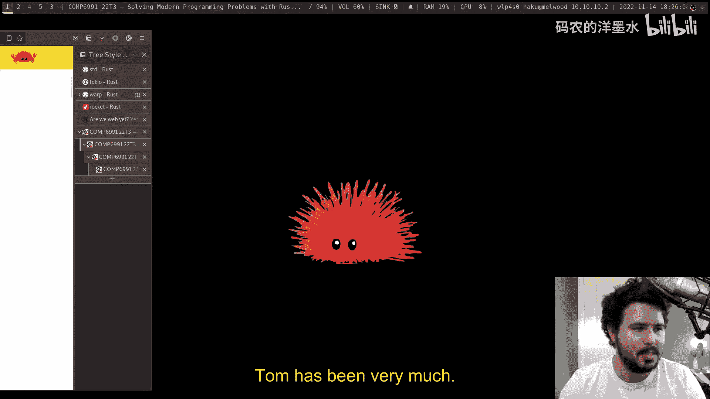

Putting in a whole bunch of work for for all the exam stuff。

 the final exam and the praC exam and all that。 So a massive big thanks to Tom。I mean。

 you should everyone should hopefully already be aware of this， but I'm just gonna。

Make it abundantly clear as well。The exam the final exam itself is all online。

We're you're not coming into CSE or the CSE labs or anything like that， and it's not proed。

 meaning we're not looking through your webcam， you don't have to install some dodgy software to take the exam it's it's just gonna be almost like you're doing weekly exercises but in exam conditions you know at home or or you know yeah。

嗯。Cool。Yes， alright。So。Yeah， make sure you read through all of these as well。

 These should mostly be the same for the final exam。

 So what time is the exam I know it's on Tuesday 6 but I can't recall the time so it is a morning slot it is it should be 9 AM so the final exam is Tuesday the 6 of December 9 AM to 12 PM3 hour exam。

There was someone mentioning like we got some feedback going。This time slot is。

Relatively inconvenient， given a lot of people， you know need to maybe need to go to work and that kind of thing from 9 AM。

 And sadly， we have no control over over this time slot。 I believe we asked for an afternoon slot。

And， but you， you sort of。Exams are central timetable at UNSW and you get what you get。

 so our apologies。But that is that will be the time of the final exam。Of course。

 the Pra exam you can do as you please。Write your own proctoring AI， write your own borrow checker。

 write your own rust language offshoot。Yes， oh， yes。 if right。 Thank you， Tom。 Yes。

 if you like this time slot， 9 AM to 12 PM， if that is a horrible timing for where you live。

 if you live。A。I think。I think within Australia， you probably。

I guess in Perth you'd be what 7 a I think that's still within I think you and IL you would consider that to be fine still。

 but if you are overseas where this time turns into something ridiculous in your local time zone。

 say you know your overseas quite a few time zone's over and this turns into like 3 a to 6 a you should very much be applying for special considerations。

And saying that， hey， this time is ridiculous in my time zone I'd like to take it at a different time around the same。

 you know， date whatever and and they'll be able to they'll be able to hook you up with that。😊。

And there's， I think there is documentation， I've seen it before I believe there's documentation about how far out of like what hours in your time zone it must fall in for you to be eligible for this for the special consideration。

 but yeah， if it if it's a ridiculous time for you in your local time zone you should。

 you should apply for special consideration。😊，Okay， and Tom Tom says 10 PM to 7 AM。

 he seems to have found so。You know， double check your own things and and make sure you reply。

 but if it's， yeah， if it's。Looking kind of crazy for you。 Don't worry。

 you'll be able to get it moved to it a more reasonable time。Okay。嗯。

I think I guess that's probably it， Tom says。Tom seems to say that that was mostly it。mCool。

In that case。We're going to have some fun。 So to be clear。

 this is a for fun lecture from this point forward， we've talked about the PraC exam。😊。

And I guess we've， we've。Mostly talked about the exam as well。Like， you know。

 the these exam details plus what you've seen in in the。And the practice exam is basically。

The information for the final exam， otherwise just make sure you don't forget that it's here and make sure you don't wake up at。

 you know，10，30 AM and go， oh my God， it's。halfwaylf through the final exam。

Because one student always manages to do that， one student always manages to either oversleep or forget that there's an exam every session without fail。

 so don't let that person be you。😊，嗯。So， yeah， anyway， I guess。

If you have further questions about the PRAC exam or the final exam， direct them to the course forum。

😊，Otherwise， I mean， yeah， again， we， we're then out of things for the lectures again。

 So everyone go home， switch off thelect No， so we do have some。

 we do have some fun stuff we can talk about。😊，嗯。We are going to try something， this lecture。

So we're going to， I'm go， I'm going to try and talk about。Async rust。Today and maybe。

 maybe on Wednesday， we'll have to see what there was some other interesting ideas to maybe fill in。

😊，Ca it， yes。嗯。😊，So let me lay some absolute like ground rules for what we're talking about here。

And expectations。Many people have asked me during the workshops。 Can we talk about asynch。

 I've seen so much about asynch crust。 Can we do asynch crust。And yes。

 asynnc crust is very cool in the real world， it's very popular。😊，However。

 there is still work being done in the language for async rust。嗯。

'There's sort of bits of the language where asynch crust is particularly tricky or isn't quite flexible enough to support。

Things that we want just yet。 But， you know， it is still like， for the most part， there。

 it's still very much used。 And there's some really cool things that live in asynch rust。

 for example， the Tokyo。😊。

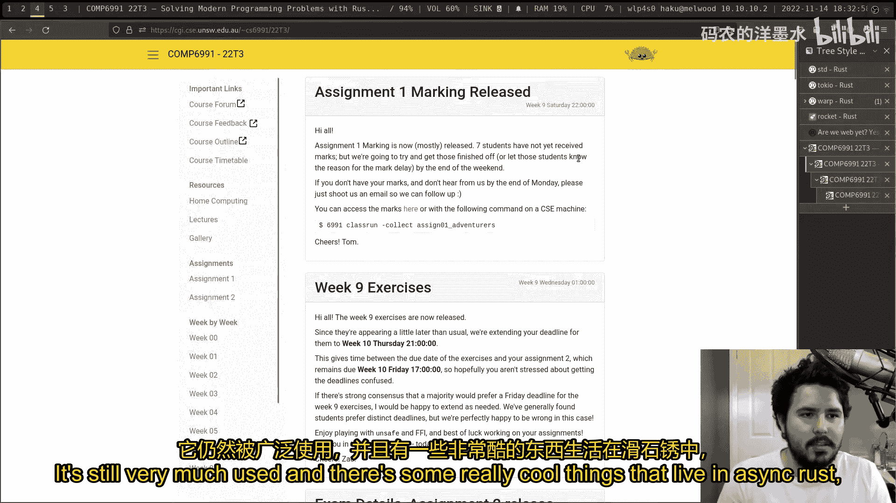

The Tokyo executor is like is a seriously cool piece of technology， in my opinion。

 and there's you know some really awesome projects that leverage leverage lots of different parts of rust in order to provide really cool interfaces like rocket is a pretty big favorite of mine and so there's still like just a ton of interesting stuff to play around with。

😊。

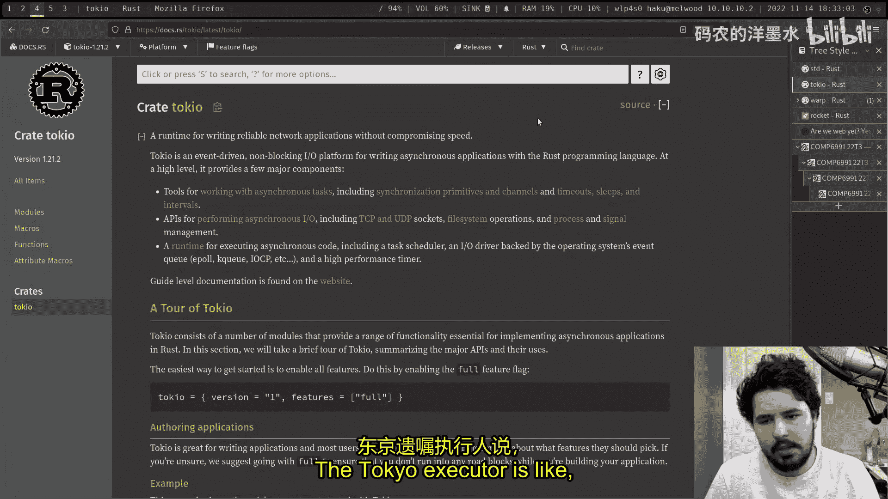

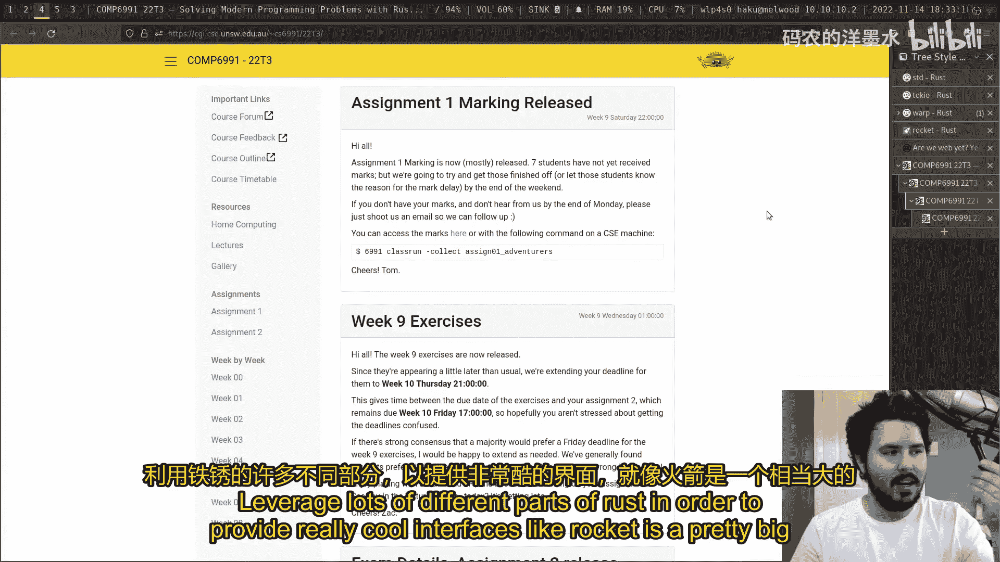

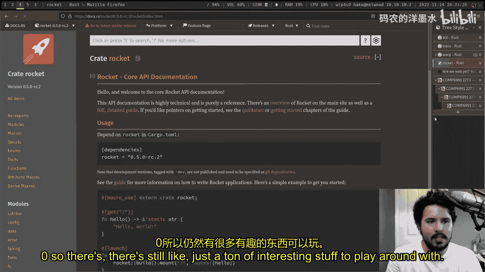

We're going to try and talk a little bit about the weeds today， like sort of the the low level。

 some of the low level details and how async rust is sort of。

Fored and compare maybe contrast like some approaches in different kinds of languages。嗯。

But let me make a couple things absolutely clear。 This is like。Kind of difficult content。It is。

 this is not accessible content。 This is not going to be stuff that appears in the exam。

 It's not going to be stuff that we're marking you on。 It's just for fun and for interest。

 You are still allowed to ask as many questions as you want。

 You can still ask things on the course forum about this stuff。

But it it's our own sort of for interest topic。And it's not going to be。

 and it's not something that you should be like stressing out about or or， you know。

 digging your head into the books to study for if， you know。

 if you're worried about the rest of the content for things like the final exam。A。Sir。

With that in mind， who is ready to talk about asy rust？

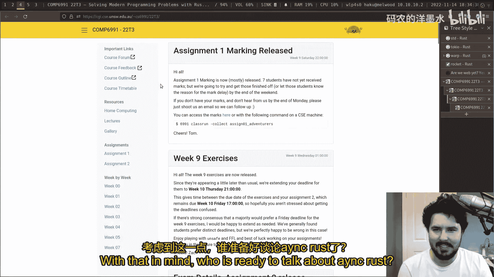

嗯。Wow， a sink rust。 What leg is this， Le 17。Wow， we've come so far。 Look how many。

 look how many leg folders there are， wow。Okay。So。Let us start by talking a little bit。About what。

Asyncch rust means。Because you might just hear the word， you know， asy， you know， and you know。

 insert like language here， asych rust and mean well async here is short for asynchronous。Which。

 I mean， like technically， async is short for asynchronous and rust here is a programming language。

 So when people talk about async rust， they must be talking about doing you know。

 asynchronous programming within rust。And that's not usually true。 Saly。 So asynchronous。

 to be clear here， the terminology asynchronous here literally just means like aing the someone who。

 who knows about English。synyntax and stuff can can remind me what like this。

 this prefix here is called。 But it just essentially is a word meaning not synchronous and not synchronous。

 meaning like you know， we， we tend to think of our code as being sequential by default。

 It does this line and this line and this line and this line and sort of flows in one direction And。

 is very much sequential。That's our sort of typical model of synchronous programming。

You go asynchronous when you start thinking about code as not simply just being synchronous。

 but perhaps say executing in multiple locations at once or you know， executing one thing and then。

Going and executing some other thing and then coming back and executing this。

And so that's where this sort of idea of being like， well， okay。

I must already know asynchronous because in the course， we've done things like stood thread spawn。

 and that lets us start being asynchronous。Great。😊。

Right now we we now have like our code is continuing over here。

 and it's now also continuing in a separate thread over here。And so we are writing asynchronous code。

😊，But it is not generally what people talk about when they talk about as sync rust。

So async rust is not really just a sum of async and the language being rust。

 it's a specifically different idea。That just falls under the name of async rust。

And this is what we all discuss now。Sir。What is async rust all about？Async rust is all about。 I mean。

 to me， I I believe asyncch crust is all about。Something called Staless。Coouts。

It's all about Staless co routines and how they sort of work with rust's future trait。

The future trait。嗯。So， all right。 Staless proteinss in the future trait。

So what are we even trying to do in the first place here？

Like what is the problem that Async rust is trying to solve？So， I mentioned before that。

You might think about someone might mention， you know， asynchronous rust too， and you go。

 I already know how to do asynchronous rust。 I've I know how to use threads since I know how to use threads。

 I know how to write asynchronous rust。Like thereforeve I've got it， I've got it figured out。

And like， that's true。But it's not really the whole story。 So what I mean by this， it's kind of like。

What we've done。 So is imagine someone was talking about the idea of generic programming。

Programming is apparently what I've written generic programming right。

 where let's say like the idea of generic programming being I can write one piece of code that works generically over many different you know。

 types， say this might work for a string or an in or a whatever。嗯。And imagine that someone was like。

 hey， I want to talk to you about generic programming and you go oh yeah， I know generic programming。

 I use Vec all the time。Right， o v ofte， I suppose。I know generic programming， I use Vic。

And it's like， yeah， okay。You probably have an like an understanding of generic programming。

 then if you know how to use Vec， you know Vec of some generic type parameter T。

 but would you really say like you understand generic programming sort of as a general concept if you've just used Vec。

Like maybe maybe you you've really figured it all that from there。

 but most likely you've sort of figured out a way to use generic code and you know。

 roughly how generic code can work。But you might not understand the principle like the sort of abstract idea of generic programming。

And this is gonna this is maybe going to hurt a little bit。 It might hurt to hear this。 So。

 so brace yourself a little bit。 But this idea of a sync programming。Is kind of。You know。

 to a certain extent， corresponds with this example over here where I know acing programming because I know how to use threads。

And it's like， yeah， threads are certainly a tool for asnc programming。

 but they're not necessarily like the the absolute primitive and threads don't represent， you know。

 asInc programming as a whole。 There's actually a lot more ideas that can that can come into it。嗯。

And so what we're going to start off with is trying to understand trying to， I think we， I mean。

 we talked about like principles of async programming a bit when we were first getting started in week。

8ight， yeah， week 8。嗯。But we're going to look， we're gonna。

 we're gonna to recap on that and then see how rust tries to represent that generic idea in a generic manner with essentially what we have up here。

嗯。Okay， so simplify the process of doing multiple things at once。

 but without the complexity of threads。 Yes， that's， that's certainly what they're trying to do here。

And so yeah， we'll， we'll certainly be talking about that。So。Right， just a recap。Actually。

 does anyone， Does anyone want to recall in the chat There was something that I mentioned。

In at the beginning of week eight， when we were just first introducing the idea of concurrency again。

There was this nice quote from Rob Pike。W whichch talked about one of like the the premises of concurrency。

 why we even sort of why we care about concurrency in the first place and what concurrency really means。

Does anyone want to offer in the chat either if you remember roughly what that quote was or what you think concurrency generally means right。

 Yeah， awesome， so concurrency is the idea to handle many things at once。嗯。

So there was also that idea of parallelism， parallelism。

 meaning like being able to literally do many things at once。

 But concurrency is more about the idea of handling many things at once。 So async programming。

 one of the fundamental ideas of is being able to handle doing many things at once。嗯。So。

When we think of asy rust。We usually think。Of。These many things at once， right。

 Like what are the many things that you're trying to many at once。 What are those things， generally。

 these are some kind of like。I'm gonna， I'm gonna to call it like an I O bound task。Iobound T。So。

I this is maybe not generic enough to mean what I want it to mean。

 but like what I'm more like sort of specifically looking for is like not CPU bound， right。

So tasks that are not CPU bound， meaning they're going to take a certain amount of time。

 And it's just the time that the CPU， like the CPU in this computer needs to put into it。

 But instead tasks。That might take a while because we're waiting for something else。

 We're blocking on something else。 And yeah， a blocking task you could also you could also call this。

 but even CPU bound tasks you could argue are occasionally blocking like this might block for a few seconds until the computation concludes。

 So what we're specifically interested in are tasks where we need to do something but we're probably going to be waiting for someone else。

So a example of this is something like a web request and we've talked about this all before。

 but let's go a little further than last time。So there's a crate called Request。Gosh。

 I hope I don't run out of disk space during the lecture。So there's a crate called Re。

 which is fun that lets us basically quite easily make HTTP requests。😊，Cool。

 and it has about 100000 features that you can switch on and off， which is。Great， do I need。

 And I want this feature。 dash， I think it's dash a。Or is it our fate job？Features， blocking。

There you are， cool。So if I want to say get the rust website。

I'll let Rus Anaza do its thing in the corner if I want to make a web request to get the rust website。

呃。I get。Then I might do something like this。I might say， unrap it。And we'll get it as text。

I give a good idea unwrap that and this， I believe should be。

Let response is this and this is a string。Yes， string。 We can see that here。 Cool。

 So I might say something like print sending。Request to rustlang。t org。Then， we'll say。

Received response from rustling。org and then maybe print out the response itself。Response。Like that。

Okay。So if we run this program， we're going to see something like this。Oh gosh。

 we're gonna see a huge。Compilation， let's build it first so we can actually see it running so separately。

All right。So if I say run the program， we see sending requests。To。Man， I should let's throw this in。

Somethingund like vim， okay。Damn it buffet it too much。 Okay， here's what we'll do。 Run， pipe， head。

 dash and dirty。

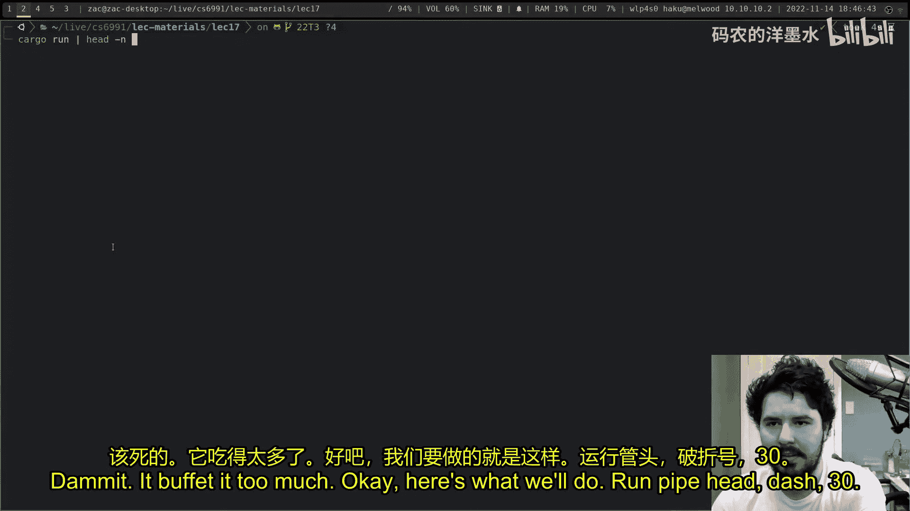

So you see， sending the request， receive the response， and then it spits out the page itself。

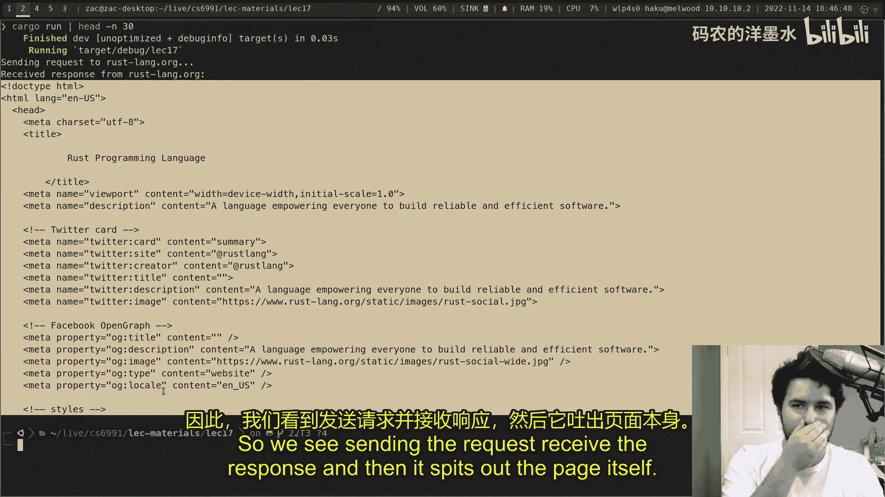

And this here。😊，Like to go from from sending this line this print and actually receiving the response takes a bit of time。

Maybe one and a half seconds or so， in fact， I guess we can actually time it ourselves。It took。1。

135 seconds also， right？That is not time where if I had a billion CPU calls。

 if I was running this program on an absolute supercomputer， it would run， you know。

 a computer a thousand times faster than mine， it would run a thousand times faster。

If I run it on a supercomputer， right in my house， if I managed to fit a supercomputer in here。

 it's probably still going to take about 1。1 seconds or so。

Is just sort of like the fact of the metal。Because the thing we're waiting on is not my computer being slow。

 It's waiting on rustling。org to give me back this information。

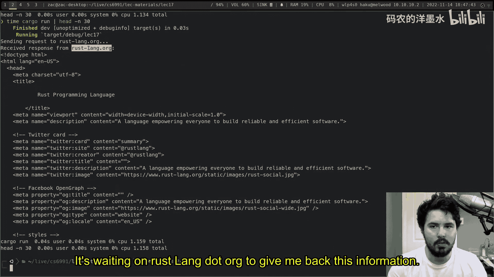

So。As as our program exists right now， there's really no reason for。

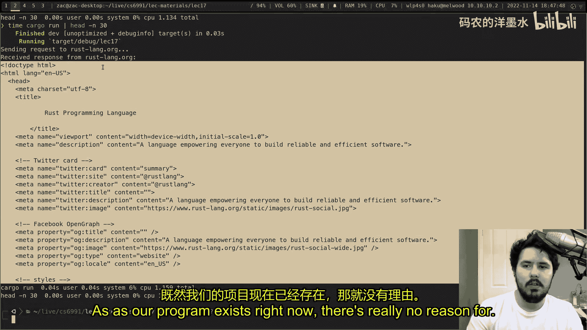

ThereThere's really no reason。To， to even worry about asynchronous programming。

 because all our program wants to do is。Send， get a request to a website and then spit it back out。

 But as I mentioned， you know， in week8， what if we want to do to do something like this。

 So what if we want to say， you know， do this process， but also。

What's another website that's probably gonna be slightly slower that people are interested in They maybe like。

The C+ plus reference site， How about that， that's a good one。

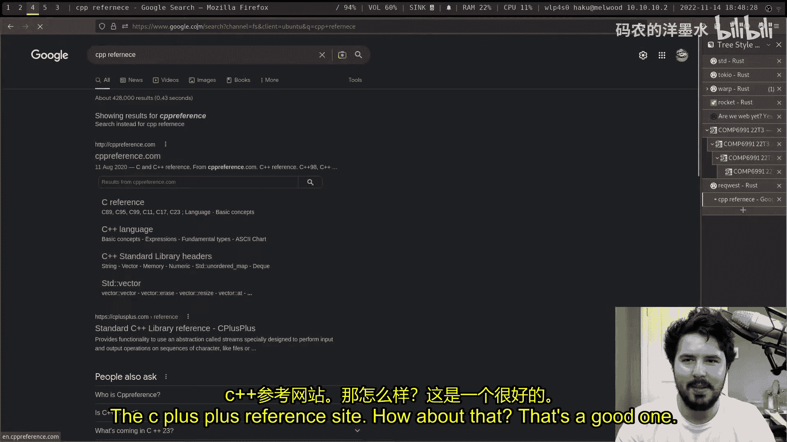

That'll probably be sort of slow。 Sure， that seems great。

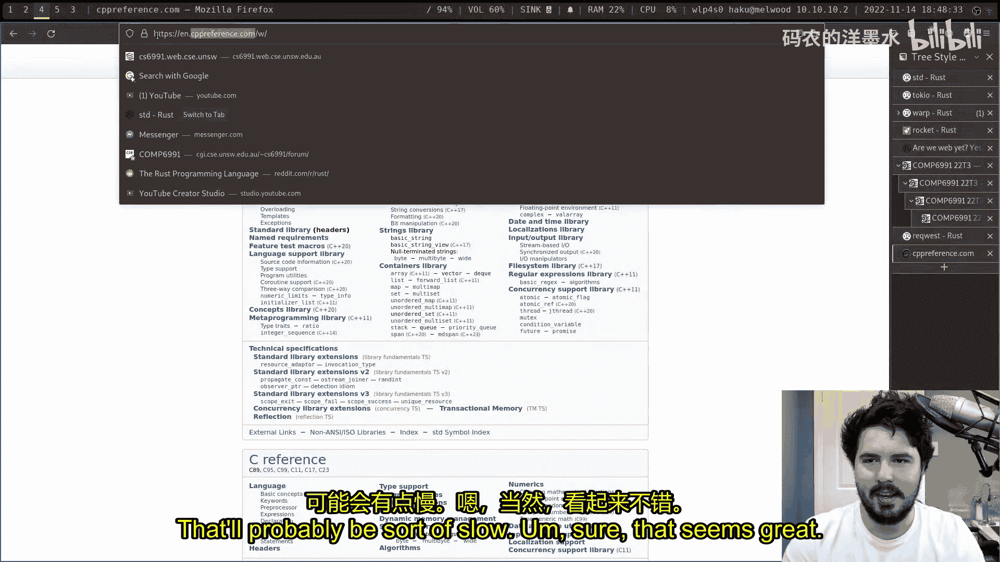

So we go send request to。Well， let me put this here。Sending your request to C+ plus reference。 com。

 oops， that's not what I want to do。also know what I wanted to do。Two C+ plus reference。呃。で。

And receive response from。Say plus plus reference。Cool， and here's that response。Right。

 let's see how this program works。嗯。Also， this response is gonna be really long。

 Let's just change this to be response dot lines dot。 sorry， response dot。Lines， dot next， dot unra。

 Just grab the first line。Same with you。Response， dot lines， dot first。 oh sorry， not first。

 dot next， sorry。Next。到。嗯。Rightrap。Like that。All right， let's build it。And let's run it。

Sending a request to rustling org， sending a request to C plus plus reference。 Wow， look at them。

 they've got， they can' of agree。嗯。Now。This program takes about two seconds。Right。

Because it's waiting about a second for rust Langorg and it's waiting about a second for C++ reference。

Right。But like it didn't have to be that way necessarily。 it didn't have to be that way。

 And we know with threads like now that we we've learned this in in the course。

 we could rewrite our program to do this first one here on a thread， say。

So we could say something like or even I guess we could do them both on their own threads， in fact。

 that'll maybe be slightly easy for us。 let's do stood thread scope， create a new scope。

Then grab all this stuff here。This will be scopepe dot spawn。Until here。Like something like that。

And then scope dot spawn。And we have something。That。All right。How about this？

So now we spawn two threads， one thread asks rustlang， one thread asks C++ reference。

 and let's see how this program performs now。So it's still I was reading the wrong time this whole time。

But， no， was I。2 seconds。Total。Where's the wall clock time。啊。W going crazy。Okay。

 I don't know what happened。 I think we just got a weird。Some fun， weird edge case over here。

 But this is what I was expecting。 Now， it takes 1。1 seconds still。

 I guess one of the websites just took slightly longer that time。 There we go。 Okay， cool。

 That was weird。😊，Oh， I counted the rebuild。 Oh， you are so right。 The rebuild took one second。

 Very good。 Asome。 Thank you。😊，So now。Even though before we did this， which was up here。

We still have the same information and the program took two seconds。

 we managed to basically double the performance of our program。By。Essentially， asking。

 like kicking off the process of。tellingling Rustling org to give give us its bites and asking C plus reference to give us its bites。

And we only end up having to wait essentially as whoever， like as long as whoever takes long got。

In this case， it looks like C++ reference is slightly faster。😊，I mean， can we even see it。 Yeah。

 you can sort of say like dot from sea assurance and then dot from ruststling wg。嗯。And so。We've。

 yeah， it's。Like we've effectively made our program twice as fast by using threads by leveraging concurrency。

So let me just catch up。 Python website would surely be slow Python dot org。 That seems pretty quick。

 Let's throw。 Let's throw it in quickly， just for fun。😊，So， and this is。

 this is a relatively scalable method。 In fact， this ties in nicely to what I'd like to talk about anyway。

 this is a relatively nicely scalable method。 in that if I want to add another website。

 I can just sort of。😊，Like。You know， I can just go in and add another thread that does this。

And we're going to say Python。org。Python log， okay， like this。And I can run the program again。

 I can build the program again。And then， run the program again。Yeah， look at Python org。

Lightning fast。And the program again， is still taking just 1。1 seconds。

Like it's taking the exact same amount of time as it was before。Because we're still spending。

 we're not waiting for the computer to catch up。 We're waiting for everyone else to send us the information。

嗯。No realistic。 E phopho thread in Se fault。 Okay， so。This is really interesting。

 and threads we've let us leverage concurrency。In order to to let us think about many things at once without necessarily doing without yeah。

 necessarily doing any two things at the exact same time， truly in parallel。

Website to bely proportion。😊，Okay， so。Then what have we what have we sort of learned here well。

We've learned that we know how to do asynchronous programming。But there lies a question that is。呃。

That relates to。Something I mentioned before， which is， I was saying before。

 threads aren't necessarily like the fundamental unit。Of， of asynchronous programming。

 of concurrent programming。We've sort of probably come to think like a lot of us in the course might have come to think of them。

As the fundamental unit。嗯。Just because that's sort of the way the course is structured to make you think about this stuff。

But。😡，Surprisingly， a lot of the time threads might actually be overkill for what we're trying to do。

Now， why is that？Well， if we think about this program that we've got here。

Let's look at what that program might look like， visually。So we have。

A main thread that's like going and executing code。 And it goes off and spawns 3。3 new threads。Right。

3 new threads。 And in this case， in Rus's case here。

 these are what's known as operating system threads。

 So these are threads that are literally like genuinely handled by Linux on my machines case。

 know operating system threads exist on Mac too。 they exist on Windows。

 And so you're actually spawning this real operating system thread and it comes with a lot of stuff。

 I'm drawing these as sort of like big boxes you know for like digrammatic effect。

 but genuinely because a thread usually comes with a lot of data associated with it。

 So that data might be things like variables that it's got on its stack。 They share the same heap。

 but they have different thread local data that all needs to get potentially spun up an initialized when you're creating a new thread。

 It has its own sort of。You where it's at in the program。

 it has its own registers and stuff if we're talking on a really low level that it wants to like deal with。

And Linux is going to have to spend probably a reasonable amount of time switching between these different threads。

 So let's say I actually really only have one core available on my system like one it's my system is really only able to do one thing at a time。

嗯。It's probably gonna have to go， okay， create a thread， create a thread， create a thread。

 Don't start doing any work on them yet。 just sort of see， okay， there's three threads。

 Then Linux is gonna go， allright， Main's now saying。

 wait for wait for all of these things here to finish。 So I'm gonna go and like do some work。

 It switches from main over here。 and you know does some work and it says， oh。

 I'm waiting for rustling orgs。 okay okay， I'll switch to this one。

 I'm waiting for C plus plus okay switch to this one or I'm waiting for Python we'll switch back maybe to this one。

 It's still waiting。 we sleep for a bit， sleep。 Okay， check oh yeah， rustlings coming back。

 So we'll go over here and continue on and this one right so we're switching between the different threads quite a bit。

 and eventually we're going to end up coming back to main here and continuing on。😊。

So to an operating system to something like Linux， a thread is really like a。

Sort of a its own data structure。RightIt's its own。

Unit in a certain sense that is able to that that has its own like， let's say it has its own stack。

 It has its own registers。It has its own thread locals。It has its own like you know。

 position and code that it's executing， right， it's got all these things that make it up。😊。

And switching the sort of context of what the computer is is performing from one thread to another。

 right， this， this switching here is， is quite literally called a context switch。嗯。

Can be quite timely expensive。You know， use up。Genuine。

 like potentially precious resources on the computer， like the time that you have。

And if we really deeply think about what we're doing here。Like。

Do we need four threads for like Linux operating system threads in order to do what we want here。

Do we definitely need。4our threads。And the answer is， actually， no。

You could do this with just one thread and still have。

 And like with without a sacrifice in performance， that is to say。Because again。

 we're not like it's multiple threads open us up to the possibility for parallelism across course。

 So in my， in， in my case here， if I look at。

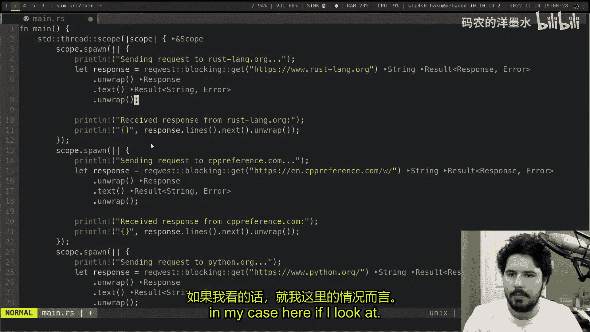

If I open up。This top program here， you'll see that my my computer has 16 cores available if I only ever write very sequential code。

You know， no matter how smart the computer is， it's not going to be able to take my purely sequential code and run it simultaneously across eight cores in order to speed it up。

Right its it's only sequential code， so I can only really take use of one physical core that's capable of executing one thing at a time。

嗯。

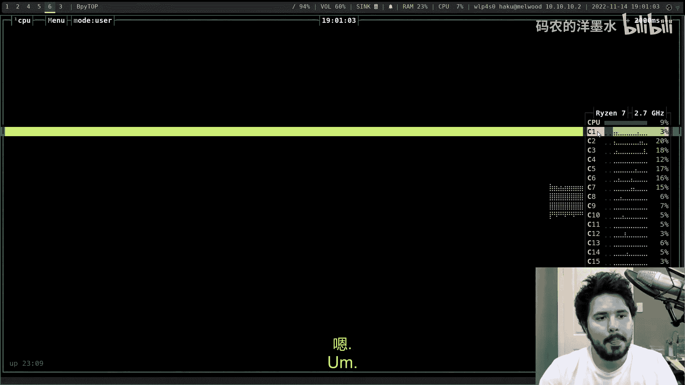

So when you use multiple operating system threads， like in。

Our diagram here。You open yourself up to the opportunity for the operating system to truly parallelze your code。

 and it goes， there's four threads going on here。 We have the resources available。

 Let's run it all on four courts。 And so if your work is quite， you know。

 heavy on the CPU needs to crunch a lot of numbers。

 then you open up the possibility for parallelism to really increase the performance of your code。

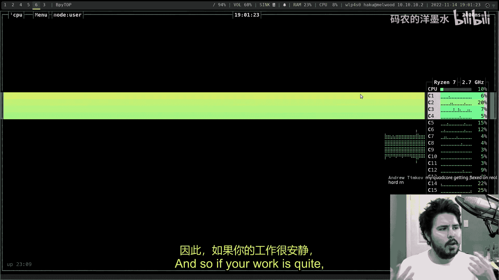

But。

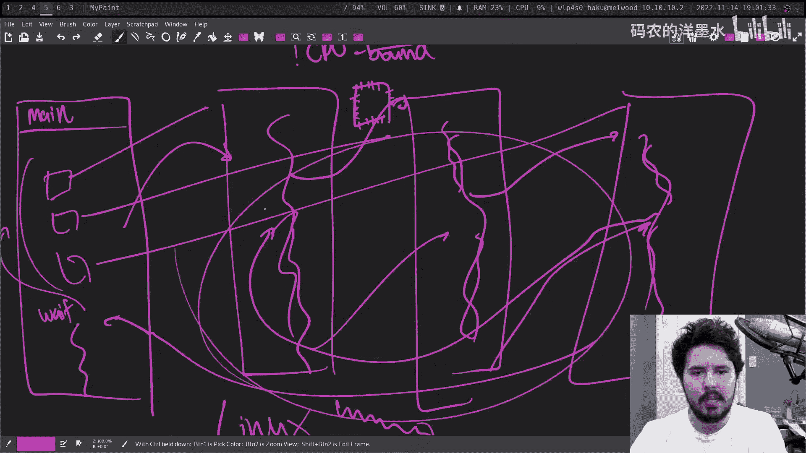

For something like this or for something like an IRC server， let's say。

 threads are probably like overkill。

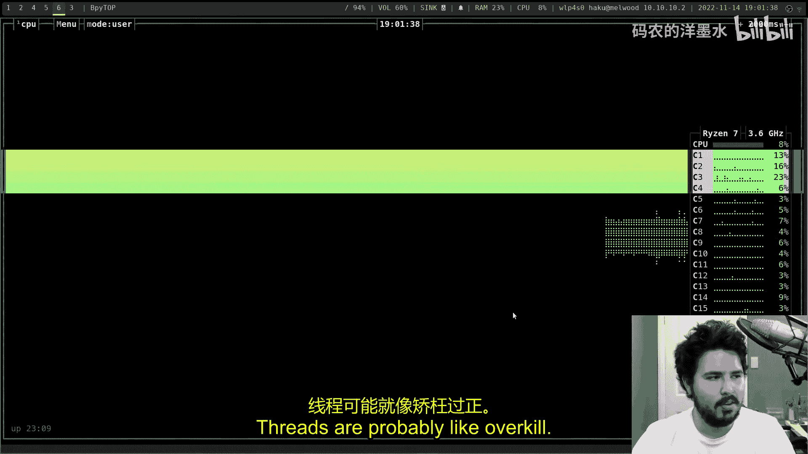

We don't need all this extra information。 Realistically。

 all we really care about is this is some form of a task。

And we can think of this task as something like a state machine。

 So like these tasks are all basically doing the same thing here。 We could， we could make it generic。

 I just did like， I just copy paste the code。 But you could imagine we wrote a function or something like that。

 In fact， that's。Not that bad an idea to do， because it actually will help demonstrate what I wanna say anyway。

 So if we had a function that was something like get website。Let's say， and we have a URL。

 which is a string。 And the name of the website is a string。And this should give back a string。

 which is the actual response。Then we're going to get something like this。Except I guess。

 probably without that one there。嗯。So， sending request to。The name of the website。Get。The URL。

Receive response from。The name of the website。And then give the response back。And then in here。

 we can say get website。U was， I shouldn't have deleted it。 I'm stupid。IThink it was rushline。org。

 I don't think there's anything special about it。And I'll just write rustling now。

And this should be let respond。O。Right， so does what we've got here roughly makes sense。

 See how that's like analogous to what we were doing before。

 It's a pretty simple refactor all in all。 And here we're just gonna have。嗯。

Willll say sending request to C plus plus reference， which is this URL here。Q。

And here we are sending a request to。Python。org and here is the URL。Okay， cool。

 So our code's a little tiier now。Which is great。 Still some duplication going on。 but that's。

 I'm happy with that。Cgo builds。And run it。Takes an equal amount of time，1。2 seconds， whatever， Yeah。

 something like that。I wonder if this even， let's， let's just see for the fun if building with optimizations speeds it up at all。

 I imagine it might a little bit with inlining the functions potentially， but I mean。

 you spend all your time waiting for the websites anyway。

 so I imagine even building with release optimizations is probably not gonna to change anything。

And it is 1。4 seconds this time， okay， it's just somewhat variable。😊，嗯。So， okay。Now。

Here's what I wanted to do。the heck now we have a somewhat generic idea about what this kind of a task looks like。

So let's imagine there's sort of three parts to。Like what's going on here， we have。Sort of。It's。

 you know， like part one here。Part。Two here， there's not really three parts。

 I'll just call this like part three here， which is the end essentially。嗯。Now， in part1。We actually。

 sorry。 No。 I do remember why I wanted three parts now because I'm stupid。

 I wanted a part to right here。Like that。 And then part 3 being the end is sort of like here。

 actually， okay。嗯。So there's three parts， there is。

 we've just called the function and nothing's really happened yet。Right。

 hold the function and width just with' just like getting ready to stop doing everything。Then。

We call get on this URL， And this function is going to block is going to make us wait until the response is ready for us。

 That's what I'm calling part 2 here。 Part 2 is when we fired off the request and we've got nothing to do for now。

 We've got nothing left to do。And then in theory， this request comes through at some point。

 and that moves us on part 3。 Part 3 can really be seen as like right here onwards in a certain sense。

Where we we're not waiting for anyone anymore， we can just continue on。With the rest of our code。

 and it's going to be microseconds before we're at the end of the function。 like here。

 maybe like a whole second we're waiting the rest of this just microseconds to execute the last little bits of code that we need here。

Right， do we see how this sort of like can vaguely be seen as like these three different parts？啊。

So to， to think about this diagrammatically， we sort of have。

 you can think of this kind of like a state machine。

 So we have the what do they call this get website。 So get。Website。

 if we're thinking of it as some kind of asynchronous task。It says， like， we can sort of。

Initialize a get website task。And nothing's really going on yet。Then。If we like let's。

 and let's say this is like this arrow here means like do work。

So we do some work on Gett website and that initializes us I thing that's ready to make a call。

Then we say， all right， do some work。And what's it going to do。

 it's going to like send request to the website。So it's going to ask the website， hey。

 I'd like to get the information， please。And it has to wait for it to do that。So， you know， this is。

 this is going to take some amount of time。 This is my， my beautiful clock。You know， icon here。

Sends a request。 Take some time。And then， you know， eventually， when we do some more work。

We're hopefully able to spit out some kind of result。Right。

 the actual response that we've got out of it。And then the task is done effectively。嗯。Right。

 so this is really what we care about in terms of a task。

 Is there anything that means this needs to be done another thread。 Well。

 kind of this part here was the scariest part。 This takes a lot of time。

 right to actually get the response back。 And so we've learned to say。

 since this call is going to like wait for a while， right。

 You're gonna have to wait for the response to arrive。

 S it to like make sure this is done on another thread。 So that thread can spend the time waiting。

And then when it's done it， it gives that value back。But what if this send request？What if we like。

Didn't necessarily wait for it。 What if we fired it off， Like， what if we said， send the request。

And I'm not going to sit here waiting for it。 I'm not going to be。

 say like a thread that is just waiting on this line of code。What if I like return back。

To whoever is working on this task and say。Like， I'm not ready yet。I'm not ready。But I might be soon。

Right， I might be soon。Right， so imagine there's someone else here。

 there's someone else that is trying to get the website， right。

 there someone else here would be function main in this example of here。

It wants to get a website and it says， okay。How to to do that， it goes。

 I'm going to call get website。And that's going to give me， it's going give me a website here。

My website equals this。Cool， so effectively I when I call this something like that。

We're gonna imagine that。Where at this state here， it's been initialized and it's ready to go。Then。

Me on the outside， I'm going say website dot do work。Right， websitego do some work。

And it's going to do this amount of work。😊，Fire off the request to start and then return back to me。

It's going to return back to me here。And it's going to say I'm not ready yet。And I go， that's fine。

 No problem。 You fired off the request。 I appreciate that。

I'm going to go do something else and maybe our code goes and does something else in the meantime。

And then eventually， it comes back and it goes， allright， let's see where we're at。

 website dot do work。And。Maybe， maybe at this point where we that do work function goes off and checks the state of the request。

 has it come back yet， are we still waiting for something and it goes oh we're still waiting and maybe it just says like once again you know we're not ready here。

But maybe the request has come back。 And it goes， great。 That do work here I not just going to say。

 hey， I'm still waiting here。 It's going go do the rest of this and actually give us our result back。

 So it might give us back ready。Of the response。And effectively， this task here is done。

So this is a slightly different way of thinking about how to work concurrently。

Without using like operating system threads like we've been doing in the rest of the course。

If you can， like， vaguely understand。How a system designed like this， right。

 not a system based upon spawning threads and stuff。

 but a system designed around doing this kind of thing。How that might exist。

Then you're starting to understand ay rust， because this is a this is。

Effectively how asnc rust works。 Now， there's some some more details that we're going， know。

 play around with。But it's effectively how it works。嗯。Okay。So。LetLet me check the chat then。

X 86 stocks would take forever。 firing up a thread takes time means your process needs to deal with multiple CPU core。

 Wouldn't it be nice if in cases where we're just waiting rather than processing。

 we could do the weight on the one thread。 Yes， yes， exactly。 So instead of having， and， I mean。

 the case that we've probably got right now is that。Main fires off these three threads。

 they all fire off their request， waiting， fire request， waiting， fire request， rate waiting。

And mainine is also like waiting for the three threads for probably like a whole second。

 we've got all four like four operating system threads that exist just to be doing nothing。

 They are existing just to sit and wait。And then eventually when these requests come back。

 they continue on， continue on， continue on and then Main wakes up and does its stuff。😊。

When really we could have done all of this just on the main thread。

Like Fbrion's Maine could have just gone with this task model。You know， do the website。

 do that website， do that website。 main could do the waiting until the websites are all finished and then and then。

I' going to print out the results so finish off， do whatever it wants to do。嗯。

So we're starting to think in this sort of task based model here。This task based model here。Okay。1，5。

2 on moment， yes。Low level things be fun and my quad call getting flexed on real hard right now。😊。

Okay， so。The interesting thing。Actually， let's， let's， let's have a quick look at at Ru for a second。

I think we're getting bored up the diagram a little bit。 oops， I click the wrong thing。

 but that's fine。 So this is this idea of a task。Oops， don't do that。This idea of a task in rust。

 we call this future， this is future。Now， future is a trait kind of it's。

 it's maybe helpful to sort of think of it in the same way that you think about iterator。

So future is a trait， it defines a type output similar to how iterators define a type item。

Which says the future， the type that the future is hoping to eventually produce。

 and it only defines this one function here called pole。Paul。

Is the translation of do work in our example here。 So do work。Is what we call poll？And this。

 like this overall idea that I was calling like a task up here is actually。A future。Right。

 now the pole type here， like what what the function pole returns。Poull of self output。Guess what？

 It's just this Po of tea is either ready with that tea or it's pending。

Right that ready and not ready from this is just this pole type here。

 which is we would call this isomorphic to option， which essentially is to say pole of T behaves the exact same way as option of t does。

Well， yeah， essentially in that。You can convert between， say。

 poles of T's and options of teas with no loss of information。 Either way。

 They're basically like the same thing is the very sort of simplified way to say it。 So if you。

 if you look at this and go， look， that looks like an option， it， it basically is like an option。

 but it's。They use a separate type to to sort of signal intent a little better Option maybe looks like there is nothing right if if it returns none that there will never be something whereas poll calls the nun in this case pending。

 which sort of implies that it might it's probably going to arrive at some point。

 it's just not there yet。So poll takes self and it takes self as a pin of refme self。

 I have no idea if we'll end up having time either today or tomorrow to talk about what pin means。

 but essentially you can imagine this takes in self or you can imagine it almost takes in a refme of self。

😊，In this in a similar way to how say。An iterator。The next function takes in a refMune itself。Right。

 so poll really looks a lot like next on an iterator， excuse me。😊，Take in repeat itself。

 It also takes in a context。 Now this context currently currently en rust it only holds a wakeker。

 which is anotherstruct that we'll talk about later。

 it's called like why don't they just pass a waker then if if it's if it's just gonna to be if that's all it ends up holding。

 It's because they might want to put more stuff in the context in future。

 but nothing's really made the cut yet other than a waker。

 So this context here really just exists to hold something called a wakeker。

 which will also talk about later on。And Paul effectively just says。

Am I ready with a value or are we still pending。I was still waiting for the value。Okay。Cool。

So it's it's okay， it's quarter past 7。 Let's take a break for a bit。 But yeah。

 that's where we're at right now。 We've just talked about this different I idea of thinking about。

 Actually actually， no， okay， there's one more thing I want to talk about before we go to the break。

Which is that。This。This sort of abstraction for thinking about asynchronous。

 like the idea of asynchronous programming， I would argue is more flexible。

 more generic than threads。The reason I would say this is more generic or more flexible than threads is because you can implement a future by using threads。

So what I mean by that？Imagine we have a type。Fstruct Fu here。 And we want to implement future。

A future for food。why am I calling it Fo， I should call this like website request。

 something like that。Where the type output is going to be the string response。

And pole looks something like this， but it doesn't import anything because it sucks。嗯。

And you could write something like this。 You could say we have a channel。Is a stood。See。

MPSC receiver of a string。This， I don't know。 Why am I not importing anything。呃。Let's grab。This。And。

ら。So， we have our。Receivva is this。嗯。But， okay， that's fine。 And we can say something like。So okay。

 sorry， I'm going to rewrite this。Bear with me for a second Aum website request。嗯。Sort of in knit。

 I mentioned。And then。Sent request， and then I want this。And then。And then， request done。Like that。

Okay， cool， so。Website request of these three things。We can say。Match， when someone says， hey。

 I would like to do some work。On the website request future。

Then we can have a look at like what do we currently look like rest oops。

 that's not what I want to do。Rss Alls will help us out here。 Thank you。嗯。Like， Sir。Like that。

 And we can write some code that looks like this。 So where are we currently at if we've been initial。

 okay， it's got to stop with the errors。Please start with the errors。Okay， okay， yes， yes， yes， yes。

 yes。啊。Let's go。Probably fine。Okay， so if we， if like we're in this sort of a knit stage。

 which is part one here， we need to we need to send that request。

 So I can write some query that looks like this。 Let's send a receiver equals MPC channel。

And spawn a new thread。 stood thread spawn。A move closure。

A move closure which does what it does this。This bit here。Like。So。

So actually go ahead and get that URL。 We also need to know the URL here so。

And knit maybe has a URL is a oh sorry， is a。You know， we have a URL here in it with a URL here。

 We move the URL。 in there we go。 We've got a URL in there。And you're upset， because。哦呃。Sure。

That should be fine。嗯。But okay， doesn't know what the channel is yet。

 We've got a response and then say send a dot send response。All right。Now。

 the compiler is gonna be pissed off probably because。Oh， boy， this is getting too big。

 Let me just make a， to a big error。 It doesn't like that。Let's double check here， match self dotd。

And it sees that。selflf escapes。Which are these lifetimes are really hard to see here because it's slightly too big。

 It doesn't like that we have self here。 And then this lifetime。 Yeah。

 we're having fun here naturally。 So when you're trying to write this really low level。Async code。

 it gets particularly fun and I want to just like， in fact。

 let me write some code during the break because that's going to be more productive。😊。

Also whered thearrow go， okay， there it is。That's going to be a little more productive。

 we'll come back in five minutes when I have something to point at and that'll probably be a little more helpful。

😊，Debugging。Having fun with ay rust shenanigans。In front of a， in front of a live thing is。

 is lots of fun naturally。 So let's take a a five minute break or so。

I'm going to write some code during the break。 We'll come back and I'll be like。

 here's how this is sort of equivalent to that and we'll talk about what that means in a bit。

 So let's have a quick break。

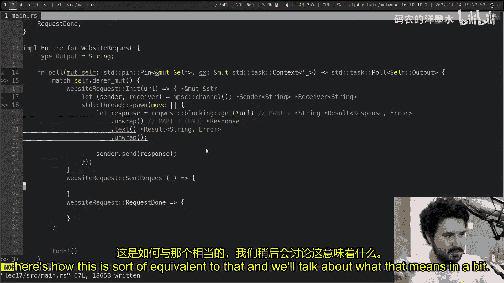

Allright， let's get back into it。Give me one sec。

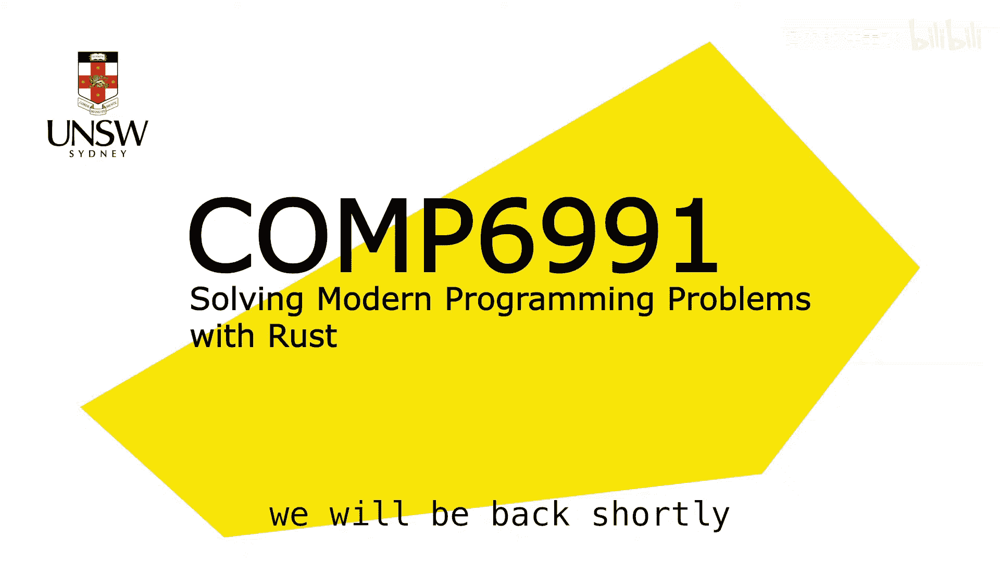

All right。Okay， so。Back to this， there we go。嗯。I， the， the issue was very， very quick to figure out。

 by the way， I I， I knew I was something doing some horrible crimes with the URL。

 And so I just cleaned up the code a little bit。 And the horrible error that wasn't particularly descriptive。

At least for me， you know， managed to disappear， you know。

 we're coming back and we've got a whole bunch of code going on here。😊。

And this is what I want to sort of look at for a second here。

Imagine we think about our website request in terms of this。

This state machine here that we're talking about， but there's three states， the initial state。

 once we've sent the request and like once we're done。Right， so。In our case。

We can so if someone wants to make a website request， they can generate a new website request in it。

 Or like you can imagine this like ready to make request。With a URL。Then， in theory。

 we should send off that request。And then say we've sent the request。

And we're waiting to get the result back， get the response back。And then。Once like they've。

 we've done some work again and the request is done。Nothing more to see here。And this poll function。

 like this do work function can look something like this where it says。

 if we are in the like when we want to do work， if we're in the initial state。

 we haven't done anything yet。😊，Create a new channel。Right， channel to just send and receive。

And spawn a thread So right the thread's coming back into this this is coming to my argument where I'm saying I think that futures are more generic than threads because we can implement a future by using a thread as like the implementation So our thread says make that blocking call request block and get that URL blahlah and then once we've got it send that response to the sender。

😊，Sorry， like send that response through this end such that it can be received on the other end of the channel。

So we fire up this thread to go to this work and then we say， we are now like star self equals。

 we are now in the sent request state here。Where we have this receiver， right。

 this receiving end of the channel that we're waiting to hear the the result back on。

But it's still not ready。 So we give back pole pending for now。Then。If they call like Paul again。

 like， try and do some work， they'll go into this branch。ca that's what we're in here。

 set and request。 They go into this branch and we'll see。 we'll call receive a try， receive。

Noting that T receive in particular， is not blocking。 it'll never block the caller。

 It'll just see if it's there or not。 If it is there， then great request done。

 So we update ourselves to be in this state here。 The request is now done。

And we give back poll ready， we say， great， the response is ready here it is and give it back to them。

If there's nothing in the channel just yet， then we'll just say we're still waiting。And then。

Theoretically， once they get this poll ready with the response here out of this you know。

 once we're in sent request date， they should be happy they shouldn't need to use the future anymore。

 but they technically can if they want， in which case request already done and so probably we just want to say something like panic and say like the request was already completed。

嗯。And so now we've built up like using a， using a thread sort of as our backing implementation here。

 we've。Adapt what we've done into this new task system。

 So we s't use anything to do with this context here。And， but so we've got the get website function。

 which just uses。In fact， we should imagine that this function maybe like spawns a thread and does that stuff。

 whatever， but get website future。嗯。We can imagine doing a similar thing if we create a new website request with this URL。

 we construct a pin out of that， which again we're not talking about just yet。Whi is our future。

 And then we're very， we're almost ready to call future poll， except we need to pass it a context。

 What we're doing here right now is like pretty esoteric。

 It's pretty like this is not the usual way you would write async code in rust。

 It's more to demonstrate how things work。 So I'm going to。😊。

Make a like if we have a look at context in order to create a context， you need to provide a wake up。

And a wakeer。We can say。Where is what I'm looking for here。There should be a。呃。Constructing a wakeer。

Well making your own waker essentially， where is this gone？Wake up。From Rono。怖い。Traits wake。

Let's see。This trait can be used to create it right， Sorry， right。 So this trait。

 we should be able to make a waker。Sorry， it's been a while since I've played around with this stuff。

 Iple this。And then， context from Waca。And that context from Waer， does this not take in。

 I must have misread this context from Waca takes in。Let's look at the source quickly。That's strange。

 It doesn't seem like that should work。 But all right， we'll trust the documentation。Great。

 so we're just like， we're not really using this anyway。 So I just want to steal something。

 and we'll talk about wakers more generally， and。😊，In fact， no， I don't even want this。 really。 W。

 just do nothing。We'll call this Al wake up。We'll call this。Our wake Iple weight。

Arc simpleple that great。 And it just does literally nothing。Cause we're not using it anyway。

And then。Wakker is。Arrc knew of this and apparently that should work for us。Oh， dot into。

 that's what I was missing。 right， there probably is。呃。我。Then there must be on Wr here。

There must be from Arc of W。 That's it。 That's the implementation I was missing here。 Right， I mean。

 you're not gonna to memorize the whole standard library in your head。

 And that's definitely being proven true from what we're seeing with me right now。

 So create a new Waker。 And then finally， we can call future poll with our dodgy Wr here that doesn't actually do anything。

I will wake up。All right。What are you pissed off about。Sorry。

 that should be wayker is this let context equals context。

From Waker takes in a B of Wker and finally we're ready hopefully to call this with ref mute context。

 which means that this here needs be mute。And that should be great when compiling。 Okay。

 so a whole bunch of craft in order to like。Craft that's sort of useful to be there and we'll see how much of it we can really talk about。

 but in order to poll。Our future。 And I could just do something like this。 I could just say。While。Oh。

 let's say， in a loop。Call future。t poll。Right， cold future of lets。Poll equal future dot pole。

Match on the pole。This was return string eventually match on the pole。If it's ready。

 if if it's ready with the response。Then give back， like， let's actually return that response。

If it's pending。Then we'll just do nothing。Like that。嗯。Where is it getting moved？futureture dot。

Use of move value。Poll should， oh。No features in a。10， do I need to use the unified syn？呃。Oh， right。

 Yes， I probably need to Yeah， so I probably need to write。啊啊。

Why don't we just try pinning it each time。W this。Again， this is really just not relevant to what we。

Care about here today。And yeah， okay， it's happy cool。So we say essentially， poll our request。

And then hopefully， when it's ready， we can return this response。 Now。

 this should so far be feeling like a little bit dumb。What we're doing here。

 But I promise it's there's， there's a decent payoff to this in the end。They're sort of like a。Oh。

 I see why like why this， that why this might actually be useful in in a bit。 Okay， so。

Now we've written a slightly different like alternative here。

Where we're still sort of going to be spinning in a loopt here， asking the pole， is it ready yet。

 is it ready？ is it ready yet？So this like overall function is still going to be blocking。

 it's still going to block and wait for this string。🤢，But you'll notice that each time we call poll。

On our future。This poll here is not really going to have a block。It's just going to say。

Like it's just going to be like either it's here or I've like fired off the request， but I'm like。

 it'll never end up waiting for a whole second here。

 It's just going to tell me if it's ready or not right now。

And we're blocking over it by like looping over this thing a billion times。So in theory。

 we should be able to swap Gt website here for Gt website with a future。Okay website in the future。

And is， in theory， should act。Much the same way。Potentially just like slowera right now。

 the way we've written it。Yeah， so slower。But it still ends up doing the same thing。

And maybe it's like。In fact， it's， it's even barely slower in a， in a small example like this。 Yeah。

 it's， it's essentially even the same speed。嗯。So that's quite interesting。Okay， so。

This is what we've got now。 Forting all this craft at the top here。

We essentially we're making a website request starting off with like a knit URL。

And we're saying pull it， pull it， pull it， pull it。And it'll go。 it'll。

 this pull function will always be very quick to call。 It'll never end up like waiting for a while。

 And it'll eventually be like， hey I'm ready。 Here's a response or it'll be like， I'm still pending。

 right， It's not quite ready yet。 And then the way we've written this up here is sort of like a state machine。

 as we were talking in this diagram here。 We're saying， where。We are like。

 we haven't made the request yet。 You've just sort of initialized the future。

We've actually sent the request and we're waiting to hear back and we've actually heard back and then we look at the state that we're in right now。

And either like fire off a task and， you know， or check on the status of the task。

 And then eventually， you know， we're done。 And， and we sort of transition through the state machine by saying。

Now we're at this point。 now we're at this point， hey， we have already finished like。

You're doing something wrong。Why wouldn't the poll notify the Gt website future when it is ready so we don't need check in the loop？

That is a fantastic question， that's so good。😊，So。The the so let me， let me。

 I'm gonna come back to that in a second。 but let me just sort of。

Make some like bits and pieces clear here。This premise of like， a future trait。

Right the like imp future for this in this sort of interface and stuff。

Worked even when all we want to use is a thread。 it like for some value of worked here， the work is。

 is implying that， you know， I had my own like。Fun and pain with waking and pain and。

 and lifetimes and stuff。 like it's maybe not easy to write。 But like it's written。 It works。

 It does the same thing。But it's under this generic interface of future now。

Why is that something that we care about？Now， with future， right so。

A task that I might want to do in a thread。Is applicable to a future。

A future can now sort of represent the idea。Of a task。That can make progress over time。

It's almost like if you， you can， you can almost think of a future also like a generator。

 if you've used generators in another language， like say Python with a yield and stuff like that。

 a future almost acts like a generator in that kind of way where you can say call it， call it。

 call it， and it'll make a little bit of progress each time or like in our case， with a future。

 it might make no progress。 It might just be like there's nothing to do right now。

 I am just stuck waiting。嗯。But eventually， you know， with the future。

 it's going to say it'll transition sort of through the state machine and then eventually hopefully say。

Hey， it's ready。So that's kind of cool。That's like this has now offered us a generic interface。

A generic interface to talk about the idea of a task that can be executed kind concurrently。

You can imagine。That like this， the way I've written， this kind of sucks here。嗯。Imagine， I had。嗯。

This is going to kind of suck to write。嗯。Can we still do it regardless I can I'm going to quickly try。

 and if it doesn't work out easily， then I'm just going to like undo for a while。

You can imagine that I can write something like this。Websiteite is a slice of。

The URLs and the names of them。We say， let tasks equals Vec bang。Or even let's say， websites dot。

Into it all。Dot hello， Where is oh， I forgot the topple。Friendci here。Tasks do intuator dot。呃Ma。

The URL and the name。To。呃。Let's say。Printlin sending request to name。诶。Website request in knit URL。

In fact， this printlin doesn't really make a lot of sense anymore。嗯。Yeah。

 I guesss just map it into that。Dot collect。Yes。Then we don't need this。

 We keep our waker and our context that we're just going to share across all them because we don't use them anyway。

 And then in our loop here， we say for task in task dot。It a mo。Like that。Which it doesn't Oh。

 collect， sorry， into a vet， I should say。For task and task in a mut。To。This。Where this is。Toss。

Which is already a refute。With the context。And then something like this。Okay， so。

This is not quite going to work because it's just going to return the response from the first like task that it Cs。

嗯。But there's something to this in that this function can now take a list of websites。

 like a whole sequence of websites。And start to work on them all somewhat simultaneously。 Now。

 the code here that would actually grabble the responses is probably going to be something like I could write something really janky right now。

 which is just like responses is a V bang。嗯。And then， we say， something like。Let's。

 let's even map this into。The task and the name this here says ford。Task。Name。

Then we say if it's ready， responses dot push。呃。Task name。

I'm going to have to get rid of the panic here。Like this is probably good。

 but just to save myself from writing things， I'm just going to make this return。

 Paul pending afterwards。嗯。And then you just go loop。If responses。t L is equal to tasks dot L。

Then break。And at the very end here， give back responses like this。

And this is going to give back a Vck。Of the task names and the strings。

And it's going to get pissed off about the lifetimes。 But that's fine。 tick name。

This here is tick name， and this here is tick name。And then it should be fine。嗯。

Or I got them backwards， I guess。Oh， yeah， yeah， yeah。 Oh Yeah。 This should be name response。Yeah。

 thank you， yes， you all seem to have figured that out。

And then it's upset that I have name is our name is a at mute at Stt。 Okay， yeah yeah。

 so probably two of these。And Bob's your uncle。 Great， so。Now。

 we have an interface that can deal with all these different things， like the。

 all these different websites being sort of。Worked on simultaneously。Now。

 why is this something that's potentially kind of cool。Well， if we say get website future。

 our website is going to be。A beck of。These three here， let responses is this。Printlin。

Ssponses like that。And the websites are going to be。God， I hope they this way round。URL name。

 URL name and URL name。Like that。Is it URL name？ Yeah， that's URL there， great。嗯。Cool。

 and the code seems to compile so we can write something like this。 Let's see if it works quickly。

 Cause honestly， it might not。 you never know。Yep， that seems to work。

It's just spitting out their responses as these horrible strings here。But you can see here it goes。

 yeah， Python。org is this thing and there's probably C+ plots and rust and stuff at that at some point as well。

And it's taking approximately the same amount of time again，9333 seconds。Here， so。

 so this is kind of cool。 This seems to generally work。Here is the insanely， oh。

 stream sofa is Sams happy。 Stream health。 Stre is healthy。Oh， but everyone's everyones。

Is it back now？Or is it okay。Good for me。 Riip stream。It's okay now， Okay， I that's weird。

 I didn't see anything on my end。 It looks even YouTube is， YouTube' is the first one to complain。

 And YouTube' is like， yeah， it's great。😊，Okay， all right， See right now， cool。So， the。

The really interesting thing about this。Is that。Notice。

Nowhere in the code that is dealing with like all these different tasks here。Is there a thread span。

There's no extra threads apart from the thread we're working on。In like this。

 the code here that's dealing with many things at once。

Right now it's just a loop that's going over each to the tasks。Right， a loop。

 a loop that's checking on the status of the tasks。

If you're familiar with say something like JavaScript or something like that。

 this might be starting to ring some bells at a loop。That's checking on the status of each task。

And potentially making progress on them like little bit by bit as well。HThat's interesting。

 This is all just done over a single thread。 Now you might go， well， Zach， this like， sure， you。

 you can claim that， but like scroll up here， this is still using like you're still using the threads here。

 In fact， you're still using the same amount of threads as we were at the beginning of the lecture。😊。

And。Yes， you have got me there。 That's true。 The way' written it right now。

 But remember this thread here， right before what we had at the beginning of the lecture。

 those threads were fundamental to what we were trying to do。Right。

 they were fundamental to allow us to even think about the idea of multiple tasks happening。

Concurrently。Now it's an implementation detail up here。

Now it's just like in order to get the the response from the website， we use this， you know。

 blocking thing here。But like， it doesn't actually have to be a thread。This is the。

 this is the really interesting thing。啊。What if we were able to say， send a request off to a website。

And like， don't make me wait until it's done。 just like， send it off。And I'll make some progress。

 I'll check on it every now and then。That's a future。A future is like。

Do a little bit of work at a time。 Just a tiny little bit with no blocking。And。You know， I'll。

 I'll check on you and say how you going。And if we look at request。

We'll find that the standard interface for using request。Stand interface 4 using request。

The standard interface for using request Her is。Gives back a is annoying also。

It is async fun this basically， let me de sugarugar this。

 we haven't actually looked at the words async or a weight yet。😊，But this。

The signature for their function is basically this。In fact， it's like， it's exactly this。

It's when you want to get a URL， I'll give you back a future that eventually should hopefully give back a result of response。

And there are like not on every system， not necessarily every system。

 but most modern operating systems these days， there there are tools to tell the operating system that you'd like to fire off a request to a website。

But like， don't， like， I'm not going to sit here and wait。Just notify me。

 Tell me when the response is back。All right， tell me when the response is back。And so using that。

 you can actually work on a whole， like get a whole bunch of websites simultaneously， you know。

 concurrently。With just one thread。Right， that's kind of cool。So you can even imagine。Gosh， I'll。

 I don't know if I'll。I can try and see if I can。If I can。Type this quickly。

But like we could have sent request to be a box in future where the output is。

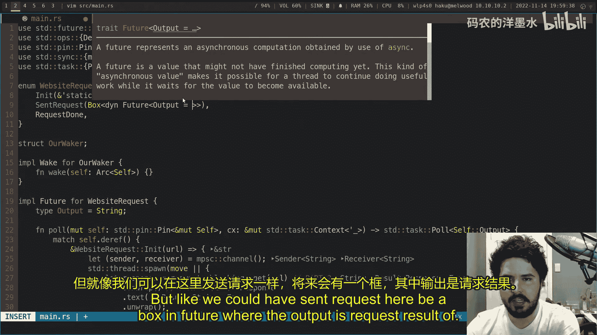

Quest result of。Oh。YouTube seems upset， but my end seems fine。0， drop frame。

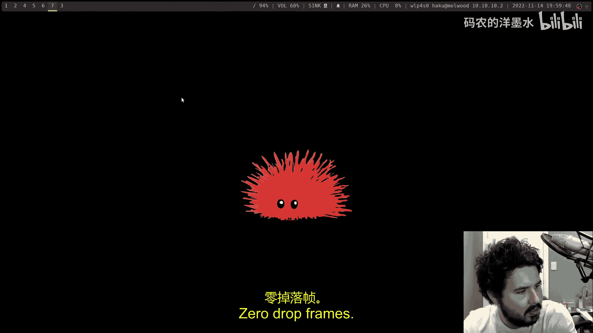

嗯。呃。Where was I of response。Request response like this。And then this here， instead of。

That's I think this is YouTube's fault， honestly， Like， I know， I shouldn't be blaming YouTube。

 but like everything's fine on mind。 anyway， I think it's。Just buffering every now and then。

 So you might just need to go 10 seconds back or something。 Oh， O。

 I see my network dropping down down for a second there。 Okay， well， maybe it's my fault。

Just go back。Go back 10 seconds or so and。It should be okay， it's not。Okay， I've dropped like。Okay。

 I have dropped a few frames now。 I think it'll be fine。 We'll， we'。

 we'll tough it out for the next few minutes。In fact， I'm just going to write this code anyway。

 So who so is whatever request。Get。URL。嗯。Star self equals self sent request of。Request。Get URL。

 This is gonna be a box， new。Of this。嗯。Which it seems happy with。Yes， cool。 And then this over here。

 we can just go。嗯。Instead of matching on receiver try receive。

 we can say match on this should here should be there。Request feature。Request future dot poll。

Which it's going to be。Pssed off about because it's boxed in future。We might Yeah。

 because I'm going have to throw a pin in here， which is annoying I can do。Let is it onpin。

 this is okay， this is going to tell us if if this is going to be horrible or not。

So that's just a result， so I need to check this and I need to check this。Is this going to， okay。

 this is unpinned。 So this is fine。Is this unpinned。 Okay， this is actually going be fine。

 It should be relatively easy So let。Pin B pin new of request future。Dot Df mute。みです。

This needs to now be D mute。Which。Fine。嗯。Cool。😔，呃。Can not be unpinned。 consider using box pin。Yeah。

 it's， it's not gonna it doesn't see the type of it anymore。 Could I just store。No。

 because I can't name the type。 Yeah， this is gonna suck。 Okay， this is， this is not happening today。

 at least。But。You know， sorry。Yeah， yeah。 this is gonna be too painful。

 I can maybe do it after the lecture and tell you about。

 but what I mean to say here is that this code here， right。

 we could leverage essentially what request the future that request gives back， which probably works。

 you know， just on the current thread， and when we sent the request just check like instead of checking on the receiver。

 we would just match on request future。Dot poll。With， with our same context。And if it's。Ready。😊。

With some sort of response。Then we can do this code here。And if it's otherwise。

 if it's pending still， then we're pending still。Right。

So essentially what this is giving us is a way to compose concurrent operations within each other as well。

😊，Right， so it's letting us compose async operations。😊。

And also is potentially helping us eliminate the need for threads at all。And just sort of。You know。

 make work on all these operations over over like a single actual thread。

Which is very interesting now。Rust is， again， at the end of the day， a relatively low level language。

You know， large， largely in part that they want to support low level programs and they want to be able to have extremely high performance。

 So writing this code itself。Is like can be really nasty as we're saying here。

 I'm going to go back a little bit just to where we still had， you know。

 a working program using threads， which would be here。嗯。But like。

 this is probably all we need to like， think about in order to understand。

In order to understand how the system works， such that we're able to like use it relatively effectively。

 which I think we can do on Wednesday so。This was like sort of a peak beneath the curtains in terms of how future itself works。

 how we can think of concurrent operations as sort of transitioning through a state machine。Right。

 where each time we're just sort of like either doing a bit of work and moving a step in the state machine or just saying like。

 hey， things aren't ready yet and returning this pole pending。A。

And then using this future to sort of。Work on operations， work on tasks concurrently。

Without necessarily needing threads is out coal primitive。

As our cooperative prim to do tasks concurrently。嗯。

So some things that we can talk about on Wednesday is， first of all。

 like getting rid of all of this crap here and just writing high level rust code using async the async keyword and the await keyword。

Which essentially mean that we don't have to write this this stuff here manually。

 we don't have to write any of this stuff here manually。

 essentially the compiler ends up generating all this code and this code here for us。

Just by writing something like function website request。Takes in a URL。

Is a static stir with say it's aync and it gives back a string。 Right， So this will generate。

 it'll do impple future。 It'll， it'll like essentially turn our code here into。

This returns something that implements future that will eventually。

 hopefully eventually output a string。Like that， that's what it'll turn us into there。

And then we can just write like instead of writing this whole state machine and everything。

 we can simply say like request。Get the URL。Dot await。So， like。

This dot await here request get URL returns a future。 And we're saying until like。

 until this future is done， we're just going to like delegate away to that future that here。

 and it'll generate a new enum variant for us like this saying， hey， this is。

For the point that we are waiting on this future here。So we'd say like await it。

 then once it's there， we'll unwrap it， dot text。On wrap。Text oh。

 text is also an await point apparently because that this might block or might take some time in order to do so we say throw that behind and await as well so it'll generate another variant and all this code in here to do all that sort of stuff。

嗯。And there this is what our code ends up turning into and the compiler does the rest for us。

 so we'll write some actual code with asy weight next lecture on Wednesday and we'll also talk a little bit about this context that we didn't use at all。

Because I ignored a question earlier， which was why wouldn't the poll notify the get website future when it is ready so we don't need to check in a loop And the answer is yeah。

 absolutely we don't need to do this checking in a loop and actual like event loops that will look at on Wednesday that do this operation looking at for tasks and making progress on them and stuff don't just randomly do it in a loop endlessly because that's just a waste of performance when we only need to say like polar task when the tasks is ready to make some progress and that's what this whole context which just wraps a waker so that's really what this idea of a waker is all about and we'll talk about that on Wednesday as well because wakers even though our waker is horrible wakers in general are are actually pretty cool。

嗯。Okay， what are you talking about with Serranova by blue skies and calm seas。

Can you explain what the pole function is doing again。

 So is a future just abstracting the idea that a task might take some time。 Yeah， essentially。

 a future。Um，There's there's a there's a couple different parts to like what makes a future。

 like really a future。If you're looking like on the really sort of bare bones level。

 like a future is just this right， in the same sense that an iterator is just a thing that。

Tofinine some item type and has a next function that can give you back an option of that item。Like。

 it's not usually convenient to think of things in this bare bones way because like you could imagine implementing an iterator that every second time you call it gives back none and the the other you know。

 the odd times it gives none And even times it gives some of 42， right？

 That's technically an iterator just not a particularly useful one。 So where do we like。

 how do we usually see futures， we generally see futures as some kind of state machine。

 So something that needs to perform certain tasks， tasks。

 especially that may wait that may need to wait for something to complete。

In order to eventually complete themselves。And it provides a way for。

A future for something that implements future to。Give control back to the thing that's。

Asking for it to perform work when it's stuck waiting for something else when it doesn't have anything particularly good to do。

So in our case here， when they say do some work when we're just like we're in the initial state。

It's going to fire off a thread。To start to， it's gonna fire off a thread to like。

 start working on that web request and then just give control back。

It's going to give control back to whoever is calling Paul in the future and say， I'm done for now。

 That's all I need for now。So I guess I don't see the advantage of this over just spawning and joining a thread and the way we've written it right now。

 there isn't really that much of an advantage to just spawning and joining a thread。The two。

Really convenient things about futures and rust。Well， maybe even three， potentially I two。

 we'll see is well， the things that I quite like about futures personally。Is one。

 I find them to be far more composable。So by composable， I mean。

I have some asynchronous task that I would like to perform， which relies on。

 say three other asynchronous tasks。To， to be performed as well。嗯。In a thread system。

 you end up having to like， write。Additional code， like with， say， channels or with， say。You know。

 like a mut text or something like that in order to communicate between a thread that's saying that like I'm。

 I'm going to go do some other stuff and check on this periodically。

 that idea of a thread communicating to you that， hey， it's not ready yet。

 Maybe it's a channel that doesn't have anything in it yet， or it is ready。

 and like here's the here's the results。 here's the fruits of my labor。

 Here's the result of my computation。A。Is really this core abstraction that a future provides？

And because we've got this core interface of a future。

It means that any kind of task that might involve waiting for something to occur can all be thought of under。

 can all be sort of used under this one generic interface。 It's sort of like。

Like not to like misphra you or something or anything。

 But like saying something like I don't see the advantage of of just spawning and join thread is sort of similar to like。

 I don't see the advantage of the iterator trait when I have Vck。Right， and it's like sure。

 most of the time you could just spawn and join a thread。

 but what if you don't want to use a thread or what if you don't have threads or what if the threads are causing like causing a big stall in performance for your application。

 Like imagine your IC server， I've heard of a lot of designs where people are spawning one，2。

3 threads or whatever for each person that joins。You know。

10000 people sit idly on your IRC server and suddenly you have 30，000 threads。

Just sort of sitting there， doing nothing。Right， and each thread。

 this comes back to like this point here。Like has a lot of stuff that it needs to think about and also places like puts load on the operating system in order to think about them all simultaneously。

The great thing with futures is that they don't necessarily need threads to back them up。

And when they're like sleeping， when they're not really making progress。

There is an incredibly low cost to storing a future。

Like if we think about where I've actually stored my futures， I create futures over here。All。

 I create them over here， and then I like mutate them through this。

How much space is each future going to take up。Well， I know I am using threads in the back end here。

 but again， implementation detail， we could take the threads out of this。

So how much space is going to take up， it's going to just take up whatever the most expensive variant of this is right now。

 it's probably this channel。But you can imagine in this future taking up 8 bys，16 bys，32 bys。

 something like that， whereas a thread might be like genuinely a lot of resources。

 even if it's just existing simply to sleep。So it's this very interesting abstraction over the idea of a concurrent task and as synchronous computation。

And no matter what this computation is predicated upon this， it might be like the asynchronous。

 It might be， I'm waiting for a website or it might be I'm waiting to read a file。

 or it might even be something like I am waiting， for some duration of time。 Like Im。

 I'm sure everyone at some point has written something in their code that's like， say， you know。

 doing stood thread sleep。For sleep milliseconds， you know，100 milliseconds， right。

 this could be a future as well。Which is just like， say pending。

 like give back pending for the first 1000 milliseconds。 And then once a second is passed。

 then you can give back poll ready。Right， so it's this， it's。

 it's a sort of level up on what we're able to do， how we're able to represent incurren computations without necessarily needing threads。

 You can still use threads all you want， and lots of futures may be implemented with a thread behind them。

😊，Right， so it's not like we're losing threads by using futures。

 It's just that you can pick and choose when you actually want or need a thread。

And so you only need to like pay for for what you need essentially， which is kind of cool。

And then yeah， the composability is also a potentially a really big win as well in that if。Like。

A thread doesn't really。 A threads a kind of poorly composable construct in that if I have five different tasks and the way I talk about a task that I need to complete is with a thread。

I generally have to write a lot of multi threaded code。And think about things like send and sink and。

 and， you know， all the pain that comes along with that and。You know。

 how do I communicate between these different threads like we were doing。

 I guess we were using thread scope before， which was a pretty easy way of doing that。

 but without thread scope， it probably would have been a bit of a pain to get them to talk to Maine。

嗯。And so， yeah， sometimes that can be particularly gnarly。

 whereas composing futures in in the sort of normal developer circumstance can usually actually be quite easy。

easyas， convenient and generic， essentially。How do you do without a thread。

 something like a web request。 You can you can I'm。

 I'm not entirely like I'm not amazing with low level Linux in particular， but I believe you can。

You could do something like a web request without and without an extra OS thread in your in your program with something like EPL。

E poll， which is an event polling system call。Where you essentially say， so。

 so you probably still will need a thread。Right， in that。You need to tell the operating system。

 wake me up when like。When this web request comes back。

 but the trick is that you would be able to do， say，1 thousand web requests all with one thread。

Or you might be able to do， say。Like， you know，1 thousand file reads。

All with just one thread dedicated to that。Whereas if your fundamental unit for concurrency is a thread。

Right， oh my gosh。Yeah。Okay， it's back now。Yeah， why is it going out to。15000 bit right。

It's like a roller coaster。Okay， can you still， you might not be able to see the screen。

 but are you able to still hear me， okay？Yeah， there's a nice Paul joke case somewhere for sure。嗯。

Anyway， what I was going to say and I'll say it to the void if need be。

 but if your fundamental unit for an asynchronous computation is a thread。

 then any time you want to do an asynchronous computation， you need to make a thread。

If your fundamental unit forous computation is more generic than a threat at something like a future。

 then you could potentially multiplex thousands of futures onto one actual threat。

 which is essentially what things like Tokyo。Like， we're gonna see。On Wednesday。Ends up doing。

 which is pretty cool。Okay， yeah， I think。o man。 yeah， this is。

It's a the bit right is on a real roller coaster right now。 That's pretty cool。哇。Real up and down。

 That's so strange。 I'm gonna have to。Maybe debug that。

 but I think we'll call it there if you have any questions。

 and I'd love to hear questions as well about， you know， talking about async rust。

Then throw them on the forum or you can try and get whatever you can out in the chat right now。嗯。

But yeah， in fact， you can even see here with Tokyo it as a runtime for executing asynchronous code。

 including a task scheduler， an Iori backed by the operating System event QEG E poll here。So。Yeah。

 E poll's pretty cool。It essentially lets you go like。Fire for a whole bunch of web requests。

And then say， put my thread to sleep， but wake me up if any of these web requests come back。

 for example。嗯。And when you wake me back up， tell me which ones are done。

And that's what we'll end up using when we talk about wakes and stuff like that。

I've used pole for highwaytros， but not E poleol， okay， cool。😊，Yeah。

 I think poll is somewhat deprecated， I wantan to say， in favor of B poll。Nope。

 that's not what I wanted。

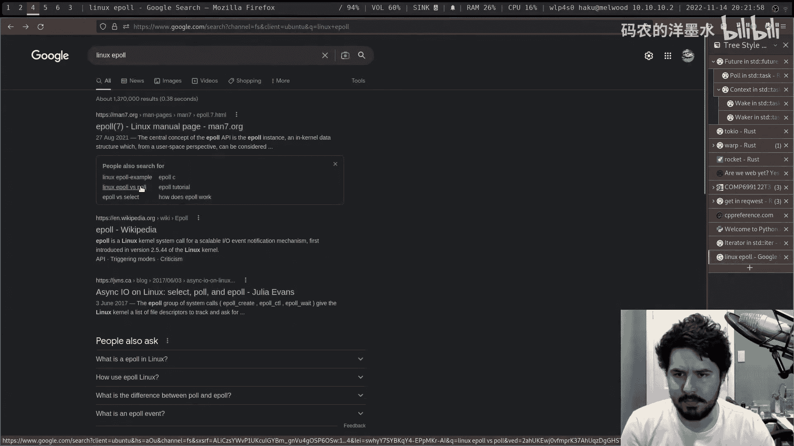

嗯。It is meant to replace the all deposit Select and poll2 system calls。再一个。

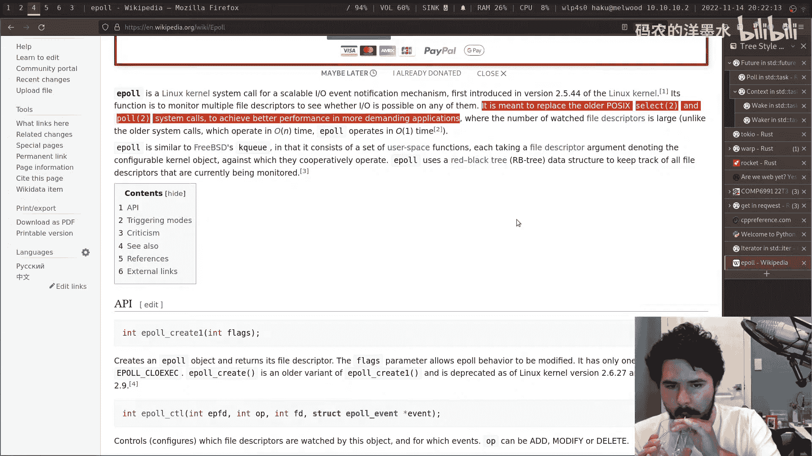

Anyway， there's lots of fun stuff there to know it。But yeah， that's what I wanted for this lecture。

Just to be clear， the outcome that I was hoping for this lecture is。

We've been thinking of our fundamental unit for concurrency as threads。

 threadreads don't actually need to be the fundamental unit of concurrency， instead。

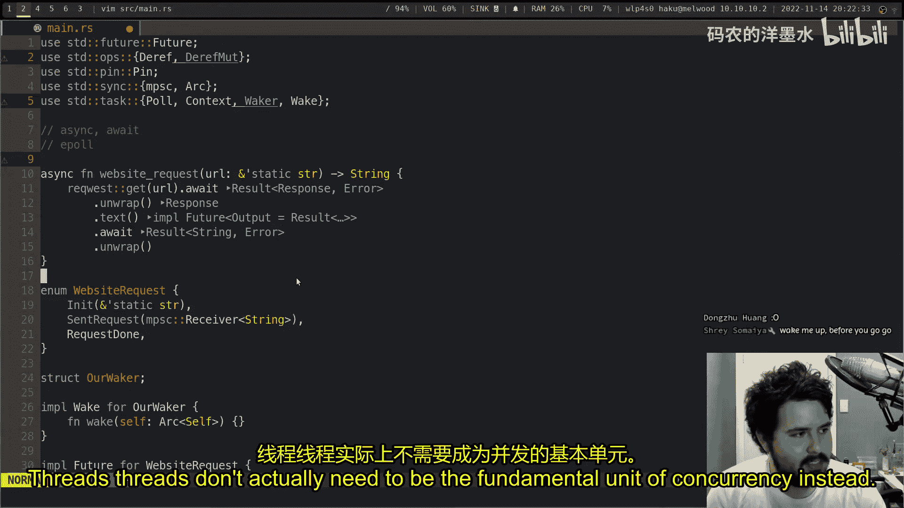

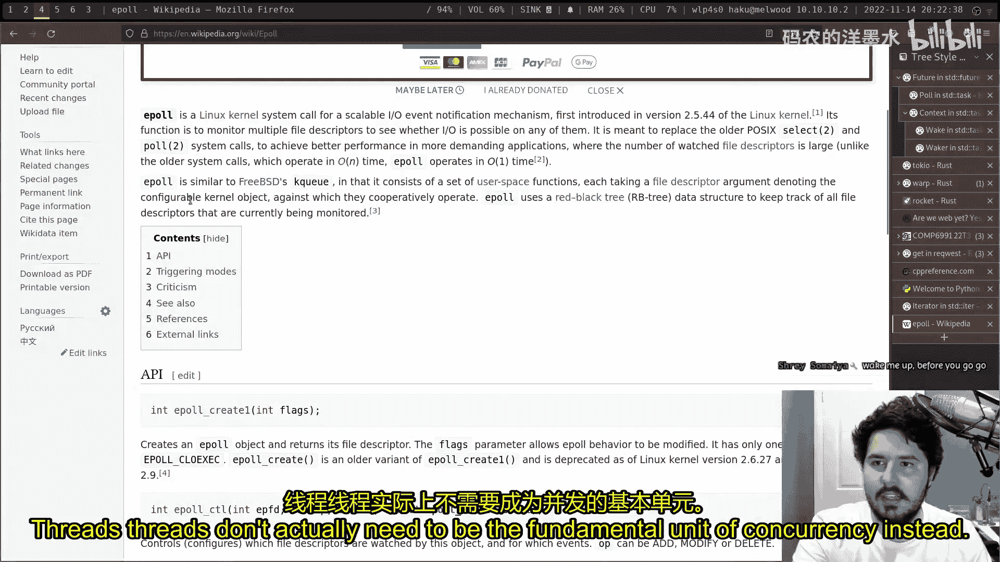

Rust has defined this generic trait future， which represents some kind of computation。

 some kind of asynchronous computation that might not have finished computing yet。

That you can make progress on and should generally never block should just like do its work in the background。

And using this generic future trait， we can now compose together many asynchronous computations。

 right， we can compose together many futures which we're going to be spending time doing on Wednesday and playing around with some actual like user level code。

 probably after just talking about waking first because waking is is pretty interesting。😊，嗯。And yeah。

 that's if you can understand that vaguely and like how someone might vague like roughly want to implement a future in that the a very common pattern here is something like a state machine where like。

 where are we up to in the computation。And then doing work and telling you， pending， pending。

 pending or like， okay， it's actually ready。If you can understand all of that。

 then you you're ready for Wednesday。That's basically it。

I would have thought it'd be it do the sending the request bit in the initial call。

 Then you'd wait for the response， which might when you get to the await bid。

 I suppose that's more limited。 though。 Yes， actually， that's actually a really nice。

 interesting point。 by the way， if you're， you know it's 8，25 now。

 So you can feel free to dip any time。 that's， you know， none of this is accessible anyway。

 so you don't really have to come regardless， but。But I'll just answer questions as long as we've got them now。

 this is really interesting because in a language like Javascript， when you create a promise。

 promise here being the the rough equivalent of future in in rust。As soon as you create the promise。

Which is like here when we create， we create the future here in Ru， it starts working。

It starts doing work。And then when you say a wait， some promise。

 it'll just sit there and wait until it's， you know， it's poll。Ready。That's not how rust works。

 actually， Rus， because Ru doesn't like bake this in as kind of like a。嗯。How do I say。

Rus doesn't bake in the execution of futures into the language。Right。

The future trait isn't some special thing in rust where when you create a type that implements future。

 it automatically just starts working on it。 Instead。

 it's just a normal trait like anyone else might use。

 Like you could define the future trait yourself just by like copy pasting the definition of it。

 Like I could create future。Like that。There it is， now I've go to future trade。And so。Instead。

 the way Rus has decided to model it， model it is that you'll only you just do your little bit of work that you need to do in order to either be finished or just till the next point that you're going to have to wait when poll is called。

And。The thing that ends up calling Paul to get you to do that little bit of work until you know。

 you know， to do some work。Is your overall。Executor， your overall sort of like a event vent loop。

 shift familiar with JavaScriptscript， your overall sort of event loop executor。Which in our case。

 we're going to use one called Tokyo。 But in Ru， you can use like you can make your own X if you wanted。

 Another really popular one is Async St。嗯。And I believe Asyncx did has a has an executor。Examples。

 Yes， here it is。 Async St main。 And so then this sort of defines your own executor。

 which will go off and， you know， decide which futures to poll and when and sort of orchestrate the overall like running of your asynchronous application。

 which is also very cool。😊，The thing like the big brain thing that we're going to I'll big brain it again on Wednesday。

 but the the really important thing is that。We've written this stuff ourselves here。

 like doing a web request or something like that with a thread。

But the real tricka is that if I'm say reading a file。Instead of spawning a thread and you know。

 going the standard library， like reading from the standard library file or something like that。

 I can instead use Tokyo right there their version of a file。

 which will when you say something like read or you know， create a follow whatever， open。

 read to end， whatever。It will give back futures that Tokyo knows how to。Execute really efficiently。

 really quickly。嗯。And so it doesn't end up using it。 it probably won't end up using a thread at all。

Or it'll use a， it'll just have one thread that it does essentially everything on。And， and yeah。

 they've， they've essentially done all the hard work in in doing this open， aycing function open。

We're gonna asyify。Yes， anyway， there's well， we'll talk about this whole on Wednesday， I'm sure。

So calling Paul advances it to the next step， yes， as long as like。诶 so。If I spam。

 what we're doing right now is like when we've sent the request。

 we spam calling poll and it's just going like error， error， error， error， error error。

 Like it's not there yet， It's not there。 It's not there yet。

 But we don't necessarily have to do that。 We could just wait until it says， hey。

 I'm ready to be called again， which is actually how the system generally。

 how the system actually ends up working。And then calling Paul will essentially always advance it to the next step。

There are edge cases where it might go。You know， something went wrong。

And I'm not ready to be advanced to the to the next step， and I'll just give you back a poll pending。

But almost always when when a future says， hey I'm ready to be pulled and you pull the future。

 it just advances it to the next step， which in this scenario here。

 because we're defining a future here using ay and a weight。

 moving to the next step just means moving to the next a await， which is really cool as well。😊。

So it just means like we do this work here and then a await。And so we wait for this to finish。

 So control goes back。 This is almost like a return right here， in fact。

This we will return from this function right here and the execute go this other stuff。

When this future signals that it's ready to go again。

 it'll pull us again and we'll move all the way down to here， return back。

 Excutr does some other stuff Eventually we're ready and we go  hey we're ready to be pulled again and the executer goes and finishes it off。

With another poll， so poll。Paul， and then Paul。Is how we end up getting working our way through the。

 through this future here with the nascing function。 And you can see here， like。

It really doesn't look all that bad once we've gotten away， you know。

 taken away all this really heavy future state machine stuff。

Writiding asnc functions as a rust developer is meant to be very easy and and。And again。

 the fact that we're able to compose all these different kinds of operations and say， hey。

 we're waiting for this output and then waiting for that output and so on and so forth。

Is is really kind of nice。 And Tokyo in particular， for example， Tokyo， for example。

Will offer all kinds of primitives for things like。This thing here， like the macro select。

Which we can say。This is sort of like promise race， I believe it's what it's called in Java。

 which just goes like fire if a whole bunch of asnct tasks and tell me when like the first one's finished。

 for example， or you can have a whole bunch of asnc tasks and just go let me operate on their results as they come available。

 And again， so just composing asynchronous operations becomes so much easier once there's a common interface for everyone to talk about asynchronous computations with。

Being the the future trait that is。Cool。That would be cool for choosing things like the faster server。

 Yeah， yeah， yeah yeah。 I've， I've done I've actually， this is kind of funny。😊，嗯。manan。

 I don't know if this code is still in production。You'd hoped not。

 but I remember writing some code a few years ago that was along the lines of。

There was this API we needed to call and the API was idemppotant。

 which means that calling it one time is the same as calling it 20 times so for example。

 an operation that would be that would not be idpotant is something like posting a comment。

 let's say， I mean you could make it iddentant， but like generally if you call comment post 20 times。

 you'll end up with 20 comments。That all maybe say the same thing。

 whereas maybe something like editing a comment is iddentpotant because you're just editing that same comment to have the same contents every time you edit it once。

 It's the same as editing it with that same text 100 times。 Let's say。

 So the API we needed to call was Identpotant， meaning。

Meaning we can if if calling at once is going to produce the same effect as calling it say a thousand times。

嗯。And this API would fail like 20% of the time， something like that。It would just fail。

 And there was no way to。 It would take like 5 seconds to respond。

 And it would just sometimes be like， it didn't work out like 20% of the time。

 And so you could just go in a loop， just go like try it， try it， try it until it succeeds。

 an 8% of the time。 It'll be fine。 But then 20% of the time。 It'll need to wait 10 seconds。Right。

 because it's got to call it， it sees it fails， and then call it again。And then。😊。

8% of the time from that point forward， it's okay， fine，10 seconds， but 20% of the time。

 it's going to go a third， you know， onto a third iteration。 It might take 15 seconds。

And so what we ended up doing was， what if we just race five futures。

 like just call it five times all simultaneously。And hope that even just one of their five succeeds。

And if they all， if all five fail， which is。Very unlikely，0。2 the power of 5。So， in， like。0。

03% of the cases。Sure running it again， but now it almost always just takes five seconds because the most likely scenario is that at least one of the five will succeed。

 And so yeah， being able to compose things with these higher order like functions。

 these higher order functions for operating on many futures simultaneously is quite convenient。

So yeah， things like select things like join join is also a nice one。

 joinin in terms of a thread means wait for this one thread to finish joinin for futures means wait for all these futures to finish。

But start executing them all， like work on them all at this， you know， concurrently。

And then come back to me when all these futures here are finished， which is， you know， again。

 quite useful， similar to a thread。And yes， workarounds for other people's web code can be very fun for sure。

All right。Any more questions， Ha past。We've had some fun here today。

 I think the last half hour has been mostly like， you know。

 messing around and answering some questions and stuff like that。😊。

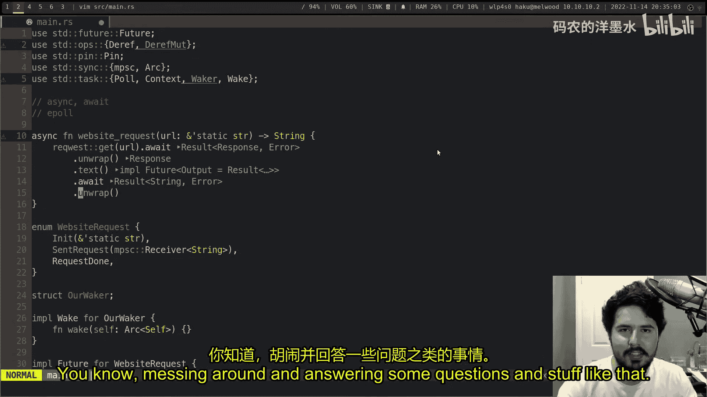

嗯。Definitely is not always fun， though。 yes， that's that's that's also very reasonably true。

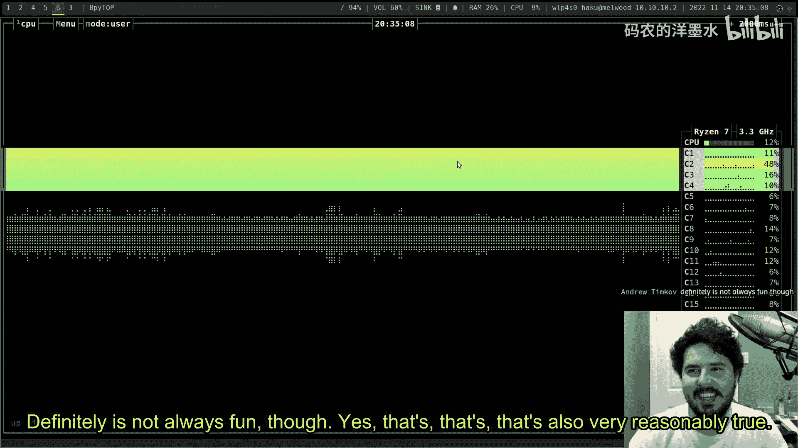

Cool， any last questions anyone wants to get in。If you have an idea of something that you want to write。

 you want to see written in Wednesday's lecture to sort of like end things off。Then again。

 let me know on the forum， my take is maybe something like a paste bin using a web framework and asy weight and asych rust and all that。

My favourite web framework is rocket currently， it's rocket's a little sassy because。

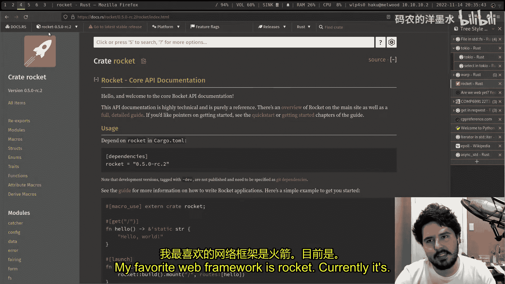

The it's， it's gone sort of like on hiatus。For certain periods of time and it looks like it might even sort of currently be on hiatus again。

嗯。Where like it's sort of run by one person。 And when they get busy， you know。

 with their personal life， the， the development for the。

 for the waypre work kind of stalls out a little bit， which is。

Potentially a little disappointing for a， for like an open source project。 if you want to use it。

 you know。

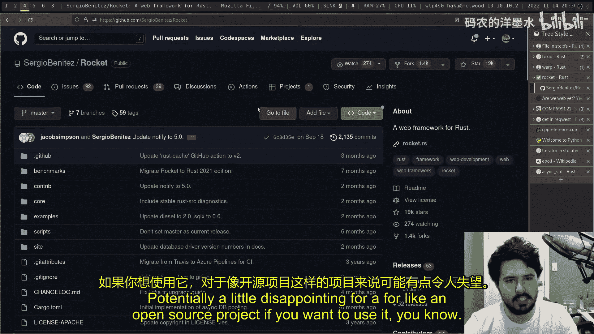

Whitely in production， but I really like itca it's a really nice sort of gives a high level feeling to a web framework and also takes advantage of a lot of really cool rust features。

 So I was thinking we make something like a paste bin a paste bin website using rocket and async rust。

😊。

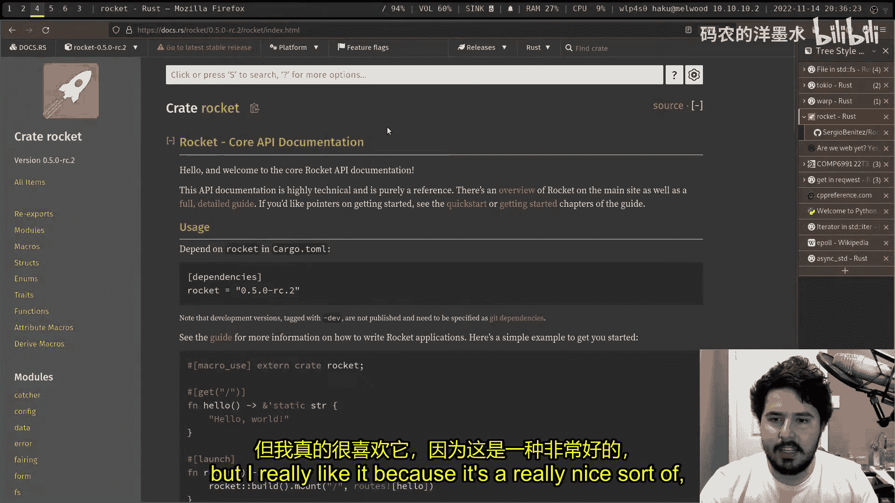

But if you have any other ideas or potentially any better ideas。

 then you can please feel very free to suggest them on the course forum and I'll have a lookout for that。

 but that's sort of my default idea of what we'll end up doing on on Wednesday to end things off。

Cool， alright， not really seeing any other questions。 make an ISC server。

 I was also thinking of making an ISC client could be interesting。😊，嗯嗯。

Maybe that can also be a separate thing。 We could also do like separate live streams or separate recorded videos or something like that。

 but an IC client could also be fun。嗯。All right。Let's leave it at that。 Thanks， everyone， for coming。

 Hopefully， we had some fun with this， even though it's again， completely。😊。

Outside course material and not assessed or anything like that。

 but just because we have some extra time and you know， some time for activities and fun。Yeah。

 thanks for coming。 And I hope to see some of you on Wednesday again when we get to write some more asynchro。

😊，All right， catch all later。 See you later， bye bye。

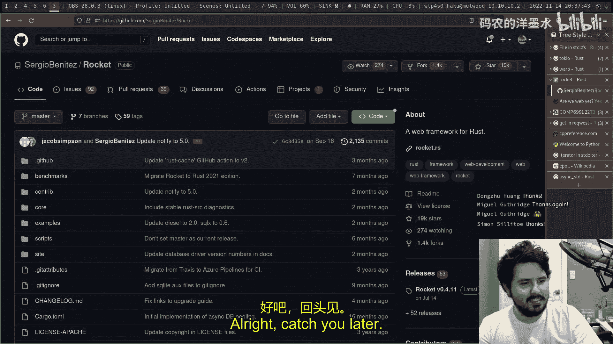

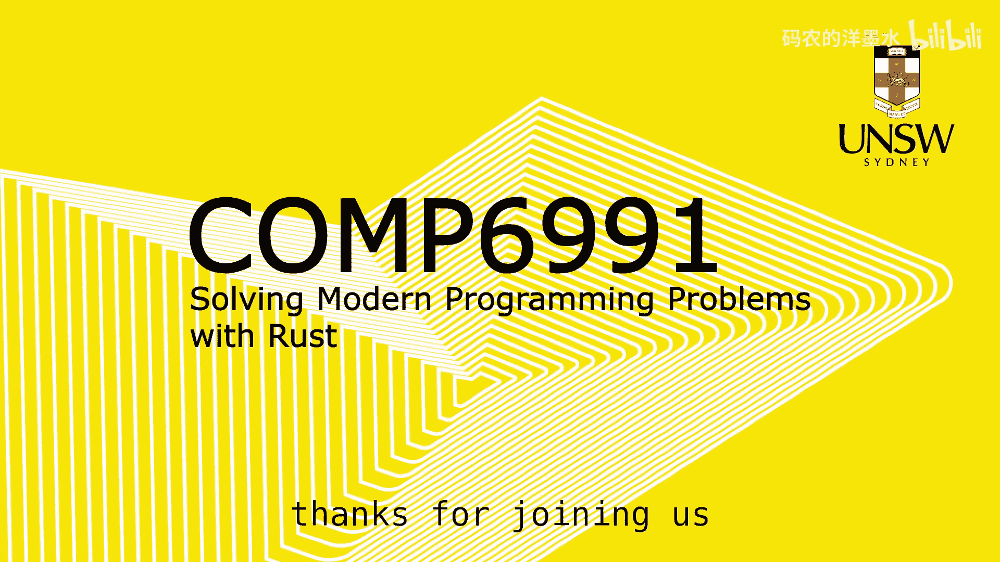