# 【全集】新南威尔士大学 Rust现代编程 中英字幕 1080P p18 Lecture 18 - Rust Async实战 -BV15cf4BCEN1_p18-

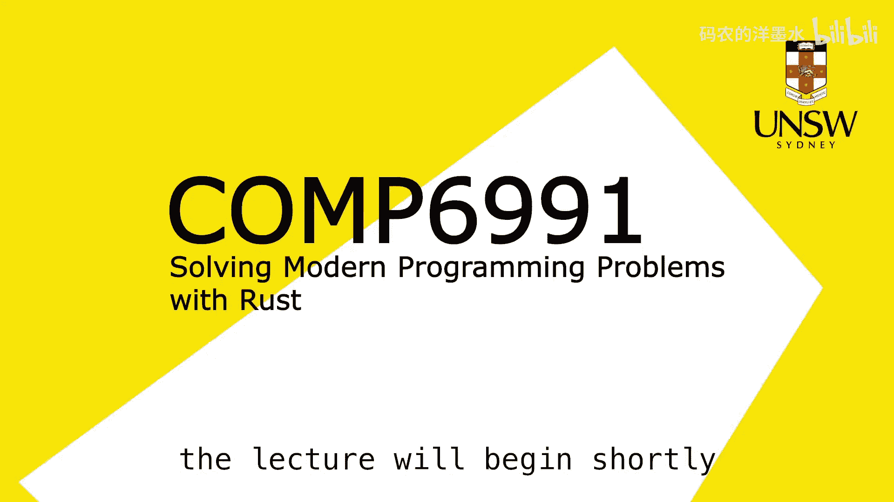

All right。Let's get started。One second。All right。I've got the headphones on today。It's actually。

 it's， it's rather nice。Having the headphones on because it feeds back my microphone。

 which helps remind me not to scream too much。All right， hello， everyone。Chatting in。

And our little chat here。It seems that some of us are sad， which is that's， that's a nice feeling。

Well。Okay， that sounds very bad out of context naturally。

 but I hope it means that we've had a fun time during the term or we've learnt some interesting stuff。

😊，嗯。And we are now getting proposals and petitions for。Com 6，9，9， and it seems for what have we got。

 advanced rust， unsafe， unsoundness asynch rust。 Yes， can I tell it that。 Oh， yeah， actually。

 I was messing with it earlier。Let turn this up and this down， I think。Is that slightly better。

 I might need to leave a little more。Maybe something like that。

You might hear more of my keyboard now， though， but。That's all right。

 some people like keyboard noises。A'm okay。Aremis launch。

 is that some kind of rocket or something like that， actually speaking of。

We'll probably be doing some rocket stuff today。In our for fun in our second for fun lecture。

M launch oh。Okay， awesome。😊，あ。20 minutes ago。 Wow， okay， cool。

Assignment1 requires you to generate your code using a macro， yes。Wow， okay， T plus 20。 Wow， awesome。

😊。

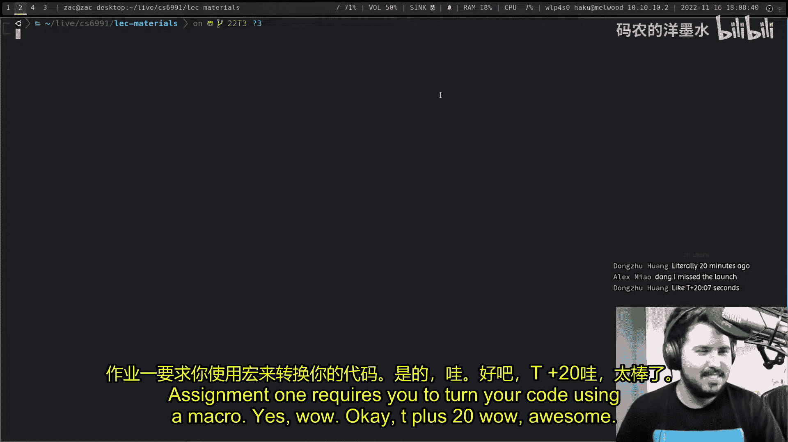

All right。So。Welcome to our last lecture。We had a lot of fun。On Monday。

 the slightly chaotic lecture and you know。😊，啊。Don't worry， I am perfectly aware。

That it was a relatively chaotic lecture。Asynncch rust is not really something that I ever envisioned being able to teach during Com 6991。

And so if if all I do is confuse everyone， you know attempting to teach it。

 then then my deepest apologies， but if if some of us get something from it from me rambling on about this stuff at all。

 then then it's you know， still a win as far as I'm concerned it was we we were out of actual you know。

 legit content at the end of week nine anyway， so this is all just for fun and for what people are interested in and a lot of people seem interested in nasync rust。

😊，So as a reminder of what we talked about on Monday， like。Three minute recap。

 we talked about the future trait， the future trait， I think is pretty cool。Oops。How we do that。

The future trait is pretty cool。😊，The big idea of future is that it's an abstraction over the idea of a concurrent operation。

 It's in particular Rust's idea of what that abstraction should look like Rus we know is hallmarked as a language that doesn't like to be implicit about。

About。Potentially serious costs， I suppose is one way of putting it serious for some value of series。

 probably a lower value than you're used to。 We know this with things like the distinction between string and stir and the fact that if you like you usually have to state pretty。

 clearly at some point， if you want to turn a stir into a string。

 whether that's with a clone with a dot2 string or something like that just because well。

 one of the big reasons being that，Rust considers allocating to be expensive in performance or memory usage that kind of thing。

 and so it likes to be very explicit about where the costs of your program are most likely going to lie。

😊，And sort of following on with that。Following on with that trend。

 we learnt that rust futures are relatively bare bones。嗯。Compared to say like JavaScript promises。

 JavaScript promises are interesting because they are also an abstraction over the idea of a concurrent operation。

嗯。But something interesting about promises is that as soon as you instantiate one as soon as you create a new promise it's immediately set to work。

 you don't need to actually you know keep track of the promise or keep on prodding it to do more and more work。

 it'll just do work over time as soon as you create it whereas a fut with rust does need to be proded。

 prodded， proded to like make progress， make some progress， make some progress。😊，嗯。Now and that yeah。

 it falls quite closely into Rus's idea if we don't want implicit weird things happening in the background。

 we like to be very upfront with our code and have it try and be obvious about what's going on。

 that kind of thing。And so that certainly influenced the design of future quite a lot。U。And yeah。

 otherwise， so。Something I'm not sure if I talked about it to the extent I would have liked to。

 but I think I may have mentioned on Monday that usually in rust。

When you're writing asynchronous code， for example。

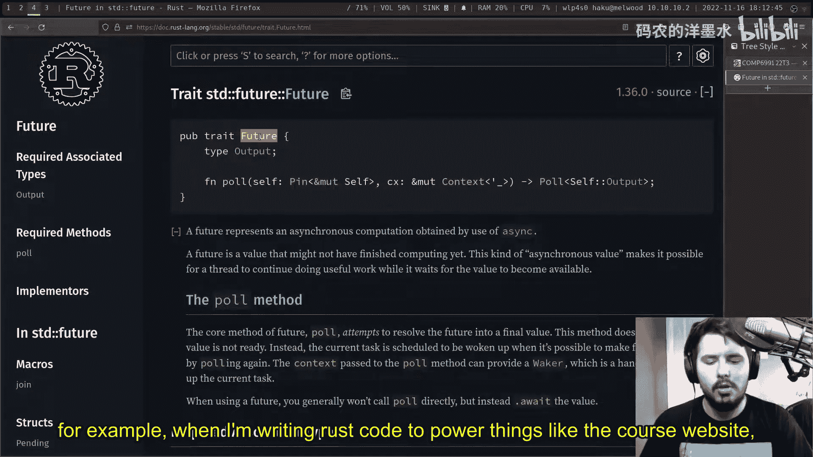

When I'm writing rust code to power things like the course website， let's say。

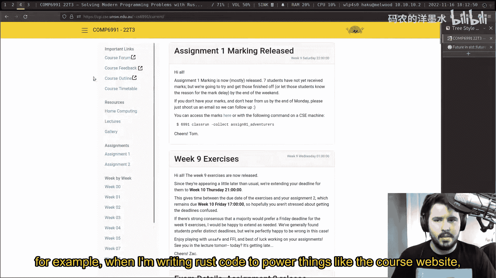

That's that's kind of necessarily async， I could have written it without any async。

 but it I think it makes it a lot easier for me。😊。

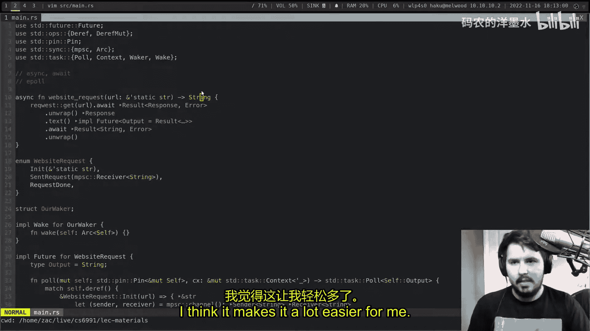

And also makes the website a lot more scalable if I， you know。

 write it asynchronously from the beginning。 And the good news is， in。

 is that in writing this whole course website， I never actually had to use the future trait directly myself。

😊。

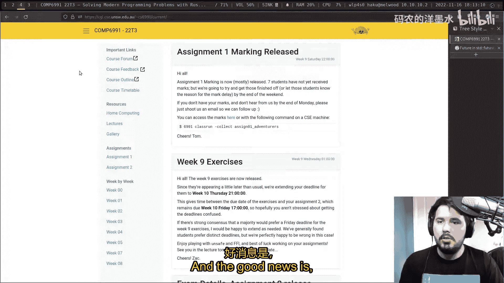

And that's sort of like an aspiration of rust in the long term。

That users when you're when you're writing a library。

 maybe maybe things are might get a little more complex。

 but if you're just sort of writing like business logic kind of code， you're making a website。

 that kind of thing。You should just be able to use things like async or await you shouldn't hopefully need to delve too deep into these details of stuff like future and I can say that yeah in writing this entire website for example I've never had to touch future itself。

 I just leave all that work to my asynchronous executor for most people that ends up being a library called Tokyo which we're going to talk about today。

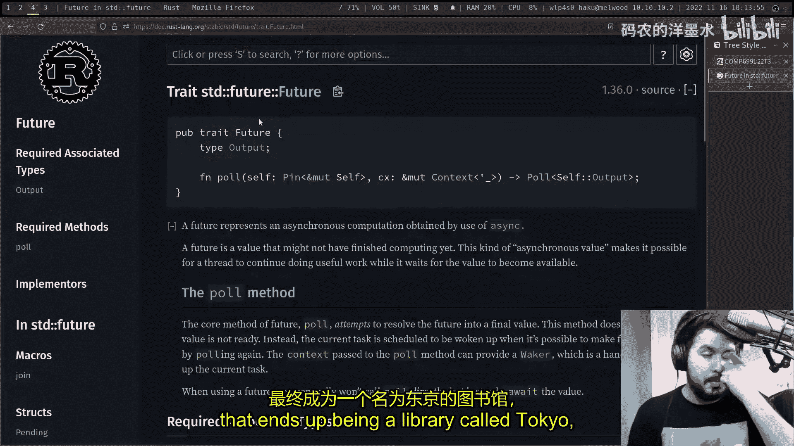

And then it handles， you know， most of the inner details and the low level aspects。

And I just get to focus on writing high level asynchronous code and not needing to think about things like threads and the overall sort of concurrency of the application becomes a lot simpler for me because I don't have to think about where I want to insert a thread to do something like this or how long that thread might live or how I'm going to communicate with it。

 I just write things in terms of asycing functions which are really just spitting out futures。

 I'm just writing code in terms of futures and Tokyo deals with you know all the concurrency for me which is really awesome。

😊，So we're going to do that today。In particular， we're going to use my personal favorite web framework。

 which is called rocket。 I mentioned on Monday that rocket is。

Some have touted rocket as a little problematic in that it's had， you know， periods of， say。

 five or six months。

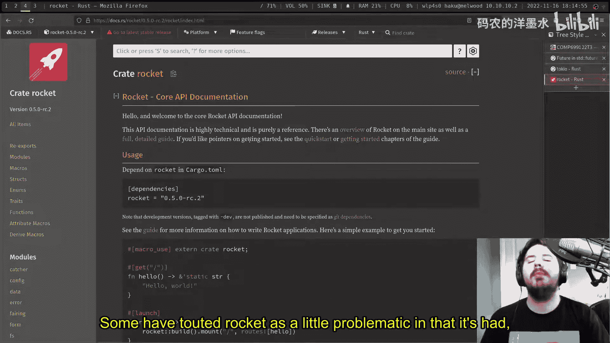

Where it hasn't really made progress because it's sort of just like one person's web framework that a lot of people quite like and a lot of people sort of want to contribute to。

 but at the end of the day this is still just， you know。Well， Sergiios。Web framework。

 but you know regardless of that， whether it's suitable for your production use case is your own question to figure out。

 but I really like it because it makes writing web services and rust particularly easy on the developer end and it makes really nice use of a lot of cool rust features that we've learned throughout the term so it's a nice sort of。

😊，Wrapping things sort of， yeah， bringing everything together kind of thing。Cool。

 so we're going look at that。There is one last thing I wanted to finish off with the future trade that we didn't get time for on Monday。

 which is waking， right， this context thing I mentioned when you want to prod poll the future， hey。

 do more work， do a little bit more work。You need to pass it a context。

 you need to pass it a context， this context is a type which currently just holds a waker。

So then and we asked why doesn't this just take a wake or if a context is just holds a weakerr they might want to add more types in future is the answer right now all they've you know found is worth including in the context is a waker but you know in future they may decide that actually we'd like to have three different things in here or something like that。

So that's important。But right now right it just it just holds a wakeer and right now wed have done nothing with that Wer if you recall we implemented our own Wer。

 which just does nothing and then we literally just like always ignored the context whenever we were using it like this just ends up getting used。

Nowhere。Okay， so。This is an interesting and this there was another question in the last lecture。

 which was really it was a great question that really gets to the bottom of why we care about Wars。

 which was this。😊，Someone asked。Something to the effect of。

 isn't it a little dodgy that we're just sort of in the like you know。

 getting the websites using futures function that we wrote here。

 we just sit in a loop constantly pollling all the futures or the tasks or all the futures。

We go pull it， pull it， pull it， pull it， like for each of the websites。

 maybe I think there's three of them we're looking at here， we go poll， poll， poll， poll， poll， poll。

 poll， poll， poll and then say like Python comes back first and then pull， pull， pull， pull， oops。

 pull， pull， pull， pull， pull， pull， pull， then see+ plus comes back and it just goes pull， pull。

 pull， pull， pull un rustt until eventually okay， I'm done， I'm done， I'm done。😊，嗯。Now。

 it is important that we that we pull the future because， again， the future can only make progress。

 Well， the future can only。Start work on new progress is maybe a way of saying it when you poll it。

So in our futures case there was three sort of states that it goes through。

 it starts off in the initial state， then you pull it and it sends the request。

That request will take some time and then once that request has come back， the next time you pull it。

It'll give you back the answer and the request will be done。あ。And so right。

 we can only transition between these states here， you know， each time poll is called。

So we would never get the result back if we weren't polling the future。

 but polling it probably millions of times before it before it goes， hey。

 it's done is probably a little excessive， I would say， In fact。

 we should be fine just to pull it twice right， we create the future in the initial state and then we say poll。

That should that should send the request off。 And then we really only want to poll the future again once this web request is done。

 That would be ideal。 That's like the perfect case scenario。 We can't do this。

 We can't use this feature with less than two polls。

But we should be able to do it with exactly two and obviously if you can do it with two。

 you can do it with three， you can do it with four。

 you can do it with five and so on and you can do it with what we've currently got。

 which is probably millions， right？😊，So we'd like to be able to do this with two poles and again。

 Ru is a language that cares a lot about， you know。

 doing things the right way in performance and not just sort of， you know。

 spinning in a loop like that。😊，And so that's what this idea of a waker is about。😊。

When you create a context， oh， okay， when you get past a context， no， this is not working， let me。

Let me grab this。

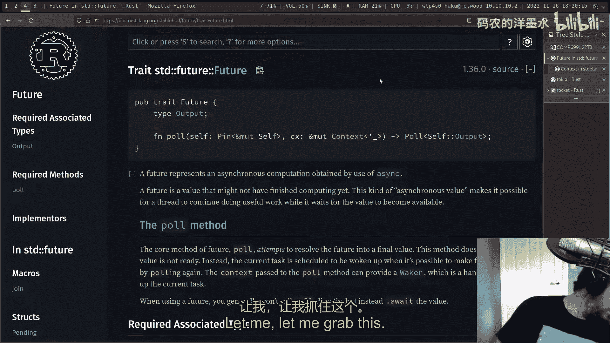

Here we go， push this。hoops。呃。

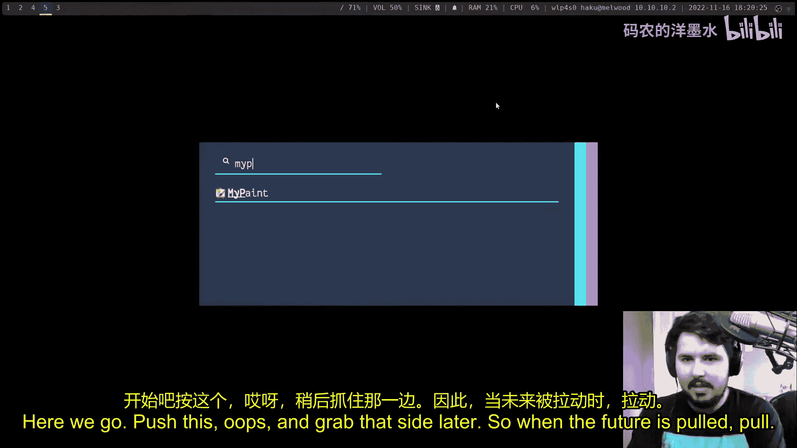

Grab that。Decide later。 So when the future is pulled。Paul。We saw it takes a pin pin of self。

 whatever it is， pin of refute self， I think。嗯。Something like that。

 whatever it doesn't really matter and it takes this context， context is an a mute context。

Of take on the score， whatever。This context came from somewhere right in order to call poll on the function。

 someone needed to have created this context。And it allows us access into a Waker。

 So Cx we saw here Cx dot wakeer。Lets us access the wake up。Alright， oh， thank you。So cx。

Wer is really like all it's useful for， it gives us that wakeer。Or a borrow of it。

 whatever it doesn't really matter。And this waker。Has。This interesting function here。

 wakeake by riff， wake up the task associated with this wakeer。Right。

 or we could do dot clone and wake。 These are whatever for our purposes。

 they're basically doing the same thing。 So on this value here， we can call dot wake， essentially。

 oops， dot wake。And what this function here does for us is it says。It tells。

 so there might be some kind of executor all the way up here。

 This is basically the program that implements the event loop。Of our rust as code。

 So this is basically an executor is something that you sort of spit futures into， right。

 future goes in and it sort of deals with processing the futures until the results come back out。

 right， at a sort of high level。 an executor is something that should。😊。

Get thrown futures and it knows how to efficiently communicate with futures so as to eventually get their results out。

And the idea here is that if the future calls dot wake， it's essentially telling the executor， hey。

 I'm I'm ready to be polled again and the excutor will go and poll it and it'll move on to the next step。

 maybe it's done now and it goes here's the result or it does some other work and then eventually calls dot wakeake again and then the future the execute goes great。

 I'll poll you again and you sort of like get this。😊，Event loop， right。

 this loop of making progress over time。😊，And the trick here。Is you might go， well。

 if we're polling the future， right， we call poll。And the future mustn't block， right？The future。

 sorry， calling poll shouldn't block the current threat。

 the current threat it should kick off a task and then return return back very quickly。

And in doing that， it should make progress on the task in the background kind of thing。

So then how does the pull， like how does polling this future， this future that comp blocking。

 you know has to do stuff in the background， end up calling wake。Um， you know。

 if it hasn't got access， well， it could just make a thread like what we've done here， right。

 we could just sayum spawn a thread。Send the response and then say context dotweker。t way。Like this。

And it's pissed off because context might not exist anymore。 Yeah， that's context dot。

context isn't cloned， but wake is， so we would do something like。啊啊啊啊。Let Waker is context。waker。cl。

And then this is a wake up。Like that？给ね。嗯。And now it's sort of signaling， hey。

 the responses come back， I' I'm ready to be pulled again。And in implementing our Waca。

 we wouldn't just do this horrible， do nothing right。

 this function would end up getting called and that would tell us hey。

 it's time to pull this future again。And again， this is what an executor。

 a runtime like Tokyo would end up implementing under the hood。 Now， the trick here is。😊，Again。

 you might just go this like。All roads seem to lead back to threads here， right， Like。

 why are we bothering to do all this stuff with future if。

It seems to always end up getting implemented by spawning a thread doing some stuff and then saying。

 hey， I'm ready for more progress like this just seems like threads with extra steps。😊，Now， there's。

You know， there's a couple answers to this answer one is， I mean， even if that is the case。

 even if all roads do lead to threads， it there is still utility in this future type and that it gives us this abstraction over the idea of a concurrent task。

😊，Which we talked a little bit about。On Monday's lecture， but the other trick here。

 this is sort of the other really neat thing about this whole system。Is that Tokyo， for example。

 basically reimples a big chunk of the standard library。

Any bit of the standard library that's reliant on things like IO that might take time might take like considerable time to actually to complete。

 say reading from this file system or things like sleeping a thread。

 that kind of thing like thread related operations， Tokyo essentially reempples。

So if we go to Tokyo FS and we go to the standard Library's FS module。

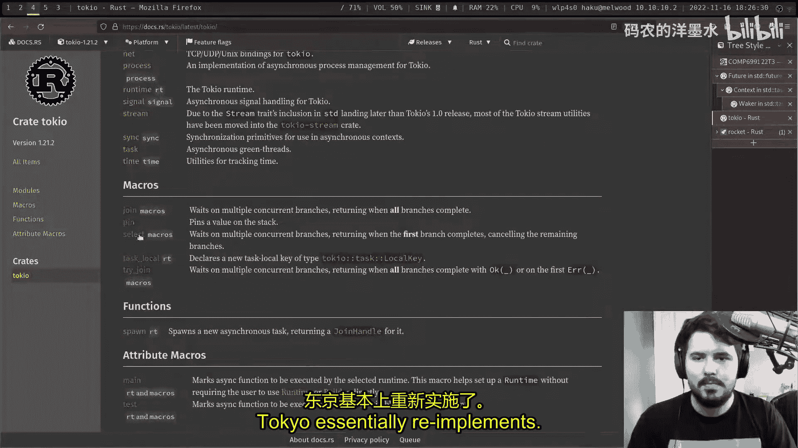

No， oh， we're over here。These will end up looking very similar。Like。

The color schemes are a little different which makes it maybe a little hard to see。

 but like canonicalize， canonicalize copy， copy， creator， creator。

 creator or creator or hardlink hardling， metadata。

 metadata like they implement the same operations over in Tokyo and if we say look at Re for example。

😊，Tokyo has read Iple Azf path goes to result VQ8， Read Azf path goes to a result VQ8。

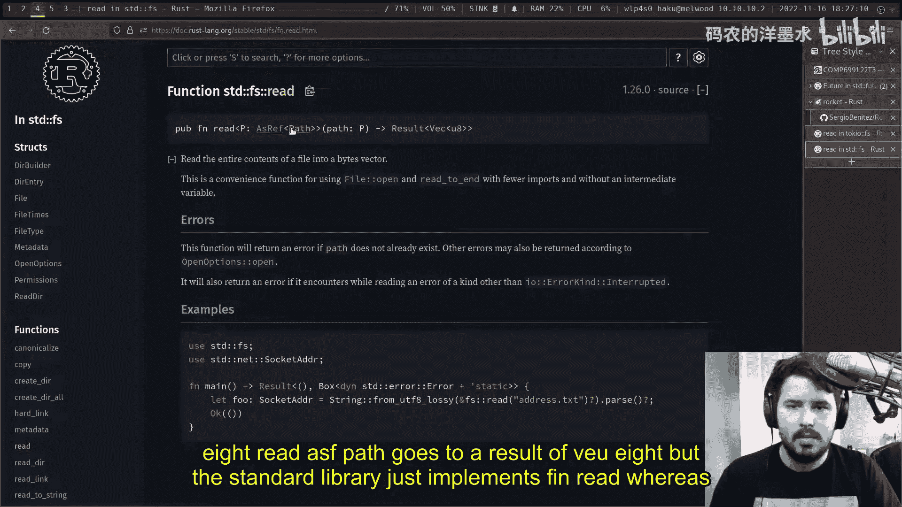

But the standard library just implements Freed， whereas Tokyo implements async F Reed。😊，Right。

 so they implement like a future version of this。😊，A version of read that is asynchronous。

 and then once again， the big trick here。Is that Tokyo， as part of its runtime。

 knows very very like performly how to deal with asynchronously reading from a file。

So using system calls like EpoL， Tokyo can essentially say like I I am writing my asyN code and I have in my future like this this future that might be pulled or whatever。

The future I'm dealing with might be， say read。I read some stuff， and I say dot a await。To say。

 wait for this future to complete。In this read future。

 which will have its function pole and that kind of thing。

It will Tokyo has will essentially do something like this。

 so Reid will say I want to read from this file over here。Tokyo is this big beast on the right here。

 this is Tokyo over here。🤢，And you know there's a lot of moving parts in Tokyo and maybe like。

 you know， heres， here's my representation of all the bits and pieces of Tokyo。 And you know。

 over here we have like the file IO section of Tokyo。And we say I want to read from this file。

 something like that， it goes and sticks it over here。😊，And then， you know。

 Tokyo is going and doing a lot of work sort of， you know， almost like all the time。

 just it's generally always doing a lot of work and just every now and then it'll go like check on the file。

Right， and this is probably this， this can very easily be on one thread as well。

 Tokyo might it can lets you configure to say， hey。

 I'd like to run this on every core if you really want。

 but all this stuff can just happen on literally one thread if that's what you're looking for and it'll look around and go you know。

 check on this file or have I been woken up to go check on。😊。

This file or that file that kind of thing and when it says all right， this this file has completed。

 it's able to go and wake up that future and continue making progress on it and you know jump over to your async function。

 really wake up your async function in a certain sense。😊，Your a function is doing some stuff。

You know the read completes and it goes， great， go wake up， this thing is ready for you now。😊。

It'll pull your future that gets staring out of your racingcing function and it continues on and does some cool stuff。

あ。So this is all to say。 Like， let me， this is， this is。

Pretty heavily advanced stuff and it's a little ambitious trying to attempt to explain this all。

In a rather quick manner。But so let me give you like the cliff notes here。

 the big ideas that I think are worth taking away from this。

So we talked about before future is nice abstraction of a concurrent operation。

 futures will only like make make enough progress to move on to the next step。

 the next step that might take time to complete kind of thing。UWhen you actually poll them。

 we don't want to just say poll， poll， poll， poll， poll。

In then an infinite loop because that will very easily stall performance and it just ends up meaning you're blocking on them anyway。

 So instead， futures have a way to signal to say like their executor or the system around them that hey。

 I'm ready to be pulled again， I'm ready to make some more progress or that might even waiting might even be saying I'm finished and I'm ready to spit out a result。

😊，嗯。And so at the absolute baseline here you can very easily implement， hey。

 wake me up just using a thread， if your task is just spinning up the thread。

 do some stuff and then say， hey， I've got the result and I'm ready to be woken up。

 then that will work， that should work just fine for you。😊。

But and and like you should basically be no worse off than if you had of written this all by hand as well。

 because， you know， like if if youre doing this with threads yourselves。

 you're really going be like waiting for this thread and a loop and going， hey， you know。

 I'm waiting for this thread to be finished so I can get this result。Or you're gonna be， you know。

 trying to get that thread to wake you up when it's ready。

 maybe by sending it through a channel or something like that， saying， hey， I'm。

 I'm ready with that with information now like you wanted。You know， that kind of thing。So you know。

 if you're just planning using threads anyway， you shouldn't really be worse off using futures。

 it should adapt quite well， but the big trick here is that if you're making a large system， right。

 a large runtime like Tokyo，Then they can really take all these different kinds of tasks right whether that's reading from a file。

 whether that's making a network request， whether that's talking to a different process on the system。

 whether that's a sleep or a timeout or that kind of thing these can all be grouped into the same interface of a future。

 and Tokyo can really efficiently multiplex all these different ideas with a very small amount of actual threads and a very small amount of actual data that's kicking around so。

😊，If you， if， if we can vaguely understand how。This idea of like wakers， you know。

 saying that this thing's ready and futures can work quite nicely in the context of a slightly monolithic runtime。

 a runtime that knows how to do a lot of stuff。Right， knows how to do hopefully like。

Almost all the stuff that you're looking to do。Then overall。

 you can get a really nice coherent high performance system。That is hopefully like， you know。

 relatively pleasing to use as well as a developer if we can， if we can agree on the premise of this。

 then we're ready to move on and start writing that code ourselves， I'd say。😊，嗯。

There was one other thing that I wanted to quickly mention。Which was。 it was something about Tokyo。

Yeah， maybe I've， maybe I've immediately forgotten。 but yeah， regardless， Tokyo is pretty cool。

Tokyo is pretty cool。嗯。So yeah， it's sort of like it's， it's cool with rust。 Oh。

 that's what that's what I was gonna to say。 Yes， I remember now。 So if， if you're happy with that。

 then that's， that's great news。😊，If you would like if you sort of know a little bit about language runtimes and you've heard things about concurrtency and you want sort of a quick take on a few things。

 this is potentially better than just always spawning operating system threads like we've gotten you to do and things like your assignment and such。

😊，Because you can achieve when you're IO bound， right。

 not when you're performing very CPU intensive work。When you're IO bound。

 you can get the same like sort of raw performance like the speed and concurrent activity as if you had。

 you know， dozens and dozens of actual threads with just say one or two operating system threads or a very small handful of them。

And operating system threads。Generally take up a reasonable amount of resources and they can be quite expensive to switch between to context switch across different OS threats。

This is potentially better than green threads。 if you've heard of that。

 which is the M to end threading model where you have。In the language， lots of threads。

 lots of sort of fake threads， multiplexed over a smaller amount of actual operating system threads。

 Java， I believe。 Well， yeah， Java almost， well， not necessarily， but Java is relatively。

Prominent in this， in this case， I believe， with a green thread runtime。

And the take here is that green threads， especially when you're working on。

You're not working like in a language VM， like a virtual machine that Java runs on。

 it can be really tricky to estimate requirements correctly and you can basically end up using a lot。

 excuse me， Use up a lot of memory。Especially when green threads are kind of encouraging your developers to like go crazy with them。

 spawn thousands of them if they need to and if each thread ends up you know taking up a lot of memory。

 then that could be quite you know dangerous if you have a go used to have this yeah go used to have this model where。

They would only and go as basically green threads as well。

 They call them go routines and they've got some， you know。

 some nice syntax for them and some nice features， but。

They end up essentially just working as basically like green threads at a low enough level is my understanding。

They had these interesting techniques where to combat that idea of green threads potentially using a lot of memory per green thread。

 what they would do is they'd start off the thread really small and then as you sort of。

Use more data it would dynamically grow your stack over time and what I believe what they found and Rust used to do this as well before Rust was released。

 Rust had green threads， believe it or not， they to green threads out before the language actually was released as 1。

0 in 2015。And what both of them found， if I recall correctly。

 is that there was these interesting thrashing issues， where if you had this loop。You know。

 right here， which uses some more data right there。

 you'd sort of find that you'd use the data and it needs to expand your stack then the loop iteration finishes and you need to go back and and it frees up that stack then you enter the loop again and it uses more and you get this like allocate de。

 allocate de， de that just like absolutely tanks performance and rather stop doing that and then destroy the green thread runtime I believe go routines also stops doing that because of similar issues So itss it's kind of an interesting balance and if you're looking for the technical terminology to keep looking into this kind of stuff the technical terminology would be stackless cors is what that's not how youpe co routines corouts。

Green threads。Is generally considered to be stackful， which just means that。

They have like that managed stack that I was drawing， you know， kind of like this。And this。

 this also is vaguely relevant to fibres as well as another terminology that appears。

 and then another very common technique is just straight up OS threads。

 which is what you see in things like C and。You know， somewhat largely C++ as well。

 I'd say C++ does have some green thread runtime that you can use。

 I'm sure you can probably get away with Staless co routines and C++ as well。

 but I have literally zero experience in that。😊，But the general offering is usually just OS threads is my understanding。

 but I could be proven wrong。And green threads us OS threads at the end of the day you you need some OS threads to do your work on the big deal here is in like CNC++ you say spawn me a thread。

 you know you say spawn and it literally spawns an OS thread in a green thread language like say Java like say go you say spawn a thread。

And it creates sort of like an object in the language。 right， So this is imagine here。

Is like the language。 And here is the O S。 It spawns an object in the language。

 And then they have as part of their run time as part of the code that sort of helps execute your program。

 They multiplex the language threads onto， you know， single O S threads。 So this might be。You know。

 you might end up with a small amount of language threads to OS threads。 you might end up with。

All the language threads are only multiplexed across a single OS thread。

 right like every single thread is just pointing at one OS thread。😊。

That's sort of down to the language， I think Java for a long time。II， I think this is。

 this is a think。 So not a quote me on this kind of thing。

 I think Java for a while only would multiplex over one O S thread。

But please tell me if I'm wrong about that I'm not sure I have no idea if that's still the case I think when Java released that might have been the the case so green threadreads kind of needs a VM yeah green threads you need generally need some kind of runtime to make them work at least to make them work well from what I've seen。

😊，And Russter did used to have a runtime。Before the language was actually released when it was still being developed。

😊，And then they decided that that wasn't really in line with what they wanted for the language and so they tore out the runtime so now rust like doesn't have a runtime in quotes it's sort of like people generally consider the languages like C C++ and rust don't have a runtime where say go or Java and that kind of stuff do have a runtime。

If you consider if you say that go has a sorry， if you say if you say。

 if you want to say that rust has a run time， then you're sort of opting in to say that c andC++ have a runtime as well。

 just theyre generally very， very small lightweight runtime， so it's。

As long as you're consistent about it， I'm happy。Um。

 but I don't think there would be too much of an argument at saying insane saying that say rust has a runtime。

 but C++ doesn't or vice versaum they have and even see， they just have very。

 very small lightweight runtime generally。How do you call cis Cos and RE is that throughify as well。

 I assume Tokyo will need to do that in their implementations so generally it's like it is through cis calls eventually。

It is through this calls eventually usually system calls are a little unstable and system calls are a little unstable and not that great to rely upon。

😊，So people generally use LibB C like the C standard library as kind of like their operating system interface in that not necessarily things like F getsS or that kind of thing but C the C standard library offers like a Cs call the interface in things like say Re in things like read which is basically this is just going to end up being an interface into the read system call on whatever system you are so yeah Tokyo whether it ends up using the standard library for some of these things。

 it might be able to。😊，Whether it's not able to use a standard library for some things。

 it has to go down to。And has to go down to the like system call level。I'm not 100% sure。

 but I could honestly say it being either way。It does depend on Lib C for for whatever that accounts for。

They do depend on Lib C， so I imagine they probably need to use the C stand library for something。

Microsoftcrosoft calls I library the universal C run time you see。 Yeah， see that sounds about right。

 I think。The Linux equivalent or the unixC equivalent is。CRT 0。CRT0。The sea runtime， yeah， yeah。

 here go。Ct zero is if you're interested in that， this is the like C C roundtime if you want to call it a runtime。

😊，Okay， can we use Tokyo assignment too， I mean， if you want， this is something interesting。😊。

It's Wednesday， and it's due on Friday。Something interesting I mentioned to Thomas as like an aside is。

呃。Assignment 2。The like if I was writing assignment。

 if I was say like working a software engineering job and someone said， hey。

 we really need you to whip up an IC server and rust。

I wouldn't be riding threads myself myself I would be using Tokyo， I'd be riding a sink rust。

Because I would find it to be easier， probably simpler to scale。

 It's just sort of like the more correct tool for the job。

 which is interesting because we're getting you to do it with threads。

 we're not necessarily gonna we're not stop we're not gonna stop anyone from doing from using asynchro rust to implement assignment 2。

 and if you wanted，Take on that yourself， then。Then you are free to do that。

 but we won't support it is what I will say。In that if you have problems going wrong for you and oh。

 I need help debugging this future crazy asN code， we're gonna go sorry， you did this to yourself。

 we're gonna suggest going back to using threads but you are you are allowed to answer the question you're allowed to implement it however you want as long as it's not just implementing it without concurrency。

 like you need to have functioning concurrency， but how you do that is up to you。😊。

Can I give a high level explanation of how EpoL works and how something like Tokyo would use it。

 I can give。😊，I can give like a three minute explanation and that' that's what I'll offer during the lecture partially because you know time constraint but also partially because I'm not an operating systems expert and I only know it at a relatively high level anyway and so。

😊，I don't like， I don't generally like explaining things at the exact level that I know them at because that's when you're the most likely to dip into mistakes and give bad info。

 So I'll give you a very quick， very high level overview， I believe the way Epo works。😊。

Is that let's say I tell Tokyo Tokyo， I'd like you to open you know this thing， open this file。

 I'd like you to open this file， I'd like to connect to this socket like open a network connection blah blah blah and the operating system goes sure this is file descriptor  one that's file descriptor 2 that's file descriptor 3 these file scripts make no sense because stood out today but whatever and then you can say something along the lines of epo on you know one2 and3 and I'm waiting to I'm trying to read from these things here and this is in the context of some thread you know blah。

 blah， blah and at this point you get put to sleep。

Your thread goes to sleep and then the operating system will come and wake you back up once like the Re event on one of these three things here is ready and it'll say。

 hey， it'll like return back from EpoL。😊，Hey， we're ready to like read for one and three like the data is right for these and then you go and read that data and you'll say like E poll on like I'm just waiting to read from two or something like that。

And so the trick here is we can now be concurrent across you know， one， two，  three，1 thousand， 10。

000 a million files。😊，You know， waiting to， waiting to do sort of concurrent operations on them with only like oneum like IO thread that just gets put to sleep while it's waiting for to it's waiting for some kind of operation。

That's sort of the very high level idea of it。 So you'd probably like。

 I believe Tokyo does have clever ways that are probably more advanced than what I'm able then you know what I'm able to explain right now of running with just one thread。

 But the easiest way I see of doing this is that you have Tokyo's main thread And then it has like an IO thread that does like the waitinging and the polling and then you know updates things like that。

 And so Tokyo will just like send stuff over to this IO thread。

 which will wait on it and then notify it when stuff has come back。 that kind of thing。

 But Tokyo does manage to do So across a single thread， it might be some more advanced trickery then。

 then I'm able to explain right now。 But that's。Sort of high level how depo。Roughly works， I think。

All right。So。What was this， Oh， that's yeah， this that feature code。Cool。Oh， look 18 oh no。So sad。

 It only works when you're eye bound。 Yes， right， The thread doesn't do much computation。

 So Tokyo is not a great。Runtime， a great service for doing like CPU Bo work。

Because it tries to use very few operating system threads again。

 usually my understanding saying is it's usually one or a very small handful of actual operating system threads and in order to do like you know CPU bound work quickly。

 you know in order to achieve parallelism， which is what you're looking for when your CPU bound as opposed to just concurrency in order to achieve parallelism。

 you really do need access to those operating system threads。

 OS threads are how the OS provides the opportunity for parallelism at all。😊，And in fact。

 it says here CPU bound tasks Tokyo is able to concurrently run many tasks on a few threads by swapping in and and out of threads。

 However， this kind of swapping only happens at a weight points blah blah blah so they say if you do have a blocking task that's going do a lot of CPU time then use this function here which will actually go spawn an OS thread to do the work and you can like a weight for that to finish but what it's saying is if like your overall project is CPU bound like if you have a lot of CPU bound stuff not just like this one thing that you want to you know integrate with the rest of your like quite IO focusedcus code base if you have a lot of that you might want to consider using ray on we know this one too which is that data parallelism library that helps us write very parallel code。

😊，And then there's tricks to integrate rayon with Tokyo as well where Rayon pulls in a whole bunch of OS threads to do that CPU bound work and then Tokyo only needs you know the one or two threads for itself and then you probably just communicate over a Tokyo channel to say like you know hey the rayon thread finished figuring the rayon thread pool really thats working on lots of OS threads has finished doing its work here's a result and that passes it back over to your IO Tokyo code so yes Tokyo is very much an IO an IObased executo runtime yeah。

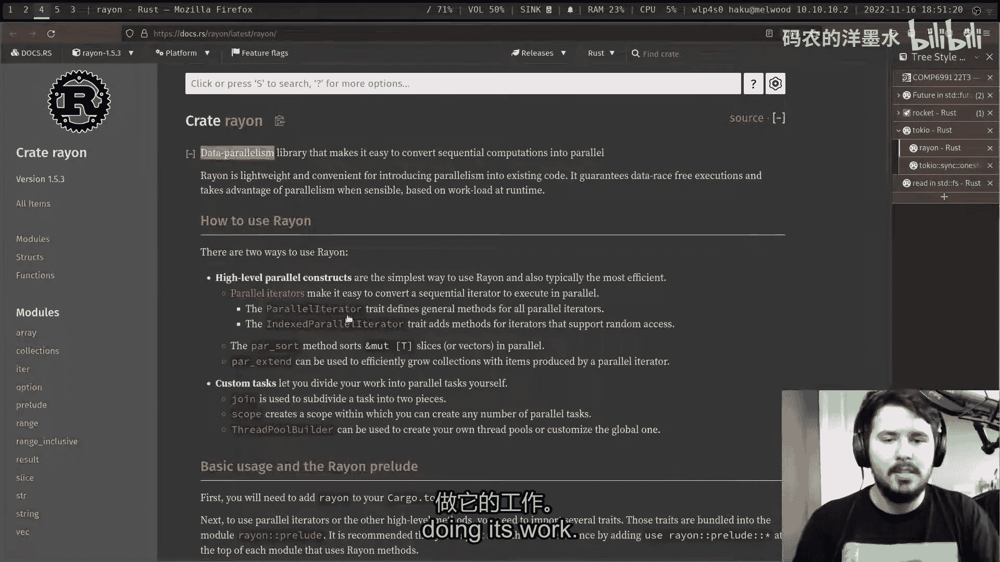

Cool。😔，Any other questions for now， in fact， let's let's take any questions until we have until you've out of questions and then we'll take a break。

And then when we come back from the break， we'll write some fun website code。

So any more questions before we take a quick break？嗯ん。

A question I have that I'm going to plug in here before we go to the break is my experience。

My experience is a cool thing。U please fill out in my experience。

 it's sort of extra important because because this is the first time we're running the course。

 is this dangerous to？😊。

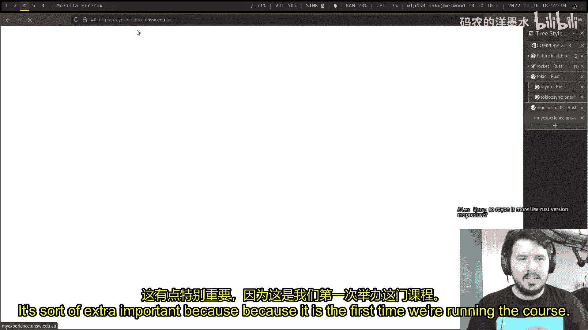

To open up in front of everyone。 I'll put it on that monitor for now。 Yeah， there it is。 Yeah。

 So it's， it's extra important for us。 if you could find， In fact， let's take an extra long break。

 let's take a break until 7， right， That's the longest break we've ever had。

 Let's take a break until then， so。😊，So you have some time to fill out my experience as well if you're able to do that that would be very。

 very nice we've got 10% completion which is honestly more than I was expecting at this point if I'm 100% honest。

😊，But we're we're gonna be hoing on you at the workshop as well。

 probably to get some people to fill it out。 But yeah。

 if you can find a little bit of time to fill it out during the break now， that would be excellent。

 otherwise will come back at7 So rayon is sort of like rust map produce Yeah rayon sort of like map produceuce on a single computer like mapprouce you can imagine as splitting up a bunch of work like a bunch of tasks onto many computers and then reducing them back into one like result rayon is that same idea。

 but in the context of a single computer where it's splitting up the tasks into many threads。😊。

So and yeah， that's a perfectly reasonable way to think about it for sure。😊，Its incentive。

 haven't thought of an incentive if you want to suggest incentives then you're you know more than free to。

um but I haven't got anything in my head right now。 All right， let's take the break。😊。

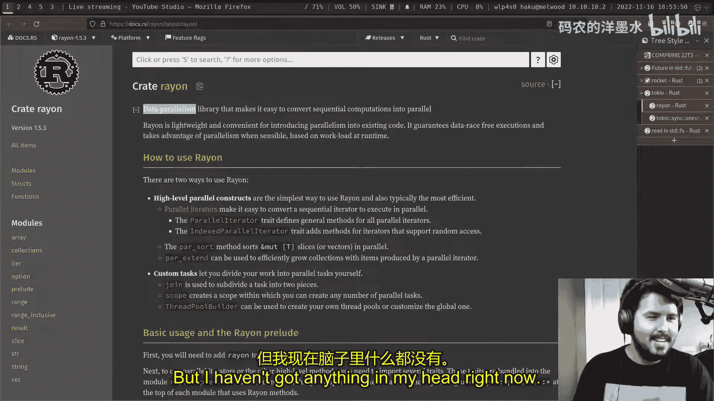

Fill out my experience during the break， please and we'll see you for our last hh。

 last little fun thing at seven。😊。

And that is 7 o'clock。We are back。Did we fill out my experience， did we do it？Oh are we like？Oh。

 they're going to make us do it at the workshop anyway。

 I'm just going to do it then did anyone actually fill it out？😊，D Wang yeah。

That's I guess that's a problem of asking to， yes or no questions right after one another is that I don't know。

😊，Which ones that yes， that's yes to Oh， I can see it went up a little bit。😊，Horay。

And Dong already filled it out。 That's， that's very nice of you。 I， I。

 I can see the response rate here is going up a little bit。😊，Thank you， but yes we're going to。

 I'm sorry to say we are going to definitely keep bugging you at the workshops。😊，嗯。All right。Nice。So。

Yes， now we get to do the fun thing。 Now we get to do the fun thing。

 Reserving judgment until the end of the lecture。 Yeah， okay， that's fair enough， yep， yeahep。😊，Okay。

 let's go。250 gives 1% bonus to everyone if the response rate reaches 85%。 Wow， that's a high bar。

 Maybe， maybe I should get Tom to write a forum post about Tom has a very convincing argument that he doesn't。

 he doesn't think it's， it's。😊，I'm going to be very picky with what I say here。

 It doesn't think it's necessarily the best idea to offer bonus marks based on。

Based on like sort of course wide activity， if he's comfortable sharing his his， again。

 I think a his relatively convincing arguments， I might get him to to write that on the forum。

 but maybe we might have to come up with something， I guess I guess we'll see how the workshops go。m。

All right， so rocket， rocket， I love rocket， yes， so Rock has a website， rocket。rs。😊，It's a。

 you know it's a real it's like a nice pretty 2020s website as you can see and it's I think it's really nice so if you view something like flask。

😊，I mean， yeah， flask is the one that really comes to mind here then honestly it kind of like gives that impression of flask for rust。

UIt's， you know。It's probably easily a few million times faster。

 but that's maybe another conversation， but it does make writing you know， websites， web backends。

 that kind of thing quite quite simple， which is really nice so rocket。😊，Ands all I've got here。

And we're going to grab rocket the release candidate to for the 0。5 release。

 which has been in candidacy for a while。你呢。we'veAs we've sort of seen before。

 but rocket is pretty cool， Rock uses Tokyo。😊，Soir。In using rocket。

 like rocket is essentially backed by Tokyo， we should see in its dependencies。😊。

That it pulls in Tokyo here。And so it's sort of。It's like you know it's a full web framework and so there are other web frameworks like。

Wp， Hy axiom， what am I thinking of here， I'm of warp。Yes， which is like warp is a。

Web framework well not it's more of like a website building library as opposed to like a full on framework I'd maybe argue and so you would use Tokyo and with Tokyo you would like run warp so see here they go Tokyo main async function main that kind of thing and then call like warp functions so that's's you know certainly an option but rocket sort of aims to be like a full on framework that does a lot of this work for you。

😊，But again， at the end of the day， we will be using Tokyo。

So rocket suggests that we put this launch annotation。On our mainco here。

Which I'll probably need to import。 And now that lets us declare this is async function main。

Basing function rocket。Or function rocket rather。 Okay， cool。

 they probably define their own async function main that they would like to use。

 That's why we can't use main。 So function， what I call it launch。

 I think it can you can call it whatever you want really。 Maybe not。 Oh。

 launch doesn't really make much sense， does it。😊，What are you upset about， it must return a value。

 right yep？Sure， let it figure it out。 It seems it's fine and it just needs to。

Let's just copy the code in。Rather than dealing with every little error as we go and forget about mounting for now。

Alright， cool。 And so as such， weve now got code to spin up a website。😊，If I go to， yep。

 I'm already here， cargo run。I'm going to have to build all of Tokyo。

 it's nice because the room was getting a little cold。

 so this is going to help warm things up a little bit。😊，呃。Great， we've got a website there it is。

 Rocket is launched from 127，001，8000 so。😊，1，2，7，0，0，1，8000。 Wow， that's so weird。 It looks like the。

 it looks like the， the course infrastructure。 I wonder why that is404 not found rocket。 Great。

 So that seems， that seems good。 They probably have that like an actual hello world example。

 which we can do here。😊。

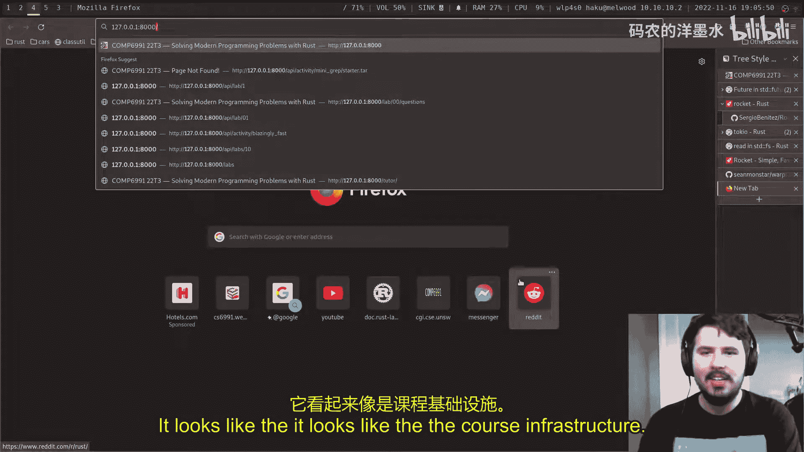

So in rocket， we can define a route。Get， you know， when we just get the root of the website。

 it will give a string back Hello world。 And so I can say。Mount on slash。Moun on slash the Ho route。

Restart the website。And now it says hellello Weld。Yeahay。

 we're probably going to be using or making pretty， you know。

 heavy use of a tool called curl to do a lot of talking to the website and it's just gonna to look something like that So it'll just be like curl。

1，2，7，0，0，1，8000。And you end up saying just what a web browser would say as well。

 it just doesn't render the HTML necessarily。Cool， so Ke lets us make that web request and see what it responds with。

😊，Like generally， generally not too bad to use， I would say。All right。So。

Our idea is that we would like to make a bit of a like paste bin service。

 Serb you must be making bank from these dot R S。 Yeah， yeah。 Wele to C S 6，9，9，1。😊，Paaste。Right。

 welcome to CS60， I think I can even do a cargo what？dash。X run， I mean。

 I guess that's probably what Kago which well just do。Oh no， it just builts it， I guess。Dexs run。

This is Cargo watch is a nice tool because when I save the file。

It'll just rebuild it and restart the website automatically for me。

 so now it says welcomee to CS6 an hour paste。Oh， no R S pun， Cs 6 and iron pasters。Great。sorted。

 we figured it out CS691 pasters because we are now the pasters who are pasting things into the website。

All right， so。We'd probably like to have a way to create a paste on the website。

 right just to be clear。Okay， someone hasn't seen stuff like this。

 There's tools like paste bin right， where I can say。

' I can make a new paste that just says hello from Cs 69，91。😊，And like， okay。

 it has a whole bunch of settings， but we don't really need those things， just create the paste。😊。

And then I will get this permanent URL here where I can give it to anyone and they'll see this paste here we're making a very like bare bones version of this So for example。

 if I paste this paste bin URL in the chat，😊，Which I did through OBS and actually seems to have worked。

 Good job OBS。😊，You'll be able to click on that and see the paste that I created。

 so it's it's kind of handy if you need to share a snippet of text， an error message。

 some like log files， you know， it's pretty handy for that kind of stuff。😊。

And we're making our own level pace bid now。😊，So we'd like to be able to like create a new paste。Um。

It's something users probably want to do and probably a way toum like retrieve someone else's pace。

Right， that's what we're looking for here。嗯。Okay， so notice that also when I made this paste。

 obviously， you know， it stored the text that I wrote here and it also generated this sequence of characters like a short URL for for storing the paste。

We could you know we could use whatever we like want here， we could generate some random text。

 a pretty easy solution here， it'll definitely be a lot longer than the paste that's written here。

 but we could use something like a UUID comes to mind a UID is well in particular V4 UID is a sort of convenient way of just generating a random sequence of bytes that just get stored as a string like this and we could just generate a random UUID and say like you know pastes slash this thing here and that'll refer to our paste it's certainly overkill but UIDs make this easy because。

😊，UThe likelihood of generating two u two like random Uids that happen to collide with each other is。

Unbelievably unlikely。 so like the unique uniqueness property is not strictly guaranteed how for all practical fairs。

 it can be assumed that an unintentional collision is extremely unlikely。

Like I wonder if we can quickly Google UIDV for collision probability yeah。😊，I love Google。

Google's like AI for finding the answer。

Okay， Qra seems to have found a nice way to visualize this。

 they say if every person on the planet generates a new UA for every second。

 a collision to occur after 10 years。😊，Okay， it's actually a little more slightly more likely than I thought。

😊，嗯。

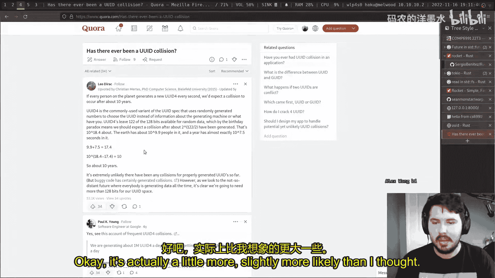

But that's， I mean， still， yeah， that's for what for our purposes， I was。

 I was looking at this one if you generate a billion。Uh， you know， UIv4s every second for 85 years。

 there's a 50% chance of a duplicate pair in any of those is apparently what？A source dude trust me。

So yeah， anyway， it's， it's basically zero for our for our intents and purposes。

 So we're gonna just use， we'll use this crate。 In fact， let's use。😊，Cargo add U I。

But I want the four UAs。Dash features before。Great。And we'll just use UIDs to represent this paste。

The paste sort of ID。Okay， so rocket has a pretty neat idea。😡。

Rocket has a pretty neat idea of these types of these sort of like guard types。That's。

Not that helpful for what I wanted。Rocket that。Guide， God， God， God， God， God。Guard。Yeah。

 there's tons of different guards， but I was hoping that they would tell us like talk about guards more generally。

😊，So in particular， well， okay， no， no， no， this is this is what I want。 request。

 Rock works with this idea of request guards， which is pretty cool。 It makes nice use of like rusts。

 sort of， you know， things that the rusts language。😊，Allows you to do， you know。

 allows you to help sort of create safe programs in that I can create some type of data。 In fact。

 Maens is just better shown by example。 There's actually a relatively cool example of this in the course in。

😊。

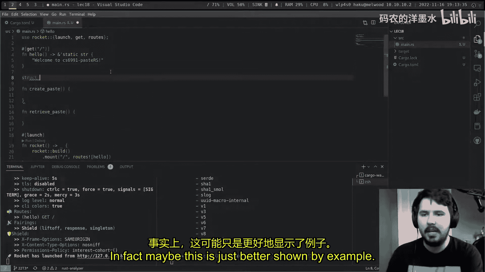

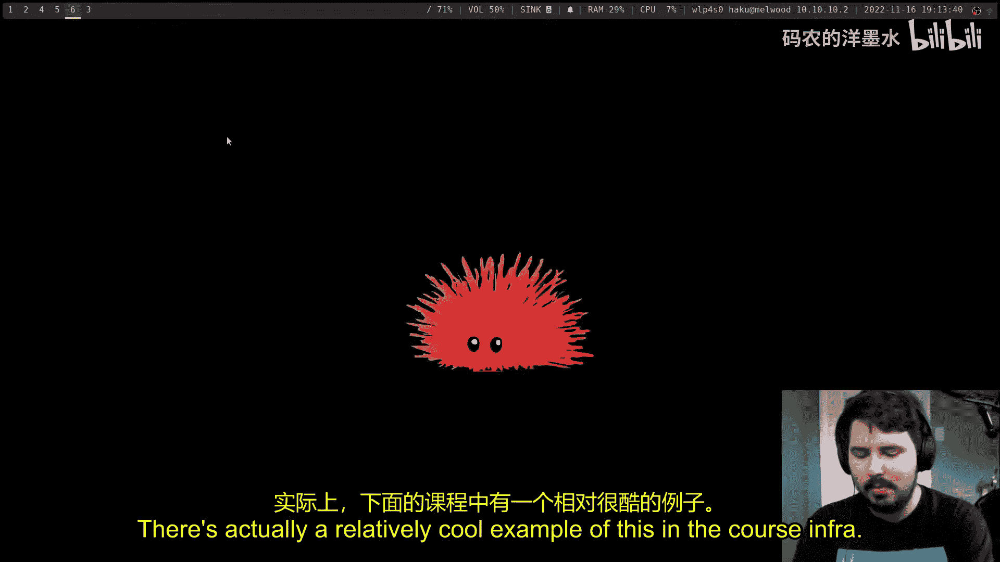

I's got to be sort of somewhat careful。😊，I got to be a little bit careful。嗯。Here we go。

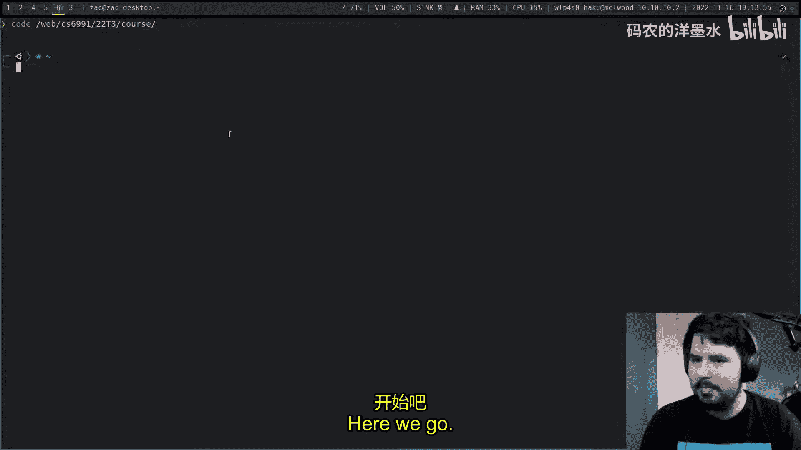

Get rid of this。

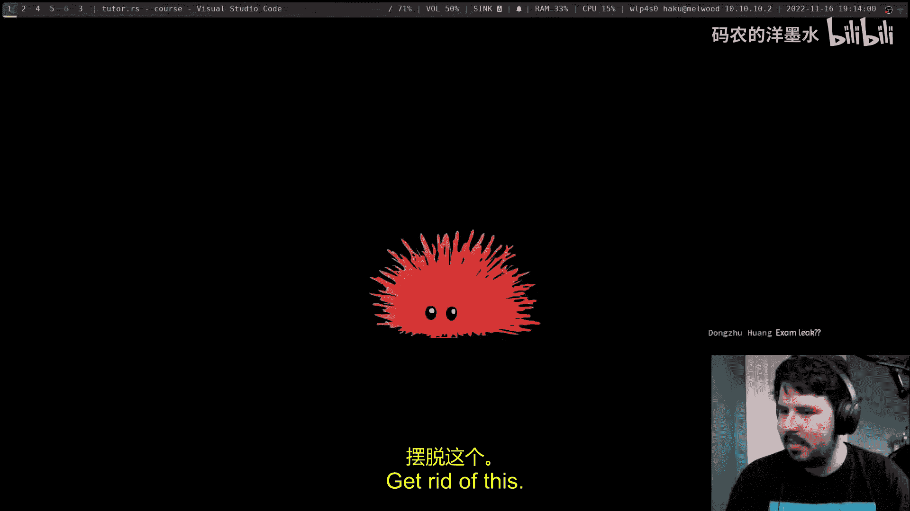

Alright， I'll just get rid that as well。 Okay， this should be fine。 So for example。

 we like to tell whether someone is a tutor or not when they're on the course website。

 I don't know if any students have noticed this。 but like if I'm say in the lectures page or whatever。

😊。

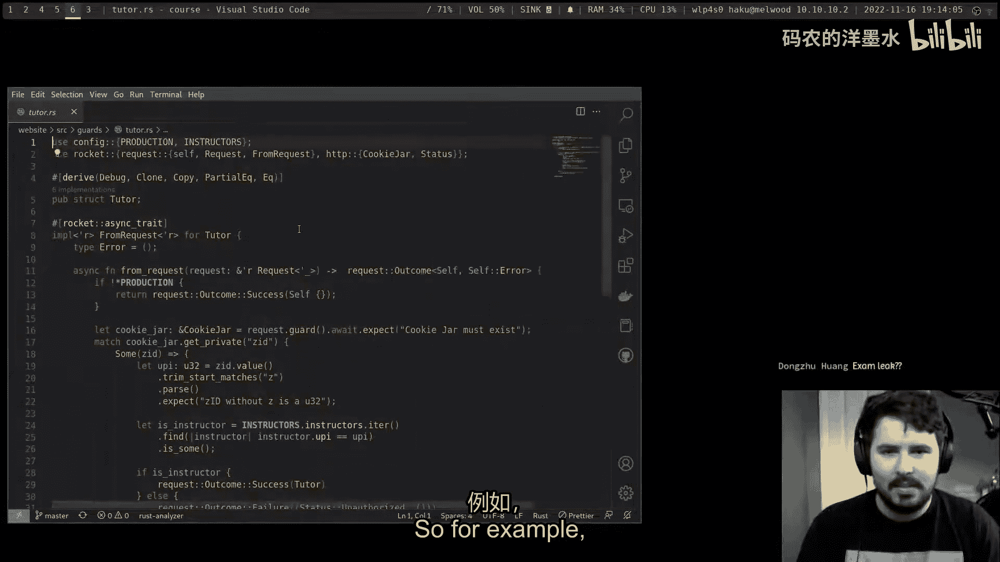

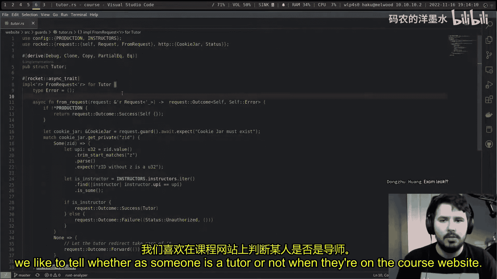

I blame CSC they okay，5 on the lectures page or whatever you can actually see there's this little login as tutor button down here which lets us access resources before they're released and that kind of thing and so how are we going to tell if someone is actually a tutor or not？

😊。

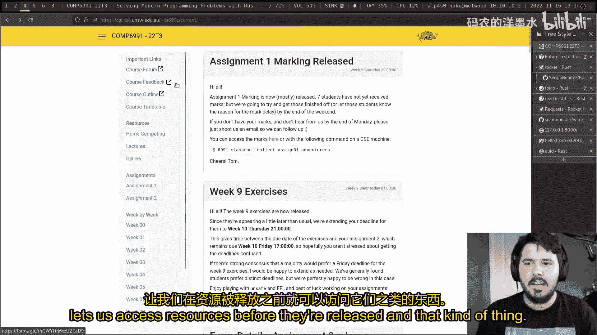

And so the idea is that we made thisstruct tuor， struck tutor that takes no parameters。

Right like this structure to doesn't actually hold any data， it's a zero size type。But the idea is。

 and this hasn't been implemented super that well。😊，Yeah。

 it hasn't really been done great necessarily because。

I actually would have preferred if there was something in here that's just like。Private is unit。

 that kind of thing。 but essentially the idea is that is that you the way you acquire like aruorstruct is specifically written as a guard on a request that basically goes check like if someone has a cookie。

And this is using something called Jason We tokens as well。

 JWT's Jots to make sure that no one can sort of cheat the system whatever。

 but like basically check in the request to the website if the person actually is a tutor from based on their cookies。

😊。

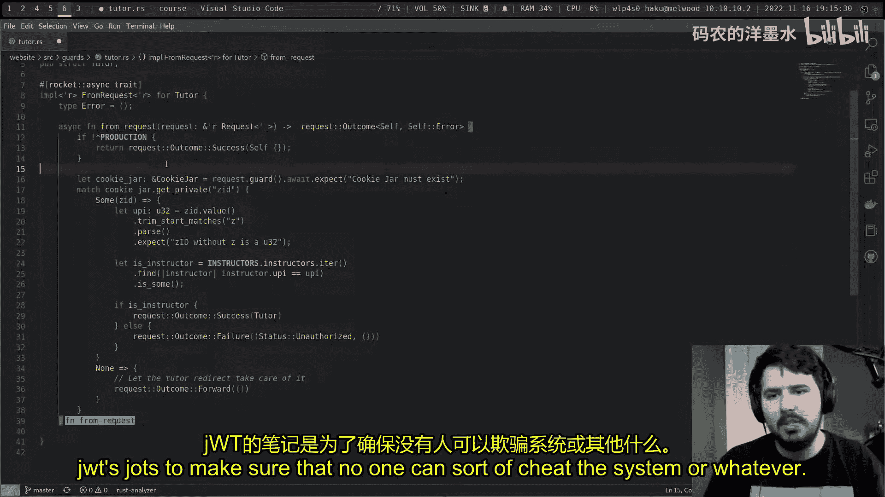

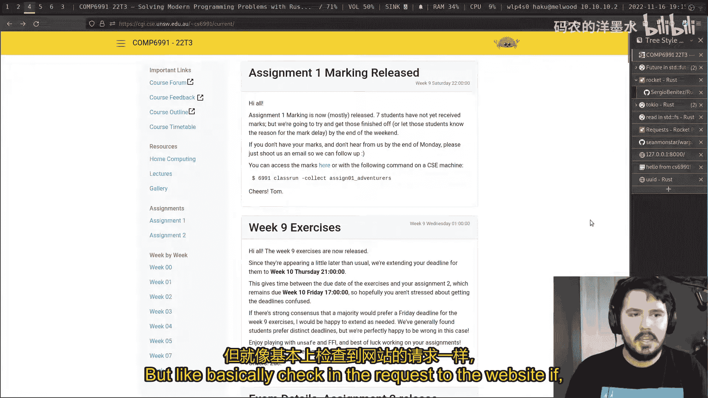

And if they are， then we create this struct for them to use， and if they are not。

 then we say that it's unauthorized。嗯。And then when we're creating like a request。

 like when we're creating creating an endpoint like hello。

 I could just throw in like tu tutor tudtor like this if there was， you know。

 assuming there's a strap tutor in here。😊，And what rocket will do is。😊。

When this function hello is getting called。😊，It will like， go and。Run this code over here。

 check if they're actually a tutor and then see if they can get the value to give to me otherwise if they can't get that tudor value。

 we know that this function could necessarily never be called because Ru doesn't just let you generate types like Willy nilly。

 you need to actually you know it needs to be instantiated properly somewhere。😊。

And that's sort of the job of this block of code here。

 it'll only ever give out the tudtor thing if they have the cookie and it's valid and they are a you know。

 a tutor for the course， that kind of thing。😊，And so it's a。

 it's a nice trick to leverage us type system。 And we can do a similar thing as well ourselves。

 So we could say。Like for example， if we're looking to create a paste or something like that。

We might like to， well， let's say， let's say we're retrieving a paste。

 We're going to want to store our paste somewhere。 So I'm going to make a folder here called Paes。

 which actually stores people's data。If we're retrieving a paste and we say， like。

 what's the paste you'd like。 and imagine that's some kind of string。 And then we say。

We'd like to say something like， you know， file open， you know， dot slash pastes。Slash their paste。

 that kind of thing。You can imagine this could be quite dangerous because what if the pace that the user ask for is not something like。

 you know， is is not something necessarily like。Like this。Right。

 they might not just ask for a pace like this， but they might ask for pace that's like。Right。

They could ask for this paste and then they go， okay， you know。

 the code goes sure I'll throw that right in there and then like it goes great。

 I've opened the file here's the contents and like the secret exam answers have all been leaked to everyone。

 right？😊，嗯。So。We could make some sort of data guard on rocket saying that hey。

 we want to like make some sort of type here， maybe it's like a paste ID and as part of this type。

 this paste ID type， which is really probably just gonna be like a string at the end of the day as part of like creating this will validate that is actually like a real UID and they're not up to any tricks like this and that way again we're leveraging rust we leveraging what rocket gives us in order to make a very sort of safe。

UU to make it a safe interface for us so paste ID， so this is going to represent some kind of face actually string is probably not really what we want and and particularly probably want a UUI。

 right？嗯。Hello， you U I Oh， you U I， of course。Like that。So if we'd like to do make a new one。

 we might like say Iple Pa studyd pub the new random。Which gives us a past idea。

And this is just going to。Construct a new self with UI new V4。Like that？

And so now we have a way to create a paste ID。And then we could say， like Pin。Like。Part2 file。

Which is going to give us a。like the sort of actual location of the where the file should be and that's going to be like dot slash paste essentially path。

 let's say path。From dot slash pasts。Slash。Actually， I might not need the join。 No， sorry。

 I I I might not need the the slapy rather。Thus slash join on。The UI is what I was looking for here。

Self dot 0。Dot2 string， maybe。Mmhmm。😊，And then path。fineine， whatever I'll just make a pass off。

Path path from this stop join that， I guess we could even do path path from dot dot join on the paste folder。

 and then they should we're looking for a file in there that's。You know。

 got the same name as the UI here。So that's pretty convenient for us now。All right。Cool so。

 we've got this nice paste I type。😊，And now we want some routes to be able to create a paste itself and to be able to retrieve a paste。

嗯。And so let's say we let's start off with creating a pace because it's going to be hard to retrieve a pace until we've created it。

I'm going to make a new post route。calledlled slash create， I think。

 seems like a potentially good idea。And then。We're going to want to take the contents of like。

 you know， if we go back to the the example that I was doing here。

 I needed to tell them the contents of my of the piece I'd like to make。

And so like how are we going to take that in， is that going to be a string。

 is that going to be something like that？😊，Sure， probably， but。

There's also another potential issue here， which is。😊。

What if someone tried to make a paste that was like absurdly large， I mean， I wonder， oh， okay， cool。

 I wonder if paste bin has a like a max size。How many pacee can I create？

What is the maximum past size，512 kilobytes right， What if I just tried to give them like 100 terabytes of data that I'd like to store in a paste that could you know。

 that could really ruin my computer or my server and so rocket naturally has some nice types to help us deal with this。

In particular， I'm thinking of data here。😊，Which is a type representing the body data of a request and data itself here is。

Pretty nice。 It lets us just sort of see these things as bytes limited to a certain limit here。

 So we can say let's stream as data dot open to maybeby bytes。

 Probably we'll just stick with what Pa bin says here。

 which was what was that 512 kiloB See more than reasonable for what we're making。

 That'll give us a data stream。 and it seems that we can。😊，rite it into a string。

 we can write into a V。 We can write into like， you know， all kinds of different things， even a file。

 that's not about an idea。Yeah， we could we could we could write a stream into a file straight away。

 so that's pretty cool。Interesting， all right so。Let's go create a paste and we're going to use this data thing here with a certain limit。

 have they got a little example， it seems they do they say data guide can be any types of influences from data and data this type here does implement from data as well。

So we could even make our own implementation of this， but I think there seems fine for us。😊。

So we need to say there's going to be a data parameter here。😊，Which I'm going to call the paste。

Then we'll say paste Tr， which lines up with that is a data。Rocket data like that。

And then we're gonna say paste dot open with a certain limit。Let's look at this bite unit thing here。

 It seems we can say one dot Gibytes or 256 kilobys。 Oh no， we wanted 512， didn't we。

 So I guess 512 dots。Kbytes like that。And this gives us back a data stream， awesome。

Data stream and we'd like to stream this into a file stream to stream precise to checked with existing file unchecked。

Stream to。A helping method to write the body to an asyncch right type returns and which indicates how many bytes were written。

 and additional read from may be required to check if all of the stream has been read。 okay。

No end of stream check is conducted and thus readwr complete and this is unknown Okay so this seems like the the easier one for us。

 this is async meaning it returns a future for us so we're going to have to think about that as well。

😊，So we're going to stream this into some kind of file， okay， cool。So。

I've I've mentioned that we're working within Tokyo。 Oh wow。

 the lighting has really gone downhill since I last looked up。That's a little better。Oh。

 I also just forgot to turn the room lights on entirely， okay。

 we got a slightly spooky slightly spooky last lecture。😊，Okay， cool。

 And so we'd like to create a new file。 So we're going to need a new paste I。

 So let paste I equals paste Id new random。 That's gonna to be our paste。😊。

Then we'd like to turn that into， that's not really， wait， pass to file， that's a horrible name。

 it should be paste to path is what I really want。So then we say paste ID。paststeade dot paste2 path。

 that's going to be the path to the file would'd like to make。

And then let file is file and note we're not using Studutter S file we're using well rocket Tokyo rocket seems to re exportport Tokyo as well。

 so we don't need to import Tokyo cells we could really do it either way here but we'd like to create a file with that path and this gives us a future。

😊，Future of like result of file。 So usually we'd say like file dot create and then something like expect here saying the path should be fine to create a new file in。

But this is not going to work。😊，We'll leave this for later， this is not going to work。😊。

It says no method named expect because it's an impple future。😡，Fortunately， the compiler is， again。

 as it sometimes is is quite smart and it says， hey， you might need to wait on this future。😊。

RightYou might need to wait on this future so essentially what we're saying is we can't really progress until this future is completed。

 so we'd actually like to say that we would like to wait for this file creation to finish before you should come back to us and keep doing what we'd like to do。

😊，But then we get another problem A weight is only allowed inside async functions and blocks so in order to wait on someone else's you know async function。

 right async function here or in other words， a weight on a future， we need ourselves to be async。😊。

Right， and then this， Okay， fine。 just wants me to。Say there's a lifetime there。

And now we've essentially like generated our futurists ourselves in writing async function and a weight。

 what the compiler is going to spit out is this create paste function is either going to be a knit with like paste a knit with paste is some data。

😊，And paste ID is some paste ID。And path is some path buff。And file is not going to be a file yet。

 right， So it's it's going to be this。😊，Or it's going to be like awaiting the file。

 like aing file create。😊，And it's going to store like all this stuff again。

And also here is going to be like the future that we're waiting on， you know。

 this is this indextax is not going to work， but like you can imagine something roughly like this。

We're waiting on this。And then like at this point， there's going to be then like finished afterwards here。

And then it'll also generate us like imp future for create paste where the output is what does our function return at this point it returns nothing and return something when we change it later and it's going to have poll with blah。

 blah， blah and you know work through these states so like a lot of stuff actually happens in just like a little bit of sugar here async and a weight but rust allows us to both have those lowle details when we like them but also just have a nicer developed experience when we when that's what we're looking for as well So in this way we now have a file。

You know，ve we've created a file concurrently right in a concurrent manner if this file creation takes a long time if there's really heavy file system contention。

😊，Then it's not going to stall the rest of the website while it's rating for this and like it's not going to stall our program at all in fact。

 because it's just going to do that in the background and then continue on when that comes back because again。

 Tokyo has done all this work to make that work quite nicely。😊，So now we have a file。😊，Paste open。

 stream into@ file。Now this probably needs to be much。Right， and now it says， oh。

 this is quite interesting。By the way， so there's a warning here。

 futures don't do anything unless you dot await or pull them R streamam2 is an async function。

 so this operation here like streaming the data into this new file。😊。

Is going to be asynchronous as well。 And so we want to wait for that to finish before we continue。

 there's also going to be some kind of result and we'll just I we'll say expect the data， the file。

Should be fine to write to with the data this could maybe like fail if we ran out of disk space or something like that。

 but I've I'm no longer at 95% I've gone and cleaned some stuff up so that's pretty nice。And yeah。

 and so now we've got two weight points and if we went back to the example。

 there's another sort of state in the middle now where it's like representing， you know。

 the next future that we're sort of waiting on at some point。😊，Oh， stream。

 there's a typo in the doc's PR time。Sream got him。😊，That's good。 Well done。 Well well spotted。 Okay。

 cool。 And so now I saw the paste in that file。😊，We' probably also like to tell them like the paste that they got back maybe we'd like to do this with something like Jason。

 Jason's nicely consumable data format， people seem to like Jason so let's throw Jason in there。

Version is this。Features is Jason。Cool， let's use Jason。Is that。see Jason for details。

 great Jason of some type cool， I don't know， we might need to pull in30 as well I'm not 100% sure。

 I guess we'll find out。😊，So we could say something likestruct。

 create paste response where it saysum paste ID is a。嗯。I mean， we could do a string here。

 but I think we could even just put a paste I in there like straight away。😊。

I think the DC I would honestly be fine for this。That is assuming that the disseralize for UID chooses to decsseeralize into a。

Into a string， but I bet it probably would。嗯。Bs oh， up in there。

 they probably implemented it manually。 Let's double check。 This Sims interesting enough。

 So let's see， struck U I D。How does it implement serialize deseialize or does it even， okay。

 it seems it does。And it seems。Oh， it sometimes it de serializes a string， sometimes it bitetes。

 but Jason doesn't really support bites anyway， so it probably turns that into some sort of string regardless whatever。

 let's not think about it too much then let's just write it as a string。😊。

So Pa I here is going to be a string。We'll derive serialize and decsialized rocket seems to re exportport those for us。

 which is nice nope it doesn't seem to it seems like that's busted。So that's fine。

 we'll just add in 30 ourselves cargo add 30， our favorite and also with the feature 30 derive like that。

And then this here is going to be。We'll grab those。And use So the serialreals de serials。 Huay。

 what is this。Unresolved ex stone crate。 That seems like it's freaking out over nothing。 Yep。

 it decided that's happy， cool。😊，And so now we could just say here。We'd like to return back， Jason。

Of a create paste response like that。 And it's gonna go， oh my God。

 it's not returning adjacent of create paste response。 I know we just haven't done it yet。 It's fine。

 Cate paste response where the paste I D is paste I D dot。

I guess we're just going to call two string on this。So say Iple display。For taste study。

Function format。Let's。Whatever believe it is that。Self dot zero， sorry。Yeah， self。0ro。

t format with F。Like that so' just saying in order to display a paste ID just display the UI like turn it into a string display nicely gives us the two string trait for free。

 so paste ID is now just past ID to string like that。Cool。

 how we've written an ascingnc function that does things nicely， concurrently that kind of thing。

 uses Tokyo File and this rocket stream to futures and again， these are like concurrent operations。

 but they all just work under the same interface， which is again really nice a really nice part of futures in my opinion。

😊，Okay， so let's see the server is launched。😊，Let's try。And let's try and make a paste。

So I'm going to to do this with curl， it's generally easiest if I just make a file first。

 so I'm going to make my paste dot text。That says hello from。😊，Compamp 6，9，9，1。Like that。

Then we're going to say。Where is I've。呃。对呀。We'll write Co。This URL here。No， not that URL。 In fact。

 we want。Slash create is what we've called it， actually we're going to need to add the route as well。

Create。Paste。Like this。 So it's going to be on slash create。😊，It's also going to be a post。

And we want to。Pass it。My pay stop text。So call this URL with all of that。😊。

And what we get back is paste I is this and in pastes。😊，Hey， we see a file here。 Hello from Com6991。

 Oh， no lag。 no， wait， but it seems fine now。😊，It's every time at like 7，37，40。

Even though I have very good internet。I paid the big bucks for very good internet。Anyway。

 I I can only assume it seems fine now。Because it says， it's fine now。呃。Is it fine now。

 no one's in the chat has said， actually it's okay now。It seems okay on my end， okay。嗯。No， yes。

 fine now， Okay， okay， all right。嗯。It's okay。 I think。 Okay， cool， cool， cool。 So anyway。

 the good news is I ran this query here。😊，Post with my paste dot text。 And it said， here's your UI。

 And over here， we got the hello from Comickna， which is the bytes that I sent it。

 So that worked fantastic。 And again。😊，It should be highly concurrentent and amazing。

20 seconds behind， I see， okay， awesome。😊，I mean， like not awesome。

 but at least it's better than being infinitely behind， I suppose， still catching up okay。😊。

So that's great。嗯。Now we'd like to we need a like we really need a way to get the pace back as well。

 that seems pretty sensible。So。So let's write something like this。A get URL， which is like。I mean。

 we could even call it get。OrYeah， get， I guess。Any have a better idea than get's I'll leave get for now and we'd like to take in like the paste ID as well。

In this URL。Paste I， well， you know， I could go use a string。That kind of thing again。

 but like why not' take a past idea。Right， why not take a Pa I。

 We're gonna have to do some work because it's gonna go， hey， I don't know how to use this。

 I don't know how to necessarily like use this as a parameter。

 but that's just gonna end up being something like a trade implementation。 So I'd like to say， okay。

 I'd like to be able to use Pa I。 The fact that I'm taking a pay I means that it must be a valid U U I D because it holds you I。

 You know， we get all this really nice type safety， which is great。

 So it can't just be any random string anymore。 And so now let's write a little bit of code Iple from parameter。

😊，For a pay study， so。Let oh from Prim to， let a paste ID be be used as a you know， website。

 HtTP post you know， just parameter in general。And I am going to need to say， if there is an error。

 we'll give you back， say a string。m， from Param， so we take we get a string。

 which it's calling tick A， which is not a lifetime， I guess I probably need tick A。

 tick A and tick A。And then we return back a result。

 either with a past I or an error that went wrong。 So for us， that's gonna look like， you know。

Would like to create a UI， So UI。From。Let's see is there from string， yes。Yes， that seems good。Oh。

 from start means from from， whatever we'll try it out with this parameter。

 And then if there is an error， Oh sorry， if it goes well， if we have a UI。

 then we can just turn that into a past I of that U I。If there is an error。

Then we'll ignore whatever they say the areas is and we'll just say。String from the。Inval。Pace I。

 not a UI before。Something like that。Great and all the types check and it's happy now。😊。

And so now if we go down here， we can just use a paste I here。

 and rocket will use that implementation that we've that we've written， which is again， very awesome。

 We'd also probably like to give them back the the paste string is maybe not。😊，The best。

 like the correct thing to use here。In fact， I believe that rocket knows how to just spit out the contents of a file。

But we might need to use a slightly different file we might need to say。

I think rocket has a all right， maybe， maybe it knows how to just use a cookie fileable trade out。

Just say give a file and we'll make this an option like if we， we could say give a file。 but now。

 as we know in Ru， we're always gonna have to give it a file， even if this paylet is maybe a valid I。

 but doesn't actually correspond to a real file。 So we'd like to say option。

We'll throw it to do it at the bottom side I up with these huge arrows。Um，And well， I mean。

 the good news here is that like paste I， we can now do pasteade dot。😊。

paste to path so let path be this and we don't need to do any further checking because we know that this is always going to be an okay path because dot slash paste is fine and then this like I mean we don't need to do like security checking stuff and this UI is only ever just going to be like these bytes that are in UI we've already checked all this stuff in you know the parameters and the types。

And so we can just say like， you know， file open the path。And and that's going to be future right。

 So okay， we need to await opening the file， we can't call weight because we're in a normal we need to make it asy。

 you know， this is sort of the pattern you go through。😊，And then， this gives us a。Result。

And like if there's an arrow， it's probably that the files not there， we can just use dot OK。

 which is a nice function on result that just turns it into an option just like。

Changes the error variant if you haven't seen okay before。You've been living under a rock， no。

Re here。It has a nice function okay， which just says when when you call resultO okay。

 it turns it into an option instead。Just forgetting whatever the error is。

 discarding the error into just a nun。And that satisfies our types and to me seems to hopefully like if and rocket would have a type error right now if it didn't know how to deal with the file。

 like if I just give it some random type。😊，Struck food。And then。I give a vaccine an option of food。

And。I comment this all out and just like leave the implementation blank。

We'll see that it doesn't like rocket won't respond with a food because it doesn't implement this responder trait。

 Again， I think it's a really nicely implemented library that makes a great use of what rust has to offer。

 And so we'll get a compiler error if it doesn't really know what to do with that type。

 So the fact that it you know， I was a little worried earlier is it going know how to deal with a Tokyo file。

 The fact that this compiling tells me yeah， it does。 So like we sorted。Retree paste。

We don't need to stock food， do we？And I mean， let's try it out。

So I guess we' let's you can create a second paste here。

And we'll see now we have two pastes that say hello from Com6 991。 and I'll grab this U I D。

 and I'm hoping that I can then say。Cal。Oops， create not create anymore， it's going to be slash get。

Slash。The paste I， yeah。And it spits up hello from Com6 991。😊，Yay。

 what if it's like a what if it's one that doesn't exist？Then we get 404 not found。

 and I can tell rocket to do my own 404 like kind of error that's maybe not HTML or something like that。

 but。You know， this is fine too like this， this hopefully gets the message across。

 We could even make this be Jason or something like that， like the other one。

 and if that's what we wanted， but you know。😊，This seems to work fine。

So welcome to 690 pasts and in here we could grab it， you know。

 a UI that had been given back in a response。😊，Get this。

And there it is and we've made our own paste bin with async rust and concurrency and it was I think not too bad and it's I think like a pretty reliable solution making pretty good use of types I didn't actually talk about this much before。

 but I really like things like this rockets rocket's written a attribute macro。😊。

That generates code from like this the like annotations that you know things like flask and stuff look like so I mean I think I might be able to say Tom's the expert on cargo expand and he was teaching me I think I can do something like this so just show me what the macro output of of this function here is retrieve paste probably going have to recompile it in nightly so again I get a nice little slap of warmth in the room while it compiles all the rust code again。

😊，Cool， and。Does it actually。I guess it doesn't。Where does this code end up？Paste I， paste to path。

 file， opener away okay。Rocket codegenative proxy structure。 Oh okay。

 so I think cargo expand is not really seeing it。 we can expand the whole thing。

 but I'm worried that it's going to be a lot of output。

 but maybe we can sift through it quickly just to see like roughly what it does with this get thing here Here we go。

 So here's what it seems to do。😊，So we have a retrieved paste function。 Then it generates thisstruct。

 retrieve paste， Iple retrieve paste and spits out all this code parameter guard of paste I D and blah。

 blah， blah。😊，You know wow， okay， lots of interesting stuff static info right so it puts that U in a struck somewhere。

 the get paste I that we'd like here and you know， this might look really kind of nasty the fact that it's spitting out all this stuff here and like what if something goes wrong in there？

😊，But the thing that should bring a little bit of like， oh okay。

 it's probably okay back is the fact that， you know all this is going to get sent through the rust compiler anyway。

 and we know the rust compiler is really picky。 So if if it spits out code that's， you know wrong or。

😊，You know， isn't going to work， there's a good chance that the compiler is going is able to catch something like that anyway because it all gets fed back through as opposed to it being as opposed to this whole process being something that runs at runtime that might panic or go wrong。

 you know。😊，U so yeah， but that's that's pretty cool using making use of macros to like you can definitely make use of macros to make your code a lot more complicated。

 no one's really getting gold medals for doing that because that's easy。

 but making use of macros to make writing code a lot simpler is certainlyum you know。😊。

Is an ice clap to rocket for that one for me？U。But yeah， that's our pace spin。😊。

I guess I'll delete one of these paste here。つcuse me。But yeah， I mean， that's like。This is， I mean。

 I guess one thing we could look at is using like， we didn't get to use Tokyo ourselves。

 I think do I use Tokyo ourselves in the course infrra。

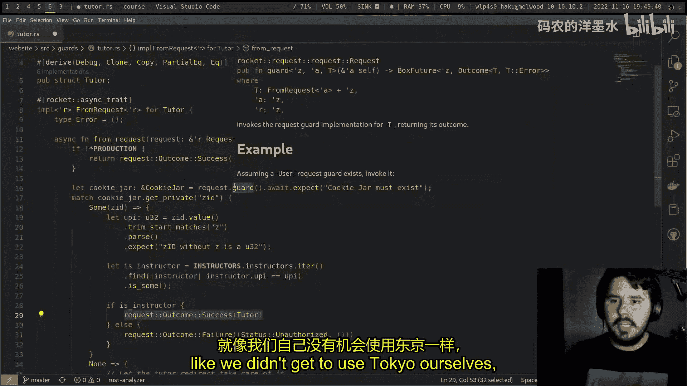

Because I have this feeling that I didn't do it this way。あ。Right， I do have。

 I make my own main function。 I guess we can try and see that。

 So I write rocket main async function main。

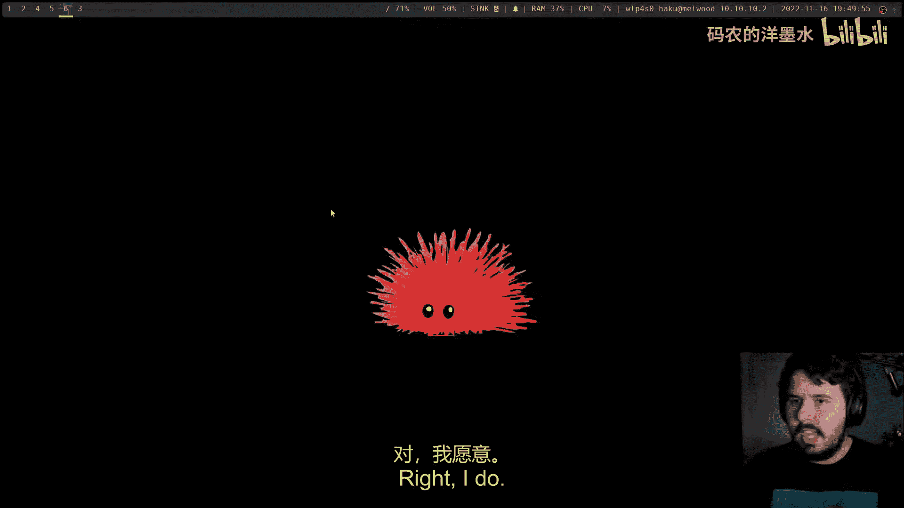

Result of unit or rocket error。And then I say。I'm going to you some of this。The website is starting。

 let me Rockers's Rock build Mount。Like that。And then。Rocket。tlaunch。 await。And okay。Like that。

 what does this return？A result of rocket ignite。 Okay， and we dont I guess we don't care about that。

 So if you like there's， there was a little bit of magic going on there before。

 this doesn't need to be mutable。 apparentlypparently it does need to be on oh I because I do some other tricky stuff in the course infr。

嗯。Right， and so this is like sort of pulling the hood back here。

 this is essentially the same as using Tokyo Maine。

 but I'm guessing let's see if rocket Tokyo main works。呃。Okay， okay， okay。

 So Tokyo it expects that Tokyo exists。 I could just。Oops， no， not Oi， Tokyo。And it's maybe happy。

 Yeah。 and now it's happy。 So like。This is like literally creating you know an ASInc program with the Tokyo runtime with the Tokyo runtime I spin up rocket and then launch that and rocket handles like delegating the requests down to these Async functions。

 Tokyo deals with all the scheduling and executing and event looping and all that overall these requests and stuff。

😊，And at the end of the day， I get this， this website would be able。

 this website would be really fast genuinely like if I wrote this code with flask and Python and then I wrote。

 you know， I have this version here， Rocket and rust。😊。

And I deployed them onto like the same server in the cloud。The amount of concurrent people making。

 you know creating paces and retrieving paces， you'd probably see a relatively sizable difference in the in the capacity of each of these servers and yeah。

 and where I think would be leveraging the computer probably much more probably in a more powerful way than would be you know。

Then would be easily feasible in languages where concurrency is a little harder you know to safely。

 to express in a way where you're not super worried that you've made a mistake， that kind of thing。😊。

So yeah， feelless concurrency。Felless and in this case， I think pretty easy concurrency。

 It's it like the compiler pretty much was able to guide us through whenever we needed an async or and a weight。

 We just go like call this and do some sort， oh， you need a weight here。 Okay， put the weight there。

 Oh， you， your function is to be async。 Okay， make the function async。 and like， okay， cool。

 it's working now。😊，So yeah， anyway。Pretty cool。U。Yeah， so that's it then。I mean， that's。

 that's like this is the last， like sort of cool little project that I， I， I wanted to。😊。

Oh I see rocket doesn't warning， rocket is executing instead of a custom runtime。

 use rocket main of a okay， fine， fine， fine， fine， fine rocket main， you're happy。😊，So。嗯。You know。

 this is that's basically our last little project that I thought would be a little bit of fun。😊。

I'll push it up to gi。I will。Oh， right， I just didn't scroll it far enough， yep。

I'll push it up to get。And that's it。No。This everyone's got to start crying now。 I mean， that's。

 that's， that's it。 Like this is， this is what async rust looks like。 This is me doing like a real。

 you know， a real world project in async rust。😊，嗯。And yeah， it's like there's。

 there's still things to be improved with async rust。 So， for example。

 things like defining a trait food that takes that says， you know。

 instead of saying function food needs to take a string like。And return a string like this。

 whatever saying that you would like to， they must implement an naync function is not something that's possible in the language yet。

 there are sneaky little hacks around this。😊，Where people have written macros。

 rocket again is just reexporting the macro from， it's one of David Toney's creations， a sync trait。

😊，Like this。And like you can just you know， we throw anc trade on this and now async functions work。

 but not quite as well as they will once the language properly supports them， So there is still。

 you know the language is still moving forward and improving and and you know working on features that are quite important for like the an entirely optimal developer experience。

 but most of the stuff is there and it's it's I think pretty pretty pleasing to write in general。😊，嗯。

😊，What would you recommend as resources to learn to further learn Rus to go after this course yeah so I think we should start a forum thread on this to be honest because I'm not going to be able to adequately answer this question。

 I mean to a degree that I find is adequate you know right now。😊。

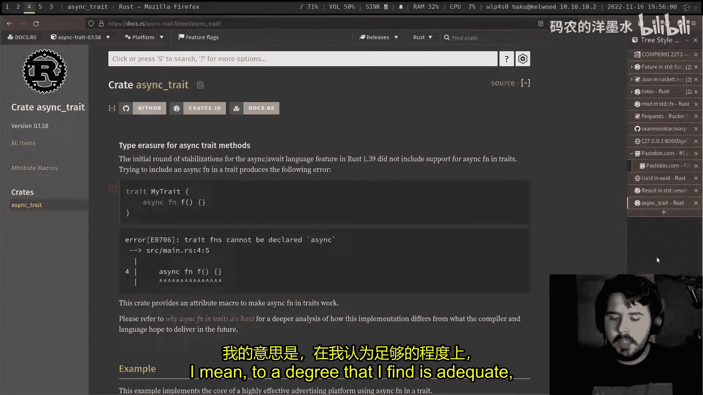

One thing that we recommend in the course outline at the very least， is resources for students。😊。

Now that we're at the end of this course， I can very strongly recommend， for example。

 these two books here， so there's a book called Rut in Action by Tim McNamara。😊。

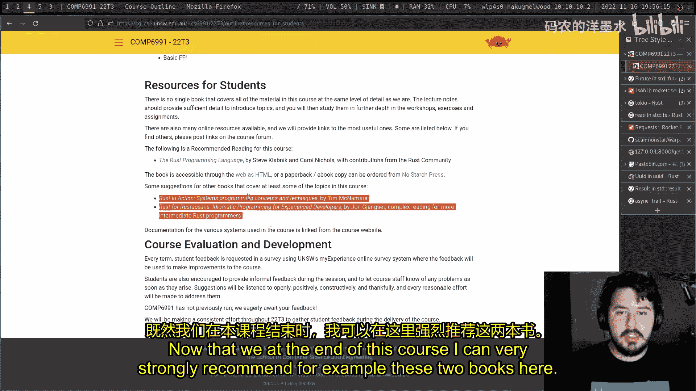

Um which is a nice book sort of towards the lower level of rust， building a database。

 an operating system kernel， a CPU emulator， this kind of stuff。

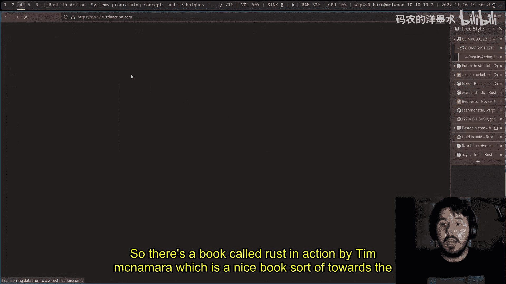

And is a pretty well loved book， but especially now at this point more than ever。

 rust for rust Asians is also a really nice pick， idiomatic programming for experience developers by our favorite John Jget。

😊，It's a it's like a more complex reading， but I'd say you're probably coming out of this course as like relatively intermediate Ru programmers。

 there's you know， still there's always a ton of stuff to like to learn and all that as time goes on and I'm you know。

 I'm still learning as well。But this is a great book to sort of continue on with you know what we've been learning types designing interfaces error handling project structure。

 asynchronous， unsafe concurrency and parallelism I mean we' we've talked about these kinds of things but but John really goes into a lot of depth and talks you know。

 it talks to a degree that we would aspire to talk about in this course as well So and David Toney also was the technical reviewer of this book David Toney。

 who was famous in the yeah the cover David Toney， who was famous in the Ru community for having written things like3di or async trait or sin or quote you know oh no。

 the stream is dying no buffer buffer buffer buffers in the chart no。😊。

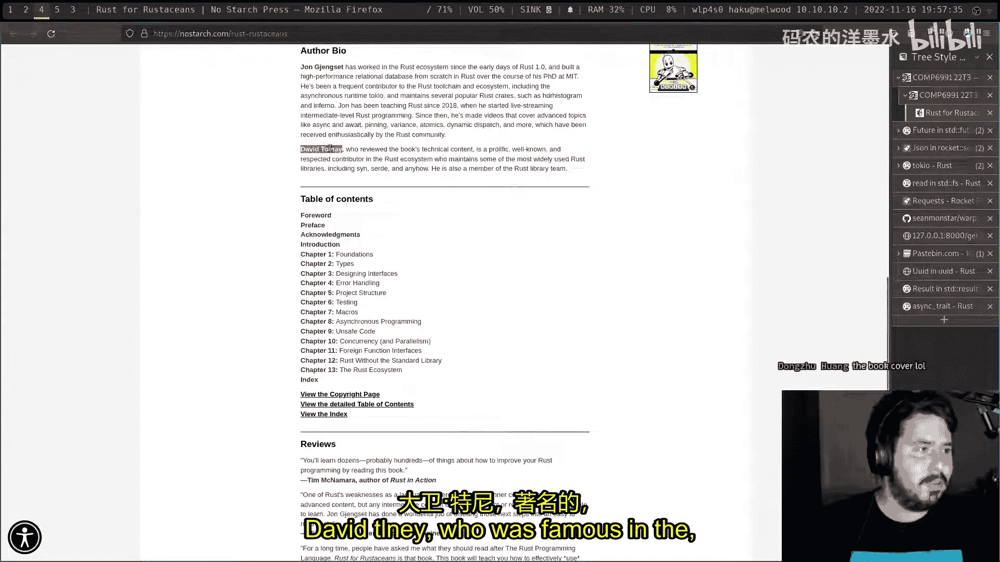

Okay， and it's fine， it's back。😊，But one thing that I can definitely recommend。

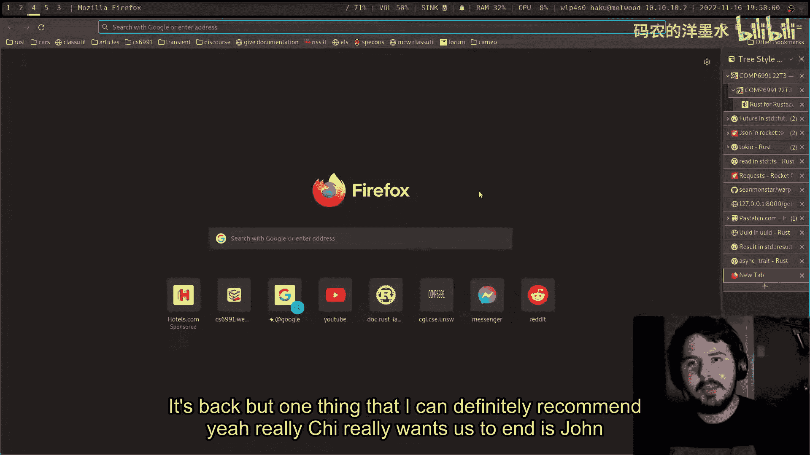

Yeah， really， YouTube really wants this to end is。

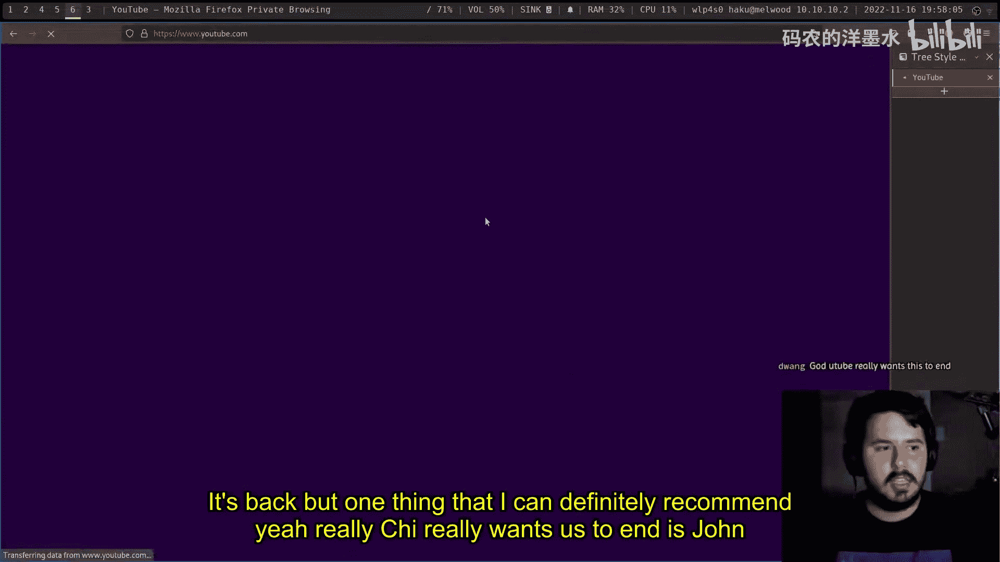

John， who has written this book， also makes a lot of fantastic videos。

 that's a funny thumbnail right there。Some fantastic videos a lot of which are sort of aimed at rust like that sort of rust intermediate level in particular crust of rust is a fantastic series crust or rust15 matches。

 Yeah that's probably all them。 There's 15 episodes of crust and crust of rust they're usually somewhere between one and three hours long just like go looking through the crust of rust bits and see if there's any that of particular interest to you So like oh I like ffi or send and sync or interesting to me or asyer weight or functions closures traits。

 atomics dynamic dispatch like di traits the drop check you know and this is like unsafe stuff here as well。

 Even this one sorting algorithms is just like John goes through and implements a bunch of sorting algorithms in rust in a way that he feels ziomatic that kind of thing。

😊，And there's new YouTube remotes， wow， nice。😊，So yeah。

 this is also another massive recommendation for me John's channel is fantastic and I know it doesn't say I'm subscribe but I opened a private window so。

😊，I don't leak all of my YouTube stuff。How do we study for the exam。

 I would suggest studying by doing the practice exam is a very good start。

 so do that the week 10 exercises where you can find it。😊。

I would also really strongly recommend coming to the workshops this week。😊。

Because have we released the workshop yet， yes， we have the workshop。

 workshop 10 is literally exam prep。And you're going be like coming up with questions and doing sample questions and that kind of thing if you want to。

 if you're like， you know， wanting to prepare a little more for the exam。

 make sure you come to the workshops because that's what the last workshop rather because that's what the last workshop is all about So for Tom Tom。

😊。

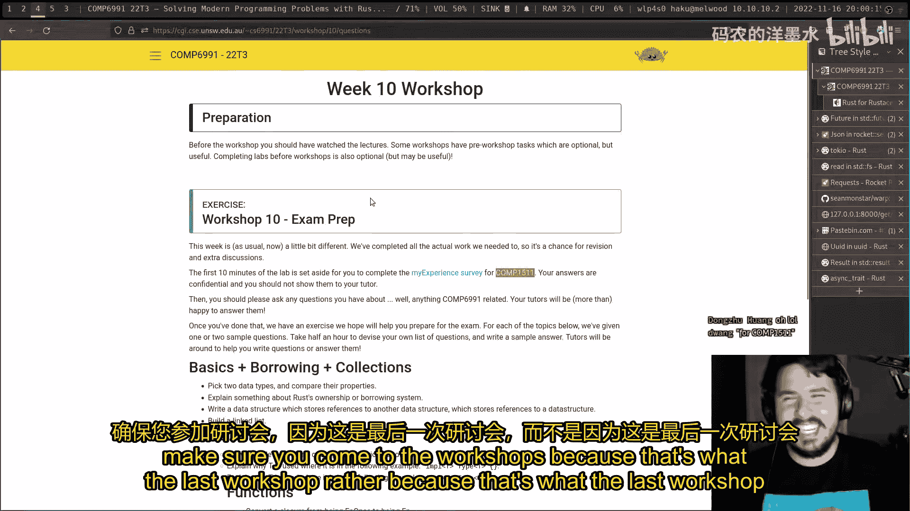

Oh， yeah， we have fun， don't we？😀わ。😊，はは。Oh， yeah， okay。Is there any Oh boy， Okay。

 I think that's fake data from one of the exercises， but I'm just gonna like play it safe。

 Workshop 10，1，5，1，1， what？😊，Oh， get pull。All right。Dam with Tom。😀はははは。😊，lectured chat caught you。

 Tom。

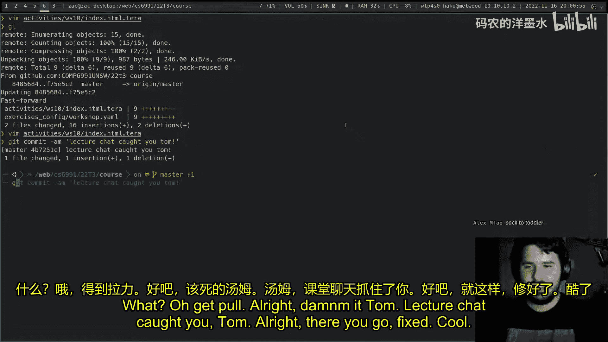

All right， there you go， fixed。😊，Cool。All right， vy， Yeah， v C。Um，Cool。😊。

So that marks the end of our last lecture。😊，It has been an absolute pleasure through the ups and the downs。

 you know， delivering these lectures over the term。

 Thank you for the people who sort of stuck with it。 it's funny with online course online lectures。

 I'm always like oh there's you know it's very nice having some people here to interact with every week。

 And I'm like， but you know it's usually only like you know。

5 to 10 out of 85 students also showing up consistently。

 but then I look look a few days later I'm like okay。

 it's got like 150 views now like okay that's you know I think people at least at least maybe like a subset。

 maybe like half the course。 you know， engaging with the lectures。 but you know。

 thank you in particular to all of you who have been you know have been showing up to the lectures throughout the term。

 And if you're watching their recordings then thank you for watching them as well and hopefully they were somewhat enjoyable。

 why is this。😊，Iスが。😊，Oh no， he hasn't terminated his list。😊，Oh， this wouldn't happen in Rus。

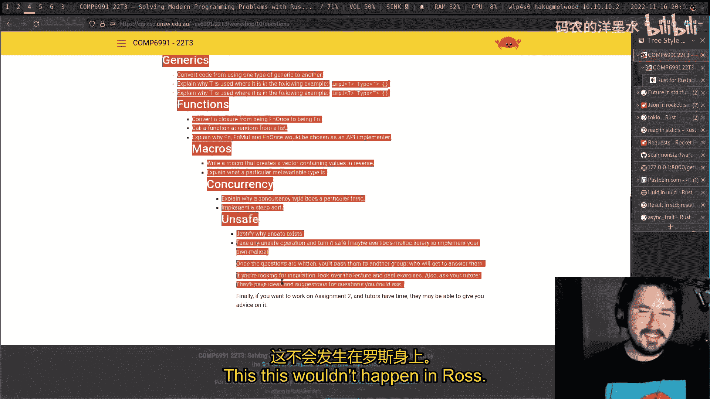

Oh， that's really funny。 but yes， thank you very much， everyone for u。

 for coming to the lectures and slash ally， No， no。😊，But yeah， I， I hope it was。

 hope it was interesting and fun。😊，嗯。呃。Got you again， Tom。😊，U it's a linked list， yes。

 it does look a lot like a linked list yeah， I think we've had a lot of fun this term。😊。

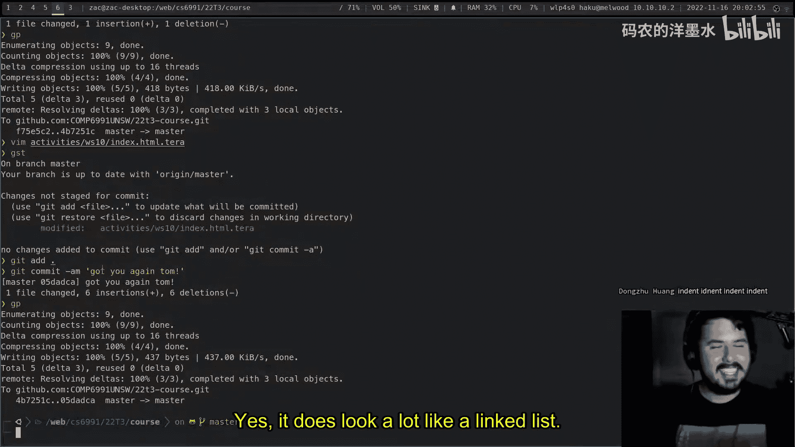

U and u yeah， but I mean， ask as many questions as you'd like on the forum。

 one thing we're going to recommend as well is feel free。😊，Maybe we'll put a。

 maybe we'll put a timer on this。 Well， I mean， I guess maybe we'll make a category on the forum。

 It seems like the appropriate thing to do We'll make a category on the forum。

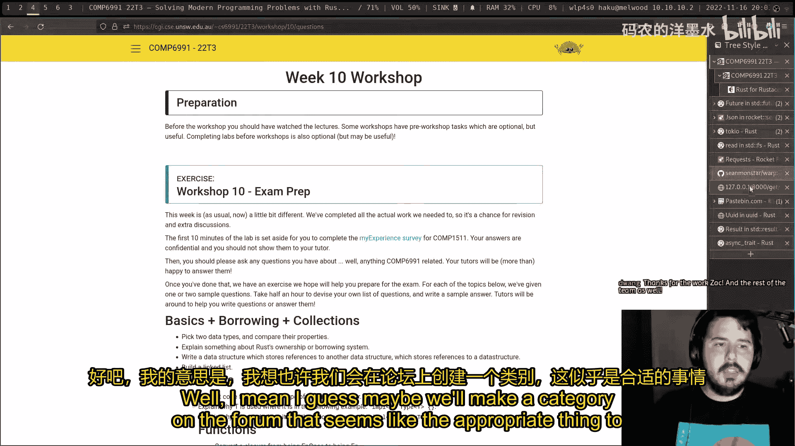

To feedback exercise broken memes workshops like just， yeah。

 so it'll make a new category called exam or something。

And you can like post like questions and answers so you can ask questions about the exam but also we'll be fine with you in terms of the practice exam this is going hey。

 this was my like written answer for PC exam question for part three or whatever and you know ask for feedback you know and then you can post your question and maybe have a look at a couple other students and give your own feedback and sort of you know make this nice little arrangement where everyone can give feedback on each other's answers and we'll come in as well and offer some thoughts as well so yeah that's another good thing to do in terms of prepping for the exam we'll make another category for that。

So thanks for the work yes and thanks to the rest of the team。

 I shouldn't need to be reminded about that， but a massive thanks as well goes out to the rest of the teaching team。

 Tom Sree who has disappeared at the very end but here here for the vast majority of it and then our teaching staff Kai Sage and Jared。

 a very big thank you to everyone who has been helping make this possible。😊。

And I am excited to see like， I guess three quarters of you in the last workshops because I'm not the online one。

 but I end up seeing I think the rest of the students。😊。

We'll see you all then in the workshops and yeah。😊，I guess， I guess that's it。Thanks， everyone。

And yeah， keep up the chat on the forum。And we'll be around and thank you for what has been a very。

 very fun term。Um， yeah， all right， we'll see you later in the week in the workshops。😊。

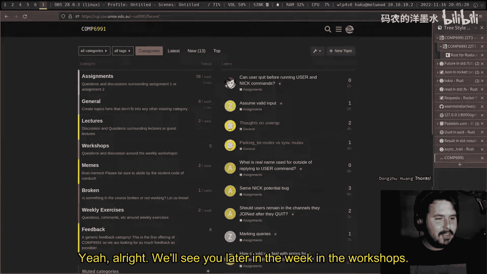

Bye everyone。 See you later。

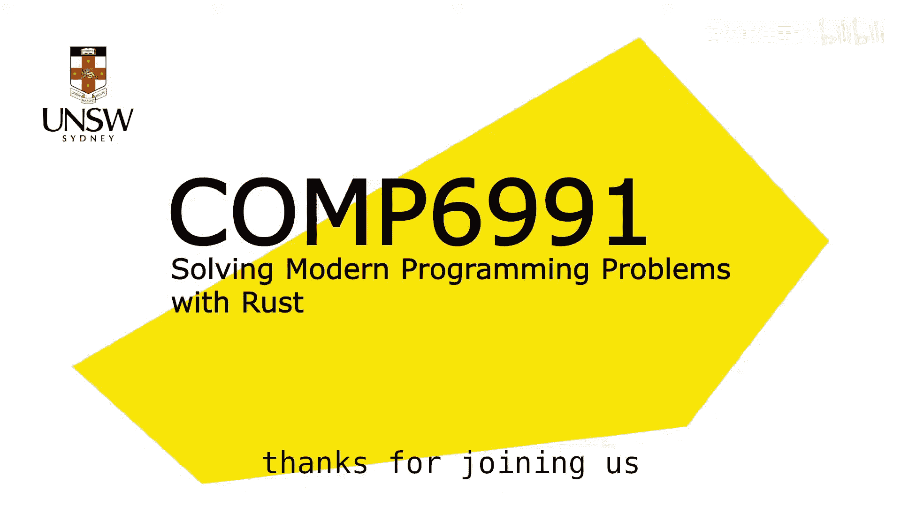