# 【全集】新南威尔士大学 Rust现代编程 中英字幕 1080P p19 Lecture 19 - 将Brainfuck语言实现为宏 -BV15cf4BCEN1_p19-

Okay。うん。Hello， hello。Hello， hello。Let me see if I can。🤧K。Uh I don know， the live chat is working。

It is there， I think。Let me think of about way to put it。I guess can no， it's gonna。

Overla with our window。H。Let's put the chat here。Something like that。

 hopefully that the code doesn't overflow too far。Into into the terminal。 So that should be okay。

 forcing everyone to subscribe with subscribers only mode。へへへ。😊，🤧ううん。嗯 already里。Okay， soll get。

 I'll give it like one minute。Give it one minute， and then we'll kick off。

How much code are we writing， I'm hoping the lines won't be too long is what I'm looking for。

Because what I've got about this much space。That's the gutter。

We might get some over might have to move the chat around a little bit later。🤧Okay。

So we'll get started then。Hello and welcome to this is going to be like a mini sort of talk stream。

 something in between feel free to type as much as you like and ask questions or anything like that。

 but there is sort of I have a path for this stream it's sort of not like a you know we're starting here and we' end up somewhere。

Hopefully we do actually end up roughly where I'm hoping we do at the end of this。

So it's a stream about macros macros in rust specifically。

 but also a little bit more generally about meta programming， the ideas behind it。

We're going to be making， we're going to be attempting to make a。A macro rules， macro and rust。

 which is。Well， it's not necessarily simple on its own， but。😡。

Out of all the different types of rust macros， macro rules macros are the simplest of the bunch。

 so we're going to be making one of those。And the idea is that this macro should be a。So I I。

 I forget how YouTube sort of。Works on these sorts of things， these words and stuff。

 I'm going to just a play it safe。 I'm going to call this language brain Frick。

And so we're going to be trying to make a brain Frick interpreter。😊，In one of those macros。Okay。

 I've got a whole bunch of things that we're going to sort of slowly look through。

Throughout the throughout the stream， throughout the talk， I'm aiming for around an hour。

 but I think that might be a little。That might be a little too keen。

 it might take somewhere a little more like it might spill over。

 I'm hoping it doesn't go longer than an hour and a half。

 but it might spill over a little bit we'll end up seeing I suppose。Okay， start。Where do we start。

 Well， there's sort of two main topics for。This this stream， which is macros and brain Frick。

 So it doesn't really matter to me which one we look at first。

 but I've got brain Frick laid out first here in my tabs。 So let's have a quick talk about that。

 So I'm going to make a big。

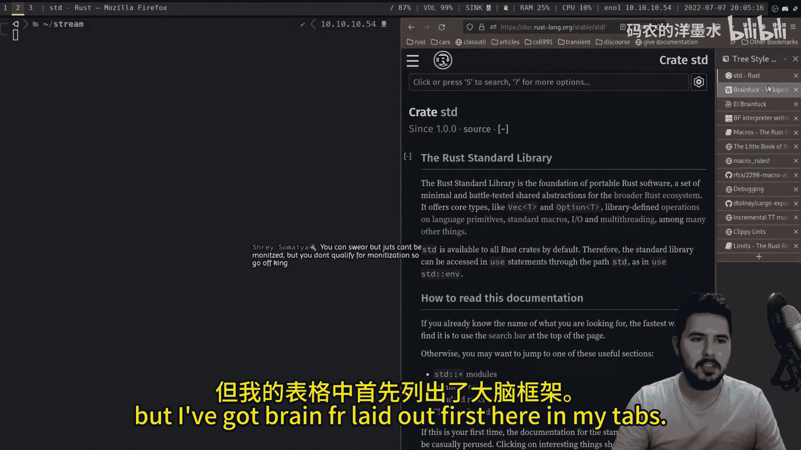

Brain Frick is an esoteric programming language created in 1993 by Urban Mueller。

 so an esoteric programming language， an esoteric programming language is a programming language designed to test the boundaries of computer programming language design as a proof of concept as software art as a hacking interface to other languages or as a joke。

😊，This is generally the one that resonates the most with me。

 esoteric programming languages are generally languages that were designed almost as jokes。

 I don't think there are any real。Eoteric programming languages that you would genuinely want to use for real software development。

 I think if that did become the case， it would cease to be an esoteric language and it would just generally be a programming language。

 I don't know， maybe some programming languages。Spawn out of esoteric languages。 insert like。

 insert random programming language that you hate here。 I， you know。

 I maybe C plus probably C plus plus was probably a failed esoteric programming language。 Ha Ru joke。

 So why brain frick in particular， There's， there's if I go to esoteric programming languages。

 I'm hoping that there's， yeah， examples here。 there's probably a whole list of esoteric programming。

 Yeah， list of programming language by esoteric。😊，There's this is a really short list。

 I believe there's actually a whole website devoted to esoteric programming languages and there are tons like。

😊，Hundreds of them， why brain freak？So brainfrick is a very as I would argue maybe the most popular esoteric program loans is one of the sort of most。

Not only popular， but like recognizable as well。😊，Because it's an incredibly simple language。

But its implications go incredibly far。 So braininf brain Frick didn't finish the word Brain Frick has eight commands and a command is just a single character。

So and the catchy name of course yes that's a very that's very true there are eight commands and a command is simply a character in the language so there's no variable names。

 there's no other text or whatever it's just these eight commands。😊。

A lot of brain frick compilers will also let you type other text in there as if you just want to sort of type comments or something。

 but you don't even need like a slash slash comment or a hash or anything like that。

 You can just type it in because it's only going to use these characters here。 I've written。

I remember this is quite funny。 I've written a couple nontrivial brainfrick programs in my time。

 and I remember I was writing a comment and I think I included a full stop in one of my comments that I was writing。

And my code was so obscurely bugged and it took me an hour to figure out I'd typed a full stop in my comment or maybe maybe a comma or something in my comment。

 And so it was like yeah that's a command And so it's fun like that Okay。

 but there's eight there's eight commands in Braf， so let me go through each of them。😊，First of all。

 there is a right arrow here， let me zoom in a little bit， there is a right arrow like this。😊。

Increment the data pointer， so okay， what's a data pointer？

Brainfrick operates on either a sometimes finite， sometimes infinite tape。

 sort of like if you've heard of a tuuring machine。

 you may have heard this kind of terminology before， you can just think of it as a sometimes finite。

 sometimes infinite array of bytes usually it's bytes， so  zero to 255 if we're thinking unsigned。

 which we usually are。So it's got this， let's say， let's say for now an infinite array of bytes and it has a pointer that's pointing somewhere in the array。

 usually they either most brain frick compilers will either start the pointer at the very left end or in the middle。

 we'll decide when when we get to that。And so and we call this sort of arrow here the data pointer。

 so this tape here with all these cells is the data and this pointer in the middle is the data pointer。

 so if your code has a right arrow it means move the data pointer one cell to the right。Right。

 so go from here to here。A left arrow is simply the opposite， move the data pointer one to the left。

Plus increase by one the byte at the data pointer right， so we're pointing here。

 there'll be a cell I should mention as well， usually the again。

 this comes down to each individual brain frick compiler or interpreter。😊，Um。

 but usually the tape of bytes all initialized to zero， that's the usual case。

So if they're all starting at zero and I say plus it'll make that cell that the data pointer is pointing at become a one if I go plus plus plus it'll make it you know go to  one。

2，3。The opposite of this is minus。Which decrements the bite at the data pointer right so I go plus plus plus one。

2，3， minus minus minus3，2，1。😊，And it's worth noting as well that usually most brainfrick compilers will implement wraparound addition。

 So if you say0 and subtract a subtract one from it， let's say minus here 0 becomes 255。

 If you go you know 254， add 255 add you'll get to0。So it wraps around from 0 to 2 55， usually。

 that's what we'll do for ours。ThereSo halfway through the whole language， right。

 this program is is to do a halfway through all of its functionality。There is the dot command here。

 which says whatever we're currently pointing at， take that cell。

 interpret that cell as an ASI character。 right？ So if I go man。

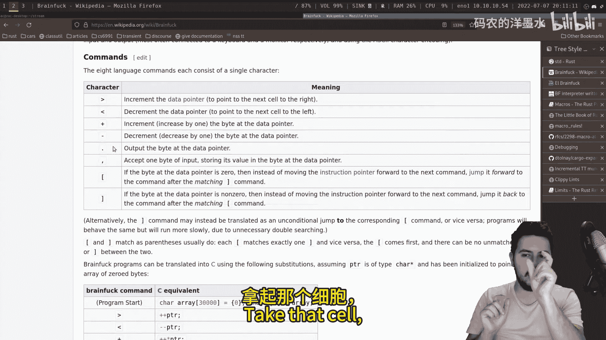

A man，7 ask you。There we go。 If you've seen the ASI table before。

 it basically just provides a mapping from numbers into corresponding characters。

 So if I said dot and the cell at the current data pointer that the data point is currently pointing to had the number 75 in it。

 it would print an uppercase K and you've got all your favorite characters on here。

 unfortunately Brafrick。😊。

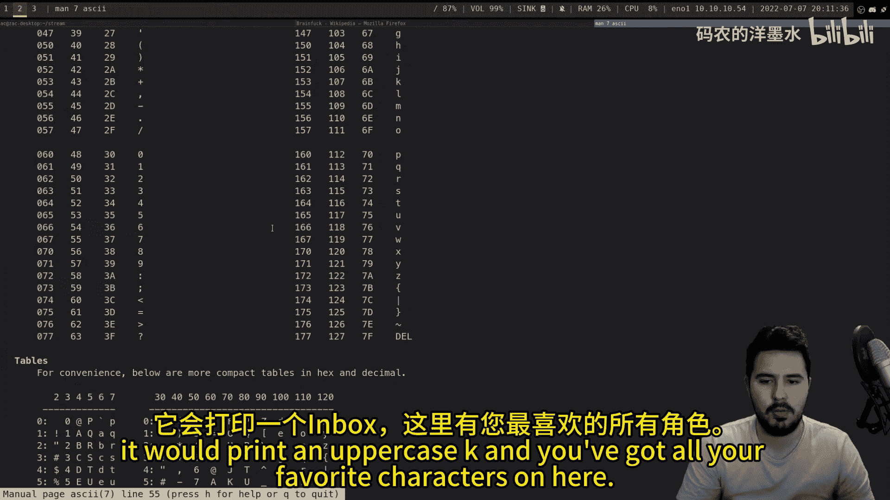

As to my understanding does not have Uniicode support， so no emojis。

 although maybe you could make it work actually， but anyway that's beyond our scope。

And then there is the comma command， which is sort of like the opposite of dot instead of outputting at what the data pointer is currently pointing at。

Instead we will accept one byte of input， so read a byte of input from the terminal and store that ASI value in the byte at the data pointer。

 so I'm pointing here， there's the box and I type in the letter X。

 x is converted to its ASI number and it's stored in that cell there。75% through the whole language。

This is really the special part of brainfrick， we have left the left square bracket and the right square bracket。

😊，And this says if the byte at the data pointer is0。

 then instead of moving the instructor pointer forward to the next command。

 jump it forward to the command after the matching square bracket command。

Wikkipedia's description here is actually of the ladder is a little more complex than it actually needs to be and they note that down here。

 I'm you know I can't really cover this up with my hand sadly， but don't read this。

 just read the right closing square bracket as meaning unconditionally jump back to the left square bracket。

Right so they actually have a sort of C equivalent down here at the bottom。

 this is our infinite you know not really infinite hours in rust also won't really be infinite。

 but they have 30，000 bytes here array all initialized to zero and they have a pointers they want to starting at the beginning of the array as opposed to like the middle or something。

😊，And they say incrementing this pointer here is right arrow。

 left arrow is decrement the pointer plus is。Get the thing。

 get the value in that array that the point is currently pointing at and increment it。

Deecrement it for minus。Put cha the thing in the array there with dot， get cha with comma。

 so print out orll get one in and this is the one we were just looking at here and this is the reason I've scrolled down to this now。

This is essentially what it looks like When you have a square left square bracket， it says while。

And if this pointer is something non zero， if the thing the pointer is pointing at is non zero。

 it will go into the body of this wire loop right and the body here is really just going to be like。

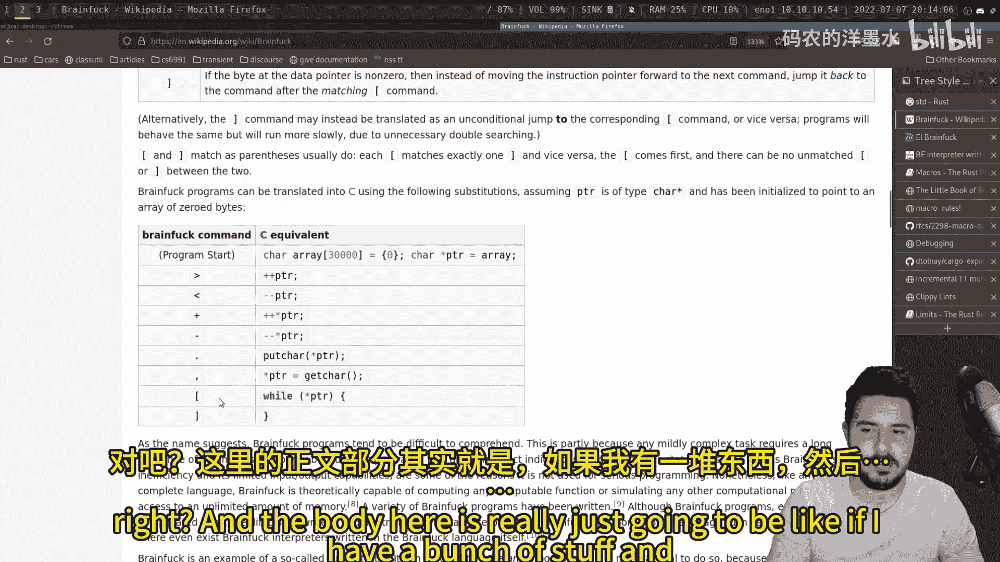

If I have a bunch of stuff。And then a closing one。It's going to mean like go and do all these instructions here until eventually it will get to this one here。

 unconitally jump back to that and check the current bite at the data pointer again。😊，And eventually。

 hopefully， unless it's an infinite loop， this will eventually end up being zero and it'll continue on to whatever other commands are you know out here。

😊，Right， it'll continue on this way by skipping past。😊。

This is also interesting because you can have nested square brackets， so something like this。

 and this is just like a nested while loop can see this square bracket matches with this one。

 this square bracket matches with this one。

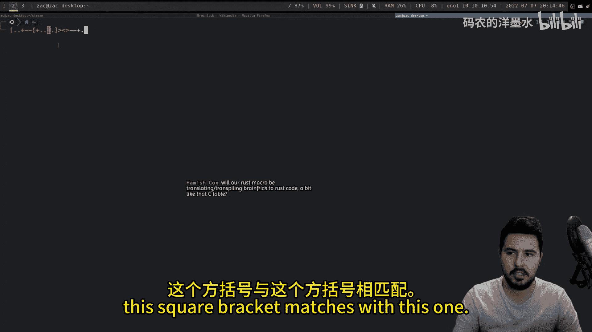

Okay， and that's the whole language。Really the whole thing。

 So why are we interested in the first place in a language that's that's got this little going on and is this simple？

The general answer here is that it is fully chewing complete。

 which essentially means that this is going to be a drastic oversimplification。

 but you can basically compute。Arbitrary things， can you can create arbitrary programs。

With in brainf。So if you have some sort of like really complicated algorithm that does all this super smart stuff and it took you 100。

000 lines of C plus plus as long as your input and output follows what brainfrick can do here which is essentially outputting bytes and input and accepting bytes of input which I think realistically most programs can eventually boil down to Brainfrick can compute whatever you computed in those 100000 lines of C++ it's incredible this was a lot of work in the 1900s went into sort of the theory behind computation and this is just about the most minimal language you can have that is cheering complete in fact it's。

😊，It's quite a moral representation of a tuuring machine in the first place。

 but the really interesting point is that。😊。

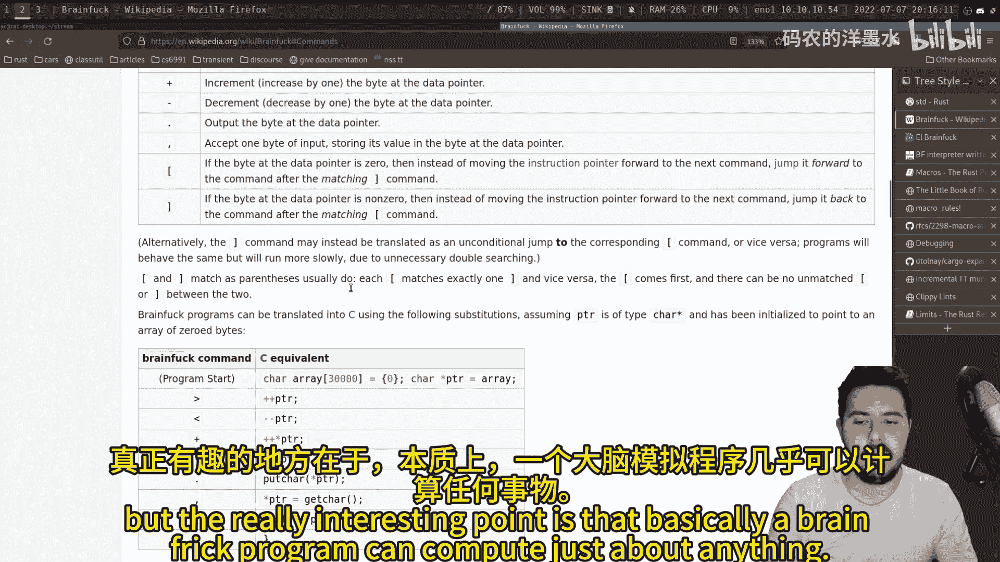

Basically， a brain Frick program can compute just about anything。

So if I look at a brainfrick interpreter written in JavaScript on the web。

 you can see here I've loaded in this program， which is， you know pluses。

 so increment the data pointer， we've got some sort of a loop going on here with all this stuff inside you know。

 moving the data from around， plusing whatever。All that stuff， and when you run it。

 it prints out Ho welt。Like this program is hello worldd in Brainfrick。Which is just incredible。

 I haven't looked at a whole bunch of these。 Be dot B sounds interesting。 look at that。

 This program does the whole 99 bottles of beer on the wall。😊，And it prints out。The whole。

 the whole sort of song from 100 to0。Oh，quine， that's good fun。

 This is a program that prints out its prints out its own source code， which is really fun。

 if you want to like have a nice challenge you know on a rainy day。

 grab your favorite programming language and try and write aquine。

 a program that prints its own source code and you're not allowed to just read the file。

 know reading your own file and just spinning it back out you have to do it all within the code itself。

 which is very cool as well。 but there's all kinds of like interesting things。

 This is a Sinsky triangle looks like which oh wow。

 the program has been written to look like a Sinsky triangle。😊。

And it prints out a Sinsky triangle with out of stars， which is very。 There's all kinds of， you know。

 brilliant examples of brain frick programs。One really great one as well is this。

 this is a brain Frick interpreter written in brain Frick。

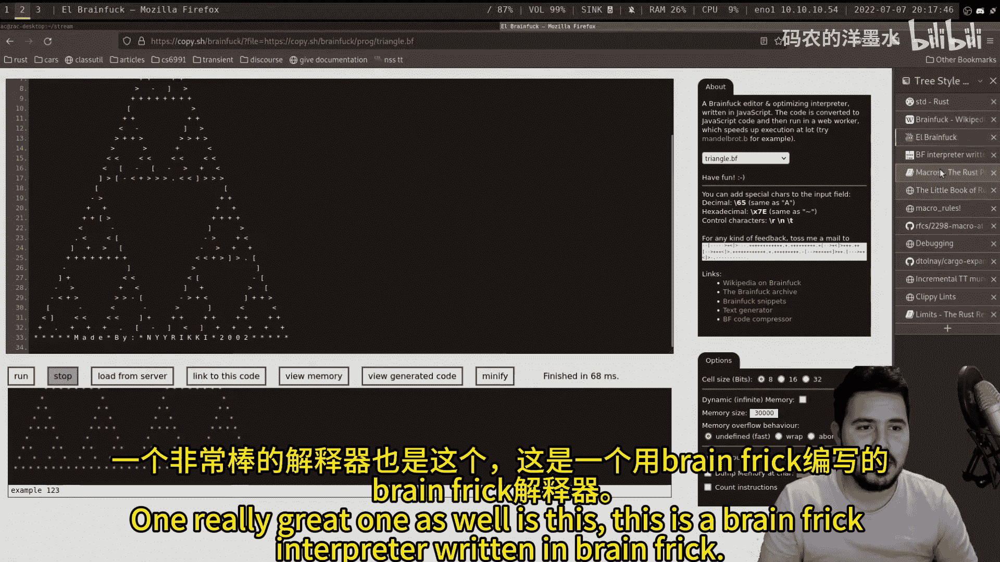

So the task that we're about to do in rust， someone has actually built a brain freak interpreter。

 so this reads in。😊，Brain frick characters on standard input and then executes that as brain f code and spits out the output。

 So the brilliant thing is， once we write our interpreter。

 we'll be able to feed this brain frick code in and then feed in brain frick code into that one。😊。

And then it'll go through you know and do that work， so this is very fun to play around with。

So that's Brainfrick。And next we'll have a little look at macros。

 so will our rust macro be translating slash transpiling brainfrick to rust code a bit like that C table that is absolutely right。

 yes。😊。

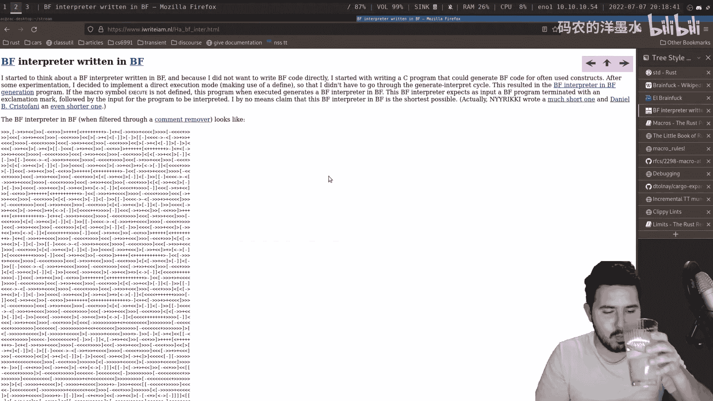

Okay。Cool。So macros in rust。😊，What is the idea of a macro if you've used rust a little bit？

You may have seen macros around the place you've probably used macros a lot。

 whether you know how to write one or not。and they're an incredibly powerful tool。

 they're of course a tool that can readily and easily be abused as I am certainly guilty of many a time。

😊，嗯。But they are they are a seriously powerful tool that often you don't really get there's a lot of mainstream languages don't have this kind of functionality built into them if you are something like a Lisp programmer。

 if you' like Lisp or any of it sort of any Lisp be sort of spin off then you're probably very familiar with this kind of idea and if youve used sort of Cs hash defines a little beyond just sort of trying to hash defined constants。

 you may be sort of you may have play it around with the idea。And it's all a similar sort of premise。

The premise is a macro essentially is a function that takes in source code and spits out source code。

 right， It's a function that you give you type source code into and it will actually spit out。

 but probably new source code， different source code。😊，Right？Okay。

 let's make a new cargo project so we can start to play around some stuff。

 let's do cargo new old brain Frick。Nice， cool。Okay。

Don't mind my editor just going crazy in the background there， so notice。😊。

I've just created the new cargo project and there's already a macro here。

How do we know we see a macro， It's this little bang symbol here。 So if it was just printlin here。

 this would be a function call。 Prilin would have to be a function whenever you see the bang character after。

After something that looks like a function name in rust， it means what you're calling is a macro。😊。

So Prilin is a bit of a gnarlly macro。There's a lot going on with it。

 But let me show you a more simple macro and rust that you'll。

 you'll have used if you've done sort of even relatively basic programs in rust。

 And that is the V bang macro。 So if I say let my V equals V bang of 1，2，3。

And then let's change the printprint line here to be， let's print out my V。Like that？

Let's see what this program does if I go cargo run， you'll see it prints out 1，2，3。

 so Vcbang is a macro that takes in some source code like this and generates us。😊，A V。In this case。

 I've got a Vec here of I32s。 A Vec is if you've played around with other languages。

 it would be called a Ray list in Java list in Python vector in C plus plus if we need some more equivalent if someone sort of needs help translate into their language I can try and ever think and see you would probably have to implement something like this yourself or pull in some sort of third party library but it's basically just a container that lets you store an arbitrary amount of values in it。

 you could have nothing in it， you could have 50 things in 100 things in it on and upwards and it can resize dynamically so you can just keep adding more and more things or take things away and so on and so forth。

嗯。So， yes， and the F string thing is actually quite new。😊，Okay， so。

How so how would we create a V with the elements 1，2，3 in it if we didn't have this Vex bang macro。

I would have to write something like this， let mute my V equals a nu vector。

I would have to say push to the back of this vector one。Push to the back of this vector2。

Push to the back of this vector 3。Right， this will do the equivalent so if I print this out here。😊。

You'll see I get the same output， 1，2，3，1，2，3。These are， well this is。

 it's very slightly not true based on this being a slightly complicated macro on the standard library。

 but for our to and purposes， this is essentially the truth here。😊，The interesting thing， though。

 is this， my Vck， I didn't have to say it was mutable。 right， So if I went to say。

 let me try and push。Or on the end of this vector， it'll say， no。

 I can't do this because you didn't declare it as mutable。But if I try and to adhere on this vector。

It's perfectly happy with it， which is maybe not something that I want。

 so I can actually restructure my code a little bit here to look like this。 Let mute my V equals。

 and then I create a new block here。😊，I'll grab all of these oops， that's not what I want to。

All of these。And put these in the block， I'm going to call this one here， let temp V equals back new。

And then I'm going to put1t V at the end here。 These， of course， are all gonna need to change to。

It's being with today。Let's do this。T back。Great。😊，And I'm going to need a semicolian here。

 there we go。And倒 make个 me。Okay， so what this code here is now saying is like got to not going smaller anyway。

😊，Create a new temporary vector with vectornu and it's going to be mutable。

 push all these elements into it。 And then this here at the end。

 this is something that you may not see in a ton of other languages。

 you may be familiar with this if you come from languages like Ruby potentially is the since notice this doesn't have a semicolon on the end of it。

 right， If I put a semicolon here， Rust is still happy with this。

 but it's just going to print out nothing at the bottom here。😊。

When I get rid of the semicolon and you'll see it prints up this so this not having a semicolon actually means something important what it means is since I say let my Vc be equal to this block of code here。

😊，All right， this block of code here。My V is going to end up evaluating to this temporary vector at the end of it。

So you can almost imagine this as saying my Vc equals， do all this stuff。

But like really this thing at the end and notice I've gotten rid of the mute here。

 So if I then tried to save my V dot push。4 on the end now， it'll say no good。 It's not mutable。

 And so we're back to sort of where we wanted this originally。 If I actually wanted to do that。

 I'd have to put a mute out the front here and then。

It would be happy to put the four on the end there。Sir。Let's imagine we didn't have Vec bang。

 and we wanted to write it ourselves because this is a bit of like。

 this is annoying to type if you want to do this like a lot， which youd often do in rust。

 You want to create a bunch of vectors with stuff already in them and all that。

So this is going to be our first macro。To declare any macro， we write macro rules。

And we need to give it a name。 I'm going to call it。I want to call it my V because we。

 but weve already used that there， I'm going to call it DIY V。Because we're doing it ourselves。

All right。 And this is the general syntax for declaring a new macro。

So we start with macro rules and this is a simple macro。

 there's all kinds of special macros that you can read about all yourself。

 but this is the simple form of macro， the name of the macro is DIY V and all this stuff in here。😊。

Is going to be the contents of this macro。 macrocros are made up of things called rules。

 So this here is a single rule。 It has some parentn there。

 It has an arrow and then some braces in a semicolon。We can have as many rules as we want。

 so I can go rule， rule， rule， rule， rule and make a whole bunch。😊。

And these might match sort of different inputs to the macro， which we'll see in a second。

Why would you want to do what the block as opposed to just shadowing the earlier my vector or is this just because it makes more sense with the macro Yes。

 you absolutely can shadow it just like that and that will shadow away the mutability and yes。

 you have noticed that this is for it makes the translation to the macro here a little more clear in a second。

 so absolutely right。😊，Okay。So。How does this macro syntax work here then， Well， like I said earlier。

 a macro takes source code。It takes source code and then it spits out。😡，More code in this case。

 the source code that it takes in doesn't necessarily have to be like valid rust code right like if I just typed in one。

 two， three， one comma two comm  three。Russ is obviously going to get upset at this and go。

 I don't know what this is， right？So it doesn't have to be actual rust code but it does need to tokenize。

 which is a bit of a weird fancy word， it means that rusts sort of very first stage of the compiler needs to be able to make a little bit of sense of it。

But as long as it can do that， as long as it can break it into sort of little tokens and stuff。

 then you can pretty much go buck wildil on what you include in the body of a macro。😊。

UAnd and generally in a macro， however， needs to spit out valid rust code。

The macro needs to spit out rust code， which it'll get turned into。I'm okay。So。

How do I actually take things in here， Well， let's say have a look at this。

 Let's say I wanted to make a macro that will say if I have equally equal equal。 if I typed that in。

 I wanted to spinit out some code。Let's say spell out some code that prints and it'll say。Equal。

 I don't know。 something like that。But if it sees the tokens。Let's say minus minus minus。

 something like that。Then it'll go printlin。Oh my God， minuses。

Something like that and a semico on the end， just like that。

So if I wanted to use my DI V macro rules here now。😊，I could pos it equal equal equal。

I could pass it。Oops。Minus minus minus。And if I run this。You'll see it prints out equal。

 oh my God minuses。But。It's this is the， this is the very tricky thing to see here。

 This is not calling this macro at runtime。 When I run the code。

 it's not going and like passing in the equals like a function would and saying that this is all done。

 This is all substituted by the compiler。 So a really nice way to get your head around this sort of stuff is with the cargo expand crate here。

 jumping ahead a little bit。 So cargo expand is made by the legend himself。 David Toney。😊。

And if I run cargo expand。So I will let me move this away for a second。And where am I？I here。

If I run cargo expandand on this， cargo expandand will take all my code。

And expand away all the macros。 So in this case， this notice this code hasn't been run yet。

 This is my code here。But the code at the top here has is no longer equal equal equal minus minus minus that stuff is all gone instead has been turned into。

 it would have been turned into printlin bang。Right but that itself is a macro。

 and so its that macro is expanded into this code。 and this code here says print with the word equal or print with the word。

 oh my God minuses。If we also look at a little further down here。😊，This is the。Vec bang code here。

 Not we have let my Vc， V of I 32 equals。 All that will stay perfectly intact right there。

 But this Vec bang with all this stuff inside it has turned into this code here。 right？

 It's a little complicated。 but we'll make a simpler version of it and see this happen ourselves as well。

 So cargo expand is very nice for looking at how macros sort of end up。

 Does it care about white space。 Could you do D V minus minus minus， So let's have a look。

 minus minus minus。😊，And if I run it。Oops， not PwD cargo run， it still says equal oh my god minuses。

Right so it is white space agnostic， but you have to consider that sometimes the white space will affect how things tokenise so for example。

 if I wrote hello and world this is two separate tokens。

 the word hello and then the word world in this case we'd call them id as opposed to words if there's no white space here this would just be one token。

A little more， a little more sort of like code like and a little bit less maybe a little less obvious。

Is。If this， in fact， here。Well， let's say， let's say if I did equals and then a greater than arrow。

If I write it like this。Then these are two separate tokens。

 equal token and then a greater than token。But if I did this way， then it's an arrow。

An arrow token like this。 So it the white space can affect the tokenization。

 but if it doesn't affect the tokenization， then then it it's。

Then the white space doesn't matter if that makes sense。

So the one thing I wanted to point out here is what if I give it something that it doesn't like？😊。

Like just food。Then we'll get an error So if I go， you know cargo expand which will build my code says no rules expected the token F。

 no rules expected this token in the macro call So when calling DI Vec it didn't know it went through this rule it went through this rule and it got to the end and went I don't know how to deal with F and so it gave up。

So again to recap， macro takes code in in some format and spits code out and it spits rust code out。

Okay。So how can we actually make this do anything vaguely useful， let's say。

 so let me grab this one back。😊，The idea here is that we can't we don't need to just put actual tokens here。

 like I've written actual equal signs and actual minus signs。But I can put sort of。

 we call these captures variables that represent some kind of token。

 So if I go to the macros book here， they actually， no， we'll go to the next one here。

 which is the little book of rust macros， which is a very cool little book。😊，Little book。

 You can Google for the little book of Rus macros and you'll stumble upon it。

 And it basically goes through a whole bunch of。Trickery and information and all that about macro rules macros and rust。

And I'm going to go to the macro rules section， which I believe is a way to go here， macro rules。

And if I scroll down a little bit we'll get to captures here and these are special things that we can capture within our macros so have to find you cant your foot in itself treat yourself the foot cr easily because you've got to get through the compiler folks that's true Rus does some nice things like they're partially hygienic and stuff which。

😊，I'm not gonna get into in today's little stream here。

 but there's they're a little more robust than something like a C hash define Does doing DO Vc bang minus minus minus with square brackets work or does it have to be pre that's a great question So if I oops。

 that's not what I want to do if I swap these for square brackets。😊，Oops， replace。

 let's go bracket for that。 Does it still work。 And the answer is yes。

 So it's actually convention how you can call it how you call your macros and you can choose one out of par。

 square brackets or braces and Rull always be fine and happy with it。😊。

So that's just completely conventional and to a certain point also comes down to like preference as well。

Allright， so。Let's see， how can we use this to make our Vec macro。Well， if I look down here。

 I've got an item which might be like a function， a structureor module， a block， a statement。

 a pattern， an expression， a type， an identifier， a path， a met item， or Tt， a single tokentry。

 This is a really fun one that we'll come on to later。

 but X is the one we're looking for an expression。 So in our case， things like 1，2，3 are expressions。

 You could also have like  one plus 2 plus3。 This oops， this all forms one expression。

 The expression is one plus 2 plus3。😊，And then we have a comma， two， comma 3， this is one expression。

 another expression， another expression。So what if I said instead of sort of this stuff here？

What if I said。I wanted an expression。 The way I'd write this is I'd say dollars and then some name。

 I'll call it my expo。😊，And what type of thing is it， and that's one out of this list here。

In this case， it's going to be an expo。😊，All right， so this is suddenly unhappy because it's going。

 This is not an expression and like having a little freakout。

 But what could we do with something like this。 Well， what if I did say printlinndbang， oops。

 printlinbang。Oh。My exp。So let's change this for DAV of one plus2 plus3。Like that。

 And you'll see to compile the same tappy， what's going to happen if I cargo expand this right。

 I'll move this away， bring this one， oops， I sent it to the wrong screen。 where to go here。

 We have this one， this one， alright。Cargo expand。You'll see that this here turns into。

Print like this is the printing stuff from printlin blah， blah， blah，1 plus2 plus3。

 That's where the tokens ended up。 right， So it's a little confusing because we've got the printlin macro going in at the same time here。

But we end up with one plus2 plus3 at the end。嗯。How interesting。So again， we're taking in。

Some form of like code doesn't necessarily have to be exact rust source code。

And we're spitting out rust source code that may include that sort of stuff there。

The thing that really gets us where we want to be。For our little our little V macro here is repetition as well。

 So if I go down here， Pat can contain repetitions。 These allow a sequence of tokens to be matched。

 and they have this general form。 So if I said I don't just want one expression。

 but I want as many expressions as you want to give me， right think in this Vc macro。

 I can just keep going comm another， comm another， another， comm another so on so forth。😊。

Then I can write wrap all this in dollar pars like this。 and you see my editor turns them red。

And after this， I have two things I need to specify， one is optionally a separator。😊。

So very commonly， you might want to do something like a comma。

 And then how many is valid for this macro。 So is it okay to have 0 and then， you know。

0 upwards or do you only want one upwards。 Well， if we think about our macro here。

 is it okay to do V bang of nothing in it。The answer would be yes。

 that'll just give you an empty vector with no items or alternatively you can start you know adding in more and more and more as you go。

 So I'm gonna say star， which if you've seen reexx syntax follows the same sort of idea。

 which means zero or more separated by comm I could not with a comment here and that would just mean separated generally by whitespace but sometimes often the compiler isn't super happy to。

Try and group expressions by whitespace because you can get parsing ambiguities And it's it's a real big big fun time。

 But so I'm going to use commas because that's what the standard vector macro does separates each item in the vector by commas。

 So that's what I'll write here。 And now the syntax for this becomes a little interesting。

 So let's say I'm just going say I'm going to print each of these expressions out on their own line still using the printland B macro。

😊，The way I write this is I do following the outside syntax here in red， I do。

Dollars with the star on the end。Like this。 And then inside I want I put some code that will be repeated and it'll be repeated for each of the my expressions here。

 So if I say print bang。Of dollar， my expression。With a semicolon on the end。

Then it's all happy and let's see what this looks like。And 7 plus 8 plus 9。Like this。

Let's grab this one back。And cargo expand it。You'll see that it turns into a printlin bang of 1 plus2 plus3。

 a printlin bang of 4+5+6 and a printlin bang of 7 plus8 plus9。😊，Right， and these semicollon here。

 for example， are coming from this， this one， this one and this one。😊。

And so it really is turning this arbitrary stuff we've written into。😊，New rust code。

And if I run this。Just to show it'll print 6 1524 right， so the addition does happen。

 but in this case it's happening at runtime because that's the way we've typed it in。😊，Okay。So。

How do we actually get to what we want， We wanted to create a vector with these values in it。

 and the answer is， for the most part， we're just taking this code and thinking about what should happen each time。

😊，Right， so what should happen for each expression and what should it happen only once。

 So realistically here， we're going to get let my Vc equals and then V bank。

 So we're starting from here。 So let me get rid of， well， actually。

 this code is actually already correct here。 So we're going to empty out this body here。

 Our macro really starts off right here。 And in fact。

 we do end up needing to put that brace in ourselves。😊。

The semicolon actually comes from them though so notice this semicolon is here。

 the semicollon is here and this after the equal sign that's where the macro lives right there。

 so we're trying to generate all this code right here if that makes sense。😊。

So what happens only once？This part here only happens once， so I'm going to write that in。

 let mute temp V equals V。New。Right。This at the very end。

 that sort of like almost returns back in a sense， sort of returns。

Our temp book at the end only happens once。But each of these pushes。

 we want to do one push for each expression。 So what do we do。

 We write that same syntax that we saw before。And we say1 fact dot push。

With that expression or my expression。Like that。So let's see if this works， I'm going to say。

Let's comment out this code。And so let my V equals this DIY V。7，8，9。Like this And if I say cogo run。

6，15，24。Right， there's our macro there。 If we look at cargo expand。 This is the very cool part。

 If we look at cargo expand， let's see， let's match this up。 let my V equals right， let myve equals。

 Then this brace here comes from here。 Let mute temp V equals V new。 That's this code here。

 for each of the expressions that we gave in。 it's going to call temp V dot push。

 says's the one plus 2 plus 3 here。 Then a comma， this comma separates individual expressions。

 The next one，4，5，6。 The last one，7，8，9。😊，And then finally， this1 effect comes here。

 this closing brace comes here， and that's our semicolon。

 and we've successfully written some rust code that does something useful。 I mean。

 not useful for us because we've already got the standard library to do it。

 but it's actually doing something meaningful， at least。😊，Okay， how interesting。

 There is one interesting thing， though， which is rust functions， right。

 if you're actually calling a real function like printlin。😊。

They're happy for you to leave trailing commentsts。Right。

 so this looks nice generally when if I use like the stand library vector。

 if you have your field separated out like this， it's nice to have a trailing comm on the end so it's all the lines are sort of consistent with each other and it means adding a new line is just going you know create a new line and do one。

 two，3 comm in this case instead of having to modify this to add a comma and then type in this one。

 you'll notice that if I put a comma in our macro。😊，Oh no， suddenly it's not happy。

I try and build it， it says unexpected end of macro invocation， it says when calling this macro。

 I don't know how to deal with this comma。😊，Oh no Fortunatelyly we can actually deal with this。

 the little book of macro rules says that currently you can only repeat either star zero or more times or plus one or more times you can't write zero or1。

 turns out you actually can this book might be a little outdated I might need to submit a PR or something afterwards。

 there is this RF which is how changes make their way into the rust language that added the question mark。

😊，Repeater here， which means 01 if you've seen that in a redex as well。

 if we go to the tracking issue， you'll see that it's closed， stabilized。

 it's in I think it's been in rust since about 1。25 or something like that you know the issue was made in 2018 so around that point。

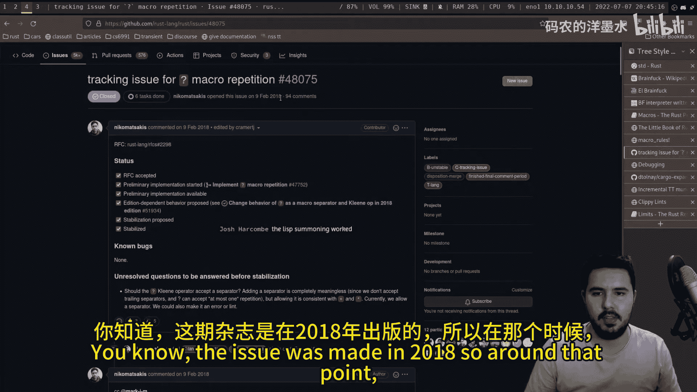

So we could actually say at the end here。Put a new thing here， which is。Like。

 think of looking at it like this。 This is another sort of。Token here。

 and we'll say a comma optionally。 So we'll match a comma token0 or1 times。 If if I write the file。

 you'll see that our error is now gone。 we run it。 you'll see it does the right thing。

 So this is the one other repeater。 There's star， which is0 more plus which is one or more and question mark as well as of you know rust 1。

25。 Also ish， which is 01 as well。😊，So it's worth checking as well does it work。

 Does our macro work if I only if I don't give it any day Ive and maybe like to use square brackets。

 something like that， let my V equals that and then print it out。Let's C to again empty vector。

 oh it doesn't know what type of vector it is， that's fair， we'll say it's a vector of I32s。

 doesn't really matter。😊，And we'll see there's an empty vector there。

 so it does work for that if I had to changed this to a plus。😊。

Then it actually won't build because it's expecting at least one expression here。

 We're happy with 0 or more， so it does work， but something rather interesting happens as well。

 We get this warning。 Vaable does not need to be mutable。 Temp Vk， help remove this mute。

 What That's weird。 Let me remove the mute。😊，Oh no， we can't push to the vector because it's。

 you know， consider changing this to be mutable mute tempe。

 like you just told me to remove that and so it's， you know， this one's just a warning so okay。

 this one's probably the wrong one， but it's giving me conflicting advice here。😊。

So hey let me catch up with this how limited is a particular type of macro thing EG can you do stuff like repeat the dollars bracket star to do multiple things for every expression can you find the number of expressions in the list yes and yes so generally you'll see that when macros call themselves recursively。

😊，the first one， rather， you can actually just sort of do things twice。

 like if I grab this code here。And paste it again。This will just push twice for each element。

 so if I go cargo run， you'll see we get 61524， 61524。😊。

Right because it'll push all of them and then push all of them again。For the second one。

 could you count how many things you can， yes you can。

 and there's maybe I'll leave it as an exercise after we write our own recursive macro for brain Frick。

😊，Hello Jashank the listsp summoning worked yep and so Vk Bang of comma works okay Oh that's very that's a very interesting point so for hours。

😊，It absolutely will in my mind， Yes， I'm not sure about the standard library vector I actually don't know。

 Let's find out。No interesting， so they don't like an empty comma。

 so I actually I do know how they've chosen to do this。

 it's a way that's a little more complicated than just throwing an optional on the end。

 but we'll leave hourss like this for simplicity it's an interesting sort of difference between our implementations and probably the standard libraries makes a little more sense here but we'll leave it there for now。

😊，Okay， so what was up with this， what's up with this variable does not need to be mutable when it clearly does。

😡，Let's go into cargo expand one more time and have a look at what it's saying。

 So cargo expand is actually complaining about our first in here。 right。

 So notice on this invocation， which is right here。 It says create the mutable vector。

 push push push and then spit it back out。 Our first one says let mute10 Vec equals vector new and spit it back out。

 It makes sense that the compiler is getting upset about this。

 because this doesn't need to be mutable。 We don't ever change it。

 We just create it and then we spit it back out。😊，Right and this really comes back to the idea that our macro is really spitting out rust code and that rust code gets fed back into the compiler and the compiler will sometimes complain about that rust code because this doesn't make sense right and so this is actually a trick that people often do when writing macros like this。

😊，This is a fun one， so they'll prefix their variable with an underscore right This doesn't actually have any semantic meaning。

😊，To the compiler， it doesn't treat things with underscore， especially。

 There is one very strange case with a single underscore in its own， but that's for another day。

 It doesn't treat this any differently， but。It signals to rust that this variable is not used。😡。

Which is also not quite what we want， in fact， there is supposedly a clippy lint。😡。

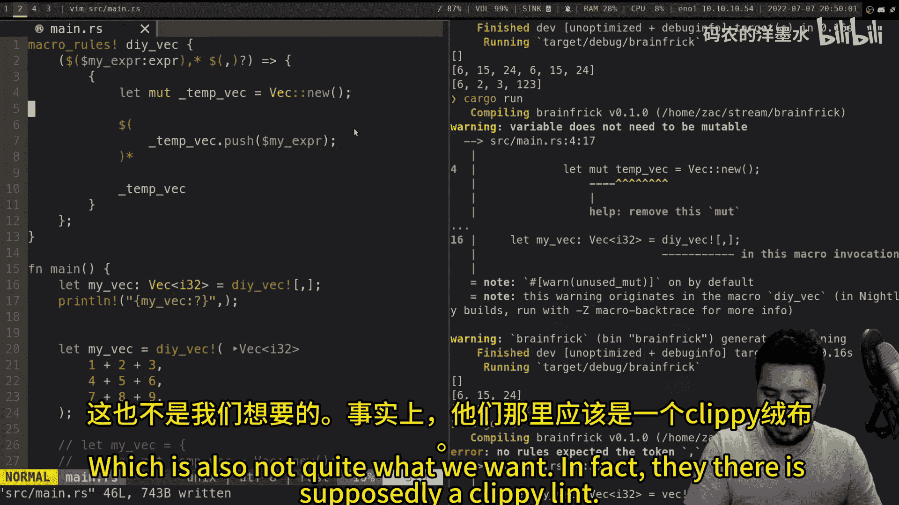

If I find it， oops here。That says if you use。If you have a variable that starts with an underscore。

 and then you use that variable。😊，Click we will complain at you。

 it'll go you said it was underscore X which is meant to mean you don't use the variable。

 but then you actually did use it and so we get to the final solution。

 people often prefix with two underscores。😊。

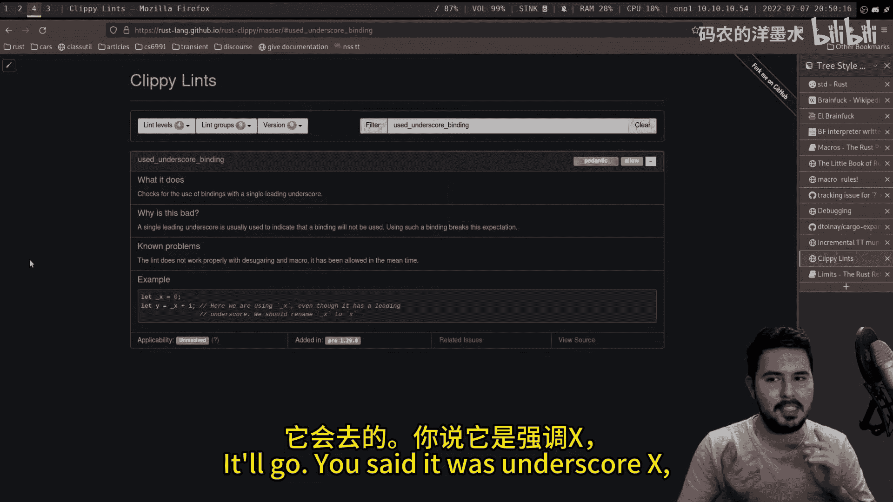

Like this。So they'll say underscore underscore， which is like this。

 this is a common a common pattern in the community。 and that tools generally recognize。

 that means it's may be used just like it's sort of it might be used sometimes it might not be used other times don't make any assumptions about whether this should or should not be mutable。

 just don't warn me， I know what I'm doing。 And so tools will often pick up on this。

 And I wonder if Clipy actually says。😊。

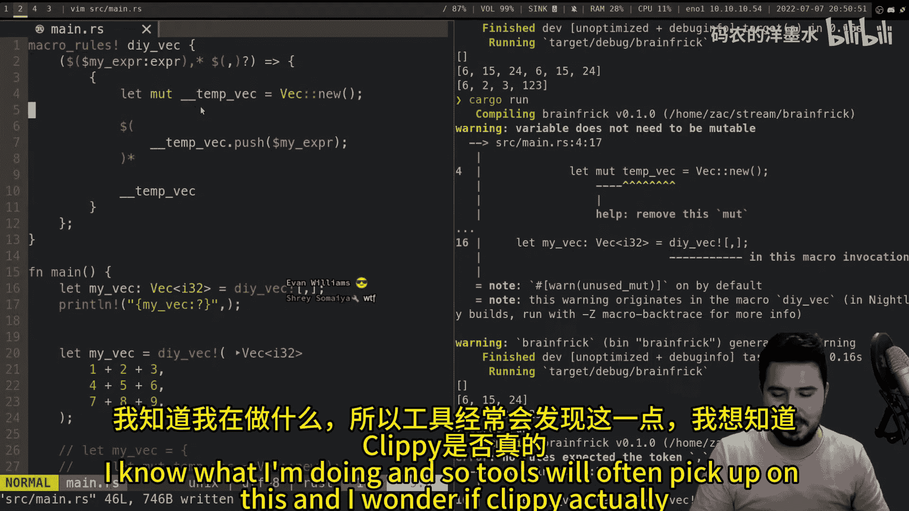

It doesn't work properly with macros， it's been allowed in the meantime， blah， blah， blah。

 they say a single leading underscore is used to this， so they actually it's not really written here。

😊。

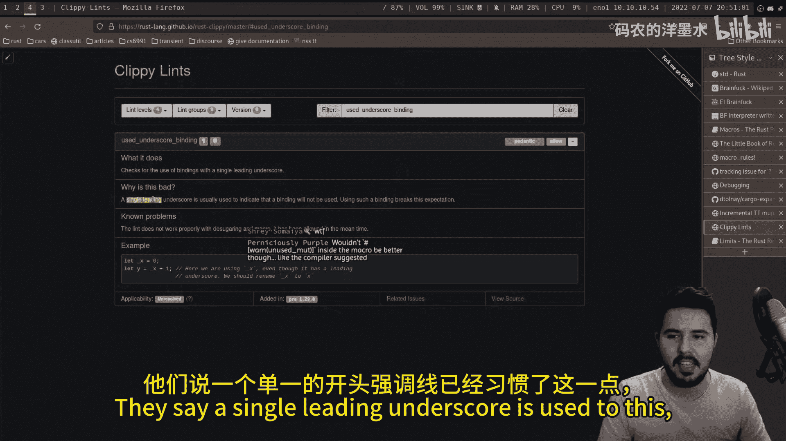

For whatever reason， but the the way around that is to go double underscore and then yeah。

 wouldn't one unused mute inside the macro be better， though like the compiler suggested， yes。

 you absolutely could do that as well。 So if we want to change that we could do instead instead of this throw in。

😊，An attribute here that says it wouldn't be worn in this case， it would be allow unuse Moot。

Like this And okay， yeah， it popped up for a second and I was like， oh， that's weird， oops。

 not cargo expand。😊，And you can see now that's also happy with that。😊。

But you sort of may see both approaches in the wild， it's a little fun like that， but yes。

 this will work as well so maybe we'll leave it like this。😊。

R is meant to be different five than they underscore the， yes， that's very true。 Fortunatelyly。

 it's generally just used to signal a bit of intent occasionally as opposed to， you know。

 at least it doesn't have any sort of semantic meaning。😊，Okay， so we've made our DIY Vck。

It's a little scuffed。 It's a little， you know， rough around the edges， but it gets the job done。

 right， And this will work with whatever expression we give it。 If we give it something completely。

 you know， gnarlly， like let my V equals a DI V of。

And let me just like absolutely torture test it like I'm going to go the string hello dot。

I'm not going to get。Lguage server completion。 So let's do it here。 Let's turn this into no， no， no。

 not into we'll do。Why is it not giving me oh sorry Chas I'll take the chas。

 we'll map each character character dot to up a case we'll filter out so we don't find any characters that are equal to E。

 I don't know we'll collect that back together into a string， something like that。

And we throw this into our macro here。Right， it's upset at me because。

Great this is a fun thing about macros， they can be really oh two uppercases， two ASI uppercase。

 what I think I want。To ASI upcase like this。And hopefully you can collect that like you don't want to compare that。

 so I'll do this。And then collect it together great。

 so this here is an absolutely gnarly thing that in my mind is going to turn into capital HLLO。

 something like that， you don't really need to understand what all this is doing。😊，But。

If I go cargo expand once again。You'll see that literally all it does is it goes T F dot push。

 and then spits all that code I wrote， which is one single expression。

You know where I told it to spit it out right here in these par ends here。And if I run it， cargo run。

You'll see I get capital HLLO， so it passes the torture test。

 it's a very sort of flexible system without having written a whole ton of code。Okay。Great。

 so we've got a whole bunch of garbage going on here。😊，Let's get back to。To brain Frick。

 that's what I'm calling it， that's the one。All right。So this is the meat。

I'm going to create a new macro here and it's going to be called I'll just shorten it to Bf。

I could saw the same before and it's going， I don't know what the you didn't give me any rules， okay。

 I'm sorry。😊，Great。And so we've got our macro Bf， the idea here here is where okay。

 it turns out we're an hour and this might end up going for more like two then sorry。

 the the idea of our stream here is that I want to make a brainfrick macro that takes in brainfrick source code。

 So actually let me grab you an example here。😊，Something that looks like this。That looks like this。

Right and I actually type real brain Frick source code into my rust program and I want the rust compiler to turn this into actual rust code that executes this Brafrick for me using a macro rules macro right so this is hello world this code here is hello world in Brafrick。

😊，And I want to write a macro that turns this into real rust code that when run。

 when that rust code is run， it does it's sort of like。

It acts in the same way that the brainf code would。

I'm watching For at 3X speed and on the early topic of miserable brainfork implications's one written in Sprinthef。

 oh yes， yes， Sprintf format strings， yes， yes， yes， yes， yes， yes， yes。😊。

There's all kinds of people who have done some seriously brilliant things with Brainfrick。

 I think we'll do something relatively cool today， but there's a whole world of fun that's gone on in Brainfrick。

😊，Okay。Sir。How do we get started， We're going to use a specific technique to make this macro。

 and this technique is called incremental Tt Munches。😊，Which sounds like oddly like， you know。

 might make you hungry if you work if you work on incremental Tt munches too much。😊。

But the idea here is we're going to make a macro that's recursive。😊，Oh， my gosh， Sir。

How does a macro recursive make sense， Actually， here's a really fun one。 Who was it that asked。

 I think I want to say it was Evan。 I'm scrolling the chat。 Could you write， Yes。

 Evan asked this question earlier， Could we write a macro that counts the number of things。😊。

And the answer is yes， we could let me comment out this brain freak here and actually it's a relatively simple recursive Tt munching macro。

😊，So if I create a macro called count， let's say count Exps。And like before， it takes in。

Some expressions， let's say， separated by commas， something like that。嗯。Sorry， oops。

 I always sometimes I I get the dollar backwards， so the name of our variable is Expo and it's of type Expo。

In the previous one， we just wrote it my Expo， but this is fine as well。

And the trick here is when they give me this whole bunch of expressions。

I'm going to create a counter。And this counter， I'm going to call I。And it'll be equal to zero。Okay。

I will be equal to 0。Actually， oh， this doesn't need to be recursive， that's sad， so okay well。😊。

Yeah， that that's a little sad。 this one in this case。

 it doesn't need to be recursive because I could just write something like this where I say for each of the experts。

Oops。ignoregnore them and then I plus equals one like this and this would end up counting the expressions for me if I sorry I also have to make sure that I give them I back at the end of this。

😊，Byイ doing。です。Like that。And this would end up counting them for me。😊，And how would I do this。

 well let's let's actually give it a run into a cargo expand， I call this count exps。

And I gave it like hello， 123， an array。Just any kind of thing that you can think of， string you。

 whatever， something like this。😊，And I said， let X equals this。 Oh， actually， an array is not really。

 I doesn't。 sorry， It needs to know what's in the array。 Let's just say like。

 let's just say the number one。 I don't know， something like that。Like this， if I go cargo expand。

You'll see that it just goes。I plus equals one plus equals one plus equals  one plus equals one and spinit I back out。

 so if I actually go printlin。😊，I can give it。I can print out X。Cargo run and it will print out4。

 So I actually don't even need to be recursive。 Why do I do let underscore equals dollar exp。

 The answer is if I remove this， it goes， I don't know what this is meant to be repeating for each thing。

😊，Right because I might have multiple things that are repeated if I had a semicolon here and then said。

 I want a whole bunch more expods over here。Then it wouldn't know if I should repeat it for each of these things or for each of these things So I say we're repeating it for the experts。

 but I'm not really doing anything with them， so I just basically chuck them into the void which is。

😊，Which is a little bit of fun there。 This is also not quite what we want either because it'll end up evaluatingval thingss。

 if I made one of these be one of these be an expression that prints some stuff。

 it'll end up printing it out as well， which maybe that's what you want。

 Maybe it's not what you want。😊，But this is just a simple example anyway， all right。

 I guess we'll go straight into some like recursive definitions then。Which again， some very good fun。

What's going to be our approach for this Bf macro？Well。

 what tokens like what are we expecting to come in here if I go back to the list over here？

Of what we're allowed to capture， it can be an item。Which is only like a function。

 astruct or a module or something like that。 This is like a declaration that may go。

A declaration that may go at the root of the file somewhere。

A block that's not kind of right like if we're just having plus dashes， that's not a block。

 A statement is a whole like statement of Ross code followed by a semicolon that's not right。

 A pattern is used with like pattern matching a stuff that's just wrong an expression well plus you know if I do plus minus comma you know left bracket that sort of stuff those aren't expressions either they're not types identifiers that's like fo bar bass that's not right a path that's a path like you know stood mem replace no。

 that's not right a meta item things that go inside okay that's very specific like no still not there and finally when left with Tt。

 a single token tree Tt what is Tt。😊，So。Token trees is the idea that if I have like some stuff。

Let's say some stuff encased in， oh， what's a good example of this。This sort of like。

To really understand a token tree， you have to understand what something called an abstract syntax tree is。

 which is a little beyond our depth in this little stream here。😊。

But the idea is it holds if I wrote something like。Oh what could be taken as a T T。

 Let's say something like Pars  one plus2 plus3。 I believe this here would pass as a single Tt single token tree。

 and it would look something like we have a paren and then a one plus two。

 and then that gets taken and plus with three。 Its sort of evaluates to one sort of Well， yeah。

 it's it's a tree of tokens。One sort of grouping， let's say of tokens and that ends up being really convenient for us because there aren't really any groupings until we come to these square brackets which and it's actually going to make our livess a whole lot easier。

😊，But。These are all just individual tokens， really， a plus， a plus， a plus， a plus， a plus， a plus。

 a plus， a plus， you know， a right angle bracket。 These are individual tokens。

 So if we say that we can have。Some Tt， right， sorry。Let's call it tokens。

Wwhichch is a Tt and then say repeat a whole bunch of these separated by， you know， commas。

 semicos doesn't really need to be anything， so we'll just say we don't need to separate it here。

The nest will basically match all the tokens， then we give it。😊，So if I went。

There's a really cool macro called stringify。Which basically takes any syntax and turns it into a string of that if I said。

 take stringify those tokens and then print them out。Like this。

What would it look like if that was my Bf macro to here？Well， let's say。Variable tokens oops sorry。

 tokens is still repeating at this depth， let's go for each of the tokens then we'll print a new line。

😊，Something like that。Is it happy yep， it's happy now？Cargo run。

 you'll see it prints out each of these individual tokens， a minus a dot， a plus， so on so forth。

 interestingly， sometimes it groups tokens together。This is a， I believe， a left pointing arrow。

 This here is you know like a bitwise shift where some other good ones dot dot is is sometimes using patterns and stuff So occasionally these get grouped together。

 And if we have something like these square brackets。

 it'll find the matching square bracket right an interesting thing in macros in rust is that parens。

 square brackets and curly braces need to be balanced right you can't just have open pre and open in print and open preen inside your macro。

 they need to balance out or it'll reject it and this all gets sort of spit together is one token tree。

😊，1 Tt。Al together， because it starts at the starting one here finds the end one and then it's got all these sort of tokens inside the TT inside here。

So this sort of splits up our brain Frick program。Mostly， there's some edge cases to look at here。

 but let's sort of pretend they don't exist for now。 Let's say we did something like， you know。

 after each token， we put a space or something。 so it really made sure that they're all separate。

 We're actually going find a way around this。And I'm sure there's a really brilliant way to do this in VM that I don't really care about。

So you can watch me as I。Separate all of these byspaces。And when I run it again。

 you'll see that these all get treated as individual tokens。All right。

 let's just say I did that just to make just Shank specifically angry because。

Because because it would and you'll see now we don't get any of these grouping together。

 we don't get this turning into some sort of like bitwise shift with the two next to each other。

 we still do get the brackets grouping because again that's a sort of requirement of how macros powers in rust。

😊，So this ends up being one big tree okay， once again， how does this still help us though？😊，Well。

 if we can sort of think about these characters one by one。If we can think about them one by one。

 then we can actually turn it into a little bit of rust code。

 each individual tookken into a little bit of rust code that does the equivalent of what that brainfrick command is meant to do。

Right， so let's say over here I create a new tape。 we'll say let tape equals we'll make it a V。

 That's fine。 We'll make it a v of unsigned bys you a。😊，And let's make it from an array。

Starting off was zero and let's say， how big should I take B？Maybe like 2048 something like that。

 2048 bytes is not be it's not going to be an infinite tape right。

 but it's not a super fine idea that's a fair amount of bytes。😊，And we'll say our pointer。

Is going to be， I I think the pointer should start somewhere in the middle so you can sort of。

Either work forwards or backwards。 And it'll still be roughly happy。

 So I'm going start my pointer off as if it's pointing in the middle of this array here。

 Then we could say a plus turns into， you know。I believe a plus would turn into tape of pointer plus equals 1。

Right I could say a right arrow， right a right arrow here would just turn into point of plus equals one。

 right， look at the next index， there's sort of little bits of rust code that we can turn this whole into。

😊，Unfortunately it's not quite this easy， we can't just start turning this stuff here into tape to this point to do this because macro is a hygienic in rust or at least they're partially hygienic which means that if you spit out code in here that talks about this tape variable it's going to assume you meant a different variable they sort of a limited sort of variables scopes are also limited in the sort of areas of code generation。

 let's say so you can't just willing nearly use random variables all between macros all over the place you need to be a little more structured about it so we can do that though we can say that we have let's say the tape which is some sort of iddent。

Right， and then maybe I give a I'd like to use a comma。

 but that might get confused with some brain frick syntax， which actually uses comma。

 sometimes I'll use a semicolon。😊，And then I'll say the point up。

 which is also an iddentt and then another semicolon and then all the brain frick code over here。

 So if this way I could pass it as tape semicolon pointer semicolon。And then all the brain F code。

And this will work fine， it'll be able to talk about tape and pointer through these。

 the macro hygiene will' be happy about that as well and we can start to actually like make it do some real things。

😊，Let me just catch up here。All right， so that's how they also that's how they figure out what to repeat I was thinking it was just order。

So it is。Or。I'm not sure if the question is the exact one here。

 the macro will look through the rules top to bottom， it'll sort of like look at the first one。

 then the second one， then the third one and it'll try and match whichever one matches first and we're going to exploit that for what we do here as well I'm not sure if that's the exact question you were asking though Q Rarrow A space escape L or bar Q would be the Vm macro yeah well oh wait yeah actually I do know how to make macros in VIm but you know it's all right it'll make Shank ups that's always a win。

嗯。Okay， I'm sorry。 I'm kidding to Shank。 So let's work on our first。

 our first little part of our B F macro。 So this here is if we have this is a whole bunch of tokens。

😊，Let me just look for the case where we find what was the first one on our other list？

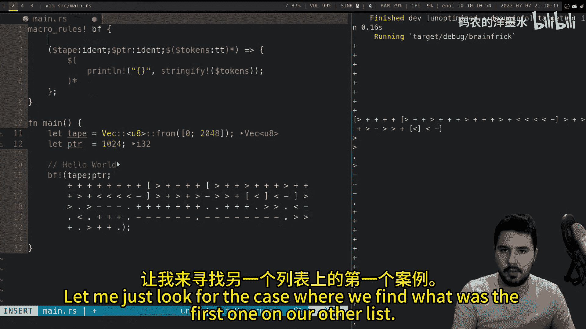

Over here commands。 The first one was a right arrow。 So how could I do a right arrow in this macro。

 or I wrote dollar tape is an iddent， So that's always going to come first。 This pointer。

 which is also an id， will come next。 And then specifically the case where we get a right arrow。

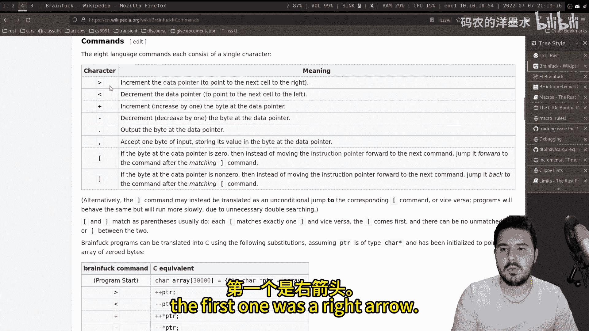

And then there's going to be a whole bunch of stuff after it right， it's， you know。

 if we pause this thing， there's still going to be all these tokens to come next。

 so I'm going to say there'll be a whole bunch of tokens next I'll call it the rest。😊。

And this repeats as long as it needs to。Then what should this code here do？

Right what should this code here do？And the answer is it should probably do what this arrow means。

 the definition of this arrow and then。Continue looking at the rest of the code here。

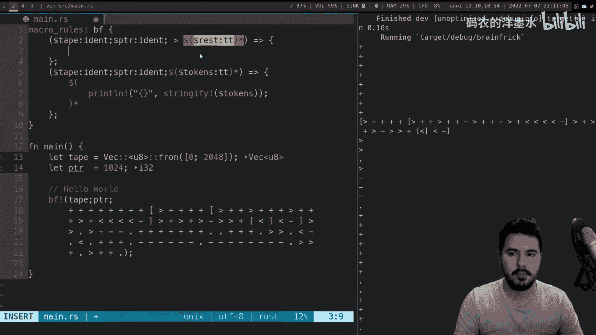

Right？So what should an arrow do， I believe if we look here it said increment the data pointer to point to the next cell to the right。

 so the data pointer is here Do pointer。

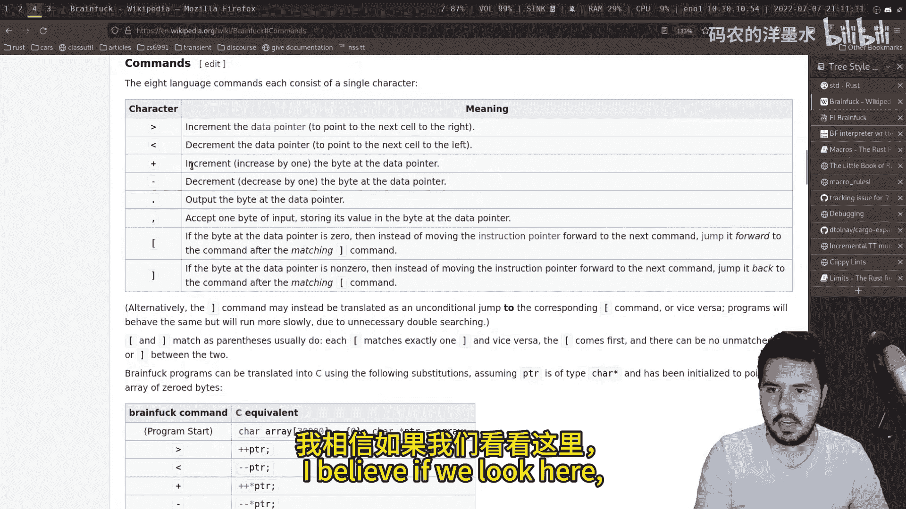

So that's going to be we'll take Do pointer and add one to it right this is immediately going to fail because I need to make sure these are both mutable。

😊，Right， because we're going to be changing these over time。

 but I'm going to say the pointer here is mutable and plus equal to one。😊，And then what do we do。

 This is the real big brain part of this whole。This is the big brain part of this whole talk really。

 the answer is we're going to do something like this， BF Bang。And we're going to give it the tape。

We're going to give it the point out。And we're going to give it the rest of the tokens。All right。

 we're going to sit on here for a second。We're going to sit on here。

And make sure we understand this idea。So if we get a right arrow， increment the point by one。

 then call this macro again。We're going to feed it the tape and the pointer again， right。

 We need to keep track of those across all these macro callss。

 but the difference here is that the rest was whatever was after this right arrow。

 We've dealt with the right arrow。 and then there's the rest。So notice I'm not writing right or。

 this would just be an infinite loop here。 if I put the rightarrow in again。

 it would just sort of keep going into itself。 We've actually made a little bit of progress here。

 We've made a little bit of progress。Let me see， sorry the macros death ofrrhius that's really weird and magical。

 so you'd say that， but I'm physically sure' really do it like that too。呃。Oh yeah。

 actually that would have been smart as well How does Ru prioritized tokens EG rule tokens Tt start adentt Howard Rut handle token to semicollons So yes。

 there's some rules about what tokens can follow some captures but I can't remember where they are the answer is there are certain formats that the compiler will go I'm not going to be able to decipher this therefore therefore like we'll just compile fail and and sort of drop here。

😊，In that case where you have TT star semicolonoid dent， it might be able to resolve that。

 but basically if there is an ambiguity and it's not going to be able to resolve it。

 then it'll just fail， you'll get a compiler and it'll go no， that's not a valid macro。

I probably just open Pyon yeah， yeah， and Python， that's a good one as well。Cool， okay。

 so this is the big idea。😡，Do spit out a little bit of code that is sort of like makes a bit of progress and then continue on with the rest。

 and we can even see this in action right now if I go B F bangang。I give it the tape。

 I give it the pointer and I say right arrow， right arrow。

 right arrow and then just like like this rule will end up catching anything that doesn't get caught by this。

 so I just go like fo。😊，Something like that it's is other the warnings yet whatever well this is the classic you know。

 do we want to throw in the allow unused blah， blah blah I'm just gonna to do the lazy thing here which genuinely is just the lazy answer the other one is probably the other answer we saw before is probably better but you know wow warnings all disappear crazy。

😊，If I run cargo expand on this， we're going to get all this printing stuff come on， there we go。

 got to the top。😊，Let's see here we have createate the type。

 createate the pointer that's real code that we wrote here， then point of plus equals1 from this。

 point of plus equals 1 from this， point of plus equals 1 from this。😊。

And then this fooo here turned into this F at the end was just like this。😊，Printlin， bang。

 string aify fo， it just prints out a string that's called fo。

 I got have put whatever here and it would have caught it there。So。😊。

We're sort of getting some rust codes starting to get spat out that looks a little bit like brainfrick。

😊，Amazing and the brilliant thing here is this has sort of modularized the work as well。

 we can just like keep going so I'll grab this。😊，How is a left arrow work， it's the same。

 but it subtracts one from our pointer。Right， that's where like a quarter through the language。

 right， a quarter through the language， what was the next one plus and minus increment the byte at the data pointer。

 decrement the by at the data pointer。

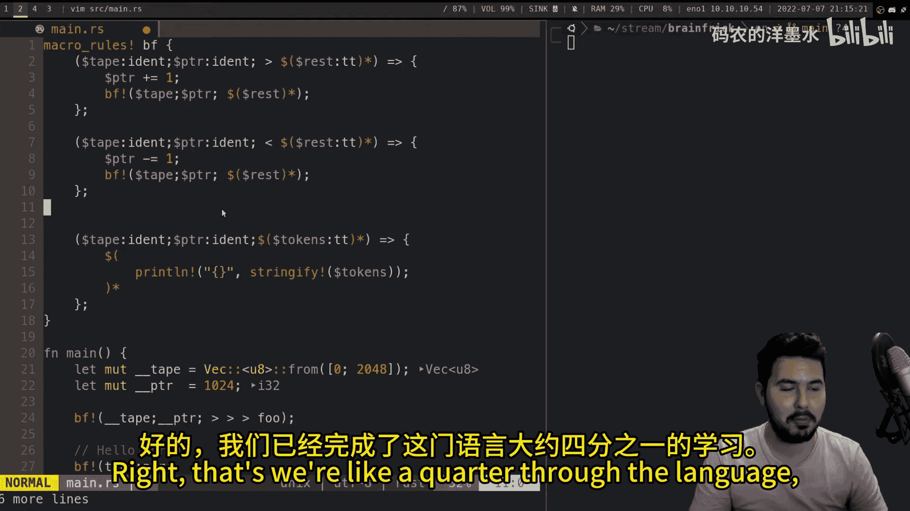

Easy， plus， I'll put them both in first， plus and minus。And what does this mean， it means the tape。

Of the current point up。Should be increased by one。Right， and similarly。

The type of the current pointta should be decreased by one。Plus minus and again。

 just keep doing whatever comes next， keep spitting out more code。😡，That means like whatever。

 that is whatever like the rest he represents， right， we are halfway through the language。

Halfway through the language of braininfrick at this point。

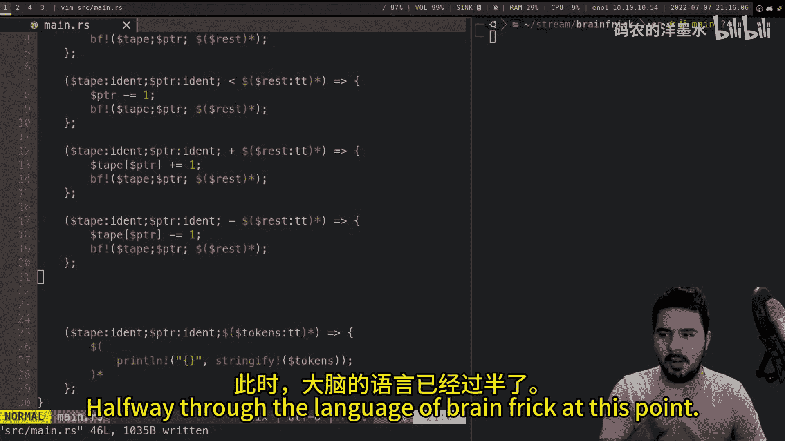

Alright， so what comes next outputting the by of dataer inputting the by of data point。

 this is a little tricky because we have to write the code that outputs and inputs and I'm going to yeah。

 we'll grab this。😊。

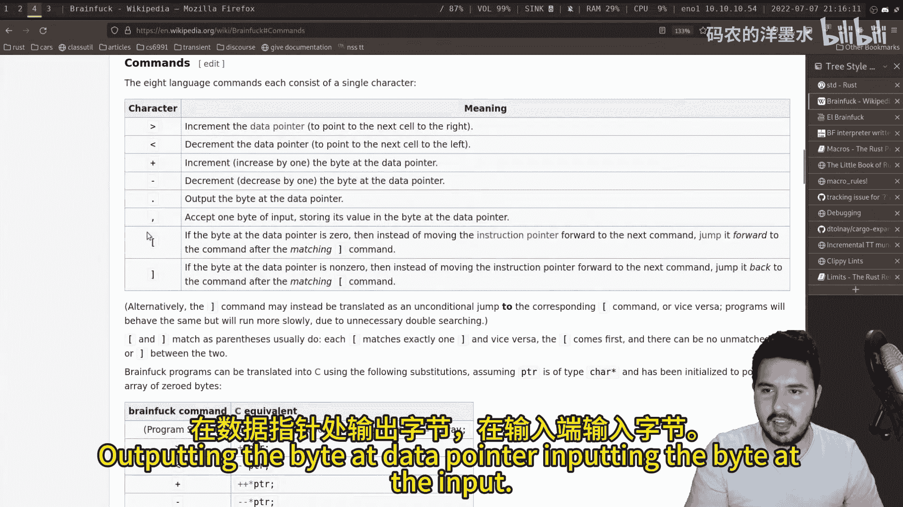

This is a dot for output， and then comma for input。 The code here is a little gnarly。 In fact。

 I might even just grab some。Cd here。Let's go like this。Tpe。Like this， so grab the current bite。😡。

Right， grab the current bite at the current pointer and cast that to a ASI character。

 it's not really AS what' sort of。Rust is a little complicated here。

 but just let's just pretend ASI character and print it out this little bit of code here is just flushing standard output because often standard output will wait for a new line。

'll'll like it'll buffer up a whole bunch of characters and then it'll see a new line and go okay great I'll spit them all out now we want to make sure just print character by character just in case so we can see progress and stuff like that。

 So I've just got a little bit of code here that says flush standard output。

 it'll be nice if it was shorter。 but you know rust。 So we got to deal with that。

 And then reading as well is a little bit of a pain sometimes when I just want to say literally read a byte。

 So I'm going to。😊，Bring some code in here for that。And this data says。

Read a byte from so it goes standard input。We're looking at bytes instead grab the next byte。

 assume it exists if and if it there was no more bytes to read， just spit out zero。

 This is another one some brainfrick programs expect and the EOF to be0， Some expect to be 255。

 I've got a couple of programs lined up that expect it to be0 So I'm going leave it as that So we've got the byte and then what do we do with it。

 We say the tape。😊，At the current pointer is going to be equal to the bitete that we just got out。

All right。So yeah， there's a little bit of gnarlly like rust stuff。

 rustisms to print the bite out and to read the bite in。

 but at the end of the day this is the most important line here， which is just a simple one liner。

 this is the most important line here， which is again just a simple one liner。😊，And again。

75% of the language is done Now。 The last thing we have left， right。

 The last little bit is just looping。And the brilliant thing is looping may potentially be one of the。

 I think it's honestly the coolest one of all of these， and it's actually really， really simple。😊。

So the idea here is。😊。

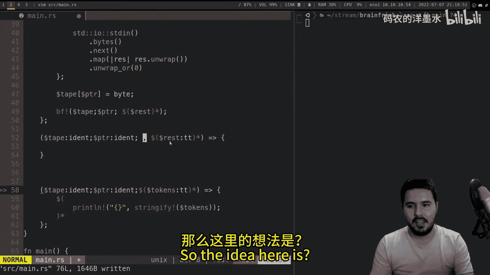

What is our macro going to see in a brainfrick loop？😡，Right we have a left square bracket。

 a whole bunch of stuff， and there we need to find the matching closing square bracket。

Right but I mentioned something earlier。The thing I mentioned earlier is that macros in their input require that any brackets。

 pres， braces， whatever in the program are perfectly balanced right you can't just have an extra like square bracket flying off here or like the compiler will actually reject it。

😊。

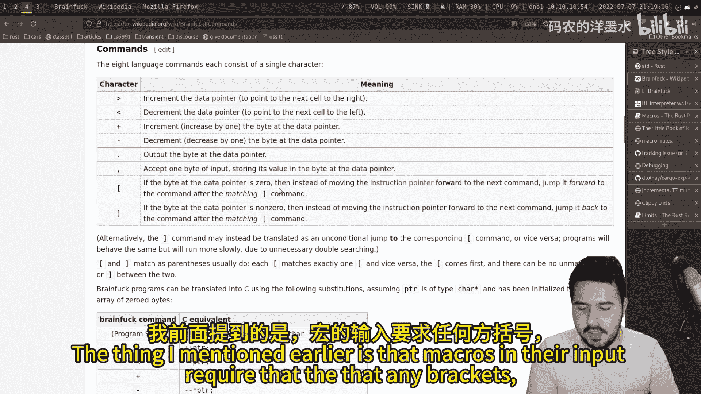

The reason the compiler will reject that is because the compiler is doing the balancing for us。

The compiler needs to actually know this one matches this one， that one matches that one。

 this one matches this one。😊，And that makes this next thing so awesome， Oh。

 I've forgot got a semi color off the end here。😊，If I want to look for a square bracket loop in Brain Frick。

All I have to do is write square bracket。 That's the start of it。

There's going to be a matching square bracket somewhere later。

And rust is going to make sure that these are balanced， so've they've already got the correct order。

 so therefore there's just going to be some body of tokens。😊，I don't know how many they'll be。

 there might be zero， there might be you know one or more whatever。

 so I just say grab me a whole bunch of tokens as many as you want and。😊。

Itll it will make sure that these two are balanced here and I've just got a whole body of stuff to do。

And what I do in that body of stuff to do， Well， I say the rule from Brainfrick is if the byte at the data pointer is0。

 then instead of going onto to the next thing， jump to the command after the matching thing。

 like if we look at the C equivalent down here it's really just saying while。

 you know this is not equal to zero。

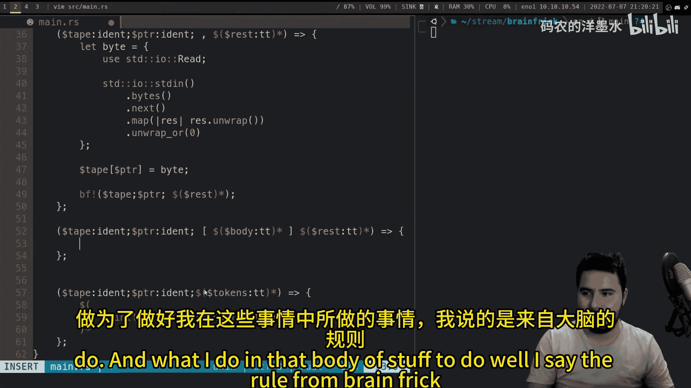

The current thing in the the current like bite in the type， do the stuff inside， right？

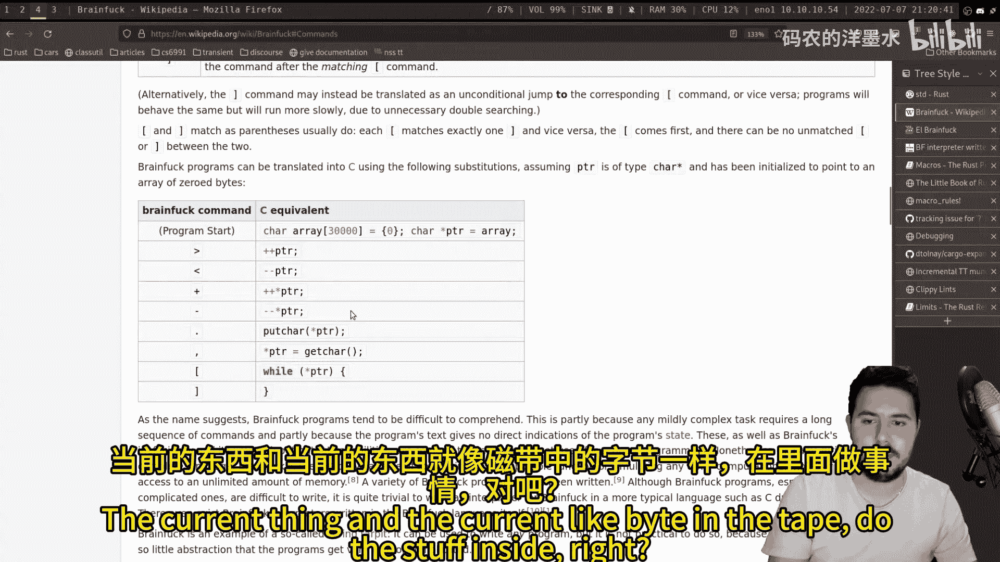

And how do we write that in rust while？The current bite in the tape。Is not equal to zero。

Do the stuff inside。 the stuff inside is tokens because it's brainfrick， as we know。

 So I'll say brain Frick。😊，And I give it the tape。 I give it the pointer。And then， I just give it。

The body， right， I need to say repeat for each of the body， things in the body。Do the body？Right。

 and when this while loop ends up， you know， evaluating to zero， whats it going to do next。

 it'll do the rest of the tokens。😊，呃。Sorry， I've got the dollar tape， dollar pointer。

And the rest of the tokens。扫。That's looping， that's essentially that's essentially 100% of brain Frick。

There's one last little case here that we've actually missed off。

 which is what eventually we're going to run out of tokens right and that's great news That means we're coming to an end。

😊，And the way what that'll look like is we'll still have the tape。We'll still have the point off。

But then we'll have nothing afterwards， there will be no tokens here。

 so there's no tokens here I'll just leave it empty。😊，And this is actually the entire definition。

 I'll write a comment here saying no more。😊，Instructions or maybe no more commands。

And what's called Wikipedia。This rule here is now completely。 We don't need that anymore。

 That was just sort of a leftover of what we had before， and brilliantly。Notice that it's。

 it looks like it's actually figuring some stuff out because this fo here is an arrow saying。

 I don't know how to deal with foo。 Forget rid of it。Suddenly， oh my gosh， all right。

 I'll get rid of Hello Wed for a second。Let's see what it does。 So cargo run。

 it's not actually going to do anything at this point。 oops， But if I say cargo expand。Look at this。

Our error arrow turn into0 of plus equals 1 plus equals 1 plus equals 1。Right。

 what if I throw in like a arrow plus arrow？Then what we expect is going to happen。

 it's going to spinit out code， rust codes， it says。😊，Add one to the pointo。

The thing at the current point of is added one and then that。Right？What if I said。So go right， plus。

 plus plus。Like that and then print out the current bite actually。

This is probably no good because it's going to print out maybe the ASI character three。

 so let me go like。😊，Let's do。To， I'll just， I'll just hold it down for a while。

 That'll probably be like an a real ASI character， right。

 So like add a whole bunch and then print it out。So this here turns into a whole bunch of fl equals ones and then a bit of printing here。

😊，Cargo run， and that's a percent symbol。 That's cool。 If I like take off。

 if I shave off a couple of these， I'll probably get something like hash， great， right。

 I took off two of them。 If you go two down on your keyboard percent dollar has。 and yeah。

 you get a hash out at the end。😊，Okay。Now the big test here。What about Hello world？Right。

 it doesn't know it。 I rename these。Right， hello weld， run it。Wow， and how is that is。

 Does hellello worldld appear at all in the rust source code， No， Of course not。

 It's all just like garbage rust code that's doing like nothing。 Look at this。 This is so cool。

 The square brackets here。😊，Right， this square bracket has turnedned into a while loop that has all this stuff on the inside。

 we've got one two like nested， there's this one here， that's this square bracket here。

 this square bracket here， this little while loop here is just one thing long。😊，It's it's incredible。

 but this sequence of rust code right because we made it follow the rules of Brainfrick and someone's written us a valid brainfrick program that prints Hello Worldld when we run it at Prince Hello Worldd。

It's amazing。There's still a little bit left to be desired here and we've still got a little bit to go in improving what we've got。

😊，So the things that I don't like with what we've got so far is that white space right I need to put white space between each character here。

 not every single one。 So for example， there's no token that consists of multiple pluses So if I put a bunch of pluses together oops。

 Russ is going to be happy with that and it's gonna spin out hellello world but a token that does exist for example is an arrow right this dash and then an arrow and it goes I don't know what this arrow it means like it goes through all our rules and goes right arrow left arrow plus minus dot right but there's no actual like dash you know this there's this there's this but there's not this and that got tokenized into one thing So when we run it。

 we actually get an arrow an arrow going I don't know how to deal with this。 no rules expected this。

😊，Right， there's actually a relatively nice work around to this。

 there's also one other thing I don't really like。😊，And that's that I have to give。

 I have to do this stuff here and this stuff here。 I don't really want that。

 I'd rather just write the like。Not have written this， just give it BF code。

 no spaces in it right and it just it just does brainfrick it spits out Ru code right that's what I really want here and we can also do that。

So。How do we do that， The answer is， so let's do this one first， the tape and pointer stuff。

 The answer is much like the V macro that we made earlier on。

 we're going to add in an extra rule down the bottom here。😊，Right， this rule should only match。

If none of these rules matched here。Right， and these rules won't match right if they've got basically if they don't have a semicolon ident semicolon blower。

 so if I say。If I just get a whole bunch of tokens。Right， and let's say。

 do we need to say one or more， do I want to say zero more。

 I can probably say zero more in this case。If I've got a whole bunch of tokens implying as well that none of these ones matched。

 they've probably just given me straight up brain F code right here。

 so let me take this stuff that we wrote earlier。😊，Right， create a tape。

 create a pointer and then hop into the main sort of body of the macro like giving it underscore underscoreco tape。

 semicolon， underscore underscore pointer， semicolon and then。All the tokens。Right。

 so now it's actually complaining what are these， I don't need these。😊，Right。We don't do。

 so the first time it doesn't match any of our above rules， so it gets down to this one。

 it creates a tape， creates a pointer， passes these into it calling the macro itself。

 Suddenly there is an identifier a semicolon an identifier a semicolon and a whole bunch of tokens So it starts matching these rules up here which starts spitting rust code out until eventually it's only got the tape the pointer to identifyent as separated by semicollons and nothing more and there's no more to go。

 It doesn't recursively call itself anymore。 It just goes undone and it stops spitting out rust code。

😊，So let's see if this still works。Cga run hell wet。Cargo expand。Scroll， scroll， scroll， scroll。

 scroll， maybe I can oh there we go， we are at the top， you can see it expands first into this stuff。

😊，And then starts doing all the macromagic。Brilliant。Alright。

 and yeah you could actually do a wrapper macro so maybe you don't want users to accidentally run into any of these cases themselves。

 you only want this format and so it's not super uncommon to see like this being the BF macro here and then having like a Bf_ internal macro that users don't actually end up seeing but we could also just shove it all in the one and it works as well and so we'll leave it as it is this way。

😊，The last one that we need to do here is deal with these pesky tokens right again if I join together two tokens like this。

 it goes it goes that's a bit wise shift。😊，I don't know how to deal with that and in fact now the error is popping up here because it matches this。

And then this goes， I like once it actually recursively calls itself。

 it doesn't know how to deal with it anymore。😊，So how can we do that， There's。

 how can we deal with this rather there's actually a really nice way to deal with it。

 So I'm going to say appease the Psar。😊，And I'm just going to add some more rules。

 What are these rules going to look like。 Well， I'm going to say tape iddentt because we've got that。

 We've got our pointer， which is an iddent。And then I'll throw on the rest here as well。

 Do rest is a token trait。And what I'm going to do is if I see something like this， right。

 a bit wise right shift， which really what I want it to mean is a， you know。

 single right arrow and a single right arrow， which semicol。

Then what I want you to do is go the F bang。Of dollar type。Dollula pointer。 And then。

This is the magic right arrow， space， right arrow， two separate tokens。Right。

 and then we could throw the rest in here as well， oops， dollar rest。Right。

 so this almost just like translates when it sees something that looks like a bitwise right shift。

 it almost like fixes itself， fix it as it back up， puts a space in。

 like goes no these are two separate tokens and then feeds it back into itself。😊。

Rust will not see this as a bit wise rightshift because a bitwise rightshift needs to be arrow arrow。

 not arrowerospace arrow， right this is really two like greater than symbols。😊。

And we end up just having to repeat this little， you know。

 this this little trick that we've done here for each of the cases that are giving us trouble。

 let me， oops， that's not what I want to do。😊，grarab it like this and go pop pop pop pop pop so what are the ones giving us trouble a left shift would do the same thing here。

 a arrow pointing to the right will give us trouble here and arrow pointing to the left will give us trouble。

😊，And dot dot， well， we really want that to actually mean。A single dot and a single dot。

 I believe if you can think of any more， let me know。

 I believe those are the ones that cause us issues。😊，Right。And then if I take all this。

And get rid of all the white space there。There we go， actually， I probably want to make。

All this in once small。We'll see this all turns into one thing。And we get hello world。Right。

 because when the PAza sees like maybe that's a right arrow there。😊。

It ends up feeding it back into itself， into just a dash。

 and then a right thing if we look at cargo Expend one last time。

You'll see like it's it there's no sort of special machinery and it's not doing any of this work it's it's not sort of like。

😊，This is not a program that's taking in these characters at runtime。

 right it's not a program that's taking this as a string and going through it one by one。

 It's like the compiler has generated rust code that is equivalent to this brainfrick code。This。

 this macro Brainfrick is a transpi， it's a transpilar from brainfrick to rust。

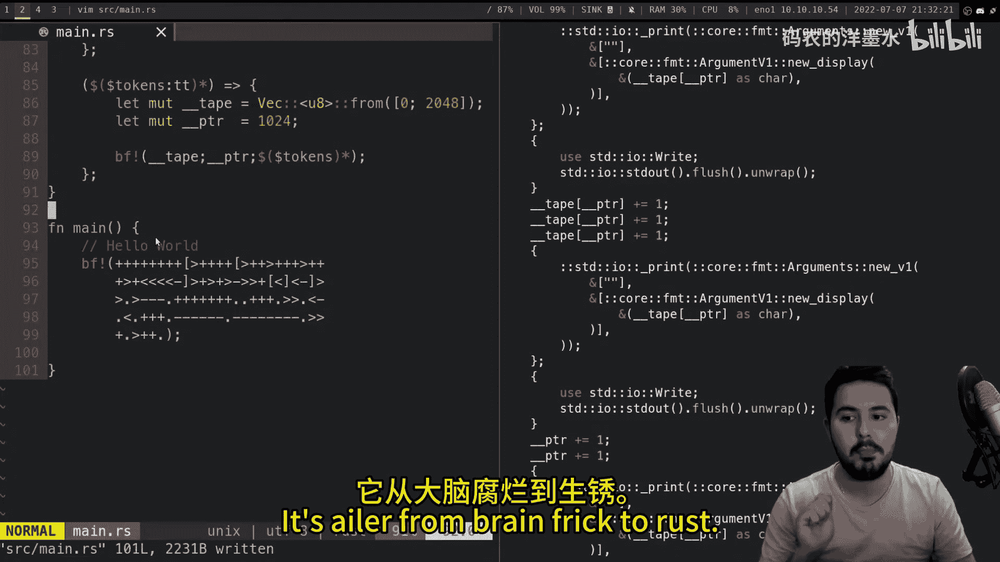

Right， much like this Wikipedia article said you can transple or translate brain freaking to see by following these patterns here。

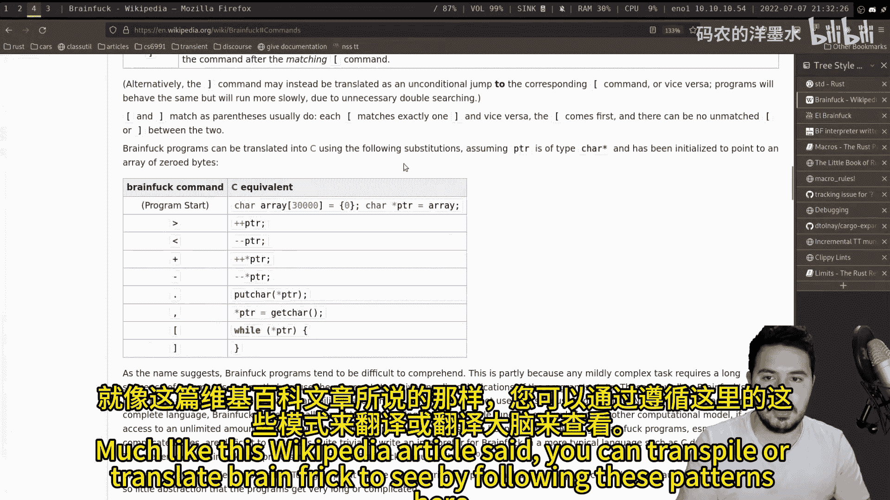

This is brainfrick， transpied to rust。Which is just it it's just just absolutely lovely I've got。😊。

This that's that's about the end of our lessons， that's the macro done there， but I think it'll be。

 you know， now is certainly not the time to leave just yet because I want to show off a couple examples of ourco doing some fun stuff。

So that was Hello worldld， the next one I'm going to pull in here。😊，Is。Rot 13。

 so this is a real fun one。 Rot 13 is a very simple encryption method。😊。

It's a it's a special case of a Caesarcipher where it just rotates each letter by 13。

 So if I go cargo run and I give it oh no oh yes， interesting。

 I forgot this one attempted to subtract with overflow。 I mentioned this at one point。

 I said that if you subtract like 0 and you say minus-1。

 it should actually wrap all the way around right， It should wrap all the way around and。😊。

And go to 255 in this case， so I actually need to change this to instead be plus equals  one。

 I'll do wrapping add of one and over here I'll do wrapping subtract。Of one as well。 completely。

 forgot about that one。 Oh， and I actually need to then say dollar tape of dollar pointer。

Equals this。还有危题啊。So this is saying， yeah， don't don't just say plus one because that'll panic if it overflows either way instead I say。

 no， I explicitly want it to wrap around。😊，So now if I say hello world， or' actually even。Hello。

 world。You'll see that the brain frick spits out this and in fact just to make it very clear。

 I will kill the program and run it again if I fear it this it spits back out hellello world So this is a Ro 13 cipher which is very good fun and again this is all like crazy rust code doing this in the background which is just super fun。

😊，I've got two more programs。呃Here。Oops， that's not what I wanted。啊。🤢。

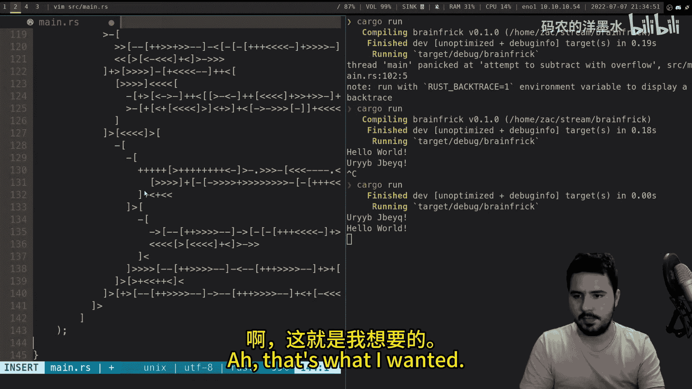

That's what I wanted， this here is a brain Frick program that computes E。😊。

Right and this is great because suddenly， no， our program breaks。Right。

 this is a program to compute digits of E， but there's so many sort of nested levels of loops in the macro callinging itself that Rus has aside decided this program is no good。

😊，I won't compile it。And this is the sort of。This is a brilliant consequence of rust's type system。

 and in this case the macro engine。Well， so how do I say this Ru's type system is tuing complete。

 which is absolutely brilliant and so but also there's just these macros that could potentially you could make a macro that just loops forever and they don't want the compiler to ever just like loop forever and ever and ever because you won't even know what's wrong with your program if it's even building or not。

 so compilers have an idea of Americans would call it gas in Australia we probably call it petrol。

 I suppose， they have this compilers have this idea of petrol， let's say。

 where every time they sort of do a little bit of work。😊。

They'll subtract one petrol from their tank and eventually if they're just doing so much work over and over the they don't think they're getting anywhere and they run out of petrol they go too much I think you've done something wrong in our case we know we've just done something horrible but certainly not wrong。

😊，And so we can explicitly say， no， add more petrol to the tank， right。

 I've actually got this window up over here Li here。 There is a recursion limit attribute。

 The default in rust C is 128。 Let's go Sico mode on this recursion limit。😊。

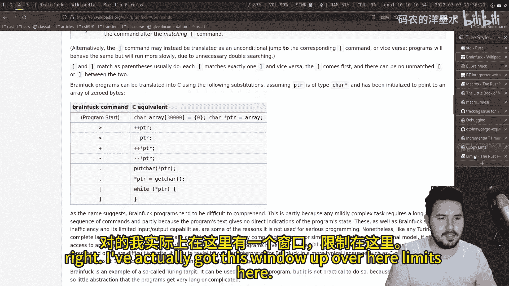

And set it to something like 1024 so that means like add a bunch extra petrol to the tank like we're going on a ride here。

And if I go Chicagogo run now。How good is that，2。7182818， you know， blah， blah。

 blah goes on for ages and eventually thread main panicked because it ran out of room on the tape right The tape isn't quite infinite and this will just keep calculating digits of e as much memory as you give it。

 And so that's that's just brilliant as well。 if we up to the tape size here to say 4096。

 then it would spit out more digits of e and then eventually panic as well， which is just。😊。

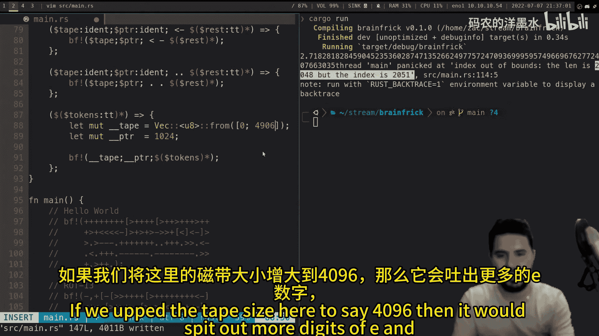

That one's just so much fun。😊，Let me catch off on the oh， flip camera。

 camera looks oh oh it went autofo for a second。 Yes， okay， as soon as I look back at it， I was like。

 oh no， he's gonna find out and focused again。 okay， theres I've got one final example。

 which I think is the coolest one of all time。 But I'm gonna catch up with the chat before and then we'll end the stream。

 So let's see， reminds me of C plus plus substitution error is not a failure thingy any nice rate to wrap the pointer itself when it hits 2048 or0。

 So you could do that as well。 I could change these to like I could sort of add some logic in here that goes if the pointer has reached the end wrap around。

 but most brain freak programs are not expecting you to do that。😊。

They're expecting if they keep going one direction they'll keep getting more memory so actually a panic I'm perfectly fine with here because it's just saying I ran out of memory essentially if we didn't do that it would start having incorrect results because it would run into old memory or something like that。

😊，I think that makes， yeah， yeah， correct， correct， as as perniciously purple has pointed out there。

 All right， the last one and my absolute favourite。

 this is actually a throwback or a callback rather。😊，To earlier on in the screen。

I mentioned this thing existed here， and now I'm bringing it in。

This here is the mother of all brain Frick programs， right， it goes on and on and on and on。

 This is a brain Frick interpreter that I mentioned far earlier。😊。

So I need to comment out the E example。This is a brainfrick program that takes as input。

 a brainfrick program and executes it， like does what it should。

 So they've essentially done all the work we've done here in a certain sense。 but in brainfrick。

 which is just so， so cool， right， there is so much going on here。

 and just to properly credit this one， this is when I brought it up earlier here。 This， I believe is。

 I think they say this is likely the first brainfrick interpreter written in brainfrick。

 And it's just， it's seriously so cool， so。😊。

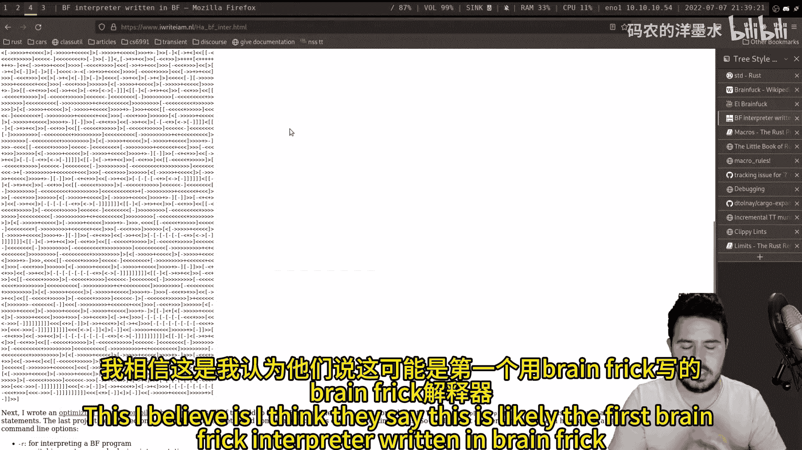

Here's what I'm going to do。 I'm going to grab the Ho world code from earlier。

 What's the best way for me to do this。I will。Grab it like off your set no number。That's fine。

 I'll grab it like this。Paste it into my term and then I'll just patch it up here。

I'm scared of doing control W because I might lose， let's echo all of this。😊，Into delete spaces。

And let's also delete new lines。All right， great。 There is hellello world。😊。

Coopied onto my clipboard here。And if I cogo run this。I've still got E。 I didn't save the file。

 probably， yep。F cargo run this。This one is like， look how long this takes to build。

 cause think about it。 This is a lot of rust code that this macro is spitting out。

 And the compilers having to go through and work through all that rust code。

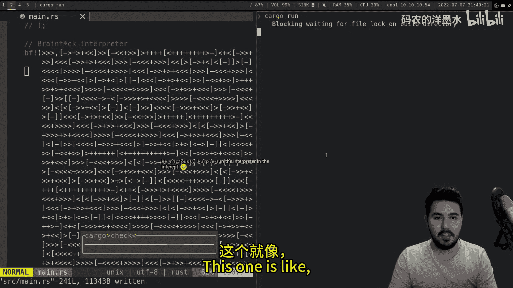

And then it's sending it off to LVMF to compile into machine code。

 there's a whole bunch of code there， but it's done now if I paste in hellello world and this program they say here。

 expect this interpreter expects as input a Brafrick program terminated with an exclamation mark。😊。

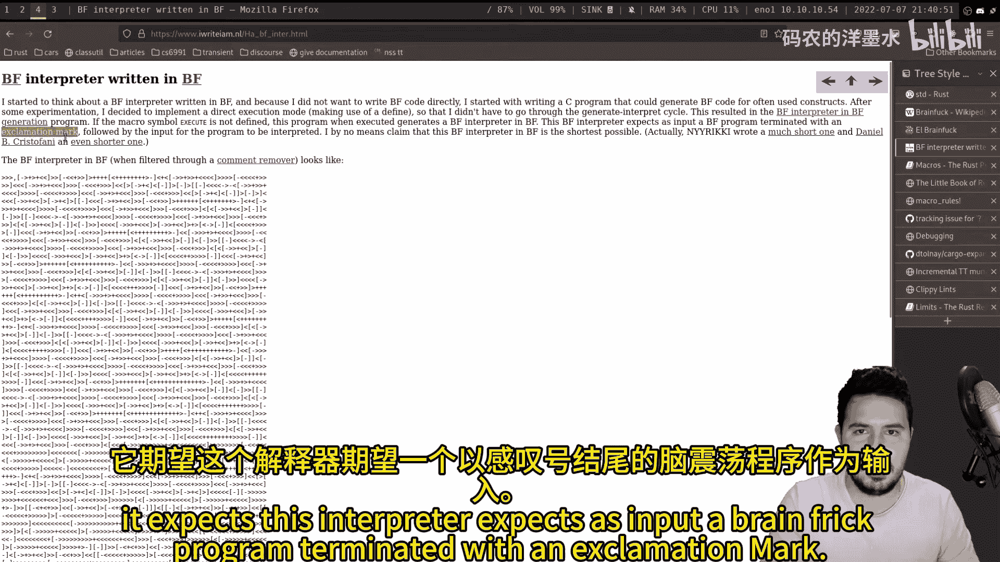

So I'll terminate with an exclamation mark and if I hit enter here。😊，It thinks。

And it prints out Hello world， which is just so， so， so， so cool。😊，So cool。

 Run the interpreter and the interpreter， I like based on how long。😊。

It first of all took to Bill but then took to just print hellello world。

 I think oops need an explanationation point I think going to interpreters deep might be it might be a bit much for it so I'm I'll probably put it out of its misery there but I will put this code on Git and please please do see if you can get that to work。

 see how many interpreters deep you can go you know if you want to play around with that。😊，Um。

 but yeah， seriously， like this is a very cool piece of software that this person has written here。😊。

And yeah。That is the very， very cool example at the very end to end it off。

I'll leave us with that hello Weia， I'll push this to get now。So let me go。Create a new repository。

AhHere， repositories new， we will call this Bf。The F strain， something like that， it is public。

We don't need any of this。And I will doing this skip remote， add origin。Get dot。thatM。

Stream finished。Get。Push dash origin main。And there we go， I' will drop this in the chat now。

 I've got a chat over here。And。There we go， run a rust compiler in Brain Frick and then compile the Bra Frick macro and the Bra Frick rust compiler。

 then run the Bra Frick ander with the Bra Frick macro by the Bra Frick Rus compiler。

That's next dream， yeah。All right。Well。That'll do us off there is there any questions before I close off the stream before we're done for today？

And thank you everyone， for making it out。I hope this was。I hope this is a little bit fun and。

Maybe like slightly educational， but， you know， at least， at least a little bit fun。

Is there any questions before I end it off？How awesome。What's the next stream topic。

 I do have an idea。 This is when I so I came up with this idea for a stream slash talk thing back in March I mentioned。

And at the same time， I also came up with another idea to do。

 I really want something with similar semantics to scan F in in rust。 and there's not really a great。

 I've looked at all the crates that offer something like that and they're all slightly wrong compared to what I want。

Um， so I was thinking of doing a like a longer format stream， excuse me。

 a longer format stream where I create a new crate for Cate Io。Like a new crate for public use。

That sort of brings a scan F like thing to from C to rust that works in。Really， like a。

What I'd consider to be a correct way because they're all subtly broken。

And the way I can very quickly explain that as well， if I give like input that looks like 1，2，3 in C。

 if I say scanf percent D in a loop， I'll get one first， then I'll get two。

 then I'll get three in every existing thing it wants to read the whole line and then it'll go 1，2。

3 is not a number you would actually have to feed this into your terminal as one new line。

 two new lines3 new which is just kind of silly I think it should work if you just give it this and also I want it where the scanf stops right after the number and there's a space next as opposed to having it choing one space and then two space for each which is it even more slight semantic difference but it drives me a little crazy and I also need it for Mipsi Mipsi is slightly broken because there's no good sort of option for this yet。

😊，So I was thinking of doing a stream where I' make a real world crate and go from like having nothing to having a published documented。

 you know。Publicly available crate for you know Ro crate on Cates Io So maybe that。

 but I'm not sure when I'll have the time or the energy for that， but if there's interest。

 then I can certainly have a think about streaming that。

The next topic is called 6991 wake Ze Rut To Tra。I've already recorded that， actually。

That exists on YouTube， but is unlisted。You'll I think you'll have to wait till week zero before you end up finding that one。

All right， I think we'll end it there。Thank you， everyone。Thank you once again。And yeah。

 I'll see you all next time。

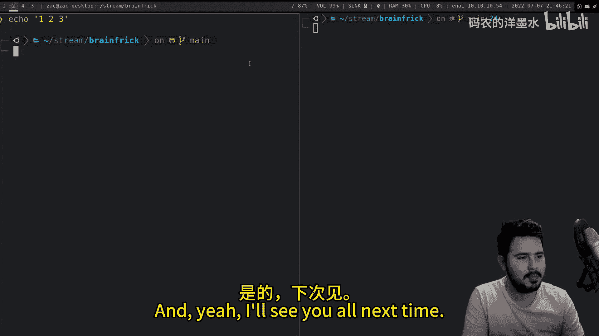

Bye拜。