# 【全集】新南威尔士大学 Rust现代编程 中英字幕 1080P p20 Lecture 20 - Rustlings编程练习 -BV15cf4BCEN1_p20-

Going live。You're live。Very epic。Of the link。I did。No。Where everywhere。

 but has voice I suppose it's often in a hashed voice。没有一个。I reporting you for spamning。

 that's reasonable。Right click if I ban your invoices， you just like the leave voice you do right。😊。

Oh yes， we actually are streaming in 1080p。 Thank God。Oh and the you can actually see my code。

 not disc code share where it's like， yeah， yeah，Incredible， that says you're a Nitro。

It says you're on a nitro， what？Do you give nuar no？Oh。

 it's saying that if I click this button to subscribe， you know。

 we have to stream your thing a 60ies I like I want to see that pattern。

I need to see all 60 frame but code。Will you make me more Z with the hell。 Okay， type。

 and I'll make you remote。Did you tie？DP1 and91。なとって。C，7，4，3，62 us I think。Straray is now Moator。

It's essentially'。No， computer money doesn't exist。嗯。

TheWhat do you one of my own is like USW It's not run by USW with USW Google logo。So it's like。

1 a0 exist so considering 1A it's literally called 1911 felt I know it was a joke。Such yeah。

 sure sure。Wsh， the joke is that in CSC， we've never heard of food 1 a because we do 101。

 that's the joke。Yeah， that's cold covered you are， so I think that's really a joke。

What that's the second how you the wish they will lead， are you going to get to cover the third？

This is the first time I understood they you didn't understand if you get。

 you don't understand getting wished that's a of getting later。

Just mess up and you're not just hover it to the queen。

You a global diplomas only what the hell is a global diploma。Gue what。Basically it's just a bridging。

 as far as Im said， it's a bridging degree。I hope you understand in considering you the core assessment。

 I didn't understand the degree to understand the course， right？上次。

So is it like1511 six as a slightly。basic levelNo same difficulty it's actually there's more content because it's running 12 weeks as opposed to know yeah interested it's a different audience and less people usually。

All right，So basically budget tone this last night。Right， Se， do you want to。

 this is a very tough first exercise。Okay， so we're doing what's called rustsling。

 which is like it's a library of exercises on a bunch of ro staff。

It was like we have variables and niche statementss and functions， eventually we'll get to like。

More complicated stuff。What I got currently is code editor VS code。Obviously。

 the best hotel in this use caseops。And we've also got it。A terminal。

 This terminal is running with rusttling customs softwareuff， which will like。

It'll continue to compile the current one that I'm working on and it'll keep your tail I'm done so this exercise is asking me to make this work。

In rust use let to me variables Yeah so a lot of the exercises are in the format of it's usually this doesn't compile。

 make it compile or it'll be like this compiles but print the wrong thing or something or this assertion fails or whatever and make the code work and if you want to like do exercises yourself you can go to like literally just Google rustlings and you'll find it on GiHub here and you just do like a curl or you can get clone it。

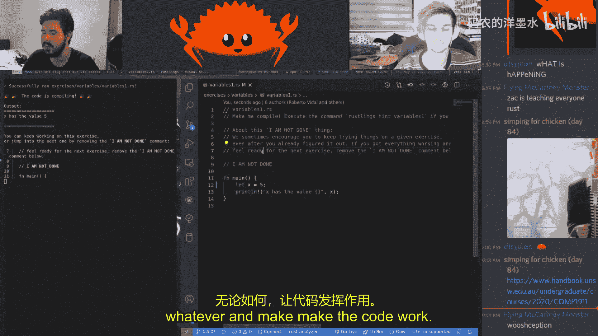

And like do the exerciseise yourselves and this like。Do you know how many exercises there are？

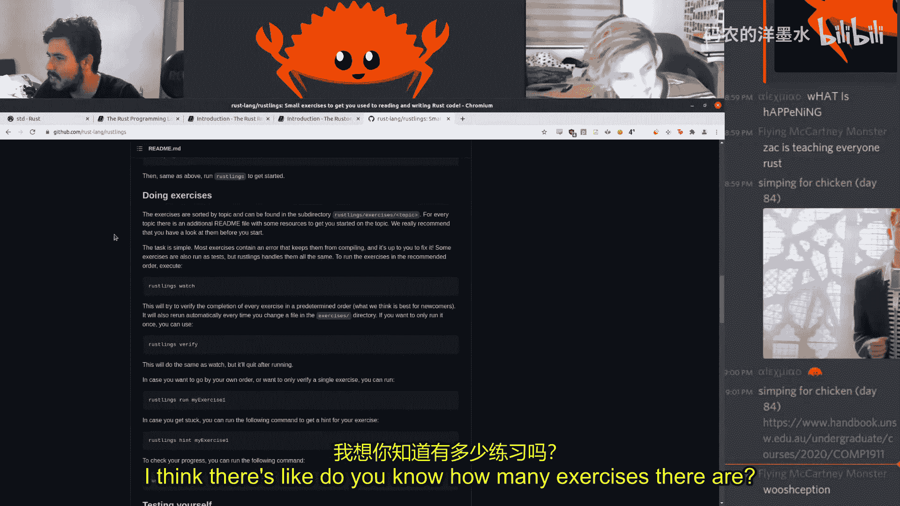

It was like a lot 30 or 40 is my guess？I'm not sure some of them are quite simple。

 some of them can get quite tricky。You know， I haven't actually gone through the whole thing。

 but it looks like pretty good content， I think。你Yeah。Yeah， so。What are we doing Oh。

 So now it says the code is compiling on the left。Yeah， this code compiling。 Yea。

 you can see what your exercise or Java next time I I am not done to。Let's read it。

And now when I say it'll be like， oh， my I like to change color random， it'll be like。

 we're I variables2 now， so it was like variables2。嗯。Make me compile Webt X X equals 10 for 10。

What does you skip to day。Yeah okay。Yeah， honestly， it was， it's actually。

 it says it's not compiling like if we look at the error message before you put the equals 3 there。

 it says it's not compiling because X doesn't have a type。Which is like。Yeah， okay。

 So it says consider giving X type。 Do you know how to give extra type without， Okay。

 without like initializing it， yeah。And then what' will let say now。

 use of possibly uninitialized variable X。Which is bad Yeah and this isn't like C or like DCCC or clang or GCC or whatever where it's it does like some certain analysis and it'll try and catch where things are uninitialized but not all the time in safe rust。

 it's literally impossible to use an uninitialized variable which is very epic。😊。

Cannot assign twice to immuno variable X。 So let x is 3 number。

 x is5 number youafe specifically safe。So sometimes you do actually want to use like you do want to meddle with things that are。

There's nothing wrong with having uninitialized memory， which sort of rust has this。

 it's hard to write the the right rules where you can have uninitialized memory。

 but it prevents you from using it in any sort of way。

 So sometimes the compile and this is sort of general across all of rust and that。

Sometimes the compiler is just。Slightly too strict because if it wasn't as strict as it was。

 it would be incredibly difficult for it to actually analyze everything and the compiler would take ages and would be way more complex than it is。

So it has to sort of make some trade offs in certain places and that's why you have unsafe as an escape hatch so unsafe is not like there's sort of a bit of a misconception about unsafe and rust and just to like demonstrate here。

If I just go。I have my rust vial， let's go。functionction name this。To write unsafe rust。

 you literally use the unsafe keyword and then make a block。

 and then your code will go inside this block here。😊。

And this is sort of like to let you get around the safety certain safety rules of the language。

 you don't just get like free rain over everything， but it's sort of。😊。

Disables a lot of the checks unsafe in rust is not for you to do things that are unsafe。

it's actually kind of like a bit of a bad name in that sense， it's not for you to do unsafe things。

 it's more of a I know what I am doing is say。But it's too sort of like intrinsic in my application for the compiler to actually realize。

😊，Right， like。This is like it may be， you know， I store an initialized memory。

 and like it theoretically could be accessed， but。It's not being accessed because've I've held certain invaris over here and there。

 therefore it's just literally not possible， so it's more knot。Yeah， sorry， well specifically。

There are a number of guaranteed the S Island。Usually in safe code， it can make all these things。

An unsSafe code， that's why you。你好。Yeah， exactly。Cool， so yeah。

 you can get around things like mututability。 You usually sort of backtrack through a reference and and turn it into something called a raw pointer and back out。

 but you don't just sort of do it for。😊，Just random kicks and giggles。 Like you。

 you should be very sure that this will be safe and usually it's very good practice。

 Everyone in the community will write what's known as a little safety comment above every unsafe block that explains this is safe because And like you sort of say this needs to be like that。

 And that needs to be like that。 And therefore， this will be， you know， this。

 this won't actually be unsafe。 And you try and make your unsafe block as。😊，Yes。

 so that's sort of the main principle of safety and rust as well in in the sense that you want to provide safety like you want to provide a safe abstraction and use sort of unsafe code。

 So if I actually have a look， a really good example here would be let's pull up the docks and look at something like V。

😊，Right， so Vck is just like if you know say job or it's like an array list， Python。

 it's like a list， it's like a growable and shrinkable heat allocated list。

 And if we have a look here and type the wordunsafe。

We will see there is actually like quite a bit of unsafe littered throughout this code and it shouldn't be much。

😊，There's a good 71。 A lot of these are going to be comments and stuff。

 but they're sort of doing things say this safe function trunkcate is completely unsafe。

 everything it does， but it knows that this is going to be safe to do because we hold certain invariance we know more than the compiler knows here and you do it a lot for like optimization or to sort of provide a certain to provide a certain interface like a mut text or whatever and so yeah you can provide as long as your function will be safe for any input and any state that the programs in that it's given then it's completely fine to sort of use unsafe in this way if you want to use an unsafe block inside your code and you actually can't verify that it's going to be safe to do like the person who's calling your function needs to ensure certain things to make sure your code doesn't do anything bad that's when you declare your function itself as unsafe as well like this。

😊，From raw parts in is a pub unsafe function。 And so for anyone to actually call this one。

 they will have to sort of read through your thing。

 figure out like when to like when it's safe to use and then call from raw parts in in their own unsafe block。

😊，And then in their unsafe block they would have safety。

 I'm allowed to call this unsafe function because I've made sure that this， this and this will hold。

Essentially。Very big tang， but very cool。 Ro safe we are。Yeah。😊，嗯。Right。

 so this doesn't work count assign twice to an me variable， so we want anm， soll say let Xm variable。

 which holds the value 3。Yay， it compiles。Oh， it didn't gives you the output as well， number three。

 number five， cool。Tpeport number 4。Maybe compile let X X is an interger。K。Bye， still my advice。So。

 let's make it the。Co， yeah。Yeah， just because it was uninitialized。

 we already sort of went through that one before。Oh， sorry。O extreme kind gel。What， why is this。啊。

Yeah， so remember。So it works that is does compile。 I would say go back like controls Z back。

 make this compile without changing only changing line 9， I would suggest。

Do something that a lot of the see programmers will tell you is a bad idea。I think we missed that。

Ive instantly7 me of them is a minor。And I was like， I don't need to recommend this。我。啊。DWai。

 lets what， try the rustlings hint。 Let's see what it says。If you if you need your hint。

 do this says in the line too。Oh boy， oh my god。Yeah， okay， so this is what they are looking for。

We learn and make it a meal very beautiful with certificate produce in how sources exercise is one in pie sure。

Wellres with me。That means we need to walk in and change it。 sometimes unless we' using to really is。

It's earth shadowdowing with oh， you can just do。Right this right yes， so the idea here。

 lots of languages actually have this support nowadays。

 but it's basically our new binding number overrides the old binding so these like the two variables literally have nothing to do with each other apart from sort of sharing the same name。

Many languages have had this for ages for but a lot of languages will advise against it。

 but it's a fairly common thing。Yeah， that's true。Just first when you do the second binding does it will if there's like you know you could still hold a reference to it if you so of traded something like on between line8 and line 9 he could say let number ref equals you know refF number in which case it would be sort of held longer and you just wouldn't have any way to reference like to talk about the original owned value but since he's overwritingiding it there and there's no sort of other references there if he gets rid of line 9 again。

 then yeah that will instantly be dropped at that point。it from memory there it's over written Yeah。

 so the the rust terminology for this in this case is the word drop because you could just say it gets rid of it in memory。

 which is true， it will sort of free up the resources that it uses in memory。

 but you can also have destructors in rust， which is sort of like I have a let's say I have a type。

Substruct food， and I want to execute some code whenever food like goes out of scope so a good example might be if you have a file like or a handle to a file rather and when that file handle goes out of scope。

 you want to close the file， you want to clean up your resources。😊，And so。

We use the terminology drop because D is referring to running the destructor。

 the drop function on that type， and then freeing up the memory that it was using。

So like do whatever you need to do to kind of eliminateinate or exterminate that type。Yeah。

 and it varies from type to type tag。Yeah， also， I see Jay asked in the， in the YouTube chat。

 Can't watch the previous streams。 This is the first one that's gone up on YouTube。

 So unfortunately not， the old rust streams are lost to the deaths the time。すしい。Workshop。是完。

this isn't very structure。 This is just me good So else structure。Cool also yeah。

 this is a good example， related when we have the ref。

If you use it right afterwards it's still pointing at the thing so yeah yeah。

 in this case it's rustss and knows out right so it's not dropped because it's like。

There's still something point you to it。Cool variable6 lets go Oh the error messages is。Helpful。😊。

Okay， no what。That's it。 So the the lesson here is that constant variables you need to explicitly declare the type。

I mean they all variables if they sure， okay。You can have a con mute though， or is it static mute。

 maybe can' no kind of con mute， you can have static mute， have static Yeah。Time for functions。

Oh cool， Grace。Make me compile okay， and just delete all the code compile。😊。

I think it's less that constants need to have。Tpes and more of that global items need to have。

Explit types。SoYeah， that's fair。Like functions， need， types and stuff。Do you have double be holes。

Do they need to have types？Yeah， so that's what you would call static。Do I need to have。Ch do this。

Yeah， yeah， that works。All right。응。So they's sort of like a。

We know that functions like implicitly return that unit type like just the two parenthees like that and so that won't change anything。

 that also won't change anything and also you can do function call me Pres arrow to unit and that also won't change anything if these all mean the exact same thing。

I've had this before。Yeah， so and like unit is a type that there's only really it's it's an empty tuple so there's only one way to construct it so it ends up being a really sort of handy let's say。

 like placeholder type that's used in a lot of places。That's actually a very important titleYes。对。

It's equivalent to one in arithme Yeah， and yeah。Wch you learn about Lauren。

 you'll learn more about it。Theレ theコ the number。It is very epic there is another type called boy which Russ pronounces exclamation mark never。

So that that one's called the never type。 It's not stable yet。 unfortunately， like if I go， well。

 I guess I can just do bang like this， but it's， yeah。

 it's still nightly only experimental because they're stabilizing a couple things about it。 But yeah。

 it's the type that you can make something that's equivalent to it。 I just have a。

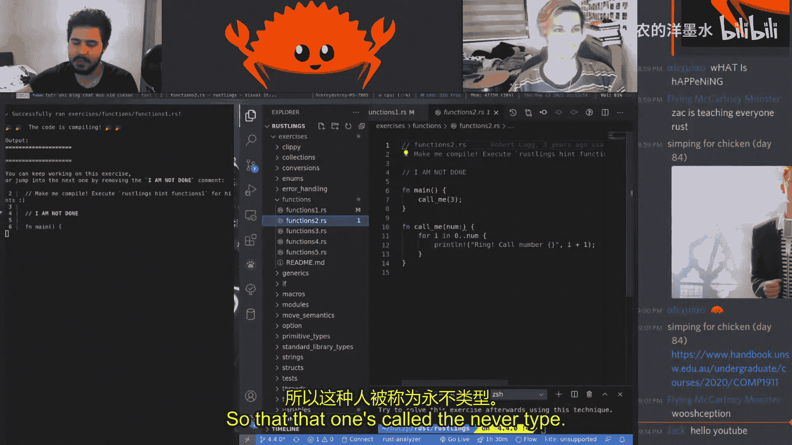

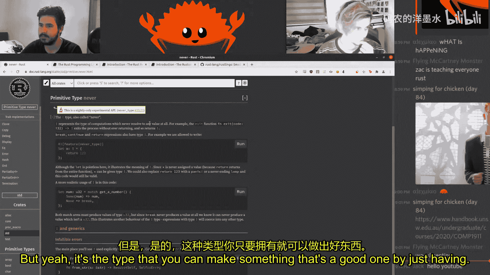

Yeah。动。Fctions。I gonna remove that。 I to do that。Call me number okay right。

 so function parameters need types Yeah， cool， that's it function parameters need types。

Do I didn't need What do I to do this without no。Oh， they need types， yes。

 always need to provide your types。

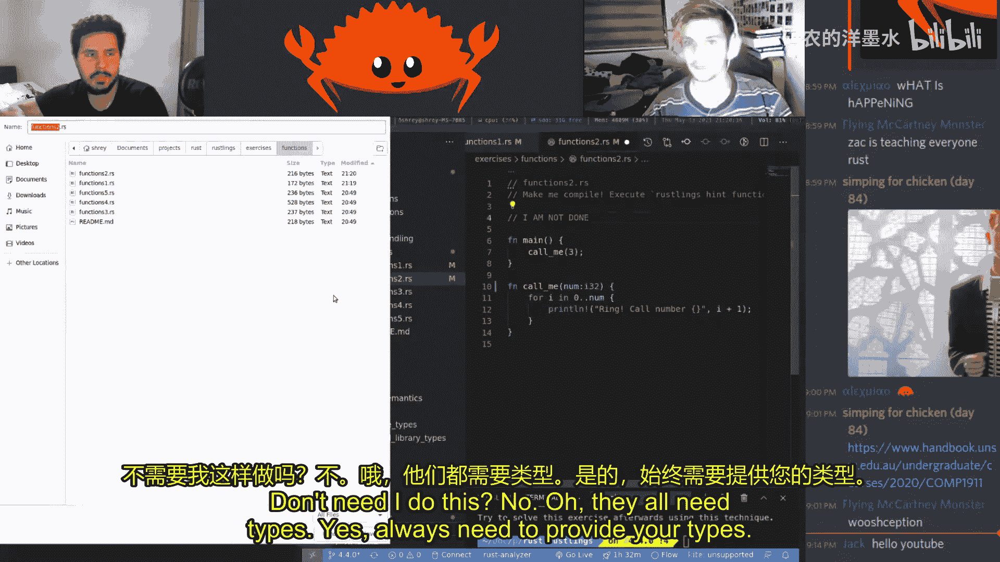

Cool， option 3。Make big compile。 call me Kong 2 ring S 1 R。1 is the other like。ぱな。Damn。

 that was difficult。Okay， number four， expected typepeic。Oh it's returning into just。成啊知。嗯。Okayay。

Yes， Ru has in the last one the last expression words are hard。 last expression has always returned。

 So this one's our question this is the so good one just saying return almost not quite actually。

 the return doesn't go there。😊，The last expression in the function is actually the if expression。

So anything that has a block that evaluates the last expression in that block。

So in terms of the function， yeah。So the if block， each arm will evaluate to the last expression in that。

So that's what the if has in total。Thing evaluates too and then evaluates to whatever the funk that。

Yeah， yeah， you want to stick a semicolon off the， but yes。The return price， my won't work。No。

 it will work。 You can do it like that， but it's rust rustismisms。 What do you call it rust。

 Pythonic， rust， rustle，I didn't think that was valid syntax。Whi错 that yeah。

Without the semicolon at the end， I guess it is。I think because return evaluates to the thing it's returning as well。

Yeah。It' just a really weird question like if you did like instead of return if you did return price minus。

 10 return price minus three。Any different and higher function。 Nope， same thing。Do I need no。

 I don't because it's this is expression of return Yeah。

 this you should be including semicolons if you're doing return like that。

 it's sort of like this weird side effect that same with JavaScriptscript Kis always use semicoons via JavaScriptscript。

Yes。Cool。Square made me compile。It's around the alone。When I first did Ha or4。

 the first example was like the double example where I was like you double and then you double double。

 that's what I'm thinking of this。Square。嗯。Right， what is the issue。

 Becauseuse I thought you found type Oh， because it's got a semi Right， Why do mean。

 Why is the semilon problem tray。Because otherwise it's not the last expression， I don't know。

 it's a statement， yes， it's a statement it's not the last statement， so you'd say the last yes yes。

Yeah， so like an expression is no semilon semicollon to the end makes it a statement and that whole last expression thing only works except the thing as an expression。

😊，The whole thing is a statement either the way， if you put a semi columnlon at the end。

 you now have two statements。じは。SureO。What what's your mistake。The unit， the implicit unit return。

Yeah， it's just the empty string which has the。Yeah， like that。Yeah。

And that's actually if you look at the compiler error again， when you do the semicollon tray。Notice。

 it says。Expected I 32 found unit。嗯。Becauseuse that's good。Last statement iss like beginning。Yes。

cool。Moving on to。Whats what be doing？Otions，Oh， wait what？Do not do。被告。Oh yes， well， okay。If one。

Complete the function return bigger。 Do not use the functional code with original variables。

 I can't write。 So I want to return return A if a is。o b l。

Which I can do in online line or one thing， I think one thing。If and the。I hope you are。诶，那儿。あつて。

Oh my gosh， around your condition Yes， Oh really。I'm just going to yell at you for everything that No Well would tell you to do I don't like that。

 That's gross。 I mean， you can put the parentheses there。I will。 I I a fight。It's not rusttonic。

Rostteic is bad。Cool， so this works because it's like the same as。

This we had in the previous examples， so we'll turn the A or turn the B， right。Same thing。

 because the F is the last expression in the block， in the function block。对。Cool。

 this is what we call eternalernary expression。嗯。You have two parts。Fs ifhu。

If phea is equals to F's4 else。啊。Really。Is it not healthy， Oh what。What's the。Oh wait， low the。Wait。

 is this like a syntax。 Is like  El。 Yeah， No， you're right， right。 What comes up the word if。

W isn't it all of the players very？Unmcle。What it want once fs goes to bar。then otherwise。

 what does it want。Literally， anything else。I remind if this was。Yeah， it's the。

Yeah that probably because it was like a， it was struggling to pause the file potentially the R like the language server was having a tricky time because you have LF with nothing there。

As a guess，Cool， now once's to go toquiz oh quiz。Wait， guys。

 I caught plagiarized on a cool way up here。Oh， I can write functions。Ca is not， all right， fine。

This is a quiz for following section variables。 Marys buying apples。

 One apple usually cost two rust buck。 But if you buy more than 48 once。😊。

They cost one where function to calculate the price of it。Yep， give me all about。

The marks to this quiz will go towards your final post。呃，那。

The course being social validation in front of us。So you。Okay。

 save I'll save my point as to the end yeah。What is a weapons。Yeah。哈哈。呃。More than 4 each one。

All right。オッケー。Return type true。嗯。Okay， that was it， wait， that was it it gave me all these errors。

It's because it's coming from a macro。I no planttation type for equals of ins jar。Yeah。

 so it's coming and it's saying partial leak of unit is not implemented。Yeah know。Okay。

It's having a sad time about that。 So there's two things here。 First of all， obviously。

 rust format is going to scream at you for line 26。Because you don't need them like， yeah， you。

 you don't need them。😊，It's better if you've been staring at a lot of sick。Yeah， true。

 The other thing is you said numb I 32 to I 32， right？Is there anything better。OhYeah。

 so Ru makes it really easy to use unsigned types。 So like， you know， if unsign types are the only。

 why would I， Why would you study。Because it's a scalar amount of apples， like it it's sorry。

 a discrete amount of apples。Right， but if it's a a screen amount of apples， that only tells me。

Floing。Sure， but like， you're probably not gonna want to buy negative apples and you're like。Right。

 but a negative price might make sense。Okay， so you could you could do I 30。

 You could return I 32 then if you want。Yeah， I。 I guess so。So you know。

 or in you may end up deciding you want to return。How would I make refundphones？

Sa economys gone I think sorry my quiz on Rrs is not taking to a account the set of the economy。😊。

Well， but wouldn then you need like the the like non to also be I 32。

 Can you get pass in and unfin them because they can be you。You that， right。

So the problem is you're trying to multi， you're trying to like you're returning numb or you're trying to multiply a numb by an I 32 and the types aren't compatible。

😊，是。So unlike many other languages， Rusk will never implicitly cost。

What it's pretty easy to trivial you have to do it You can just do numb as， no。

 you don't need don't don't do that。 That's， that's disgusting numb as I 32。Yeah。

 I hate that's gross。It。No。The whole idea that it's not something that happens well happen。えてくる点は？

他证是。Thousands of millions of things。Andこパ。that makes sense， but is there a shorthand for it。

 I just so long like carists do this？No， no。In this case， you'd probably just make the number of。

エタリ2。You're really not getting any benefit。民案さ。So that going so。不动手。

And create a is2 that's usually what I end up going at。If I。

 if I end up having to cost multiple times， you just do the costing once and then。

That's why shadowing your variables。You don't need a specific type。 but that's。

 that hasn't really done much， if you want to do3。 So that won't work。

It weren't imply cost your types。I could just show but it weren't implicitly cost of types I。

No on the left side is an And now since you've said it explicitly there， none of yeah， yeah。

 you're just do numb。 And since you've actually like it knows that the right hand side will be an I 32。

 so you don't need to state it again on the left hand side。That's cool， I guess I can see what is。

 So yes， Ty。 it would actually be suggested as well that you just get rid of the I colon I 32。Yeah。

まったよね。Answer。Cool。He failed the quiz。Oh， move semantics， nice。😊。

'm sorry lost one month from your post months。Yeah。😊，ああ、まけこま。好好。Okay yeah。Yes。

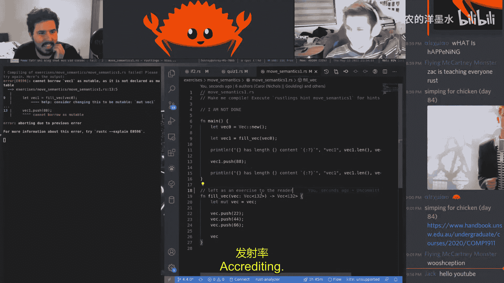

嗯。Cool。Zck， can you fill backward with Beck。 what the ahead。Okay， you vector x0 fill V 1 with x0。

Print out like one。Bringnt out， push 88 into like1。 print out like1。Right。

 so what's going to fix this fillback thing that's not working。I think I did this one， like I would。

But harder to。Good， what's Si Harris say？That's a good question Con remember but but can cannot borrow removal right so you can't this is an immuno variable so that I'm trying to push function to be and meable right。

And I'm going to pause you for a second just to like， so we're going look here。

 what was the name of the function again， It was output。Good， V push。Oh， that's。

Whatever so you can see this takes a refme itself。And therefore， we need。Nively bigger Oh my god。

 I left it。Element P for push。 So it takes a mutable reference to self。 Therefore。

 when we do like Vec dot push with our value， we need to have mutable access。

 So dots a very special operator and it'll sort of try and take references and de referenceence things and then take two reference to it and then dere it twice and keep sort of doing this pattern until it tries it'll keep trying and to get to what you want it to be。

 So it'll automatically go take a reference， dere。 But when it takes the reference。

 it'll go right ref， you know ref mute self or ref self or whatever and it'll just go， oh。

 I'm almost there， I just can't be I can't access it because I'm not mutable。

 So by adding where you add tray。😊。

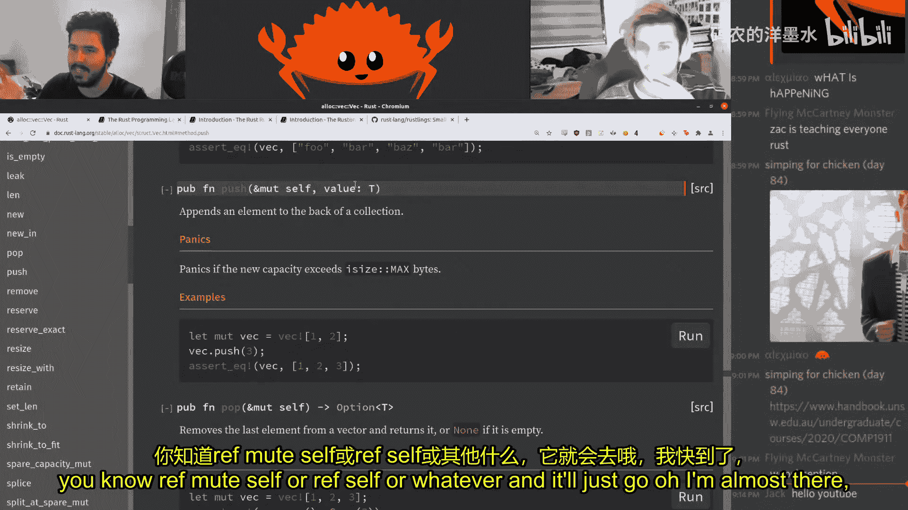

Yeah， so now when it does V1 push， it can actually get a mutable reference to back1。

 How just that's not。 Well， there is like a move on line 9。

But it's not really demonstrating much in terms of move semantics， which is， yeah。は。

zero gets movedYeah， but that doesn't really get demonstrated PDF。Oh， boy。Okay， alright。

 bar of back 0。Right。呃。I the code says extra type like I see， which is not in a copy trick， right。

 So it's the move。 Yeah， and it's tried to use， wait， shouldn't this move back out。Yes， correct。

 Look at where it's yet， correct。 Look at where it's moved back out to。So you call Phil V。Right。

 you move V0 into fill V。And then what does it do with that return value of Fvek。

So VX0 has being moved into V1。Rui。when you， when you。Back zero with。feel贝。

The value is removed from the Vex orbarium past in bank。zero now doesn't work。It just doesn't exist。

 correct。The vector binding is useless。But why。Because the value has been moved out of it values I've taken thisied it sorry I've taken this and moved into here So so because this is a very sort of weird rusty thing。

 let's take a little aside。To go to where they actually talk a little bit about moving。 So let me go。

啊。Where is it？Did I go to Fa。Surely I've gone too far at this point。

 Where was it under ownership there we go。 we'll receive moving let's see。Ewnership rules bh， b。

 blah， blah， blah， blah。What is that interactly， It's moving。Okay， whatever， I'll just。

 I'll just open up pat terminalnal and we'll explain。Okay。

 so this is sort of one of the like core principles in rust。Which is。

I think probably the easiest way to explain this is to distinguish between the idea of copy types and then nonco types so as an example。

 just sort of take my word on it now， a few examples of copy types might be something like an I 32。😊。

Like a4 by number。 We might have something like a boolean， which would be one by usually。

We might have， what's another interesting copy type， a shared reference。 So let's say if I go X。

 let's say X ref is a reference to X。Ohm sorry， is a Ref I32 equals refx？

These are all what we would call copy types。 And then let me give a few non copy types。 So。

 for example， a V let V is a V of。Something doesn't actually matter what it is。

 it could be a copy type like I 32。And I'll say that is going to be a vector of 1，2，3。嗯。

What's another good noncopy type。 You can have things like hash maps option， I suppose is fair Op。

 We know is going to be either some of this tea that we have here。 Let's say this will be a boolean。

 Does't really matter。 It'll either be some of that boolean or it'll just be nothing at all。

 like a none。 So I'll just do some of like false。😊。

And let's say we have some custom user defined type。So I'll makestruct my structure。Like that。Cool。

 and then I'll just have let S equal let S myes straw equals a nu instance of myes straw， Okay， so。

As I said before， these are copy types， and these are non copy types。So what we have here。

 there's there's there's really nothing that's like going on between the the two here。

 They're both acting identically。 It's only once we start getting into these like move semantics where things start to happen differently。

 So let's say I go print printlin B of R X。It's going to be something， and I give it X。

And then I say something like this， let y equals x。And then I say printlin bang。哦。X again。

 and notice here I'm saying x and not y。Right， so Ive， I say this printlin， I let y equals x。

 So I create a new value， a new a new variable Y， which is assigned to X。

 And then I go and print X again。 right， Let me open up two windows here so we can sort of see what's going on in the same time。

😊，啊 cool。And yes， I know it's fine。And then I will go rust see through。Yeah， I don't worry about。

And we see it goes x4， x4， so it prints out x， it prints out to X like that's working as we expect。😊。

That is because X is what we would call a copy type so what it does here is since I 32 is like a really rather like small thing。

 it's four bytes， it's not really that big a deal， you know it's very cheap to create you know infinite copies of this thing whenever we say let y or something equals X。

😊，We。Copy the value of x into new memory and allocate that to Y。 and everything's all happy and nice。

 But you can imagine if we had some like huge structure。😊，That we may not want to like。

Cone that whole thing across， make a whole new one and then like potentially do that many times like you get this huge memory cost。

So， copy。Is a little marker that says I am a small simple type， I don't carry a lot of value。

 therefore feel free to just like copy me around the place and act like most other languages probably would in this case。

😊，However， if we have a non copy type， so let's say I try and print V now。

So I'm going to create the vector。I'm going to print the vector again。

So if I don't change anything here， if I just rust see it and run it。

 we see it prints the vector out twice now let me set y to be equal to V。

Rust see it and we get this big error message， B of Mo value V。Right this is because V is non copy。

 so when we do this let y equals V， the value of V is moved into the variable y。Right。

So y is now the owner of this value like this V that we have here V 1，2，3。

 Y now owns this and V doesn't。 This binding V is it is pretty much useless from this point forward。

 you could still sort of use it。 But like yeah， the binding you can just consider dead from this point forward。

 and therefore this code doesn't compile。 And in our case， that we're looking at here。

 these move semantics， right， So moving this variable v into into y or the value of V into y works the exact same with function parameters。

 So by a function food that takes V， which say Vec of I32s。😊。

And let's say I don't know if it returns， if I change this line here。

 let y equals v to be through of V。Exact same semantics， because V is asking for a Vec。

 a Vec is not a copy， then you get this unfortunate like move semantic here。

So there is a couple ways to get around this like they they've thought of this and be like。

 this is a bit nasty to deal with in certain ways。But it's really up to you how you deal with it。

 So I said before that a reference type is copy。 So let's say F just like printed out the first thing in the vector。

 something like that。 Let's say just go as print line V of0， something like that。

V doesn't actually need to take all the memory of the vector and own it right What would actually happen here when I call this is I would go through a V。

 it moves V into this parameter here and since it doesn't do anything with V like you know。

 doesn't return anything in regards to it and it's responsible for it， it owns its value V。

 that vector actually gets dropped like it gets freed。😊，When F ends。

 So V literally doesn't even exist parts at this point in this case。Right。

 but it doesn't need to do that。 It doesn't need to be responsible for all the memory。

 just wants to be able to read the first thing in it。 So instead， we could just say。

Let through be a ref that。 This is actually not。 you won't see rust code that actually looks like this。

 but that's sort of a different story。 If you learn about slices and stuff， you can。

 you can sort of play with that there。 But for our for our intents and purposes， this is fine。 right。

 this actually won't compiled because I need to say， give it ref V。😊。

But if I drag and rust C this now and run it， then we still get V1，2，3，1，2，3。

 and this function also works。 It printed out that first thing in the V。

There is one other option we have here， which is， let's say it actually did want its own vector a needed responsibility of the memory for you know some random semantic reason you have。

😊，嗯。Or the function signature just happens to look like this。 Someone's made a bad function。

 and I really need to call it。 There's another sort of there's a way to copy a noncopy type。

 but it needs its you have to sort of explicitly say it because you're sort of assuming that the cost is going to be quite high and that's the clone trade So if you implement clone and a lot of things do implement clone not everything。

 So some things literally you can't copy， you can't clone， you just have your value and。😊。

It's a bit unfortunate that that's the way it is， but most things will end up implementing clone。😊。

And this will essentially do the same thing as a copy， but on a noncopy type。

 you have to explicitly say， yes， I want to clone this and it should like stick out like it should stick out like a little wart because you probably most of the time when you're like reaching to clone。

😊，You probably don't need to actually use it。 It's probably like things have gotten a bit tricky。

 and it's like， okay， I'll just， I'll just clone it here。 It's fine。

 but there's a better way of writing it where you don't have that extra cost。

 So clones usually stick out quite a bit for good reason in that sense and just to show you if you wanted to say what if I want to make。

 you know my struct only has。an I 32 and why a U 32 I know it's going to be really cheap it's just going to be you know8 bytes I want my struct to have copy semantics it's really easy you just do this little you may have seen derive before which just says implement this for me and you can give a copy in this case I like to say copy clone。

😊，And this will basically automatically implement the clone trait for you。

 so this function here and it'll say whenever like it's moved around， just just clone it。

 just give it copy semantic so it'll always clone that memory for you every time。

So let's get rid of this for a second because I don't want to compile it for other reasons second。

So the trait。Cone is not implemented from my structure。

 So because the way copy where it's it's a bit dodgy of a story than that。

 but' it's simple enough for now copy， you you're required to implement clone on it。

 So it knows how to how to actually copy that memory when it needs to。

 And that's sort of what the clone function is there。

 it's a bit weird when you get to like side effects in clone。 but you know。

 getting a bit ahead of ourselves。 So it needs to know how to clone it in order to be able to copy it。

 So maybe you'd even prefer for it to be written more like more like this。

 So I derive how to clone it。 And then I how to copy it from there。 And so then if I have。

In my main function。Let x equals my struct。Of you know x is three， y it's two。Something like that。

 then I can say let y equals x and both x and y are still they're both valid down here where if it was nonco。

 only y would be valid at this point， X would be moved out of and you wouldn't be able to use it anymore。

Would a string type be non copy then， That's actually a really awesome question。

 because the answer is simultaneously， yes and no。 Rus actually has two different string types。

 There is one called ref stir。 Sorry that's something like this。 like X ref stir equals hello。😊。

And a ref stir is basically， it's an immutable reference to a string and that string。

 like you can't resize the string through that reference。 you can't。 Well， first of all。

 it's it's immutable so you can't really mutate it。 but behind like a stir in this case， you can't。

Ever change it。 Like if you imagine you had like a a ref， a ref mutester。 it gets a bit weird。

 but think of it as a statically static size string。 It will be like the five letters。 Hello。

 you can't add characters to it。 You can't like take characters away from it。

 And then there's another type。 Let's call it X 2。Capital S string。

 and that might be written something like this。 Oops string from flu。Make this a little bigger。

 And this is what we would call a heap allocated string， So it's something that can be you know。

 grown and shrunk。's it's essentially basically like a deck of characters where it's you know a list of characters that can grow and drink and mutate and all this and very interestingly。

 we can also turn capital S strings into ref stir， not the other way around unless you you know create a new string like a new heap allocation and put that value in it。

 but you can sort of turn a ref string， So like。😊，ThereIt's a really weird thing you can say， let。X3。

 this won't compile stir equals D reference x2。There's a directre trait in rust。D Ref。

 and it says when you dereence me， what will I turn into。 So for a pointer or like a reference。

 it'll turn into the thing it's pointing at the thing it's referencing the string。

 it just so happens that it'll dereence into a stir So then you can end up referencing it again and you get a ref stir。

 And in this case， this actually will compile finally enough。As you can， as you can say that。

So you sometimes see these weird conversions in rust where you see like why are they referencing and then dereencing I suppose the other around dereencing and then immediately referencing like that doesn't do anything but you can sort of mangle types around like that and it'll just it won't really do anything at runtime。

😊，嗯。Cool， and I sorry， just to bring it home。 Reffster is copy because non like just a reference types are copy。

 capitalist string is not copy because it's， it's like a V。 If it were copy。

 you would end up with a problem where。😊，Something like this， if I have let X near my screen。啊贝。

And I said let X 2。Equals x1。The problem is at the implicitly at the end of this block。

 we're going to have drop X1 and drop X2， or if you're coming from C just replace the word drop with free。

😊，Because they both needed to be cleaned up， they're both valid。

 you know this at the end of the function because we're imagining that they were copyied。

And what would happen is these would both have a mallik pointing at this same food string， right。

 It's mallic some space for the string。And then this one's x1 iss pointing at that string。

 x2 is also pointing at that string， then you drop x1， which frees， you know that malik away。😊。

And then we drop X 2 and we get a double free and we get that security bug， very dangerous， scary。

 So we get that double free there。 since this is actually a move。

 there's no Dex1 because it's been moved out of。 So we just get the single free and everything is Bueno。

And that's basically that。Is there any more questions from that？Go I'll bounce back to Sre。哭。

Rust strange。Cool， right， so this is saying that back0 is moving to Beckwa into fillback and therefore it's gone here。

So。I'm going to just close。Make a temporary variable that gets food in kind。あ。We got going。

The only issue should be。Ah that's fine， this isn't the solution buried in there？It works， yes， cool。

 So that does work。 There's a slightly more succinct way to write that。

Without the extra temporary variable。It's just the back requirement right。

Soll it'll move the cloned in in instead of the original V， that'll still work。

Probably the right solution here would just be to take a mutable reference to the vector in Fiback。

So modifying the function fill V。All right， so instead of like consuming the memory of a vector and then like giving a back instead just taking a mutable borrower of that bar of that vector。

Yeah。And makeさ does that。Make me compile without adding new lines， just changing existing ones。No。哦。

Oh， that。I don had it for second。嗯。Bla me with electronic hotel。 Please changing meeting with back。

Can of borrow people。呃。嗯。Where are the errors coming from in this case？I don't know。

 Im already much shortly。Cant from the usage of the backal Yeah how not borrow me because it's trying to。

So this so mutability in terms of when you're dealing with a reference。

 then the mutability is the mutability of the reference。

 but when you're dealing with an actual like type like an actual value。

It's attached to wherever that binding is declared。 So look at look in your function。

 look in your function 2123，23， they're all talking about Vec right。

 Where is that exact binding V coming from right there right。

 Is that amutable binding or an immutable binding。Right， so like E this is mutable， which it is。

 Its just defined themable unless I change it。 Well， it's。

 so it's the same thing as if you have a let V equals V。Right， like you own the value。

 but you haven't declared that binding is mutable or immutable。Oh， that now that， yeah sure。

TheMo is4。 almost was out。 Is sorry。not系有。我要走回。啊。How子。是。Oh， I see okay。Oh。

 let's just create one So they're saying that we don't want fill V to take a vector anymore to just return one。

It's doing this。 I can't do this， right，啊。研急？What color is。Consider。I'm surprised。

 oh it's the you're looking at the wrong back。I was going to say I'm surprised at Conton further type from that because it can look at which Voe it's pointing at。

Yeah啊。なるな。I'm sorry。We would look at the line that the Arizona。Yeah。

It doesn't know what that is a v of， but I don't think it's even used。我。What style errors。話好きでし。

Oh wait， I' to this right。Yeah， yeah。 Hes a solution to exercise。 Oh god on。ButPect。嗯。そ是什啊。嗯。といよか。

So I don't think Vx0 is actually used。E all， hence why it can reallyly infer the typess。

My account wiseness。Oh， you tell grasslings。Oh， yeah， did。Wait， did you。

Because that says functions one， oh wait。What。W is it。Yeah， this is like functions too。

 I think it's doing。ForSome reason， like like the rust。死。Okay， cool。 Alright。

 it's pointing at the next one。 Okay， cool nice。Yea， acid said we are。

Why doesn't this get dropped returned It moves the value back out。 So actually， yeah。

 that's a really good point if you you can move a value in through a function parameter。

 you can also move a value out of a function through the return。😊，Yeah， yeah， yeah， yeah， yeah。

 yeah yeah， yeah。I am done。What are I going to do now。Pitive ties。 Whats like what。The sort of。

Built ins per se。嗯。It's not like mean， is that true for values and you must counter to one without？

Well， I mean， if that weren't the if4 compiled， the let will， but the air4。Because if I 32。

s it'll only take balls。Could do it the cost。 Yeah， yeah。Co the time thats cool。No。

 when I'm going Yeah add Y X。It is both morning and evening。Yes。

I think it's asking you to do it in terms of is morninging。喂问还有。

Let his evening equals probably some function of his morning。 Yeah， that's what I was imagining。😊。

I mean。咩嘅。呃。Cool。Pto types。ok。To。Atheical characters chas。Finish line example。

 What's your favorite character Try b blah blah。Let your。Please understand like just did。

Yes go equal number two5イ。系一个。I do。Yeah， I think a miracle。 qua。 Where all this one in。Cool。

 paradigmtypes 3， I'm not done。啊。Wow。Creary based on v， the line here。

But the question mark question question mark。Wait， is there certain easy do what to do？😊，ははい。No。

 there's no easy way， you just have to type one， two， three， four。😊，我第一集来。😊。

So it actually says it wants an array， specifically not that。😊，No。So。

An array is like an array in sea。RightCompile time， static size。Not globalable， not shrinkable。Right。

 okay， whereas V is like Python list， correct？好。えそうです。哦。What。😮，Have you seen a race synt before？

I don't believe so。 So it's just square brackets， you can put a value and then a semicolon and then how many of like how many。

 how big your array should be。It can also just not give it the size。Yeah， yeah。

 and so that'll just be like an array of like one。 or if you have comma， comma， comma， you can have。

 you know。And elements。Let's see。 that's， that's no it says you have to create an array with at least 100 elements。

 That's Look， look strange。Look at the hint。There's no shorthand。 There is shorthand material。

 Sometimes does not require you。Al right， I just do。one。That's silly。

 So that'll make 100 like strings of， you know， this 100。Lots of the string one。

 And now you have well， that's a bigger egg。Yeah，One， and then like empty like C does。 Yeah。

 so they look at the bonus。 The bonus is actually really cool here。😊。

So they check like the way they check if your array has 100 elements in it is they say if a dot land is greater than equal to 100。

Right， so， but they don't actually like they， they didn't do that through a function or anything。

 They're just assuming that your A is going to be the type of an array， right？So yeah， you。

 you actually could if youd make it long enough。

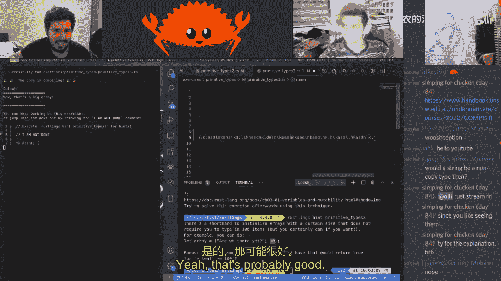

Yeah， that's probably good。I am program。Well， that's a bigger end we got。Absolutely scandal。Ohol。Oh。

 I have a copy at the。P that4。Oh， I don't know the slices。

 again of an array with a told larous testpa。I think it's like。Well， well sorry。 Stop this。Pro yeah。

 yeah bring that back。That I maybe this shouldn't be there。No I mean， oh。You've got the right idea。

Is there anything got。 No， no look at that yeah。And what's right。F 2，34。喂。And the bang。 yeah。

 So basically， you can almost sort of think of。Think of a Vck。To a slice is the same as a， sorry， a。

Sorry， a string， like capital S string to a ref stir is the same as a V to a slice。

Strange just throws the V to a slice right sense So the V or the or the capital S string can be like changed like made big or made smaller blah。

 blah， blah， whereas a ref stir or a slice in this case。

 which is really just a ref square brackets is a pointer like it's a reference to somewhere in that you know list or string whatever and and also a length。

Right， so it's not a copy like no they yeah so that slice is actually a b of your array it'ss a it's a reference into your array with a particular length。

😊，Wait， does that mean like you hit a bar， kind of not use like if I did。Deadline of。あ。还有。Three。

 that will be fine。There's nothing wrong with borrowing something twice。Oh really。

 I thought it was amutable but Yeah， okay， there's nothing wrong with two immutable brows。However。

 you can make it break， right。Yep， yep， just moves on， you can make it break。😊。

If you put something between line 11 like online line 12 essentially。嗯。Again。

 you can have two immutable burs to something and that's perfectly fine。Right。Okay。

 this is a very weird case。 You've made your reference mutable。

 You haven't taken a mutable reference。 How you do ref mute。Yeah， reference， yeah。

And now you get the big borrowrow checker arrow。The angry evil bar check。

I am not happy to delete your code。 Yes， that's how we solve the bar checker。That's how he appes it。

嗯。And the reason that actually like is important that that caused an error is you can imagine if you mutably borrowed your original thing that you had。

 let's say it was a beck， you mutably borrowed it and then you shrunk it。😊，Yeah。

 then the thing that was referencing it before and said there was like five things there is going to go。

 yeah，lah， blah， blah， uninitialized memory， uninitialized memory。

 someone else's crap over here like， and then you get undefined behavior。So， that's why。嗯。

Do you start to the cat top， oh， I can do this。Oho， tus， nice， Its just like pithon。Os。

It's not like it's almost like oh， look at the compile era， that's so good。はい。

So word version if I think。 you're right。Yes， true。King please don't me。

 I think it makes sense like this because it's actually like that pattern is consistent in rust。你啥。

Cool， indexing tuple kind of skirt numbers。Numbers of one。Was it kind of complaining？Oh my God。

 the compile is two nice。😊，OhI hate this。 I remember， Yes， I remember the first I saw and I hated it。

Yeah。You actually， honestly？It's it's almost one of those like， you know， the the whole Guido。

 our Lander syntax is crap because I don't like landers。Honestly。

 that kind of works in this case where it's like you don't generally want to be indexing into a tuple anyway。

 usually the better option is to yeah is to patent match it out or you know things along those lines so because it's clearer that way regardless。

服务。Strucks one。Stros。So I done。Pified， cosmetic variabless， quiz1 functions， if。M shrugs。

I'm not going to read the read me a bit dangerous like that。Oh， boy。Something goes here。呃。What。Okay。

 you said straight draft。So there's color classic struct， color tuplestruct and unitstruct。

the name the hes。Name is。Dring and。Color is it。Not so quickly。he no， What am I doing。啊。Don strange。

Is stare is a type。You ref。This is just okay， yeah。

 So that's gonna be the problem is if you declare a reference inside your struct。

 then it's gonna want to like， no， well， how long is this reference going to live for like which reference is sort of which lifetime you can get around it。

 there's a nice cheat code， If you go back to ref St again。😊。

The nice cheat code is you can actually specifically annotate that the lifetime of that reference。😊。

Like this。 yeah， it's on the right track where the the。

The single quote and then like a then an identifier or whatever， it's like a lifetime identifier。

 we usually say it like tick A or tick B or whatever。

 There's a very special lifetime called tick static。😊。

Which is like this reference will live as long as it needs to。 Like however long you need it to live。

 it will。Okay， it's so strings Not no no no， but but because we've actually。

 you're only using constant strings there， they're baked into the binary。

 therefore they'll live forever， so you would actually write this as ref tick static space stir。😊。

So this is saying a string that a reference to a string that will live as long as it needs to。

 and then you don't need to do anything special in your strap。

 why would you not always have this because then like because your reference you can specify when there's as long as it needs to。

Because not all variables live forever， like if I created a string that was keeping。Also。

That would not have static lifetime。 And so you could not。发。Iing。Right， okay。

 so this is assuming you don't talk to。So the anesthe that means something that lives at least as long as forever。

Yeah， okay， cool。 Yeah， that thatll least to make。I'm pretty of st I was to forget about this stuff later。

Okay， its make your instantiation a little more annoying， but that's fine。 lifetime No。

 there's not this threads。The threads one is pun。Cool。What was it like。So， we want to do。Hello。

 this we do。 What is the structure name。Is it the bracket？哦。Mae is。Spring。咁。Green。And。本ん当。That。

This may not pass。Interesting， because look at the assertions。No。嗯。You can probably honestly。

 you can do the trick I said just to like because we're just playing this so just change the assert Es to say asserter Eke ref star green do name。

No， doesn't compile。 It's not testing your code because it doesn't compile。😊，We can do it at the end。

 we can do it at the end。들어야。Goodbye to do。I。Cool。This one， wait， Why is it。

Whats wise and color bracketets， There's three types of strs。啊。There's like field struts。

 like the brace named field struts。There's tuplestructs where there's like the fields are basically unnamed。

 it's just like a structut attached to like a tuple。

And there's unitstructs which have no like they don't contain any data。Oh， why is it so white。

That is quite bright。I can't change it。Plo startss。Ps were named at the fields dirtt。

 They declare the trucky word in the chaovle。Right， pleasure to meet next 0 to01 to period whatnot。

아呀。Or you patent match it out。Which is what theyve done there。Yeah。

 that's the same as think of it as like a tuppple that you are destructuring， like in Python。

That's why I said the syntax makes sense because it's consistent in rust How are you two things's like integer length comma integer through and here'll be the same comma or what No。

 that'll be length is a topplestruct right。Cool。W does What does it want to have。

Allstrs green is very good one， right， Co sound steel。This， and I went to。Why is not making me。

Suggestions。Rather your rust analyze might be doing something bit weird。

I know let me use I type properly。这。嗯。Co this needs to be。That pretty hies。好位。Yeah。

 the things that the truck contains needs to go in the top of there。Cool。

 and I have your units dropped。So unit struck is basically equivalent to the unit type where it contains no data。

 it's zero sized。嗯。Yeah。Think about it。 you so you instantiate a I'm angry that that works。

 you don't Okay， so you instantiate a like a brace struct with braces。

 a topple struct with parentheses， unit struct。 Yeah， you don't need anything。

 I'm assuming that's what you were getting at there。

 So you can just say unit struct and that that will actually instantiate you a unit struct。嗯。And， oh。

 the test pass， cool。H， so it actually infers it， which is handy。

 I suppose it the assert ache must D ref。Interesting。Or like a， you know， the dot behavior。

How did this work？which错。てです。Message equal messages equals format units so it's they've derived debug on unitstruct。

 which will just print out the name of the thing。And that's that's formatting it with the debug debug format Yeah。

 my rational arm is broken I kind of been like controlled to go to the definition Yeah that's。

Pa for right。Sparportks。At restaurant visit sauce， the weve got a orderstr try the debu name year made by mid Bo。

可了。Wouldn't is do we。You you make in like。嗯嗯。Or and do like。Yeah yeah， i'm sad。

Just to put it in the right name space， right， like it's sort of attached to the to the like name space per se of the of thestruct so you don't get a bit lost。

To syntax templatetax dont it's just updating the fields inside a strut。You know， x。

 you point dot x equals b over oh。嗯。This is oh yeah， okay， true。I would like to was good。Yeah， it is。

 yeah， it's like the spread spread off right up。Cool。嗯。Oh my gosh。 Do we have to do this。

What template。嗯。The was the original staff。 but they overall wrong，2 bottles through。Hey， and look。

 most of these， the only things they want you to change is the count and the name。아 the from。I ro。呃。

嗯。one。あわてやったあ俺は。That does not like me。Yeah， there's a few issues here。We I missed this in， probably。

All rightright。 Yeah， so thanks。

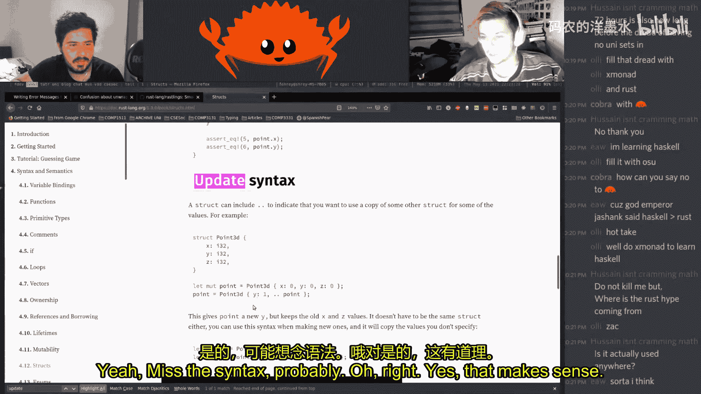

Yeah three。Does， yes，s。Dt like me Ca Work their foot。 worth in foot。Have you ever arrived。

Let the compiler help。Like， it actually is a really good compiler。Like on the left hand side。Yeah。

 this one is not healthy。 how do you have to stream。That part was。还港。Look at the help。

 look over what it's T。Start for the body of that。Look at the health N， yeah。Say。

 it literally tells you what to do。I want pay the chart。好了。This is7。

That sense does exactly sitting on。And。St。n if you have name on type。好。

do you need to create your order。Oh right。Thats。On function。Why is the same on function。

O you orders also function those reference you。That's， yeah。 That's a。Unfortunately。

Why does it default to like how does it even see that shouldn't that be like had to scope no？

You can have functions。Yeah， but like。I shouldn。no， yeah， like。fine。Oh， my gosh。In the other sign。

Hang on， think about it。point。No， no no， do I add the meat there。Coun。嗯嗯。

You're declaring a new variable， right？How do you declare any very well en rust。OhYeah， yeah。

 why didn't say that because they are doing it slightly differently that they're actually like mutating theirstruct。

No， like the error message Yeah， it says invalid valid the left hand side of assignment。

Because the reason it's upset is because your order actually is it's a function and it's trying to assign to the function and it's like it's that same。

 they probably should have named it something else。예。Allright， number three lost drugs exercise。

I be a quiz off this。D the logic。 then says we have find the package rack on test module test。

 make cokeile as fast。 You have issues。 get。Package， country recipe。In package near。

Something goes here。😔，What goods here are。个试三个试啊。就看那O。这先太。啊。Okay， next part。

Es international probably gets a bull。嗯。嗯。Is。Goodick， it was it getway， get fees， fees is a。Wait。

 please par of package。It just calculates that assume given the goala。こう。Thank首歌首歌。

So I was trying to check if it's going across the country border。

I'm trying to check how I check that。 Well， look look what you have thestruct。Send the country。

 your shipping country。 I don the same truth。But is it international in the neighboring countries。

Time to implement a graph database on we， wrestlings。Clearly， this is the re solution。Oh my gosh。

 I'm winning spam。 is good stuff。From a7 meeting me。I meet channel forever。Cool。い。Self do。诶。

Theiscipient country。Oh， yeah， I could just do。Cory。Equals so。But。戦略？Almost。Does that know what。

It's semantically like going into the compiler， correct。Yeah那个。Cool。Gt fees。 How does the fees work。

I have no idea。哦。There， you get to decide how the fees work。Yeah， I was waiting for you to do that。嗯。

おと。Oh wait， it's not。 It's3。啊，对。'Oh， you're right， you're right， yeah。Dn， I was just good be like。

 oh I should do some zero。 and it's like， get easier than zero。😊，可以。Three times。对。嗯。Not quite。

You has that face。Three times cents per gram。Aolong。Why is it。Oh。Self dot weight。time色 yeah可。

And this should pass。 I imagine epic。 So there's actually， before you move on， there's a haskellism。

That is also rustism in this case with the first function you wrote or the new function。Yeah。

 where it has weight and grab。If weighting grams is less than or equal to 0。

AThere is technically still atype for this。 The hasskell quote here is make illegal what does it make make illegal states unrepresentable。

 I that the correct quote？😊，It's probably close enough and in that case like。

This is where you would almost certainly be reaching for a U32。Because they know'。

 but it's also saying equal to zero is also like a bad type。And should be unrepresentable。

 you could technically use the rust type non zero。😊，There's a you can do non0 U 32。

And that would then make Oh yeah。That weighting grams。

 you could remove that check because it would be unrepresentable。

Because panics are usually not very good。Cool， someone asked the question in voice chat was like。

 is Ros actually using everywhere anywhere。 And I was like， yes。

 the same way that Steve use everywhere and more as well， right？ it's not， it's like。You couldn。

You could make an argument that rust very well maybe catching up to how much C is used on a sort of day to day basis these days。

 but in terms of like overall amount of code written like C would blow rust out of the water and probably like many。

 many other languages any day。 also because C's got a 50 head start。But like sea and rust。

Aren't really direct competitors like there's there's definitely a big overlap， but for example。

 I don't think things like a lot of places where you'd really want to direct competitors anywhere you use C you could be using。

Yeah。But。And theres basically no way you could use C that Russells wouldn't if only for compatibility reasons。

Rust isn't really a direct。 like there's a lot of places where still C just really makes the most sense and Ru can't compete。

I don't think that's true。 Okay， that's fair。I think that would be an unfake comparison。

 I think like the common comparison which happens a lot is rust and go。Yeah， oh for sure for sure。

 but the rust is directly targeting cases I was I would have argued C+ plus。Yes。

 but C is also in the exact same。C++ is a interactive。Yeah， yeah。 I think for the most part， it is。

 But the power I disagree is like， I think there are still certain。

Specificationations where that you you really are reaching for C as opposed to other languages like like there is no actual use piece where rust。

Yeah， I do agree with you。 Like， I know， you know， from using a lot of rust and using a lot of say。

 I do agree with you。I'm trying to find the right way to verbalize that I just I think there's some spots where rust。

 although it may be you know， a perfectly fine competitor and can do the same things。

 it's simply not going to be used in those places。But that's not true。Any way it has been used。

 rust is already been。Yeah， yeah， but for example， I don't think Rus is going to yeah。😊。

That's the point。Yeah， fair enough。So all the else have could Ru be taught in 151 and I was like。

 yeah， it could like yeah I don't think it should but but it could that's not the point of 1511 but like you know we taught 1511 in Haskell at one point。

Yeah。嗯。酷。呃。So。We are going to move on to the next one， which is en armss。Some types they。

Sometimes not' real。 They't hurt you。 Some types should be in every language。

 I don't know how to eat them。 So I'm just gonna assume that it's like， quit。かか。没。

This snake that has a lot bit of sense to me as an enum to be described as yes。啊没意思。To do。

what to do as I say if it anything else but this I'm going be Yeah。

 that's fair that's fair I suppose it could be to otherwise make sense but this is like yeah。

 thats that makes the most sense for rust。Yeah。Dine the guarantee below。No。Right。Me of。

Or what the heck。Hh。What is movingstruct？There's， wellstructs can be like named， named fieldstructs。

 topple strs or unit strs。And enums act similarly。Probably， echo is there to be a。Sing。

Probably it is email。 will find out。아 왔십니까。No。왜 주。That right。No 그래서。I， we'll find that very strange。

Cha color of。I' have 32。啊 two。Oh my gosh， I was genius。It just works。That's very epic。 Yeah。

 so you don't need， you don't need you know， you like you need the colons for the names like inside the move variant。

 you have X colon Y colon， but you don't need it before， before the brace。Before the brace。

 whats second do this。What。This doesn't make sense。嗯。But you say you can do this。 No， no。

 So I'm saying you don't need the because you are trying to put a colon after the word move。Oh yeah。

 that was the type of。Cool。As 3。To do。Inquient patient usage below。Yeah。

 I might an email of like yeah。Where is it Where are we using。Oh， Im patch expression。 No， thank you。

Message I'm Yeah， that that seems fair。Right and now you to do this Oh， that's so cool yep。It's like。

What are you matching。Message。啊。Message。Dots。没。On。Something not quite。 So first。

 the syntax is a you're getting a bit mudled here。 So you need to yeah， you need to match something。

 So that's good match message。 Then you've almost got the sort of variant syntax right。

 But you like message。 What's the capital。 What's the lowercase M message。There。

Yet the variant itself comes from the type， if that makes sense。So。I can't。 Yeah， no， that's。

 that's right。 You just need to change that to capital N because the variant comes from the type。

 not necessarily the value。 And so you say message move， the equals， equals。Greater than is correct。

 And then you just have to make sure that the move of b matches what it should look like。There like。

Can I much again like this so it's a tuple variant， is it？No。

 it's a structure so why have you matched it like a tuple？Alright， yeah。

 and you don't need to rede clear the types again。 Like it knows what the types are。 Oh rightep。

And this I correct that no， because otherwise， yeah。

 needs be named shouldn't work actually it would be silly。没好鱼。Why is' not order one on。well，你 here。

What's the first parameter to move position。I don't know self to honestly right self， second to work。

放的。The unified function callings syntax。Yes。哦。ふ。That actually would work。

 but you would just need to namespace it you would have to say state column and colon move position self point X Y so you could do it if you want to。

 you don't have to use the dot syntax if you don't want to。

That's why I said unified function Col and syntaxt because that's the special name for it。Right。T5。

저게 타고。Fund structure for。会。It shouldnt be allowed， right。once they something right。Hey， no， this。

 why is this allowed？Mimatch type hang on。Ex so hang on。

 we're getting the first so the dealer is look okay。

 The first very expected function tablestruct topple variant foundstruct variant message move online。

 it's defined On line 7。 It's used online line 65。😊，Move of a point。

 your move variant probably doesn't take a point。So it is actually， it is actually a。

 a couple you know。Point is the type。Yes， the crowds make a newstruct。 Oh right now。Perfect， yeah。

 there。Then you'll have to update your。Much。Or how do I what the heck。こい。And knows the type。Right。

 so you can just call it whatever you want actually。I probably call it lowercase P point。

 but you know。Yeah， I suppose that works。 You can probably destruct to the point at the same time。

 but obviously that makes no sense for this in this case because you're about to。Use clip the point。

 again， the。Cool， a how do I just say it。And yeah， you don't need if you。

You don't necessarily need to make your match armour block。 So you've said like arrow braces。

It can just be a single expression and if you do a single expression， then you do need a comma。

 if you do a block， you don't need a comma。Message， quit。be。In this case。

 I would say try doing this without the block。Just for funies。Not a cent column。Com on哎得。す个。は、こううね。

以前。嗯。No it doesn' not like that。Compare it to the line above。啊，行。Look at this bad error message。

 except if you want to blah， blah， blah， blah， what of none of those things。嗯。

That's my second compiler of today Yeah， yeah， yeah。Sure off bat。嗯。Oh， no。

 your chat is going off and the there。A see abstract of fl。発そ発そ発見る料理。発そ。いやいや。

There'sI think at like university courses in general。Cool， what the on change colour。呃A。Allright。

 was。it does want a couple， yes。Yeah走。啊。Let's say。Expected U8 found 32， okay？No， don't， don't add it。

 Don't add it。 Don't。 I'll give it you。 You can just update the topple variant。😊。

Like why you put I32s yeah， you're going to have to do it anyway， I think。Now you have U8 as U8。

Extra safety your types have been doubly checked。Yeah。😊，嗯。All right。And。Expected three。Line，69。

OhYeah， you， you need update your variant。That's so annoying。Yeah。

 it's a bit weird that they've done it like that， you'll have to change your match as well because you've updated your Eum。

😊，And in fact， actually， you don't notice how you're unwrapping the topple。

 then you're rerapping the tuple。Yeah， oh could I just like match on something yeah。い 하나 같아。See。

 why wait for PEp 7，6，8 or whatever it is when we already have。so I instead of python matching。

 It's gonna be so good。啊。Why are we about going to be so yeah。

Why worry about going to be so good when it already is so good？

I'm excited for high counter types in my life。😊，If it happens， if it happens。I'm excited for。

Not higher kind types。 generic associated types in rice。When leaving higher kind of tested rust。

 at leasttype will be at least after we get generic stereotypes， Yeah， exactly。 yeah。

 and it'll give you most of the useful things。Goodbye， to。やるんだ。Qu time。not a good time。喂什么。

Moddules are communicate modules。I don't know how to make how to skip things。 Oh， this looks really。

 this looks pretty simple。 Okay sure。对。I shouldn't need to make the mod pub。

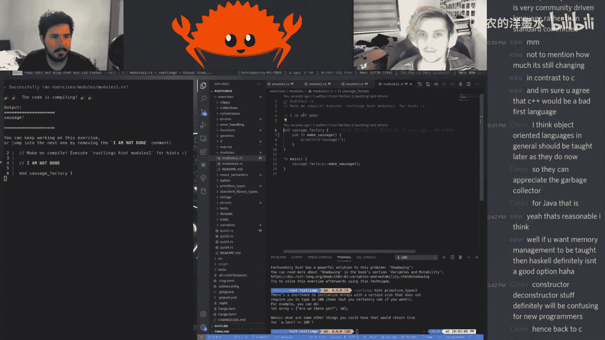

Cool。啊。Not fruit as fruit。Okay， wait， yeah， what， okay， so this is a really interesting thing。

When you're writing a library。Let me show you nipsi just to not for any sort of useful use。

 just to brag， basically。啊。So yeah okay。

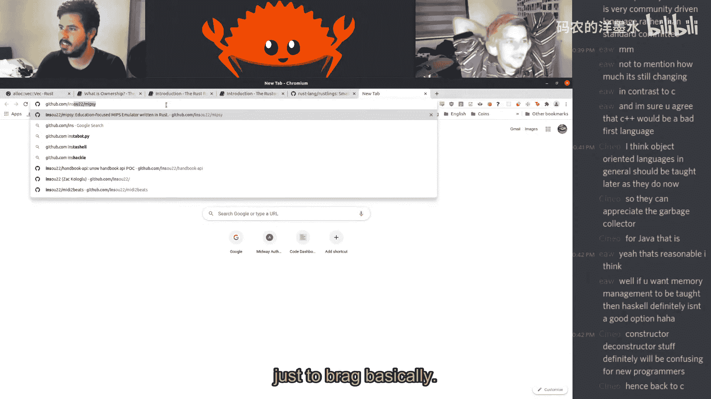

In Mipsy library， right？I think this， this actually does have a couple functions in it for。

 you know whatever reason。But it has a lot of these pub views， right。

 so we know use sort of like import and rust。U so， you know。

 I say I use this because I'm going to use it， but clearly there's not that much code here and there's a lot more imports than are probably going to be used。

This sort of idea of pub use is a way of like exposing specific things out of a library。

 so I want people to be able to see the Mipsi result type Mipsi era you know compiler blah。

 blah so I say input for me and then the pub user is sort of like make that import public it's almost like a reexporting that import for other people to use so it's then they'll just use like Mipsi colon colon Mipsi result or Mipsy colon colon instruction set。

😊，And that's what they sort of doing on1 seven and eight。

Right so I tend to do this and what myself generally I'll have like a module that has。

One type in it that I effectively want to be public。

 and then there's a whole bunch of other types that are。And it's not worth。

The user of this library havingt go into that module。To just get that one type。

Reexport the type in the。And so when you look at the library。

 you don't really have any sub moduleles when you use it library。It because of numbers。哦。

But it means that the actual implementation is a lot of cleaner。

 Do you still have things split up into a lot of。Right。So what is the thing private constant import？

Importing。Okay。Fruit， which is this。 which is this。Public， not public。

So no that don't need to make the module public。Okay， but then wise its private。Right。

 so that's doing the whole re export thing I was just talking about the pub use。

So what I' was saying is grab self fruits pear as fruit and then make that public。

Can it theば of it this。Am。No， I guess not。 that' that was yeah， interesting to say。But like， yeah。

 you get these。 you can't make something public if it contain if it。

If you can access private types from it， it's just like very it makes sense。So in this case。

 you're trying to export a private type units I'm not happy。It is angry。

 Is the rust Sea package going from Linux， Is it rusty or cargo， cause that。What you want is rust up。

sorry Ru up yeah so there's the three so rust C cargo rust up Ru C is literally like the base compiler like I will take a dot Rrs file or a few of them and I'll rust C blah line and generates me a binary sort of like clang or GCC cargo is a package management system for rust programs。

And rust up allows you to have multiple different rust tool chains installed。 So tool chain includes。

 you know， rust C， cargo clippy， rust format， you know。

 all these different sort of things that are needed for an install of rust and it lets you have many different versions of it。

 it lets you have the stable rust tool chain， the nightly version， the be， you know。

 and so it lets you manage them all。 So just go to rust up do S Yeah， Ru up is the mothership。

 so you got to rust up to S。 there's a installation thing there。

 And then whenever you want to like update rust to the latest version， like update your rusty。

 your cargo， your clippy all those things， you just do rust up update。

 And so it's all nice and sorted for you。😊，exactly。The， look at them， the rustme in in memes。

In names， it's the Greek semi Collon one。What。😮，Though not the Greek semica 1。 I don't say。

 wheres memes。Misk。Oh， miss。 Oh， I have that clothes。 I don't see that。 Oh， memes oops。

Second during the use of maintenance yeah it replaces sene call withs a great question。

 mockney friends JavaScript， pathetic。It's very cheap。

You should post tell your raw themes that you have into the chat after tonight's stream。Yeah。

 I have a big stock pileile of them。Literally there's stock I got sent like 20 ro beans the other day just out of the blue。

All right， the collection。还是么。We'll do a big one， right。哎呀。That's really easy。Oh is the one sign it。

Oh， the same thing。没有。But a big Ba boom。Each own in the back be is is too naive to try and do this。

No， can't start。I is a ref muti 32。哪个高中。責近。Imediately iterate。So it's a mutable bur on the V。

 and it returns you a mutable reference to each element inside the V。 Nothing wrong with that。

 That's cool。IThis syntax looks terrible， but not terrible and bad， just like， I mean。

 that is perfectly legal C。Yeah， I know， but it still。Yeah， I suppose so， but it's it's just， yeah。

 you have a reference you're dereencing it and you're， how makes sense in why you Yeah， yeah。

Hash map。Oh， cool。 I can steal it。哼。は。Oh wait no， you can wait。呃哎什么。Yeah念哎。don't get any。 No。

 it just thought is an empty hashmat。straight doesn't care what。All right， we' run it。 Will it work。

 Oh， no， lazy。Why doesn't it work？At least three types of fruit， yeah。What data type is using tray？

Trink。 Yeah， what's， what's the name of the data type that。It's a hashm in case anyone else Mr。

 and hash mapshuh？You can please look at time。hash map？That's a hash collision。

 that's two different values hashing to the same thing like and and at that like so if for just know a hash mappss are a key value data store like one key one value。

😊，Or yeah， and so trayys just gone insert and it keeps overriding the same key。And now it's up here。

か。😊，😀呵呵。😊，はうん。系呀。I feel like you said that in the discord chat so like the stream wouldn't see but the stream has the would see I actually want to say it and recording it people podcast they never know what I said it's true。

😊，Cause， you know， it's a very good podcast to listen to。嗯。Oh my gosh。

 why is this so much fruits This looks like a 1，5，3，1 exercise。The care the fruit。

 the virus how many of the fruit are you to put more than like what。

There are three heads of fruits apple floor already in Boston you not more of these fruits may past test。

Guu。If can you check type， how do I check the type。对。I。How much check it's like？

And then there's a really， there's a tights it's a variant。

 but there's there's a really like kind of cool way to do this。嗯。You will only be able turn。

How would say imagine it was like a topple variant or whatever。 Yeah， we can do a match。

 Match is probably the right way to do this。 but I want to show you like this cool little trick。😊。

Yeah， wait， you're actually， wait， it suggested the right thing。Before you get rid of the suggestion。

Typing again。If space， yeah， if let， it's like this really cool thing。

It works much better when you're unwrapping like a variant in the topple。But yeah。

 you' you're getting it。 Yeah， see I saw this Yeah， I saw this using errors， right， yeah。

So the thing that comes off the length， right is normally a name， but actually。

What you're putting there is a pack， and there are four places。哦。

That said it's three places where you can stick to patent。

So the obvious place that you can put a pattern is after mass。Sorry all of the pace for match。

Match against。And do something when parts of that pattern about。Boths。

You can also with let match do a pat match。 So the thing that comes after let is a pack。And right。

In the case of if and while， the thing that。Comes after that。 could be a bullian condition。

 but you can also have a。Falible let， which is a let that matches a pattern。

Where the value could potentially match a different。This is also a little chy。

 And one other place you can see patents show up again。

 a little bit chy to say this but macros is another one。

 So really common third place I was actually going to say is function arguments。Hellot all that much。

So when you have a function and you give the names of all of the arguments。

Each of those arguments is actually。And very。Happ is there as well。Oh really。Yeah。

There's two different kinds of patterns， so you have fallible patterns and infallible patterns。

 so an infallible pattern has to match every value of that type。So normal let。

And function arguments have to be infallible。 They have to be able to match every possible value。

Pattterns used in match cases if wet and wildlife in can be felt。

 it can potentially only match some of the possible value。Right。

Is there a way to do like a union or an Yeah， you're literally doing it。

 You just have to provide something on the other end。 Oh this is in if let， its it's nightly。really。

 that's not if Yeah， if let with an awe。😊，It's just a single fight，Why is that。

Hasn't completely landed yet。 You also have to put the on the right hand side of the equals tray。

 like if let fruit pan equals what。Oh， the thing you're trying to match， yeah。How is that not in。

No more rush。A。It'ss just not stable yet。I didn't think the syntax was specific to。

Whether it was if let or let。Oh if it all natural。Yeah， whether or it's fallible or infallible。

They well is in the future。Yeah， it's just， yeah it's。

Somewhat special case in the compiler right now， I suppose me it's not stable yet。

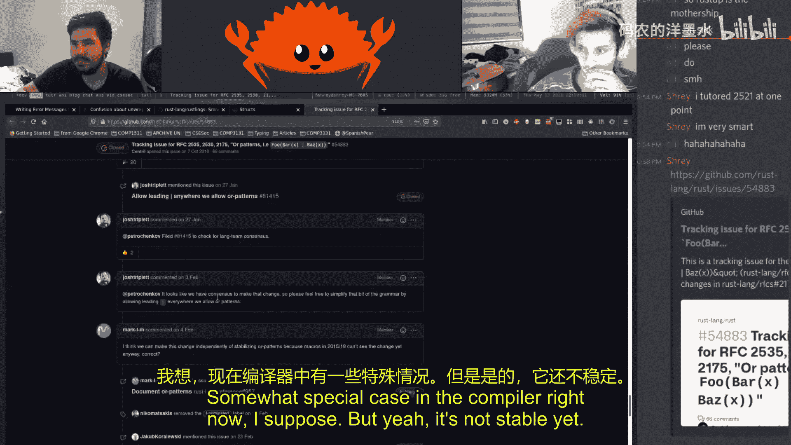

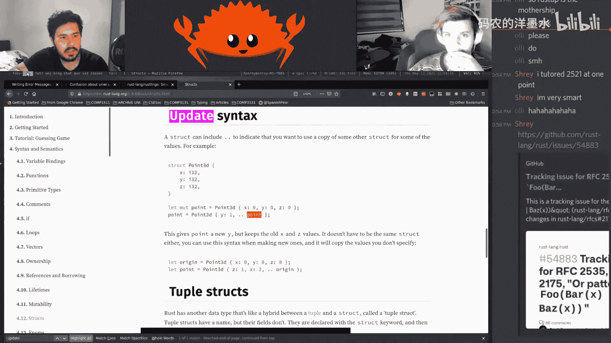

Unless it was one of the things that got stable stabilize。啊。What，1，52， I think tray is on 1，52。

Because there was some change to all patterns。したいとはです。Yeah， that I thats。Well， yes。

 Rose on the latest。 Well you not taking on the latest security version， but。嗯。But is is on 152。

 And I think actually what you may be thinking of is that you can do in a match block。 Yeah。

 in a match block， you can do like， for example， match like sum two bar 3， like2 or three。

 And I think that's actually 153 that that's coming。Why is this why is this syntax to？

Paent iffflet iflet is the semantics of iflet are a bit weird it was like there's weird hacks about it。

They shouldn't be different Yeah， but in terms of the compiler。

 maybe it was Code Gen or something or I don't know。 there was something weird about it。

 and so there's some special cases with thelet。And yeah， to be clear， you should。

Definitely be doing a a match here。 case you would use Yeah， trying match multiple Yeah。

 I thought there've been a， but there's not rust about Yes， you can do the a in the match。Well。Yeah。

 the map that you do it's all nice。O O。Okay， well， half 2 is done。You not that easy。Co。Now。

 what does I mean do strings。I would rather not actually do strings。W strings， this looks。

Make me comp with a practicing your show。Oh， I kind of see。 Yeah， yeah， literally。 this ones。

 this one's not that difference between a rev star and a capital S string。Doolm too easy neat。

I am very not。Make big college the function chairla Co。 What is the issue， Ex resting found string。

Stuck string。Why isstruct string because it's astruct？What was that。Sorry。

 I just managed to get my encrypt encrypt set Oh good job。

 Oh that's such a nightmare Oh I know that feel Les encrypt encrypt to the auto update is really pinnicky。

I just had to write a script because my Dianus。Provider doesn't have like a。Prem thing。嗯。Um，Cool。

 so this is the other like around you've got a string， which is， yeah。

 what do you mean why is it astruct？Why the stock should be type。Yeah。

 that's what a type astruct is a type I know。I just don't like to way to get a message thats all。

Wait， hang on。 Oh wait， did dude， I think you weren't meant to change the function definition。

I didn't。Didn't you oh wait， what did you do？waitai， it says don't change this line， try oh my God。

 don't put it back。The compiler literally told you what to do， you have no excuses。😊。

You having no fun with us。わかし。See， see there， oh he's come。对该。Oh， you I can do it。 I can do would。1。

2。G， R， E， E， N 5。好才喂。It actually will do it， not as a slice。😊，Okay， cool。Too easy。

time to collect share。No。Late。😔，The let's encrypt challenges don't work。yeah， I was right。

You actually it was a bug in Let encryptpt， you actually have to go into the source code and remove that it wouldn't do the the different challenge because it thought that the first one was fine。

 but you have to like say it true make it and not know that that challenge even exists Oh quiz。😊。

CanOh， interesting。Some are string， some are rest does。哇。no， come on， come on， don't do that。 Okay。

 Troy， just which one， what do you think the first one is。😊，I that slide It's a ref star， second one。

啊你。I can't give a function signature Yeah， you should be able to just open up Docs Rrs and just like try out the documentation。

Oh my god， doc。 rustdashl。org， no that's the wrong one that that's for like crates。あ。Duck。

t rust dash line dotg slash stood。我爱是。All right。2 underscore school string。去。Well hang on， What's it。

 what， What's it being called on。Go like， go back to the code， I mean， and like。

 what's two string being called on。A stood bow stitch string， like a ref star， right？

You just said the blue is a rep stir， so it's been too so go back to the docks again。

And you're looking for the two string function on the on like a st type， right？Yeah。

 which is this Yeah， that one。Chs a capital case strain。 Yeah。

 so that literally is just a function to take a。Let's say in this case。

 a refster that Anna returns a heat allliator string so you can then modify it and stuff。Yeah。

To owned。Im gonna guess it's string size， because they。呃。MisYeah。

 you've still got a lot of question marks。what Yeah， okay， so remember a reference is a borrowor。😊。

Right， oh right， right。And an actual value is， is an own value。Nice weather the dot in。

 I will be 100% honest。ばいいてど。That feels like they'd be conflicting implementations to me。

Don't blame me。Imagine in ditching half stream coming back to a service window down。

I know what this should be， but I thought into。Tea for tea was。Probably not。

 That doesn't really make much sense。Into is a trait。What。

W in is a function on a tray and it's implemented for， well， stir in this case。

 you can look at the stir implementation， like stir into。啊。You can， yeah。

 you can search stir column colon into。啊。嗯。O。Russ fat。

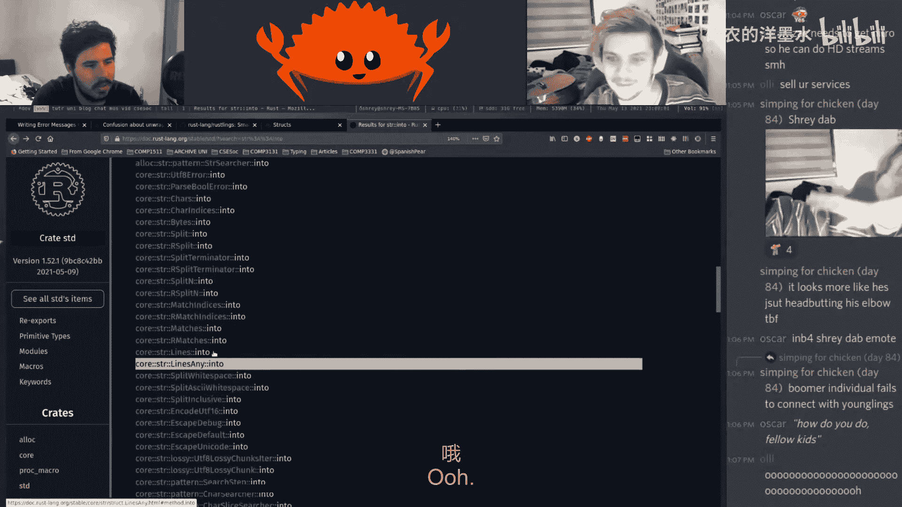

What's it being。That's all， no。系咪怕方。St to。That's interesting。 I'm gonna have a look。 that I was in。

 Yeah， yeah， yeah。嗯。喂。F， What is format to probably a。这。きしす。H trim color， yes。哦。Here， S， take a。

 take a break for a second。 I've done my little investigation。 So there's， there's the into trait。

 which we were just talking about and into。😊，Where can I show declaration， There we go。

 Trade into has one method into self。🎼And produce a T so I could implement into U 32 for I 32。

 and then that would turn an I32 into U 32， except it's weird because we couldn't find any implementation for stir into right But there is I'm going to have to see if I can type this correctly。

 It would be like。呃。不嗯。Let's look at from。 There's another trick called from。

Which is sort of like the opposite。It takes it some sort of T and turns into my value and there is this very special thing here。

Where am I looking。Proly down here， here we go I。Imple from from， from， from from。啊。Oh。

 I guess I guess it's going to be on the on the In page， my bad。

 So if I just go back to into again here。It'll say I。Into you for tea， where you is from of tea。

So it's saying that if you can turn a thing from that into that。

 then you can into the other way around。So if we do， if we look at。Sring from。

Then that will take a ref string into a string。 I wonder if there's a stir from。No。

 so so it's getting the implementation from string from and then。Yeah。Interesting nightmare。Wait。

 that's correct。 So string slice into。Interesting。Interesting。See， usually。

 usually people use into to convert a rep stir into。A raster into a own string。嗯。

So that's interesting that it ends up like that。 What happens things if you do call it with oh。

 you know what， call it with string， like change string slice to string the nice weather into。Yeah。

 yeah， yeah。 and then run that。Yeah because there you go here it actually says it here into is reflexive。

 which means that into T4 t is implemented， which is why I was like I was surprised I was like it's not gonna know which implementation to use but it does because you're choosing the function right and you're saying that function needs a rep store or that function needs a string and so it goes yeah。

 I can turn it into a rep store I can turn it into a string。😊，Oh，三。O。

 did you ask for the instructions， Ca I swear。 I saw you all the instructions with them。

The message disappeared。再见。O。I feel I was going crazy for a second。

ZZack doesn't name nitro for an HD stream because Zach is doing an HD stream to YouTube。True。

For free。But you could pay$6 dollars a month Z and you get animated emojis That's true。

 I could give away money for free Oh I need to get back to your screen sorry。😊。

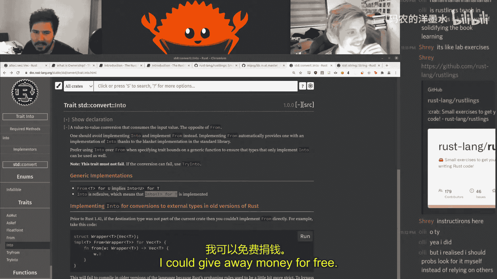

W are tall that nothing better than C。嗯，IRead random。

 someone posted think about line of saying at C is the best。Yeah对啊，就有个 language球球。Not bad。All right。

Damn my wait what， oh wait what？What that's I don't think Iquiz too no no Er handlingling， Sman。

 I don't believe look。Python has it right， it's easy else for forgiveness and permission。

 so let's just delete these and I feel like it's going to have a big cry if you delete them。😊。

I would try it。嗯。But I'm too scared。This function refuses to generate text。B b b b b。H呀。

What's some of it？Does is， is option guaranteed to be some none。 Yeah， some or none。

And how are they getting in errors， What's the type of somewhat error。So maybe， no maybes exist。呃。

What let it。So。WhatsSo that option is sum or none if you want， there's no sum or error。

 but there is okay or error。Oh， that's。'llFind out what it is by doing。Es， wait。

Do ahead just go to the documentation and type okay。By。The documentation is actually good。Result。

 wow。Scroll， just look at the definition of result。Result， Ok， your error。But then why how could you。

 how could you use some is some okay， Yeah， yeah。Right。

We love some types get it because it's like types， epic pun。Hello time。😊。

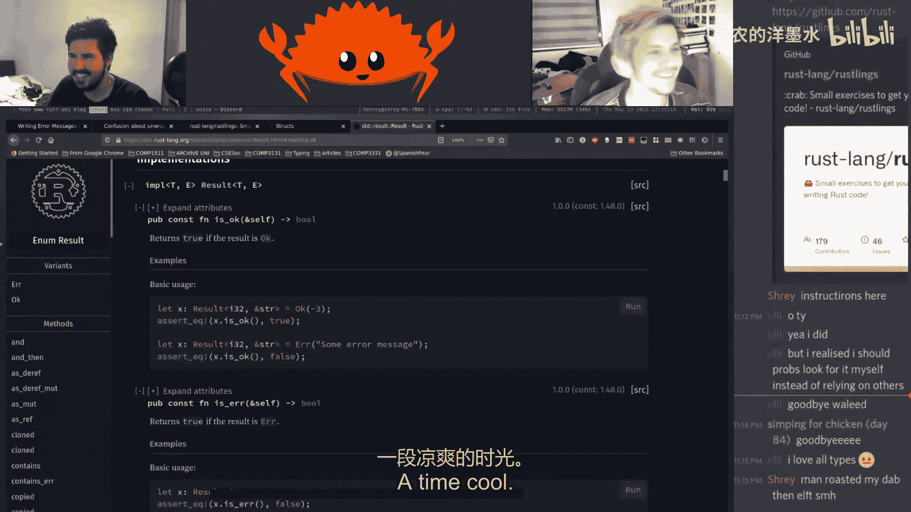

嗯。吐。It was a ho， I resolved。呃。嗯。Yeah， fair play。I missed that have been quote。

Theres something wrong here。It those string。 Oh， it has to be。stringring or。Spring the spring。

Checkick up email result。 Fo option。好。Wait， this feels like it something I should be doing。

But you know your result of an option。😊，sSo it's expecting okay yeah。

But I feel like this is not gonna。Because the test are expecting a sum yes， oh okay。

 I see why you're doing that you have to modify the test。

It says it says you'll need to update what this test expects。What silly in the good。Yay。Ive never。

 I don't think。 I don't think you should be encouraged to pass tests by modifying the tests。I mean。

 that's how I usually do it。No， you just start rip them from M，huh wheres M tests。I think。

 there's one。Maybe you should do the section on test second wherever useful function test， it works。

What is this。Oh， wow， I already do paragraphs。Oh wait， there's not that much。

Kin apply results of Bob Bla wait， what do the tests say。

 just read the tests test driven development。Play forward has10 single one。Plus five times。What。

Oh my gosh， Okay， fine， are you just stupid。Documentation， all land has five to。

 then when you purchase a pressing for you of one token。Time far possible one。Is3 hot。34。

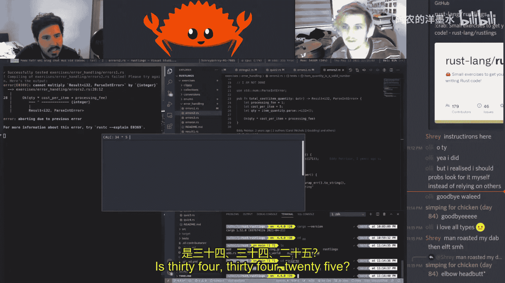

아 on西。嗯。Be invalid。 I'm actually not kidding straight。

 I'm pretty sure you can do this whole exercise with one character。I'm not kidding， really。😊，Yes， no。

No， you can't only give it this thing， right？Where's what's the error type in this case。

Wheres that come from？How do I return to？So this actually doesn't compile， it doesn't compile。Okay。

Can I multiply result of v by integer。Look at what's pointing at quantity as well。

It actually says that Yeah， they go。 I'm a genius。 Okay， do you want to explain what's happening。

 Shu because。Well， you see rust programme are lazy right。

 and rather than writing something like you know， error checking you know to check like dot unwrap。

Yeah I like what else is like。啊。To check if it unwraps correctly and it's an actual number。

 they have a default thing called questiontion mark。

 which will attempt to unwrap it if it doesn't it'll produce an error which you implement on the type or something I don't know。

So therefore， for pause and error， it's always going to be this stream。So， okay。you're to undo that。

Item quantity pass。Of I 32。Returns a result which will either be OK with the I32 that was successfully pared or it will be error with some pars in error that's just the time signature of that particular pars variantian。

So quantity， let quantity there isn't actually an I 32， it' not it's not an integer， it's a result。

 it could be an integer， it's either okay an integer or it's an error with with that parsin error。

You could manually match it。 You could say let quantity equals match item quantity pass and then say。

 if it's okay of。N or whatever， make an end if it's error， then return that error back or whatever。

 but because our function total cost also returns a result of I32 a apart error。

The thing that's most important here is that the error type of our function。

 which is pars in error and the error type of that PARS function are compatible， like in fact。

 they're the exact same。We can just say question mark and what that question mark means is if this happens to be that error variant error with a PAsian error。

 return from this function immediately and make the return of this function be error of the specific error we got by calling PARS。

And again， it works because it type checks that the errors are compatible。

But if it wasn't an error if it was okay， then unwrap that successful value。

 which will be an I32 in this case and put that in quantity so that question mark actually changes the type of quantity from a result I32 ps in error to just an I32。

😊，And it works， because。You know， the next line we're able to use it and go on like that。

 because if it wasn't actually an I32， if we didn't actually get the value out。

 then the function would have returned and we wouldn't be continuing to execute So it's this really handy like unwrap it or return that error from our function。

And like if you look in Npsy， whatever， there's probably hundreds of question marks over the place。

 it's very handy。Really， Ru， Im not done。 I probably do like one finishedarrow and how we head off cause I could bit。

Reasonable。呃。Oh， we get to result as though。 which is cool。

 the question about upgrade the factor1 lower option。Total cost。 If the cost can the result。So。

So I just so you know， using。When I just said， can I use me if you learn all my else， yeah。

 definitely。嗯。So sure using what I just said about the question mark operator that I'm sure you were astutely listening to。

 why is that not working online line 15？😊，It's a great question， Olie。

 I'm sure you would love to ask this question。😊，There's a rule about when you can and can't use the question mark can I use a question operate in a function return to the unit。

 right that would make no sense。So。Therefore， we have to make sure the functions return result or option to accept the question mark。

Soir。Total cost is returning Why what Why is erroring is clear returning result is it not。Oh。

 here it's not here。 It's an errorode。Does Olie wantan to help Olie。

 what do you think needs to be changed。搞得。AAre you about to get school tray？ I really hope you are。

No so sad。 What about you， Oscar， Are you listening to。

To to the rules I said about the question mark operator。对。Ok is not even listening。Oh。

 I just Im literally deserted from like three Oscar or goes oh。😊，The question mark operator。

 you said it only works in an option type， right？Well I the definition of the function that's returning the but again。

 changing。A result。Question markrea。嗯，就生 result。呃。Is the function。 What， What do you possible result。

 What is the question mark where there it is。まテロクわす。But doesn if you're returning result。

 why are you cost deciding is it taking result？You doesn't need to。Get functions。吃么东西。Oh yeah。

 so it' was a returning result and then。Oh I see yeah yeah。嗯。It's a great question。

You've satisfied like yeah that's honestly that's on the right track you've satisfied one of the constraints which is the thing you question mark needs to be。

 you know something like a result or an option or a trit and the total cost does return a result so it's a good candidate to use a question mark on。

😊，But the other constraint when you're using the question mark。Is that。

Your function needs to return a compatible a type。Right so on line 28。

 that question mark works because PARS the function is a result I32 parsant error and Parsant error is compatible with that error type from your function。

Pause in terrorro。Since they're compatible， it can propagate that error by returning from the function。

Yeah， so your ten000 error right Okay， what is the function that that that question mark there is being used in。

 what's the， you know， is it is it compatible？What function is that question mo being used in on line 15？

T cost， it's being used in Maine。Yeah， what's Ma's return type？啊。NothingYeah， just just unit， right？

What does the error message say？Carries the catalog inner function of inner function that returns unit。

嗯。So you can only use a question mark on something like an option or a result or whatever you can the second constraint again is you can only use the question mark operator a function that returns sorry that returns a compatible error type。

ButBecause it needs to be able to propagate that error upwards。But why can't do that。

 Like why isn't this is is is exactly the same as like unwpped。No， because。Right。

 like isn't this propagating saying unwrap it， otherwise error and you've got the error。

 you know what type is giving you right，' not giving you this sort of thing。

 So then I can't just throw the error there What do you throw。All right。Why can't。

 I guess it currently。嗯。哦 okay I think该这。Like there's no effort to go okay。

 to use the question mark operator is to have a result being returned。

 same thing so when your function the being returned。

 if you prepare the result of passing error instead and we can't do that this is a specific type of error which I guess can't be just in a normal context functioning that what we doing。

Yesやス。Very good， very good， very well done。So the fix is。So the fifth is to go。Yeah呃。いです。い。Well， no。

 hangy on。 Do no to change。 that's a question mark。Send me go one。Wait， the case has not change that。

Yeah， don't change the card。No， that function is fine， there's no errors in total cost。yeah。

 but don't change。 Don't change online。What what？No， no。O can hang on use， let me read it out to you。

 cannot use the question mark operator in a function that returns unit。Wait。

 I should actually just change this pack made。Is that going to work？Sll is on allowed。啊。

Generic parameters。That you just wrote like a tuple。A type of a tu。Wow。

 look look at the error message。Tk to transmit target。All right， it actually is that's so clever。

 it actually can tell。It's like， hey， you should use angle brackets。There're think to， okay。

 you're in god。You get all my。Oh， carries have and。Va。That is stupid。

 Why I would to It's actually shouldn't me over turn a number for like。

 it's actually really good because look at this， change your pretend user input to something that doesn't work。

 Like through， whatever。 Like， like look at 8。 No， Why just， Why would you do that。

 Just change a very look。😊，RightIt actually like， it's really handy。I see。

 I didn't think that you could do like it didn't occur that like nonin return those for main things Well。

 I mean to be fair， it's it theyre like nonin return value is definitely worth a thing because you've never used an individual return value for a main in rust。

You've had a unit return value in main。 Yeah， I just like C is like no return It like inquiusive return one over Okay。

 so there there's a few， there's actually a few options of what you can return for main。

 You can return unit， You can return I 32。 You can return option。 You can return result。嗯。

I can't remember if there's anything else you can return。Bras return from。不。然后一。嗯。But Ali。

 the way I understand it is that question mark will unwrap or if it's unable to do that。

 it'll return an error。Right， so here， it breaks。So returns in error sort of cost。

Te cross the question mark right？ then an error on with a question mark is like it will try to pause the arrow which it can't。

 So it breaks and sort it turns it again， but mean before having a type right。

 So it may as implicit turn type of the urtype。 And so what' was saying is that hey。

 your function is returning a result。But your function had an name has utype。

 so we have to modify the type to accept a return or a result。

That's what also was saying where it like question mark will attempt to unwrap and if it cutt unw we're easily return error。

 so here we attempt and we fail so we have return error。I mean。

 this is trying to attempt to unlock an era。I'm Roman an error。

 so it errorss in doing that and it tries to return it。

 now it return a result and it's really try to run it to something that's like。即系你要为诶。You know。

 normal number there's a。Maine Brook because of they causing error。con with email that vision。

So it' just like， yeah， so。The question mark doesn't have a return。 The question mark is like。

The question mark is what're saying like no， the question mark does kind of have a return of it。

 he's right。Let me have a The question mark literally， Okay， you know what， if I， let me。

 I'm going to switch to my screen， I'm going to explain it very literally。

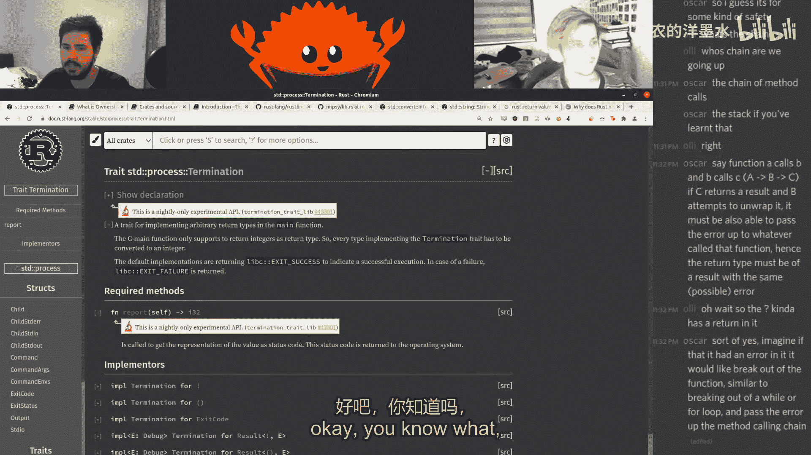

绝对 comparison。Like literally， very， let's say we have function theory return as result of。

I don't know。 It Doesn't have a unit。 And let's say the error can be a。

Shor and paused in error was fine。That came from these stood pause intoarrow。Great。😊。

And this can be u bar right。 So if we have like the string three paws into an I 32。

Like that question mark。And then just like， yeah， that should be happy like that。

Let's just make this return okay for now。We need to return okay as well。

Just to make sure this should compile rust bar and no it doesn't because I need to do3 dot taskss。

That。Main function， not down。O。Okay， cool， so that compiles。Literally， oops。

The exact same thing here。 what this question mark actually like is syntactic sugar for is exactly this。

 It is。 And I should really say let X equals that。 right。

 That is quite literally just syntactic sugar for exactly this。 Let X equals match。😊。

Three dot par into932。Okay of X goes to X error of E goes to return。Arrra of game。

 So that absolutely is a return inside question mark Alreta。 This is literally just sugar for this。

I understood。Send the point home。 Ru see。 No， O， fine。 I need it to send color with that binding。

Rusty and then happy。Yeah。O。CaAlso， the answer， by the way， what can main return， I was wrong。

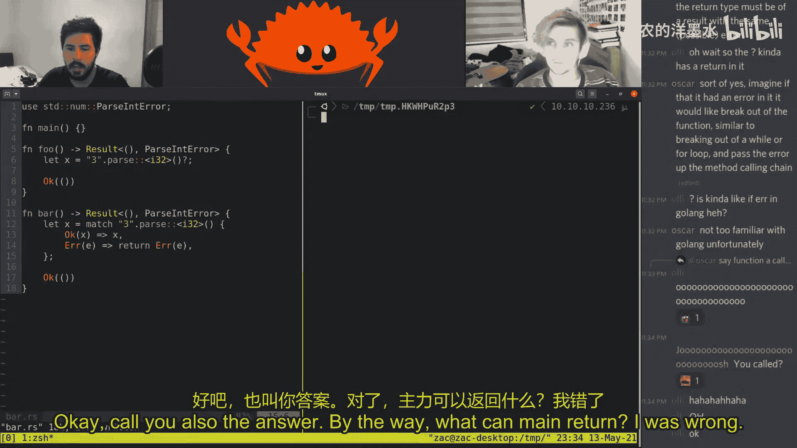

It can return anything that implements the termination trait。啊。So that can be a result。

 it can be unit， it can be the never type， remember that's a type that can never be constructed so what it actually ends up meaning is your main will never return it's like this handy little marker for it it's pretty cool and exit code which looks like a type which can be success of failure。

Pro just exit oneYeah， but that's not a return value for Ma。 that' that's a separate。

That's a separate function that takes a I32 and returns never because it never like you can't get a value from exit because it never returns。

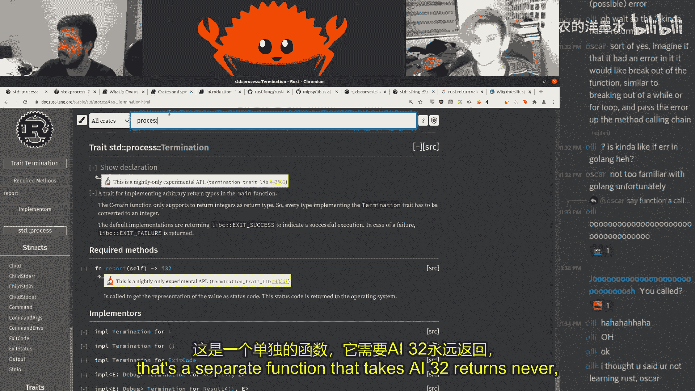

Cause it exits the process。 Very cool。Go back to Se。Well， I give me like seven paragraphs to read。

 This is a bit aggregate access the first one。 you can do it。 Thanks， cow。

 editit the rate and validate function early。 dark cr areas that do not already exist。

7 for wrong ring include I air。Passing input could press a for error valid query creation error。

 which is defined below。 How the error to one general error I was going to type What that goes where the question marks are and how do I turn that type from the body Bo Flsing in errors for heat。

Right， so wants us to。Pigix errorss。 And then the。Creation era is fine somewhere。Kえ。So yeah。

 if it's negative or zero， that's bad。Yes。8。Oh my God。

 Are they expecting you to know dynamic dispatch， what。嗯，是有。

So I can just do question my last talk this one。Irie。What's the question about。

I think they actually are expecting you to use dynamic dispatch， which we haven't yeah。

 let me just double check。 Let me look at like rustling。Solutions， I'm going to cheat。

Because I want to see which one is this error error is N。Yes。

 I think I this is any of that influence error， right？The。Let me just check。啊。Exercises。啊。

Theyre a handling。Okay， let's see what these two people did。 yet one used dynamic dispatch。

 the other person also use dynamic dispatch。嗯。Okay。Oh。

 this gets into so many like rabbit holes ignore。啊。嗯。嗯。Yeah， do you。

 do you see what this is saying or no。Expected in。Blah found in something else。 Yeah。

 what is positive non zero integer Col and call new return。呃。If I can click on it， but I can't。

New York returns a creation era。Yeah， and this is why we get into all these nasty like rabbit holess。

 honestly。You were odd。And so。You know， I'm just going to let you keep messing this one around because yeah。

Quest opportunity for。Right。Exected but blah because of return type。

If they in result found draft positive。 okay， so we。好。Did the help messages are so good。Trazy yeah。

It's such a huge explanation， it deserves its own to as a stream to explain that my understanding is that this is saying anything that implements the error like is of type。

😊，Some error don't know no， you're right the first time， anything that implements the error tray。

Right。But this doesn't input the error always does。嗯。But。In the but。Yeah don't three out of dispatch。

 I'll just tell you what it's not。 You know how in Java you can have like object。😊，嗯。

How I say this like。嗯。嗯。God， this is really hard to try and like， succinctly。Transfer like。Okay， so。

shit子。It it's。Forgether， yeah。theyre inter generics， not what's result oneh？

Oh it says that it comes it's not without one。One of delivery favorite generics， should be that bad。

 right， E some type tea。Dd， what if you got friend of the scope， isn't it generic type T？😊。

Can of that Well， yeah， but like what if you just threw a tee randomly in Java like？

It wouldn't be particularly happy。Get6 compiler compiler。Yeah。Yay。Genes。

That that find start value We are。So okay， right now it wraps only U 32s， re。

 rewrite it so it can wrap anything。Great， let's tea。Oh my God， the rust Sea is actually hacks。

I was about to do that having I was about to before Ru do it。 So I I'm okay， well。

 you also didn't read what Rus C just told you and now you've made it worse。嗯。H。はは。😊。

You literally get hacks and then you choose not to use them。😊，I'm balancing the game。Okay。

 read what that actually says。Missing up quite prim。Notice the help， actually， like points。

Where things should be。Oh， really。I mean， it's like in J。 Java has class food， like， you know。

 you do class food of tea。嗯。What have you done Oh， okay， let me no no no， no， no， no， no。う。No， no。

 no， care to that。So you are right the first time when you put because you're implementing something on a wrapper of tea right but when you save this it says it doesn't know what that T is so you actually need to throw a T on the I as well you're saying implement for any tea。

On wrapper of tea。Does that make sense， yeah？What the heck is that implementment on any？Rpper of tea。

Or why can I that implement wrap off every day？You just did。Without having the first team。 Well。

 what if you wanted to do， What if you wanted to， what if you wanted to implement on wrapper of string。

So that's fine。 because string is about8。 No， No， Okay， another， I mean。

 like what go like make new lines like on line 9。And what if you want to Iple wrapper of string？

JustRight， but how does Rus know whether string is a generic parameter。

 like a T or if it's an actual type like string， You presume that if it's got a concrete implementation then you should go that else fall the No。

 because if some dick head comes along and makes a type called T， your code now breaks。

It does the wrong thing， just。What if you run out of letterss？嗯。

So you're saying implement generic over any tea wrapper of that tea。Okay， fine， you can be。

this is the next one。哦。Oh， it panics。Oh， no， it's just an assertion panic， damn it。

I felt panicked and I was like excited my god to。Our grades。This isn't a。What。😮。

Will a the A F like then。That's letter grades。Can I do。I can this no you can。诶。

How do I say blah or blah？I don't read generic but any type。 only generic I got two types。

I figured a teacher chair。I think you're going to find two types。It's very， it's。

 it's very interesting watching。You're like， thought pattern， though。Any generic to you， right。

 But I want that。 I want specifics。So we just actually went through this with the Iple。

You can implement something for a specific generic type。Or a specific type on a generic。

 or you can implement it like any generic， right？So you just because your report card is generic over some type T。

 it doesn't mean it's generic over every type T。 that makes sense do。Oh。

 this is going to be already This is already added to it。I agree much。But I need。

 do I need to do a double。yeah， it's a double or F32， which is a float。Let's see。

So how did they construct it。Make sure to change the grade here。This guy。Ktete。Wait， do we get rid？

What thetro Oscar on nitro。Wait， I swear we had a papeger emergingji。Where it go。Yeah。

 I'll go the night sure。Bya。Maybe you should stream an Oscar's account if sound exactly Wait， no。

 but we actually had it in CSE Sock。😊，Is。Some well and we did it， that makes sense。

 find only generic trait and implant two specific ones。But this is dumb though。

 isn't it like w if it shook with duplication of code for no reason？嗯。Like。

 is there another way to do like。String or like F2， like choice is bad， right。

What you could do is simple。Well， okay。This is more of a bad example like because you wouldn't really write things like this。

 like realistically the only bound you have on the grade is that it can be displayed， right？😊。

Like a string can be displayed in a format， an F 32 can be displayed in a format。

 so anything that can be displayed in this case is perfectly fine as a grade right So what you can write is Iple So just add a new Iple block with the same stuff。

So you sayimple tea。Yep， except this won't work。 so delete the other input blocks and then try and compile it and Ru will tell you that it won't work and it'll tell you why。

It doesn't work like it's not disable sometimes correct， right。

 T cannot be formatted with the default format and look at the help。You're close。

 You're on the right track。 Look at the， look at the。The suggestion gives you at the bottom。So了。Oh。

 that's also Wait， isn't it a red block as well。 Yeah， so you can write。

 write it this way first and I'll show you how to write where。 I like where， where's good。Right。

 so this says I for T for any T that implements the display trait。

Imple report card of that T print below below。 The way you do the wear is after the T you just do。

 you don't have， I'll tell you how to format it， but after the T you do enter。

You don't need to do an enter but it's how it's nicely formatted where？Enter， enter。

And then on the line above。Put a tab。And then go T， colon display。if display is not imported。

 you'd have to do stood format display。And you wouldn't put the just to。

 just to like rust format at you， no space before the colon， no space before the tea on， oh。

 you did it， okay。Nice， very sweety。 Yeah， okay， I't answer my question。 What do I want to do。Well。

 that's what you've just done It's like。Yeah， but this has floats。Okay， wait no， this has integers。

 what， what about downhole rights， What about they want integers？

So want onlylets and never want a greater of three， and three100。You can say。

Oh she can fuck up cause Russell like you。嗯。I'm thinking of all these really。

 let me show you a really garbage way you could do this。😊。

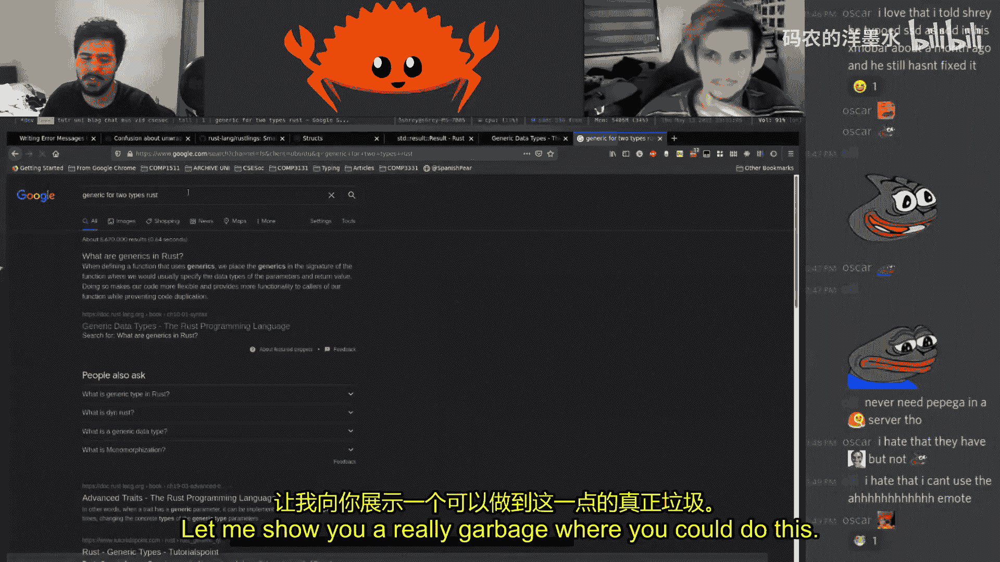

This is like， can you copy paste the code somewhere， right？😊，Oh yeah。

 just so I can like quickly access what you have。It need playgroundite terminal。

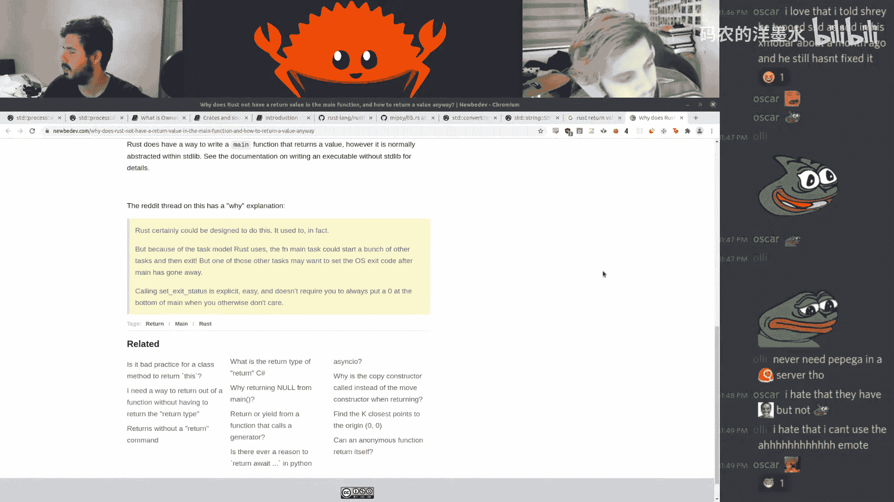

I don't know。Its big pie employee tech。Where you play。I you sent it here。 Okay， thank you。 Oh my god。

 Oh know， it's not about。 I thought it was， I thought it would build the new lines and spaces。😊，Good。

There's one really dodgy way you can do this。I'm imagining。So。啊，这个是。

I get how used them when I haven't used it for a while。There perfect advanced ofusal。

 You can bring this back， get rid of these。And write something like this。Tight。啊。Valid gray。Immpple。

 valid grade。For F 32。Imple valid grade。For string。Imple T report card。 Where T is a valid grade。And。

呃。Make valid grade。require oops， make valid grade require stood format display。This would work。

I think。What do I close report。啊。For F 32， I need to basically just put like a empty block here。

Main function， not found。Smi Collins not native because I put price there。Andなですた。还很 name。那个。

So there's no way to do like。Or types。 But you don't need to。 you can just make your own sort of。

Types which traits， right， yeah。T to those types。Traits are like Java interfaces。

 traits of Java interfaces。I think has school。Clsses。In line assembly， yeah lots yeah。

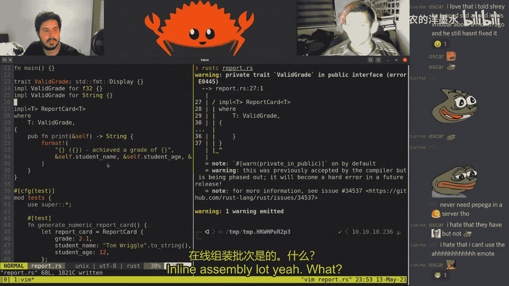

What。😮。

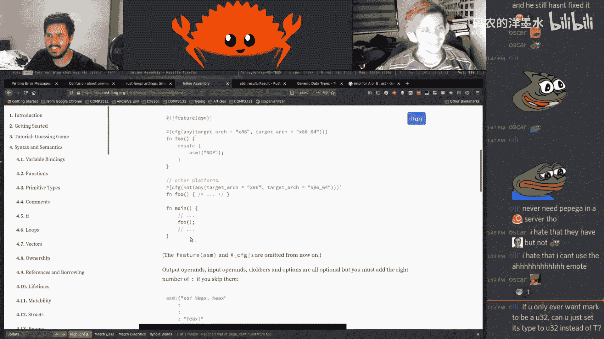

O。I't a book onai Yeah， the rest of Nor。If you only ever want Mark to be U32。

 can you decide say as touch as U 32 and 32， yeah 10% for sure。😊。

Rust also does a thing called monomorphization in。In Java， if you have generic types。

 they get erased at run time。 Well， I guess at compile time。 So by the time you reach runtime。

 they've been erased， what that functionally means is like。Anytime you use like some T in Java。

 the compiler will do its very best to check that the way you're using the T is okay and safe and then at run time like when it actually finishes compiling it it just turns all your T's into like any object it doesn't it like completely erases the idea of its type like completely。

And that has its own issues， in fact， even sometimes the compiler isn't actually good enough to verify that the types are all safe and happy。

 And so it'll be like， yeah， that generic code's good when it's not and it'll just magically work at runtime because there actually are no types and things get really weird in rust you have something called monomorphization which means。

😊，嗯。It will keep track of what different Ts are used for like a certain T。

 So if I go back to my screen here， report card of T。Is used here。 will not。

 it's like the the print technically is used， which is here。 It's used here with a T is a F 32。

 and it's used here where T is a string。So rust will actually generate rust C will generate one function print where okay。

 not really， it'll generate two strs。It'll generate onestruct report card where T is a F 32 and it'll generate anotherstruct report card where T is a string and then it'll generate one method print where for the F32。

 one method print for the string and then it'll decide which one to do at a runtime sorry not a runtime compile time it'll go this one goes that one。

 this one goes that one。So what I was trying to do was make sure that。Before the code。

 I'll let me get back。The code was thing that。Report card。嗯。Is generic of any type tape。Right。

 and that would only work you I can display so if I had a float， it would work fine。

 but if I wanted to be， you know a crazy programmer like I hate floats。

 I only want integers and strings then。It would not let me do it unless I did what Z would talk about。

 which is like。Specify eating some weird stuff。I want just try to be extra specific of our generics。

 essentially。嗯。Yes， sure I want to restrict it further than it needed to be。Option， or I option。

Options are great。 Maybe Monad is the best。It's not a monad， Ru doesn't have mon ads。

 don't fool yourself。God damn it it has and been they're just。It has monotic behaviors， Yeah。

 you're right。I learned you think one for one you're actually as much as I hate to admit。

 you are completely right。It just doesn't have the type system isn't powerful enough to have everything in higher kind of types。

 it doesn't have higher kind of types。😊，Fuction man printic number 16。Option。そ。What。What。Oh。

 it's yeah。It's a yep。F generics are just like parameters but the types instead。Exactly， in fact。

 in almost every single language， that is like not technically true。

 but it feels true in really purely typed languages like purely typed like functional style languages like Haskell。

 where you have these crazy， big type systems。😊，That is exactly what a generic is。

 it's a type it's a parameter for a type。So it's actually like being able to see it like that not only is it like yes。

 it's impressive， it's the right definition， it's literally like the the very core exact definition in like the most pure of languages so yes。

 that is exactly what it is。😊，嗯。What is wrong at the momentm。

So that number to add equals to U 6 bo law and。 Then just convert it into an option。

And then numbers of law equal to the option， so why is it complaining？Oh。

Use of possibly uninitialized numbers。The numbers is not。Oh is it。ATy of five， yeah。Oh。

 it does not't take a types and they take a value。So。I'm actually low surprised that it's。Yeah。

 you could do that， but there's probably a better thing you can do instead。Some 3。

Like you're using an option。What to， what would you initialize the option it's possibly some none。喂。

Yeah， okay， right。Like， okay。I would probably initialize it as none is what I was going to say like。

And why does that work in option doesn't？嗯。Oh okay right so this is this is actually it's declaring an uninitialized array it says let mute numbers which is of type option U 165 of them It's not the like equals an array of this right So if you want to do like five values which makes perfect sense you would need to set it to that as opposed to saying that's the type。

😊，I don't if want， but this is。Bad though， because I just， I am。Yeah， you are assigning to it。

It should be fine， but like it's not。How do I。Make it you try in love but。Yeah， but again。

 that's in that's in your type specification there like let me numbers is of type this and none is a value。

😊，How do I them， you've done a array initialization already。 It's you equals。

It basically looks like the exact same thing， but oh you're right this is the type that's what I'm saying。

 yeah， yeah， but not a comma。I say。Yeah。And oh， I'm interested to see if you actually need the type annotation or not because it may be able to infer that it's an option of U16 from the number to add。

 but maybe not。😊，Let's it。No， it does so because it doesn't actually know what the type of numbers is from that just like none if it's just none。

 it could be an option of anything。Any， but because on line 21。

 you have numbers equals some number to add and it says that numbers to add is U 16 it goes do do do that must be a array of five option of U 16 and it figures out a' pretty epic does。

😊，Not know what option is because I didn't really， I just did it really alsot know what option is what？

Does anyone this name know option is。It's a endofuo， it。Tomorrowed in the category of endofus。Right。

 hold that line on that。 Yeah we were on ads。 Yeah， he's， he's not wrong。Okay。

 so all the option is essentially。How long was thisす。Imagine if I have。

Imagine that youre to the shops， right， here we go。We got to the shops again。

If I can go to the shelvess， right， you expect me to come back with some groceries or nothing。あ好。

You don't expect me to come back with a car or like you know a。😊，A guitar。

 you can pick come back with some groceries or nothing， right， so for his milk。😊，P joke。

If we're making a function， right， that tray goes。To shop。How do we type it， right。

 but that the return value is either， you know， some groceries？哦。まて。Right。

 there shouldn't it shouldn' be impossible for someone to ride a function。

 str goes to shops that returns a guitar or a car or something right the only possible return time should be some groceries or nothing right。

 So how do we do a like a。Or turn top like this。 the answer lies in none where sorry in option。

Please give me something nice。嗯。This is not going to be nice Yeah。

 so option is the typesa version of null。Like。Like yeah， literally， yeah。

 it's nu but in a type system。Yeah， pretty much so I can say option of something。Oh my gosh。

 I'm tight， Oh my god， Oh my。Option of screen No option none of that。那个 springring。

So it's either going to have the groceries that I got as a string or it's going to have nothing right and so the way I return stuff in is like you know this print number function takes in an option of an integer right so sum 13 I could also you know print number of none right this is a pretty bad example for when you want to use option like you would never。

There's not many times you want to pass in an option well that's really lie but like this example really highlight。

 but that's what option is' like a typey say version of null the function never return anything and if I never return anything then you wouldn't be using a turn type using something like this Well no if the function doesn't know though that's that's all right if the function doesn't return anything it won't compile。

If you tell it to attend an option and then you don't return anything， it won't compile。Yeah。啊，谢谢。Oh。

 I see， I see。 that's， I thought it was a joke， but I was like I'm just I'll take it at face value。

ll come back Yeah Yeah， so and your this， this very closely ties into it exactly what you were saying earlier about generic types being a parameter。

😊，On like a type， right， it's you have option of T where an option can be an option of any other value。

So that T could be an integer， it could be a string， it could be another option of something else。

 it could be you know that T it can be crazy types。

 you can have a couple of three options and the third option is an option of an option of an option of an option of some other type like。

 but its it can be an option of anything。And literally， what that type means。

If I say I have an option of some tea。I will either have a tea to give you and say， yep。

 I have some tea here it is's yours， or I say sorry there's nothing， there's none tea time yeah。

So it's literally just a way of expressing like the problem with null is that you don't know where a null may or may not appear。

😊，Whereas with an option， you're literally saying you're allowed to say null here。

 I'm expecting you to be able to say null here， and for me to use that value I have to explicitly check that what's there is not actually null。

😊，Yeah and that's why in my function as well， I can't give it 13 right and 13 is a number right so why doesnt this work because 13 is not an option。

 13 is an integer right so to pass in the types of thing you just like slap it in an option and say something。

Yeah， more specifically， there's that maybe number dot unwrap on line8 and what that unwra there is saying is。

giveive me the U16 inside that option option of U16， so give me the U16 inside if it's none。

 if there's no option to give me panic。Like literally like throw exception crash the whole program and say there was a panic on line 8 something messed up you shouldn't really unwrap because it goes against the whole idea of options like that's basically like getting a null pointer exception and having a big freak out anyway So usually you'll do something else instead。

 you'll say you know。Maybe you'll return an error result， or you'll just not do it if it's none or。

 you know， something like that。 This trend is really bad example because you can't even pass it。

 just panics。So wait until it's forcing you to null check is why I'd say yeah。

Because like we want to know check sometimes right you want there are cases you want something or nothing right not only that。

 but the existence of option in a language that's not true actually， what I was about to say is。

You know， languages that have option have this nice feature， Not true。 Like Java has option。

 but it also has null。 So you can have an option of tea is either sum of tea， nu or null。

 Jesus Christ， But like in a language like rust， the sort of other side of the queen。

 which is where this becomes really powerful， is that since we have option， we don't need null。

 since we don't need null， we don't have null since we don't have null。

 any value that we ask for like any， if I ask for a string or a you know， a foo or bar。

 if it's not an option of that， I know it must be there， I know it must exist。😊。

Right like I don't ever have to nu check anything that I don't explicitly say option of that。Really。

 Andy。Oscar。Java， bad。Is my solution to your problem。

Geting Java'ss Java's option is actually very bad Allasian has a nice article about it。

 some do un with alassian。Cool， next one。Last one I bed I said that 40 minutes ago。Okay。

 make is let send which some type。 So if let。Some spring dirt。No some。Eals what。Yes， no option。

And it knows that there's a string inside that option， right？You never have to set like。

 like rust will always like in further types。 What goes there。Oh， that the word word， right？

 It's like if it's some of this inner word and then that inner word will have the type string as opposed to the type option of string。

Yeah， and then you have to do it down there or something。 I don't know Oh yeah， no， oh yeah， while。

 while super super fucking cool。 Sorry， excuse my language。While let。

pop causeuse pop pops the top thing off the vector， which may not be there。

 So it returns an option T。Yeah。While I pop， pop， pop， pop， pop， pop， pop and get something。

Optional O， because it's。Yeah， look at what they've got， it's a v of options。Don't just unwrat。

 Don't unwrarap。 Don't unwrarap。You can actually make your wallet even crazier。

Can I can I match Well why doesn't this do it properly because it's pop， No， no， no。

 because pop returns a option of tea。Right and look online line 17。

 it's a V of option of IA so what you've got， what pop returns you as an option of option of IA。

Ill pretend option Yeah， because there might not be anything left in the V。Yeah， exactly， very epic。

Option or option。 We love it。This is actually like I really wanted you to do this because it's like very cool to look at。

 but it's actually bad because。Just because like that will keep looping while we get some sum integer。

 right？Except you could imagine there's like a none value in the v halfway through。

 and then it would stop。 So like， but it's， it's very cool to look at。 So actually。

 what you would probably do， you should probably do well let some option。😊，I you hear， not a while。

Yeah， exactly。That's much better。いこ中。Yeah， there you go， that's a very good impulse。Nice。

You should you should do optional integers back of5 equals none。Oh my gosh。

 where all the work been broken。No， no， no just do of five， like a race intax of five。

Or four or whatever。No， raceyntax。Aray index indextax array index indextax I can see mind No。

 it doesn't。 That was a tuple before。no， the actual great thing is that like index， u。

 like the indexing operator is a trait so you can implement indexing or whatever you want。

You're on tops and stuff， which is very epic。Xcommon is good， we shoot a whole， you know。

 suck roster string， we do Xmon three。We should someone should do a talk about Xed， honestly。

 like a workshop。I actually wasnt on the next one though。 just haven't had next one。 All right。

 al right。😀。😊，The tasty thing， or you， the tasty thing。Nice。

And wouldnt might as the big things let's sort of look this one。

 which is very bright and colored because I like to be awake。I actually like your thing。

Thank youI have this one darker That's more like my theme， but mine this one for my class account。

Which is。Be both。That's probably the closest to mine。 Yeah， that' that's quite similar to mine。哦。

This is To one。哦。Just so。我 is not。What is the numbers on the top right of my theme。I did this。Yeah。

 that's my local IP address。Dont and did notcing right now。Local IP address。 Yeah， yeah。

 local good101010。😊，Dd， I how you get31s。 Yeah， so lucky。😊，我就跑步我去跑步。Yeah， let's， let's hack me。No。

 I'm not gonna to do this。 This is on YouTube。Because that's just what I got。So you to networks。

 What's that thing called again， D DHCP， There you go。 That's just what I got DHCP。 The router went。

 This one's free and gave me that I address。别啊。Do yeah。Yes。All right。I am going to go off。

Are we done。 What are we done。We done。Collections， we've done enums， air handlinging functions。

 generics， ifs， Mac modules， moves semantics option， prototype， strings， strokes， burial。

 quiz one and quiz two。 So wait， what do we still have to go。OhClippy conversions。

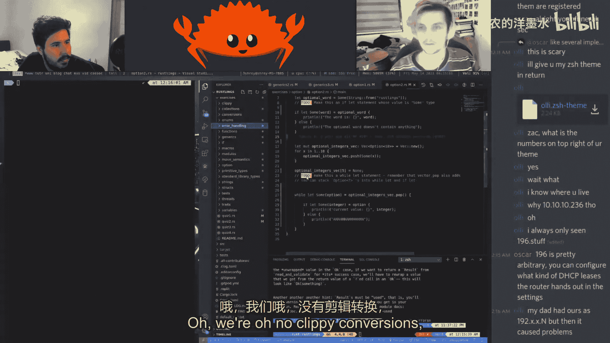

Macros， standard library types， test threads， traits。嗯，够。10，10，10 is a very common subnet。6s。

There's certain。Is get weird， I think potentially zero through9 have certain semantics about them and 10 is just the most convenient。

 small number that doesn't like have any weird specific semantics about it。Actually， yeah， because。

You needed to be recognized as a local IP address as opposed to a external one， for example。

 Google's 8。8。8。8 DNS or Cloudflareers 1。1。1。1 yeah you guys are yeah me so。But 10 will be 10。

 to1010 will be recognized as a local address。Tras ths， tests。 can tests。Do dog tests I do。

 I saw some people learning about dog tests on Twitter today and they were like。

Holy shit is the best thing I've ever seen。Do they that I teach dog test got damn。All right。

 very the end of the YouTube stream。What do we have  three hours，20 minutes。To longOkay。

Buy YouTube stream Sa bye， S。Sa bye Oscar。Hes left here。オな askけなは。We'll be vote meeting。啊。All right。

 actually yeah， yeah， Lis watching。bye。Although I think she left the while。And stream， okay。

 stream is ended。