# 001：课程介绍与预备知识 🎯

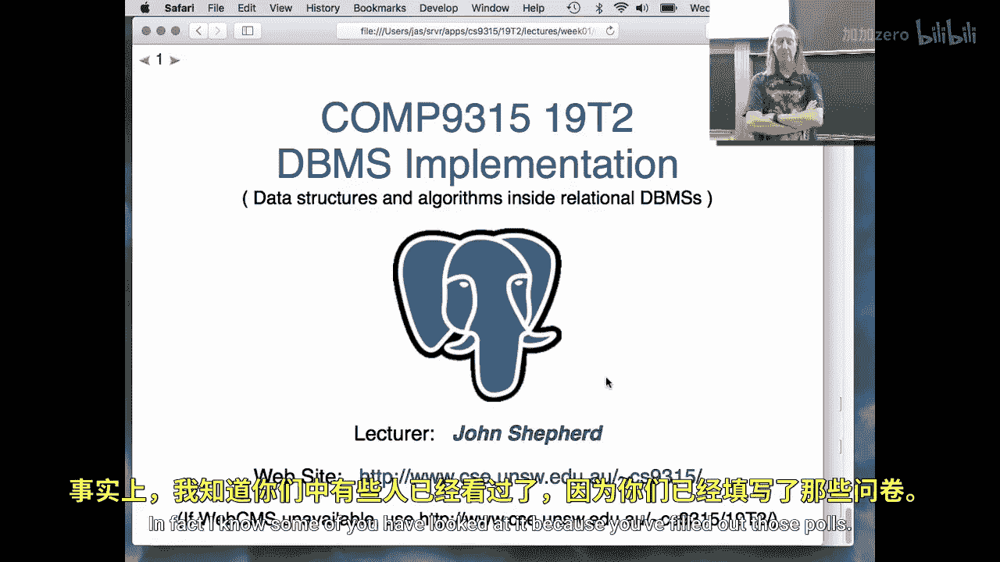

在本节课中，我们将要学习COMP9315课程的整体介绍、学习目标以及学习本课程所需的预备知识。我们将通过一个简单的数据库示例来回顾SQL查询，并明确课程对编程和数据结构基础的要求。

大家好，我是John Shepherd。这是我的个人网站，我相信你们中有些人已经看过了，因为你们已经填写了相关的调查问卷。

我是计算机科学与工程学院的讲师。这是我的办公室，也是我将进行答疑咨询的地方。

关于咨询的具体安排，详细信息已经发布在课程网站上，你们可以去查看。

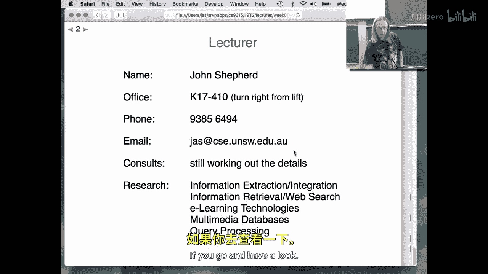

咨询时间安排在每周四的讲座之后。本课程没有助教，只有我本人。希望我能顺利度过这个学期。

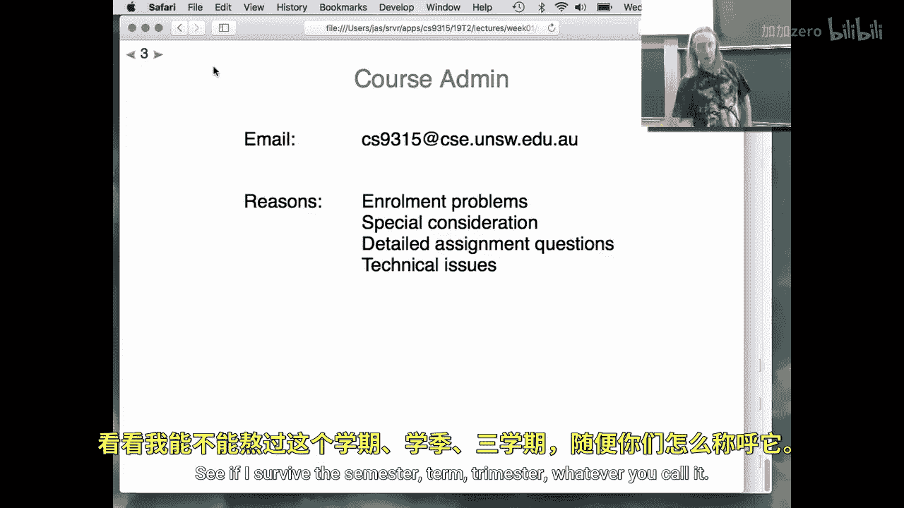

那么，这门课程是关于什么的？你们来到这里是为了学习关系型数据库的架构。我们将以PostgreSQL作为具体的学习载体，后续我会详细讨论PostgreSQL。

我们需要一个数据库来进行实践。去年的第一个作业就是围绕PostgreSQL进行一些操作。在第一个作业结束时，我提到第二个作业会涉及更多PostgreSQL的内容，但出乎意料的是，很多同学的反馈是“不，我们觉得PostgreSQL的代码太多了”。所以今年我可能会尝试相同的策略。

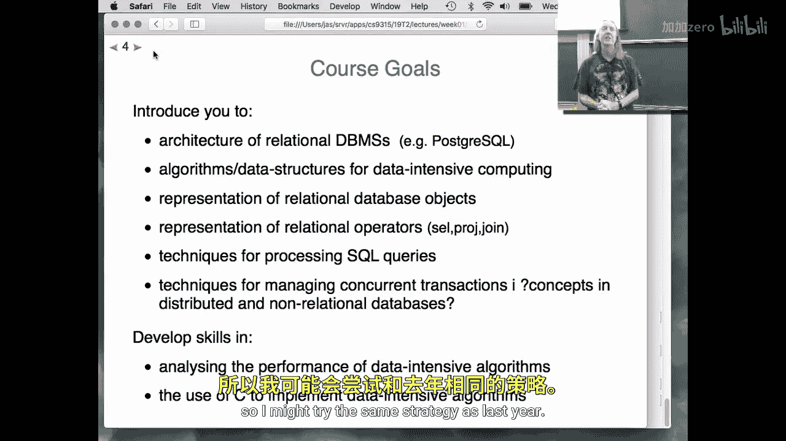

第一个作业将涉及操作PostgreSQL。第二个作业则要求编写一些C语言代码，这些代码是独立的，但旨在说明数据库查询处理的某些方面。

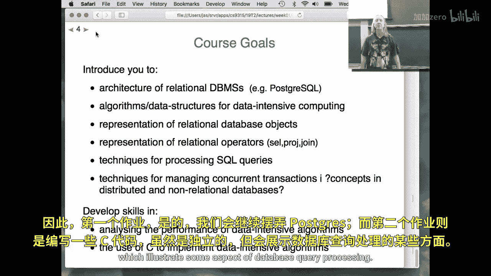

这门课程并不全是关于PostgreSQL的。它更多地是讨论在处理大量数据时有用的各种数据结构及其相关算法。

当然，我们仍然需要了解关系型数据库的工作原理。我们将学习对象如何表示、操作符如何实现。研究这些的一个原因是，关系型数据库自70年代中期就已存在，我将在未来的讲座中详细讲述这一点。

从70年代至今，人们在实现所需的各种操作符方面做了大量有趣的工作，并且技术一直在发展。新的数据库应用场景不断出现，催生了新的算法来解决新问题。同时，也出现了一些新挑战，例如谷歌面临的问题，其数据规模据称太大，以至于传统关系型数据库难以处理，因此谷歌实现了自己的文件系统及其上的操作符。

考虑到只有十周的时间，我可能无法涵盖这些更现代的创新。但我认为我们将要讨论的所有内容仍然非常有用。

此外，我们还需要关注并发控制，这一点非常重要。因为关系型数据库被广泛使用，并且经常在许多人同时访问数据库的场景下使用。

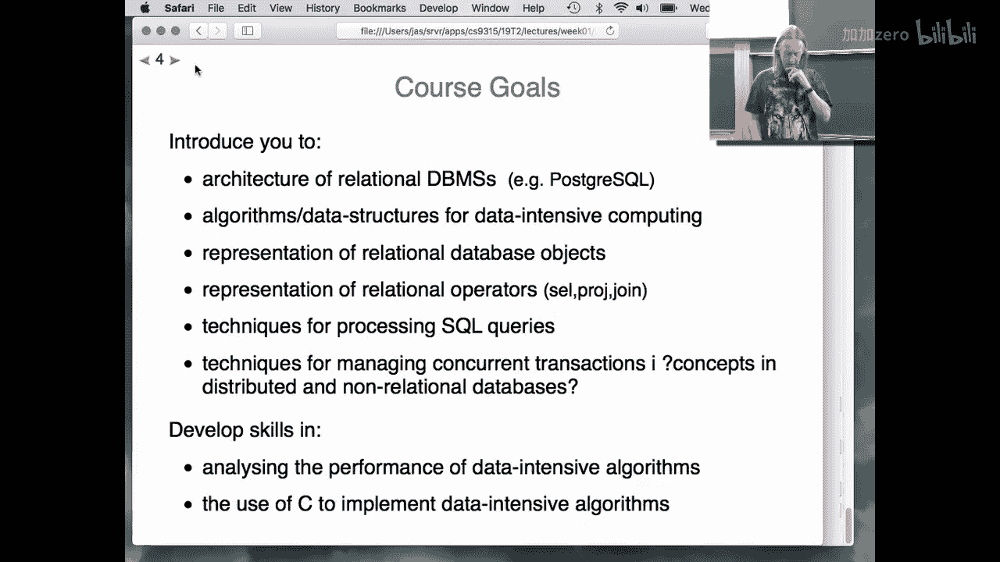

因此，本课程的目标是让你们在课程结束时掌握这些技能。

我假设你们都熟悉C语言。去年有些同学直到课程结束显然还不懂C语言，并在期末考试中遭遇了失败。如果你的C语言编程能力不强，现在放弃还来得及。第一个作业用C语言，第二个作业用C语言，考试也需要C语言编程。明白了吗？

我假设你们至少学习过一门扎实的、涉及C语言的数据结构课程。我也假设你们学习过数据库入门课程，因此接触过SQL。鉴于这类课程是本课程的先修课，我认为你们都学过。

此外，如果你们学习过COMP1521（操作系统）课程，那会很有帮助，虽然可能不是所有人都学过。该课程涉及许多低层操作系统功能，这些对于实现数据库系统显然是必需的，因为我们需要在相当低的层次上与磁盘或文件系统打交道。所以我们需要关注这类问题。

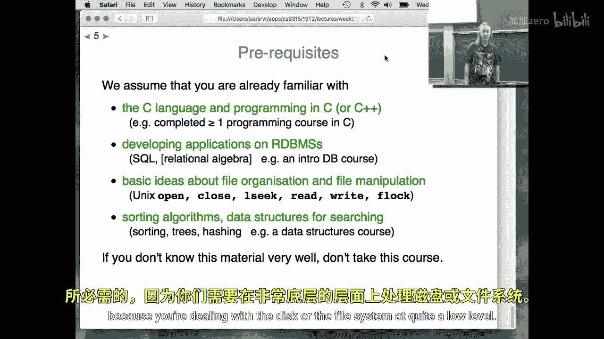

我还假设你们学习过算法课程，因此知道什么是快速排序，什么是哈希。

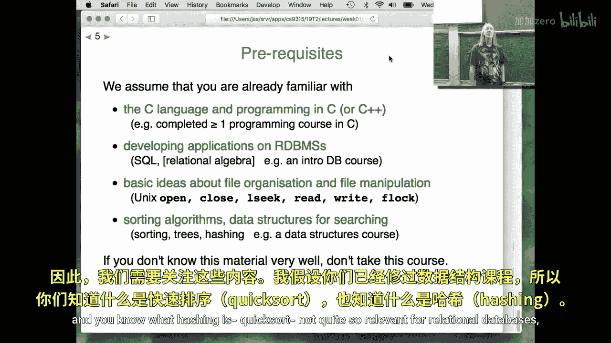

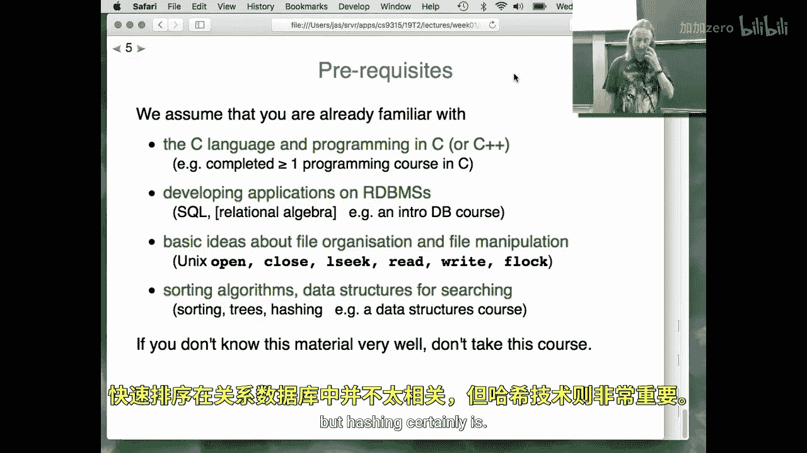

快速排序对于关系型数据库来说不那么相关，但哈希技术绝对是相关的。

正如我所说，如果你不具备这些知识，现在放弃还来得及。好吧，让我们看看谁真的还记得这些内容。

这是一个简单的数据库模式，包含三个表：`students`、`courses`和`enrolment`，这是标准的设计。
*   `students`表包含学生ID、姓名，以及为了增加一些其他信息而加入的学位信息（在实际中，这应该是一个外键，引用一个`degrees`表，但在此练习中不重要）。
*   `courses`表包含一个内部随机整数ID、标准的UNSW课程代码、学期以及课程标题。
*   `enrolment`表基本上是一个连接学生和课程的表，实现了一个多对多的关系，因为一个学生可以选修多门课程，一门课程显然也有多名学生。

那么，谁能写出一个SQL查询来找出所有学生的选课情况？没有人举手？看来得由我来做了。在黑板上写可能不是个好主意，因为视频可能拍不清楚，但如果我在屏幕上写，就没问题了。

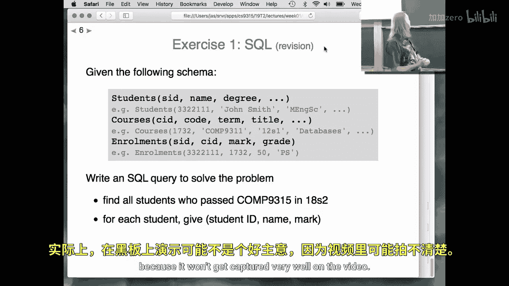

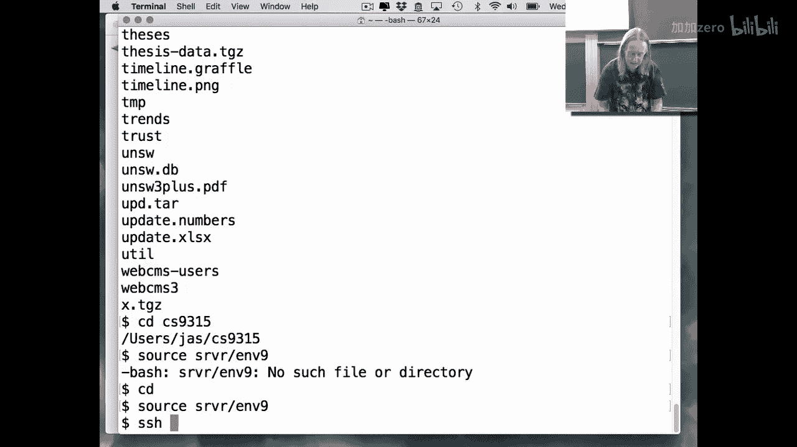

本节课中，我们一起学习了COMP9315课程的概况、学习目标以及所需的C语言、数据结构、SQL和算法基础。我们回顾了一个简单的数据库模式，并明确了本课程将深入探讨数据库内部实现原理，包括数据表示、操作符实现和并发控制等核心主题。准备好迎接挑战吧！