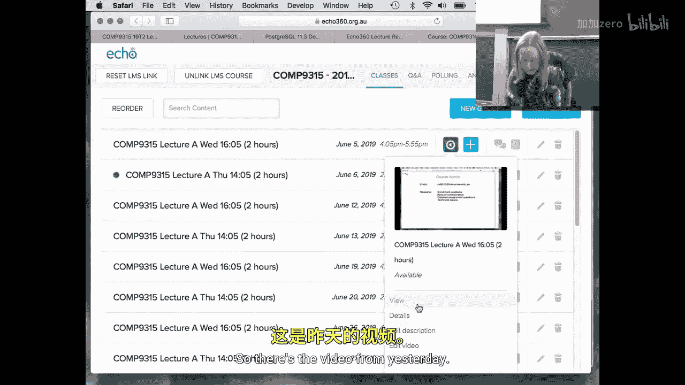
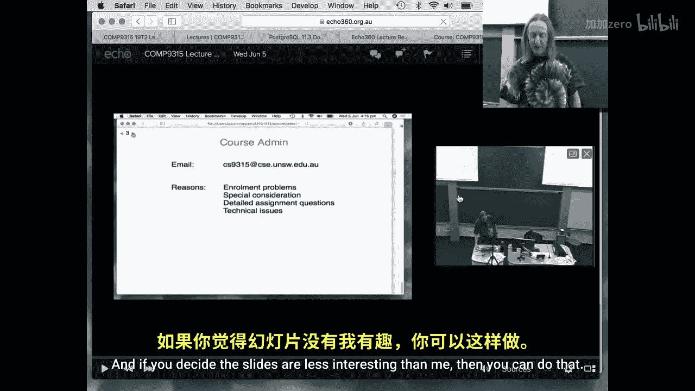
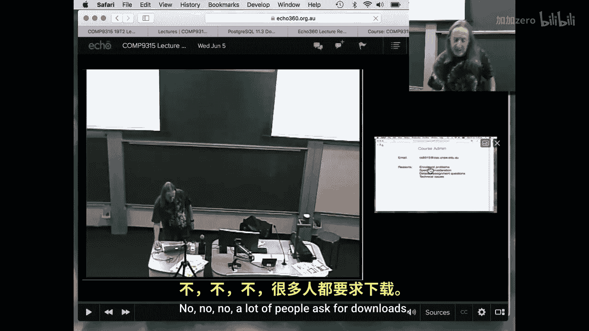
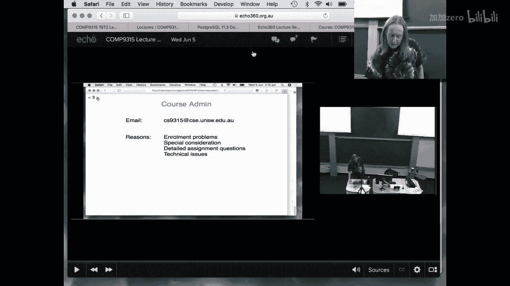
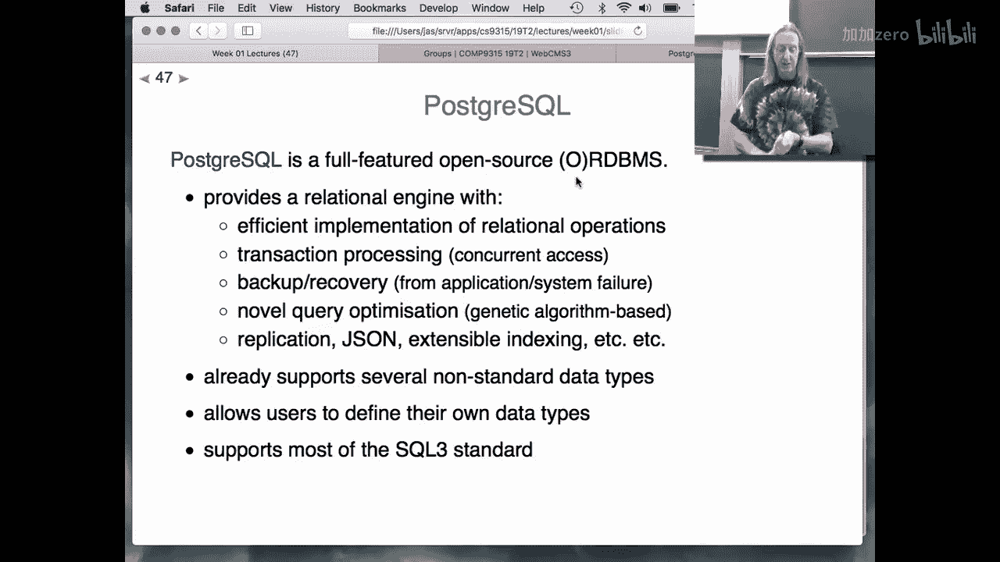

# 003：Postgres简介与课程安排 📚

在本节课中，我们将了解课程的整体安排，并深入探讨我们将要使用的数据库系统——Postgres的背景与特点。

## 课程安排与资源获取 📅

上一节我们介绍了课程的基本情况，本节中我们来看看如何获取课程资源以及本周的安排。

在大多数讲座中，我都会展示类似这样的幻灯片，让大家了解课程进度、今天以及接下来一周的计划。需要指出的一点是，Echo360平台的录播视频会在讲座结束后几小时上线。而我个人录制的视频，则要等到第二天早上我来到学校后才能上传。虽然我可以从家里上传，但耗时太长，所以不这么做。

如果你现在访问课程网站，可以看到昨天的讲座视频已经可用。视频会以这样的形式呈现。如果你觉得幻灯片不如我本人有趣，也可以选择只看视频画面。

以下是关于视频下载的说明：
*   很多人询问下载事宜。我怀疑下载后得到的就是这种分屏效果，因为这似乎是Echo360平台处理的特性，下载的文件可能也是如此。

无论如何，我们不需要纠结于此。总结来说，Echo360视频会即时处理并在讲座后几小时提供；我的视频则会在次日早晨上传。如果这个小摄像头足够可靠，也许未来我会停止个人录制，完全依赖Echo360。

## 实践任务与小组组建 💻

接下来，我们谈谈本课程的实践部分。我已经布置了第一个实践练习，内容是安装Postgres服务器。请大家尽快完成，趁其他课程还不忙的时候着手。同时，请开始组建作业小组。

组建小组的途径如下：
*   我设置了一个特殊页面，方便不认识其他同学的人发帖交流、获得回复并组建小组。
*   但正式创建小组，你需要进入指定的链接进行操作。

## 本周核心内容：深入Postgres 🗄️

在介绍了课程资源与安排后，本节我们将聚焦于本周的核心内容——Postgres数据库系统。

今天我将会比昨天更深入地讨论Postgres。下周，我们将开始学习数据库管理系统提供的存储管理等核心内容。

你可能已经注意到幻灯片底部有一些奇怪的信息，它们指明了教材、对应的章节和章节。如果任何信息过时了，请告诉我。你可能会发现有些教材不涵盖特定主题。正如昨天提到的，所有教材都大致覆盖了DBMS，但有些（如旧的Maz教材）不讨论目录，而其他教材则会讨论。有些教材会用整章来阐述某个主题，而另一些可能只用一小节。因此，你可以从这里了解查找某个主题的最佳去处。

## 数据库简史与人物 👨💼

在深入技术细节之前，了解历史背景总是有益的。这些技术从何而来？我们为何关心数据库？这位友善的老人又是谁？

没人知道吗？他与埃迪·鲍尔走得很近。不知道他的名字是查尔斯·巴赫曼。他之所以有趣，是因为他提出了整个数据库的概念——虽然不是我们如今所认识的形式，但确实是关于拥有一个结构化数据集合、可永久存储在磁盘上、并能进行查询和更新等操作的整体理念。可以说，很多事情在很久以前就发生了。

他在密歇根大学完成了本科学习，之后在陶氏化学公司工作，从事过程控制。在那里，他意识到需要一种方法来组织与过程控制相关的所有数据，并提出了他称之为“集成数据存储”的想法。如果你看看它所实现的所有功能，会发现它与现代数据库系统所做的非常相似。它肯定不是关系型数据库，因为关系模型的概念在当时尚未提出，那是后来的事。

最终，关系作为数据库结构机制的概念出现了，随后IBM的一些人研究出了如何基于关系模型实现一个系统。但所有这些关于存储、检索、事务等的想法，他在1964年就提出了解决方案。之后他继续从事咨询工作。

因此，在每周的讲座中，我都会穿插介绍一些数据库领域有趣人物的信息。

## 为什么选择Postgres？🤔

现在，让我们回到正题，解释为什么本课程选择Postgres作为教学系统。

我们使用Postgres，而不是Oracle，因为你无法获取Oracle的源代码；我们也不使用MySQL，因为它的源代码结构较为分散。MySQL是通过从各处拼凑存储管理器等方式构建的。而Postgres至少是由一个团队作为一个单一系统实现的，拥有一个相对合理、一致的代码库。

事实上，PostgreSQL起源于90年代初伯克利的一个名为Postgres的研究项目。该项目旨在成为一个融合了面向对象思想的关系数据库后继者。原始的Postgres拥有极其优美的代码库（如果你能找到的话），但它没有SQL前端。其初衷是使用某种面向对象的语言来访问Postgres处理的数据。后来，一些学生接手了这个优秀的代码库，为其添加了SQL前端，并逐渐演变成我们今天所知的PostgreSQL。因此，你有时会看到它被称为对象-关系数据库管理系统。系统中还保留着原始系统面向对象特性的一些微小痕迹，但不多。

它为你提供了一个标准的关系代数引擎，对关系操作进行了相当高效的实现。它具有良好的事务处理能力，特别是在处理并发更新方面。

---

**本节课总结**

在本节课中，我们一起学习了以下内容：
1.  课程资源的获取方式，包括Echo360录播和个人录制的视频。
2.  首个实践练习（安装Postgres）和组建作业小组的要求与途径。
3.  本周的核心内容是更深入地了解Postgres系统，并预告了下周将开始的存储管理核心主题。
4.  通过教材引用信息了解了如何查找扩展阅读资料。
5.  回顾了数据库的简史，认识了数据库概念的先驱查尔斯·巴赫曼。
6.  明确了选择Postgres作为本课程实践系统的原因，包括其代码库的一致性、清晰的历史渊源（由研究项目演化而来）以及它作为对象-关系数据库管理系统的特性。