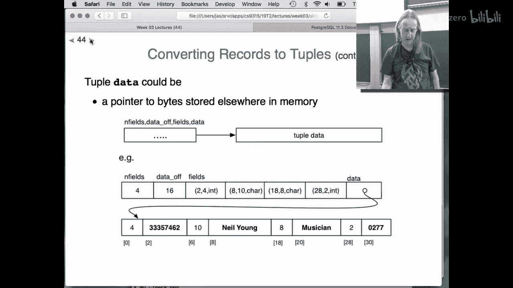
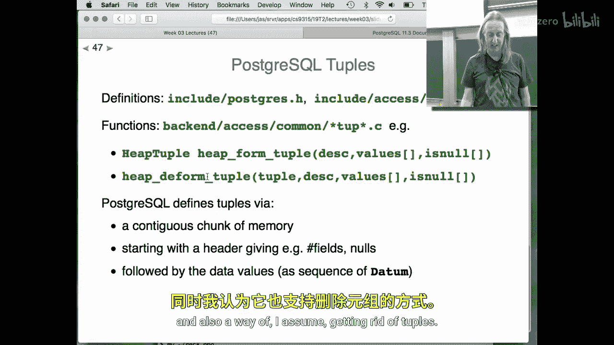
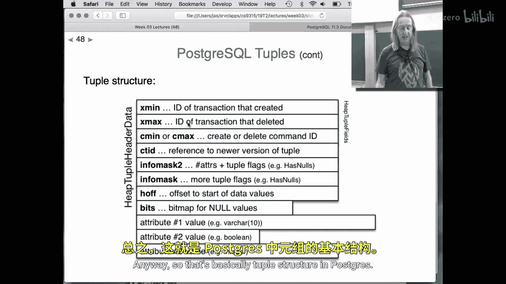
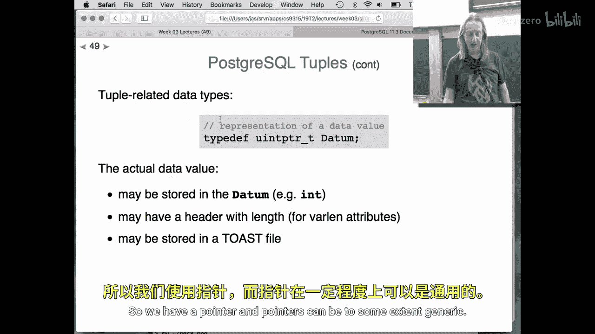
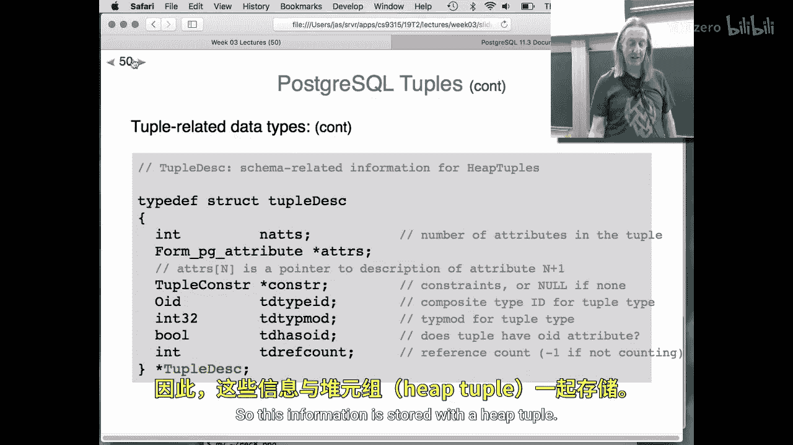
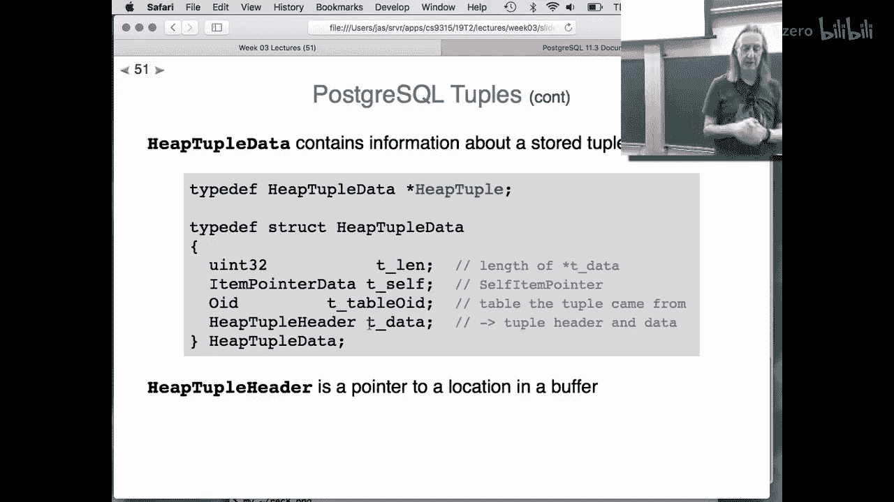
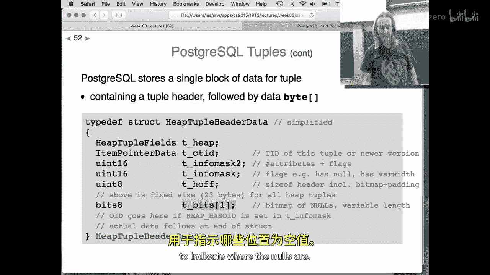
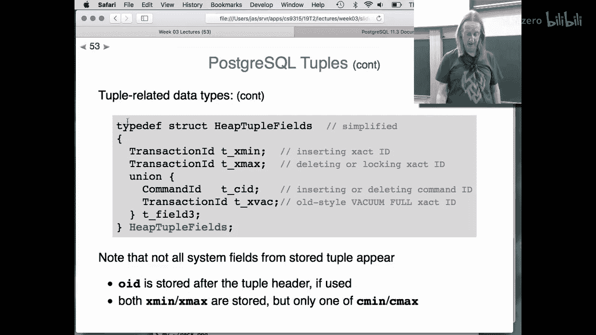
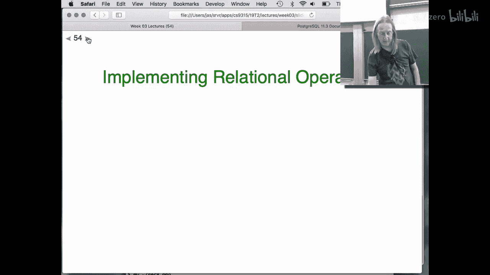

# 012：Postgres中的元组结构

在本节课中，我们将学习PostgreSQL数据库内部如何表示和存储数据的基本单元——元组。我们将了解元组头的结构、其包含的元数据，以及PostgreSQL如何利用这些信息来管理事务、空值和版本控制。

---

上一节我们介绍了Postgres中“堆”文件的概念。本节中，我们来看看构成这些堆文件的基本元素——堆元组的具体结构。

PostgreSQL提供了一些函数来创建和销毁元组，类似于我们之前讨论的`make tuple`操作。

PostgreSQL将存储元组的页面序列称为“堆”，其中的元组则被称为“堆元组”。一个堆元组包含以下信息：

当一个对象被加载到Postgres中并开始使用时，元组会包含一些伪属性。这些属性作为元组头数据的一部分存储。例如，OID存储在其他地方，而Xmin和Xmax则直接存储在元组头中。

元组在特定事务的上下文中创建。一个事务由一系列SQL语句（在Postgres中称为“命令”）组成。因此，元组由特定事务中的特定命令创建。

Postgres保留Xmin和Xmax，但只保留Cmin或Cmax中的一个。一旦元组被删除，Cmin就变得无关紧要，因此通常存储的是Cmax。

当更新一个元组时，Postgres不会就地修改它，而是创建一个包含更新内容的新元组。旧元组会包含一个指向新版本元组的引用，从而将两个版本链接起来。

元组头需要记录该元组有多少个属性。此外，它还包含一系列标志位。其中一个重要标志是`hasnulls`。

`hasnulls`标志并不直接指明哪些属性是空值，它只是表明此元组包含空值，因此需要以不同的方式处理。真正指明空值位置的是一个位图。

位图是一个比特序列。如果第一个比特被设为1，则表示第一个属性是空值，依此类推。

如果`hasnulls`为假，则意味着元组没有任何空值，因此不需要位图。元组的结构会根据此标志而改变。

由于位图的长度未知，并且位图的大小会随属性数量而变化，我们需要知道数据值实际从哪里开始。数据值从位图流的末尾开始，而`hoff`字段（即头部偏移量）告诉了我们这个位置。

以上是Postgres中元组结构的基础。

`Datum`是Postgres中表示值的最低层级类型。考虑到一个`Datum`可以是字符串、整数或浮点数等，我们无法使用一个通用的数据类型。因此，Postgres使用指针来引用这些值，指针在一定程度上可以是通用的。

还记得我们之前提到的字段描述符吗？这里我们有“元组描述符”。

元组描述符提供了元组内容的概览，包含对目录数据的引用，以及一些从目录中提取并存储在此处的信息。显然，我们需要记录属性的数量等信息，这些信息与堆元组一起存储。

以下是堆元组的结构示意图，它借鉴了Postgres的风格：

一个堆元组包含以下信息：
*   以长度开头，即数据的总大小。
*   一个“自引用项目指针”，其具体用途尚不明确。
*   指示元组来自哪个表的OID。
*   堆元组头，实际上是一个指向缓冲区的指针。

所有元组最终都会存储在缓冲区池的某个缓冲区中。

因此，堆元组头与其余数据一起存在于缓冲区中。

元组头中包含我们在前面幻灯片中看到的信息：隐藏在堆元组字段中的CTID、Xmin和Xmax，以及Cmax字段。可以看到，结构体中嵌套着结构体，有些东西实际上是指向其他结构的指针，这可能有点令人困惑。

这里我们看到了一个变长数组的例子，我们无法确切知道它的长度。我们之前看过的元组可能只有三四个属性，因此位图可能只是一个8位的字节。但理论上，一个元组可以有数百个属性，那么指示哪些属性为空的位图流就可能长达数百位。

Postgres处理这个问题的方法是：它会分配一个堆元组头数据结构，并分配比头部实际所需多十倍的空间。末尾的这些额外空间将构成位图的一部分，用于指示空值的位置。

我们看到的堆元组头字段包括Xmin、Xmax，以及第三个字段。这个第三个字段与我们之前看到的略有不同，它要么是Cmin值，要么是Cmax值，具体取决于元组是否被删除。它还可以告诉我们一些关于相对于“清理”操作的状态信息，即这个元组是否已被删除。无论如何，堆元组字段中的这第三个值只是一个单一的值，我们可以用多种不同的方式来解释它。

以上是对Postgres元组结构的一个极其简要的概述。如果你想了解令人抓狂的细节，可以去查阅源代码，同时也可以看看相关文档。

本节课中，我们一起学习了PostgreSQL中堆元组的核心结构。我们了解了元组头如何存储事务ID（Xmin, Xmax）、命令ID以及空值位图等关键元数据。这些设计使得Postgres能够高效地支持多版本并发控制（MVCC）、空值处理以及元组的版本更新。理解这些底层结构是深入掌握Postgres存储和事务机制的基础。