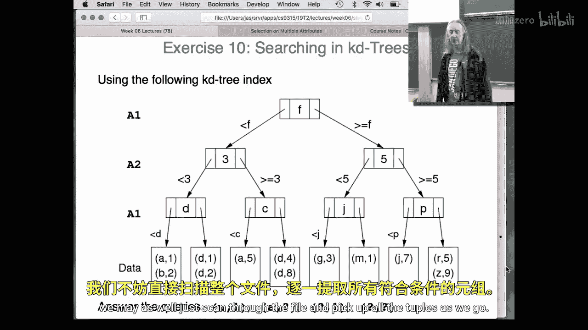
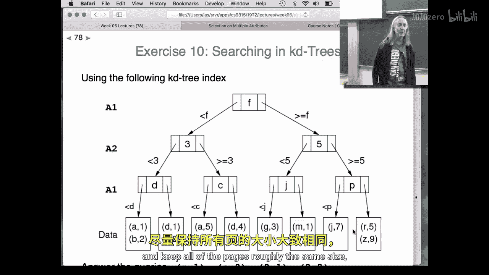
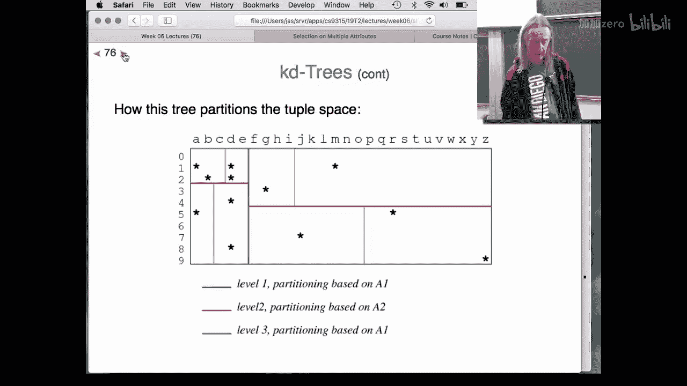
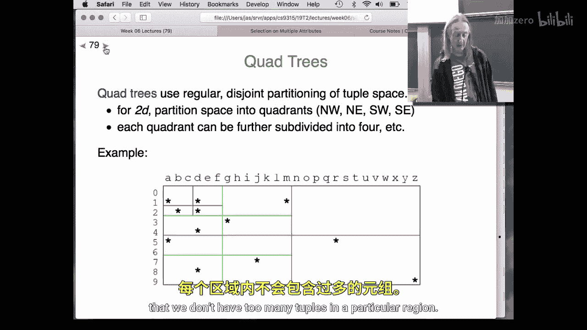
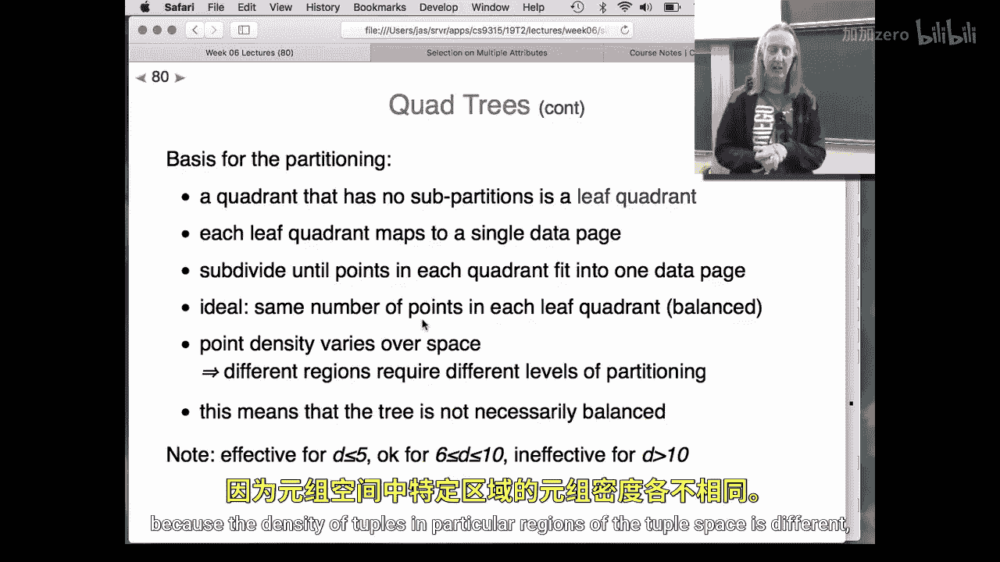

# 020：多维索引结构

在本节课中，我们将要学习两种用于多维数据（例如地理坐标）的索引结构：Kd树和四叉树。我们将了解它们如何组织数据、如何处理查询以及如何进行数据插入。

## 课程笔记与幻灯片

上一节我们介绍了多维索引的基本概念，本节中我们来看看课程资料的构成。

课程中讨论的所有内容都旨在通过课程笔记提供。部分内容尚未完成，因此不会公开。幻灯片基本上是课程笔记的摘要。如果查看课程笔记，会发现其中包含许多幻灯片上没有的细节。讲座中的幻灯片是课程笔记的摘要，外加一些练习。

## Kd树查询处理

现在，让我们深入了解Kd树是如何处理不同类型查询的。

以下是基于一个示例Kd树的查询分析。该树按属性A1和A2交替分割数据。

**查询1：查找点 (M, 1)**
1.  在根节点，查看属性A1（值为M），决定进入左侧分支。
2.  在下一节点，查看属性A2（值为1），决定进入右侧分支。
3.  返回查看属性A1，根据其与值J的关系，决定进入左侧分支，最终在特定的数据页中找到点(M,1)。

**查询2：查找 A1 = A 的点（A2未知）**
1.  从根节点开始，已知A1=I，因此进入左侧分支。
2.  由于A2的值未知，必须检查当前节点的两个子节点。
3.  进入第一个子节点，查看属性A1（值为A），进入左侧分支，到达一个数据页，并在其中找到符合条件的元组。
4.  无需检查另一个子节点对应的数据页，因为该页所有元组的A1值都大于或等于D，不符合条件。
5.  返回检查另一个子节点，同样查看属性A1（值为A），进入左侧分支，到达另一个数据页，找到另一个符合条件的元组。

**查询3：查找 A2 = 1 的点（A1未知）**
1.  从根节点开始，A1未知，因此必须检查两个子节点。
2.  进入左侧子节点，查看属性A2（值为1），因此只需检查其右侧分支。
3.  到达一个内部节点，此时A1未知，因此需检查其两个分支，这导向两个不同的数据页，需要读取并扫描以寻找A2=1的元组。
4.  返回检查根节点的右侧子节点，查看属性A2（值为1），因此只需检查其左侧分支。
5.  到达一个内部节点，A1未知，需检查其两个分支，这又导向两个数据页。
6.  最终，需要检查四个数据页来获取结果。

**查询4：查找所有点（无查询条件）**
对于此类查询，索引结构没有帮助。最优策略是直接顺序扫描整个数据文件。

## Kd树插入操作

了解了查询，我们来看看如何向Kd树中插入新数据。

插入操作始于一次搜索。由于插入时所有属性值已知，因此会沿着一条确定的路径到达一个数据页。例如，插入点(B, E)会到达包含该区域的数据页。
如果目标数据页已满，有两种处理方式：
1.  不调整树结构，仅添加一个溢出页。
2.  调整树结构，在当前分支下增加一个新的节点（可能再次基于属性A2进行分割）。

Kd树不一定是平衡的。分割决策的基本目标是尽量使每个数据页包含的元组数量大致相同。例如，在一次分割后，如果两个分区分别有2个和3个元组，可能就认为足够均衡，无需进一步分割。

## 四叉树

接下来，我们看看另一种多维索引结构——四叉树，它采用不同的分区方法。

四叉树采用规则的空间分区。每次分区时，它将一个区域（或子区域）划分为四个象限：西北(NW)、东北(NE)、东南(SE)、西南(SW)。划分是通过沿两个维度将区域对半分割来实现的。
在构建树时，我们持续细分，直到每个象限包含的元组数量大致可接受。例如，某个象限可能因为元组过多而需要进一步分区，而其他象限则可能因为元组很少而无需再分。
在四叉树中，一个叶节点（即不再进一步分区的象限）直接指向一个数据页。分区会持续进行，直到每个数据页负责的元组数量大致均衡。当然，由于元组在空间中的分布可能不均匀，无法做到完全均衡。

## 总结

本节课中我们一起学习了两种多维索引结构：Kd树和四叉树。Kd树通过交替使用不同属性对空间进行二分分割，而四叉树则每次将空间规则地划分为四个象限。我们了解了它们处理**点查询**和**部分属性查询**的路径选择逻辑，以及插入数据时的基本策略（如使用溢出页或节点分裂）。这两种结构的目标都是通过组织数据来减少查询时需要访问的数据页数量，从而提升查询效率。