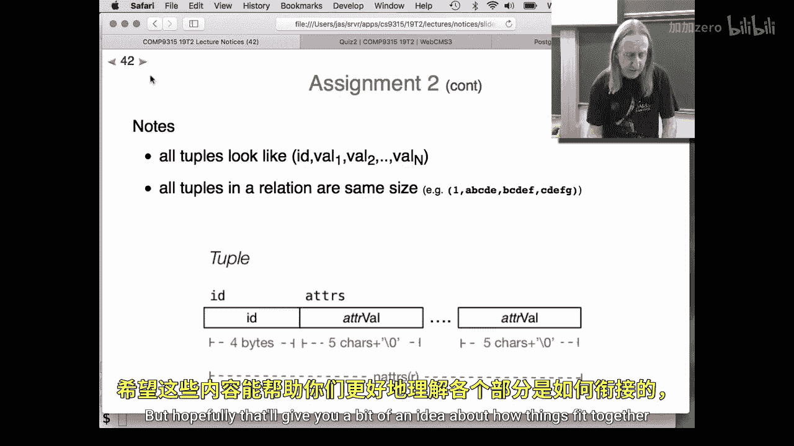

# 021：作业预览与数据结构

在本节课中，我们将预览即将发布的作业2，并详细介绍其背后的核心数据结构设计。我们将了解如何表示关系、元组和页面，为后续实现扫描、排序和连接操作打下基础。

## 作业2预览

上一节我们讨论了数据库的基本操作，本节中我们来看看即将发布的第二个作业的具体内容。该作业要求你在一个已提供的框架基础上，实现几个核心的数据库操作命令。

作业框架已经提供了页面、元组和关系等抽象数据类型的定义，以及一些基础命令。

以下是作业中你需要实现的核心部分：
*   **`select`命令**：用于数据查询。
*   **`sort`命令**：为避免与系统命令冲突，命名为`SO`，用于数据排序。
*   **`join`命令**：为避免与系统命令冲突，命名为`J`，用于表连接。
*   **缓冲区池**：管理数据页在内存中的缓存。
*   **迭代器**：实现扫描功能，能够按顺序获取下一个元组。

## 数据结构设计

理解了作业要求后，我们来看看支撑这些操作的数据是如何组织的。核心在于关系、文件和元组的结构。

### 文件结构

每个关系在存储时对应两个文件：
1.  **数据文件**：存储实际的元组数据，文件名为 `{关系名}.data`。
2.  **元数据文件**：存储该关系的描述信息，文件名为 `{关系名}.info`。

元数据文件中包含以下信息：
*   关系名称
*   属性数量
*   每个元组的大小
*   数据文件中的页面总数
*   数据文件中的元组总数

### 数据页与元组格式



数据文件的结构被设计得尽可能简单。每个数据页只是一个连续的字节序列，其中顺序存放着多个元组。


所有元组的大小是固定的，这简化了存储和检索。每个元组的结构如下：
*   以一个4字节的整数ID开头。
*   随后是固定数量的属性值。在本作业中，每个属性值是一个5字符的英文单词。

因此，对于一个具有n个属性的关系，其元组结构可以用如下代码描述：
```c
struct Tuple {
    int id; // 4字节的整数ID
    char attr1[6]; // 第一个属性（5字符+结束符）
    char attr2[6]; // 第二个属性
    // ... 更多属性
    char attrN[6]; // 第N个属性
};
```
虽然所有元组大小相同，但为了代码通用性，框架中可能使用可变长结构来定义元组头，以适应不同属性数量的关系。

---


本节课中我们一起学习了作业2的概览和核心数据结构。我们了解到作业需要实现选择、排序和连接操作，并辅以缓冲区池和迭代器。数据以关系和文件的形式组织，其中元组采用固定大小的格式存储，这为后续高效实现各种操作提供了基础。理解这些结构是完成作业的关键第一步。