# 022：基于签名的索引

在本节课中，我们将要学习基于签名的索引方法。我们将了解如何为元组生成签名，如何利用这些签名来高效地执行查询，以及如何权衡签名大小与查询性能。

上一节我们介绍了签名索引的基本概念，本节中我们来看看具体的实现细节和查询过程。

## 签名生成与查询

我们为每个元组生成一个对应的签名。每个签名是一个比特串，其中大约一半的比特位被设置为1。执行查询时，我们会扫描签名文件，确定哪些元组是相关的，然后定位到数据文件中对应的页面，只读取这些页面来获取实际数据。

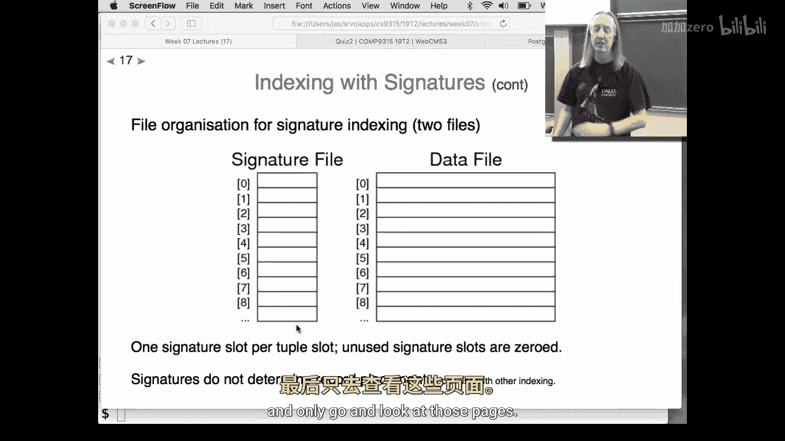

以下是一个签名生成的例子。假设我们有一个包含多个属性的元组。

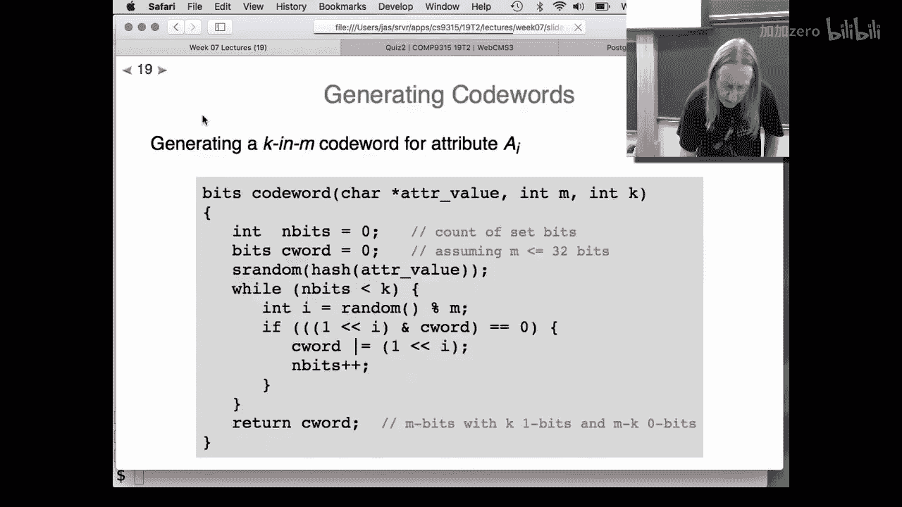

我们为第一个属性生成一个码字，它是一个小的比特串。例如，账户号“102”通过一个基于属性值的种子随机生成的哈希函数，会得到一个特定的码字。

对于元组中的每个已知属性，我们都生成一个码字。然后，我们将所有这些码字进行**按位或（OR）**操作，最终得到该元组的完整签名。这个签名中大约有一半的比特位是1。

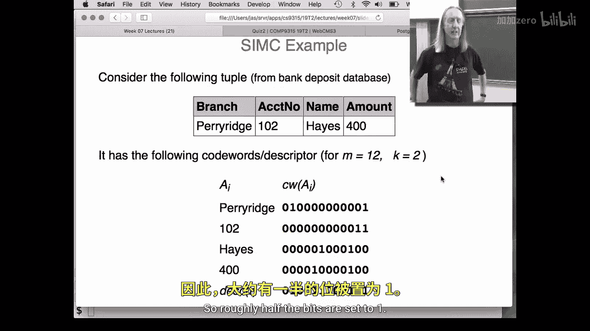

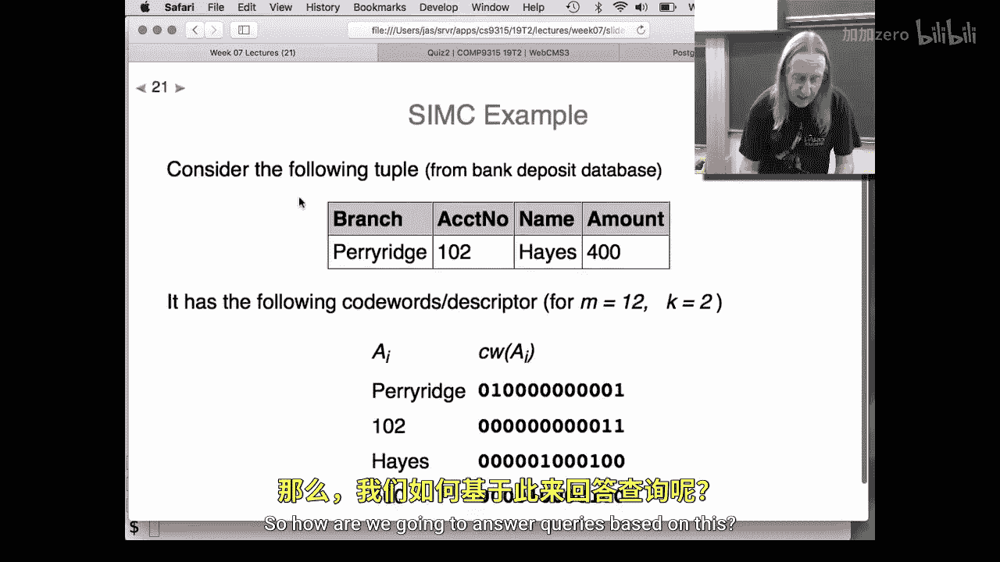

## 基于签名的查询

那么，我们如何基于这些签名来回答查询呢？

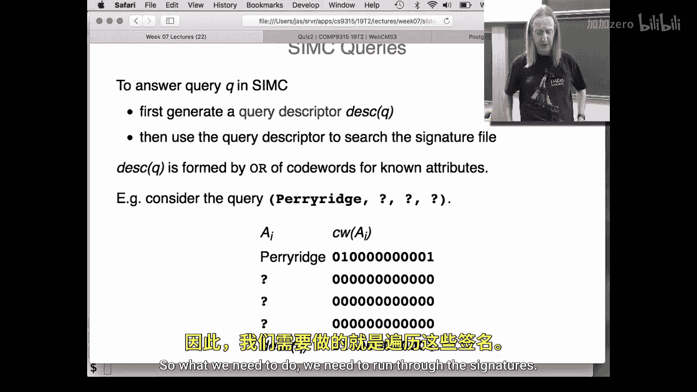

我们首先为查询生成一个**查询描述符**。对于部分匹配检索，我们只知道部分属性的值。

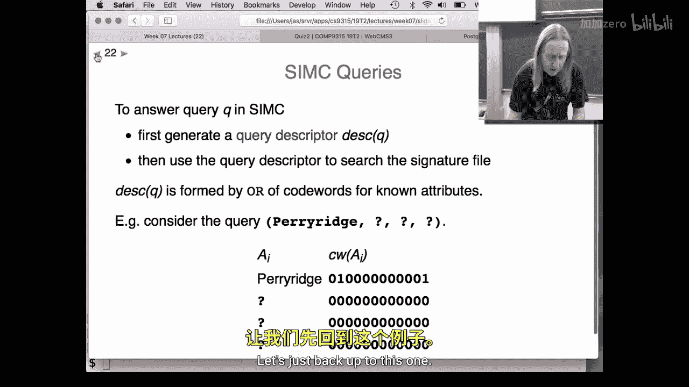

我们为查询中每个已知的属性生成码字，然后将它们进行**按位或（OR）**操作。未知属性的码字被视为全0，不参与计算。这样就得到了该查询的查询描述符。

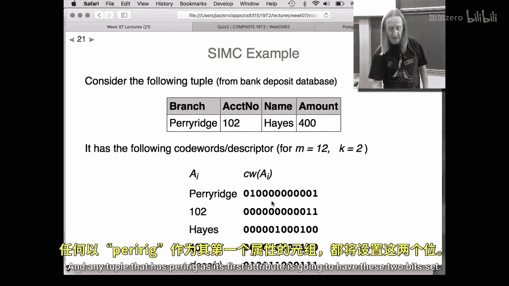

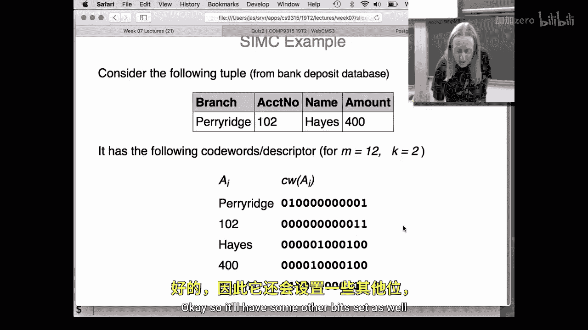

查询过程如下：我们扫描所有的签名（即元组描述符）。对于一个给定的元组签名，我们将其与查询描述符进行匹配。

匹配的条件是：**查询描述符中的所有1比特位，在元组签名中对应的位置也必须是1**。这可以表示为：
`(query_descriptor & record_signature) == query_descriptor`
其中 `&` 是按位与操作。

如果满足这个条件，该元组就是一个潜在的匹配项。我们从该元组的ID（TID）中提取出它所在的页面ID。

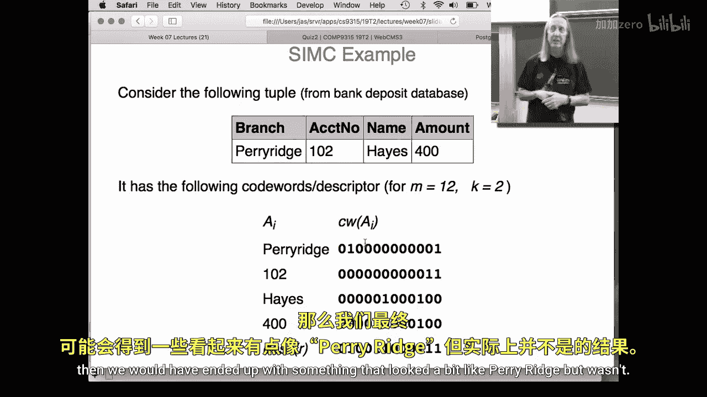

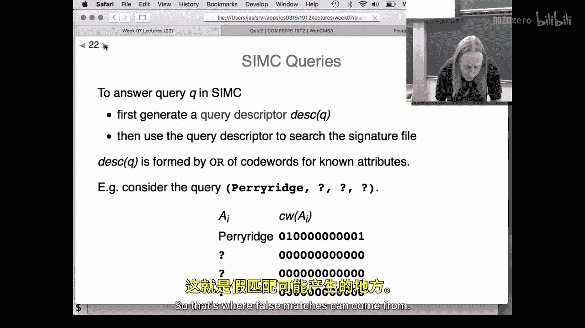

我们收集所有潜在匹配项所在的页面ID，然后只去读取这些页面。在页面内部，我们再逐一检查每个元组，进行精确的属性值匹配，以确认是否为真正的匹配项。

## 假匹配问题

这种方法的潜在问题是可能出现**假匹配**。

一个元组可能因为其不同属性的码字恰好设置了查询描述符所需的比特位，从而被误判为匹配，即使它并不包含查询所指定的属性值。

假匹配会导致我们读取不必要的页面，增加I/O开销。

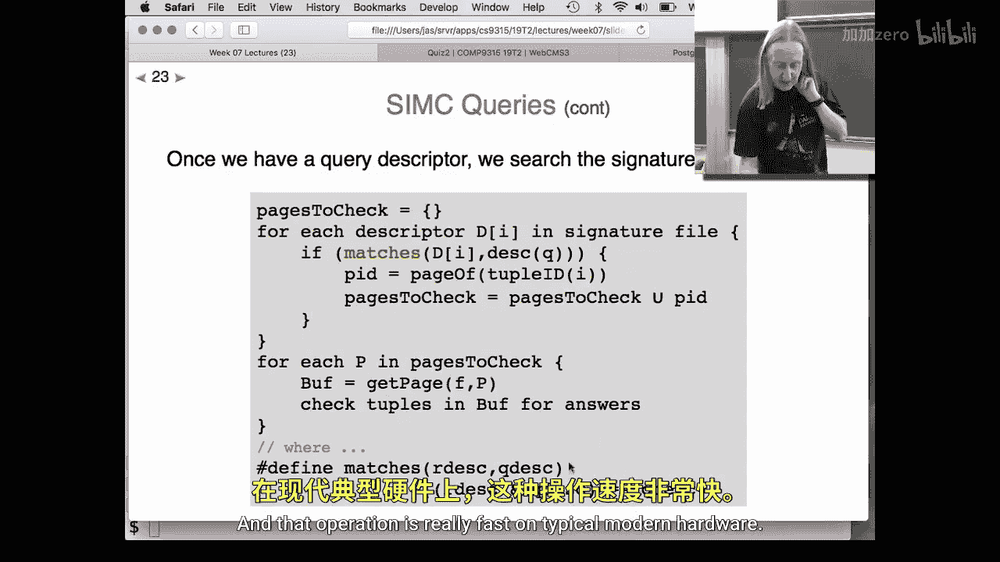

## 优化签名参数

为了降低假匹配的概率，我们可以采取以下措施：

1.  **增大签名长度（M）**：签名比特串越长，可编码的不同状态就越多，不同属性组合导致比特位冲突的概率就越低。
2.  **为每个属性使用独立的哈希函数**：这可以防止不同属性中相同的值（或不同值经哈希后）产生相同的比特模式，从而减少冲突。
3.  **选择合适的码字重量（K）**：即每个属性码字中设置为1的比特数。理论表明，当每个码字中大约一半的比特为1时，签名的区分度最好。

当然，增大M会使签名文件变大，增加扫描签名文件时的读取开销。而K太小会导致哈希碰撞过多，K太大则会使签名过早地被填满1，降低区分度。因此，需要在假匹配概率和扫描开销之间取得平衡。

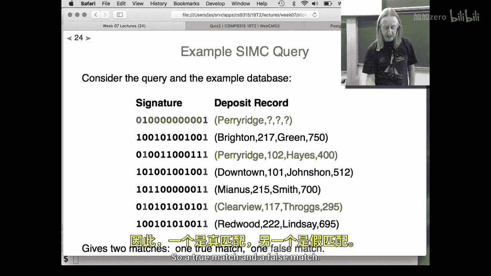

## 参数计算公式

理论上存在M和K的最优组合。我们可以根据可接受的假匹配概率，使用公式来推导出推荐的M和K值。

例如，如果我们希望假匹配概率低于万分之一（1/10,000），我们可以将这些值代入公式进行计算。

公式通常涉及以下变量：
*   `M`: 签名总长度（比特数）
*   `K`: 每个属性码字中1的比特数
*   `n`: 元组中属性的数量
*   `p`: 目标假匹配概率

一个常用的近似公式是：
`p ≈ (1/2)^(M/n)`
但更精确的公式会考虑K的选择。确定了M和K之后，我们所有的签名都将按照这个配置来生成。

## 性能成本分析

最后，我们来分析一下使用叠加码进行查询的实际成本。

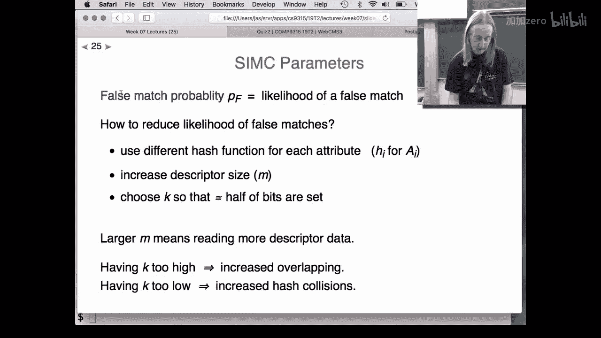

成本主要来自两部分：
1.  **扫描签名文件**：需要顺序读取整个签名文件，进行快速的比特位比较操作。这部分成本与签名文件大小成正比。
2.  **读取数据页面**：需要读取所有潜在匹配项（包括真匹配和假匹配）所在的数据页面。假匹配越多，这部分I/O成本就越高。

因此，优化的目标就是通过选择合适的M和K，在控制签名文件大小的同时，最小化假匹配的数量，从而使总查询成本最低。

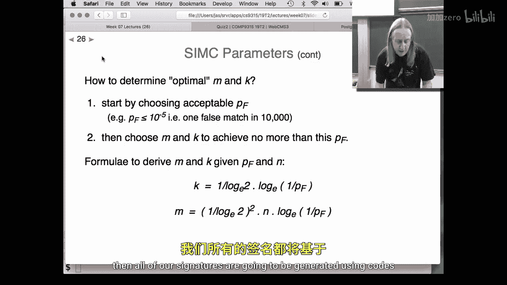

---

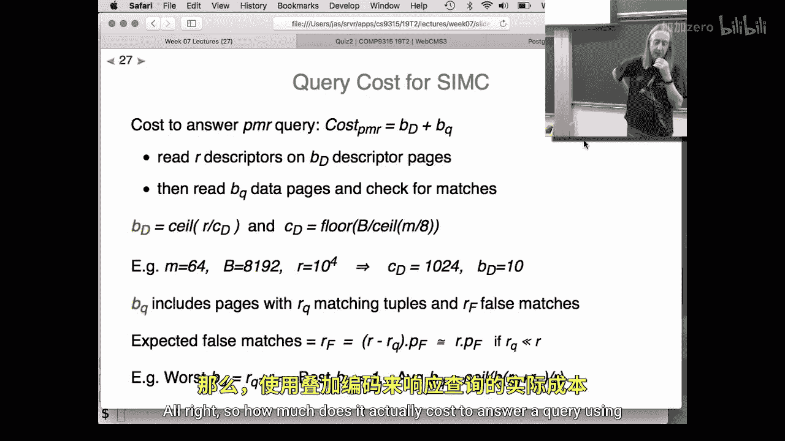

本节课中我们一起学习了基于签名的索引技术。我们掌握了为元组生成签名的方法，理解了如何通过签名快速过滤出潜在匹配的元组，并深入探讨了假匹配现象的成因及其优化策略，即通过调整签名长度（M）和码字重量（K）来平衡查询精度与I/O开销。这种索引方法特别适用于部分匹配查询的场景。