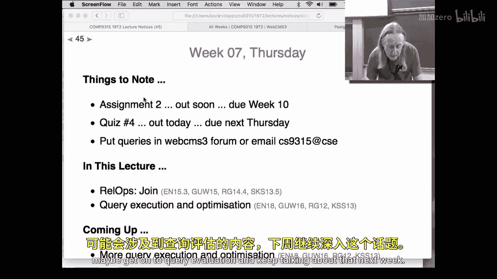
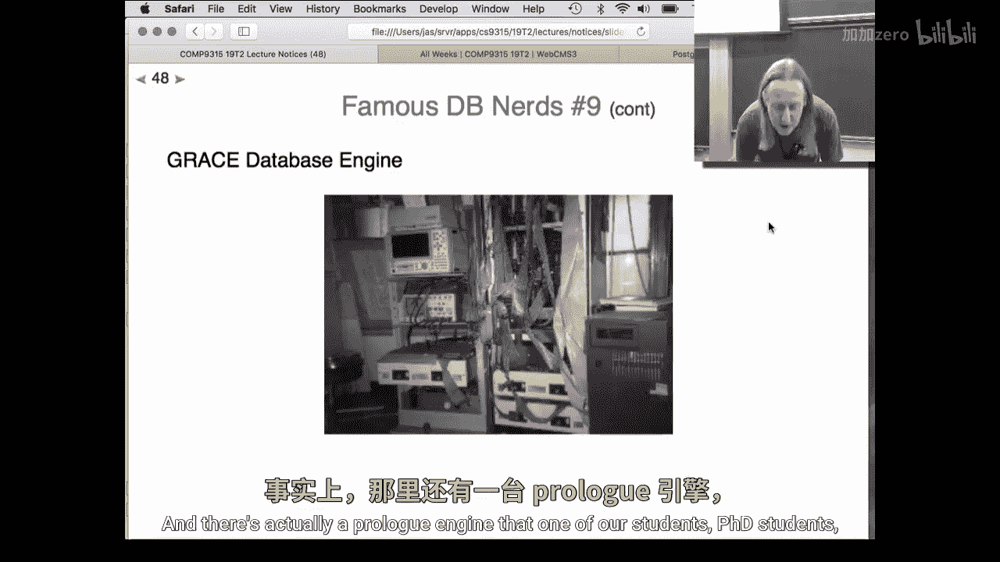
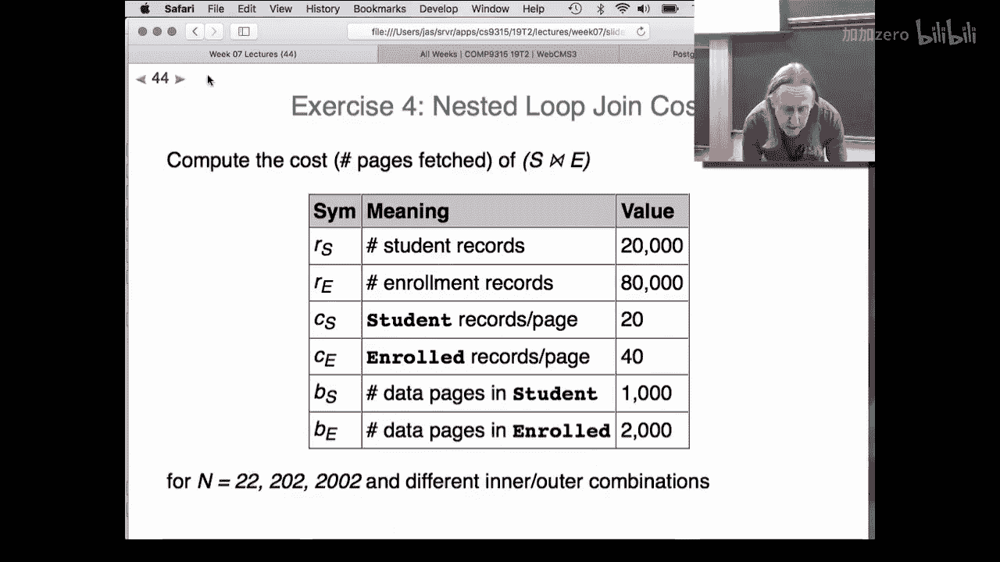
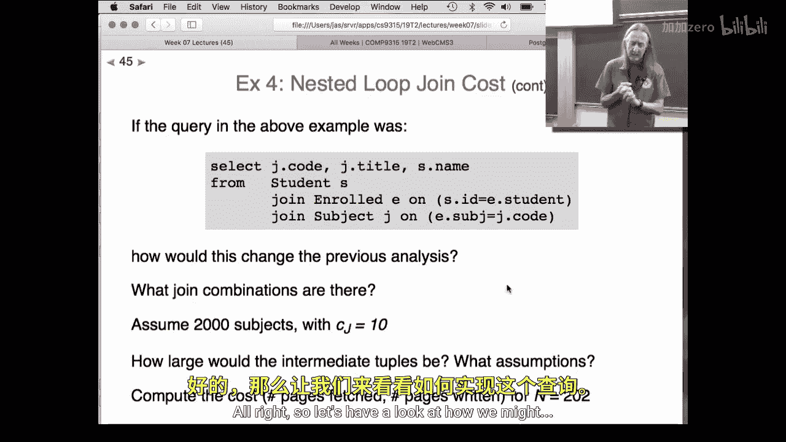
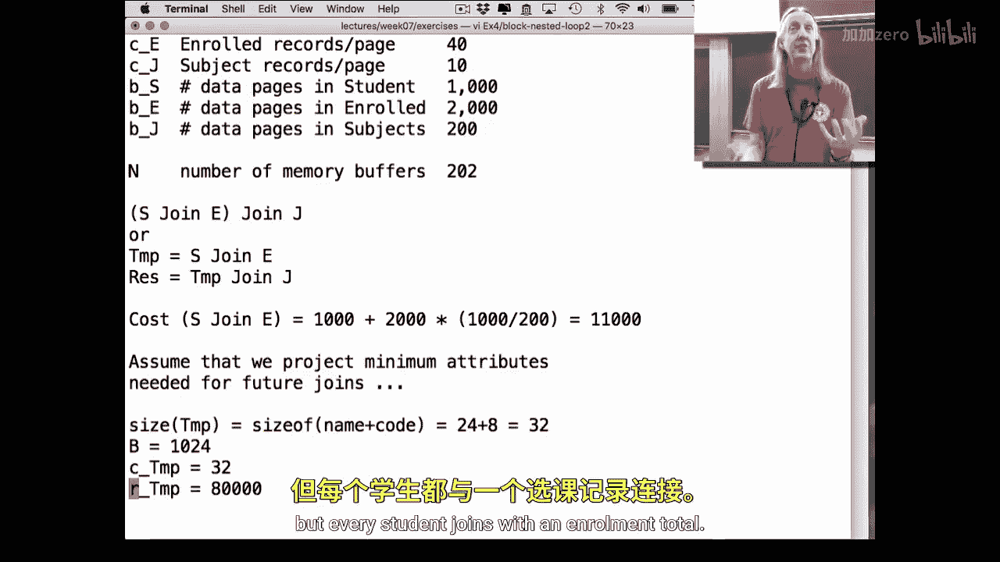

# 023：连接算法与查询优化

在本节课中，我们将学习数据库查询处理中的连接操作，特别是嵌套循环连接及其变体。我们还将探讨如何通过优化内存使用和中间结果来提升多表连接查询的性能。

---

## 课程公告与回顾

上一节我们介绍了嵌套循环连接。本节中，我们来看看在更复杂的查询场景下如何应用和优化它。

首先是一些课程事务通知：
*   每周测验已发布，截止日期为下周四。
*   如有问题，请发送至课程论坛或课程专用邮箱 `CS9315`，避免发送至讲师个人邮箱，以确保问题能被及时处理。

---

## 今日主题：连接与查询评估

今天我们将深入讨论连接操作，并可能开始涉及查询评估，这部分内容将持续到下周。

---

## 数据库轶事：Grace数据库机

在进入正题前，分享一个数据库历史轶事。东京大学的团队在80年代建造了一台名为 **Grace** 的专用数据库机器。它的设计理念是利用并行处理和智能哈希连接算法（我们稍后会讨论）来高速执行关系代数运算。

尽管这是一个有趣的研究构想，并为其设计者赢得了SIGMOD（数据管理国际会议）奖项，但像许多80、90年代的特殊用途机器一样，它最终并未投入实际生产。

---

## 回顾：块嵌套循环连接

我们之前讨论了嵌套循环连接及其优化版本——**块嵌套循环连接**。其核心思想是：
1.  将外层关系（如表R）的一个数据块读入内存缓冲区。
2.  顺序扫描内层关系（如表S）的每一页。
3.  将内存中R块的每个元组与S页中的每个元组进行比较，匹配则形成连接结果。

**理想情况**是，如果较小的表能完全放入内存，则连接成本最低，仅需对两个表各进行一次扫描。

**实际情况**受限于可用内存缓冲区数量（`B`）和关系大小。所需扫描S表的次数取决于R表被分成多少块。执行连接所需的最小缓冲区数量为 **3**（两个输入缓冲，一个输出缓冲）。

---

## 复杂查询示例：三表连接

现在，我们考虑一个更复杂的查询，它涉及三个表：`Student`（学生）、`Enrolment`（选课）和 `Subject`（课程）。查询目标是获取学生姓名和课程全称（而不仅仅是课程代码）。

一种执行策略是分两步进行连接：
1.  首先连接 `Student` 和 `Enrolment` 表，生成一个中间结果。
2.  然后将这个中间结果与 `Subject` 表进行连接，最终获得所需数据。

---

## 优化：减少中间结果大小

在处理多表连接时，**中间结果的大小**对性能至关重要。一个关键的优化点是：在生成中间结果时，**只保留后续连接和最终输出所必需的属性**。

对于我们的示例查询：
*   从 `Student` 和 `Enrolment` 的连接中，我们只需要保留 `student name` 和 `course code`。
*   `course code` 用于下一步与 `Subject` 表连接。
*   `student name` 和从 `Subject` 获取的 `course title` 是最终输出结果。

通过这种“**投影下推**”的优化，可以显著减少中间结果的数据量，从而降低磁盘I/O和内存消耗，提升查询效率。

假设我们有 `B = 202` 个内存缓冲区，我们可以基于优化后的中间结果大小，来计算整个查询执行计划的总页面读取成本。

---

## 总结

本节课中我们一起学习了：
1.  **块嵌套循环连接** 的工作原理及其性能受内存缓冲区数量影响。
2.  处理**多表连接查询**的一种策略：分步执行。
3.  一个重要的查询优化技巧：**尽早过滤和投影**，只传递必要的属性以减少中间结果规模，从而提升连接操作的整体效率。

理解这些基础算法和优化思想，是掌握数据库查询处理和性能调优的关键。