# 024：Grace哈希连接算法详解

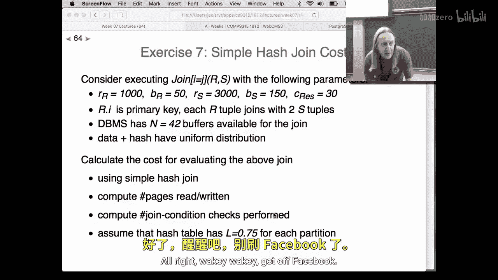

在本节课中，我们将要学习一种更高效的哈希连接算法——Grace哈希连接。我们将了解其工作原理、成本分析，并通过一个具体例子来加深理解。

上一节我们介绍了简单的哈希连接，本节中我们来看看一种改进的算法。

## 算法核心思想

Grace哈希连接的核心思想是：**一次性为整个关系文件构建哈希分区，然后依次处理这些分区**。这听起来可能前期成本更高，但实际上并非如此。

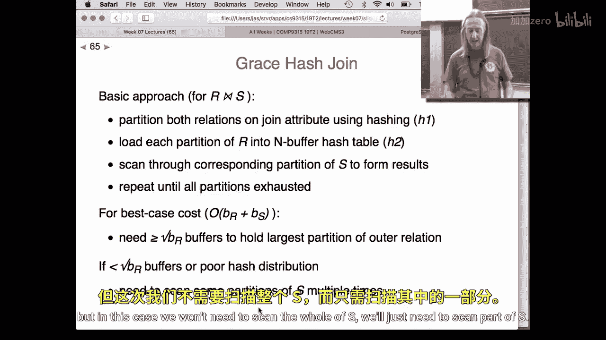

其最佳情况下的成本与关系R的块数`BR`和关系S的块数`BS`相关。具体公式为：
**最佳成本 ≈ 3 × (BR + BS)**

为了实现这个最优成本，我们需要有足够的内存缓冲区，以便能够将外关系（通常是R）的最大分区完全装入内存。由于我们先分区，再逐个读取分区进行处理，因此所需缓冲区数量大约与关系总页数的平方根相当。

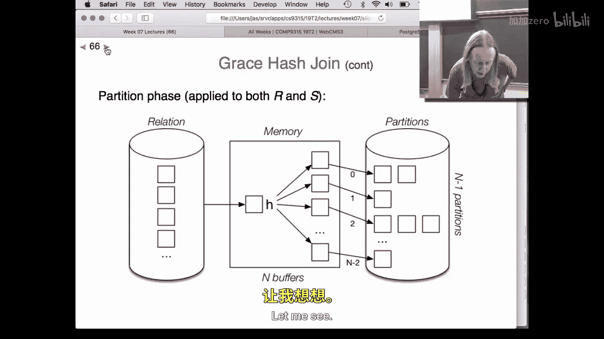

如果缓冲区不足，或者哈希函数分布不均匀，我们可能需要多次扫描关系S。但与简单哈希连接不同，在Grace哈希连接中，我们**不需要扫描整个S，而只需扫描S的对应分区**。

## 算法执行步骤

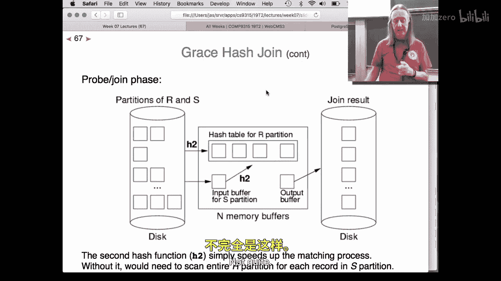

以下是Grace哈希连接的两个主要阶段。

### 第一阶段：分区

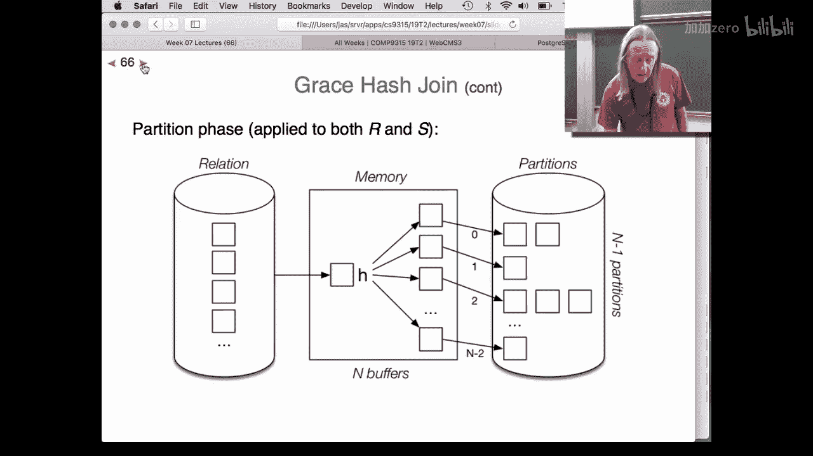

我们为两个输入关系R和S分别构建哈希分区。
1.  逐页读取输入关系（例如R）到输入缓冲区。
2.  使用一个哈希函数`h1`，决定每个元组应放入哪个输出缓冲区。每个输出缓冲区代表输入数据的一个分区。
3.  将填满的分区写入磁盘上的输出文件。
如果我们有`M`个缓冲区，最终会得到`M-1`个分区（其中一个缓冲区用于输入）。
4.  对关系S重复完全相同的过程，使用**同一个哈希函数`h1`**。

分区完成后，我们得到R的一系列分区文件，以及S的一系列分区文件。由于使用了相同的哈希函数`h1`，我们可以确定：**R的第i个分区中的元组，只可能与S的第i个分区中的元组产生连接匹配**。

关于分区成本的一个细节是：由于分区页可能未被完全填满，分区文件的总页数可能会略多于原始输入文件的页数，但不会多太多。

### 第二阶段：连接

现在，我们逐个处理对应的分区对（例如R的分区0和S的分区0），以找出连接匹配。
1.  将R的一个分区（例如分区i）完全读入内存，并使用**另一个哈希函数`h2`** 在内存中为其构建哈希表。
    *   **为什么需要第二个哈希函数？** 如果使用相同的`h1`，该分区内所有元组可能会被散列到同一个桶中，这无助于减少比较次数。`h2`的作用类似于简单哈希连接中的哈希函数，用于减少需要检查的元组数量。
2.  逐页读取对应的S分区（分区i）。
3.  对于读入的每个S元组，使用相同的哈希函数`h2`计算其哈希值，定位到内存哈希表中的相应桶，并扫描该桶以寻找匹配的R元组。
4.  如果找到匹配，则将连接结果放入输出缓冲区。当输出缓冲区填满时，将其写入最终结果文件。

重复此过程，直到处理完所有对应的分区对。

## 成本分析

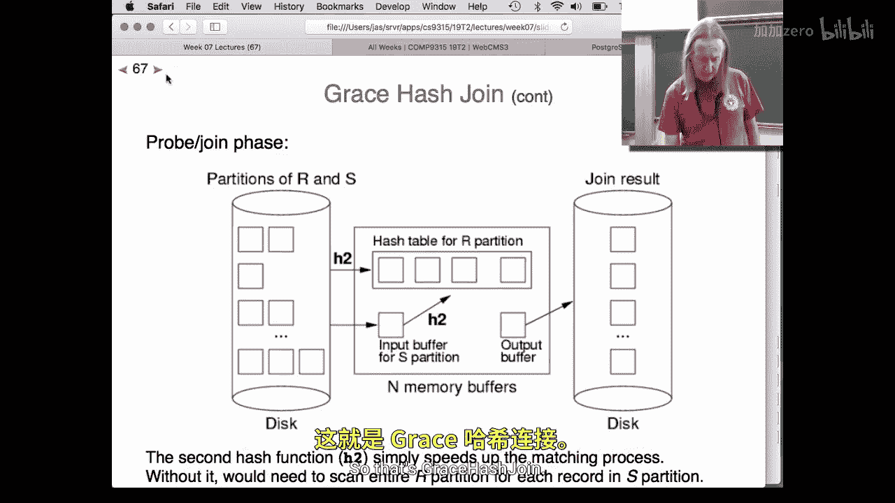

我们来分析一下Grace哈希连接的总成本。假设分区文件的总页数与原始关系页数大致相同。

*   **分区阶段成本**：
    *   读取关系R并写出其分区：`2 × BR`
    *   读取关系S并写出其分区：`2 × BS`
*   **连接阶段成本**：
    *   对于每一对分区，我们需要读入R分区，并扫描对应的S分区。因此，总成本约为读取所有R分区和所有S分区的成本：`BR‘ + BS’`（其中`BR‘`和`BS’`是分区后的总页数，略大于`BR`和`BS`）。

因此，**总成本 ≈ 2BR + 2BS + (BR‘ + BS’) ≈ 3 × (BR + BS)**（在近似情况下）。这个成本是相当不错的。

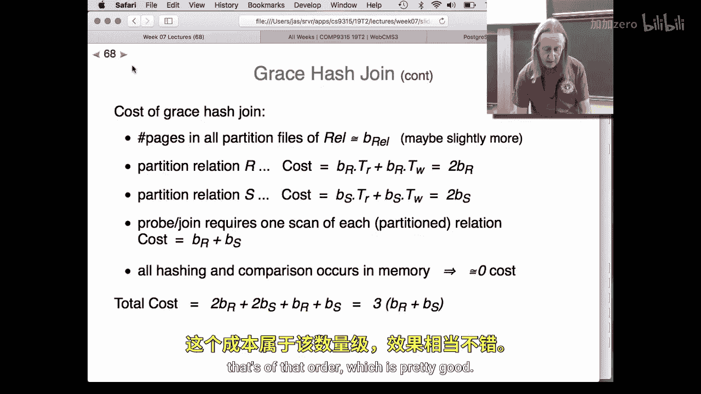

## 示例分析

让我们通过一个具体例子来看看成本可能是多少。

假设我们有42个内存缓冲区（`M = 42`）。在分区阶段，我们将使用1个缓冲区作为输入，其余41个作为输出缓冲区，因此会创建41个分区。

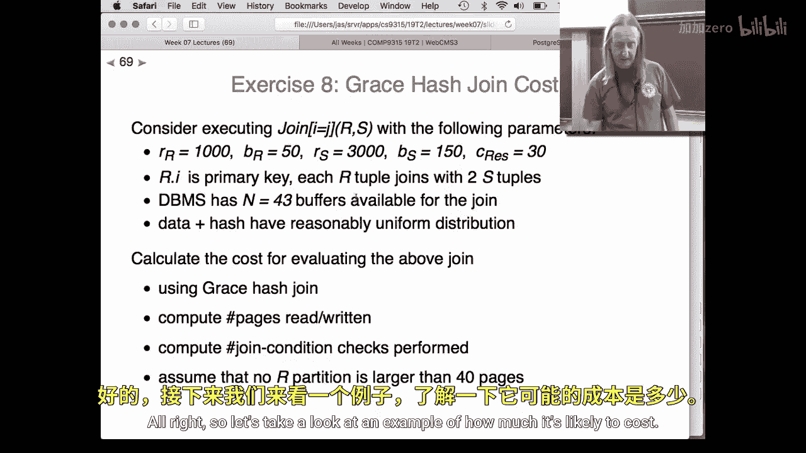

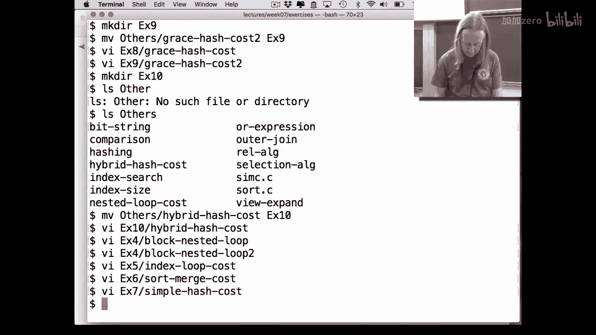

对于关系R，假设其总元组数均匀分布到41个分区中，那么每个分区大约包含2页数据，每页大约有25个元组。因此，R分区文件的总页数`BR‘`约为 `41分区 × 2页/分区 = 82页`。

对于关系S，其元组可能更小、数量更多。经过相同的哈希函数`h1`分区后，假设每个S分区大约有3页数据。那么，S分区文件的总页数`BS‘`约为 `41分区 × 3页/分区 = 123页`。

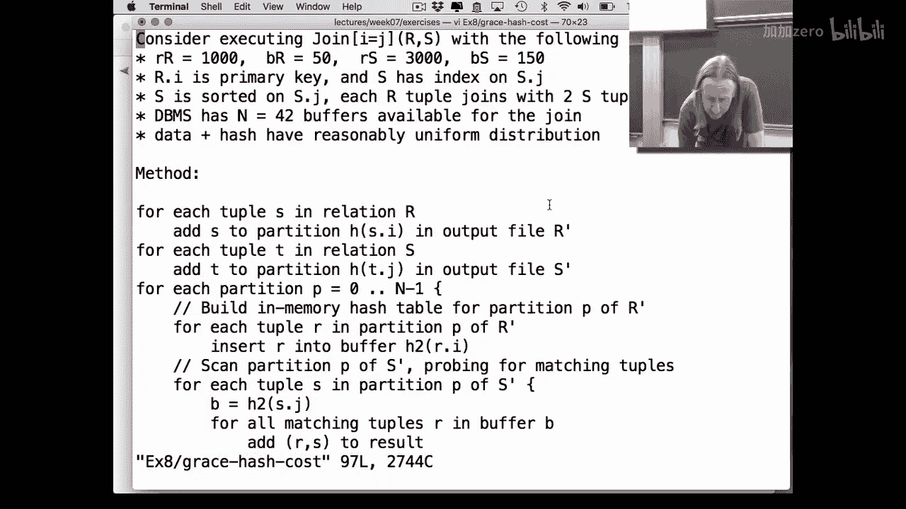

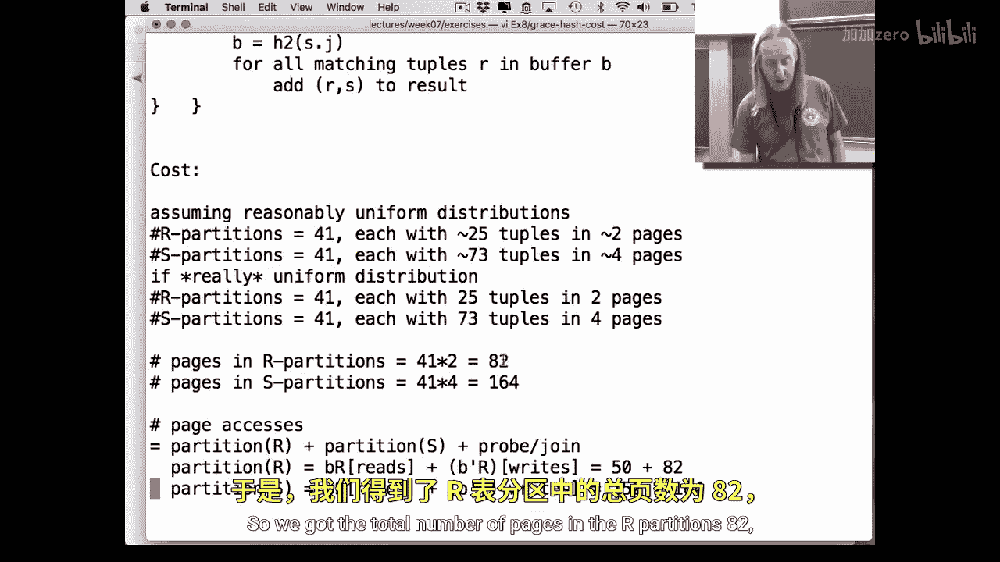

根据我们的成本公式，总I/O操作次数大约为 `2BR + 2BS + 82 + 123`。如果原始`BR`和`BS`分别接近82和123，那么总成本大约在 `3×(82+123)=615` 次I/O左右。

---

本节课中我们一起学习了Grace哈希连接算法。我们了解到，该算法通过先对两个关系进行分区，再对对应分区进行连接的方式，降低了对内存大小的依赖，并能在缓冲区数量约为总页数平方根时获得较好的性能。其核心在于使用同一个哈希函数确保匹配的元组进入相同编号的分区，并在连接阶段使用第二个哈希函数进行高效匹配。