# 026：查询优化与成本估算

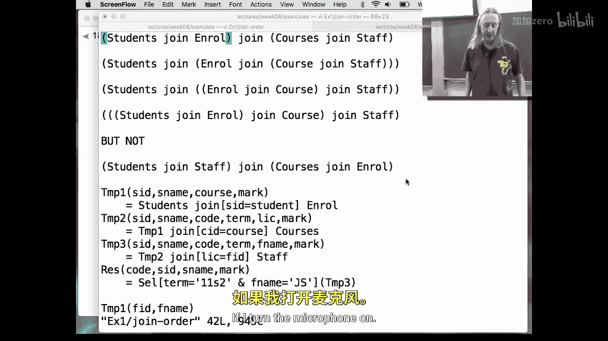

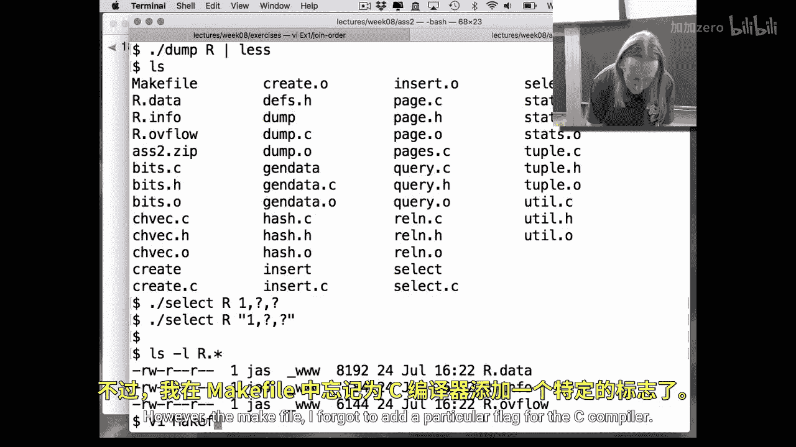

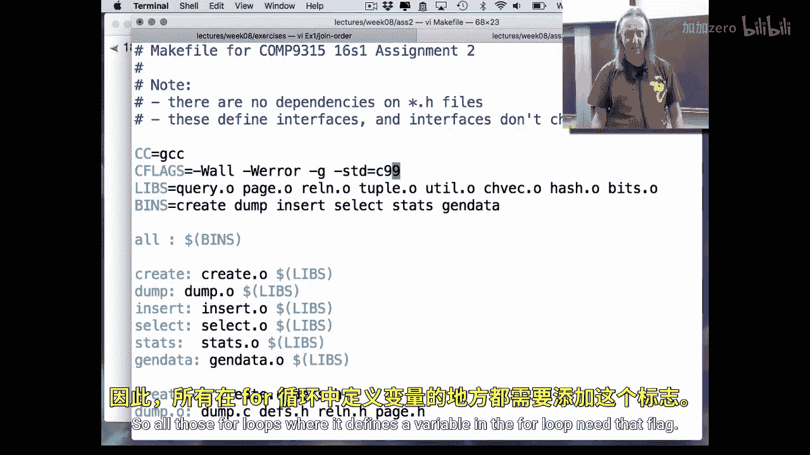

在本节课中，我们将要学习查询优化器如何为查询计划选择具体的物理访问方法，以及如何估算这些操作的成本。理解这些概念对于设计高效的数据库查询至关重要。

## 课程概述与前期问题

上一节我们介绍了查询计划的基本概念。本节中我们来看看优化器如何选择具体的实现方法。

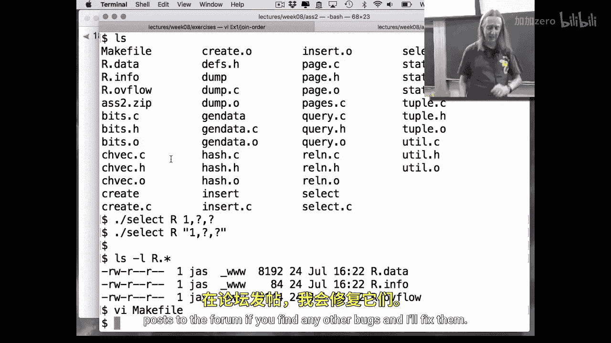

首先，需要说明课程材料中的一个问题。Makefile文件最初遗漏了一个编译标志 `-std=c99`，这可能导致在某些环境（特别是名为“Greek”的CSE服务器）下编译失败。该问题已在更新的材料中修复。请注意，由于库的差异，建议不要在“Greek”服务器上完成本课程作业，在其他CSE工作站或Mac系统上均可正常运行。

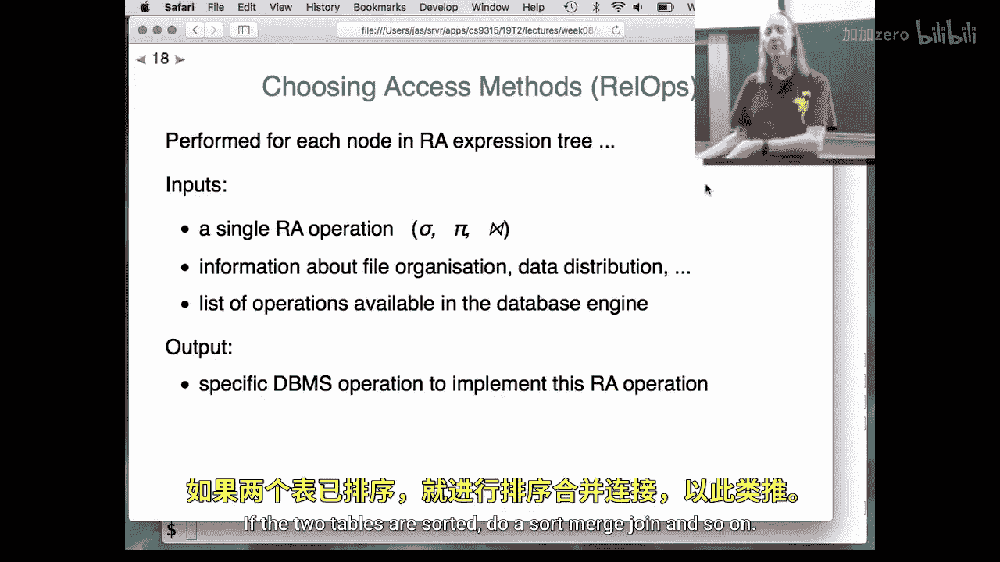

## 选择物理访问方法

查询优化器的核心任务之一，是为关系代数操作选择最有效的物理实现方法。选择依据主要是关系上已有的数据结构。

以下是优化器进行选择时遵循的一些基本规则：
*   如果关系在筛选属性上建有索引，则优先使用**索引扫描**。
*   如果关系在连接属性上已排序，则考虑使用**排序归并连接**。
*   如果关系在筛选属性上建立了哈希结构，则可以使用**哈希搜索**。
*   如果以上结构都不存在，则只能回退到**线性扫描**，这是效率最低的备选方案。

## 操作流水线化

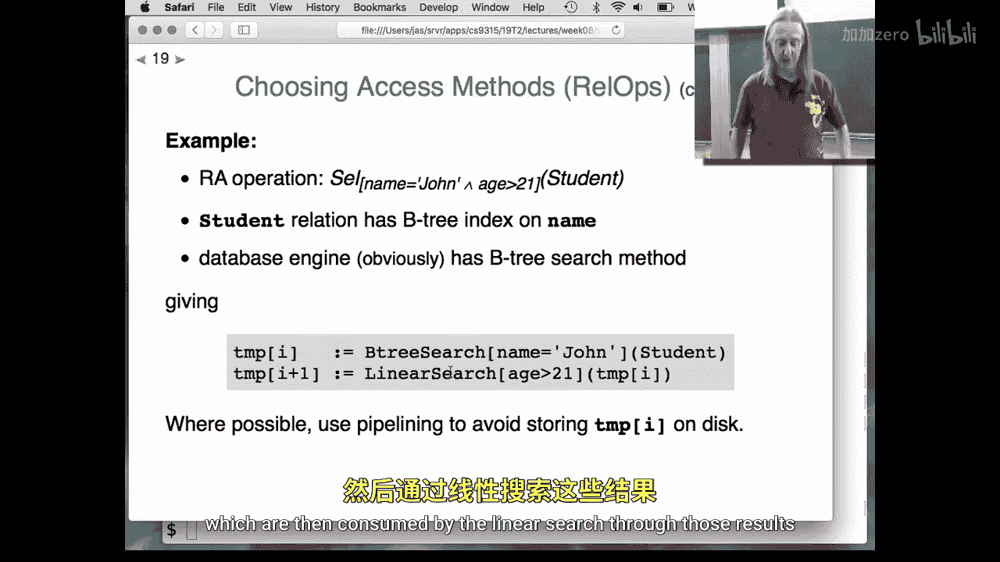

为了提升效率，数据库系统会采用流水线技术。该技术将一个关系代数操作的输出结果直接放入缓冲区，供下游操作立即消费，从而避免将中间结果写入磁盘带来的高昂I/O开销。

例如，对于一个包含两个条件的查询（如 `name='John' AND age>21`），如果 `name` 列有索引，优化器可能会将其拆分为两个顺序操作：
1.  使用B树索引快速找出所有 `name='John'` 的元组，并将结果放入缓冲区。
2.  下游操作从缓冲区中读取这些元组，并通过线性扫描筛选出满足 `age>21` 的元组。

## 连接操作的选择策略

对于连接操作，选择策略同样依赖于对关系特性的了解。

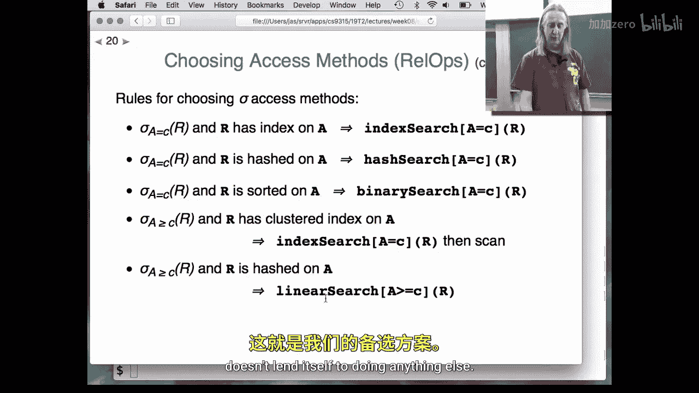

以下是针对不同情况的连接方法选择：
*   **块嵌套循环连接**：如果已知其中一个表能完全放入内存缓冲区，则使用此方法，并扫描另一个表。
*   **排序归并连接**：如果已知两个表都在连接属性上排序，则此方法非常高效。
*   **哈希连接**：对于等值连接，这是一个常用的高效方法。
*   **嵌套循环连接**：当没有其他优化结构可用时，这是最后的备选方案，相当于连接操作中的“线性扫描”。

## 输出结果大小估算

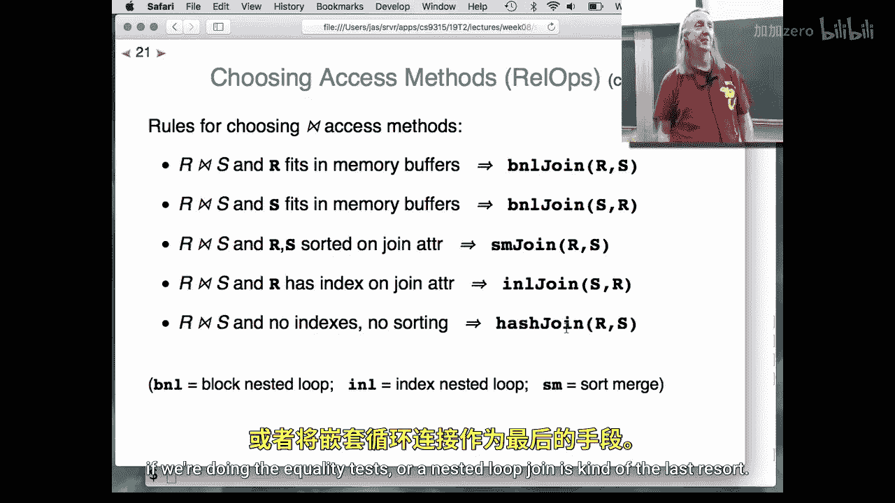

估算一个操作产生的输出结果大小至关重要，因为它直接影响下游操作的成本。我们无法通过实际执行来获取精确大小，因此需要进行估算。

估算所依赖的统计信息包括：
*   关系的**元组总数**。
*   元组的**平均大小**，这决定了输出的数据量。
*   属性的**不同值数量**，这有助于估算选择查询的输出基数。
*   属性的**最小值和最大值**，这对于估算范围查询（如 `>`）的结果集大小很有帮助。

## 投影与选择操作的估算

对于不同类型的操作，估算方法有所不同。

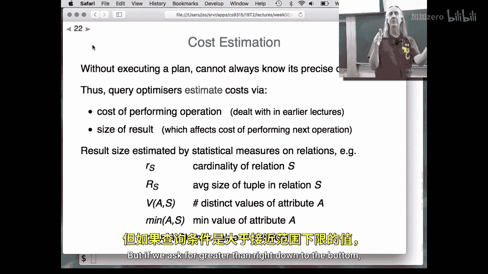

### 投影操作估算

投影操作的结果大小相对容易估算：
*   **元组数量**：如果不使用 `SELECT DISTINCT`，输出元组数量与原关系相同。因为SQL默认采用包语义，允许重复元组。
*   **元组大小**：输出元组的大小就是所选属性的总大小加上元头开销。
*   **去重估算**：如果使用了 `SELECT DISTINCT`，估算输出大小会变得复杂，因为这取决于数据的重复程度。精确估算较为困难。

### 选择操作估算

对于选择操作，我们通常基于**均匀分布**的假设进行估算。
*   **主键上的等值查询**：输出结果最多为一个元组。
*   **非主键上的等值查询**：输出元组数量 ≈ 总元组数 / 该属性不同值的数量。
*   **范围查询**：结合最小值、最大值和均匀分布假设，可以估算满足条件的元组比例。例如，查询条件接近最大值时，结果集较小；接近最小值时，结果集较大。

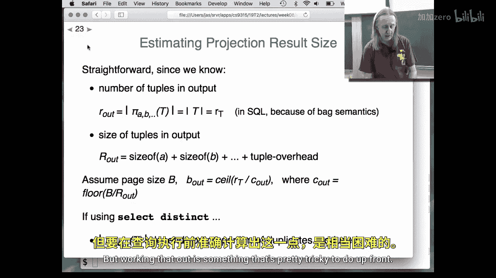

## 课程总结

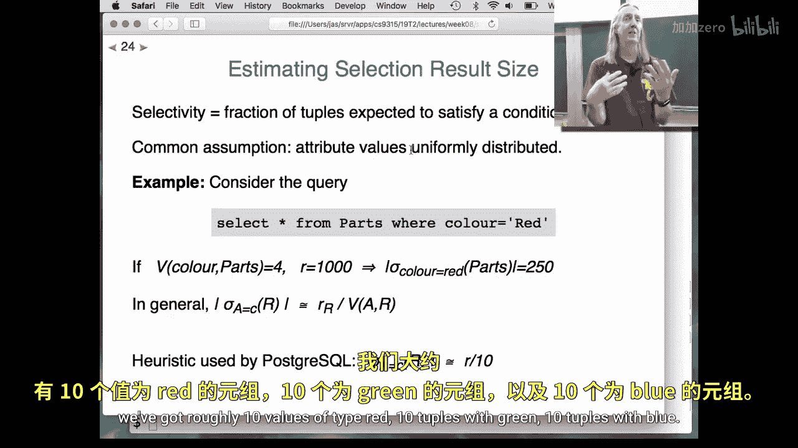

本节课中我们一起学习了查询优化中两个关键环节：物理访问方法的选择和操作成本的估算。我们了解到，优化器会根据已有的索引、排序等数据结构，为扫描、连接等操作选择最高效的实现算法。同时，利用系统收集的统计信息，优化器能够估算每个操作步骤的中间结果大小，从而评估整个查询计划的执行成本，并最终选出最优计划。掌握这些原理，有助于我们编写出更能被数据库高效执行的查询语句。