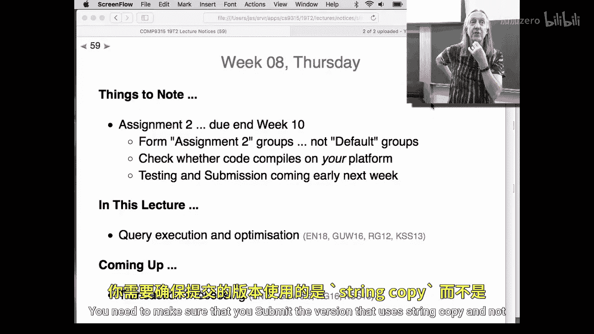
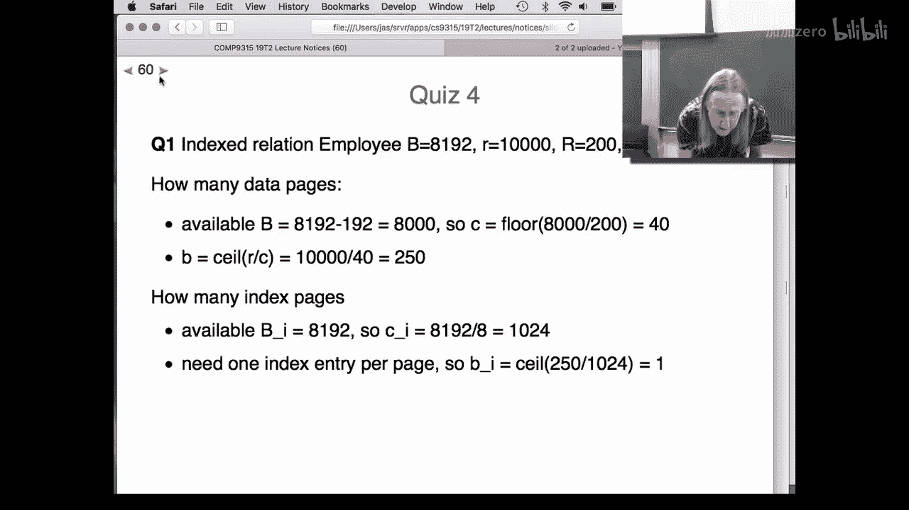
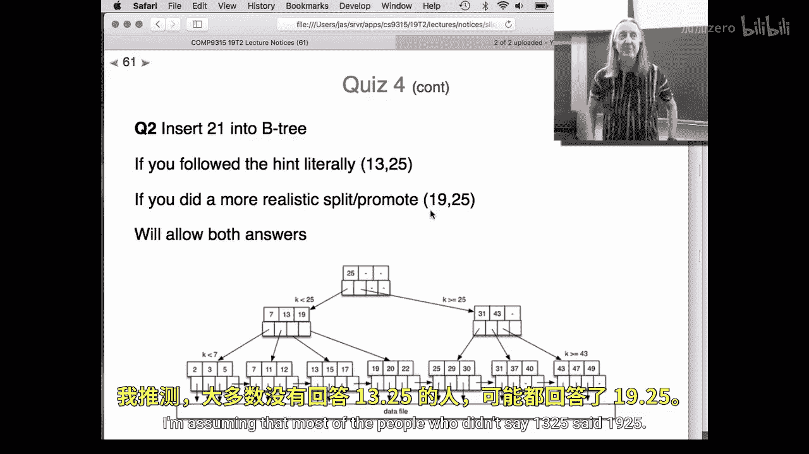
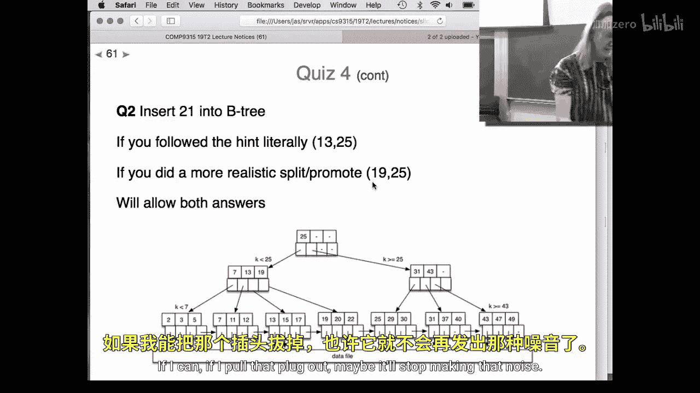

# 027：查询评估收尾与作业说明

在本节课中，我们将快速回顾查询评估的剩余内容，并重点说明作业2（Simon2）的编译注意事项以及小测验4的题目解析。


---

## 作业2（Simon2）编译说明

上一节我们介绍了查询评估的整体流程，本节中我们来看看作业2的具体实现细节。首先，确保你的代码能够顺利编译。

以下是编译作业2时需要注意的几个关键点：




1.  **字符串复制函数**：由于C99标准弃用了`strdup`函数，代码中已使用自定义的`copyString`函数替代。提交作业时，请确保你使用的是`copyString`而非`strdup`。
2.  **随机数生成器**：代码中使用了`rand`函数生成随机数据。如果在你的机器上编译失败，可以尝试将其改为`random`函数。此修改仅影响数据生成，对功能无碍。
3.  **编译测试**：请务必在提交前测试代码能否成功编译。已有同学反馈在特定环境下编译成功。

关于作业分组，请确认在系统中能选择“assignment2”作为小组类型。如有问题，请及时反馈。

---

## 小测验4题目解析


接下来，我们回顾一下小测验4中的两道题目，帮助大家理解相关概念。

### 题目一：关系与索引大小计算

本题考察如何计算数据页和索引页的数量。已知条件如下：
*   页面大小：8KB
*   记录总数：10,000条
*   每条记录大小：200字节
*   每个索引条目大小：8字节
*   数据页头大小：192字节

首先，计算每个数据页能存放多少条记录：
```
可用空间 = 页面大小 - 页头大小 = 8192 - 192 = 8000 字节
每页记录数 = 可用空间 / 记录大小 = 8000 / 200 = 40 条
```
因此，所需数据页总数为：
```
数据页总数 = 总记录数 / 每页记录数 = 10000 / 40 = 250 页
```
接着，计算索引页。由于数据文件已排序，我们只需为每个数据页创建一个索引条目（指向该页的最小键值），而非每条记录一个。因此，索引条目总数为250个。

每个索引页能存放的条目数为：
```
每页索引条目数 = 页面大小 / 索引条目大小 = 8192 / 8 = 1024 个
```
所以，所需索引页总数为：
```
索引页总数 = 索引条目总数 / 每页索引条目数 = 250 / 1024 ≈ 1 页（向上取整）
```
关键点在于理解“数据已排序”这一条件，它让我们可以采用稀疏索引，从而减少索引大小。

### 题目二：B+树插入操作

本题考察向B+树插入键值`21`后的根节点内容。原树结构为：
```
        [13]
       /    \
[5,10]      [15,20,25]
```
插入`21`后，它应进入右叶子节点`[15,20,25]`，导致该节点溢出。根据提示“中间值被提升”，我们需要分裂该节点。

分裂过程如下：
1.  原节点键值为`[15,20,25]`，插入`21`后变为`[15,20,21,25]`。
2.  找到中间值。对于4个元素的数组，提升的通常是第二个元素（索引1），即`20`。
3.  将`20`提升到父节点（根节点）。
4.  分裂后的叶子节点变为`[15]`和`[21,25]`。



因此，新的根节点内容为`[13,20]`。部分同学可能通过不同的分裂策略得到了`[19]`，这两种答案在本课程语境下均可接受。

---





本节课中我们一起学习了作业2的编译要点，并通过解析小测验4的题目，巩固了数据存储计算和B+树插入操作的核心概念。理解这些基础原理对后续的数据库实现工作至关重要。