# 029：事务调度与可恢复性

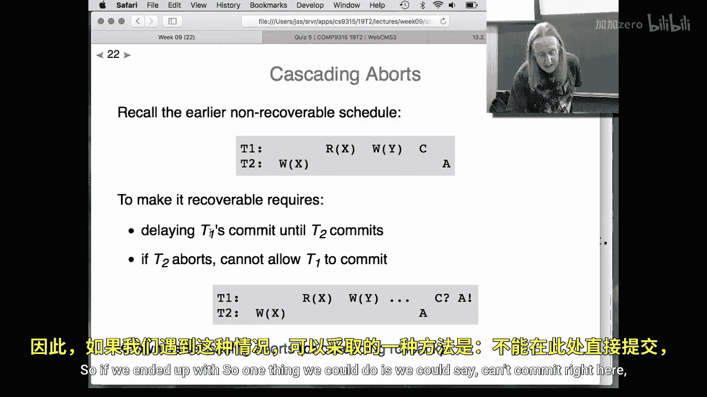

在本节课中，我们将要学习数据库事务调度中的关键概念，特别是如何避免级联回滚，以及不同调度类型（如可恢复调度、严格调度）如何影响数据库的并发性和一致性。我们将通过具体的场景来理解为什么某些调度会导致问题，以及如何通过调度规则来保证数据库处于一致状态。

## 级联回滚问题

上一节我们介绍了事务并发执行可能带来的问题。本节中我们来看看一个具体问题：级联回滚。

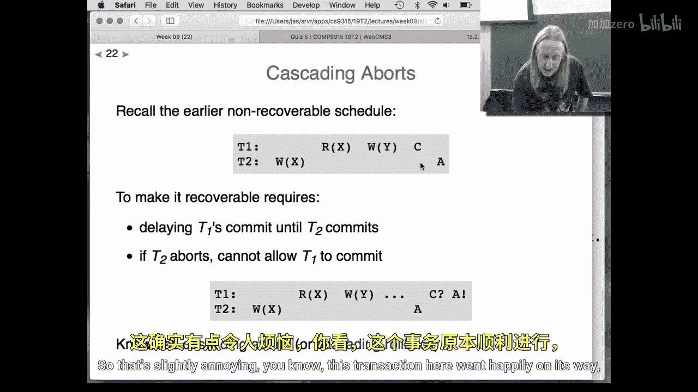

当一个事务读取了另一个未提交事务写入的数据（脏读），而后者随后又中止了，就会产生问题。读取了无效数据的事务，其计算结果也变得无效，因此它也必须中止。这可能导致一连串的事务都需要回滚。

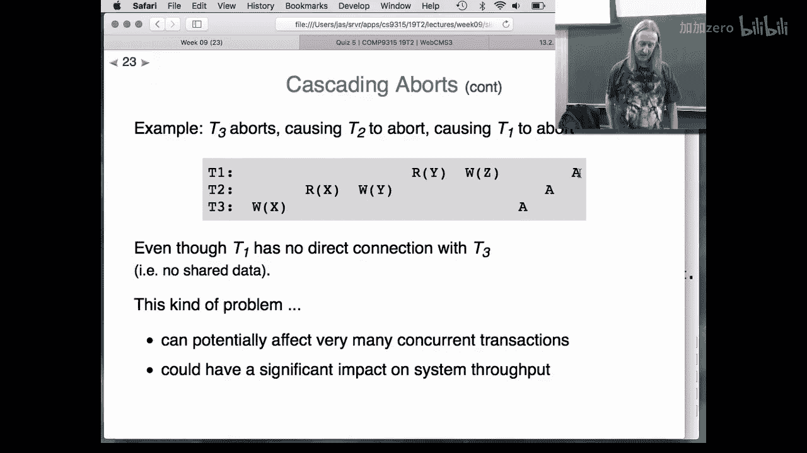

例如，考虑以下场景：
*   事务 T2 读取了事务 T1 写入但未提交的数据 `x`。
*   随后，事务 T1 中止了，`x` 的值被回滚。
*   此时，T2 基于无效的 `x` 值计算出的 `y` 值也是无效的。
*   为了保持数据库一致性，T2 也必须中止。

更糟糕的情况是，如果事务 T3 读取了 T2 写入的 `y`，那么 T1 的中止将导致 T2 和 T3 都需要级联回滚，即使 T3 与最初的 T1 并无直接关系。

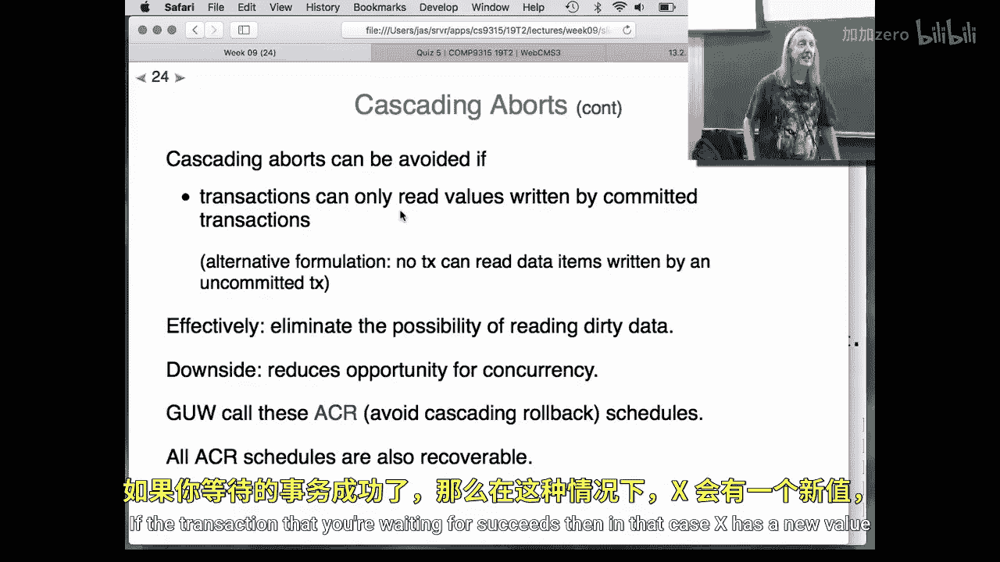

## 避免级联回滚

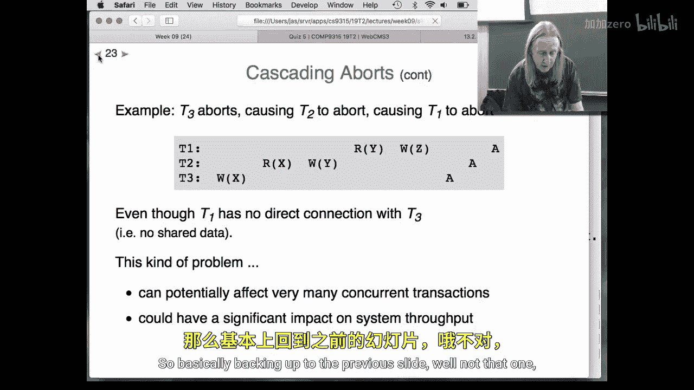

为了避免级联回滚，一个核心原则是：**事务只能读取已提交事务写入的数据**。

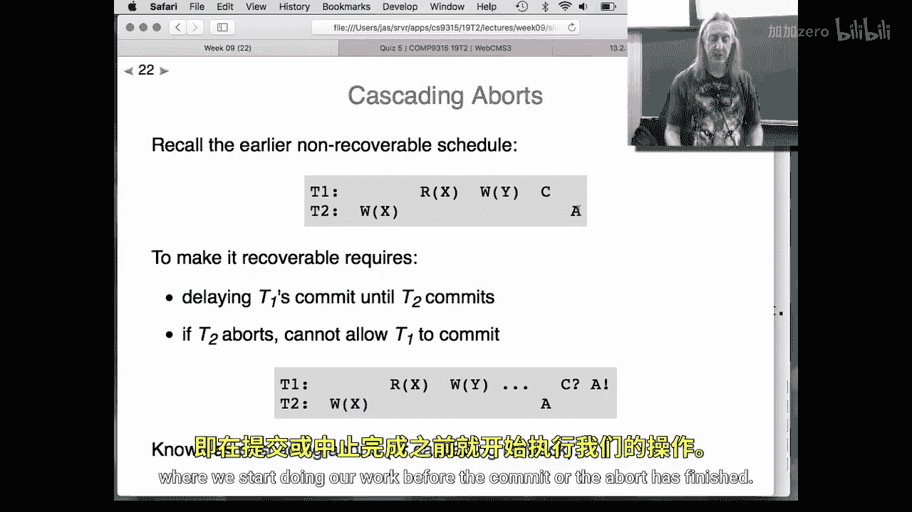

这意味着，如果一个事务想要读取某个正被其他事务修改的数据项，它必须等待，直到那个事务**完全结束**（无论是提交还是中止）。等待结束后，它可以安全地读取最终确定的值（提交后的新值或中止后的旧值）。

这种方法消除了读取“脏数据”（可能被回滚的数据）的可能性，从而避免了级联回滚。遵循此规则的调度被称为 **可避免级联回滚（Avoids Cascading Rollbacks， ACR）** 的调度，或称 **可恢复（Recoverable）** 调度。

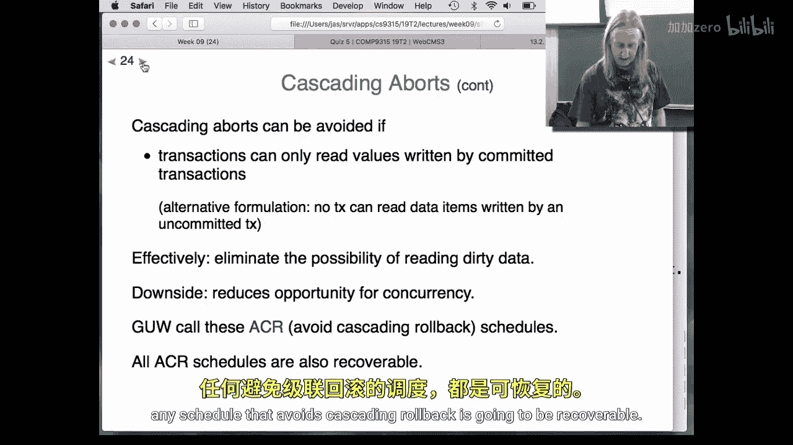

## 调度类型的层次结构

除了可恢复性，调度还可以具有其他属性，例如**严格性（Strictness）**。一个严格的调度要求：事务不能写入（覆盖）另一个未提交事务已写入的数据项。

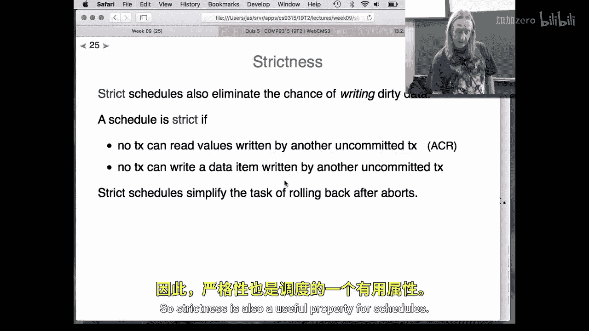

不同的调度属性构成了一个层次结构：

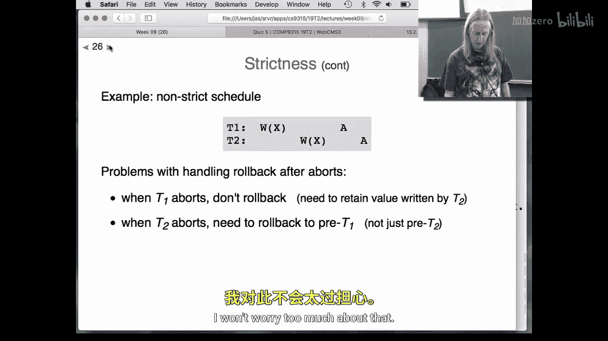

*   **可串行化调度（Serializable Schedules）**： 保证并发执行的结果等价于某种串行执行顺序。这是最严格的保证。
*   **严格调度（Strict Schedules）**： 是可串行化调度的子集，提供强一致性保证。
*   **可避免级联回滚调度（ACR Schedules）**： 是可串行化调度的另一个子集，保证了可恢复性。
*   **所有可能调度（All Schedules）**： 范围远大于可串行化调度。

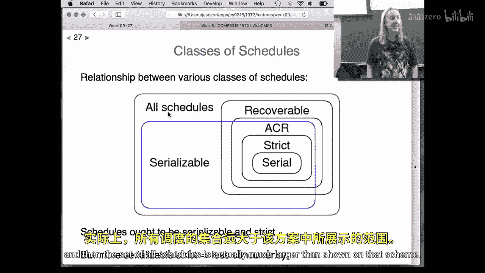

**权衡**： 调度的属性越严格（如可串行化），对数据库一致性的保证就越强，但允许的**并发度（Concurrency）** 可能就越低。许多数据库系统允许用户根据需求选择隔离级别，例如接受可恢复调度以换取更高的并发性能，但这会带来一定的风险。

## 并发控制与调度器

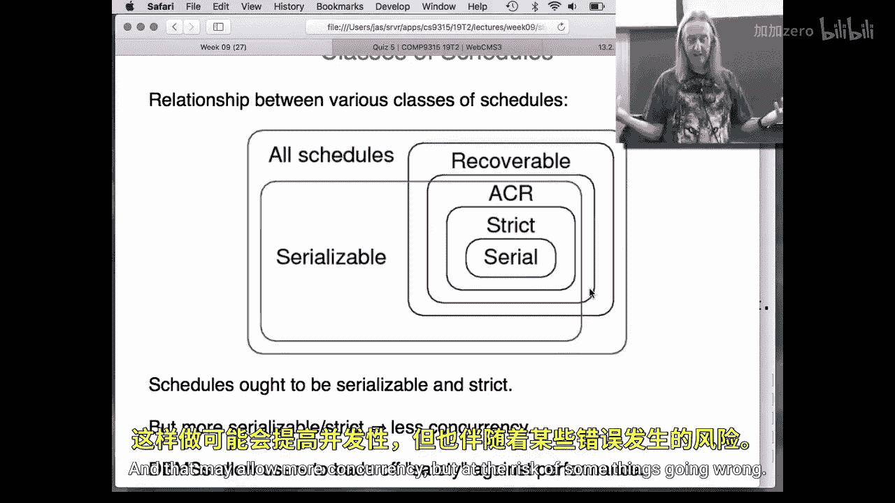

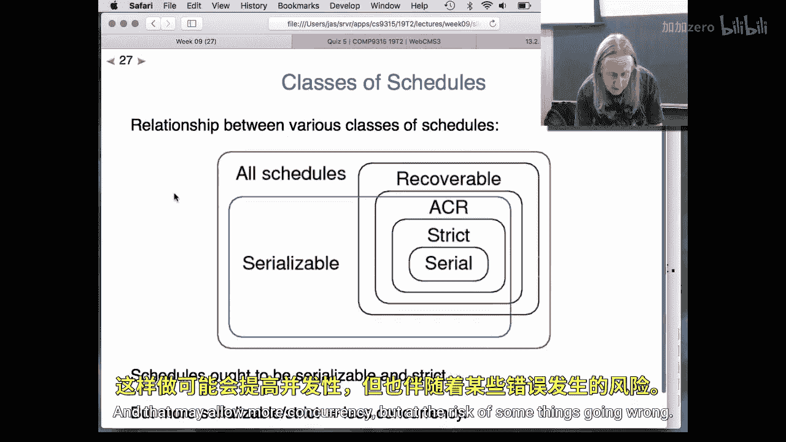

那么，数据库如何确保事务遵循这些规则呢？这通过**并发控制机制**和**调度器（Scheduler）** 来实现。

事务管理器会发送一系列的读/写请求。调度器的职责是决定这些操作的执行顺序，以确保最终产生的调度具有我们期望的属性（如可串行化、可恢复），而不会产生无效的结果。调度器排序后的操作会与缓冲区池管理器交互，以获取实际的数据对象。

需要强调的是，如果两个事务操作的是完全不同的数据对象，那么它们的操作可以任意交错执行，不会产生任何问题。并发控制主要关注那些操作存在**冲突（Conflict）**（例如，读写同一数据项）的事务。

## 可串行化详解

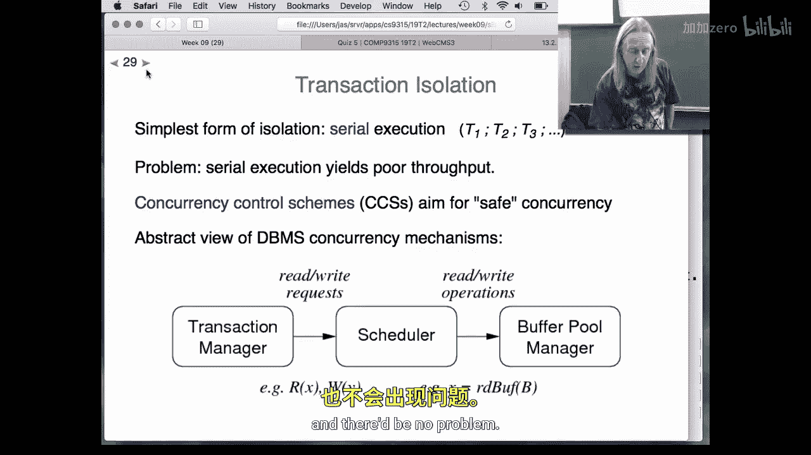

我们再次深入探讨可串行化的定义。其核心思想是**等价性（Equivalence）**。

*   **调度等价**： 如果两个调度执行后，数据库处于相同的最终状态，则这两个调度是等价的。
*   **可串行化调度**： 一个并发调度，如果它的执行结果与**某个**串行调度（即事务一个接一个顺序执行）的结果等价，那么这个并发调度就是可串行化的。

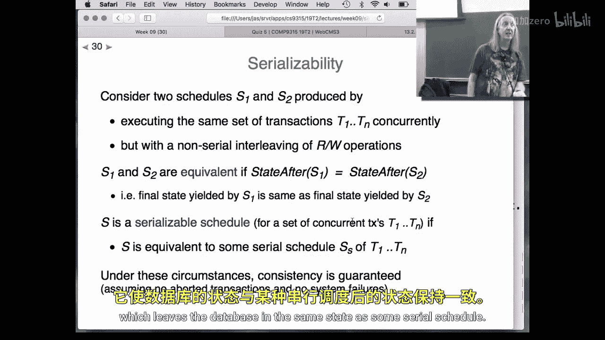

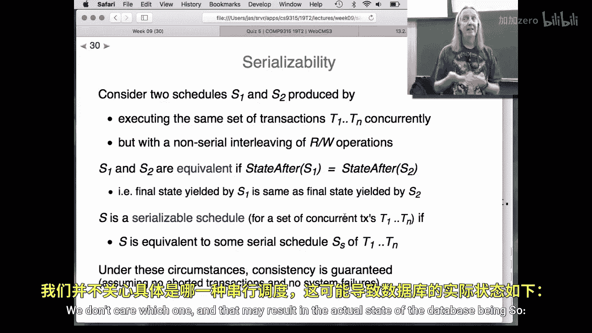

注意，不同的串行顺序（如先T1后T2，或先T2后T1）可能导致不同的最终数据库状态。但只要并发调度的结果等价于其中任何一种串行顺序的结果，我们就认为它满足了可串行化要求，从而保证了数据一致性。

判断可串行化主要有两种方法：
1.  **冲突可串行化**： 通过分析事务间的冲突操作（如对同一数据的读-写、写-写）是否按特定顺序发生。
2.  **视图可串行化**： 通过分析哪个事务产生了某个数据的最终值，以及数据值在生产者和消费者之间的传递关系。

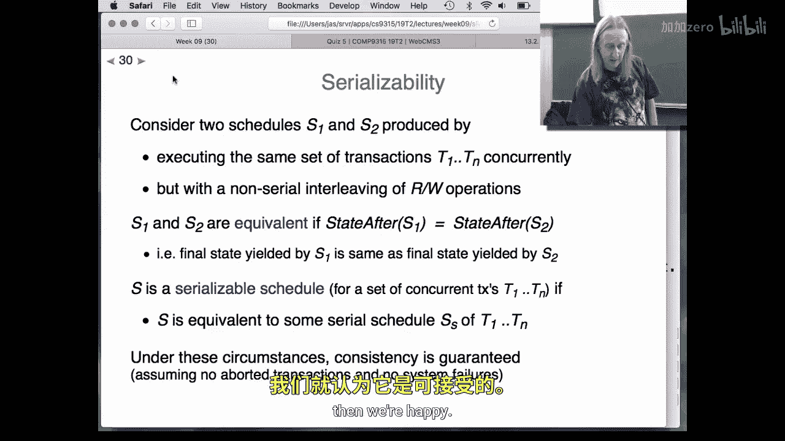

---

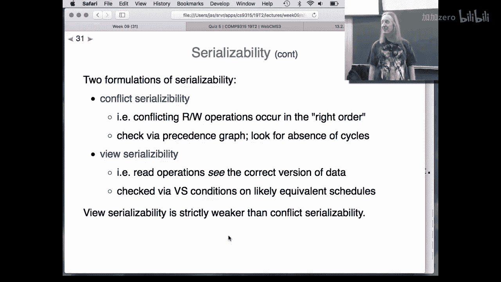

本节课中我们一起学习了事务调度中的关键问题——级联回滚，以及如何通过让事务只读取已提交数据来避免它（即可恢复调度）。我们还了解了调度类型的层次结构，包括严格调度和可串行化调度，并认识到在一致性保证和系统并发度之间存在权衡。最后，我们介绍了数据库调度器的角色和可串行化的精确定义，即并发执行的结果必须等价于某种串行执行顺序。