# 031：事务恢复与日志管理

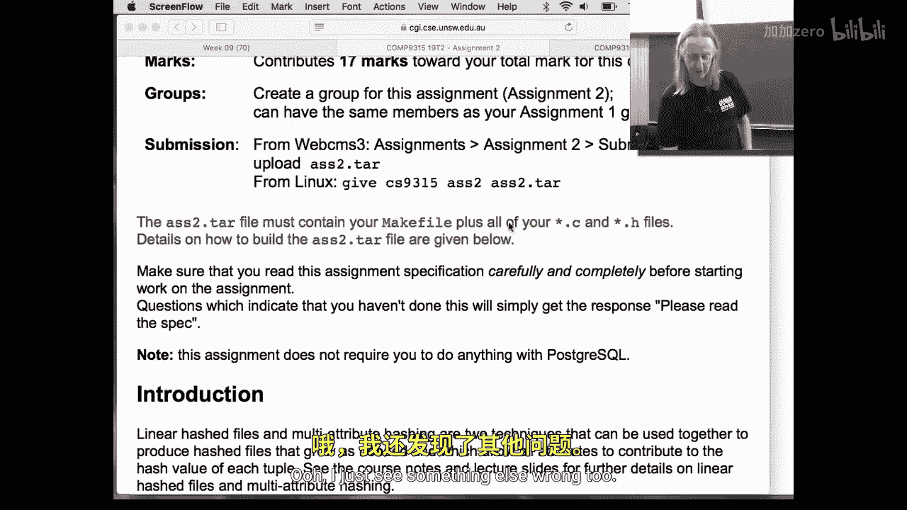

在本节课中，我们将学习数据库事务的原子性和持久性是如何通过日志机制实现的。我们将探讨系统可能遇到的各种故障，并了解Postgres如何使用日志管理器来确保数据在崩溃后能够恢复到一致的状态。

## 作业提交与测试说明

上一节我们讨论了哈希索引的实现细节，本节我们来看看与课程作业相关的一些重要说明。

以下是关于作业提交和测试的具体要求：

*   作业规范中要求提交特定文件。过去要求学生提交特定文件时，总有一半的小组没有提交系统运行所需的全部文件。
*   因此，请提交所有文件，包括 `Makefile`。
*   关于使用 `math.h` 库的问题：如果使用，则需要更新 `Makefile`。但计算2的幂次有更高效的方法，不一定需要使用 `math.h`。

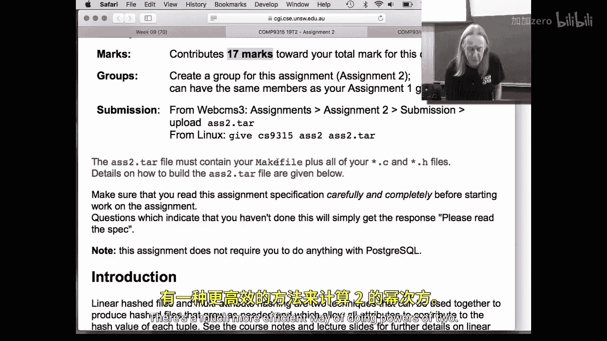

---

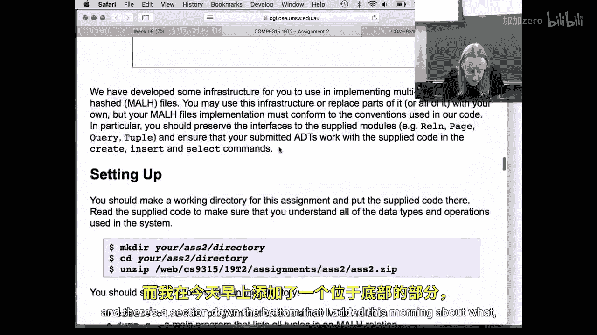

以下是我们的测试流程：

*   我们将解压你提交的文件。
*   然后，我们会将我们的主程序（如 `select.c` 和 `create.c` 等）覆盖到你的代码之上。
*   接着运行 `make` 命令。如果你提交的文件齐全且正确，它应该能顺利编译。

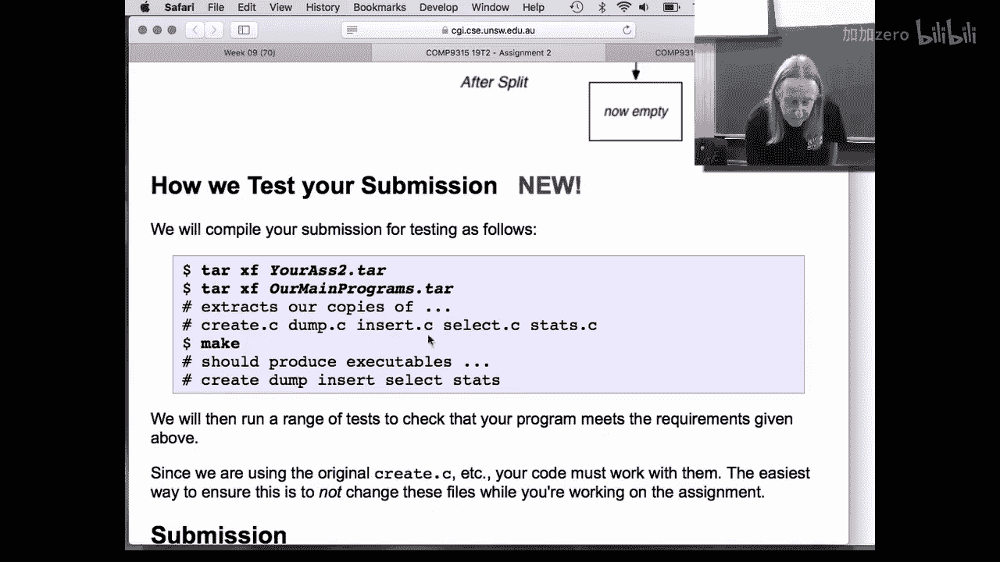

---

关于测试数据的说明：

*   我们不再运行 `gendata` 程序并将其输出导入 `insert` 程序。
*   改为从一个文件中读取数据。你可以通过点击链接获取该文件的实际文本内容，这将为你提供完全相同的元组。
*   因此，你应该得到完全相同的多属性哈希值。你可以使用 `diff` 甚至 `cmp` 命令来比较结果。
*   同样，由于我设置的元组数量很少，预计不会发生分裂。到达此阶段时，你应该在一个桶中有几个元组，在另一个桶中有几个元组。
*   请注意，我们初始时有两个页。我在测试时发现了一个错误：如果你尝试从一个页开始，它会失败。如果你想查看代码，可以找出原因。代码中有一个假设，即文件的深度 `D` 大于零。如果你只有一个页，深度就不大于零。
*   总之，如果你的多属性哈希实现正确，你也应该得到这个结果。

---

## 事务的原子性与持久性

现在，让我们继续前进。记住，我们希望事务具有**原子性**。

原子性基本上意味着：要么事务所有预期的效果都发生，要么所有预期的效果都不发生。

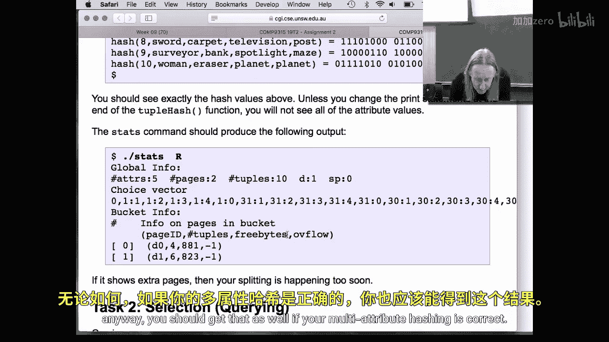

**持久性**则意味着：如果你执行了提交操作，那么即使数据库系统或运行它的计算机系统发生了灾难性故障，这些值在未来也应该是可用的。你可能需要在重启系统时进行恢复操作，修复数据——其中一些数据可能是提交操作的一部分，另一些可能不是。还有更微妙的系统故障，它们处理方式略有不同。

事实证明，原子性和持久性这两个特性的实现是紧密联系在一起的。

---

## 需要应对的系统故障

那么，我们需要担心哪些类型的系统故障呢？

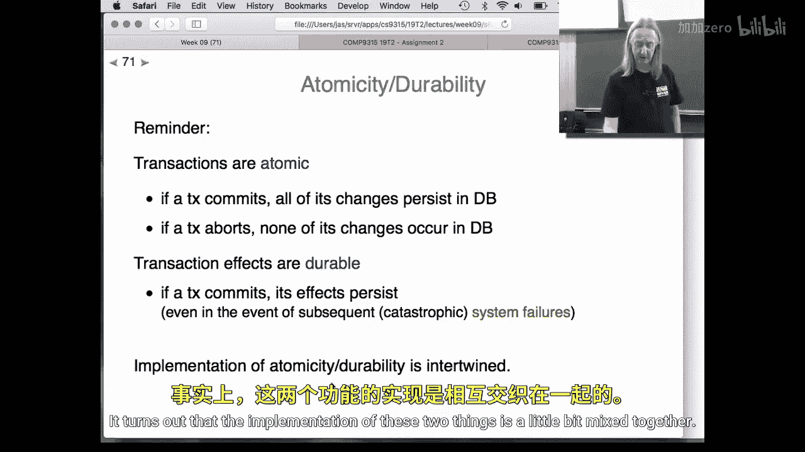

*   **位翻转**：可能发生吗？容易修复，这就是我们使用奇偶校验位的原因。
*   **存储介质故障**：整个磁盘设备损坏。
*   **Postgres进程崩溃**：可能不会破坏数据库，但可能会中断在该特定服务器实例上运行的事务。希望它不会破坏其他任何东西。
*   **操作系统崩溃**：在部分事务提交过程中，我们的写入系统宕机。
*   **灾难性物理破坏**：例如，存放服务器的机房发生火灾，所有存储在其中的数据都丢失了。这很不幸，但我们可以恢复——在一定程度上，因为我们有异地备份。

---

## 崩溃恢复场景

这是一个典型的场景：你有一批事务正在运行。

*   事务 T1 运行并提交。
*   事务 T2 运行并提交。
*   紧接着系统崩溃。

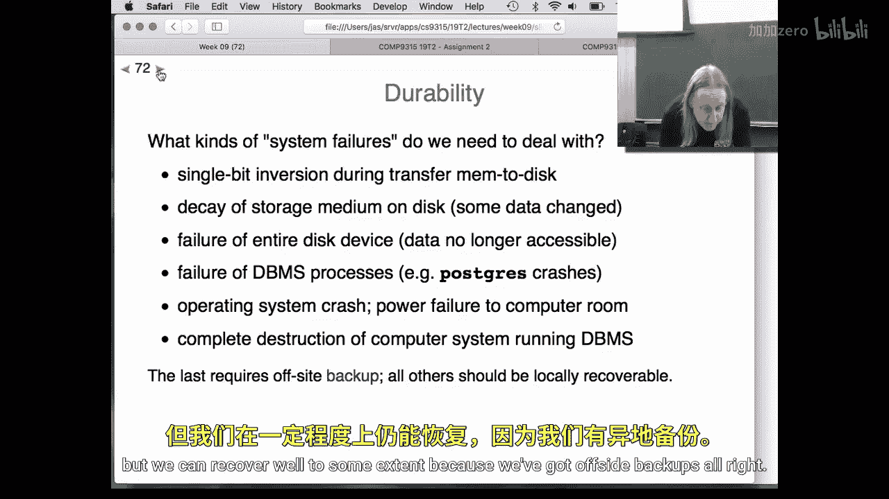

由于 T1 和 T2 已经完成，我们必须确保在从崩溃中恢复后，它们所做的任何更改最终都出现在数据库中。
对于 T3 和 T4，它们可能已经做了一些中间更改。我们希望确保所有这些更改都被撤销，就好像 T3 和 T4 从未实际运行过一样。

---

## 稳定的底层存储

首先，你必须有一个稳定的底层磁盘系统。

具体来说，我之前可能用过 `put_page` 和 `get_page` 来从缓冲池获取数据。但在这里，我建议 `put_page` 实际上是写入磁盘，`get_page` 是从磁盘读取。

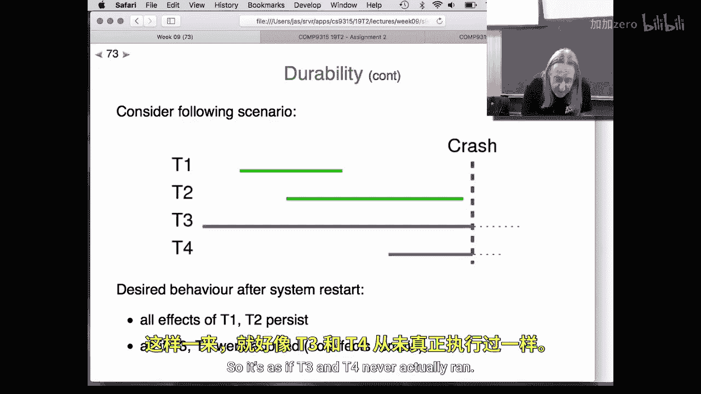

关键在于：如果你向磁盘写入一批数据，随后在没有其他人写入的情况下将其读回，你应该看到与你写入时相同的内容。

我之前提到的所有其他类型的故障，都可以通过各种标准方式修复，例如奇偶校验、标记坏块。如果你足够聪明，你会在磁盘存储中设置一些冗余；对于计算机系统的物理破坏，你会有异地备份。

---

## 数据库管理系统需要处理的故障

我们需要真正担心并且可以由数据库管理系统处理的事情包括：

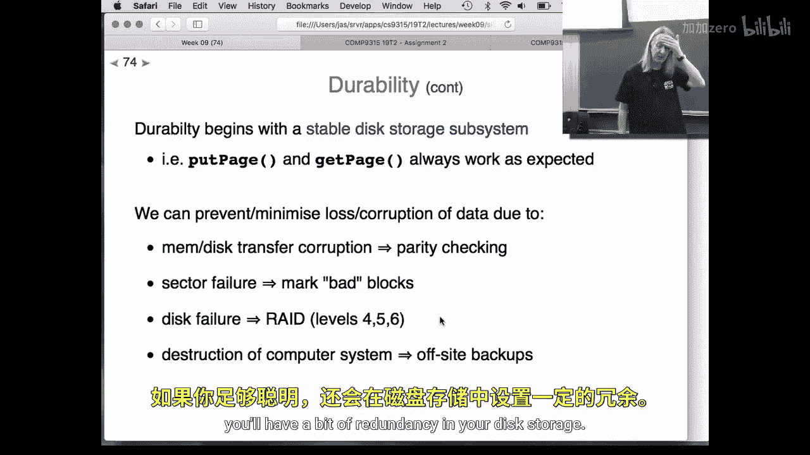

*   数据库管理系统本身故障。
*   操作系统崩溃。
*   在某种程度上，还包括事务失败。我们预计这种情况会不时发生，所以这并不特别糟糕。

管理这些问题的标准方法是：随时间推移，保存数据库如何更改的某种**日志**，并确保该日志被推送到磁盘并具有持久性。

通常，将日志推送到磁盘涉及推送相对较小的数据项，而更新数据库则涉及更大的更改。但是，如果你能将所有日志项推送到磁盘，你就可以利用它们来尝试恢复状态。对此有几种不同的策略。

---

## 恢复架构

以下是架构如何组合在一起的思路：

*   我们仍然有**缓冲区管理器**，所有来自数据库的数据都经过它。
*   我们可能有一个**日志管理器**，它可能会直接与缓冲区管理器通信（但为了使图表更简洁，这里没有画出）。
*   查询处理器基本上是之前幻灯片中展示的那一堆组件。
*   当然，还需要一个**恢复管理器**来利用日志管理器生成的内容进行恢复。它们不直接相互通信，恢复管理器会去读取磁盘上的日志。

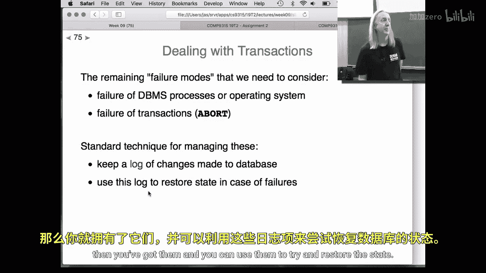

---

## 数据的三个版本

当你运行一个事务时，一个特定的数据项实际上存在于三个不同的地方：

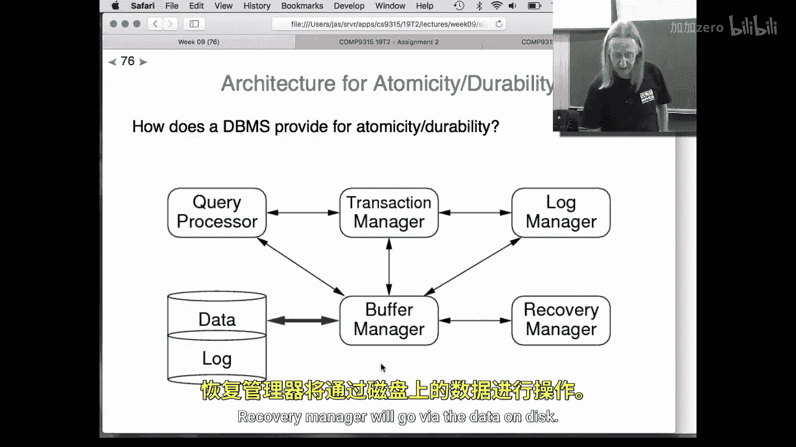

1.  存储在磁盘上的版本。
2.  加载到某个内存缓冲区中的版本。
3.  可能还有一个版本存在于正在操作该数据项的事务的本地内存中。

因此，对于我们所谈论的同一数据项，可能存在三个完全不同的值。

---

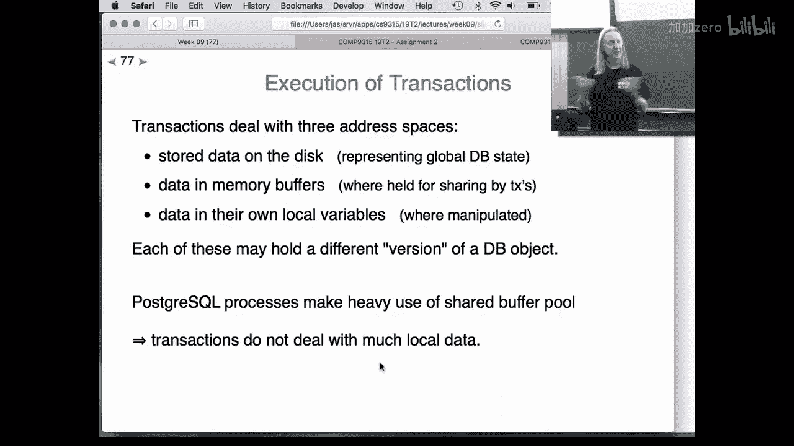

本节课中，我们一起学习了数据库事务恢复的基本概念。我们了解了原子性和持久性的重要性，探讨了系统可能面临的各类故障，并介绍了Postgres通过日志管理器来确保数据一致性的核心架构。理解数据在磁盘、缓冲区和工作内存中的不同状态，是掌握事务恢复机制的关键。