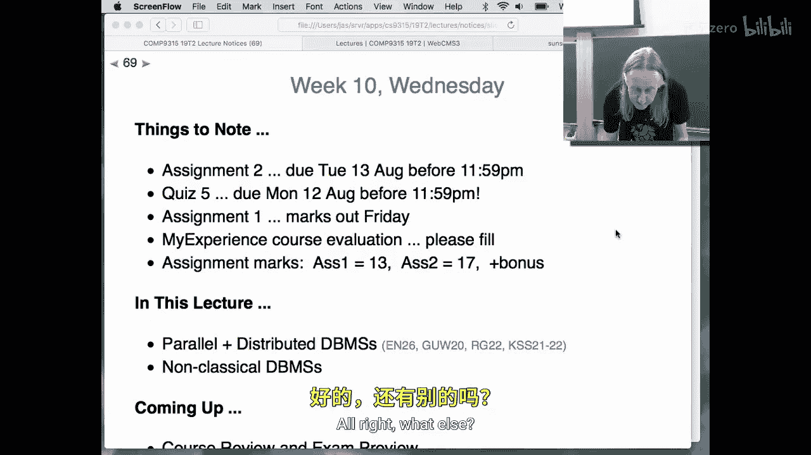
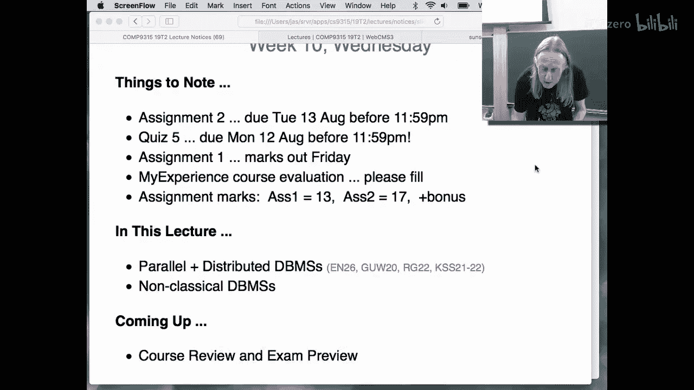
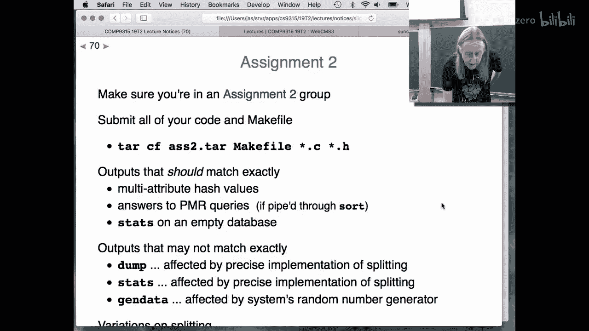
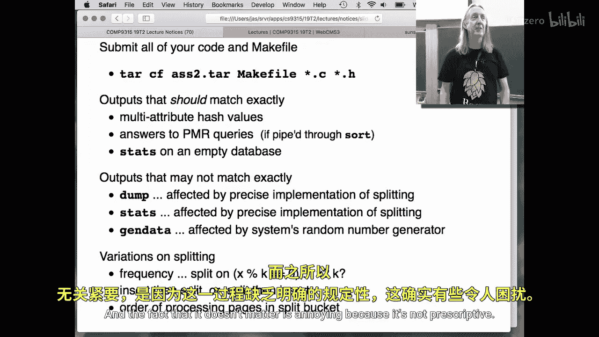
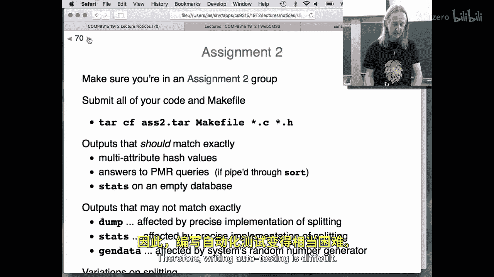

# 032：课程总结与考试准备 🎓

在本节课中，我们将回顾课程进度，澄清作业细节，并开始讨论期末考试的相关主题。本节内容将涵盖课程管理事项、作业提交注意事项以及线性哈希索引的实现细节。

---

## 课程管理与作业澄清 📝

上一节我们结束了主要的技术讲解。本节中，我们来看看本学期的收尾工作。

首先，关于时间安排。本学期是第10周，也是最后一周。作业的截止日期已调整，以避免与短暂的假期冲突。建议尽早完成作业。

关于测验5，其发布时间可能较晚，这解释了为何参与人数较少。作业评分工作即将完成，预计在本周五公布成绩。对于服务器崩溃、无限循环或产生巨大核心文件的情况，处理会耗费额外时间。

课程反馈调查非常重要。请务必填写，高层管理者非常关注回复率。

关于作业分数，课程大纲和作业说明中存在不一致。以作业说明中的分数为准（13分和17分）。提前一周提交可获得额外分数（14分和18分），该政策从昨天开始生效。

对于小组作业，请确保你已在“作业二”小组中注册。如果未注册，系统将默认作业由提交者独立完成。事后补充说明合作情况可能导致成绩问题。请提交所有代码。

---

## 线性哈希索引实现细节 ⚙️

在实现线性哈希索引时，有几个关键点需要注意，这些点会影响测试结果但不会影响功能的正确性。

以下是作业测试中需要关注的几个方面：

*   **元组位置**：使用`dump`命令可以查看元组位于数据页还是溢出页。重要的是元组在正确的桶中，具体在哪种页面不影响正确性。
*   **分割时机与顺序**：分割操作的执行频率和顺序会导致`dump`输出不同。测试时使用`stats`命令的结果会更可靠，因为它统计的是整体数据。
*   **随机数生成器**：系统的随机数生成器会影响数据分布，进而影响分割行为。

分割策略有多种实现方式，它们都有效，但会导致内部状态不同。

以下是几种可行的分割策略：

*   **固定阈值分割**：例如，每插入200个元组后执行一次分割。这会导致平均溢出链较长。
*   **动态负载因子分割**：基于页面平均填充度（如75%）触发分割，能更有效地利用空间。
*   **插入前后检查**：在插入新元组前或后检查并执行分割，如果新元组正好落在待分割的桶中，结果会略有不同。
*   **页面处理顺序**：分割时，处理数据页和溢出页的顺序不同，可能影响元组最终是落在新数据页还是溢出页上。

所有这些策略都能确保元组被分配到正确的桶中，因此实现具有灵活性，但也给自动化测试带来了挑战。

---

## PostgreSQL核心贡献者 👥

数据库领域，尤其是PostgreSQL，拥有众多杰出的贡献者。

以下是部分知名的PostgreSQL核心贡献者：

*   **Tom Lane**：PostgreSQL项目的核心领导者之一，负责审核和集成大部分代码变更。
*   **Josh Berkus**：重要的核心开发人员之一。
*   **Bruce Momjian**：知名的PostgreSQL布道者，经常在会议和书籍中发表演讲或撰写文章。
*   **其他贡献者**：图中还包括一位澳大利亚籍的贡献者，他曾在约十年前为本课程做过讲座。

社区中还有许多其他贡献者，共同维护和发展着PostgreSQL系统。

---

## 总结 📚

本节课中我们一起学习了本课程的收尾安排，澄清了作业评分和提交的重要细节。我们深入探讨了线性哈希索引实现中分割策略的多样性及其对测试结果的影响，并简要认识了PostgreSQL背后的部分核心贡献者。接下来，我们将继续讨论期末考试的相关内容。