# 033：分布式数据库系统概述

在本节课中，我们将要学习分布式数据库系统的基本概念，包括其两种主要类型：并行数据库与联邦数据库。我们将探讨它们如何工作、为何需要它们，以及在实际应用中的一些例子。

---

上一节我们介绍了如何在数据库中利用并行性。本节中我们来看看如何将数据分布到不同的节点上。

一种方式是将一个表的部分数据存储在一个节点，另一部分存储在另一个节点。这种方式是将原始表中的元组集合进行拆分，但这只是拆分关系的一种方法。在分布式数据库的语境下，我们还会看到其他方式。

基本上，这里讨论的分布式数据库主要有两种类型。

第一种是**并行数据库**。在这种系统中，你有多个特定数据库的实例，它们都遵循一个定义良好的模式，所有实例都在操作这个模式。这类似于我们刚刚讨论过的并行数据库的广域网版本。

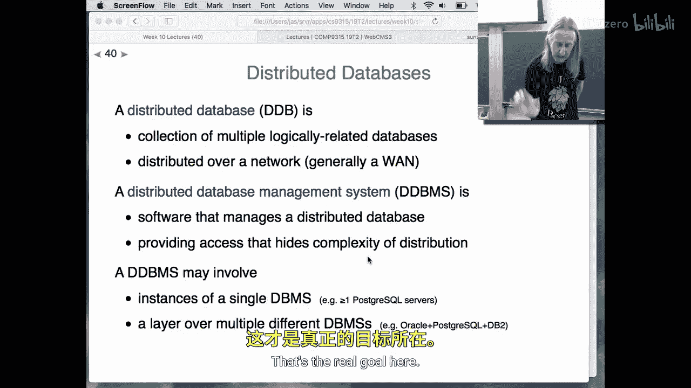

第二种是**联邦数据库**。在这种系统中，每个节点拥有自己的数据块。这些数据通常与其他节点上的数据相关，但未必来自相同的模式或数据源，甚至可能由不同的数据库管理系统运行。例如，一个节点可能运行Oracle，另一个节点运行Postgres。这种系统的核心思想是，无论后端是多个数据库还是单个数据库服务器，它都能让它们看起来像一个统一的数据库。

---

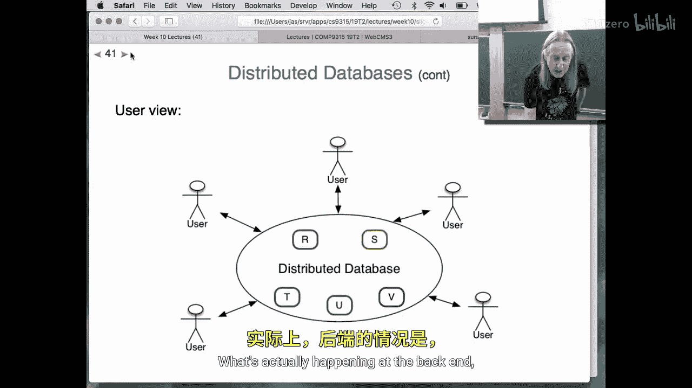

无论后端看起来如何，用户最终看到的前端都像一个单一的模式。无论这个模式是源自特定服务器下的真实单一模式，还是由一堆具有不同模式、被集成或联邦在一起以呈现单一服务器外观的数据库服务器所组成，这都不重要。

---

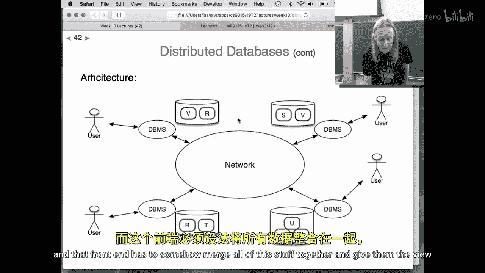

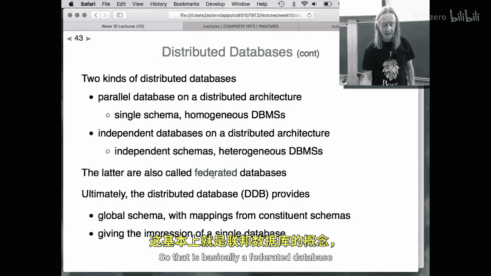

那么，为什么我们需要分布式数据库呢？以下是几个原因：

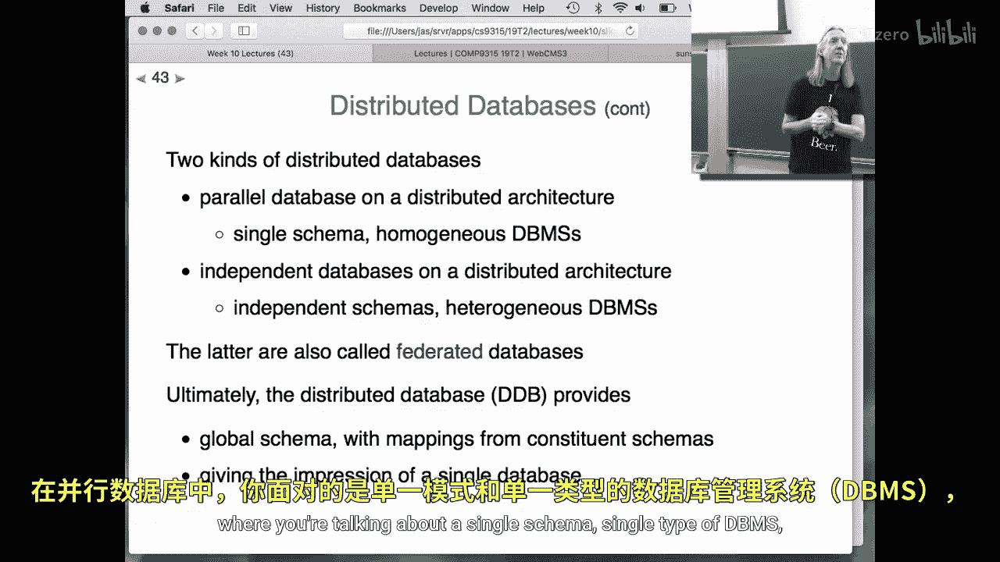

*   **数据整合**：我们可以拥有多个数据库，并在需要时将它们全部合并。
*   **可靠性**：显然，数据复制有助于提高系统的可靠性。
*   **并行查询评估**：如果我们需要从这里的Oracle数据库收集一批数据，同时从那里的Postgres数据库收集另一批数据，这两件事显然可以并行运行。

---

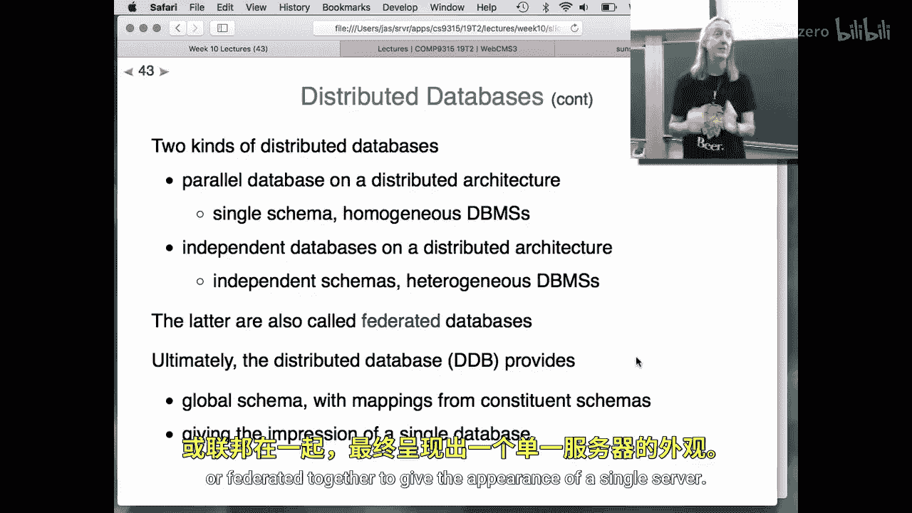

由于数据库可能具有不同的模式，必须存在某种映射机制，将后端数据映射到我们呈现给用户的全局模式视图中。因此，进行这种映射会产生成本。

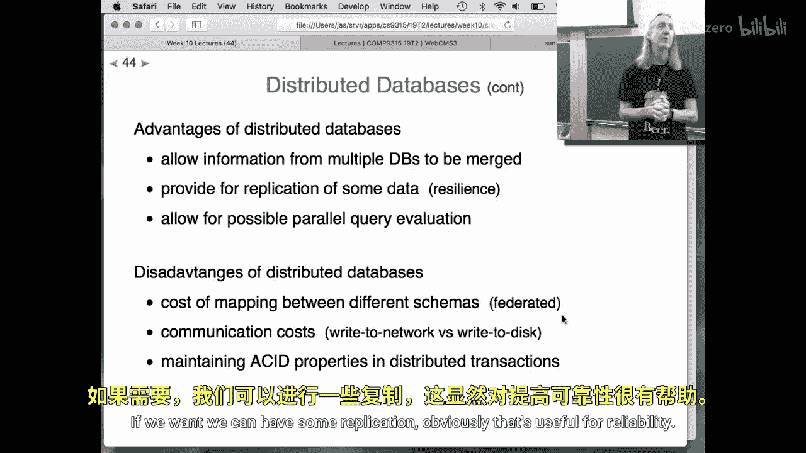

此外，还存在网络成本，因为数据库分布在网络上。有趣的是，在上周的语境中，我们还必须解决如何保持跨多个服务器（可能还有多个不同的DBMS）分布的事务的ACID属性。

---

以下是一些可能应用此类系统的例子：

*   **银行系统**：一家拥有多个分行的银行，可能将每个分行的账户数据存储在该分行的服务器上。同时，人力资源信息、所有分行列表等数据可能存储在一个中央服务器上。此外，可能还有一个与客户相关的中央注册表。银行希望看到所有这些信息的概览。
*   **连锁百货商店**：商店可能在本地存储交易数据，然后为公司提供一个可以查看所有数据汇总的视图。

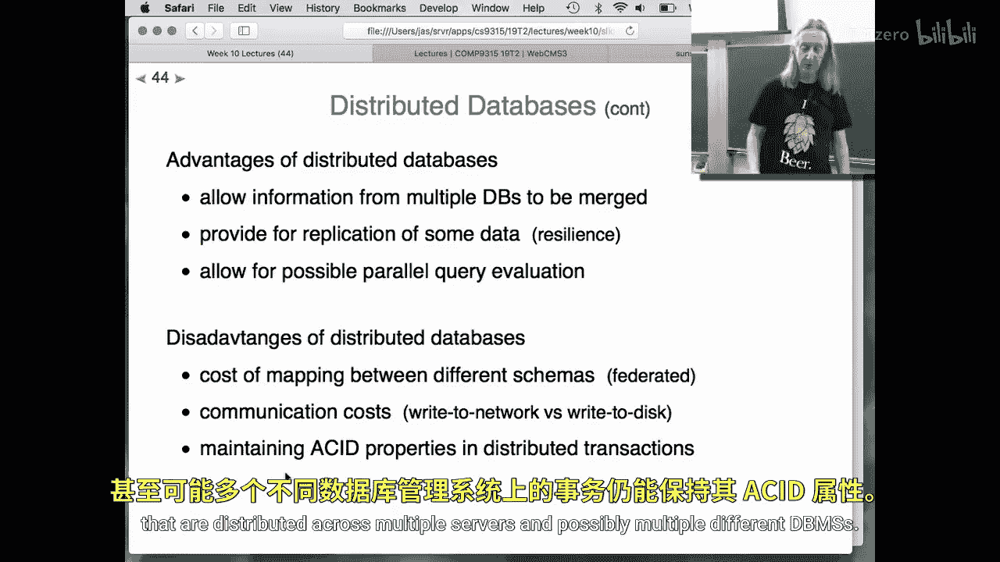

如今，你可能会觉得所有数据都将保存在中央数据库中，因为网络足够快。但在理论上，系统可以按照上述方式构建。

---

在这两种场景中，我们都希望系统能提供一个单一的企业模式视图。

以会计为例，每个分行维护自己的数据，但银行需要了解所有账户的全部信息。

---

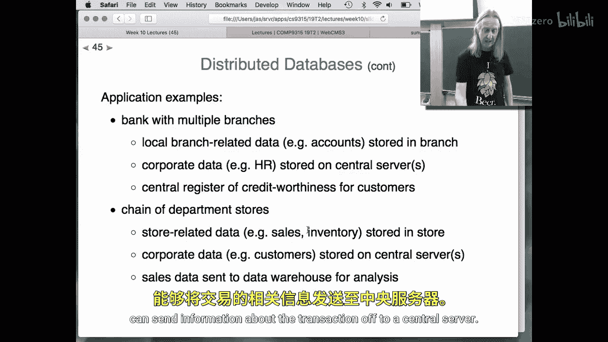

我们在并行数据库的语境下讨论过的**分区**概念在这里也适用。有时分区是自然发生的，因为这里有一个Oracle数据库，那里有一个Postgres数据库，它们显然拥有不同的数据集。

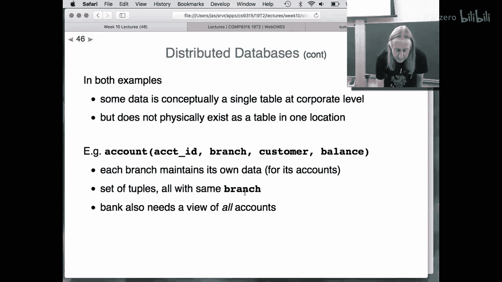

但即使没有这种情况，我们也可能希望将一个表的部分数据放在一个节点，另一部分放在另一个节点。

*   **水平分区**：即我们之前在并行数据库中讨论的那种分区，将元组子集分布在不同节点。
*   **垂直分区**：将部分列存储在一个服务器，另一部分列存储在另一个服务器。

如果你确实拥有具有不同模式的数据库服务器，但这些模式需要合并，那么很可能这里的列和那里的列构成了一个更大实体的一部分。

当然，还存在**事务性**的问题。

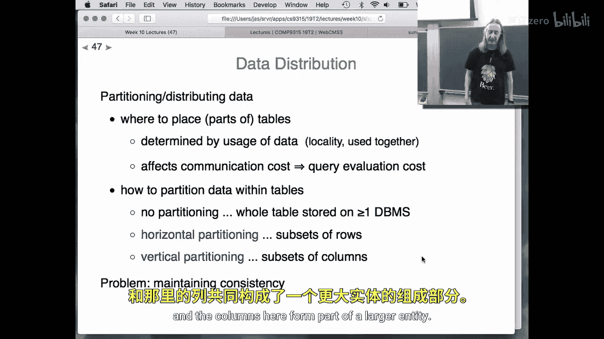

如果我们有一个表被水平分区，部分元组在这里，部分在那里，我们可以用多种不同的方式拆分表，但需要确保每个元组在某个地方都有表示，并且我们可以通过合并所有分区来重建原始表。

---

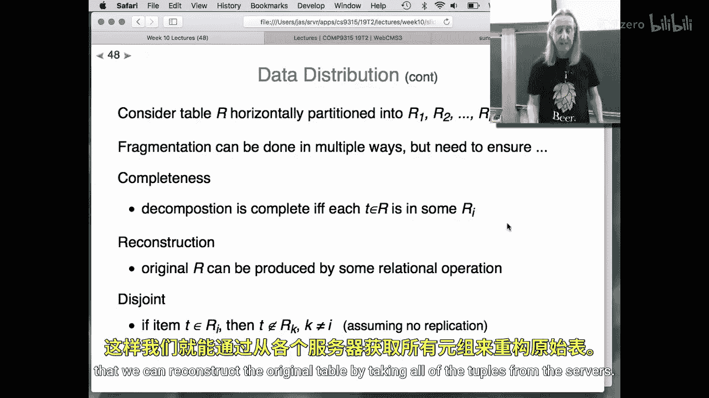

本节课中我们一起学习了分布式数据库系统的核心概念。我们区分了并行数据库与联邦数据库，探讨了它们的目标、优势（如数据整合、可靠性和并行处理）以及面临的挑战（如模式映射、网络成本和事务管理）。我们还通过银行和零售业的例子了解了其实际应用，并回顾了水平与垂直分区在数据分布中的作用。理解这些基础是设计和实现高效、可靠的分布式数据存储系统的关键。