# 新南威尔士大学【中英⚡Postgres数据库实现原理｜COMP9315 2018 Postgres Implementation】 p01 P1 -BV1qXoqYHErC_p1-

All right， welcome to end9315。I don't quite trust Echo 360s so I normally make my own recordings which is what that thing is and unfortunately I left home。

Left a critical connector at home so。Beful。So everyone's holding that camera up。

 hopefully it won't fall over during the lecture。Alright， so I'm John Shepherd。 That's the website。

 I'm sure some of you have looked at it。 In fact， I know some of you have looked at it because you've filled out those polls。

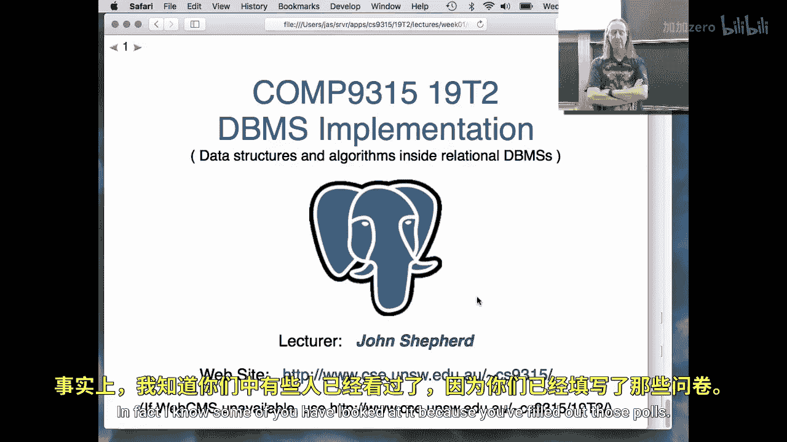

嗯。I。what am I， I'm a lecturer in CSE， surprise， surprise。I I could be a fourth year student。

That's my office， that's where I'm going to hold consultations， is this microphone working all right？

No response， I don't know， is this microphone working or？Can you hear me， That's correct。Who said no？

All right， I never trusted these or I see they go and sold this new technology。

I trust that I'm going resute to these again。Good old。那边也。Althoughello。

So that one's a little bit down， I can win both。嗯。I know I want to strangle myself but up where is you。

All right， that's going to look really good on the video， that help did nothing， didn it？😊，Look。

 I got these microphones on maximum volume。They're not working。 I don't know what to do。

Listen carefully anyway， so that's my office that's why I'mholding my consultations that's the kind of research I do consultations I have worked out the details therere on the website。

If you go and have a look。

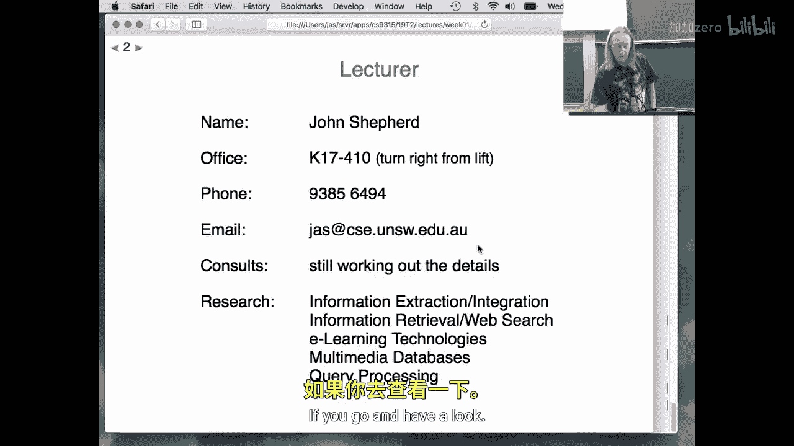

And there'll be one straight after the Thursday lecture Cor ad mean， there's no cors a mean。Tudors。

 there are no tuds， live thereing straighters， no， it's just。😡，Me with luck。

See if I survive the semester， term， trimester， whatever you call it， who likes trimesters？

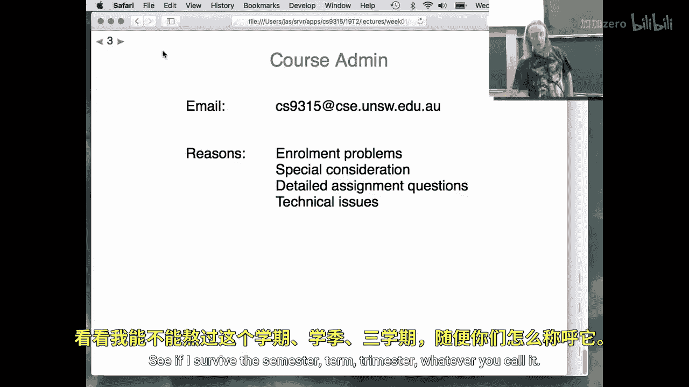

Who hates them？喂。wasnn't a resounding show of disgust but anyway okay so what's the deal in this course。

 why are you here， you're here to learn about the architecture of relational databases。

Use via the vehicle of PostgresQL， I'll talk more about PostgresQL later。

So we need a database to play with。In fact， maybe we don't last year the first assignment was to fiddle around with Postgreive bit at the end of that first assignment I said for the second assignment you want to fiddle around with Postgreive more and to my surprise the response was no well I want to poke around in Postgre we think of it this too much code blah。

 blah， blah so I might try the same strategies last year so。

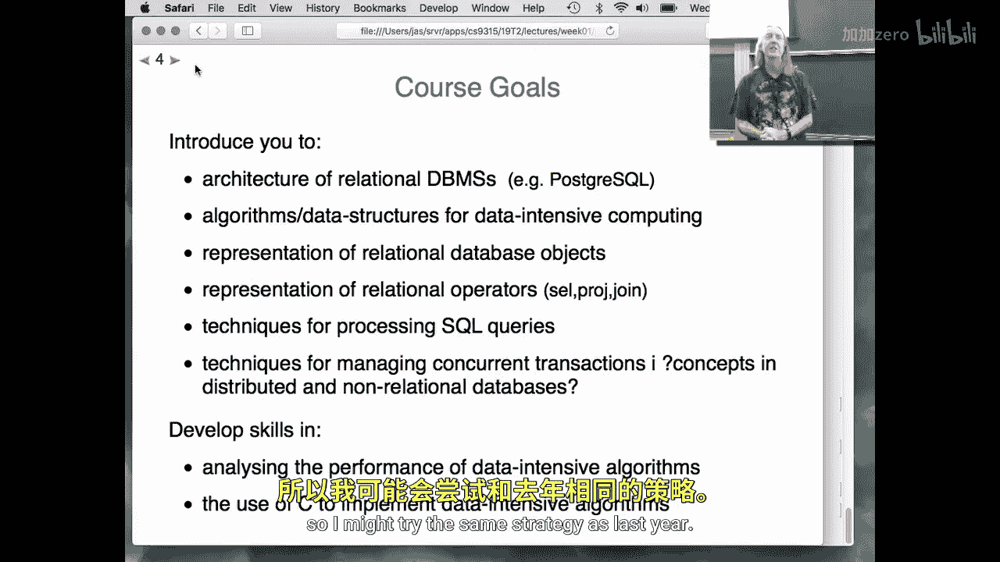

The first assignment yes， will be fiddling with Postgres。

And the second assignment will be writing some C codes as sort of standalone。

 but which illustrates some aspect of database query processing。

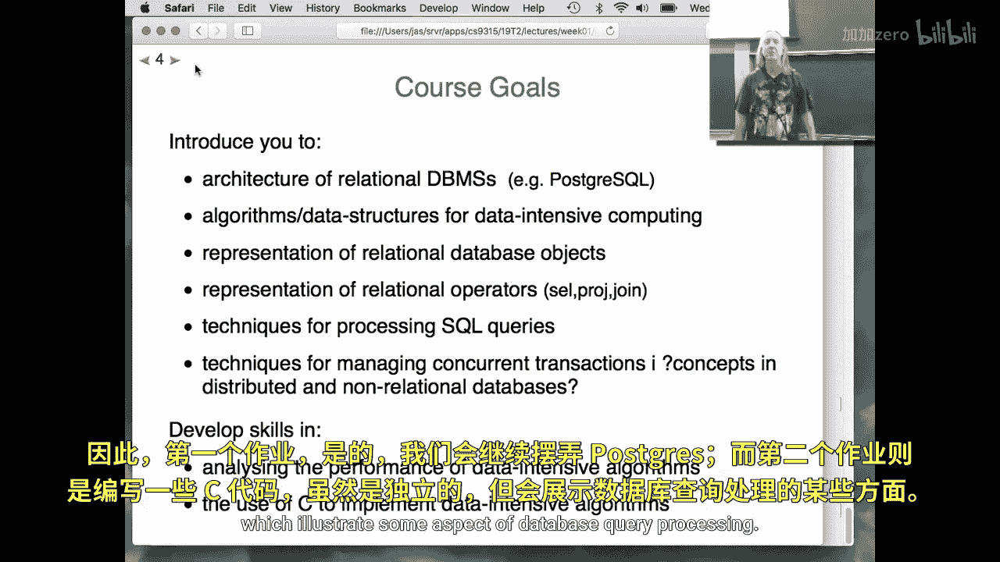

It's not all about Postgres， it's really more about discussing the various data structures that are useful when dealing with large amounts of data and the algorithms that work on them。

😡，But of course we still want to look at how relational databases work so we'll look at how objects are represented。

 how the operators are implemented， one reason for doing this is the relational database has been around since the mid-70s I'll tell you more about that in the future lectures。

But over the period， since the。Me 70s till now， a lot of interesting work has been done in implementing the various operators that are required and things keep changing。

 You know， new applications will come up for databases so they'll come up with a new algorithm。

 It meets the。Its the new problem that's a reason also some problems have come up。Think Google。

 which are simply too big to for well， allegedly too big for relational databases to work on them。

 so Google implemented their own file system and then some operators on top of that。嗯。And。

Given the 10 week time span， I may not get on to talking about those more modern innovation。

But all the stuff that we're talking about is still useful， I think， oh。

 what's that piece of junk doing there？Also we need to worry about concurrency that's very important because relational databases are very widely used and they're frequently used in context where a lot of people are hammering the database at the same time。

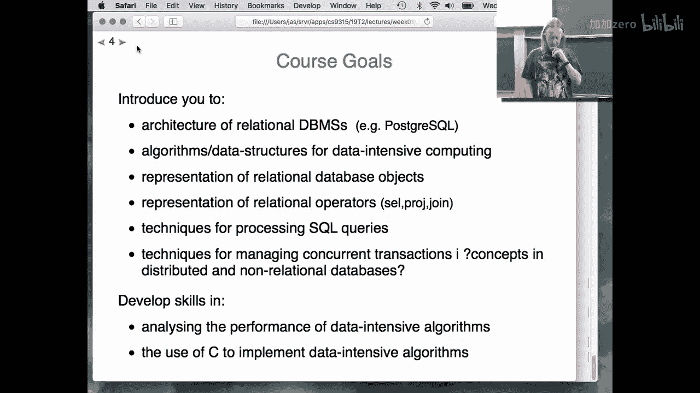

， so the idea is that you get those schools at the end of the course。Pricks。

 I assume that you are all familiar with C Last year some people were still in the course of the end goodness knows why who clearly didn't know C and crashed and burned in the final exam。

😊，If you're not a good Z programmer。Give up now。Yeah。一哥。诶。First assignments in C。

 second assignments in C， the exam requires C program。Got the point。So。

I assume that you have at least done a decent data structures course involving C。

I also assume that you've done an intro database course so you've played around with SQL and I assume that all of you have since those kind of courses are a prere for this course。

嗯。Maybe not so frequent but it would be nice and certainly if you did comp 1521。

 maybe not a lot of you did， that talks about a lot of these low levell operating system functions that are clearly going to be required to implement a database system because you're dealing with。

The disc or file system at quite a low level。 So we need to worry about things like that。

 And I assume that you've done it data instructions course。

 so you know what quicks saw it is and you know what hashing is。

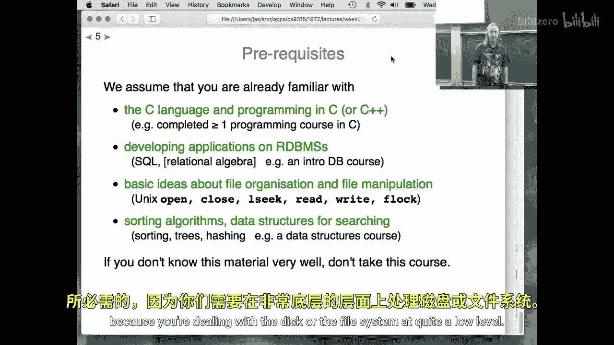

Quick sight， not quite so relevant for relational databases， but hashing certainly is。

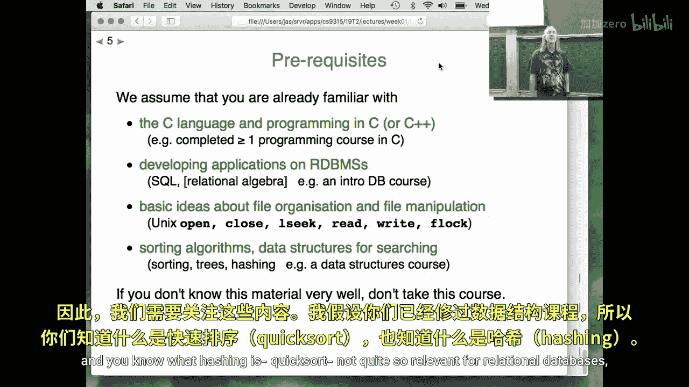

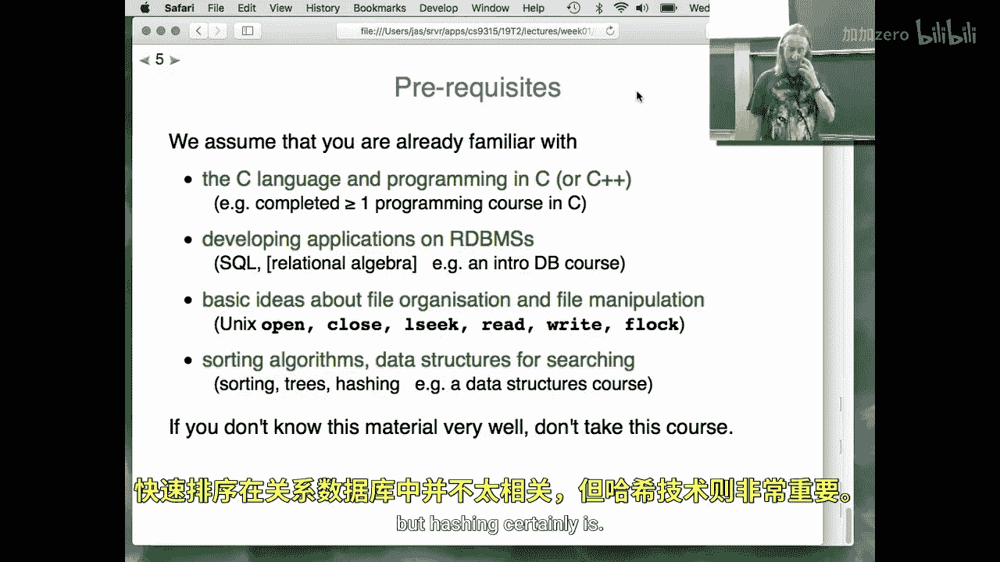

And as I said， give up now if you don't， oh all right， let's let's see who really does remember this。

😊，Hes。A schema， three tables， students courses and enrolment， standard kind of thing， student ID。

 name， and just to have some other information in the student table， what degree they're doing。

 of course， in real life that would actually be a R and key referencing a degrees table。

Doesn't matter for the purposes of this exercise， courses， got an ID， internal random integer ID。

 course code， standard UNW course codes and term and the title of the course and then enrolment so that's basically just a table that links students to courses implementing an end to end relationship because many students take a course。

I'm sorry， students take many courses and of course obviously has many students in it。All right。

 who can't write an SQL query to do that？No one's got I don't know。Who can。

Who wants to come in and do it on the board？Nobody so you're leaving it to me in fact doing it on the board is' probably not a good idea because it won't get captured very well on the video。

 but if I do it on the screen here ha ha it will。

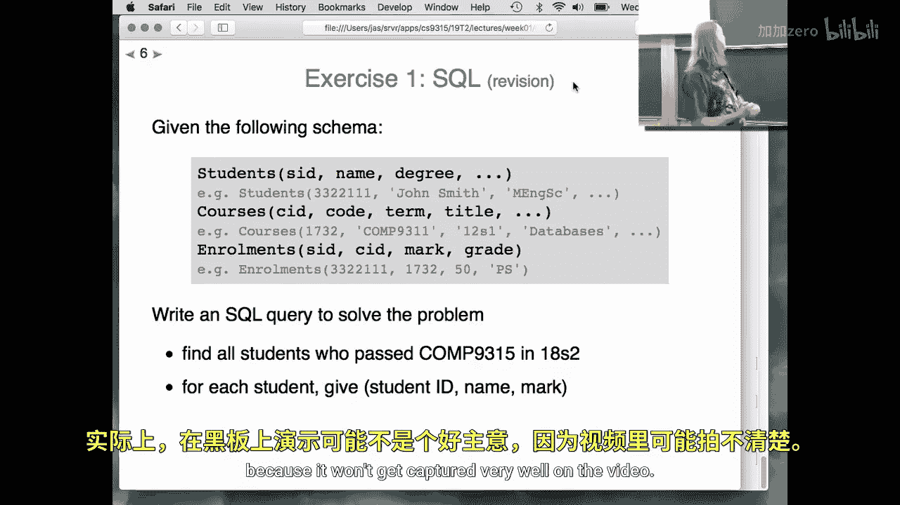

Let me say oh， oh， I can't remember where I put everything， let's assume。😔。

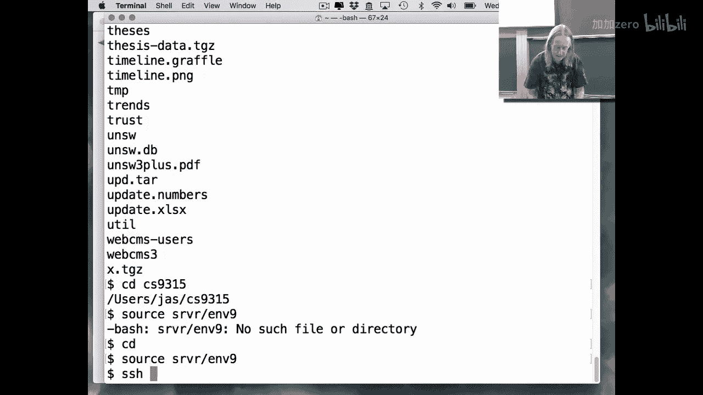

，Ha all right now。