# 新南威尔士大学【中英⚡Postgres数据库实现原理｜COMP9315 2018 Postgres Implementation】 p02 P2 -BV1qXoqYHErC_p2-

She。great microphone。Great， a couple of questions about what's available in the exam。

 These are what's available in the exam。 You can't bring your own notes。 You can't bring。

Whatever we're trying to go paperless， so everything that you deal with in the exam is on the screen。

So at the moment you guys can only see A but all the other stuff will be up eventually。

 certainly well before the end of semester so you can make sure you understand what's there and if there's a question on the exam you're not sure about it you can probably look up the notes。

And maybe get some hope。That why。

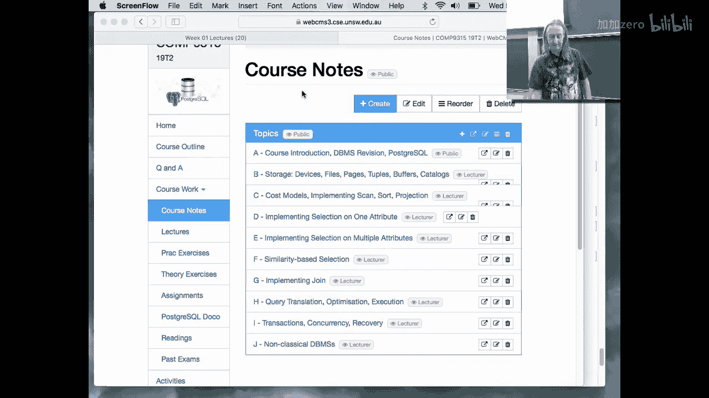

嗯。So relational databases， which I assume that you've all done at least of bit before。😊。

Basically what they allow you to do is maintain a whole large collection of data。

 also they allow you to maintain data about the data。And we'll see how that all plays out later on。

 when we talked about catalog。Constraints are very important aspect of relational databases。

 they try to make sure that the data that you put in satisfies certain properties， in other words。

 they try to prevent you putting junk in the database。They allow you to query。

 obviously well know SQL。Some relational all relational databases allow you to do views。

 some will allow you to do triggers， some will allow you to do st procedures。

Posgres allows you to do a little bit of query rewriting via rules。

 so you can say if I type this query， I really want this query here which is a variation of that。

 you know by some transformation that I've defined and any decent database will also have some indexing capability also a database that's going to be used by lots of people or at the same time。

 obviously has to have some kind of concurrency control and a notion of if it's going to be used for serious calculation type thing。

where you may have a lot of database operations that actually correspond to anatomic operation in the application。

 some kind of transaction processing as well， and they're all based on the relational model and they all provide。

A version of SQL unfortunately fortunate， every database vendor thinks they know better than all the other database vendors and they add extra stuff to SQL so no two databases are going to have exactly the same SQL if you stick to the SQL standard。

 that's pretty much going to work everywhere I believe some databases vary from the standard。

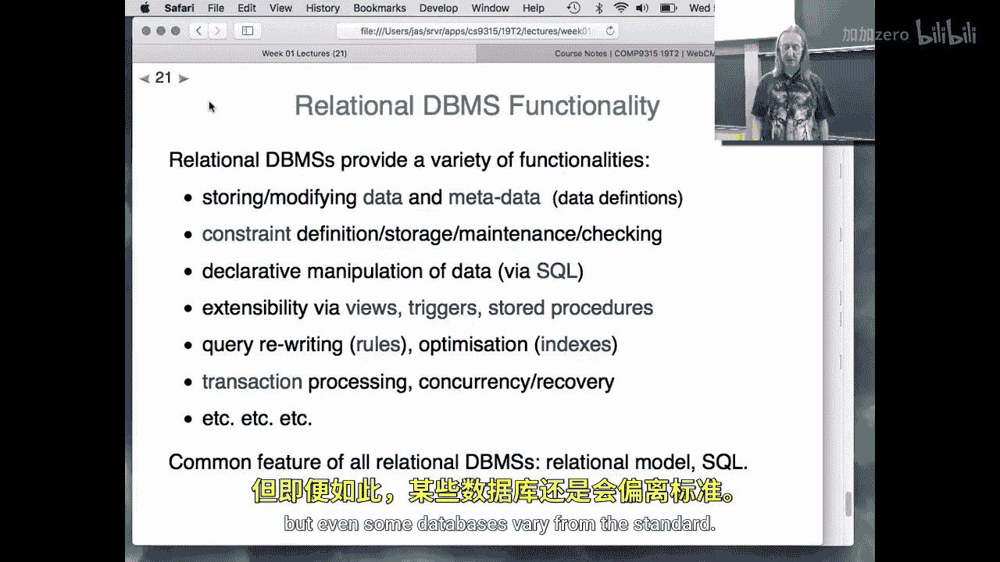

So data definition， you know you've all seen create tables， you've probably seen creating domains。

 I don't know。They do anything with creating new， simple data types based on existing data types in。

Your previous courses。Doesn't look like it。All right。

 well Postgres and plenty of other relational databases will allow you to define new data types。

Wch so here we're defining a new data type based on an existing data type。

 but with constraints on the kind of values。 so we can't have any off floating point value as a W。

 We can't have minus。1。😊，Much as we might like to sometimes so the wave is always going to be somewhere between0 and 100。

 So that's a way of stating that。 And we can then define。Attributes that have that type。

And so when we try to insert information about a student or when we update information about a student。

 it'll check that the value that's gone into here fits in that range of values。

So when you do statements like that and create table as the most obvious one。

 we're not adding any data to the database when we do create table what we're adding is met data we're adding some information somewhere that says there is a table called students。

 this table has five attributes， one of those attributes as a primary care and。

 so that information all has to be stored somewhere and the standard way that databases do it these days in the past they used to do it or some databases differently but nowadays there's a bunch of tables that stores information about tables。

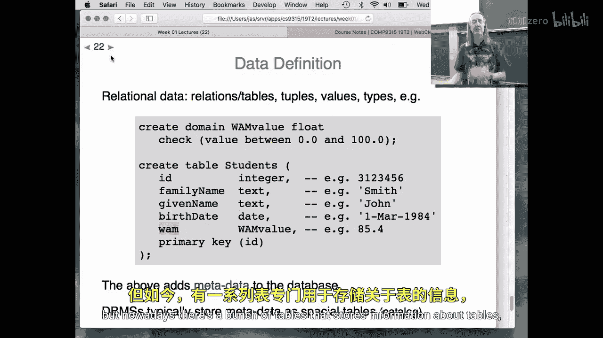

It all sounds a little bit recursive， but it works reasonably well。So。😊。

Our TBBMS looks like this we feed in a data definition statement like create a table the database is connected to a whole bunch of stuff on the disc and a DDL statement like create table it's going to have effect only a once more part of that It's not going to add any more tus it's not going to add any indexes necessarily or it's certainly not going to populate them all it's going to do is add an entry in the catalog to say hey there is a new table called students and it has these various properties and typically we'd end up with some sort of status coming back and let's start playing with Postgres I can do it on。

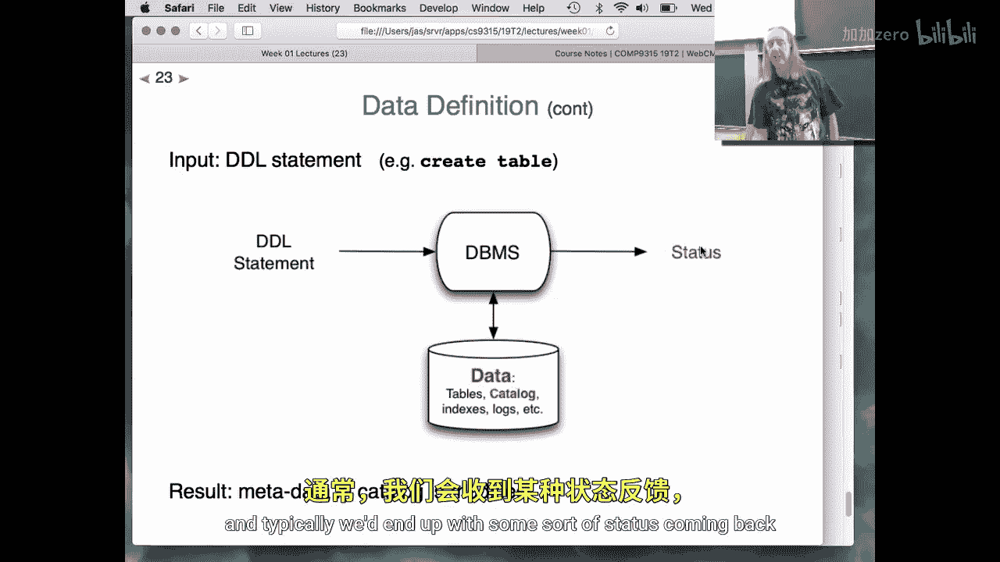

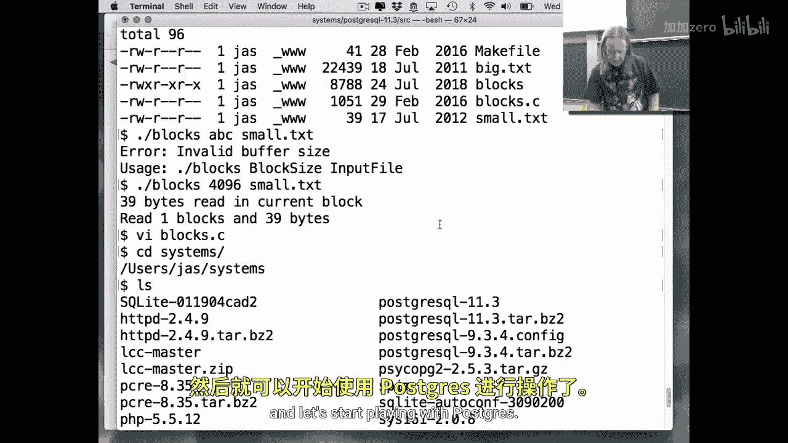

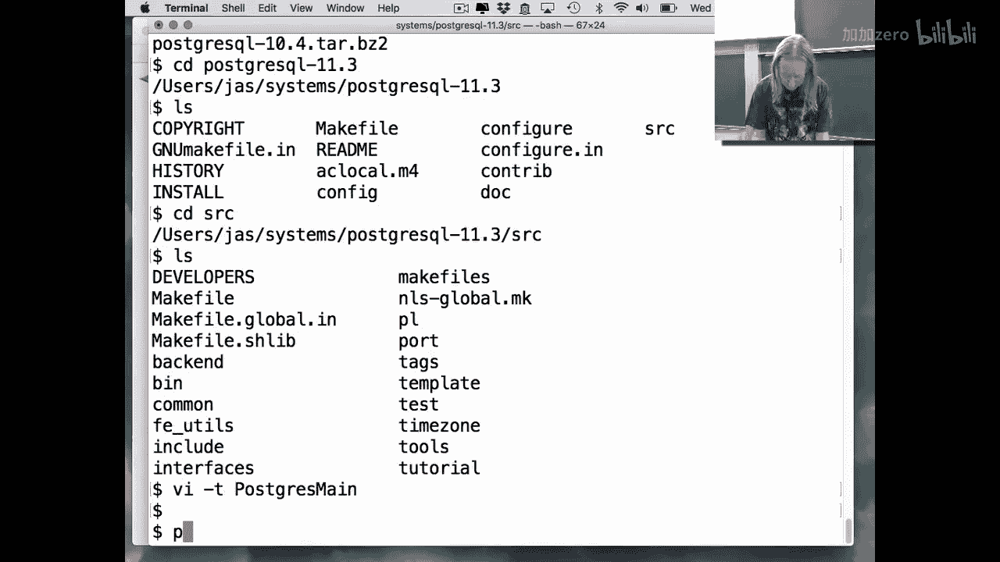

I can do wrong here。I hope yeah。

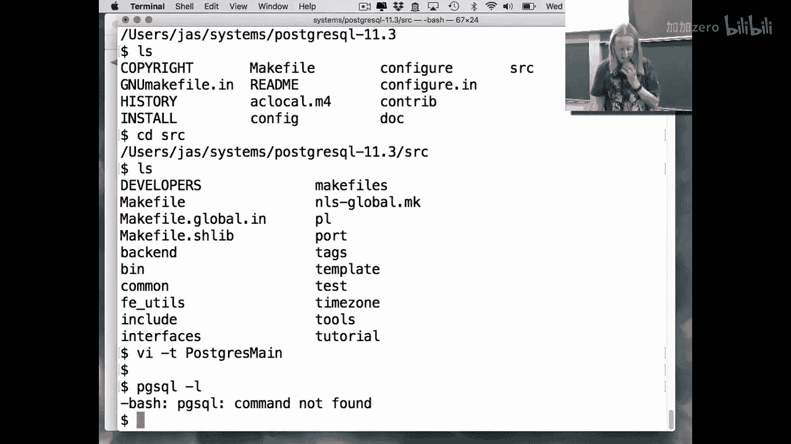

OhYeah， why didn't that work because the command is called peaceQl？All right， oh。

 there's a lot of databases。我 that many that啊。

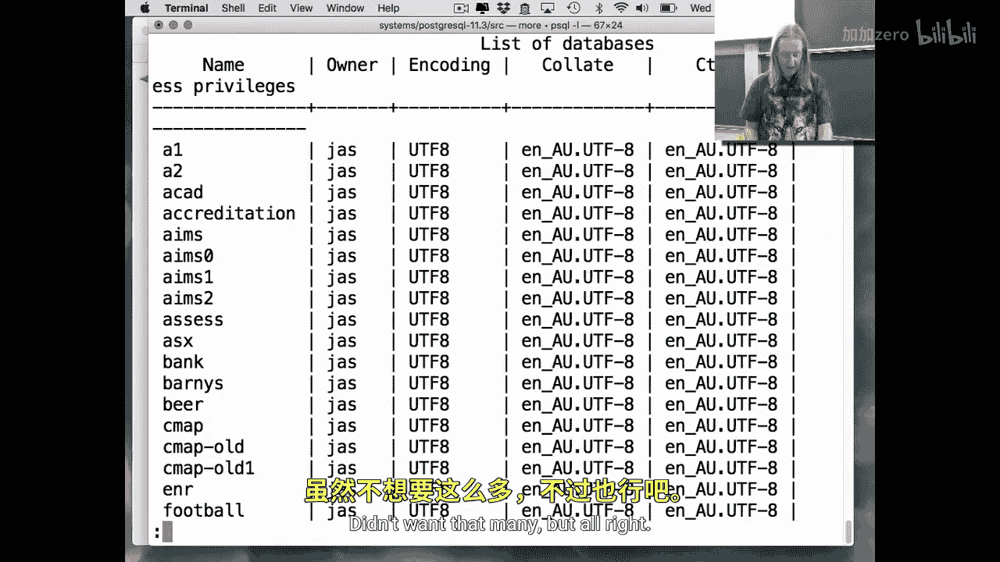

对。And I got one called Jes， he said， and you can see this is Postgre 9。3。4。Too old。

But still looks pretty much the same。So if I create some arbitrary table and here I'm sure I'm going to guess a name that already exists。

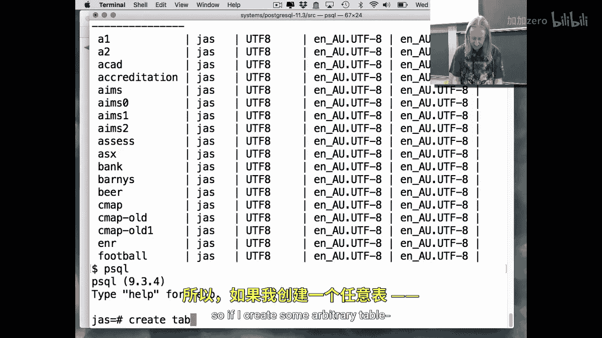

一会住呢。I get back some status information that a table was created。

 who that's what I asked to do so at least it didn't give me back an error message and it made changes in the catalogue so now I can see there's a table calledR。

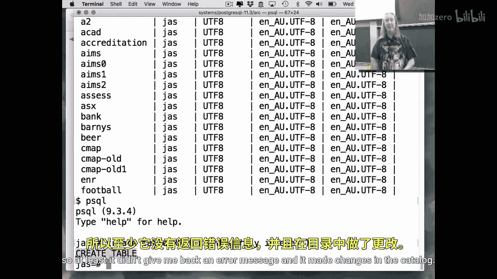

And I'm the owner， and if I want to find out what details then I can do that。

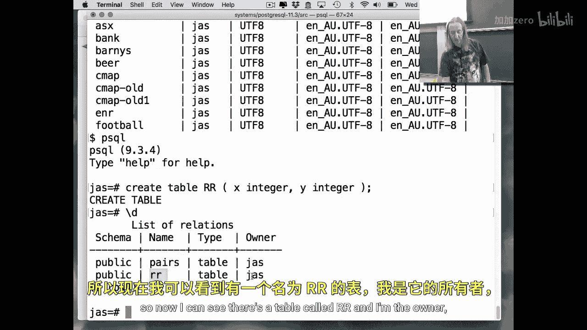

And clearly this information， the fact that I've got a cold called X and I've also got a cold called Y。

 and they're both integers， that's also being stored somewhere in the catalog。

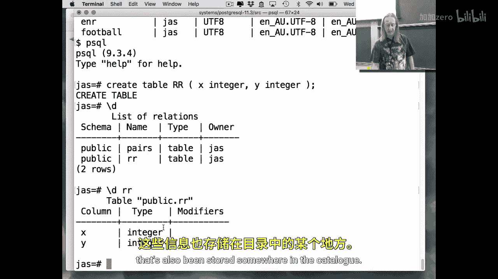

啊， so。DidDL statements affect the catalog。

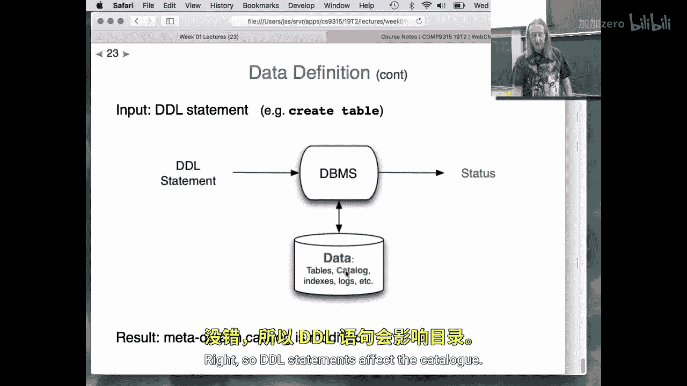

Other kinds of statements you can do in postgre， obviously change in the data in the search delete an update。

嗯。You can say a single tackle， you can update。A single tubble or a whole bunch of tus。

 and if this student leaves you in SW because they hate trimesters。

 then you can delete all their enrollment information。Not that we're allowed to。

 but in theory we could so what does this affect as far as all of the stored data goes。

 it's going to affect tables obviously so we're adding new tuples or taking tus away or making changes to tuples if those tus have indexes on them it will also make changes to the index。

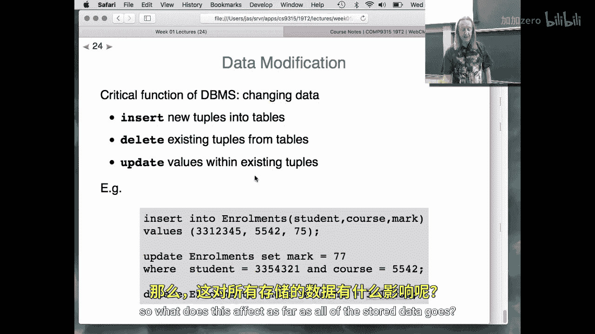

And it'll return this status。 So if we go back to our little database。

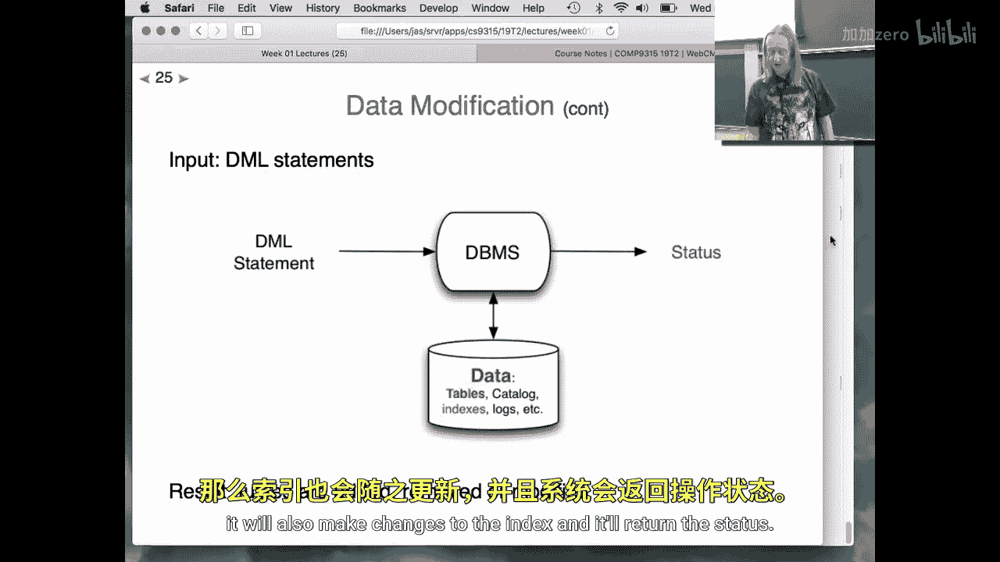

And let's insert into。硬急。

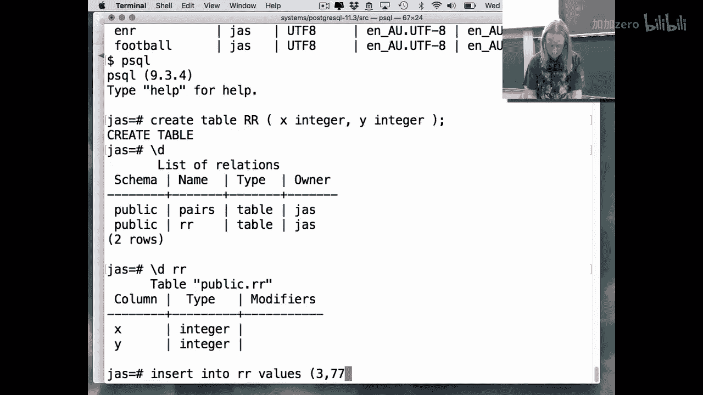

So there's a status being given back by Postgres and these numbers actually mean something。

 the one means one tu was modified and the zero is actually telling us that Postgres isn't generating an internal object identifier for this tu。

 we can set things up so that every tur gets inserted。

Whether or even if you've got an idea of your own。It's being generated from the sequence or whatever Postgres can generate a unique over the whole database identifier for each individual tu and if it does。

 you'll get a large number there telling you what the OID is。

Talk about our ideas more in the minutes。 Let's see what's in。Ps。Oh， excellentcellent。

So I can delete some top rules from pes。嗯。嗯What are here。还有咩。

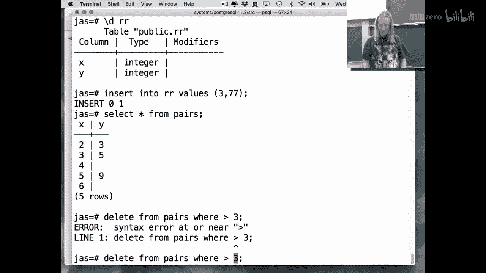

是吧。