# Postgres数据库实现原理：P2：数据库操作与系统架构概述 🗄️

在本节课中，我们将要学习关系型数据库的核心功能、数据定义语言（DDL）与数据操作语言（DML）的区别，以及PostgreSQL如何通过系统目录（Catalog）来管理数据库的元数据。我们将通过简单的示例来理解这些概念。

## 考试与课程资料说明 📝

上一节我们介绍了课程的基本信息，本节中我们来看看考试的相关安排。

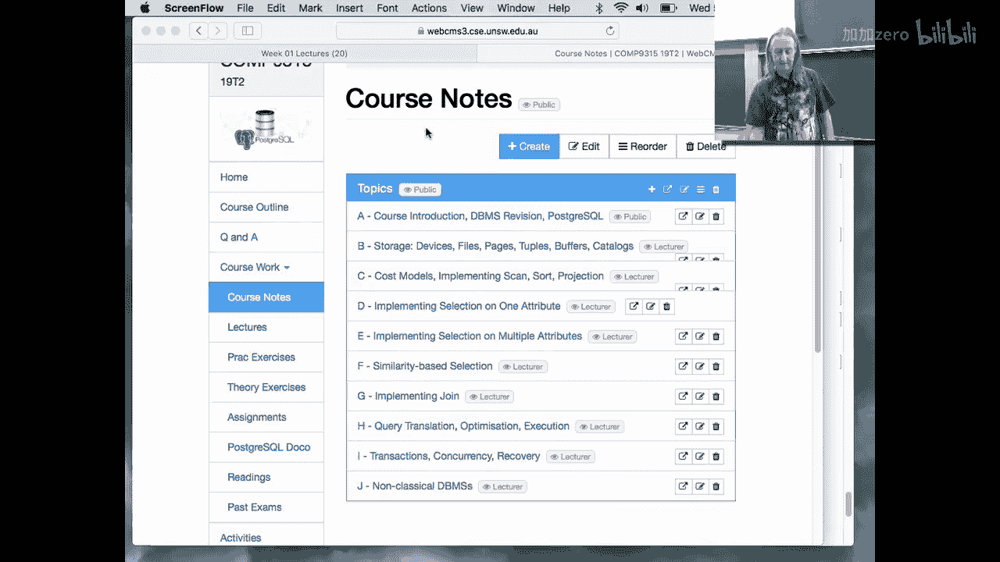

考试期间，考生不能携带个人笔记或任何纸质材料。课程致力于无纸化，因此考试中的所有资料都将显示在屏幕上。目前屏幕上可能只显示部分内容（A），但所有必要的资料都将在学期结束前提供，以便学生充分理解。如果在考试中遇到不确定的问题，可以查阅这些笔记以获取帮助。

## 关系型数据库核心功能 🔧

关系型数据库允许用户维护大量数据集合，同时也允许维护关于数据本身的信息（即元数据）。我们将在后续讨论系统目录时详细展开。

约束是关系型数据库的一个重要方面，它确保输入的数据满足特定属性，从而防止无效数据进入数据库。

以下是关系型数据库提供的主要功能列表：
*   **数据查询**：使用标准的SQL语言。
*   **视图**：部分数据库支持。
*   **触发器**：部分数据库支持。
*   **存储过程**：部分数据库支持。
*   **查询重写**：PostgreSQL通过规则（Rules）实现，允许将一种查询自动转换为另一种形式。
*   **索引**：任何完善的数据库都应具备索引能力，以提升查询性能。
*   **并发控制**：支持多用户同时访问的数据库必须具备。
*   **事务处理**：确保一系列数据库操作作为一个原子单元执行，对于关键计算应用至关重要。

所有关系型数据库都基于关系模型，并提供某种版本的SQL。然而，不同数据库厂商通常会添加自己的扩展功能，因此完全遵循SQL标准的语句基本通用，但包含特定扩展的SQL语句则可能在不同数据库间存在差异。

## 数据定义语言（DDL） 📐

数据定义语言用于定义数据库结构。最常见的语句是创建表（`CREATE TABLE`），也可能包括创建域（`CREATE DOMAIN`）。

PostgreSQL及其他许多关系型数据库允许用户基于现有数据类型定义新的数据类型，并附加约束。例如，我们可以定义一个表示“波浪高度”的新类型 `Wch`：

```sql
CREATE DOMAIN Wch AS float
    CHECK (VALUE >= 0.0 AND VALUE <= 100.0);
```

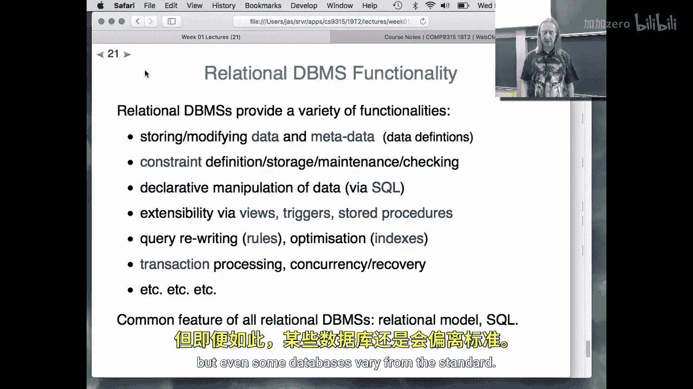

此代码定义了一个名为 `Wch` 的新域，它基于 `float` 类型，但约束其值必须在0到100之间。随后，我们可以在定义表属性时使用这个类型：

```sql
CREATE TABLE Students (
    id INTEGER PRIMARY KEY,
    name TEXT,
    wave_height Wch
);
```

当我们尝试向 `Students` 表插入或更新数据时，数据库会自动检查 `wave_height` 字段的值是否在定义的范围内。

执行 `CREATE TABLE` 这类DDL语句时，并不会直接向数据库添加实际数据，而是添加**元数据**。这些信息（如表名、属性、主键等）需要被存储在某个地方。

## 系统目录（Catalog）与DDL执行流程 🗂️

现代数据库标准做法是使用一组特殊的表来存储关于所有其他表、类型、约束等的信息，这组表称为**系统目录**。这听起来有些递归，但运行良好。

数据库管理系统（DBMS）的架构可以简化为：用户输入DDL语句（如 `CREATE TABLE`），DBMS连接到磁盘上的各种存储结构。执行DDL语句主要影响系统目录部分，它不会添加数据元组或填充索引，而只是在目录中添加一条记录，声明存在一个具有特定属性的新表。执行完成后，通常会返回一个状态信息。

让我们通过实际操作PostgreSQL来观察这个过程。

首先，连接到PostgreSQL（命令是 `psql`）：

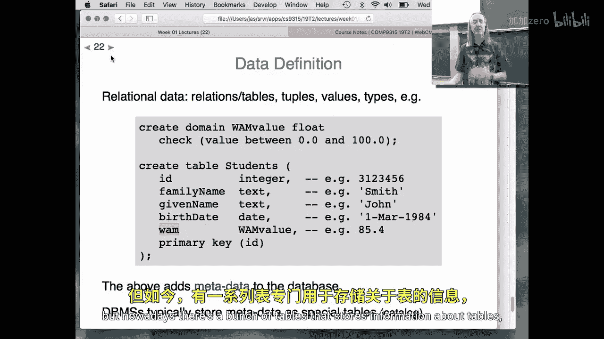

```bash
psql
```

连接成功后，可以创建一个简单的表：

```sql
CREATE TABLE R (x INTEGER, y INTEGER);
```

如果执行成功，将返回类似 `CREATE TABLE` 的状态信息，表明表已创建，且目录已被更新。现在，我们可以查看数据库中是否存在这个表：

```sql
\dt
```

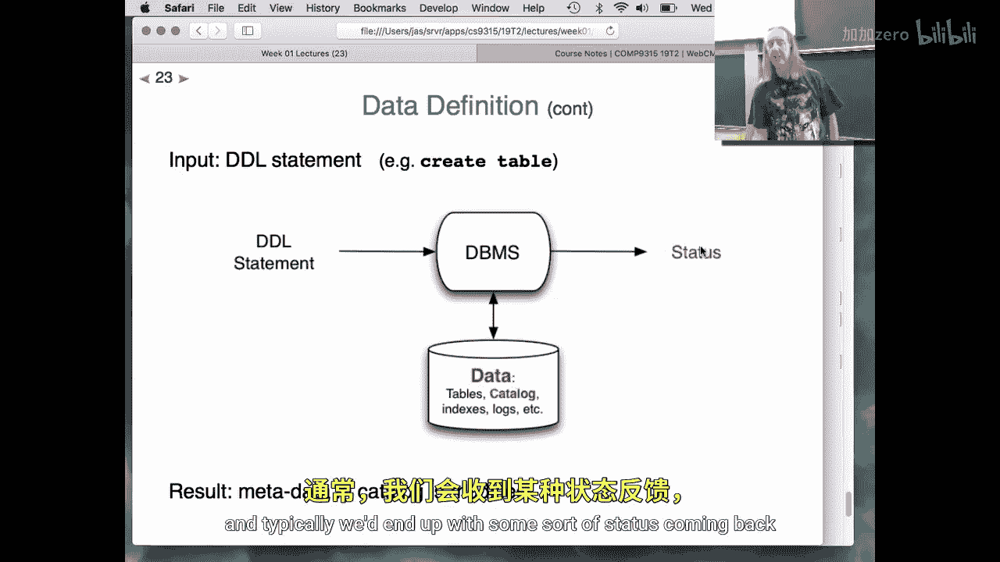

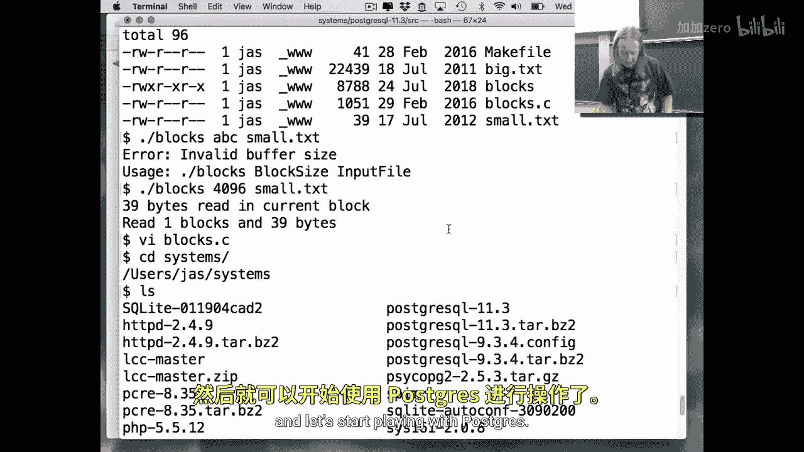

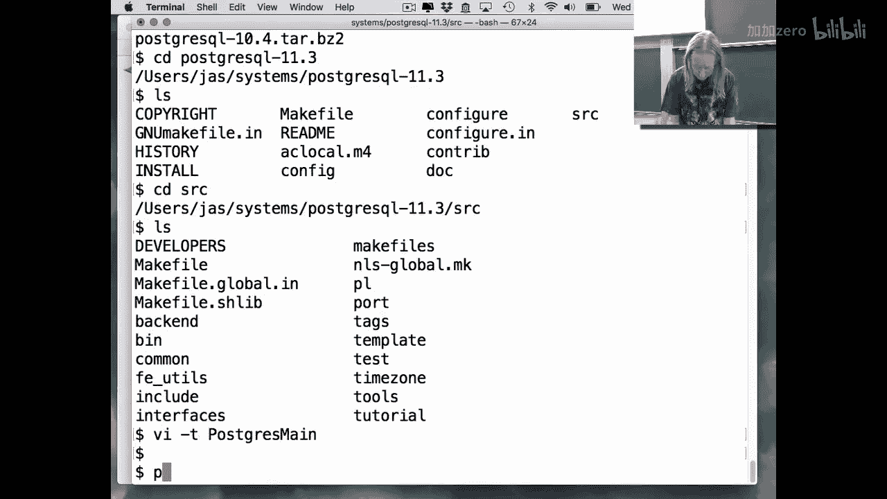

此命令会列出所有表，其中应包含刚创建的 `R` 表及其所有者信息。要查看表的详细结构（即元数据），可以使用：

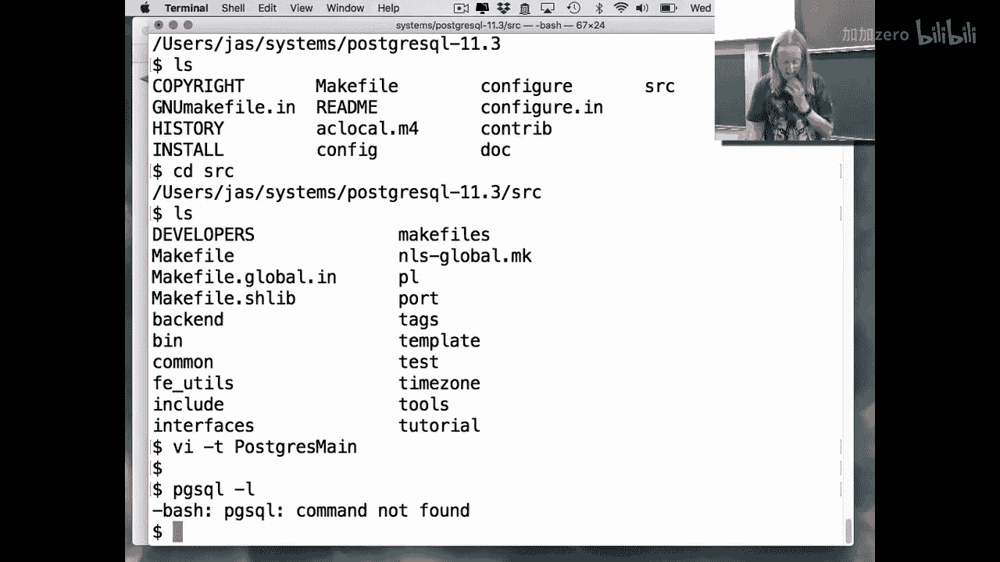

```sql
\d R
```

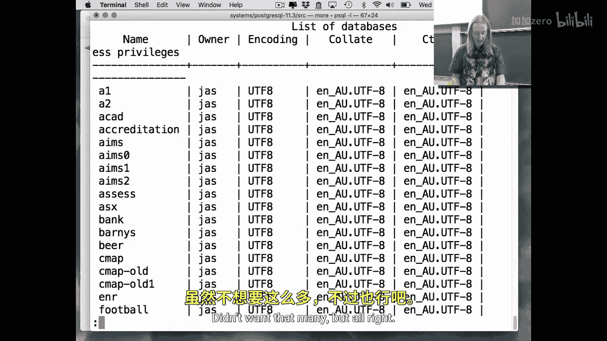

这将显示表 `R` 包含两个整数列 `x` 和 `y`。这些列名和类型的信息同样被存储在系统目录中。

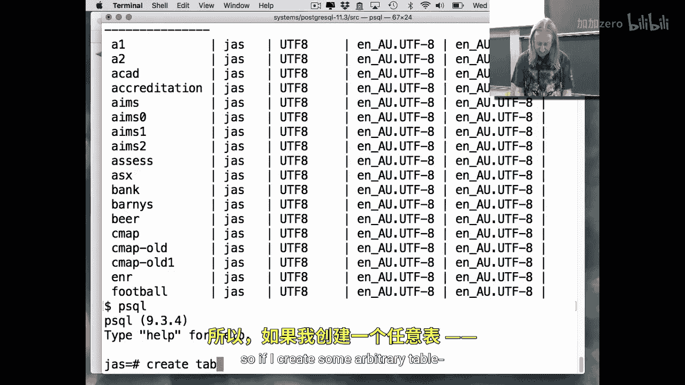

因此，**DDL语句主要影响系统目录**。

## 数据操作语言（DML）与数据影响 📝

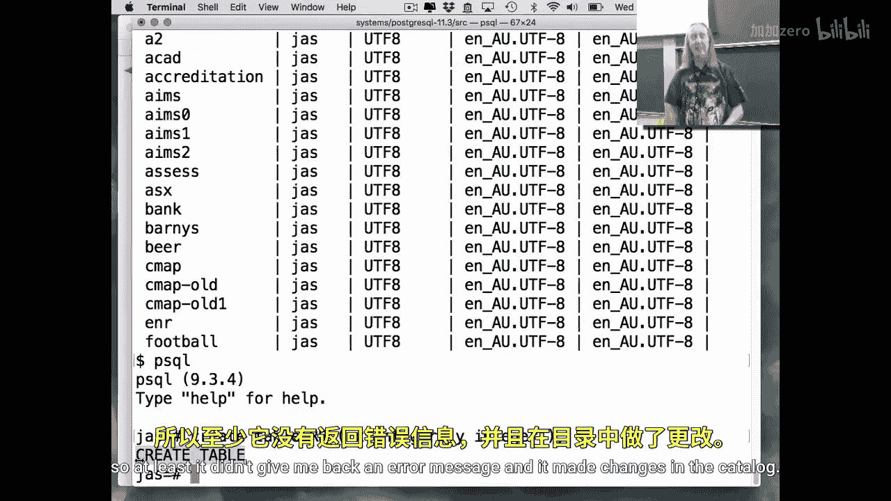

除了DDL，另一类重要的语句是数据操作语言（DML），用于改变表中的实际数据，主要包括插入（`INSERT`）、更新（`UPDATE`）和删除（`DELETE`）。

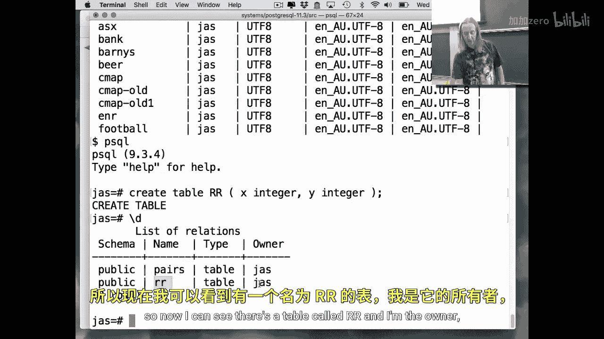

例如：
*   `INSERT INTO Students VALUES (1234, 'John Doe', 2.5);` （插入单行）
*   `UPDATE Students SET wave_height = 5.0 WHERE id = 1234;` （更新单行或多行）
*   `DELETE FROM Enrollments WHERE student_id = 1234;` （删除一行或多行）

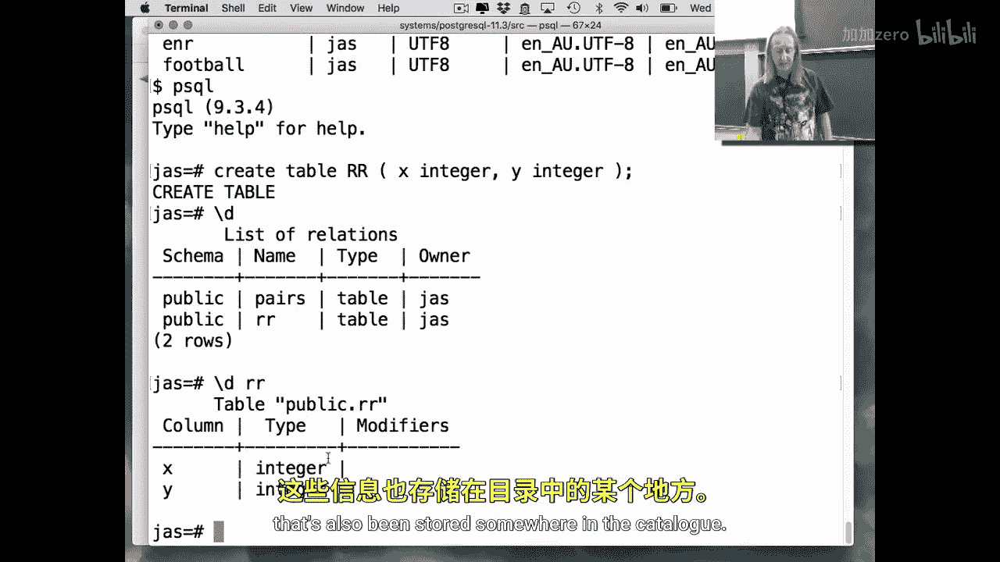

DML语句的执行会直接影响表中的数据。如果这些表上建有索引，那么相应的索引也会被更新以保持一致性。执行后，PostgreSQL会返回一个状态信息。

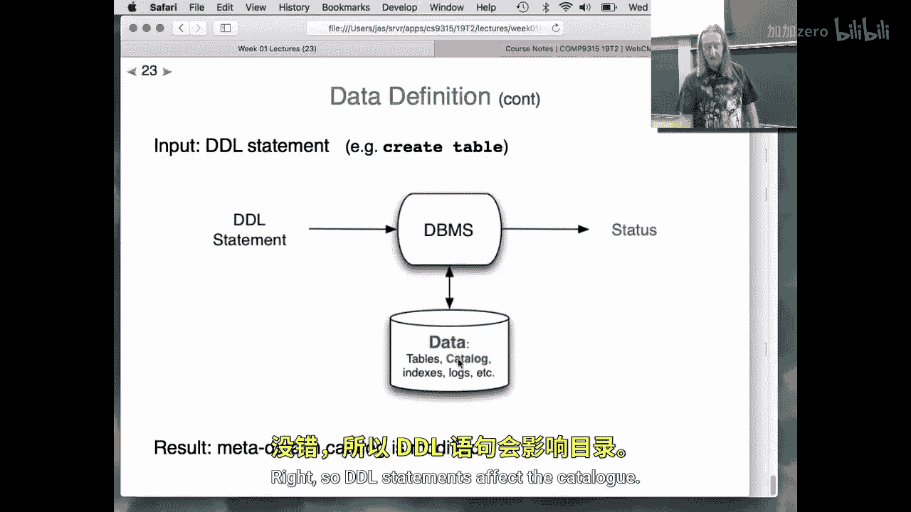

让我们回到之前创建的 `R` 表进行操作：

```sql
INSERT INTO R VALUES (10, 20);
```

执行成功后，会返回类似 `INSERT 0 1` 的状态。这里的 `1` 表示有一行被修改。`0` 表示PostgreSQL没有为这行数据生成内部对象标识符（OID）。我们可以配置PostgreSQL为每个插入的元组生成一个全局唯一的OID，如果启用，这里会显示一个大的数字作为OID。我们将在后续课程中更详细地讨论OID。

现在，可以查看表中的数据：

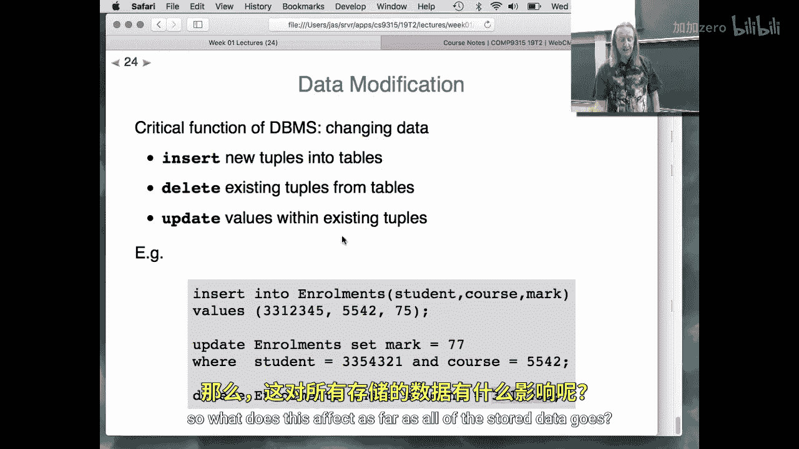

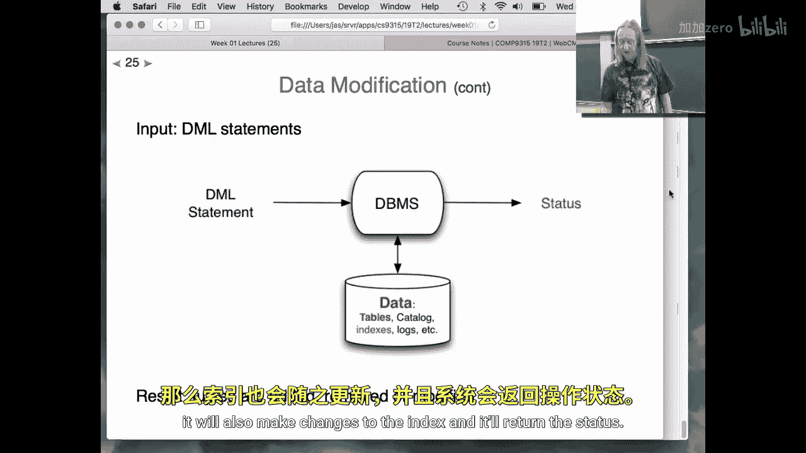

```sql
SELECT * FROM R;
```

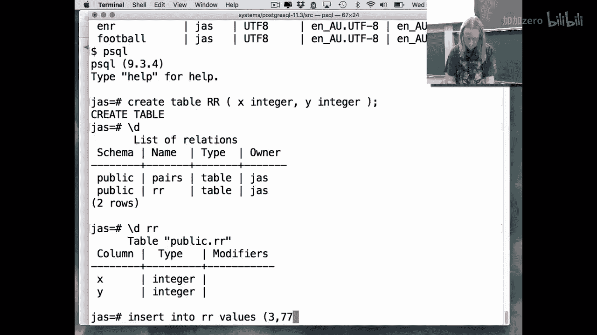

我们也可以删除数据：

```sql
DELETE FROM R WHERE x = 10;
```

## 总结 🎯

本节课中我们一起学习了：
1.  **关系型数据库的核心功能**，包括数据存储、约束、查询及事务管理等。
2.  **数据定义语言（DDL）** 用于定义数据库结构（如表、域），其执行主要影响存储元数据的**系统目录**。
3.  **数据操作语言（DML）** 用于增删改实际数据，其执行直接影响表数据及相关索引。
4.  通过简单的PostgreSQL实操，我们观察了DDL和DML语句的执行过程及其反馈的状态信息，初步理解了数据库系统如何区分和管理元数据与真实数据。

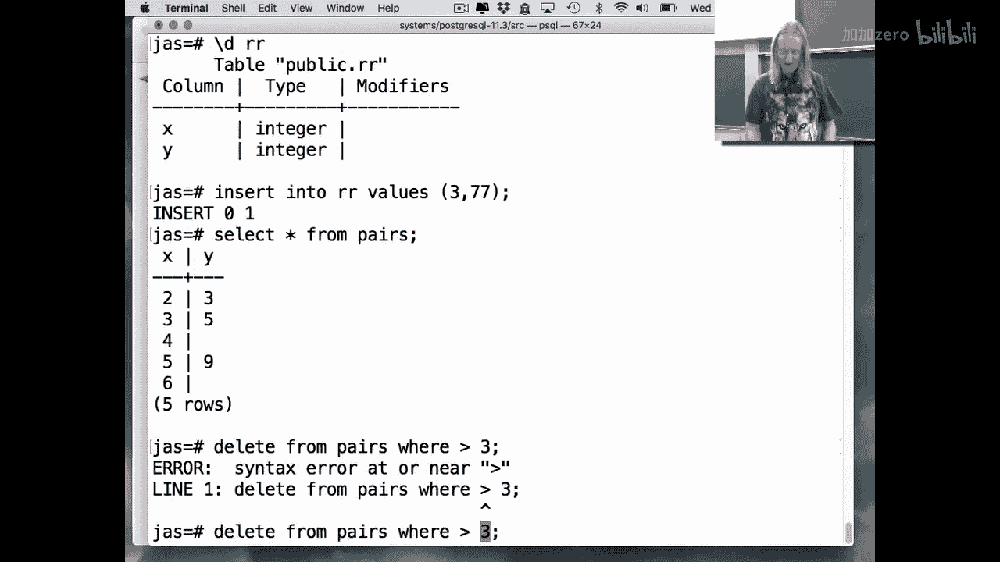

理解DDL与DML的区别，以及系统目录的作用，是深入学习数据库内部实现原理的重要基础。