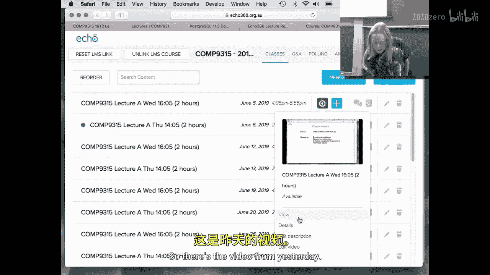
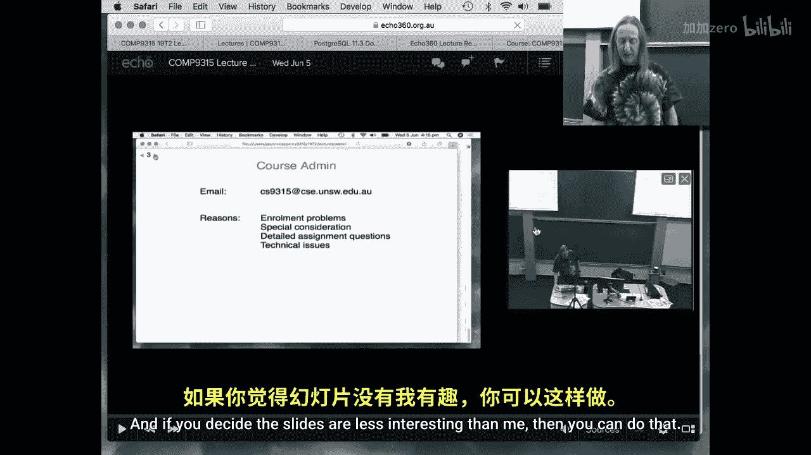
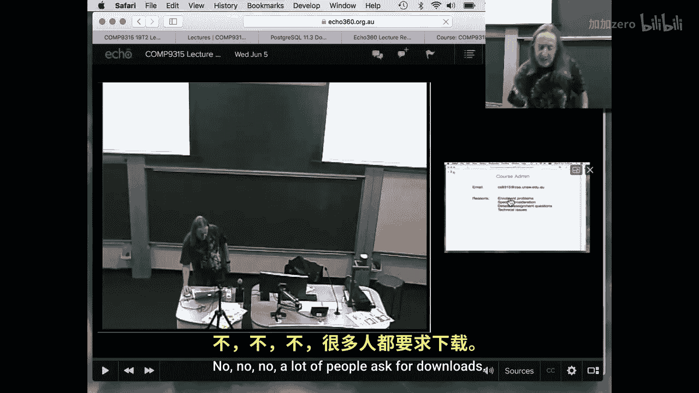
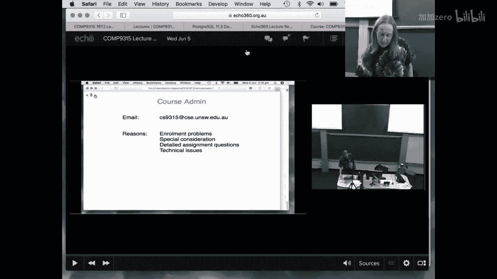
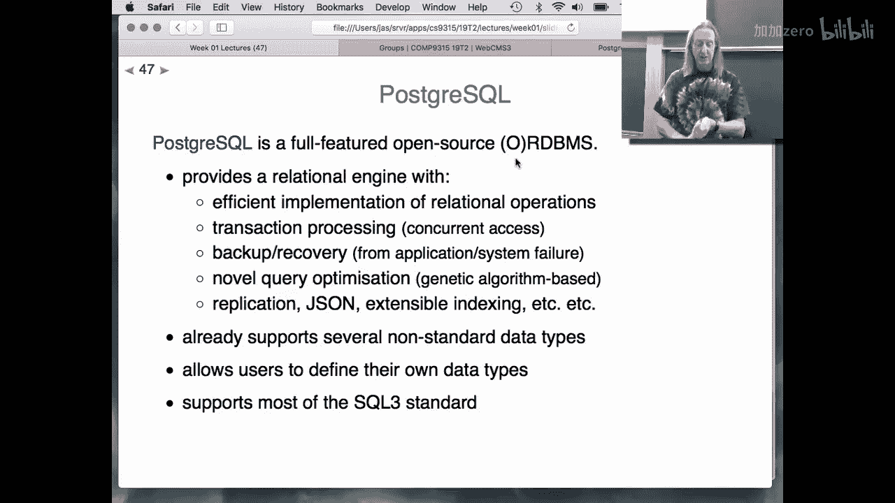

# 新南威尔士大学【中英⚡Postgres数据库实现原理｜COMP9315 2018 Postgres Implementation】 p03 P3 -BV1qXoqYHErC_p3-

One of the undergrad classes， when you decided to count down every time I put that on the whole class。

It was going five， four， three， two， one。why。ThatIt was interesting。All right。

 so most lectures and I didn't do it yesterday because it was the first lecture I'll put up a slides like this just to give him an idea of what's going on in the course。

What we're going to do today， what we're going to do in the next next week。

And so one thing to point out， the E videos become available a couple of hours after the lecture。

The video Z make。I don't get the chance to upload them until the next morning now I could upload them from home but that would take so long that I don't do it so I upload them when Im get here so if you go to the website now let me see。

And we got a video over yesterday and wow， there I am。

 you can maybe we can be a bit recursive and spend this lecture watching that video。😊，Pointless， yes。

 I agree。 But anyway， they're available there， the other videos you've got to go。😊。

Let me get a okay key。I'll open it in a new town where are we over here。Go to moodle。我ぎ。なら。ほら。不。以前模行。

Click onlect your recordings。If anyone knows how to run LTI come and tell me and we can bypass some of those stick。

 oh look， it's currently recording here。Interesting， and anyway。

So there's the video from yesterday。Which comes out like that and if you decide the slides are less interesting than me。

 then you can do that。

佢啊佢啊好啊。I don't know what happens if you download this， has anyone downloaded a bit？But。嗯嗯。

WhenA lot of people ask for downloads， I kind of suspect that's what you're going to get if you download because I think this split screen team is handled by E。

And wouldn't occur in a download。😔。

But in any case， no， we don't be there。 We don't need there We don't。对内袋。We go this all right。

 so as I'm saying the E videos get processed straight away and they become available a couple of hours after lecture my videos。

 I'll upload them the next morning。I don't know how long keep do mind if this thing。

 this little camera up there turns out to be reliable enough。🤢，Maybe I'll stop making them。

 and I'll just。Rely on echo。Prec work， I just finished setting up the first preg exercise。

 which is for you to install your postgres servers doing it。

ASAP while you got plenty time I'm sure you haven't got stuff to do in other courses。

 do this and start forming assignment groups and the way you do that is through。Here。

And I sat on a special page so that people who don't know other people in the course can post messages and get responses and maybe form a group that way。

 but to actually form the groups， you've got to go into here and create a groupoo。For了3个 one。

What else。Okay， so today I'm going to talk about Postgres a bit more than what I just got onto yesterday and。

Next week we'll get on to the hardcore stuff talking about the very aspects of the storage management that a DBMS provides。

So you may have noticed down the bottom here， there's all this weird stuff that's telling you which。

Book， which chapter in the book and which section that information is in。If anything's out of date。

 let me know。And you may notice that some books。Don't cover a particular topic Okay so I mentioned that yesterday all the books you know broadly cover DBMSs。

 some don't talk about catalogs like the old Maz one， the other ones do。

 some of them will spend a whole chapter on a particular topic but others will just talk about it in one section so。

You can get an idea of where the best place to look for some topic is from that。

So I'll be giving that reference information in each chapter and the other thing I want to talk about is history yeah。

Where did this stuff come from， Why do we care about databases， who is this friendly old man anyway？

😊，Anyone know？No idea嗯。Saing a close with Eddies bead。

Don know his name is Charles Barkman and he's interesting because he came up with the whole idea of a database。

 not the database in the form that we would recognise now。

 but the whole idea of having a structured collection of data that you can put on the disk somewhere store it permanently and come along and ask queries of it。

 keep it up to date and so on。And you can say a lot of this stuff happened a long time ago。

So he did his undergrad in Michigan， he then worked for Dw Cheical where he worked on process control and while he was there he decided I need a way to organize all of the data associated with the process control stuff and he came up with this idea of what he called an integrated data store I think came along a little bit later so it did if you look at all the things that it does aha looks familiar it all the stuff that modern database systems do now it definitely wasn't a relational database because the idea of a relational model hadn't actually been proposed at that stage that came later。

And eventually the idea of relations as a database structuring mechanism came along and then some people at IPM came and。

Worked out how to implement a system based on the relational model。

 but all of these ideas and you know storage， retrieval transactions。

 and so on he came up with solutions for them in 1964。And then it went on to do consulting。

So each week where each lecturer salary throw pop out some infofer。About various interesting people。

In the D mis spheree。All right， so Postgres， this is the system we're using why we're using Oracle because you can't get the source。

 why we're using My SQL because the source are it。All over the place。

 my SQL was cobbled together by grabbing a storage manager from somewhere or a couple of storage managers blah。

 blah， blah， at least Postgres was implemented as a single system by a single group。

And has a reasonable。A reasonably consistent code based。😔，In fact。

 Postgres QL grew out of a research project of Berkeley in the early 90s called Postgres。

That was intended to be。A successor to relational database that incorporated optic oriented ideas。

 the original Postgres has an absolutely beautiful code base if you can get a hold of it。

 but it didn't have an SQL front end， so the intention in there was that you use some kind of objectic oriented language to access the data。

That Postgres was handling so some students came along， took this lovely codeb。

 added an SQL front end to it and that's gradually evolved into the Postgres that we have today so you sometimes see it referred to as an object relational database management system。

There's a few little traces of the O nature of the original system， but not so much。

So gives you a standard relational algebra engine， reasonably efficient implementation of relational operations。

Good transaction processing in particular， the handling of concurrent updates sort of about that minute。

诶。Does good。