# 新南威尔士大学【中英⚡Postgres数据库实现原理｜COMP9315 2018 Postgres Implementation】 p05 P5 -BV1qXoqYHErC_p5-

hear me。 Allright， we are week 2， Wednesday。😊，The quiz first quiz is due tomorrow。😊，Who's done it？

One， one person， the rest of you better get a move on， I'm sure that's not true oh。

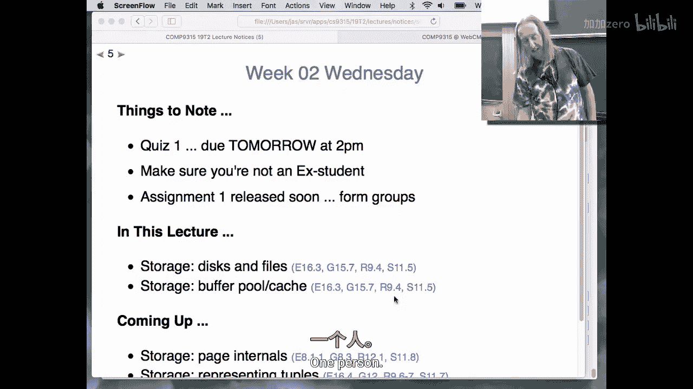

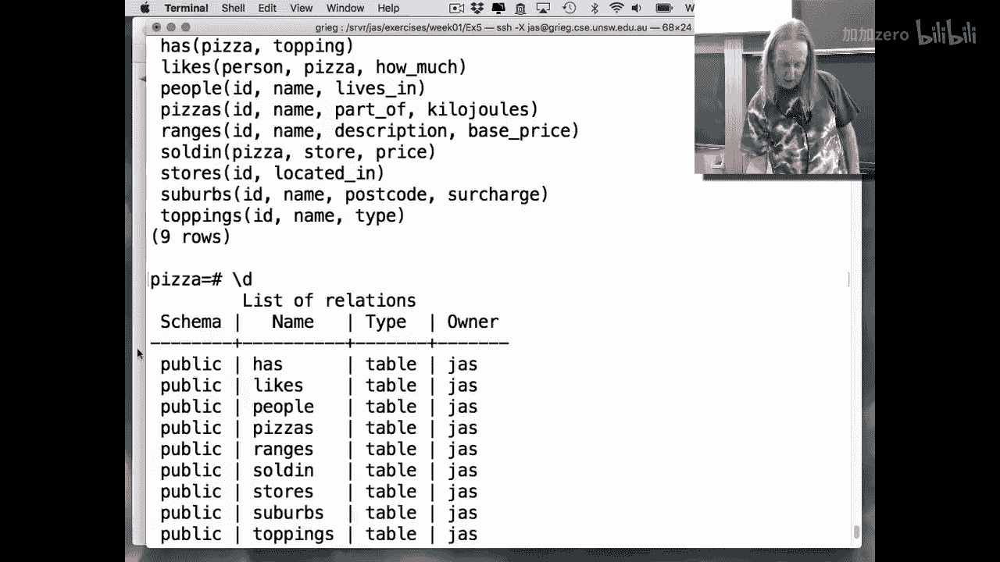

I want to have a look at least， let's see。Results， well 127 people have done it。

 I didn't say 127 hands go up， but that means 100 people haven't done it。

 so you've better get a move on。😊，And don't leave it。Until tomorrow to discover whoops。😔。

I've become an ex student。WebbsCMSS uploads all the enrollmentment records and eventually if you don't appear in one of the enrollmentment records it says this person is an unofficial student and it's very easy to go in and say make all of the unofficial students ex students because we assume they're no longer enrolled。

😊，Which is what I did on Sunday。 And I have a funny feeling that may have been a little bit premature。

 And some people who。Where almost official students got kicked out。To some extent。

 so make sure that you can log in so if you go to here or you can go to the homepage。

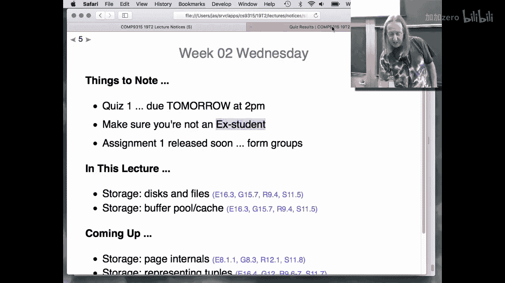

And you try clicking on quiz one if it even shows up and it says you can't do it because you're not a student then let me know。

It's pretty easy to add you back here。So it why not come out later this week。

 I haven't been checking how many groups there are， I bet if I looked I'd be disappointed。

That saw much one there。Because the did follow okay， not too bad， not too bad。Does that main。No。

 that can't mean everyone's in a group and even if you by yourself make a group。

 we see someone here has made a group。分上月出 one。Alright， let me see。す。

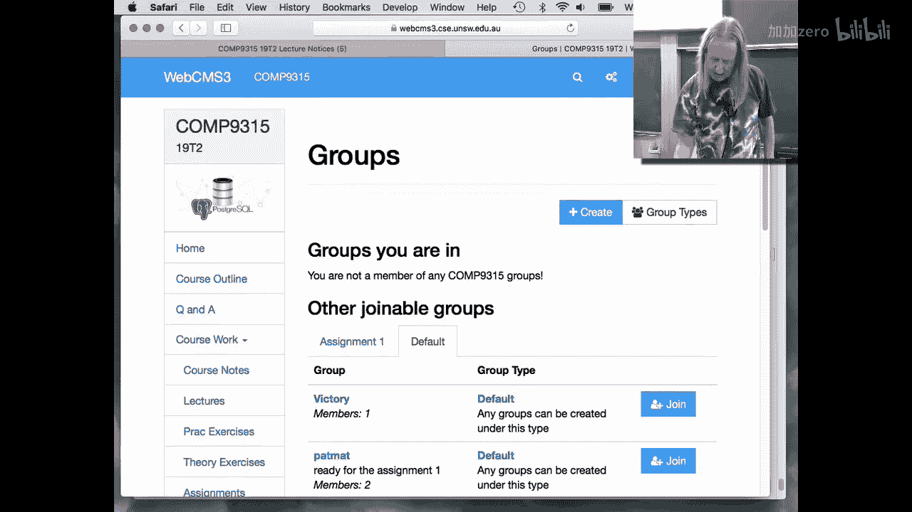

ます。I don't think I'll need the cross website anymore All right。

 so today we're talking about the storage subsystem last time we talked about the catalog。😊。

So the catalog allows us to look up the names of all the different kinds of things so we can look up the names of the tables。

 we can look up the names of types， we can look up the names and attributes and so on at some point we have to take those names and convert them into something in the file system so a table in Postgres is represented by a file that lives in the。

PD data， slash， base， slash。Oh idea of the database directory。

 So somewhere down there is a file with a numeric name， and we have to create that name， given the。

Symbolic name like student or enrollment or employee。😔。

So the storage subsystem helps us with that lets us get access to the files containing the data。

 obviously we've got to load that data into memory if we want to do anything to it so if you want to know evaluate a where clause does this trouble satisfy the where clause you have to have the top in memory and then apply the appropriate test。

One possibility is just to keep loading pages as needed that would make every database system really。

 really slow so they would use a lot of buffering so I'll be talking about buffering as well in the context of databases。

 the track work I've been getting messages where this doesn't work blah， blah， blah。

 your instructions to no good because I follow them to the letter。

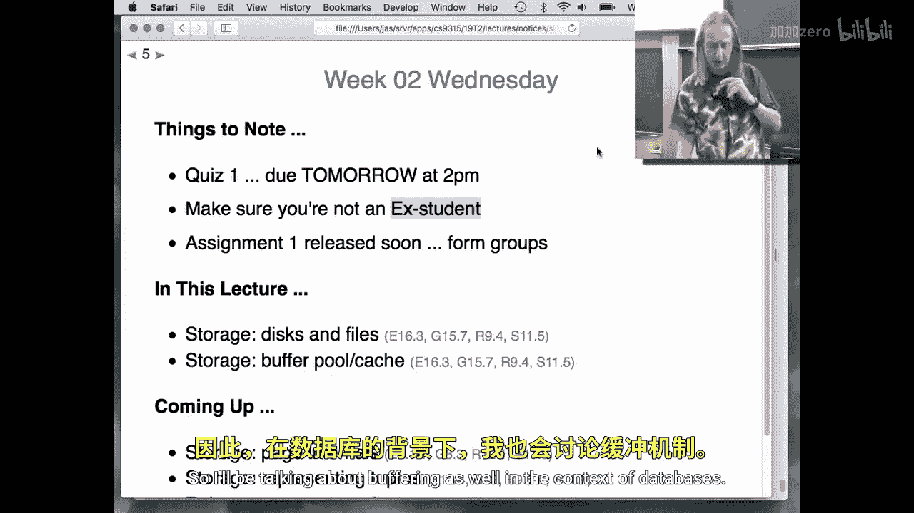

And it didn't work。Yeah sure。It's very useful if you send me some additional information that apart from it doesn't work and most of the people who sent me this additional information all you're got to do is look at the error messages and it's patently obvious what the problem is。

So learn to read and interpret the output that you're getting。

To help you debate another couple of things people have tried to compile their Postgres service on some other machine like Wagner or workstation or VX2 or whatever that's fine。

 it will compile and run。But that's the only place that it will compile and run。

There's some annoying discrepancies between the libraries on Greek and the libraries on the rest of the machines in CSE。

So if you can pile it up on Wagner， it's not going to run on Greek。

 if you try to run the server on Wagner， you get kicked off the server that just gets killed。

You can run the service on the workstations but that's not helpful unless you set up a window onto Greek。

 so I would suggest that you do all of your Postgres work on Greek so whenever you want to do some stuff SSH with your ZID onto Greek。

If you compile bin on Greek， you can't run them on other machines。

 if you compile them on the other machines， you can't run them on Greek。

which is slightly annoying The other thing is if you go if you're not careful about your past settings。

 you might invoke one of the other PSQL or Indeed Db or create Db commands that are sitting around on the CSC system。

That then not helpful to us because we want to compile Postgre from scratch。

 all of these others are commands that are sitting somewhere。

 use a bin or something I can't remember。

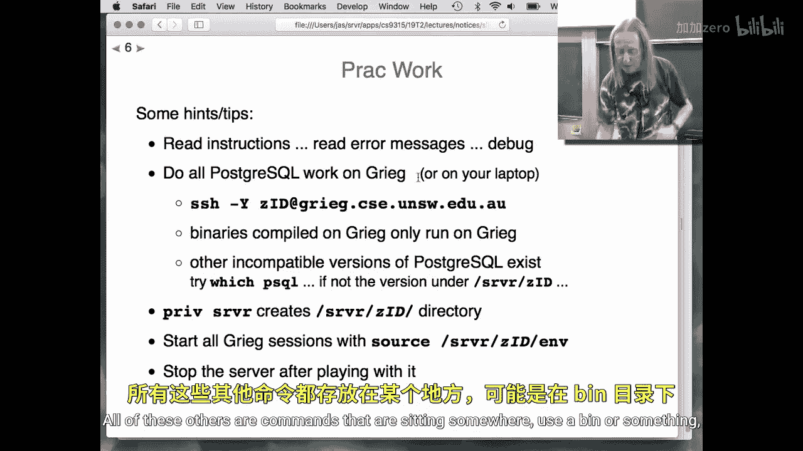

I can't look up here。 Let me see what I can do。If I jump here to agree and just。

Drop onto a CSE and an arbitrary CSE server and say which PQL， for example。

 it'll tell me there's a PSQL in user pin， make sure you're not running that that's not helpful at all and I don't even know。

No， I can't run it anyway。What's wrong here as soon as you see？😡，That message。

 you know that you haven't set your PG host environment variable correctly because it's just looking in the standard place where the socket file might be and it's not there。

Could also mean that I'm not running a server on this machine， which is true。 and if I try to。

 as I said before， it's just going to kick me off。But yeah。

 make sure that you're not running a wrong version of。One of the commands， it should be the one in。

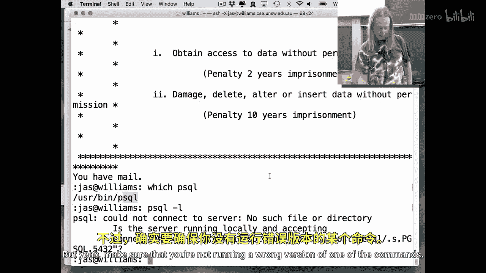

In your slash server directory。

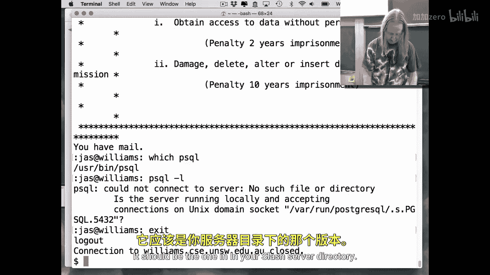

So if I go back to Greek， so I've just got Naileus which is shot and for SSH， blah， blah， blah。と。

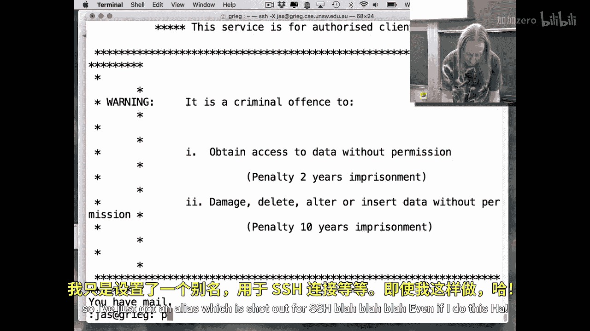

Even if I do this。HaOnce again， same error。 Why am I getting this error because I haven't set my environment very。

All I got to do is make sure。And I set the environment up appropriately。诶。

Then it will work okay now I'll close up bit naughty because I with my Postgres server running。

 you probably shouldt do that once you're finished playing with it， close it down。

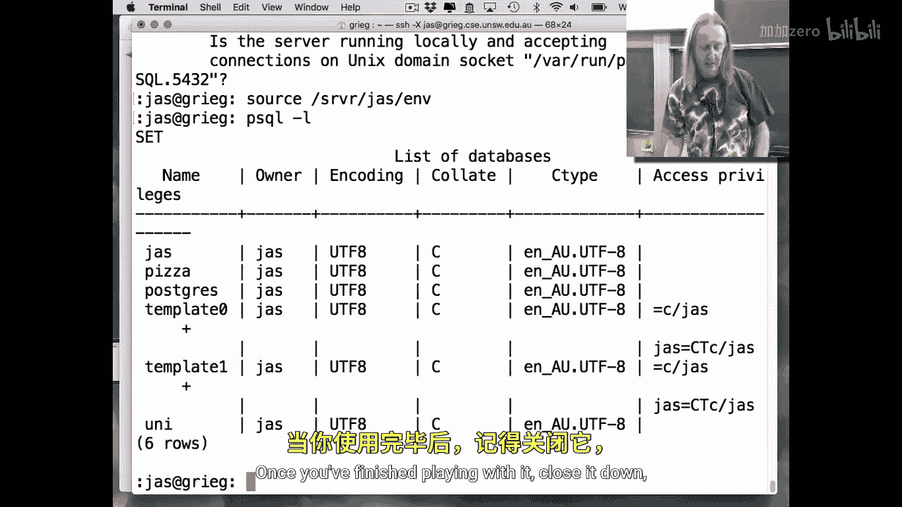

Started up again next time to log in。😔，Let me see the Pre server command。

 I kind of get the impression that some of the pre exercise material gives the impression youve got to do that every time you log in。

 in fact you don't the main thing the pre server does for you is just to create that slash server directory。

Slash service， slash Z I。😔，Make sure all right make sure you start your Greek stations with sourcing your own file and don't leave the server around。

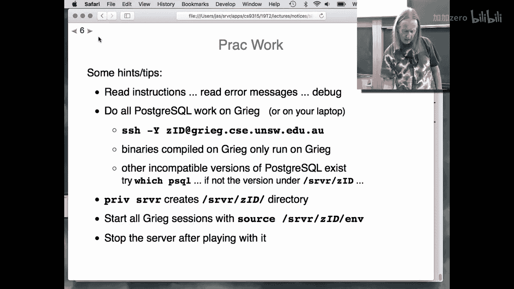

All right， so if you do all of that， hopefully you won't have too many problems。All right，在。

Famous database person。 Who's that。Okay， someone could guess。Clearly。

 a bit of a ping the way he eats hot dogs。He runs a database company whose product I'm not particularly going to talk about in his course。

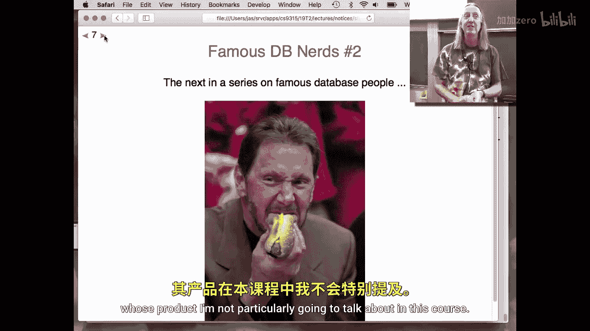

It'sFy。