# Postgres数据库实现原理：P5：存储子系统

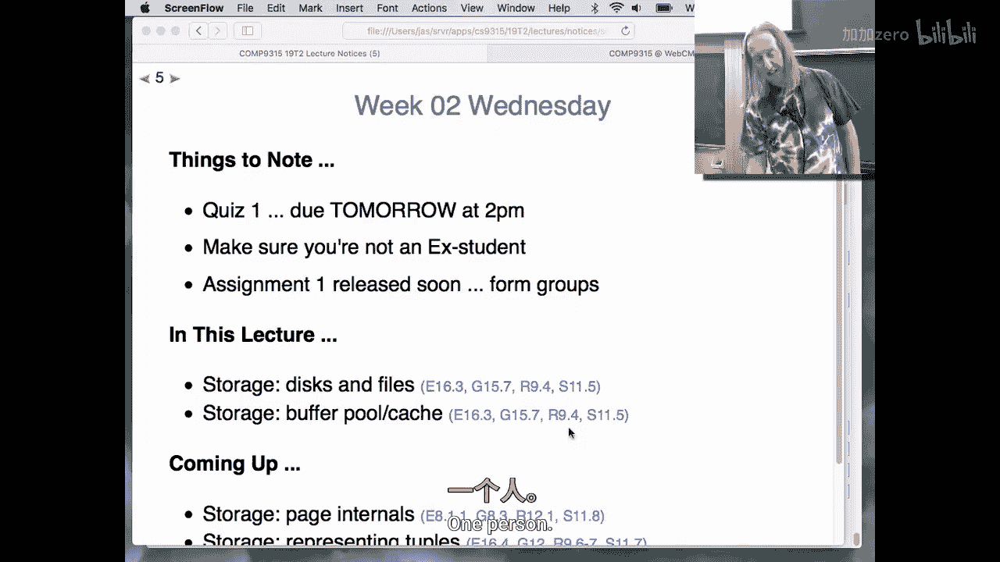

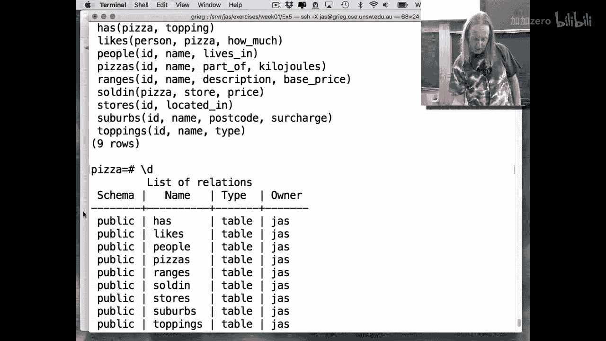

在本节课中，我们将学习PostgreSQL的存储子系统。上一节我们介绍了系统目录，它帮助我们查找表、类型和属性等对象的名称。本节中，我们来看看如何将这些逻辑名称转换为文件系统中的物理文件，并了解数据如何被加载到内存中进行处理。

---

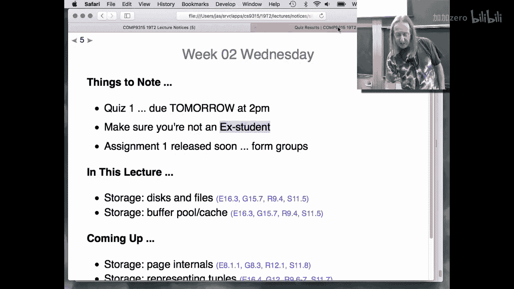

## 课程概述

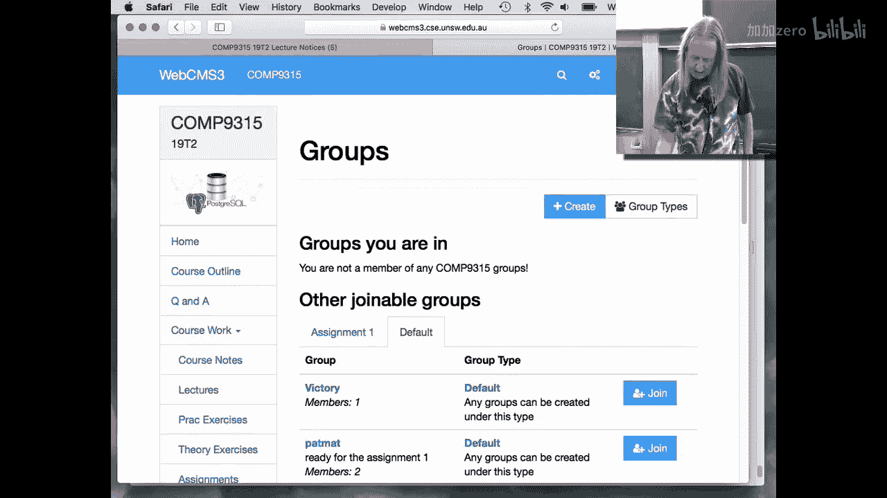

存储子系统负责将数据库中的逻辑对象（如表）映射到物理存储文件。当我们执行查询时，例如评估一个WHERE子句，必须将相关的数据页加载到内存中。为了提高效率，数据库系统广泛使用缓冲机制。本节课将探讨这些核心概念。

---

## 环境配置与常见问题

在深入技术细节前，先解决一些实践中的常见问题。

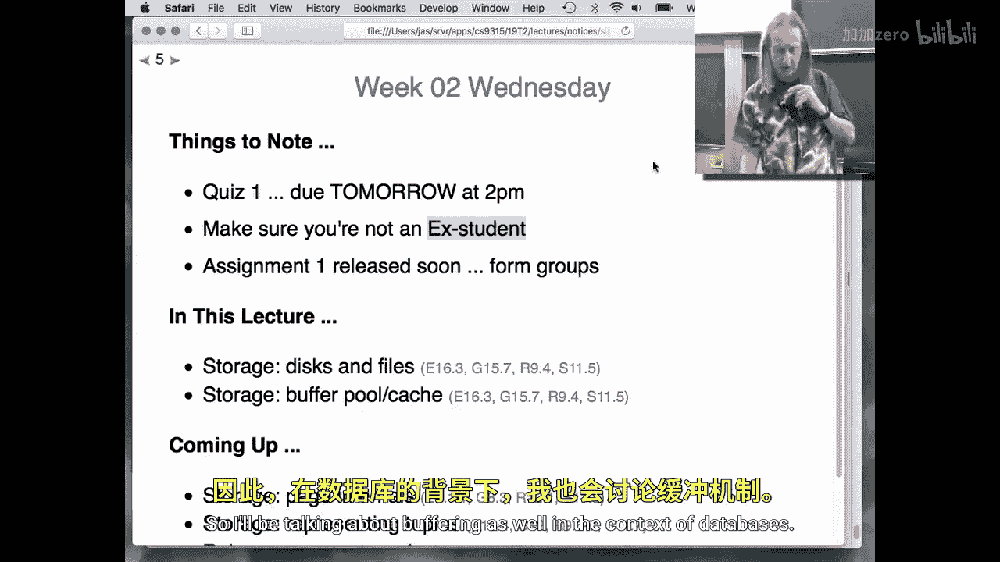

*   **截止日期提醒**：第一次测验将于明天截止。目前有127人已完成，意味着仍有约100人未完成。请尽快完成，不要等到最后一刻。
*   **学生状态检查**：系统会定期同步选课记录。如果发现你不在最新的选课名单中，可能会将你的状态标记为“非正式学生”或“已离校”。如果你在访问测验时遇到权限问题，请及时联系我，可以很容易地将你重新添加回来。
*   **项目分组**：请确保你已加入或创建了项目小组。
*   **编译与运行环境**：**强烈建议所有PostgreSQL相关操作都在`grieg`服务器上进行**。在其他机器（如`wagner`或工作站）上编译的代码可能因库文件不兼容而无法在`grieg`上运行。反之亦然。
*   **使用正确的命令版本**：确保你使用的是自己编译的PostgreSQL命令（位于`~/server/bin/`目录下），而不是系统预装的版本。可以通过设置`PGHOST`等环境变量来指向你的私有服务器实例。
*   **服务器管理**：使用完毕后，请关闭你的PostgreSQL服务器进程。每次登录时，你需要重新设置环境变量并启动服务器。主要步骤是执行你的环境设置脚本（例如`source ~/env`），然后启动服务器。

---

## 存储子系统核心

现在，让我们回到存储子系统的主题。

一个PostgreSQL表在文件系统中体现为一个具体的文件。这些文件位于`PGDATA/base/`目录下，每个数据库都有一个以其OID（对象标识符）命名的子目录，表文件则位于相应的数据库目录中，并以数字命名。

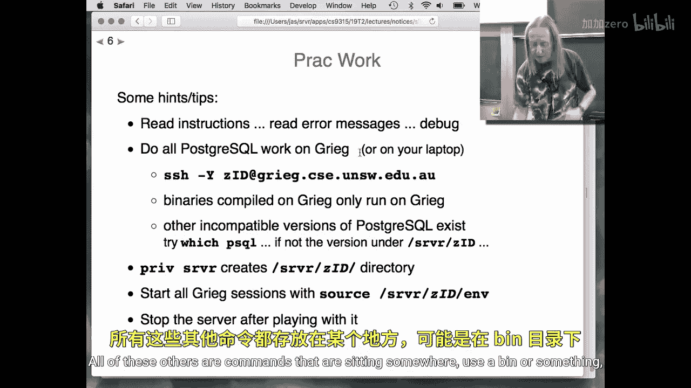

存储子系统的核心任务之一，就是将我们通过目录查到的逻辑表名（如`student`或`enrollment`）转换并定位到对应的物理文件。

当我们执行查询时，例如判断一行数据是否满足WHERE子句的条件，必须先将包含该行数据的页面从磁盘加载到内存中。如果每次需要数据时都临时从磁盘加载，数据库性能会非常低下。

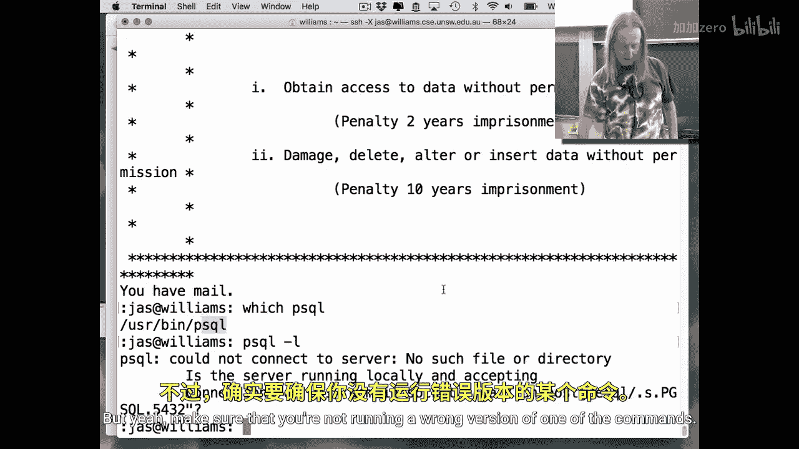

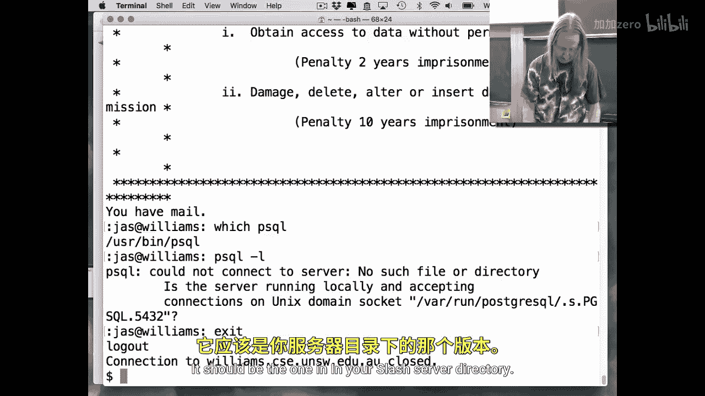

因此，所有数据库系统都大量使用**缓冲池（Buffer Pool）**。缓冲池是内存中的一块区域，用于缓存从磁盘读取的数据页。当需要访问某个页面时，系统首先检查它是否已在缓冲池中。如果在（称为缓冲命中），则可以直接使用，避免了昂贵的磁盘I/O操作；如果不在（称为缓冲未命中），则需要从磁盘读取，并通常替换掉缓冲池中某个现有的页面。

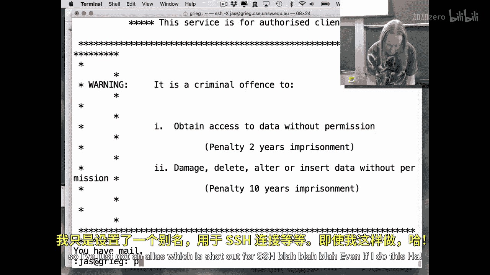

在数据库上下文中，缓冲管理是一个复杂而关键的组件，它极大地影响着数据库的整体性能。

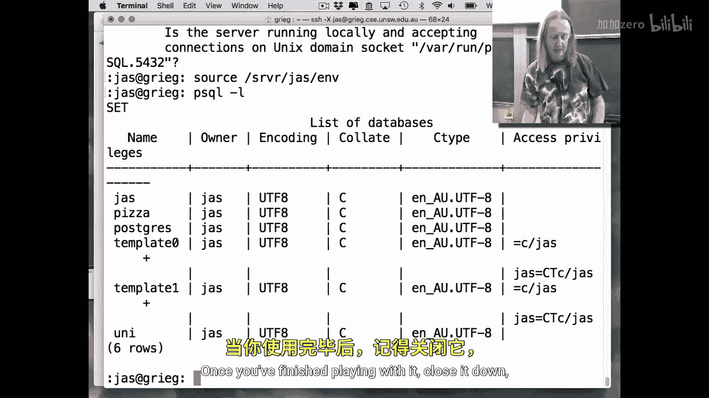

---

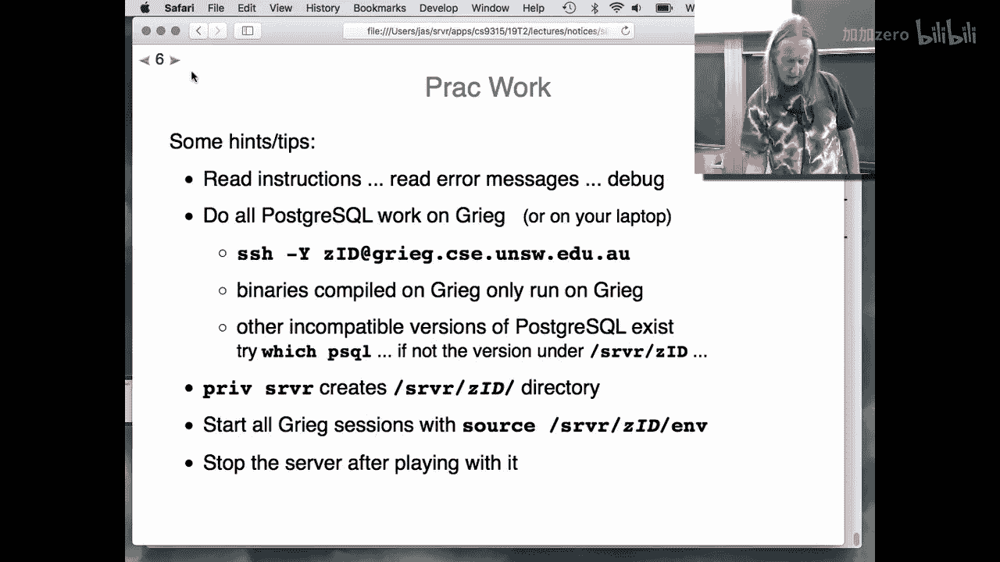

## 总结

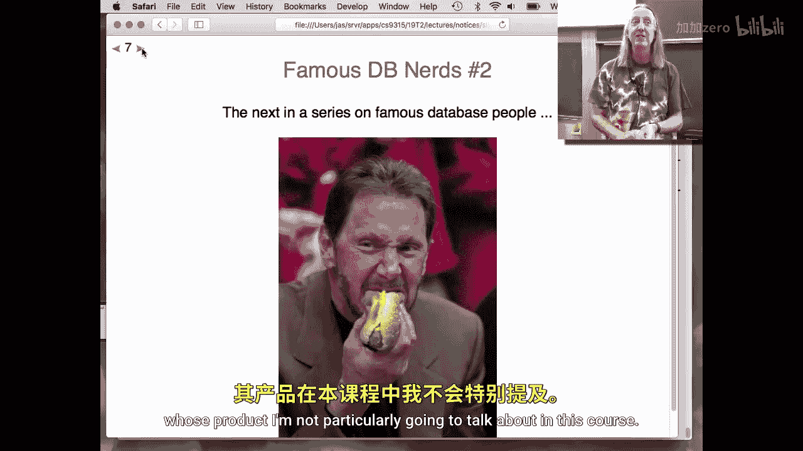

本节课我们一起学习了PostgreSQL的存储子系统。我们了解到，逻辑表最终对应着文件系统中的物理文件。为了高效处理数据，系统必须将这些文件页面加载到内存中，并通过缓冲池机制来最大限度地减少磁盘访问，从而提升查询性能。理解存储和缓冲的基本原理，是深入学习数据库内部工作机制的重要一步。