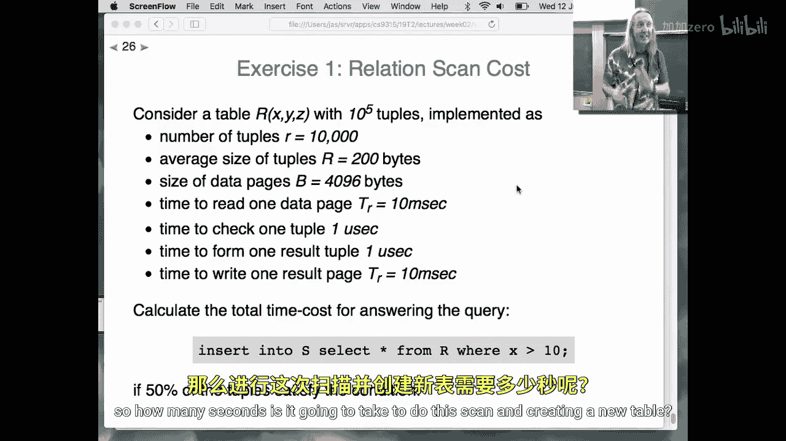
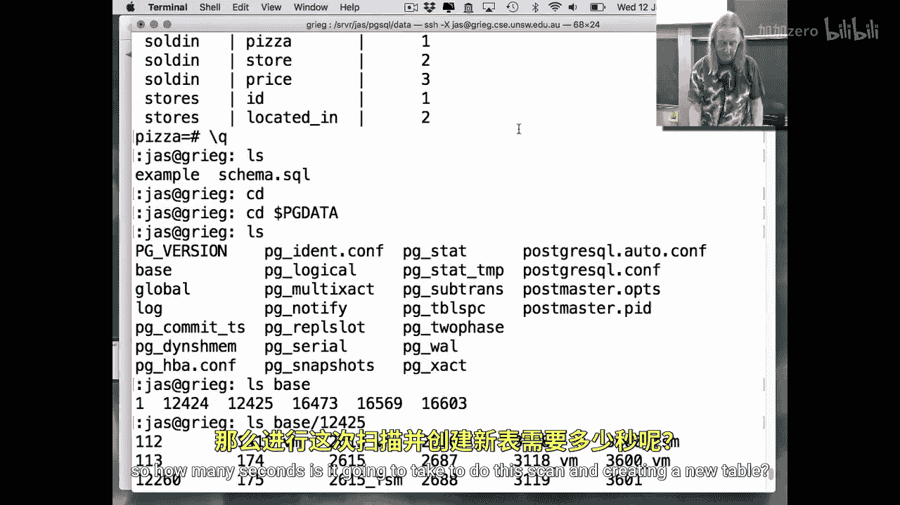
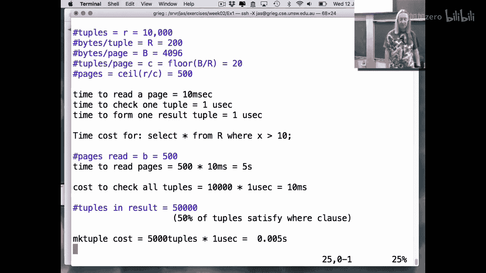
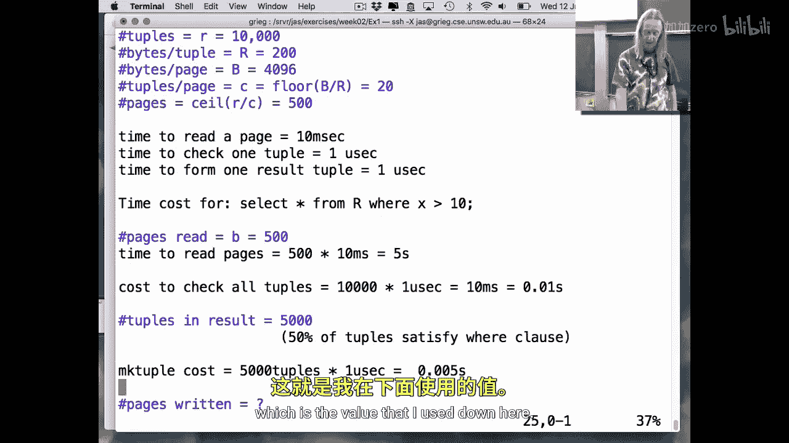
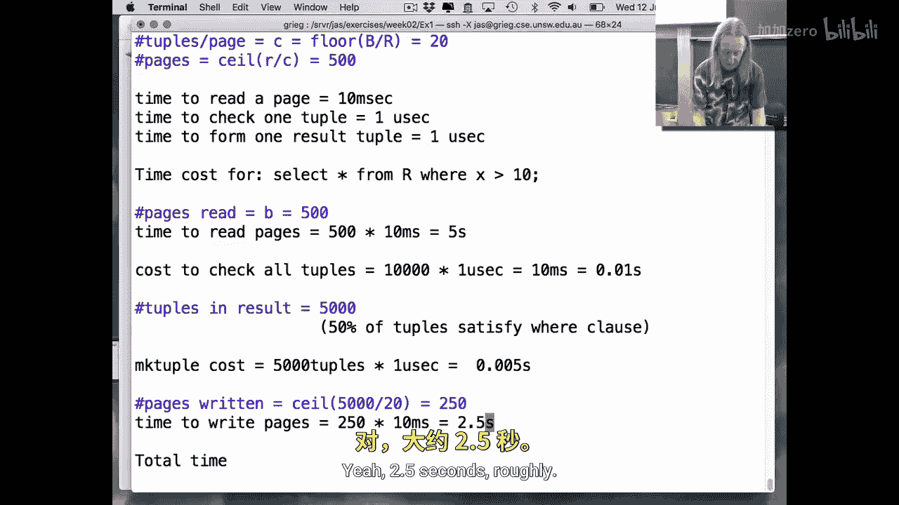
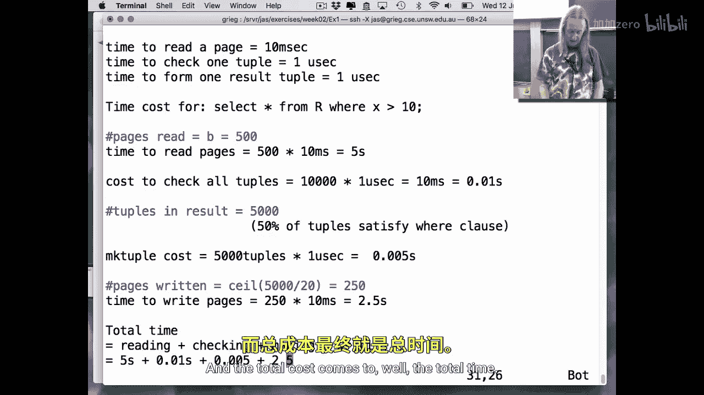
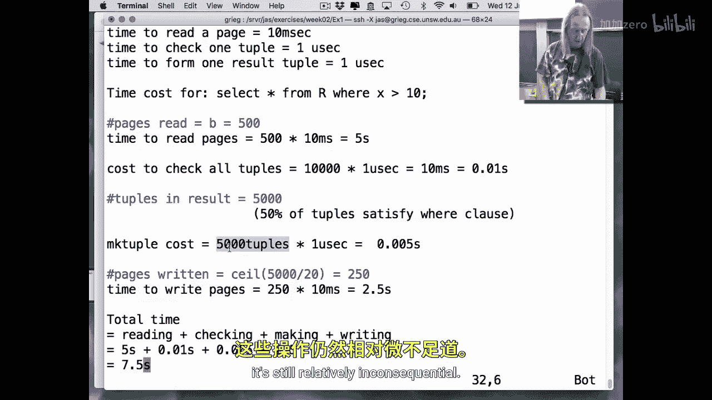
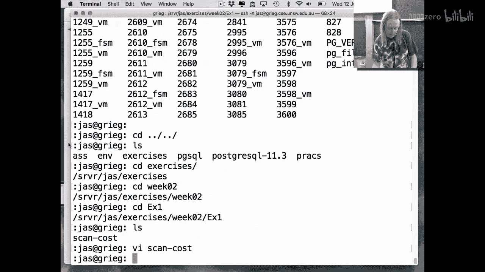
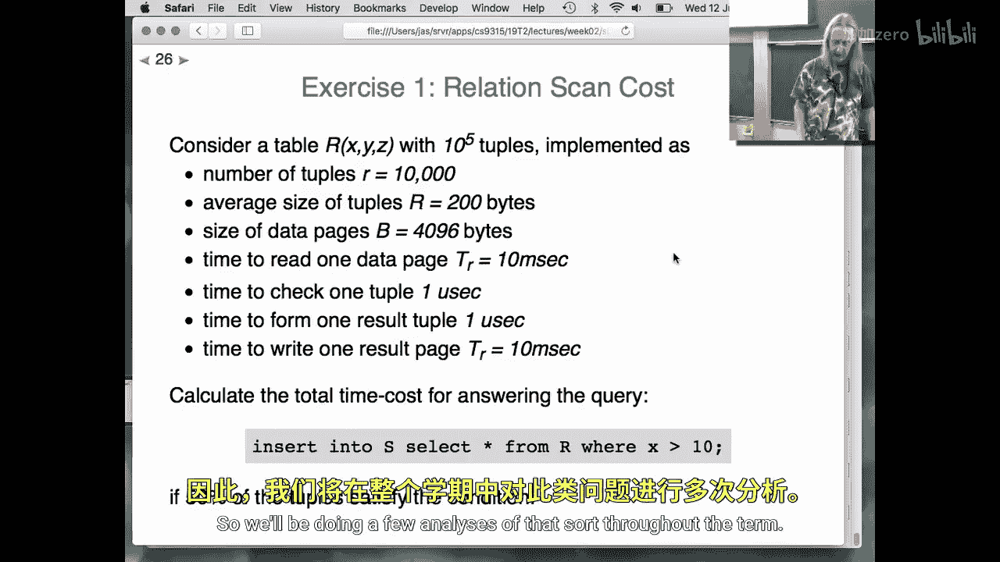
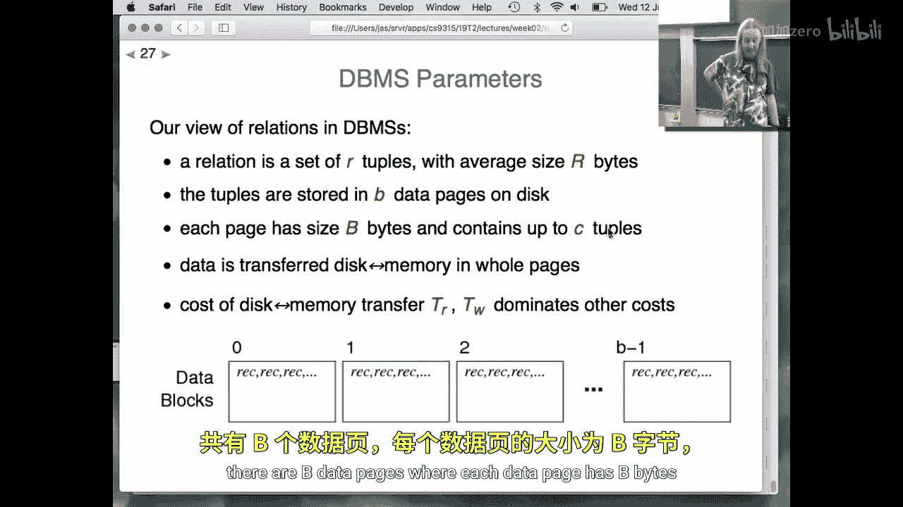

# 新南威尔士大学【中英⚡Postgres数据库实现原理｜COMP9315 2018 Postgres Implementation】 p06 P6 -BV1qXoqYHErC_p6-

Okay， so let's see how this plays in practice so a very simple query we're just。😊。

Grabing all the tus from some table art。And we're inserting them to another table S。

 so effectively this is just copying。The table， all right， so we had a copy of tabler in table S。

And we told this kind of information so there's 10，000 tuples， each one's 200 bytes， pages 4K。

Time to read a date page 10 milliseconds so that we're assuming it's on a hard drive so that's typical all kind of access。

Time time to check one tu， virtually nothing， one micro second。

 time to create a result tu also happening in memory。

 almost free and time to write a result page around about 10 milliseconds I got TR here should be TW but reading and writing costs on a hard drive pretty similar。

Alright， so how many seconds is going to take to？

Do this scan and creating a new table。

Okay， so this is the same thing I hope the parameter is that the same doesn't really matter。

All right， how many tuples can we fit in a page？行军。Five， we can certainly fit five。

 five 200 byte tupleles is only a thousand0 bytes， that'll fit in a 4K page。Not of it1。What about 20。

 what about 30， what about 40， 4， 200 page doubles is 8000， so that's to be 20。200 by tus is 4000。

So that'll fit so the number of tuples we can fit per page if we assume， you know。

 all tuples are the same size。Which is sometimes true。

If you've got a tuple that's got four integer values in it， for example。

 all those tuples will be the same size， but as soon as you start adding strings。

Varcha then doubles convey vary in size if you're doing chart 10 or something。Then once again。

 cha 10 and a couple of inks， well the tus would be the same size。Al right， so 20 doubles per page。

 10000 doubles， how many pages？And by the way。The way that's calculated。Is to take the floor。Oh。

4K over 200。Total number of pages needed where we got 10，000 doubles。

 we can fit 20 doubleples in a page there like 500 to me。I think。Equs and this time。

 this is actually the ceiling of。Number of tuples divided by number of tuples per page。

When did I say，2500。Alright， so to store those tuples now here we're assuming that we've packed them as tight as we can and there are no holes because we've deleted tus and had to add more things on the end。

 so all the pages contain 20 tuples。All right。So。Number of pages to read， well， we're not。

We're reading all the pages because we're scanning the entire table。So that's 500 pages to read。

Time to read the pages， 500 times 10 milliseconds。いす。So I think。Five seconds， that right。

 who's done the myth。诶佢啲。look at you because you're notdding for。没有啊。

You're my checker cost to tick all the tuples。All right， so there个。

We're not really checking the tuples in fact， but let's say for some reason oh know we are sorry we're checking that each tuple satisfies that condition so we have to do that 10。

000 times 10，000 times a micro second oops， 10，000 dos。Is pretty small。

Thousand0 times a micro that would be。Mely sick。 Oh， excellent。Oh。

a thousand times we mill out 10 milliseconds， is that right？大家。I said yes。可以下。All right。

 10 milliseconds is a lot smaller than five seconds。

So that's， oh， look， and I've already。And I could easily wow。I can easily rewrite that as。

And hopefully get it right。😔，诶喂。Forgotten there to use BI the costs of making tus now remember that half of the tus are going to end up in the result。

 so that'll be half of 10，000， which is not 50，000。5000， which is the value that I use down here so。

Making the topples is not so bad， number of pages that we have to write。啊。Oh， dear。

So we go to write 5000 tuples and we can fit 20 tuples per page， so that looks flow。2，50。

Does that seem right yes it does surprise surprise it's half of that because we're writing health and tops good cross check All right。

 so the time to write all those pages to 50 multiplied by the time to write a single page which is10。

Mise seconds。Wai is gonna to give us。出年嗰有 p啊。Where is it five second year，2。5。Seconds。

然后。All right， so the cost of reading all the data。いいです。5 seconds。Cost of doing all the ticks。

 or01 thingin。Plus， the cost of building tus。Plus， the cost of writing them out。😔。

And you can see that the stuff that happens in memory is inconsequential。And。

The total cost comes to， well， the total time。7。5 plus a little bit seconds， okay。

 so thats that's a fair bit of time， but you know all of those。All of those valuess。

Made up something in reality， they're not going to be quite that bad。

 But the important thing to this is that the re writing cost that's the dominating factor in the other stuff。

It's pretty much。Insignificant and。Even though we have to do something 10。

000 times and we have to do something 5，000 times， even when we're doing all of those tuple creation and all of those tuple checking。

 it's still relatively inconsequential。

All right。

So we'll be doing a few analyses of that sort throughout the term。

All right， now hard of what cropped up in that was various database parameters， which again。

Crop up frequently in all our cost analyses。A relation has total of our tuples。

Each tuple or the average size of topples is uppercase are。There are B data pages。

Where reach data page。Has。