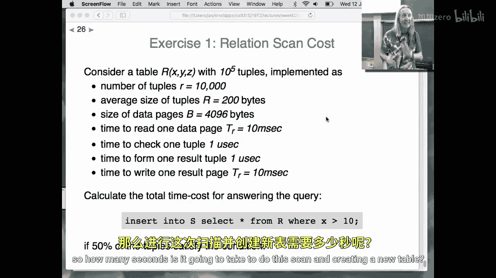
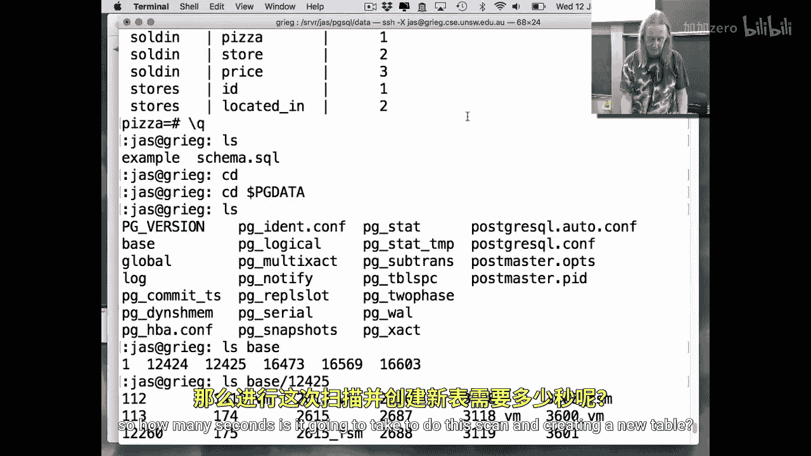
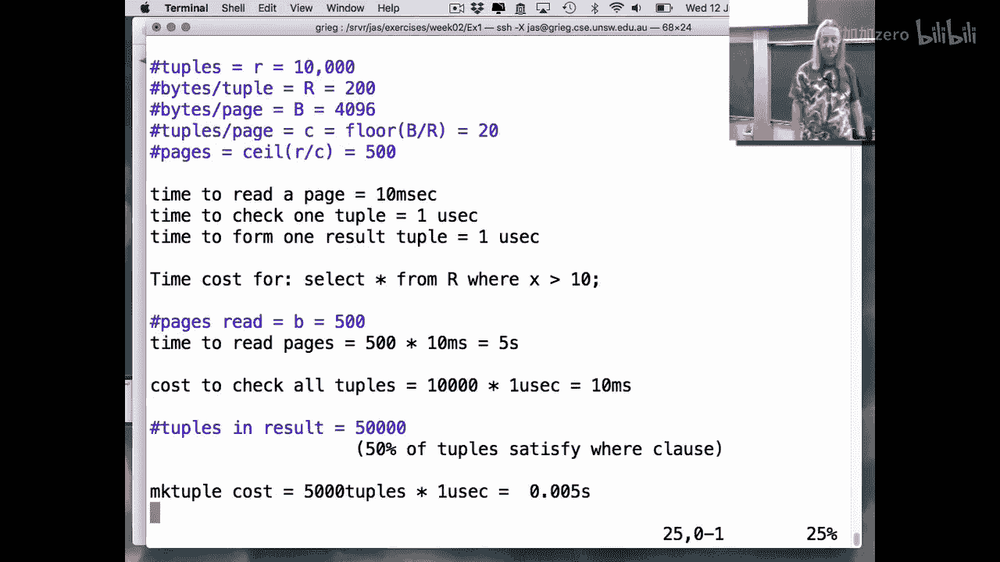
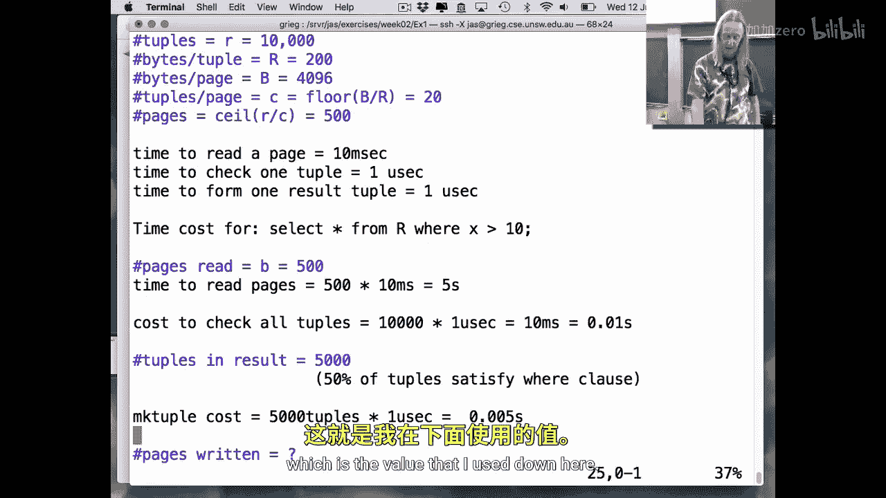
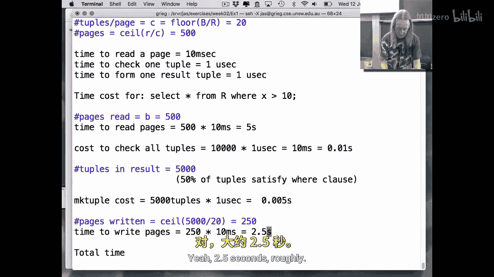
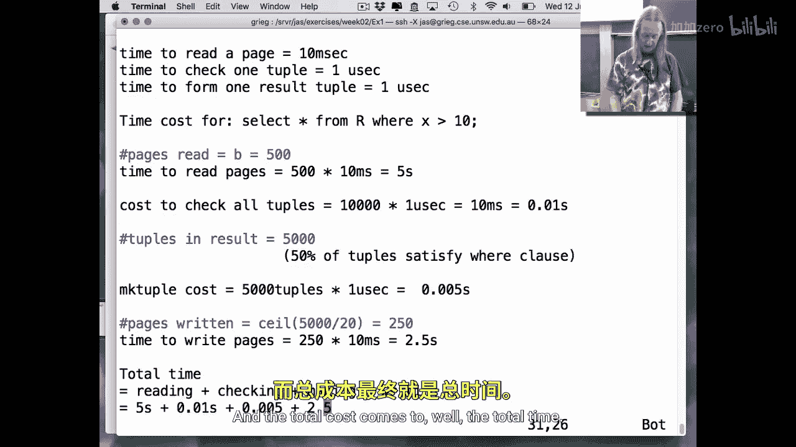
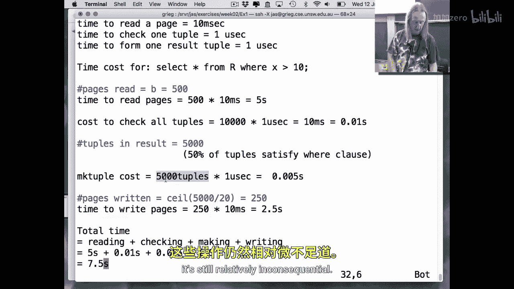
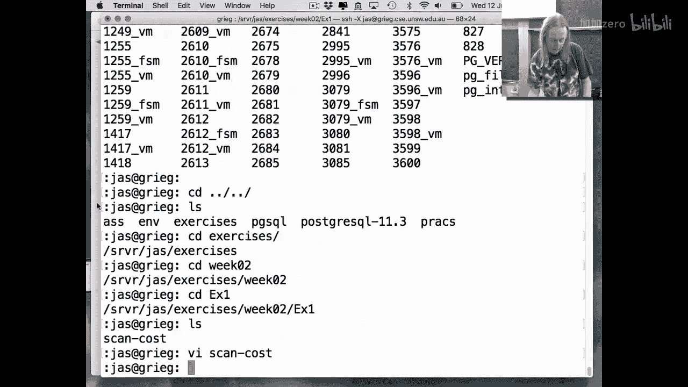
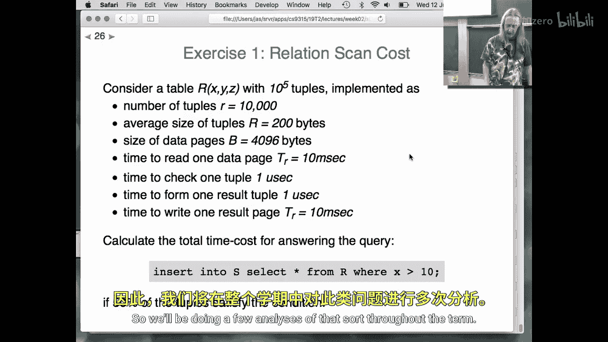
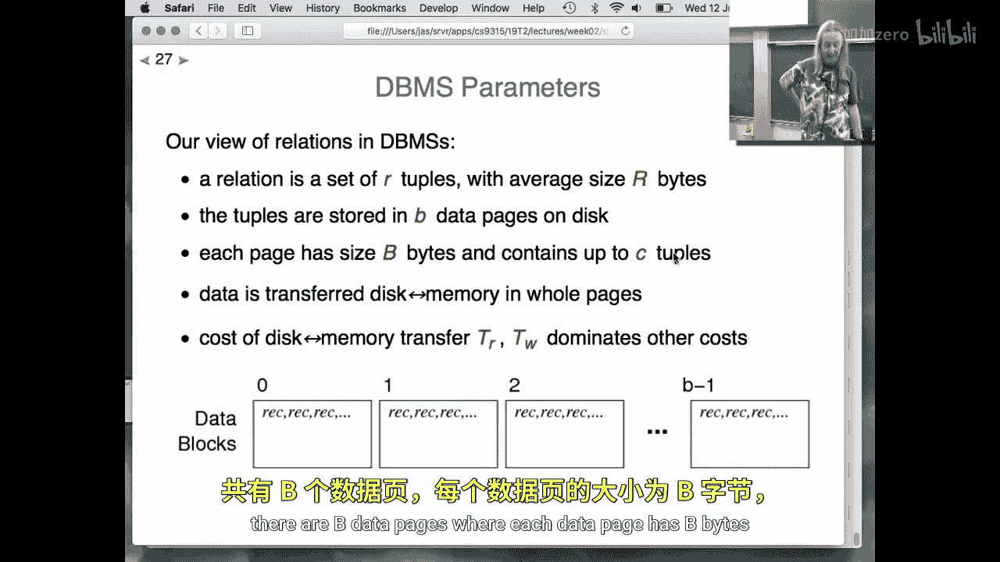

# 数据库实现原理：P6：查询执行成本分析示例

在本节课中，我们将通过一个简单的查询示例，学习如何分析数据库操作的执行成本。我们将重点关注磁盘I/O（读写）与内存中计算（如元组检查）之间的成本差异，并理解为什么磁盘操作通常是性能瓶颈。

## 查询场景与参数设定

上一节我们介绍了成本分析的基本概念，本节中我们来看看一个具体的例子。假设我们有一个非常简单的查询：从一个表 `R` 中读取所有元组，并将其插入到另一个表 `S` 中。这本质上就是复制整个表。

为了进行成本分析，我们设定以下参数：
*   表 `R` 中的总元组数 `T` = 10，000
*   每个元组的大小 `R` = 200 字节
*   数据库页面大小 `P` = 4 KB (4096 字节)
*   从硬盘读取一个页面的时间 `T_r` = 10 毫秒
*   向硬盘写入一个页面的时间 `T_w` = 10 毫秒
*   在内存中检查一个元组是否满足条件的时间 `C_t` = 1 微秒 (0.001 毫秒)
*   在内存中构建一个结果元组的时间 `C_r` ≈ 0 (可忽略不计)

## 计算存储需求

以下是计算存储表 `R` 所需页面的步骤：

首先，我们需要计算每个页面能容纳多少个元组。这取决于页面大小和元组大小。

**公式**：`tuples_per_page = floor(P / R)`

代入数值：`floor(4096 / 200) = floor(20.48) = 20`。因此，每个数据页可以紧密存放 20 个元组。

接下来，计算存储所有元组需要多少个页面。

**公式**：`pages_needed = ceil(T / tuples_per_page)`

代入数值：`ceil(10000 / 20) = 500`。所以，表 `R` 总共占用 500 个数据页。

## 分析查询执行成本

现在，我们来分解执行 `INSERT INTO S SELECT * FROM R` 这个查询的各个步骤及其成本。

### 1. 读取数据页的成本

要扫描整个表 `R`，必须读取它的所有数据页。
*   需要读取的页面数 `B_read` = 500
*   读取总时间 `Cost_read` = `B_read * T_r` = `500 * 10 ms` = 5000 ms = **5 秒**

### 2. 检查与构建元组的成本

对于读取的每一个元组，数据库可能需要检查它（尽管在这个简单查询中，`SELECT *` 意味着选择所有元组，但检查操作在逻辑上仍然存在）。然后，需要为结果集构建新的元组。
*   检查元组的总时间 `Cost_check` = `T * C_t` = `10000 * 0.001 ms` = 10 ms
*   构建结果元组的总时间 `Cost_result` ≈ 0 ms (因为所有 10000 个元组都进入结果集，但内存操作成本极低)

可以看到，内存中的计算成本（10毫秒）与磁盘读取成本（5000毫秒）相比微乎其微。

### 3. 写入结果页的成本

查询结果需要被写入到新表 `S` 中。由于我们复制了所有 10000 个元组，并且每个页面能容纳 20 个元组，所以：
*   需要写入的页面数 `B_write` = `ceil(10000 / 20)` = 500
*   写入总时间 `Cost_write` = `B_write * T_w` = `500 * 10 ms` = 5000 ms = **5 秒**

### 4. 总成本汇总

将以上所有成本相加，得到查询执行的总时间：
**总时间** = `Cost_read` + `Cost_check` + `Cost_result` + `Cost_write`
= 5000 ms + 10 ms + 0 ms + 5000 ms
= 10010 ms ≈ **10.01 秒**

## 核心结论与常用参数

通过这个例子，我们可以得出一个关键结论：**在数据库操作中，磁盘I/O（读取和写入页面）的成本通常远高于内存中的CPU计算成本**。即使进行了上万次的元组处理，其时间消耗与几百次的磁盘访问相比也几乎可以忽略。

在后续的成本分析中，我们会频繁使用以下关系参数：
*   `T`: 关系（表）中的元组总数。
*   `R`: 每个元组的（平均）大小。
*   `B`: 关系占用的数据页总数。
*   `P`: 数据库页面大小。

它们之间的关系可以概括为：
**公式**：`B = ceil(T / floor(P / R))`

## 总结

本节课中我们一起学习了如何对一个简单的全表扫描查询进行成本分析。我们通过计算读取页数、写入页数以及内存操作时间，清晰地展示了磁盘I/O是数据库操作的主要性能瓶颈。理解这些基本成本构成，是后续学习查询优化和高效存储结构的基础。