# 新南威尔士大学【中英⚡Postgres数据库实现原理｜COMP9315 2018 Postgres Implementation】 p10 P10 -BV1qXoqYHErC_p10-

Okay， lets let's try and straighten out the terminology。

 which I'll go back through my notes and try and make everything consistent。😊，All right， so record。

It's intended to just talk about a sequence of bites。

 whether it's generally it's you know somebody who lives on the disk but when you load a page of data from the disk into memory and you talk about a position of a record it's also just a sequence of bys at that particular location so a record I'm interpreting as or I'm treating as something as just a sequence of bites a tuple on the other hand and so far I've been using the words tuple and record more or less interchangeably。

But later on， I want to distinguish a tuple from a record。 so a record is just a sequence of bites。

 A tuple is。A collection of information that allows me to interpret those bikes。😔。

Or it might even be that I've extracted those bys and I've got a sequence of attribute values corresponding to those bites。

Right but it's a way that you know how I can interpret a record as something that looks like a database tuple so it's got a bunch of attributes attributes have names and the attribute values aren't just byte sequences they're actually values in particular domains so a tuple is something that we can use in memory Postgres makes this distinction reasonably well page is just a copy of。

A page from a disc file， so in Postgre's case it's8 k long， 8 k bytes of information。

A page ID is an index of page within the file， so if I want to find out the file offset of a page I simply multily the by the size of pages。

In that file， like I said， that's typically something like 4K， 8K in Postgres， it's definitely 8K。

Which may be configurable in Postgql dot com。嗯 not sure。Then a T ID。

 which I have a bad feeling I used。😊，Differently in some of the slides is I want it to be an index of a record within a page so it's the index into the directory and then from that directory entry I can go to the actual bytes within the page。

I think one thing that I have at least done consistently is peered Td and read the way I've used them in all of the subsequent flights。

😔，Every P， it's a page Id， which is an index of a page。 Every T Id， it's an index of。A record。

 a sequence of bitetes within a page corresponding to a tuple。And a record Id。

Cars is just a pair page Id。 So we know which page we're talking about and then a tuple Id。

 which is whereabouts。In the page， we can find。The record bytes that we can then convert to a tumble。

And to find a record offset， let's say we're talking about a file that's got favorableable size records。

 each page is going to have a directory， we go to the directory and that'll give us the offset of a particular。

Reckle。Particular sequence of bites representing a regular between and then converting to a tuple。Oh。

Probably still unlike like saying。Anyway。At least I've used pe tied mid consistently throughout the flight。

 So that's what they actually mean。

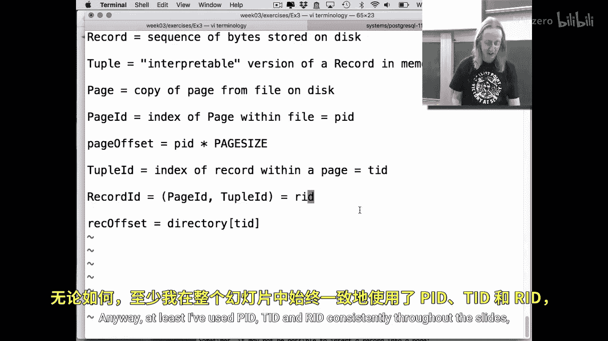

Alright， so maybe they'll clear things up。 Maybe I'll need to put that slide。

 won't worry about that exercise。 and haven't got time。

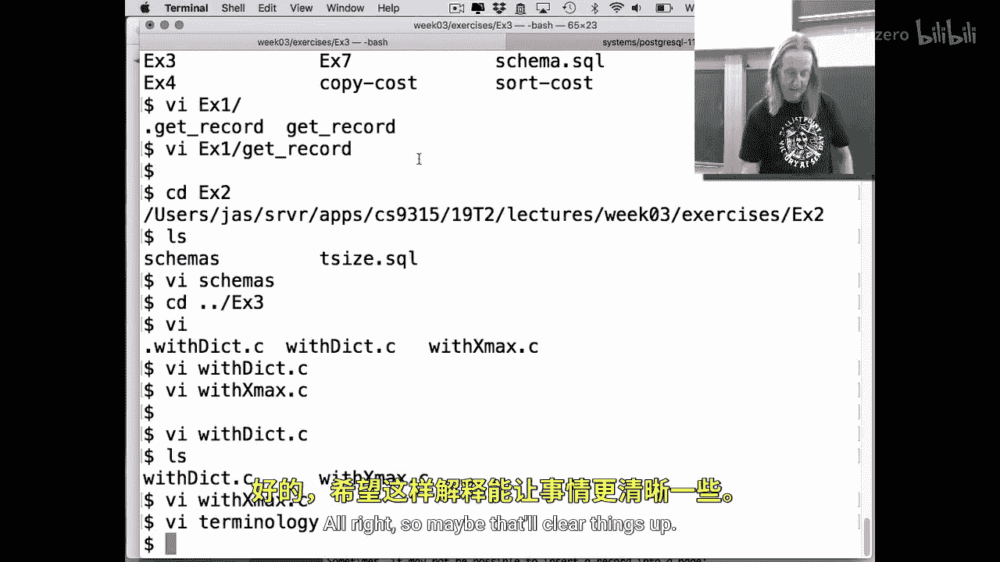

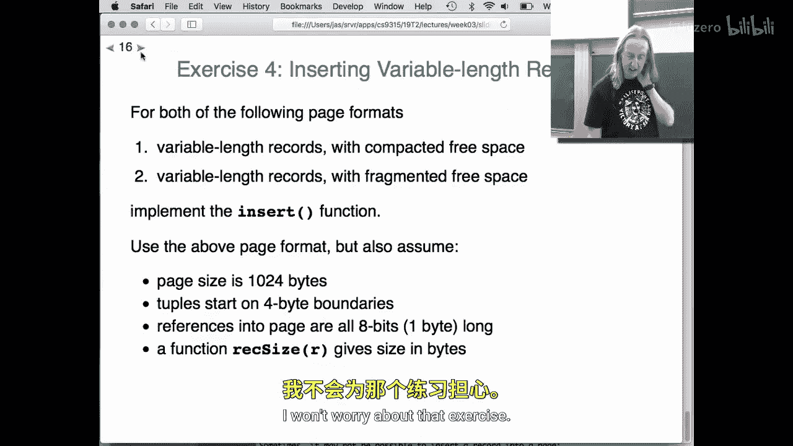

How many records can we fit on a page where we kind of saw that there's a little bit of interplay between the number of records and the fact that a dictionary has to be used and the dictionary occupies space proportionable and the number of records？

So。Obviously the number of records depends on the page size if you've got an8K page。

 you can probably fit almost twice as many records as you can on a 4K page。

Twice as many records of the same size， record size。Didip me know how big is a piece。

 how long is a piece of string， how big is a record， Well。

 it depends depends how it was defined in the create table。

 so 64 bytes wouldn't be uncommon for a small record。诶。

Couple of hundred bytes would be moderate size record。

500 bys might be a la record and if you've got a giant record。It's not going to be stored in the。

Data file anyway we'll see how that works out later。系。

Typically a page we saw already that pages have some additional information。

 so we've got the directory there。

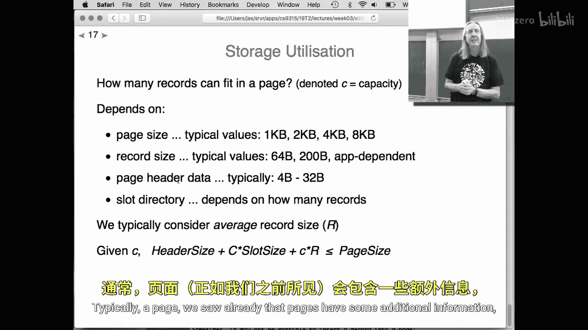

But we've also got these two things in here， which you could call the page header。

This is just a simple example， we'll have a look at what a Postgres page had looks like later。

But it will contain a collection of information that allows you to work out what's going on on the page。

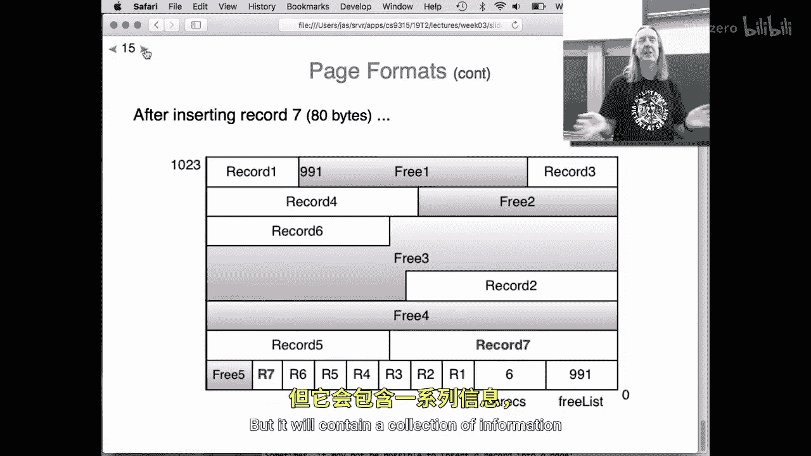

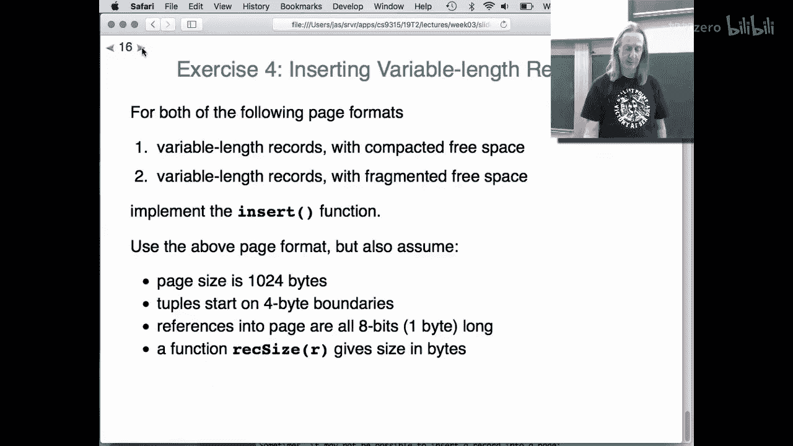

And once again， a slot directory we're talking about。A fixedix size， fixed size records。

 Or we've then got a directory， not necessarily a s directory。 If we got very size records。

 So in any case， all of those things taken into account have to fit in the page。Oh。

 you know used up see there。And I make low cut。有唔咩啦。

So I see is the capacity for the page basically how many records can be stacked on a page All right。

 so speaking of how many records can I stack on a page。

 let's have a little look good all these stuff。 So imagine we've got  onek pages。

 we've got records that are defined like this。

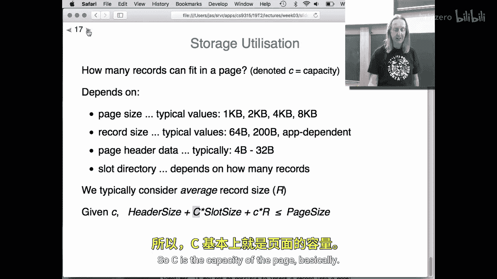

All the records are aligned on fourbte boundaries。Let's see if that's gonna be。Interesting， yes。

 it will。Because we've got something that's Cha 10 here， we're going to have to。Pendder to charge 12。

The Varchar 20 sort of kind of breaks everything， but if we assume that all of these varchars are going to be 16 by this then we don't need to pad on with them。

But in any case there's going to be some padding to make sure it fits on a fourb boundary oh and I just realized in my solution I changed these field names because I thought it was confusing to have C because on the previous slide I just use C to refer to the number of tuples in a page so it's W X Y Z is what they're going to be called。

So the way field is paded to ensure that the Zg field starts on fourb boundary。 la la， la。

 Remember said that。系啊。Maximum size of the X attributes， 20 bytes， v 20 average size 16 bytes。

 so no padding needed。The page has 32 bytes of hair information， what's stored in that。

 who knows doesn't matter， we just know that there are 32 bytes of it。

And we're only going to insert tuples into the page initially， so if we stay out with an empty page。

 how many tus can we add before we've filled the page up？

So here's a back of the envelope calculations。😔。

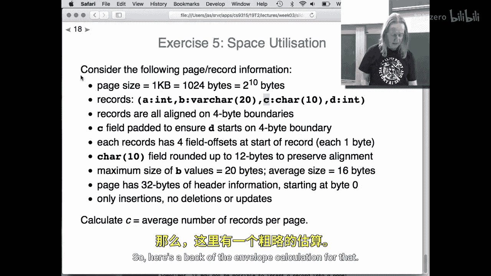

For that。That's not where I'm going to find it， go way。😔。

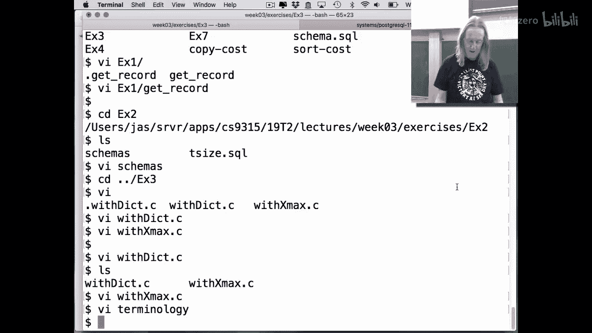

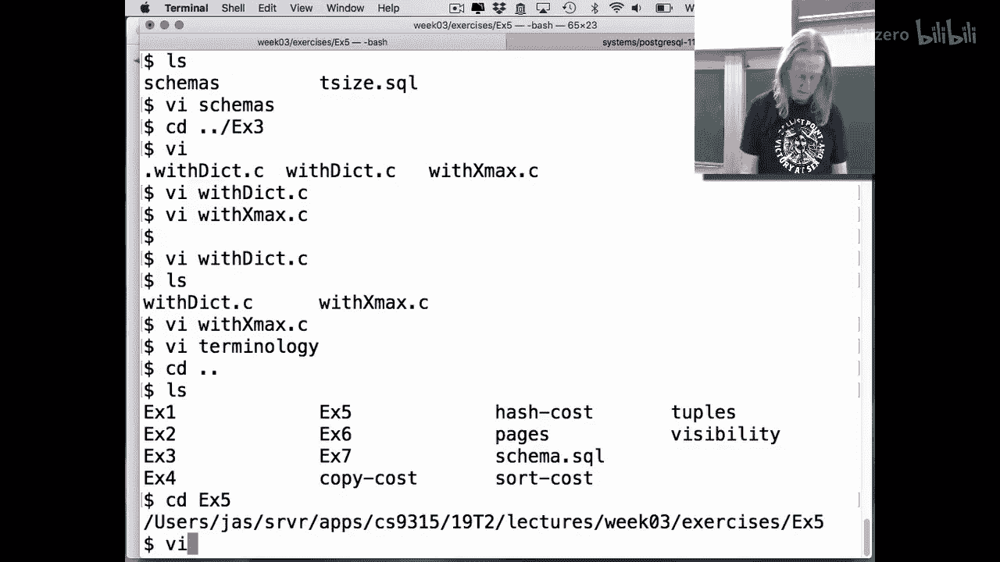

All right， so this is。A nice EI diagram of what what the page looks like， it's got header it start。

 then it's got the directory， one entry for each tubble， then it's got。

Some free space just think back to those diagrams before then it's got all of the the actual stored records added。

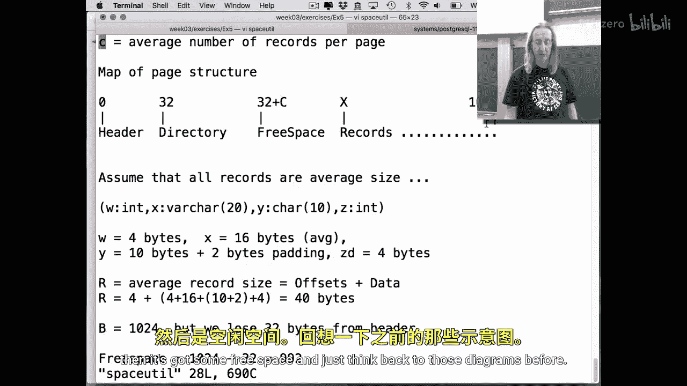