# Postgres数据库实现原理：P10：页面结构与容量计算

在本节课中，我们将学习Postgres中页面（Page）的基本结构，并理解如何计算一个页面能容纳多少条记录（Record）。我们将明确几个核心概念的定义，并通过一个具体的例子来演示容量计算的过程。

## 核心概念澄清

上一节我们介绍了数据在磁盘和内存中的基本组织形式。本节中，我们来看看几个关键术语的准确定义，这对于后续理解至关重要。

*   **记录（Record）**：一个单纯的字节序列。它通常存储在磁盘上，但当一页数据被加载到内存后，记录也指代该页面内特定位置的一个字节序列。公式表示为：`Record = Sequence of Bytes`
*   **元组（Tuple）**：一组允许我们解释记录字节的信息。它可能意味着我们已经从字节中提取出了数据，并得到了一系列对应的属性值。元组具有属性名，且属性值是特定域中的值，而不仅仅是字节序列。因此，**元组是我们在内存中可用的、类似数据库元组的结构**。Postgres对此有明确的区分。
*   **页面（Page）**：磁盘文件中的一个页面的副本。在Postgres中，一个页面的大小是固定的 **8KB**（8192字节）。代码表示为：`PageSize = 8192 bytes`
*   **页面ID（Page ID）**：一个文件内页面的索引。要找到页面的文件偏移量，只需将页面ID乘以页面大小。例如：`FileOffset = PageID * PageSize`
*   **元组ID（Tuple ID / TID）**：一个页面内记录的索引。它是指向页面内目录（Directory）的索引，通过目录项可以找到页面内实际的记录字节。
*   **记录ID（Record ID）**：由页面ID和元组ID组成的一对标识符 `(PageID, TID)`。它告诉我们记录位于哪个页面，以及在该页面内的具体位置，从而可以找到记录字节并将其转换为元组。

为了定位记录，我们访问页面的目录，目录会给出特定记录（即代表元组的字节序列）在页面内的偏移量。

## 页面容量分析

了解了页面的基本构成后，一个自然的问题是：一个页面能容纳多少条记录？这取决于页面大小、记录大小以及页面内部管理结构（如目录）所占用的空间。

显然，记录数量取决于页面大小。一个8KB的页面通常能容纳的记录数量大约是4KB页面的两倍（假设记录大小相同）。记录的大小则由创建表时的定义决定。
以下是几种常见情况：
*   小型记录：约64字节
*   中型记录：几百字节
*   大型记录：约500字节或更大（非常大的记录不会直接存储在数据文件中，后续课程会介绍）。

一个页面除了存储实际数据记录，还包含一些管理信息。主要包括：
1.  **页头（Page Header）**：包含用于管理页面状态的信息（例如，空闲空间指针、页面校验和等）。在我们的示例中，它占用固定空间。
2.  **目录（Slot Directory）**：对于定长记录，可能是一个简单的槽目录；对于变长记录，则是更复杂的目录结构。每个目录项对应一条记录，指向其在页面内的位置。

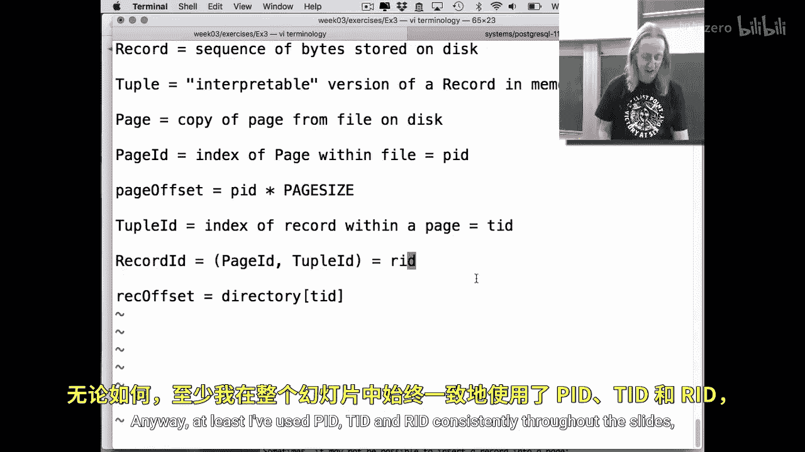

所有这些组成部分（页头、目录、实际记录数据）都必须容纳在页面内。因此，页面的有效容量就是能“堆叠”在页面上的记录数量。

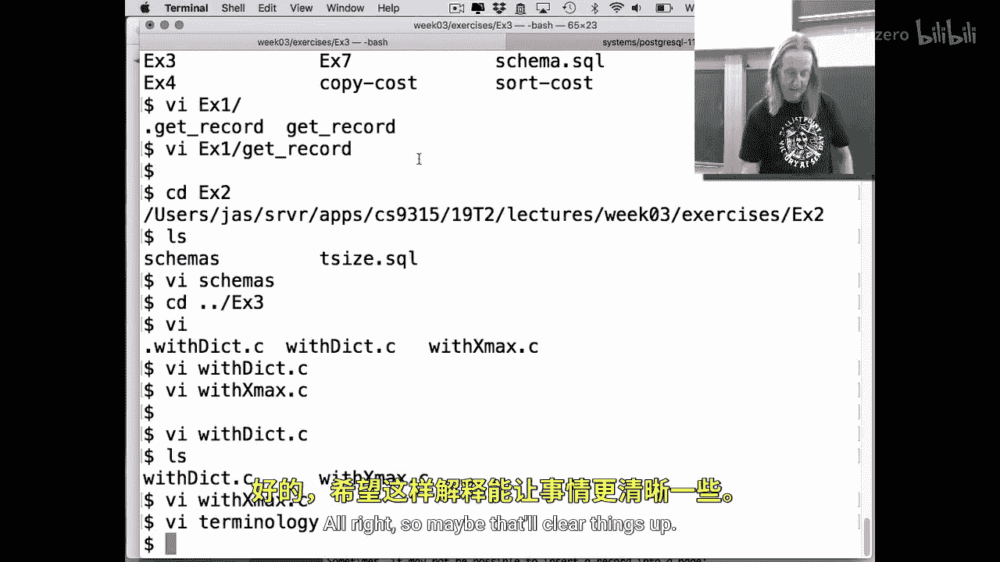

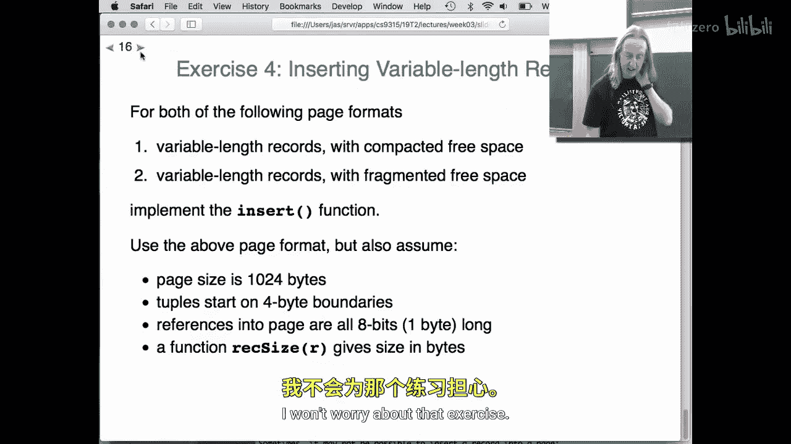

## 容量计算示例

让我们通过一个具体的例子来计算页面容量。假设我们有一个 **1KB（1024字节）** 的页面，并且定义了如下结构的记录：

```sql
CREATE TABLE Example (
    W CHAR(5),
    X VARCHAR(20),
    Y INTEGER,
    Z REAL
);
```

已知条件如下：
*   所有记录按 **4字节边界** 对齐。
*   `W` 字段（CHAR(5)）实际存储可能需要填充到满足对齐要求。
*   `X` 字段（VARCHAR(20)）最大长度为20字节，但平均长度为16字节。为简化计算，我们假设所有`X`字段都恰好为16字节，且不需要为对齐而填充。
*   页面有 **32字节** 的页头信息。
*   初始时页面为空，我们将不断插入元组直到页面填满。

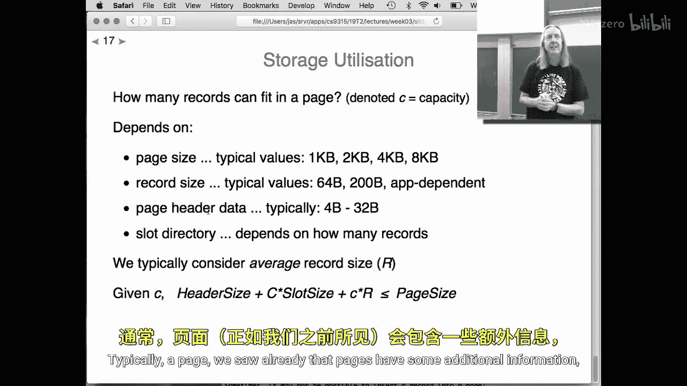

以下是计算页面能容纳多少条记录的过程：

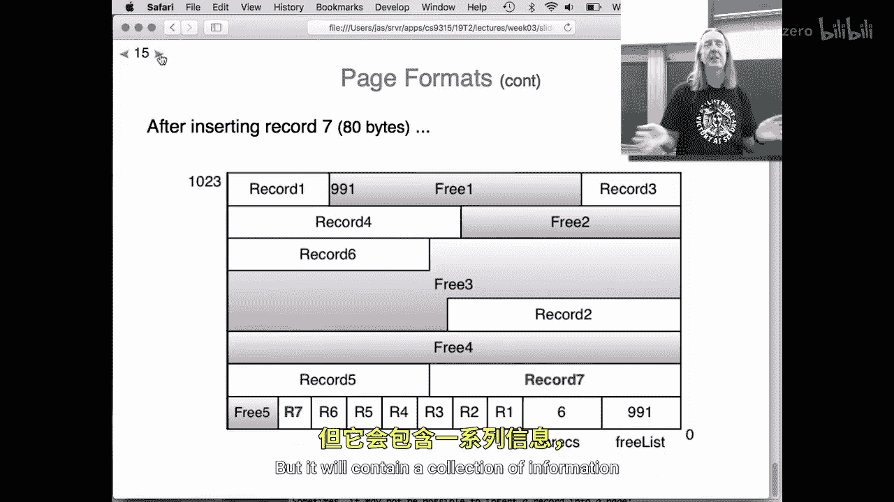

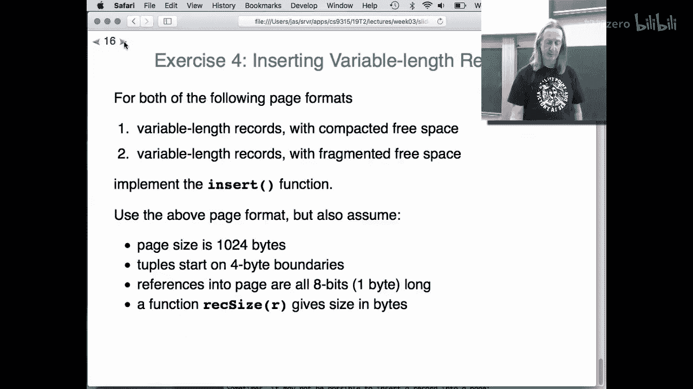

1.  **计算单条记录的大小**：
    *   `W (CHAR(5))`: 5字节，但为了确保下一个字段`Z`从4字节边界开始，需要填充到8字节。
    *   `X (VARCHAR(20))`: 按平均16字节计算。
    *   `Y (INTEGER)`: 4字节。
    *   `Z (REAL)`: 4字节。
    *   单条记录总大小：`8 + 16 + 4 + 4 = 32` 字节。

2.  **计算页面可用于存储记录和目录的总空间**：
    *   页面总大小：1024字节。
    *   减去页头：`1024 - 32 = 992` 字节。

3.  **建立空间方程**：
    设 `n` 为页面能容纳的记录数。
    每条记录占用32字节数据空间，同时需要在目录中有一个对应的条目（假设每个目录项占2字节）。
    因此总占用空间为：`n * 32 + n * 2 = n * 34` 字节。
    这个总占用空间必须小于等于可用的992字节：`n * 34 <= 992`

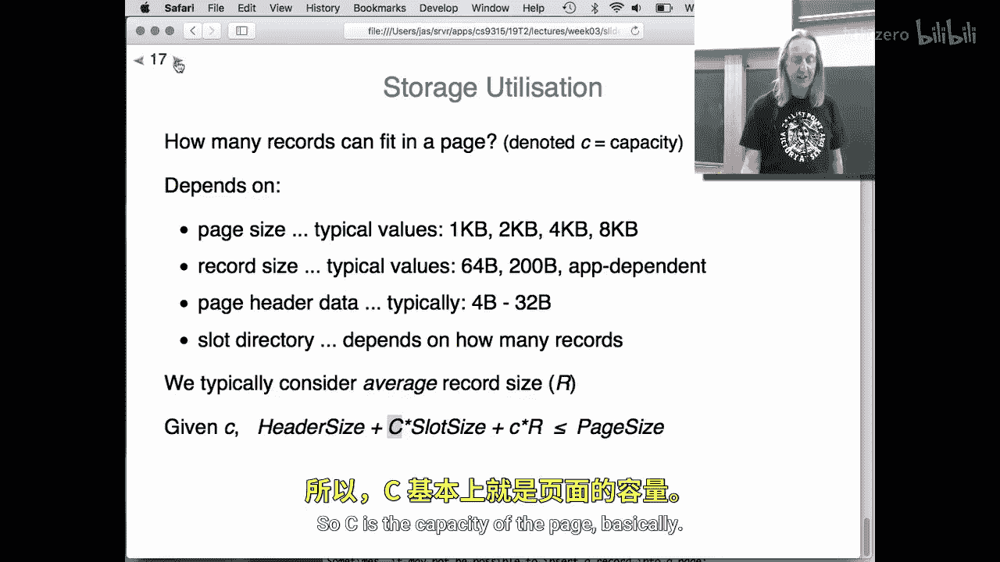

4.  **求解记录数 `n`**：
    *   `n <= 992 / 34 ≈ 29.17`
    *   因此，最大整数 `n = 29`。

**结论**：这个1KB的页面最多可以容纳 **29** 条给定结构的记录。

## 页面布局图示

最后，我们通过一个简单的图示来回顾页面的典型布局，这有助于直观理解上述计算：

```
+-----------------------+
|     Page Header       | (32 bytes)
+-----------------------+
|   Slot Directory      | (n * 2 bytes)
+-----------------------+
|      Free Space       |
+-----------------------+
|   Stored Record 1     |
+-----------------------+
|   Stored Record 2     |
+-----------------------+
|         ...           |
+-----------------------+
|   Stored Record n     |
+-----------------------+
```
*(图示：页面从上到下依次为页头、目录、空闲空间和存储的记录)*

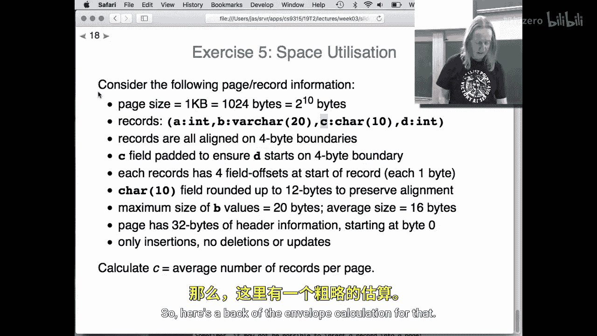

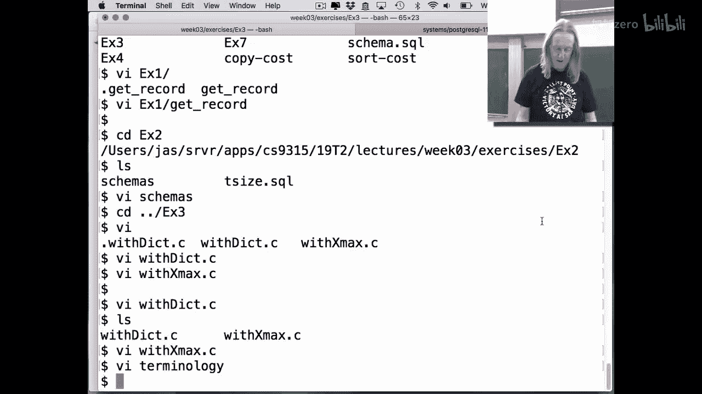

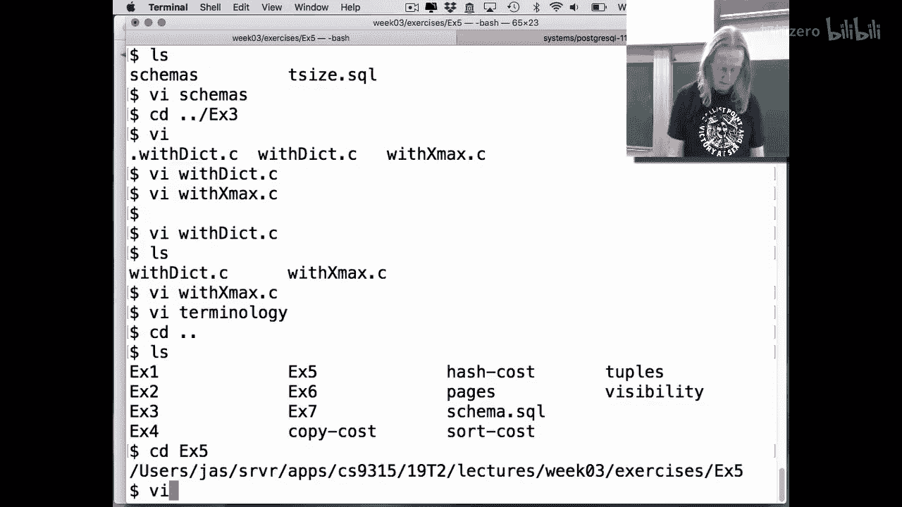

---

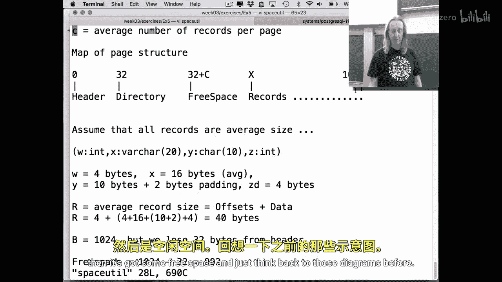

本节课中我们一起学习了Postgres中页面、记录、元组等核心概念的准确定义，并深入分析了页面的内部结构。通过一个具体的计算示例，我们掌握了如何根据记录大小、对齐方式和页面管理开销来计算一个页面的数据容量。理解这些基础知识对于后续学习数据存储、索引和查询优化至关重要。