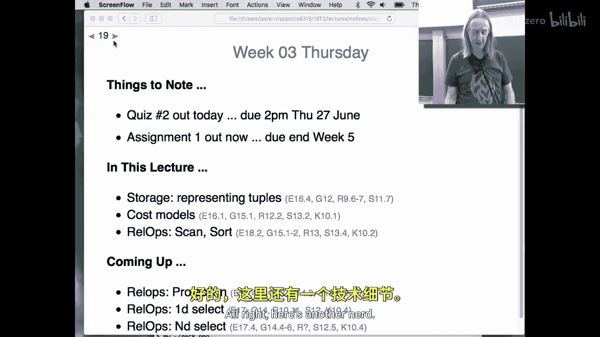
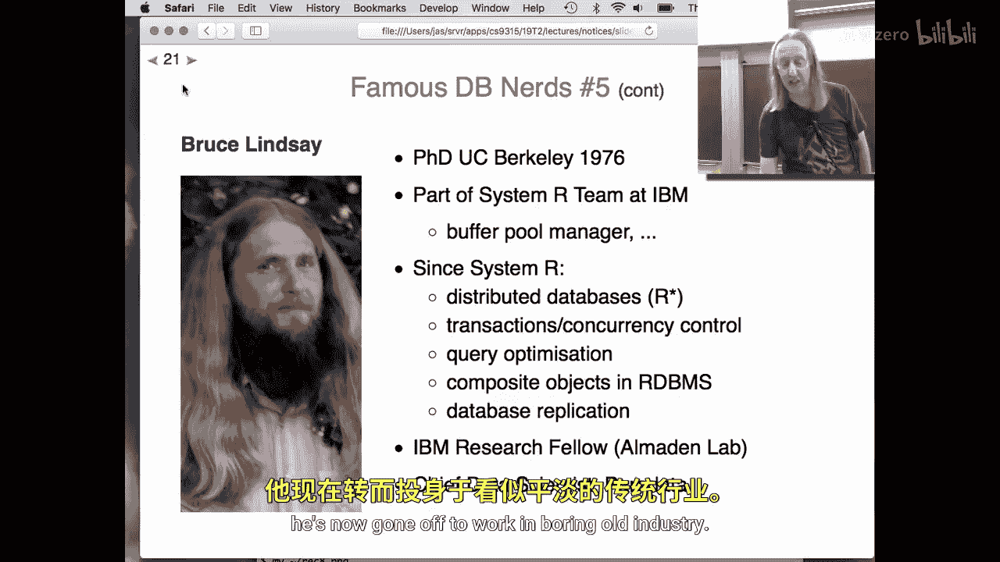
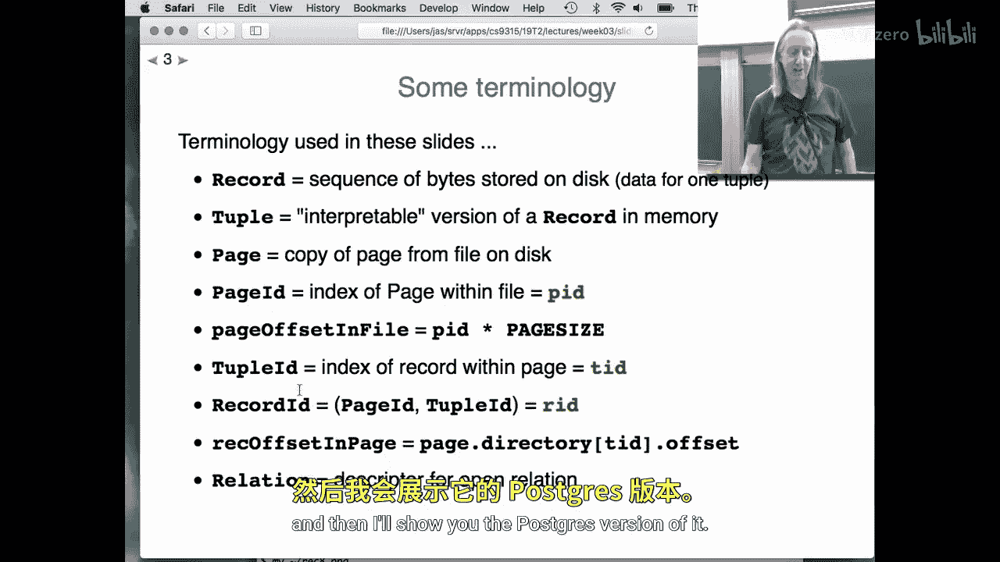
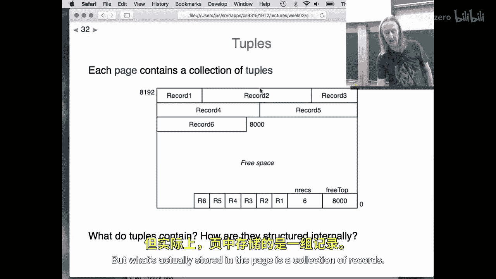
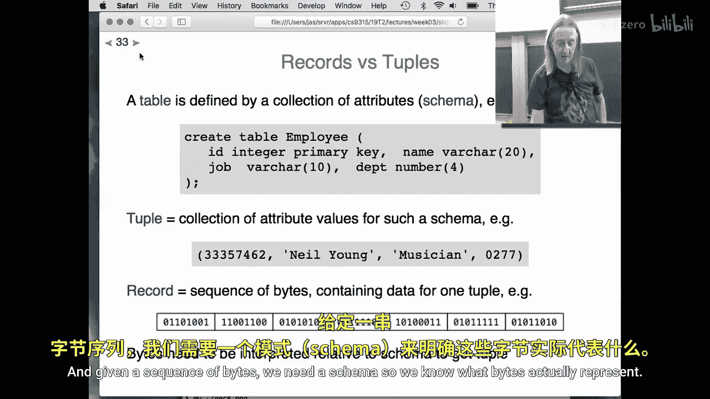
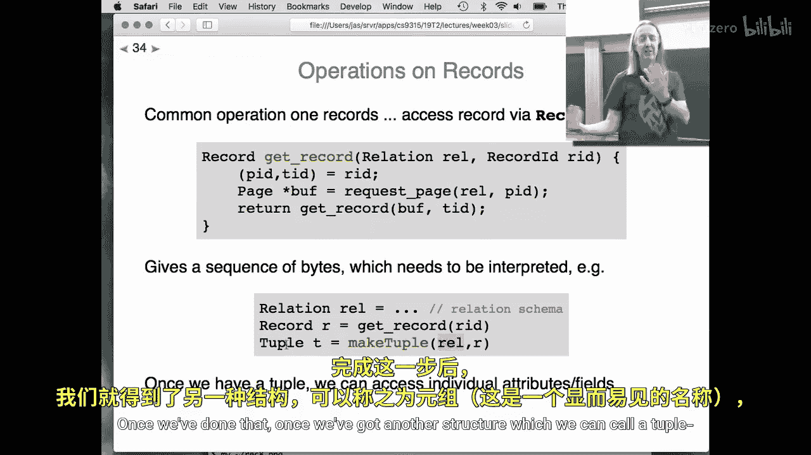

# 新南威尔士大学【中英⚡Postgres数据库实现原理｜COMP9315 2018 Postgres Implementation】 p11 P11 -BV1qXoqYHErC_p11-

Yesterday's terminology debacle was so bad that everyone decided not to turn up in。そ。O文。

Was made a mark。All right， so quizzes， like I said。

 they'll appear after the Thursday lecture and they'll be due just before the lecture next Thursday。

So it's ready to go。 So it's out to the end of week 5。

And today we'll continue with that storage stuff。Definitely want to get that out of the way this week。

 and then get onto。Looking at how we implement relational operations in DPM missile。

Right， here's another nerd。Every time I put that up to undergraduates， well。

 there was a different picture of it that I used to use and they'd say， oh， that's you。

I don't know why doesn't look anything like me anymore I' never had a beard that long anyway。

 but this guy is extremely well known in database research community and alsohaha there must be something about。

😊，在。He was also part of that team at IBM that developed the first。

For a prototype relational database systems， So his name's Bruce Lindsay。

He did the buffer pool manager， should ring a bell from last week。

 we talked about the buffer pool so he implemented the original buffer pool for SystemA since then he's gone on to work in a whole lot of different kind of areas working his way up and became quite senior at IBM。

And I just noticed on his LinkedIn profile today， that his。

Now moved to be the chief data scientist of para datata。

Which seems to be some kind of supply chain analysis。😔，Company data mining。So he's gone on， I guess。

 two bigger and better things or maybe this is his retirement plan。

 having spent all our time at IBM working on interesting stuff he's now gone off to work in boring old industry。

Alright， let us。私人。乜嘢。I finally noticed yesterday。😊。

So this has been saying Tuesday and Thursday the whole time， why didn't someone point that out to me？

Takes me a while to notice these things When you see stuff that's wrong on the slides。

 let me know and I'll fix it because I don't want errors to propagate endlessly anyway。

 so nowll fix it and oh。😊，all right， so one thing I want to quickly talk about。

 I went to slides last night checking for all occurrences of these kinds of words and hopefully I've made everything consistent。

😊，I thought about this last night and I was thinking。

 well if I did all this stuff consistently and if I kept using the same function names。

 always with the same arguments， eventually we could build up a library of all these different functions to do all these different tasks and we can put them all together and we'd have a little DBMS。

😊，Well very did， but probably too late to do that now。And in any case。

 we want to have a look at a real， real， full scale。

 ugly hideous DBMS that has to deal with things actually， the source code for Postgre is pretty good。

😊，Compared to some other systems I've seen right so we've got a record which is just a sequence of bytes that's the stuff that we actually store on the disc to as an ondi representation of a tuple if you like so it's just a sequence of bitetes if we took that sequence of bytes and just looked at it we wouldn't have a clue what it was we have to interpret it in the context of a relation so we know that you know this first part represents the student ID the second bit represents a student a second part which is a few bytes represents a student name and so on so it has to be interpreted in the context of a relation。

So records exist are the stuff we write out to disk the bite sequences that goes on to the disk there are also stuff that gets read into memory and they live in the page buffers so we'll get page already in a block of data that will contain some B sequences that are records which we would then like to interpret as tuples。

And that's what we'll be talking about in the first part today。

 so our page is just a chunk of bikes red from the disk。Pr J is an index。Into the page。

 dictionary or directory。From which we can then go to the location。

In the page that contains that particular regular， the redwood with P， ID P。

 and then we can deal with that。And we looked at a few ways of how we can represent data within pages yesterday if we want to get a page of sorry。

Pid is the index of a page， not the index of a record within a page。

 That's what I was just talking about。 All right， So page Id。Is。

A number which tells us which particular page in the file we're talking about。

Eventually we have to go and read that page， so we'll have to see to the right location in the file and to work that hour we simply take the page I and multi by the size of pages。

And then we can do an Lse with that page offset value and then do a read of a chunk of page size data。

From。The fire double IDd index of record within page gives an index to the directory in the page and from there we can work out whether。

Record information leaves。A record ID has a page ID and a double ID so we know where to go to get the page of data and remember even though we have record IDs。

 we can't just say go straight to the place on disk where this record lives and just fetch that record data it's not the way it works we have to read a whole page of data but if we know the page ID where the record resides and we read the appropriate page and we can find where it is where the record live within the page we can compute that from the directory。

And we've got this magic data type that I just ched in and I could have sworn that I talked about this data type somewhere else in the slides。

 but I didn't find it anyway， but we can never look at it today briefly and then I'll show you the Postgres version。

A a relation。All right， so let's go here。Right so what we looked at yesterday was how we laid data out within a page remember page just8k bytes and we want to interpret this collection of by here as a particular record and that's another record that's another record and so on right that's all very nice we know that we've got a sequence of bytes here that corresponds to a topple。

We need to know how to interpret that so its a sequence bytes。

 what do the first four bytes represent， what do the next 10 bytes represent and so on and so on。

What exactly is stored in that sequence of bias？So here I've said a page contains a collection of tuples。

 that's true。But what's actually stored in the page is a collection of records。

 but we want to interpret those records as tops。

All right， so it's difference between a tuple and a record okay tubble is a conceptual thing。

 a record is just sequence of bias。And given a sequence of bites。

 we need a schema so we know what bites actually represent。

Alright。Common operation there's a typo straight away， what's that common operation on record。

 access to record via record ID to do that as I said a couple of minutes ago we have to go fetch the page containing that record and then we can scan through the page or we can call a function called get record that will give us the byte sequence that we wanted。

If we want to do anything useful with that in the context of a WMS。

 we need to be able to interpret this bike sequence as a collection of attribute values and make trouble is the thing that we're going to take。

A sequence of bytes an interpreter relative to a relation once we've done that once we've got another structure which we can call a tuple。

 that's an obvious name to call it。

We can then start。