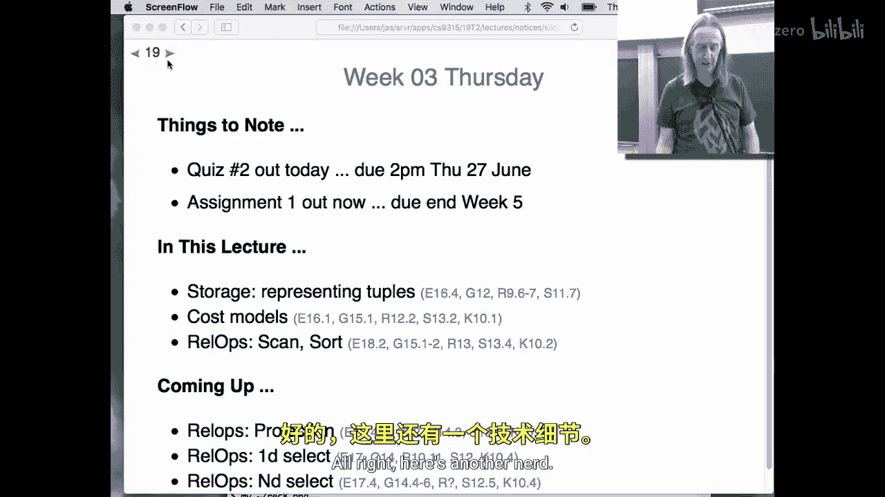
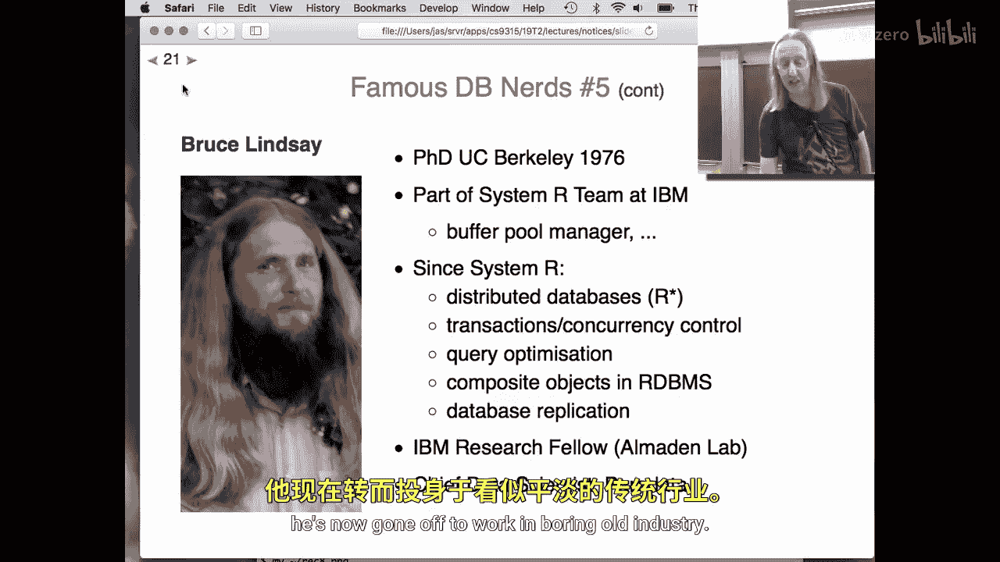
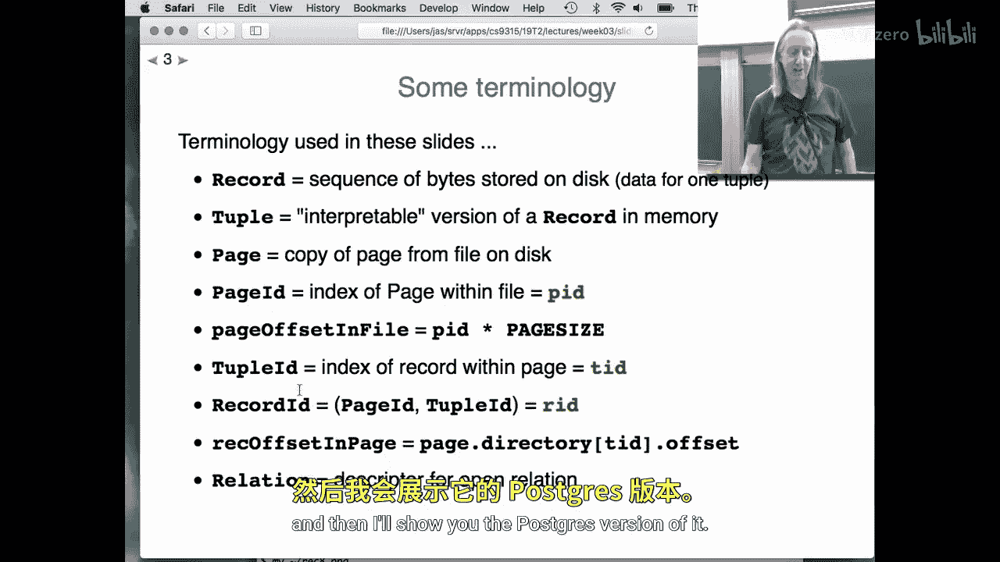
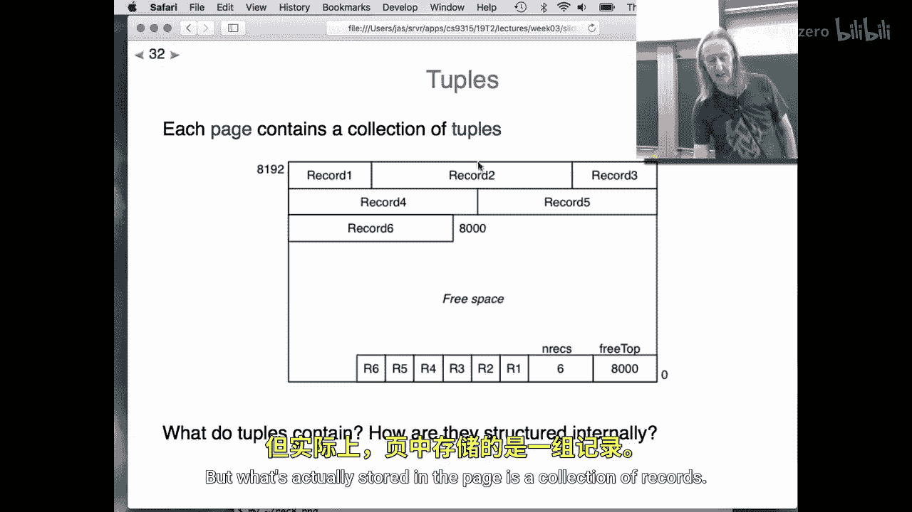
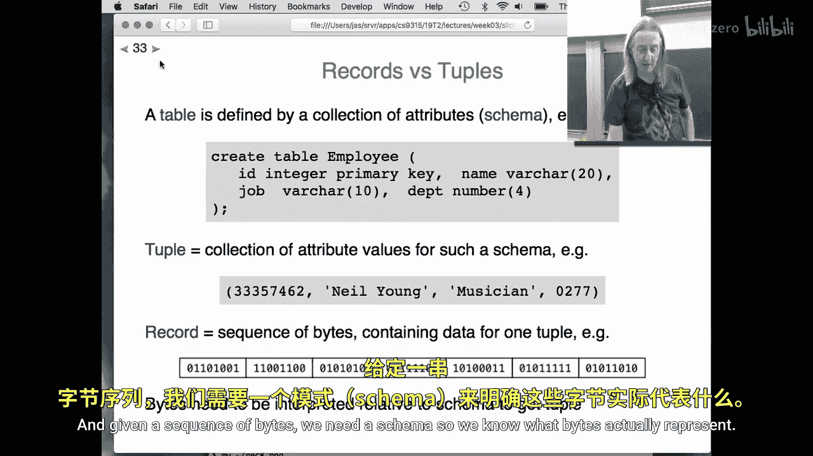
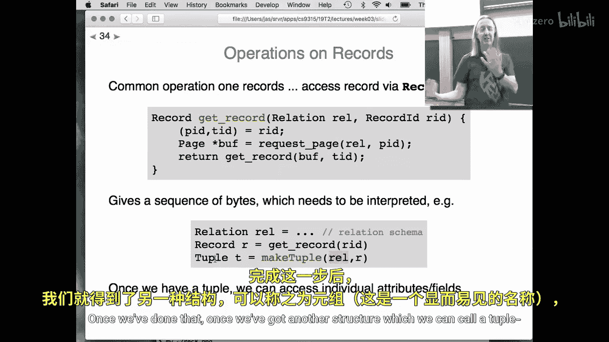

# Postgres数据库实现原理：P11：记录与元组

在本节课中，我们将继续探讨数据库存储的核心概念，重点区分“记录”与“元组”这两个关键术语，并学习如何将磁盘上的字节序列解释为有意义的数据库数据。

上一节我们介绍了页面（Page）的基本结构和记录ID（Record ID）的构成。本节中，我们来看看存储在页面中的具体数据——记录（Record），以及如何将其转换为程序可操作的元组（Tuple）。

---

## 记录 vs. 元组

首先，我们需要明确两个核心概念的区别：
*   **记录（Record）**：存储在磁盘页面中的**原始字节序列**。它本身只是一串 `0` 和 `1`，没有内在含义。
*   **元组（Tuple）**：在内存中，根据**关系模式（Schema）** 对记录字节序列进行解释后得到的数据结构。它包含了具体的属性值（如学生ID、姓名等）。

简单来说，**记录是物理存储，元组是逻辑视图**。要从记录得到元组，必须依据关系模式进行“解码”。

---

## 记录操作：通过ID访问

对记录最常见的操作是通过其 **记录ID（Record ID）** 进行访问。记录ID通常由 **页面ID（Page ID）** 和 **槽位ID（Slot ID）** 组成。

访问一个记录的流程如下：
1.  根据记录ID中的 **页面ID**，计算该页面在文件中的偏移量：`offset = page_id * PAGE_SIZE`。
2.  通过系统调用（如 `lseek` 和 `read`）将整个页面数据读入内存的缓冲区。
3.  根据记录ID中的 **槽位ID**，在页面的**目录（Directory）** 中找到对应条目，从而定位记录在该页面内的具体起始位置和长度。
4.  调用类似 `get_record()` 的函数，获取该位置的字节序列（即记录）。

需要注意的是，数据库管理系统（DBMS）总是以**页面**为单位进行磁盘I/O，无法直接读取单个记录。

---

## 从记录到元组

获取到记录的字节序列后，DBMS需要根据已知的关系模式将其转换为元组。

以下是转换过程的简要说明：
*   模式定义了每个属性的**数据类型**、**长度**和**顺序**。
*   例如，对于一个 `Students(id INTEGER, name CHAR(20))` 的关系，DBMS知道记录的前4个字节是整数类型的ID，后续20个字节是定长字符串类型的姓名。
*   通过这种解释，原始的字节流就被赋予了意义，变成了一个包含具体属性值的元组数据结构。

一旦获得了元组，DBMS就可以在其上执行各种关系操作，如选择、投影和连接。

---

## 总结

本节课中我们一起学习了：
1.  **记录（Record）** 是存储在磁盘上的原始字节序列。
2.  **元组（Tuple）** 是依据关系模式对记录解释后得到的内存数据结构。
3.  通过**记录ID**访问记录需要先读取整个页面，再利用页面内的目录定位。
4.  核心的转换过程是：**磁盘页面 -> 记录（字节流）->（根据模式解释）-> 元组（数据结构）**。

理解记录与元组的区别及其转换过程，是理解数据库存储层如何工作的基础。下一节，我们将开始探讨如何在这样的存储模型上实现具体的关系代数操作。