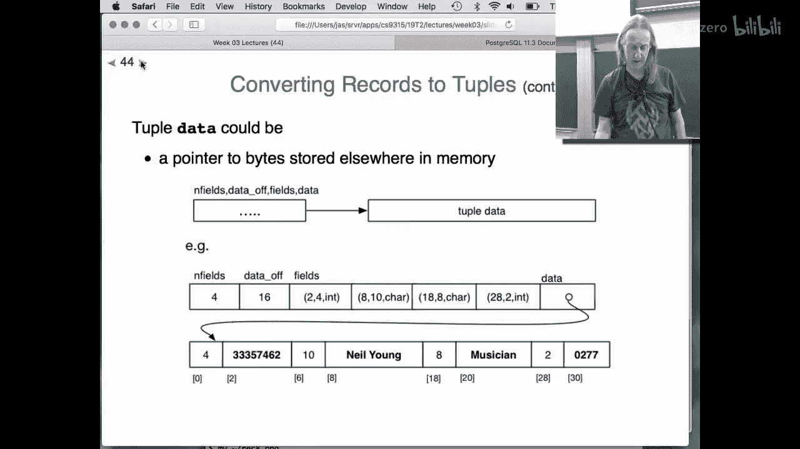
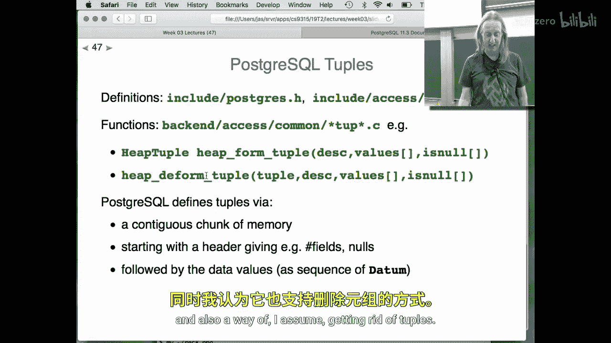
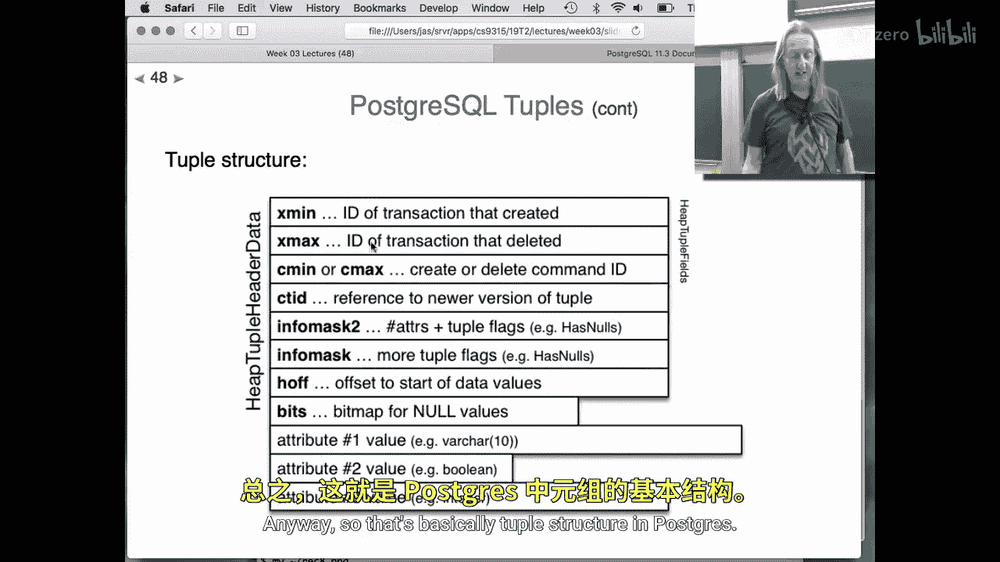
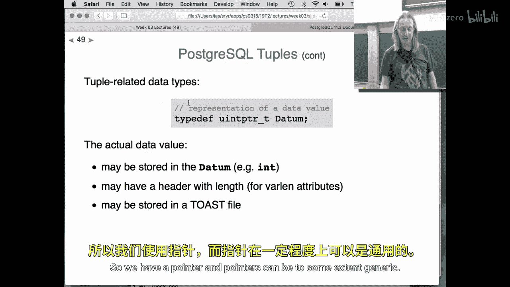
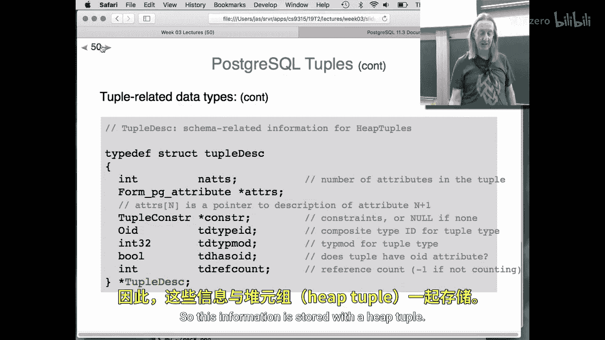
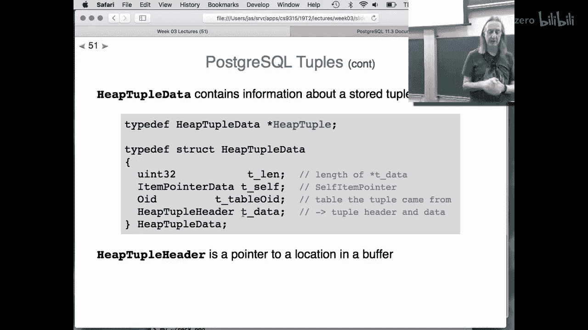
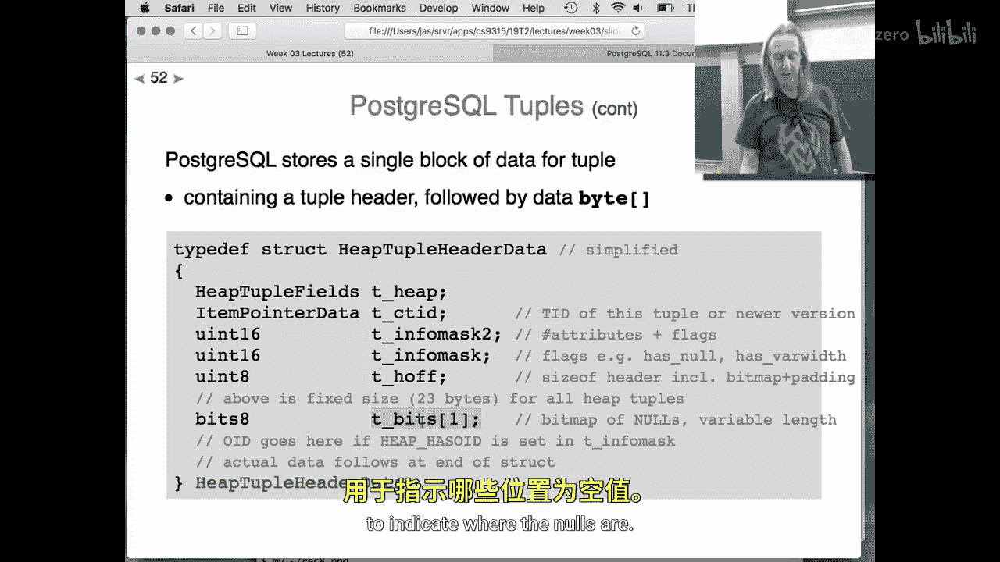
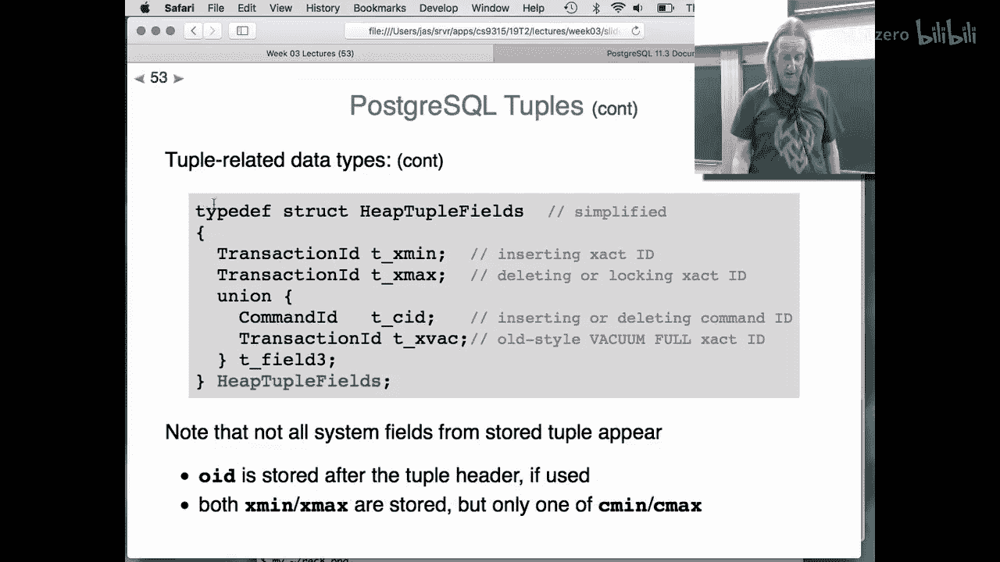
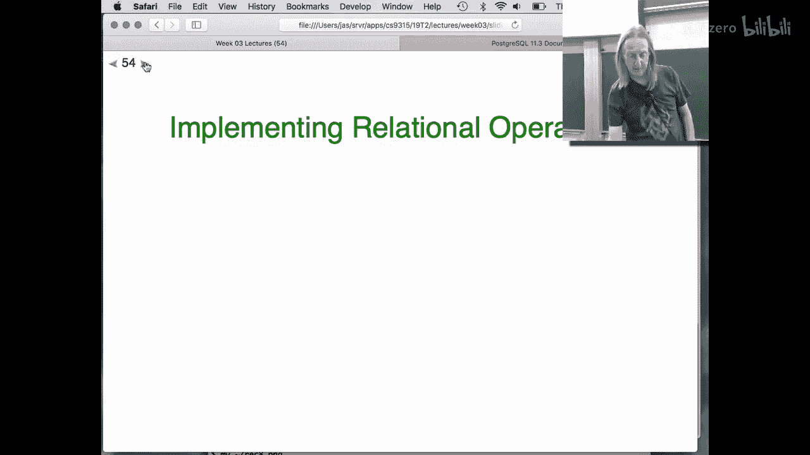

# 新南威尔士大学【中英⚡Postgres数据库实现原理｜COMP9315 2018 Postgres Implementation】 p12 P12 -BV1qXoqYHErC_p12-

All right， thank you for pointing out a bug on this slide。Where。

The offset for the start of musician is not 18， it's 20 and the offset for this is should be 30。

 so I'll fix them on the diagram。系啊。And I'll have to redo the Pd and all that kind of stuff。

That will appear oh yeah， the other thing too， if the videos don't appear by midday on the day following the lecture。

Just prod me because sometimes I forget。 I forgot to upload the videos this morning until。我整啊慢你 call。

Yesterday， it's video。

let me see what are we up to。 blah， blah， blah。 yeah， Postgre tu。 So I told postgre。

 I'm going go really fast over this postgre that's got a function to create tubbles kind of analogous to our make tuple thing and also。

A way of， I assume， getting rid of tuples。

Don't know why you want to deform a couple is。Basically， what。

So Postgres calls flat files or you know， a sequence of pages or each page contains tus。

 they call it a heap。And then the tus in a heap are called heap tus， what a surprise and。

That's the kind of information that they contain。没我 me say呀。And this weird tuple。

 once we've got the object loaded into Postgres and we're starting to use it。

 so remember that we've got these fake out or these pseudo attributes like OID and Xme and X max。

 they're represented as part of the tuple headed data so you can see them OID is not actually there because it's stored somewhere else。

诶。So when you're creating tus， there's a notion that got they're created in the context of a transaction。

 the transaction consists of a sequence of SL statements which they call commands in Postgres so you're created within a transaction by a particular command。

 so that's what these things are all about。开桥啊。Yeah it's interesting why do they keep X min and X max because they only keep one of the Cmen and Cm so you don't really care once the tu's deleted C min is kind of irrelevant。

So， Cm is。With stored there， tuples， if you update a tuple， as I've said a couple of times。

 it doesn't。Change it in place， it makes a new tuple that looks like the old one except with the update included when it does that。

 it actually links the two tuples together so that the old tuple will contain a reference to the newer version of the tuple。

系后。Then we need to know how many attributes the tuple has and then there's a whole bunch of flags including things like hayze nulls。

 that doesn't actually as far as I I going to know tell you where the nullles are。

 it simply tells you that this tuple contains null values so you have to process it slightly differently。

 that's what tells you where the nullles are， is a bit map。So just sequence of bits。

 if the first bid is set to one， that means the first attribute is null and things like that。

If hesnels is falses。Then the tuple doesn't have any nulls and we don't need to have a beat map。

 so the tuple structure would change based on that。

And because you don't know how long the bitmap is or the bitmap can be different sizes depending on the number of attributes。

 we need to know where the data values actually start， they start at the end of the bitstream。

 but this ho thing tells us。Actually film was called height underscore score off。Maybe。

Don't know what I school anyway， so that。Bas with topple structure in Postgre。

Daatum is the lowest level value kind of thing and I guess given that a datum could be a string。

 could be an new dig， could be a float。We don't actually， we have to。

 we can't just have a generic data time， so we have a pointer and pointers can be to some extent generic。

Oh see， what have we got here。Yes， so。Remember we had field desk。Well， here we've got tuble disc。

Which gives us an overview of what's contained in the tuple。References to the catalog data。

 some of this information that's been extracted from the catalogue and is stored here。Well。

 it's interesting， obviously we need to keep count the number of attributes and so on and so this information is stored with a heap。

七保。Where a hate tellho。Like I had on those previous examples， the previous stuff was mine。

 this was Postgress， but I tried to copy the style a little bit。诶。

A heat tuple has this kind of information starts with length， you know the total size of the data。

 I don't know what the point of a self item pointer is。

 here's where the OI oh sorry this is what table the tuple came from。

So that's potentially useful and the heat tuple header。Is。Actually， a pointer to。A buffer。

 so all their tus eventually end up being one of the buffer pool buffers。

So the heat tu header actually lives in the buffer with the rest of the data。

And this is the kind of stuff that we saw on an earlier slide so the CTID hidden inside the heat double fields with thex min and the X max。

the CMmax field so you can see I've got structuress within instructors within instructors and some of the things are actually pointers to other structures can get a little bit confusing and here we see an example of a bitstream。

Or of one of these arbitrary length arrays， so we don't know exactly how long this is going to be。

Interesting， I suppose all of the tuples that we've looked at have it， you know，3 or four attributes。

 So we're only going to have a single8 bit thing there， but potentially， I've seen。

Seeeen examples with hundreds of attributes in a tuple and so the bit stream to indicate which of those attributes in could be hundreds of bits long so。

So the way Hogre does that it says， all， I'm going to allocate one of these he tu header data structures and I'm going to allocate 10 times as much space as the header actually needs and all of this stuff at the end is going to form part of this bid string。

To indicate where k nulls are。

What else。And the heat tuple header field that we saw， So we got the x min， the X max and。In fact。

 it's slightly different to what I had before not quite no no it's not true。

 the C ID the command ID is either the CMing value or the CMX value depending on whether the tus deleted or not。

Or。Can potentially tell us something about the state relative to vacuuming。

 so whether this tuple' has been deleted or not so in any case this third field in our heat tuple fields is just a single value which we can interpret in a number of different ways。

我说。So there's an extremely brief view of Postgreed tuple structures go to the source code if you want to see the excruciating detail and have a look at the documentation as well。

All right， next topic。So。😊。