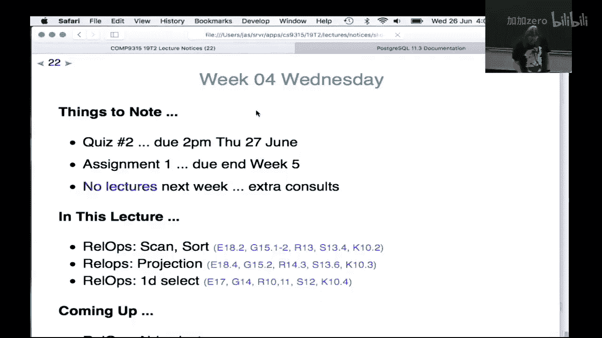
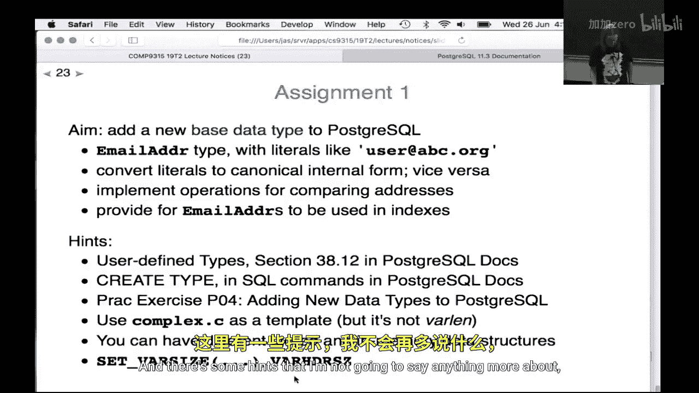
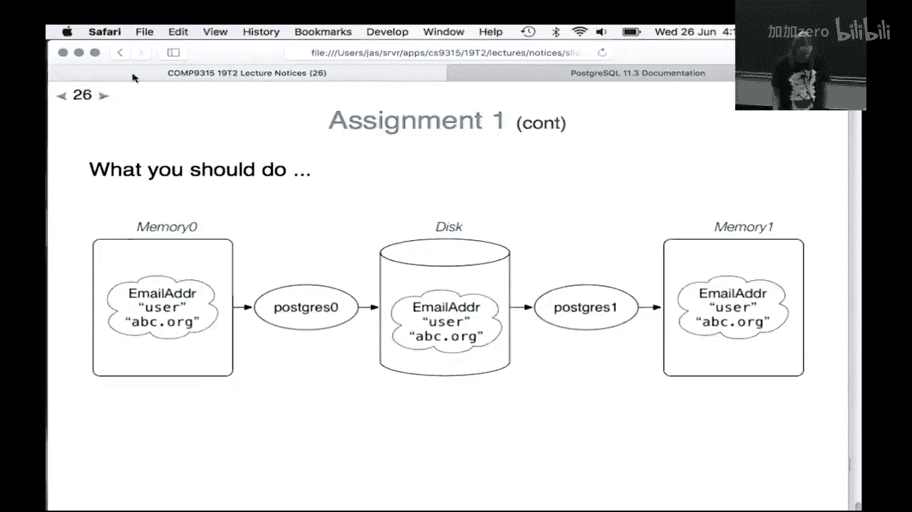
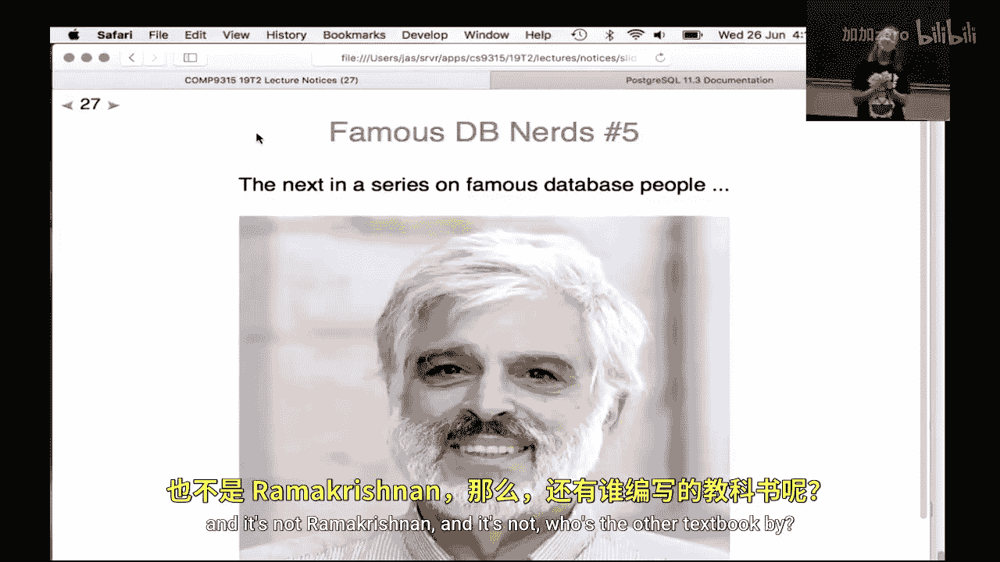

# 新南威尔士大学【中英⚡Postgres数据库实现原理｜COMP9315 2018 Postgres Implementation】 p13 P13 -BV1qXoqYHErC_p13-

Right， so zz， quiz number two has been out since last Thursday， if you hadn't noticed。

 you look at that little right hand barring web CMMS on the front page。

 it'll tell you things that are due and it's due before tomorrow is a lecture。🤢，Simement one。

 which I'm sure you're all working on， plenty of people have sent me questions。😊。

That's due at the end of next week and to give you extra time to work on it， no lectures next week。

 this is your midterm break wow， who says you're going to get a midterm break under。😊。

Even is W3 plus。嗯。All right， yeah， so since there are no lectures and since you're doing an assignment。

 it would make sense to have extra consultation to homes。

 they probably won't be at the normal times because I'm busy on Tuesday and Wednesday。😊。

We've got some people coming up from Melbourne。But I'll put them on the website when。

 when the actual consultations， I'm pretty sure I've already。Mark went in for Monday。

 and maybe another one for Thursday。 and I'll see if I can find some time on Tuesday and Wednesday。

Assignment 1。Just thought I'd have a little。Talk about that because I've been getting a few questions。

 some of which are absolute classics that every time we run a make a new data type in Postgres。

 we get the same question because people don't quite get what's going on in the memory or at the memory level All right。

 so obviously you've got to make a new data type called email address， email address。😊。

Somewhere in your email do source file is going to be a create type email adder with some。Parameters。

You can get by with exactly three parameters you don't need。

Dozens who don't need to stress about storage type and things like that。😔。

Doesn't really come into it。 So basically， the deal is for defining any data type in Postgres。

 you've got to write something that will take a string and convert it into some internal form and that form。

Should be a storeorable form， which a few people have fallen for the trick that I'll show you in a minute。

Once you've got it into some sort of internal form。

And the storeorable form in the internal form don't have to be the same at all。

 And it's probably convenient， if they're not。Especially when it comes to implementing the operations for doing dress comparison。

And also， you have to set things up once again， a little bit of work in email dot source to make it indexable and。

Simply creating the comparison operators helps with that as well， so。

Here's I look at this giant list of hints I've given you too many Anyway。

 have a look at the section on user to find data types in the Postgres doc。

 have a look at the create type SQL command that will tell you everything you need to know about all the parameters for create type。

😊，The PraC exercise get to just to install an existing provided data type， which may be helpful。

That data types a complex number， which is basically just two ins use that just as a template。

 one way it's significantly different from this exercise is that the structure is eight bytes always。

It's not variable links like email addresses。That changes how you have to store it。

 like I said before， you can have different stored new memory data structures。And。

These are some hints that I'm not going to say anything more about。

 but you will understand why they're important soon。

So basically and you have to write two core functions once you get them going。

 you can store email addresses in the database and then get them out again。

Email underscore in takes a string and converts it into。Your， your stored format for email addresses。

 which。Could be just a string。Just like that。 You can store it in the form You read it in。

 But one thing， even if you do that， you need to check that it's a valid email address because all of the。

Input functions for all data types always check that whatever you're feeding in looks like a valid value for the type。

Email outtakes the stored representation of an email address。

 converts it back to the printable representation canonical form。

If you want to convert everything to lowercase， you when you store it， that's fine。

And then you've got to write a whole lot of comparison operations that take two email addresses and tell you true false。

 you know whether it's less than， whether the first is less than a second， blah， blah， blah。

 So that's essentially what you have to do as far as writing functions go。He's a mistake that。

Heaps of people make every time we run an assignment like this。They will build a structure in memory。

Part of that structure will be two pointers。That point to strings that have been allocated in memory。

 And for doing allocation with post screen， use's the Poc function。Which is postgressors。

Alllocate Postgressorors's version of malloc。So if you create something like this。

 you've got this data structure。It contains， I don't know what else you might want to put in it。

 but certainly， you have two pointers pointing to the components of the email address。If you do that。

😊，And you don't have to worry about writing stuff to the database。

 What you're gonna to do is produce one of these functions。

 And the rest of Postgres will take this object and stick it in a file。

If you stick this particular object in a file， its contents are pointers to these structures in memory。

 And when you store it on the disk。You've still got those pointers to those structures in memory。

Those structures may or may not exist until this process finishes。

 but they certainly won't exist next time you run a Postgres server。And you load this thing up。

 it contains two pointers， but they're pointers that were only relevant back in this context。

 So you've just got effectively got rubbish。 if you do if you've got rubbish pointers and if you do that。

 you bound to crash your Postgres server。 if you try to do stuff with that。 So don't fall for that。

Tp。Happens every time。 And I've already had a couple of questions that basically indicate people have done things that way。

 So what you have to do， you have to build an object that actually contains the two components of the email address。

And men store that on the disk， so you've got the data value stored in the object and when a subsequent Postgrels server reads the object back。

ha ha you can extract the data values from that object and to whatever you need to do。😊，So。

Any questions。 And don't ask the question。 My server crashes when I run。And I try to test it。

It's pretty pointless asking00 people if any one of them has a particular problem。

 because you're not going to make it。I'm not going to be able to answer here。

 Come along to consultation or ask on。The message board on the forum don't say my server doesn't work。

That's totally useless how am I supposed to give you any help。At least tell me what you're doing。

 if you want to give me code， don't post it on the forum。 S it in email。All right。

 But don't fall for that trap。 Some people already have。Now， you should know not to。

Allright， so that's that。 Another famous database person。 anybody know。If you。Look at the textbooks。

 there's a clue。And it's not El Meri。And it's not。Ramakrishnan。And it's not。

Here's the other textbook goodbye by， It's not Jennifer Wiham， obviously， but he is from Stanford。

