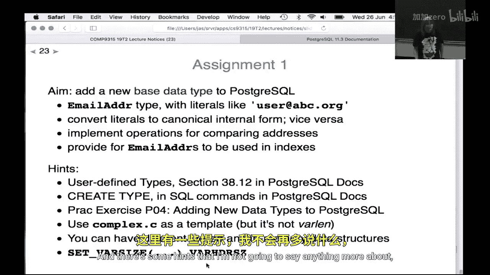
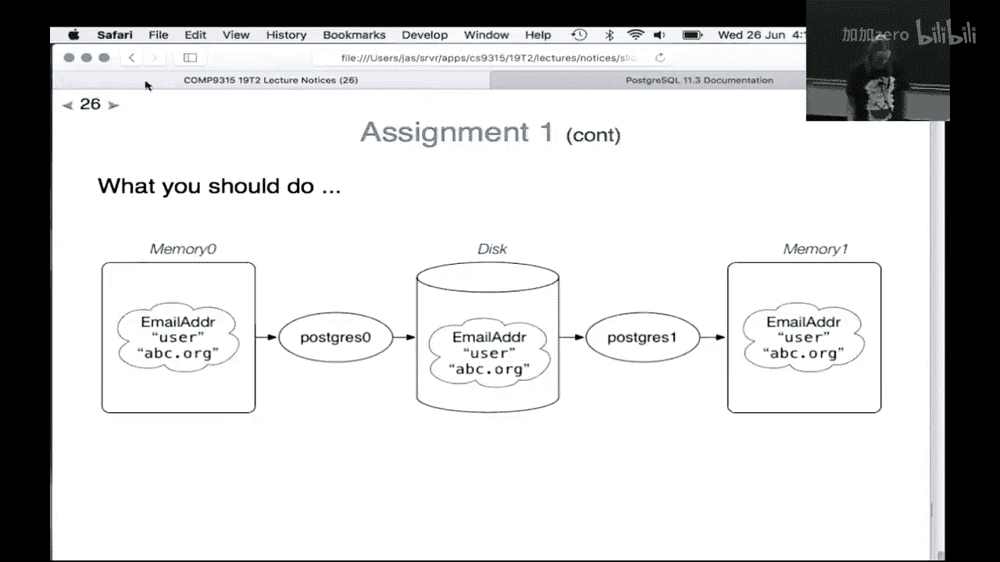

# COMP9315 2018 Postgres实现原理：P13：作业1详解与常见陷阱

在本节课中，我们将详细讲解作业1（Assignment 1）的要求，并重点分析一个在实现自定义数据类型时常见的、可能导致服务器崩溃的陷阱。理解这些概念对于成功完成作业至关重要。

## 作业概览与时间安排


上一节我们介绍了课程的基本结构，本节中我们来看看当前的学习任务安排。

*   第二份测验已于上周四发布。
*   作业1（Assignment 1）将于下周结束前截止。
*   下周是期中假期，没有课程安排。为了给大家更多时间完成作业，将安排额外的答疑时间。具体时间会发布在课程网站上。

## 作业1核心任务：实现Email地址数据类型

作业的核心目标是**在Postgres中创建一个名为`emailaddr`的新数据类型**。这涉及到在源代码文件中使用`CREATE TYPE`命令，并为其实现必要的函数。

以下是实现此数据类型需要完成的关键步骤：

1.  **定义类型**：使用`CREATE TYPE`命令，通常只需要三个参数即可，无需过度关注存储类型等复杂选项。
2.  **实现输入/输出函数**：
    *   `email_in`：接收一个字符串，将其转换为内部存储格式。此函数**必须验证输入是否为有效的电子邮件地址**。
    *   `email_out`：将内部存储格式转换回可打印的规范形式（例如，可以选择统一转换为小写后存储）。
3.  **实现比较操作符**：编写一系列函数来比较两个`emailaddr`值（如小于、等于、大于），这是使该类型可被索引的基础。

为了帮助你理解，可以参考PostgreSQL官方文档中关于“用户定义数据类型”的部分以及`CREATE TYPE`命令的说明。此外，实践练习（Prac Exercise）中安装现有复数数据类型的例子也可作为模板，但需注意其存储结构是固定长度（8字节），而电子邮件地址是可变长度的，这会影响存储方式。



## 关键陷阱：内存指针与持久化存储

在实现`email_in`函数时，一个极其常见且严重的错误与**内存中数据结构的持久化**有关。许多学生每年都会掉入这个陷阱。

**错误做法示例**：
假设你在内存中定义了一个结构体来表示电子邮件地址，其中包含两个指向字符串（如本地部分和域名）的指针。

```c
typedef struct {
    char *local_part;  // 指向动态分配内存的指针
    char *domain;      // 指向动态分配内存的指针
} EmailAddr;
```

当你使用`palloc`（Postgres的内存分配器）创建这样一个对象并让`email_in`函数返回它时，Postgres会尝试将这个对象写入磁盘。

**问题在于**：写入磁盘的不仅是结构体本身，还包括那两个**指针的值（即内存地址）**。这些内存地址仅在当前服务器进程的上下文中有效。当Postgres服务器重启后再次从磁盘读取这条记录时，结构体里的指针指向的是无效的、随机的内存位置。任何尝试使用这些“垃圾指针”的操作都极有可能导致Postgres服务器崩溃。

**正确做法**：
你必须构建一个**自包含的（self-contained）** 对象，使其内部直接存储电子邮件地址的各个组成部分（例如，使用字符数组而不是指针），而不仅仅是指向它们的引用。

```c
typedef struct {
    char local_part[MAX_LEN];
    char domain[MAX_LEN];
} EmailAddr;
```

这样，当这个对象被写入磁盘再读回时，所有必要的数据都完整地包含在对象内部，可以安全地重新使用。

## 总结与求助指南

本节课中我们一起学习了作业1的具体要求，并深入剖析了实现自定义Postgres数据类型时一个关键的内存管理陷阱：**确保存储到磁盘的数据结构是自包含的，而不是包含指向临时内存的指针**。



如果你在完成作业时遇到问题，请注意：
1.  在论坛提问时，请具体描述你遇到的问题和已尝试的步骤，而不是仅仅说“我的服务器崩溃了”。
2.  如果需要分享代码，请通过电子邮件发送，不要直接贴在公开论坛上。
3.  充分利用安排的额外答疑时间。


避免上述陷阱是成功完成本作业的重要一步。祝你好运！