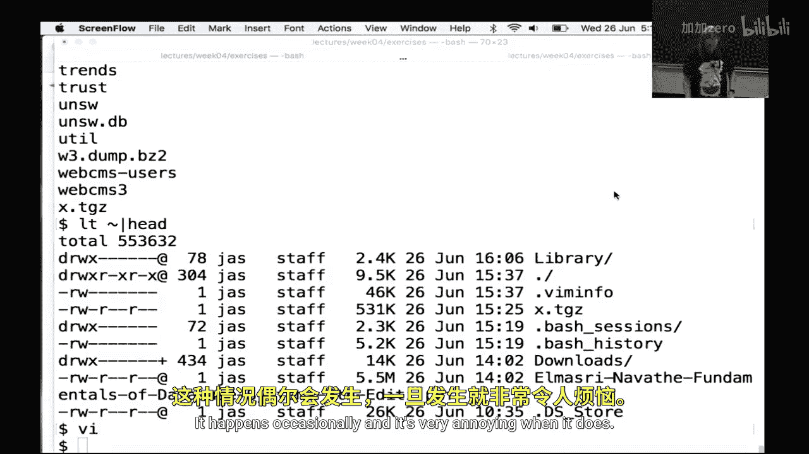
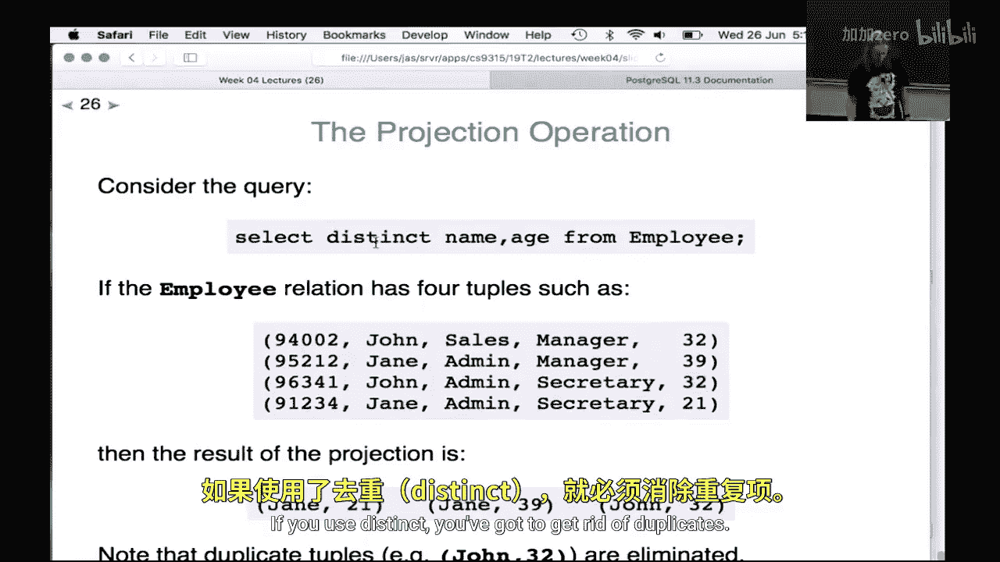
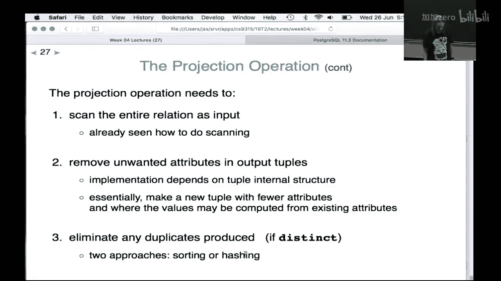
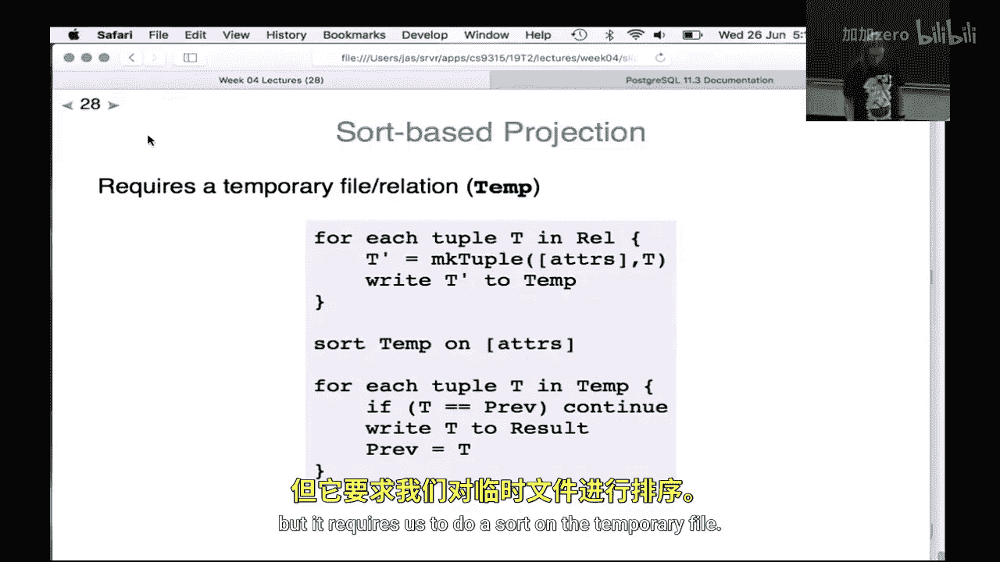
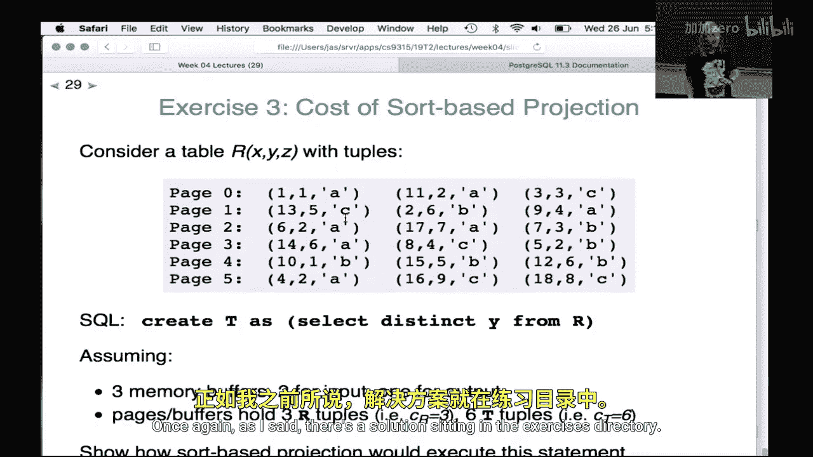
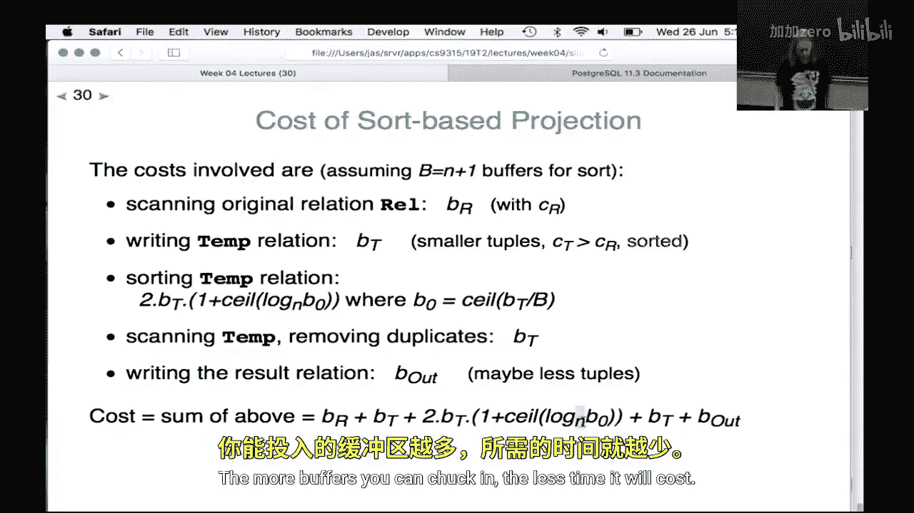
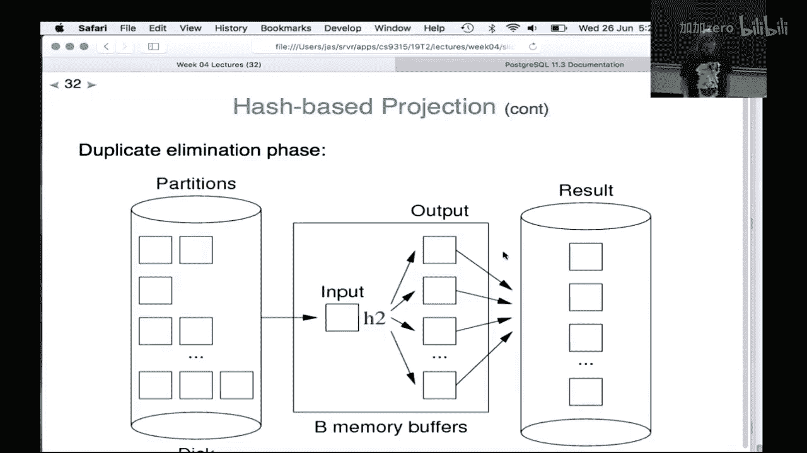
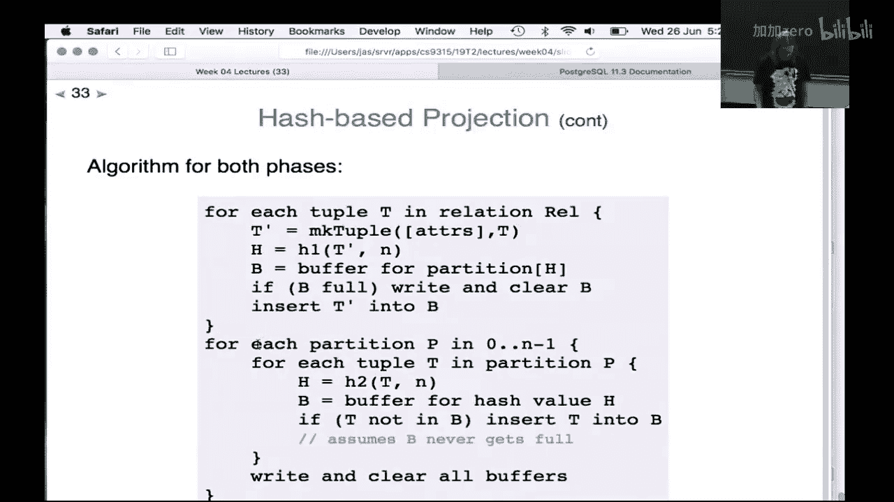

# 新南威尔士大学【中英⚡Postgres数据库实现原理｜COMP9315 2018 Postgres Implementation】 p14 P14 -BV1qXoqYHErC_p14-

I'm annoyed。Screenflow failed again。So what I'll have to do is grab the Echo 360 video and stick that on YouTube。

<|OTHER|>It happens occasionally， and it's very annoying when it does。

Anyway， hopefully it won't happen this hour and so you're going to miss the little talking head I know you actually we've got that camera well I have no idea what downloaded Echo 360 videos look like where that actually ends up。

 I don't know。😊，But anyway， we shall see。But I can get video for the last hour。

 assuming Echo didn't fail。Oh， we' haven' got redundancy in the system。 Wow， that could be bad。

 All right， so we just looked at sorting and we looked at scanning。 final。

 simple operation is projection。😊，And you might say， why， what's the big deal， You just run through。

 pick out the fields that the user asks for， write them to another file。

 which is clearly going to be smaller than the original file and you're done。That's true。

 but if you throw in this word here。Then that changes things a little bit because you might end up with some duplicates。

Now where do we get that so if I do this projection， I get John 32 right at to the disk， I get Jane。

39 Rod her to the disc， I get John。32 again。How am I supposed to know that I already saw it John 32。

 and I don't want this John 32 to be written。 So that's the trick with projection。

 If you use distinct， you've got to get rid of duplicates。😔。

So that's final the final step so these steps are pretty straightforward。

 removing unwanted attributes is basically just building a new tu type based on whatever。

 whatever attributes were mentioned in the select clause。

But eliminates the duplicates then as you can see at the bottom， two ways of solving that problem。

 one you can use sorting， one you can use hashing。

So sort based prediction， basically。Says all right。

 do the projection with all the duplicates included。

 then sort the result file and then scan through the result file and because you've sorted it。

 duplicates are going to appear adjacent to each other so it's pretty straightforward to do stuff like this so sort the temporary result then scan through the temporary result and if the current tuple is equal to the previous tuple it's a duplicate and we just ignore it。

Yes， so we do to continue。 So if it's not。 then， okay， it's a new tuple。

 we write it out and we remember what the tu was that we just rode out。 And then we get the next tu。

 And if it looks like the other tu， we just ignore it。 Okay， so that's pretty straightforward。

 but it requires us to do a sort on。The temporary file。 And when you're doing this sort。

 you've got to sort it on all of the selected ats。

Let me see what to me want here， so distinct why。No time， I won't do that one once again， as I said。

 there's a solution sitting in the exercises directory， or there will be more interesting。

 how much does it cost？

All right， so we've got to scan the original relation。

So we have to read all the pages of that relation。We need to write the temp result。

Since presumably most of the time with the projection， the output tus are going to be smaller。

 so we be the number of pages in the temp relation is probably going to be a fair bit smaller than the number of pages in the original relation。

We then sort the temp relation and notice that the B0 in this case comes from BT。

 the size of the temp relation， and that's the same formula as we had before。

We're reading and writing tus from BT， we' got our initial sorting passes and then we've got all the other sorting passes。

 and then of course the whole point of sorting is that we then scan through it。

 we can find the duplicates easily so we do another scan of the sorted version of BT and then we write the result。

So you put all of those costs together， read the original relation， write the temporary relation。

 sort the temporal relation， scan the sorted temporal relation and write the final result。

 so that's what you end up with。So that's clearly going to be a little bit dependent on that end value。

 The more buffers you can chuck in the。

The less time it will cost。Hashbased projection is slightly different It involves in the best case having two passes。

 only two passes， the previous one that sorting， you know we saw it could take three four five depending on how many buffers you've got so how does this hash prediction work so we read in one page at a time。

 we take a topple we hash the。Haash the tubble and here we can do the projection at the same time。

 so we read and tuple， strip out the unwanted attributes。

 hash what's left and store it in one of these。Output buffers。

And then when this output buffer fills up， we write it out and we keep scanning through the input tus pages at a time。

 tu at a time in here， hash it， stick it in an appropriate output buffer so what we end up with is a bunch of hash partitions where each of these contains tuples that hash to the same value coincidentally。

 one important thing about that though， is if I've got two duplicate tus they're clearly going to hash to the same partition。

U。So。We produce this disc file。 or you could have multiple files if you want to store the partitions。

Separately， which is probably a good idea because you don't know when you're going to fill one of them up and write it out。

 So sticking all of these in a single file is potentially a little bit tricky， could be doable。

If you had links from one page to the next inner partition， but anyway， so what we do now。

 we do partition at a time， really in the first page of topples。Stick me in here。

Using a different hash function。We。We decided to put them in an output buffer。

 we decided which output buffer to put them in， having decided that first thing to do is to check that output buffer and see if there's already a couple with the same values。

Because once again， if we've got duplicates， they ended up in the same partition in the first pass。

 and they're guaranteed to end up in the same output buffer in the second pass。NowYou might say，m。

 what happens if this fills up and we happen to write it out and we write out something that's a duplicate of something that subsequently comes in。

 that's true， that's a problem so that can be resolved。But。Under optimal conditions。

 which means our hash functions distribute things reasonably uniformly。

 And we have enough buffers here。 And basically， it's the square root of the number of pages that we had in the original file。

Okay。So if we've got that many buffers， then hopefully and the hash function distributes things uniformly。

 none of these should fill up and we can read this thing in。um。Every time we see it tuple we hash it。

 we see if there are any duplicates in the output buffer if there aren， if there are。

 we just forget about that tuple going to the next one and so on。

So what finally gets written out from these output buffers is something that is guaranteed not to contain any duplicates。

And there's the algorithm， so the first pass。Decide which partition to dig it in， write the。Right。

 the tu to the appropriate partition。Continue。

And this kind of thing we've seen before as soon。