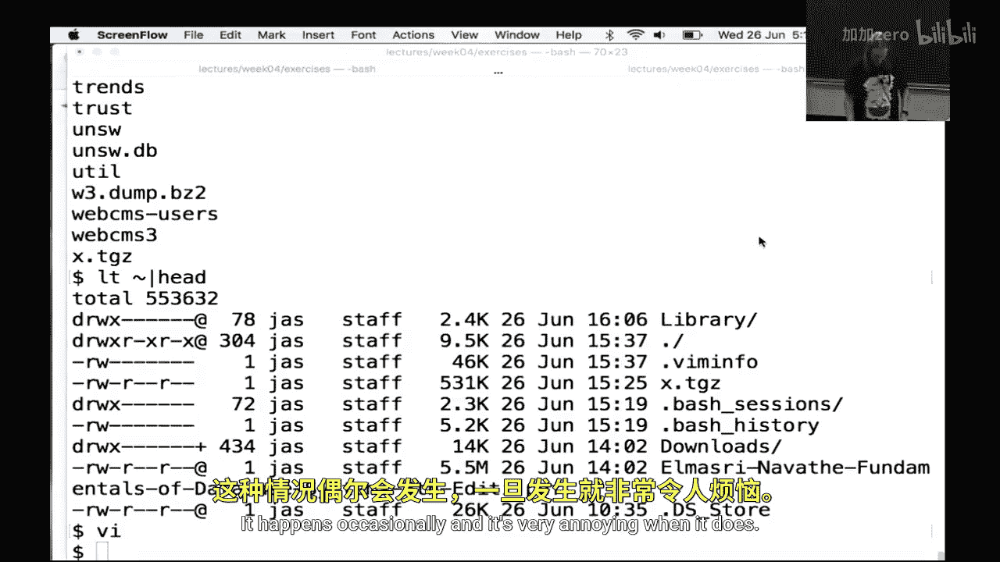
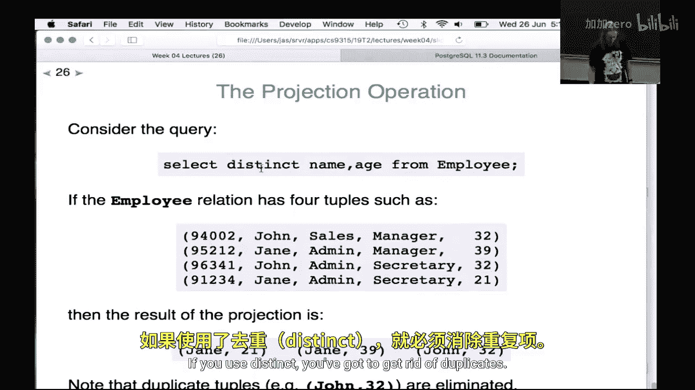
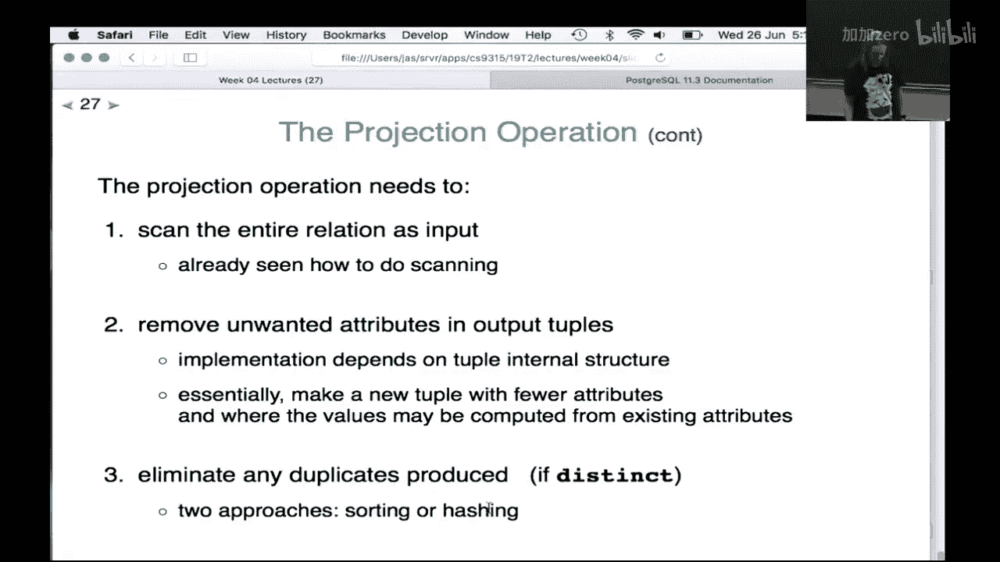
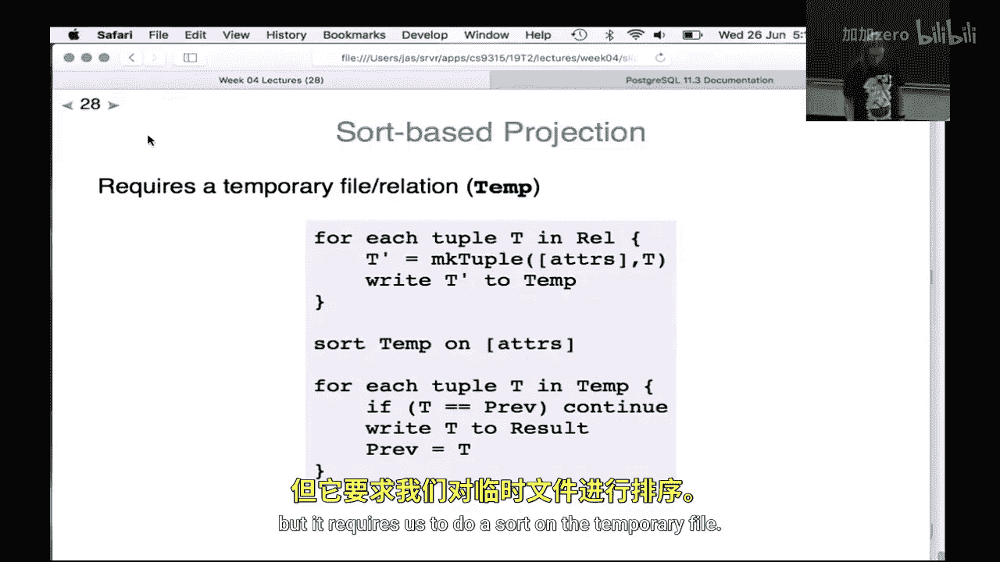
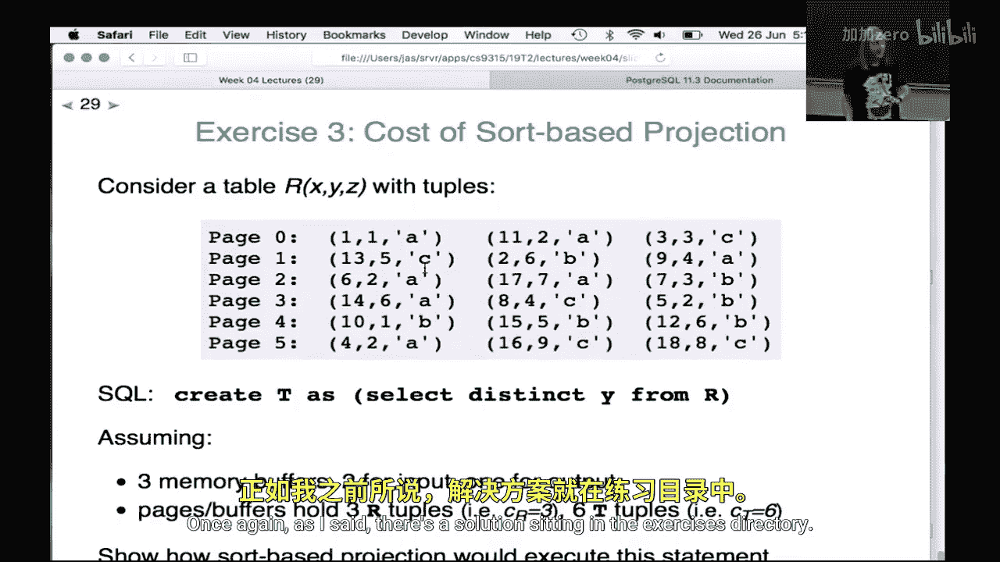
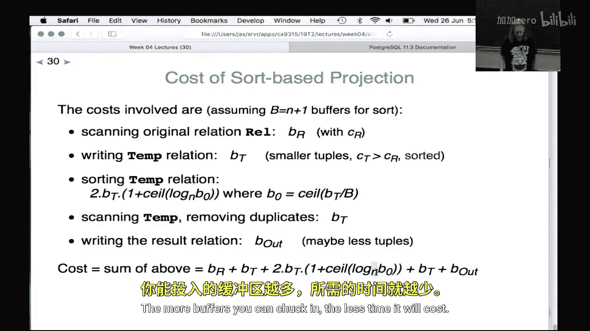
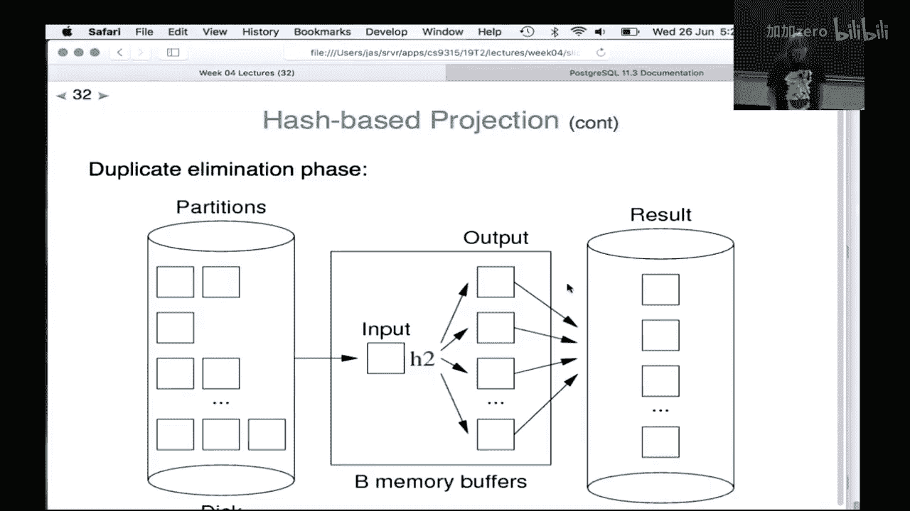
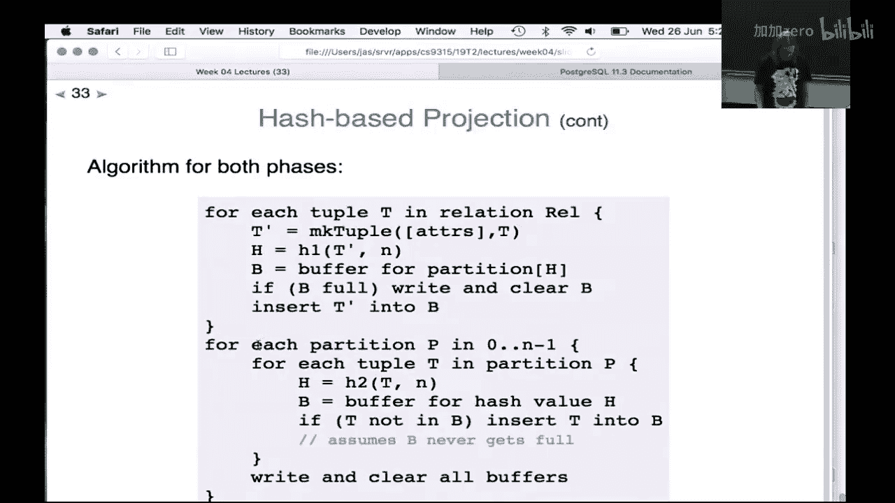

# Postgres数据库实现原理：P14：投影操作

在本节课中，我们将要学习数据库查询处理中的最后一个基础操作：投影。我们将探讨其基本概念，并重点分析当使用 `DISTINCT` 关键字时需要消除重复元组所带来的挑战。我们将介绍两种解决重复问题的方法：基于排序的投影和基于哈希的投影，并比较它们的实现原理与成本。

## 投影操作的基本概念

上一节我们介绍了排序和扫描操作，本节中我们来看看投影操作。投影操作的基本任务是从关系中选取用户指定的属性列，并生成一个新的结果集。

你可能会认为这很简单：只需遍历原始文件，挑出用户请求的字段，写入另一个文件即可。这个新文件显然会比原始文件小。这确实是投影的基本形式。

但是，如果查询中加入了 `DISTINCT` 关键字，情况就发生了变化。因为此时可能需要消除结果中的重复元组。

例如，执行一个包含 `DISTINCT` 的投影操作，可能会得到 `(John, 32)`、`(Jane, 39)`，然后再次得到 `(John, 32)`。关键问题在于：如何知道已经见过 `(John, 32)`，从而避免再次写入这个重复的元组？这就是投影操作在使用 `DISTINCT` 时的核心挑战。

## 消除重复的两种策略

以下是解决投影中重复元组问题的两种主要方法：

1.  **基于排序的投影**：先进行包含所有重复项的投影，然后对结果文件排序。由于排序后重复项会相邻出现，扫描时很容易识别并忽略它们。
2.  **基于哈希的投影**：利用哈希函数，将可能重复的元组映射到相同的位置，从而在生成过程中直接检测并消除重复。

## 基于排序的投影

基于排序的投影方法非常直观。其核心思想是：先进行包含所有重复项的投影，然后对结果文件排序。由于排序后重复项会相邻出现，扫描时很容易识别并忽略它们。

具体算法步骤如下：
1.  执行投影，生成包含所有元组（含重复项）的临时结果文件。
2.  对这个临时结果文件进行排序，排序键是所有被选中的属性。
3.  扫描排序后的临时文件。
    *   如果当前元组与前一个写入的元组相同，则它是重复项，将其忽略。
    *   如果不同，则它是一个新元组，将其写入最终结果，并记住这个刚写入的元组。
4.  继续处理下一个元组。

这种方法虽然直接，但需要对整个临时结果文件进行排序操作。

### 成本分析

现在我们来分析一下基于排序的投影操作的成本。其成本主要来自以下几个步骤：

*   **扫描原始关系**：需要读取原始关系的所有页面。成本为 **b_R**（原始关系的页数）。
*   **写入临时结果**：将投影后的元组写入临时文件。由于投影后元组通常更小，临时关系的页数 **b_T** 通常会远小于 **b_R**。成本为 **b_T**。
*   **排序临时关系**：对临时关系进行排序。这里使用的排序成本公式与之前相同，其中 **b_0** 是临时关系的大小 **b_T**。成本涉及对 **b_T** 的多次读写，包括初始排序趟和后续的归并趟。
*   **扫描排序后的临时关系**：为了消除重复，需要再次扫描排序后的临时文件。成本为 **b_T**。
*   **写入最终结果**：将去重后的最终结果写入磁盘。成本为最终结果的大小。

将所有成本相加：读取原始关系 + 写入临时关系 + 排序临时关系 + 扫描排序后的临时关系 + 写入最终结果。总成本显然会受到可用缓冲区数量 **n** 的影响。缓冲区越多，排序阶段的成本（尤其是读写次数）可能越低。

## 基于哈希的投影

基于哈希的投影方法略有不同。在理想情况下，它可能只需要两趟处理，而基于排序的方法可能需要三趟、四趟或更多，这取决于缓冲区数量。

以下是哈希投影的工作原理：

**第一趟（分区趟）**：
*   我们一次读入一页原始数据。
*   对于每个元组，先进行投影操作，剔除不需要的属性。
*   然后对剩余属性（或整个投影后的元组）应用一个哈希函数 **h1**。
*   根据哈希值，将元组放入对应的输出缓冲区。
*   当一个输出缓冲区填满时，就将其写入磁盘。最终，我们得到一系列哈希分区文件，每个分区包含哈希到相同值的元组。
*   一个重要的特性是：任何两个重复的元组，必定会被哈希到同一个分区中。

**第二趟（去重趟）**：
*   现在我们逐个处理这些分区。
*   将一个分区的数据读入内存。
*   对于该分区内的每个元组，使用另一个哈希函数 **h2**（或在内存中使用不同的数据结构，如另一个哈希表或直接比较）进行处理。
*   我们将其放入内存中的输出缓冲区。在放入之前，先检查该输出缓冲区中是否已存在具有相同值的元组。
*   因为重复元组在第一趟保证进入了同一分区，在第二趟也保证会进入相同的输出缓冲区进行检查。
*   如果发现重复，则忽略该元组；否则，将其加入输出缓冲区。
*   当输出缓冲区填满时，将其写入最终结果文件。最终从这些缓冲区写出的数据保证不包含任何重复项。

### 算法与条件

以下是算法的简要描述：
*   **第一趟**：决定元组所属的分区，将元组写入相应的分区文件，继续直到处理完所有输入。
*   **第二趟**：对每个分区，在内存中检查并消除重复项，然后写入最终结果。

这种方法在**最优条件**下效率很高：
1.  哈希函数能将数据相对均匀地分布到各个分区。
2.  拥有足够多的缓冲区。具体来说，缓冲区的数量 **n** 最好大约等于原始文件页数 **b_R** 的平方根（即 **n ≈ sqrt(b_R)**）。
3.  如果满足这些条件，并且在第二趟有足够的内存来容纳一个分区的所有唯一元组（或使用哈希表高效查重），那么就可以在生成过程中有效消除重复，避免分区文件溢出到磁盘带来的额外开销。

## 总结

本节课中我们一起学习了数据库查询处理中的投影操作。我们了解到，简单的投影只需选取属性，但加入 `DISTINCT` 后则需要消除重复元组。我们深入探讨了两种消除重复的策略：
1.  **基于排序的投影**：通过排序使重复项相邻，然后扫描去除。其成本包括扫描、写入临时文件、排序以及再次扫描。
2.  **基于哈希的投影**：利用哈希函数将可能重复的元组分组，分两趟处理，在第二趟于内存中直接去重。在哈希函数均匀且缓冲区充足（约 **sqrt(b_R)**）的理想情况下，此法可能更高效。

理解这些基础操作的实现原理与成本，是构建高效数据库查询执行引擎的关键。