# 新南威尔士大学【中英⚡Postgres数据库实现原理｜COMP9315 2018 Postgres Implementation】 p15 P15 -BV1qXoqYHErC_p15-

Okay， Thursday， so I managed to extract。Useful video stuff from E so what I put up on YouTube looks almost like what I get out of this thing so if that works reliably I'll stop using that kind of use the YouTube stuff。

😊。

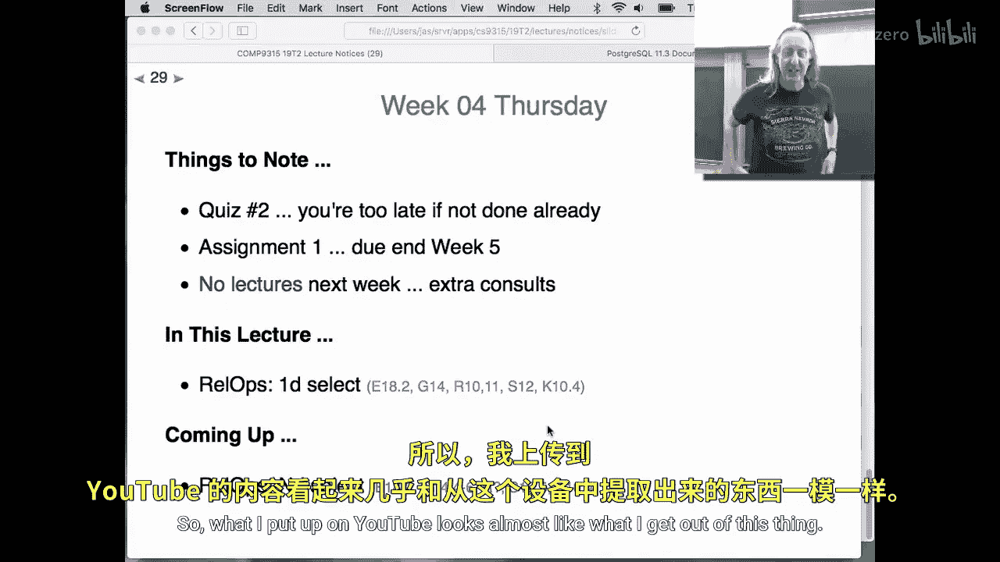

All right， so I'm giving you one last chance， screen flow。

Quz too late if you didn't do it before you came here。

 maybe that's where everyone is trying to do it before the deadline， but the deadline has passed。

Re no lectures next week。Like I said， I'm still trying to work out when I'll be available for consults。

And I'll continue on with those topic。

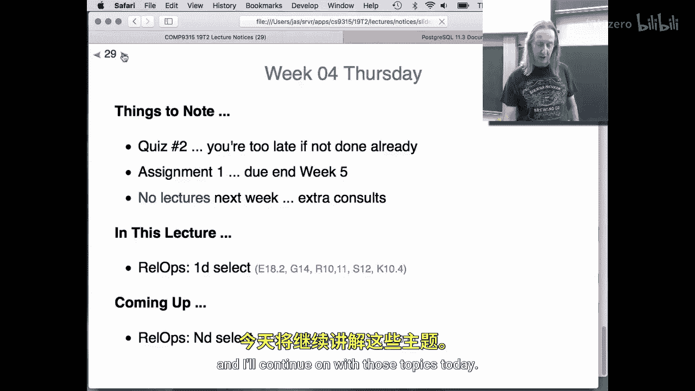

Today。嗯。Anyway， well I can't hear because I'm not using the microphone。It silly。Mary。

I don't know what that's going to do to the audio。You are forgotten something。は。好好好。

Perhaps continue assignment1， a couple of other things in response to a question I had yesterday。😊。

You can't submit other files apart from email。c and email。source。

 so everything that you want to submit had better be in email。c if you want to。

Get stuck from somewhere else。 Put it in email dot C。诶。You can do has to inclive system type stuff。

 so hash include standard IO although that's not going to help you much if you want to hash include some of the other Postgres。

h files you can do that。Yeah using that kind of hash include。

 but if you've got you know if you've got your own emailpather。c emailpathser。h and email。

c does a hasshinlude a emailpathser。h no that's not going to work you need to put the content of emailpather。

c into email。c。Yeah， so that' what that's all bad if you do happen to get some code from somewhere else。

That's probably okay unless it's the entire assignment。But if you get a par or something like that。

 just say we got it from just as a matter of common courtesy。

But be careful if you're getting stuff off the web， make sure。

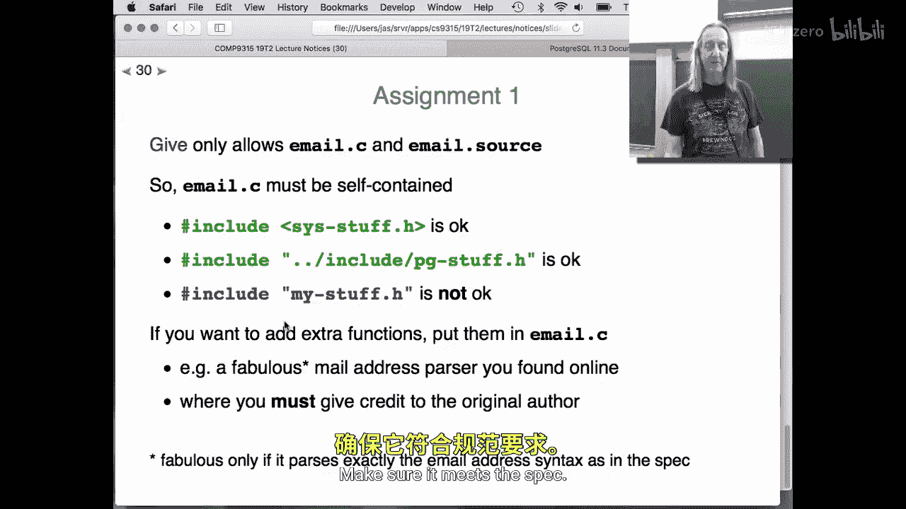

Makes the sp。

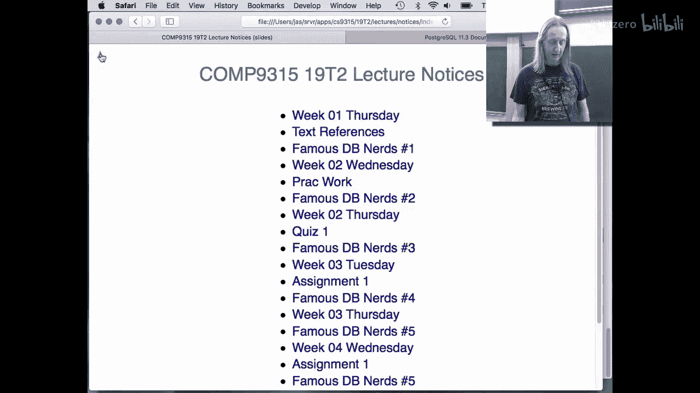

Aurra。Continue， let's where were we up to yesterday， we did scanning。

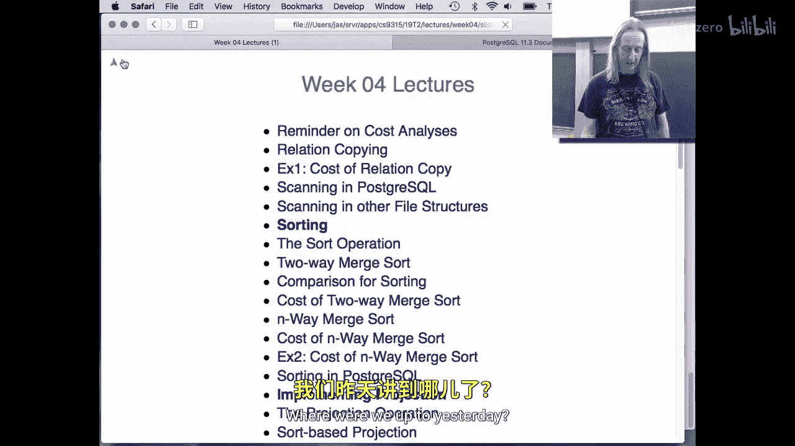

Seelection and we were just doing searching in files and I think I just described the process so let's have a look。

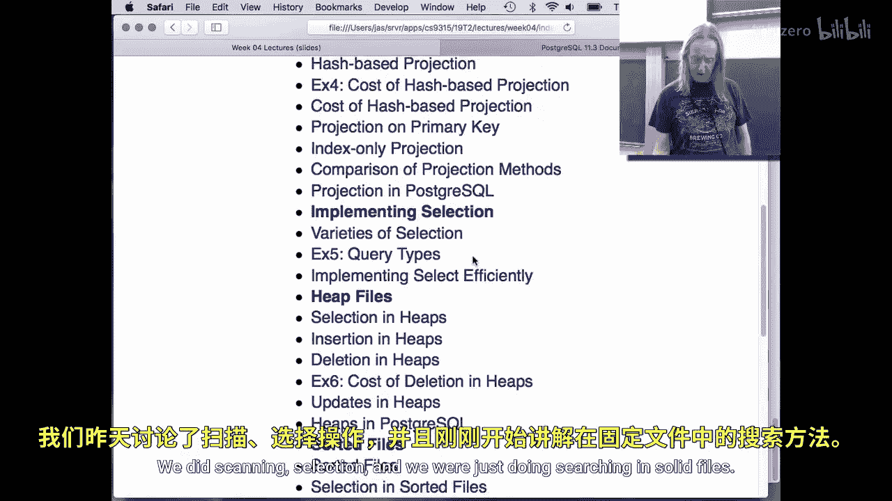

An example。Of how we might do searching All right so the deal is we do standard binary search you know it's got low and high bounds on the indexes into the array in this case it's got low and high bounds for the pages that we're interested in so we'd start out with lower zero high as four we take the midpoint page two and we look to see in normal binary search there'd be a single value there so you look to see whether what you're searching for is a less thing greater than that and youd restrict your attention to part of the array accordingly in this case。

So the first thing we're searching for is 24 so we work out this is at midpoint， we open this page。

 we read that page and we scan through that page looking at all the tuples to see if we can find a tuple that has k equals 24 and we do。

So that's nice， so。The cost of doing that is a single page rate。

And that was all we had to do All right we'll at the next one cableables three so we'll start the same way we'll get this middle page and we scan through the page looking for cableables three at the same time we need to remember what was the lowest and highest value in that page。

Once we've scanned through the page and we didn't find cables three。

 we then say is three less than the lowest value in the page or is it greater than the highest value in the page and that determines how we restrict our search so in this case obviously three is less than the minimum value in that page。

So we restrict our attention to these two pages and the way binary research works when you try to work at the midpoint of two pages it picks the lower one and so we'll open page zero would be the next page to open。

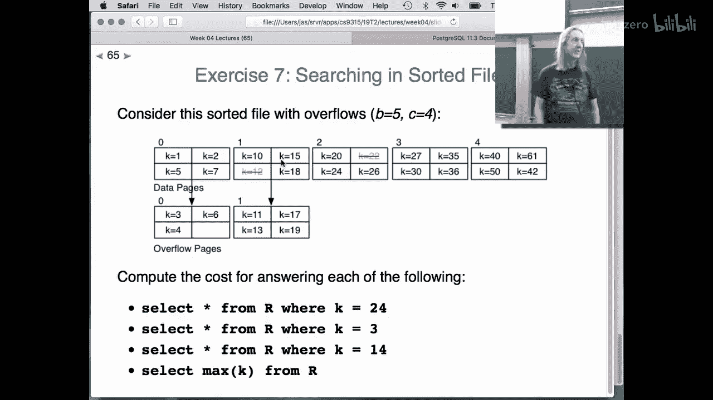

And we'll start scanning through page zero and de of flow pages to see if we can find a topple with cables three。

 which we do here。Okay， so that's two page reads to do that one sorry three page reads。

 we had to read the middle page， we had to read that page to check whether the tu was in it。

 we had to read that page。All， but about K equals 14。So we'll start off the same way。

 take the mid page， discover that 40 is less than 20。

Go down to here the first page we're going to look at is page zero we'll scan through that and discover the minimum is k equals1。

 the maximum is k equals 7 but we're looking for k equals 14 so it's clearly further up the file than that so the only choice left to us is this one here so we open page one。

And we scan through that page and it's over to flow pages and having done that。

 we don't find cable equals for it so we know it's not in the file。And we can return。No match。

Right what about this final one，re for the maximum value of k？

We can do this quite efficiently always in a file like this， the file is sorted on attribute K。

 so we know for sure that the largest value is going to be in the final page。

So we can just go straight to that page， open it up and search through there to find the maximum K value。

 so that's pretty easy that operation turns out to be very straightforward in a file structure like that。

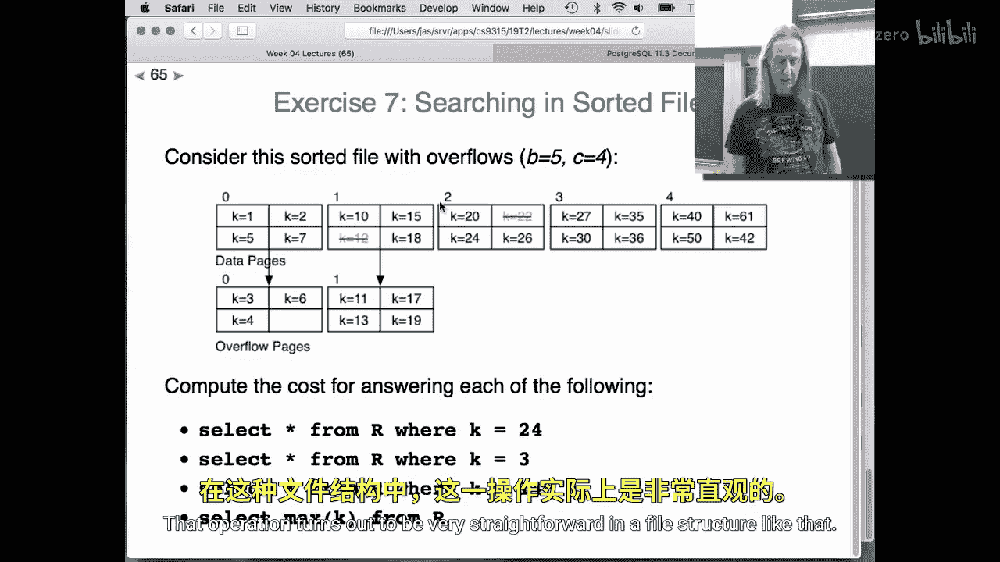

All right， so that the way I just described that。睇下。😊，There was a little bit of work we had to do。

 if we've got。

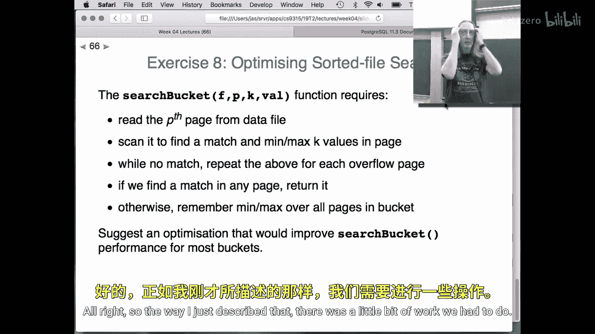

A bunch of overflow pages， we're got to look at all the overflow pages to find the minute and max values。

 can we do anything smarter than？

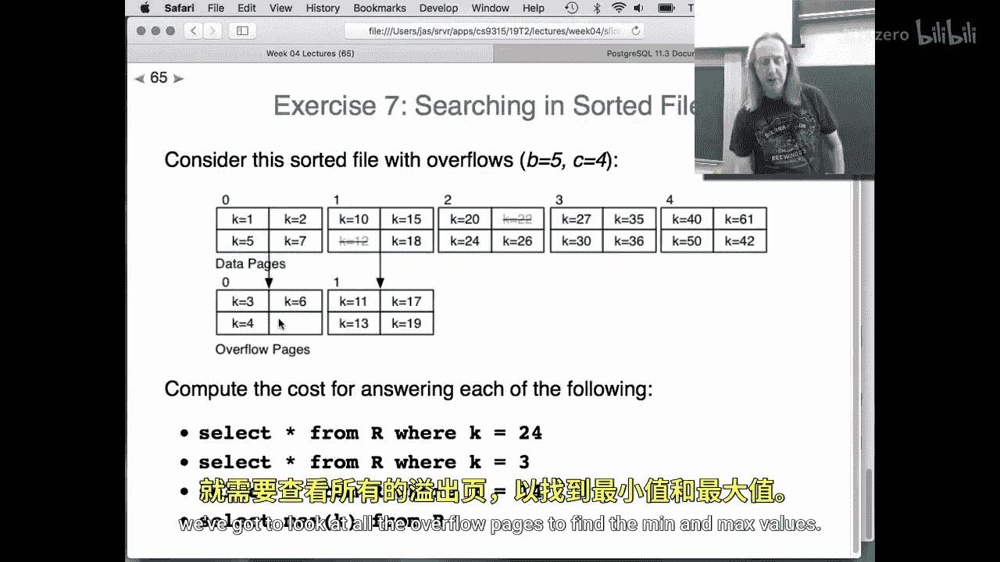

Suggestions。Yeah。I can think of one way to make it a little bit smarter。

What if we were to maintain the min and max value you each bucket in the first page of that？

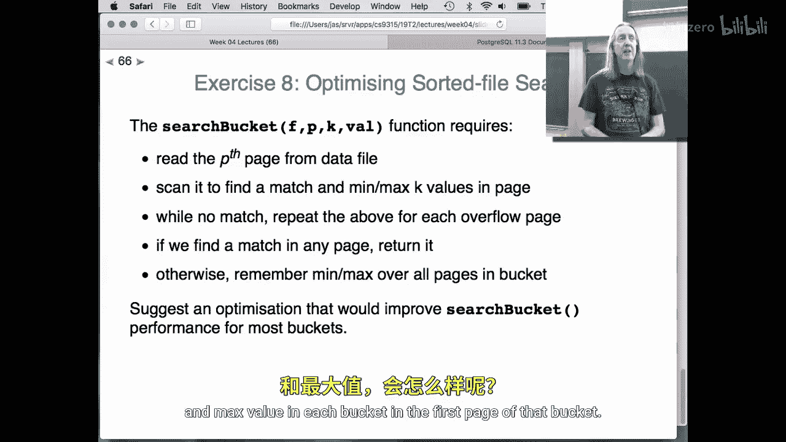

So in the data page， if we go back to here in this page as well as storing these four tuples。

 we'd also store a min value， which would be 20 and a max value which would be 26 and similarly for。

P that has overflow pages in this first data page， we could store mean equals one and max equals seven。

 which happens to be in that page as well， but in every out it might be in the page like this so we look at this bucket。

 the mean is 10 and the max is 19 Okay so if we do that。

 we don't need to scan the entire overflow chain for pages where we know we're not going to find the key value。

So in this example here know in this example here Ks 14。

 we look in this page without even scanning the topple so we're saving you know marginal amount of time there。

 I said that kind of thing takes virtually no time but straight away we could work out that it's down in this part of the file and then we could go on to page zero and look at the minimum max values and discover it's higher than that without reading without needing to read the overfllog page and then we could go here and yes。

 or。K equal 14， the Mins 10， the max is 19， well maybe it's somewhere in here， so he looked through。

That overflow chain and that's the under one that we need to look at。

 but we still need to read the data pages because they tell us what the minimum max values are。

Can we do better， even。

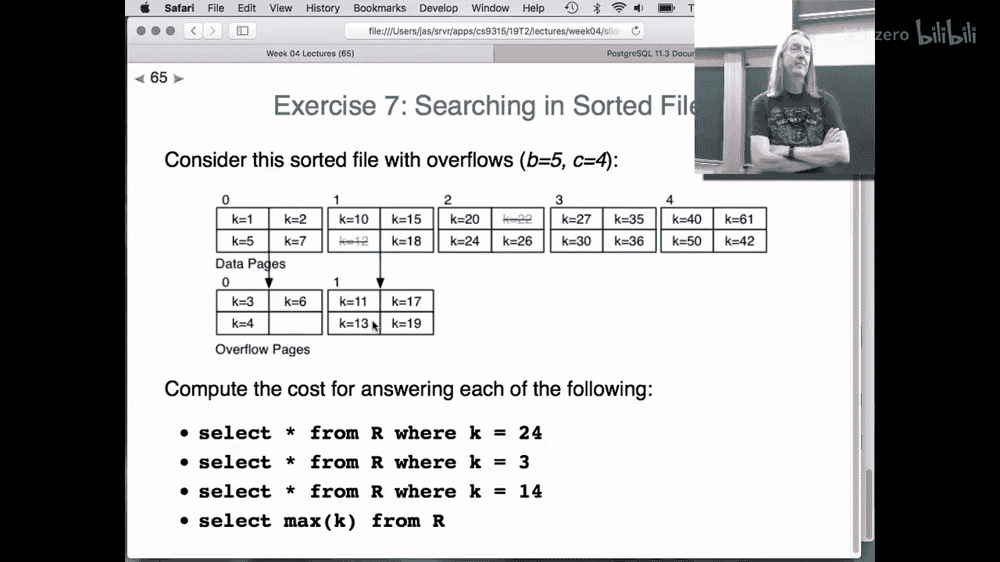