# Postgres数据库实现原理：P15：文件搜索与优化

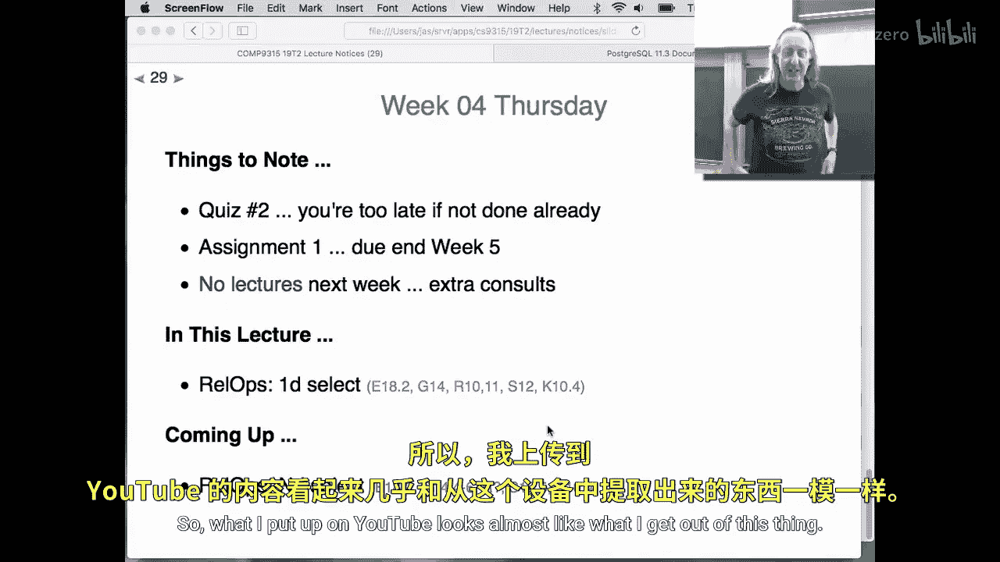

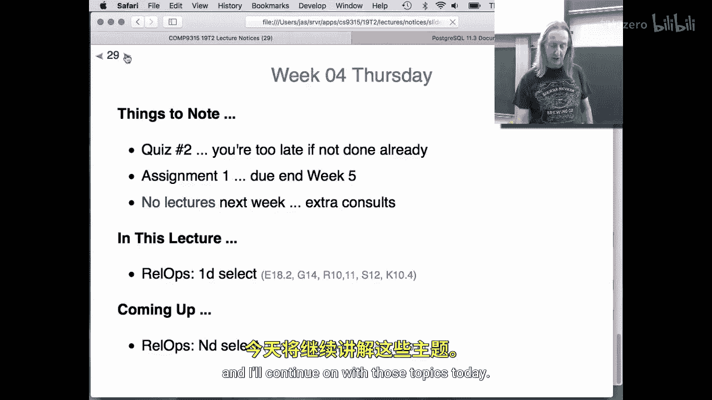

在本节课中，我们将学习如何在已排序的文件结构中高效地搜索特定数据。我们将探讨标准的二分查找方法，并分析其成本。随后，我们将讨论如何通过存储额外的元数据（如最小值和最大值）来优化搜索过程，以减少不必要的磁盘读取操作。

---

上一节我们介绍了文件扫描和选择操作的基本概念。本节中，我们来看看如何在已排序的文件中执行具体的搜索。

## 二分查找示例

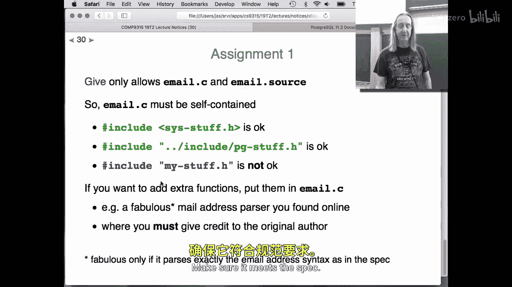

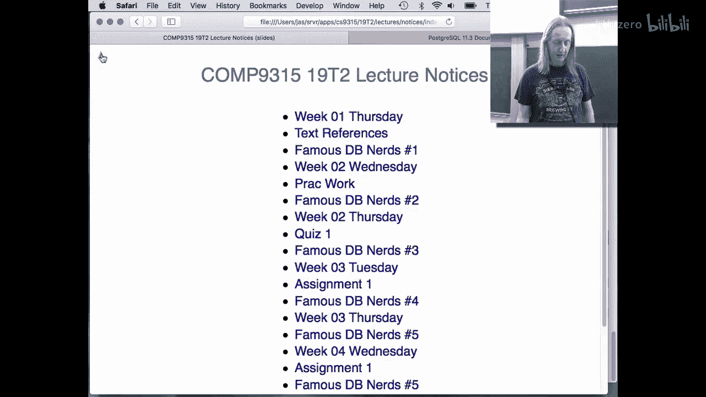

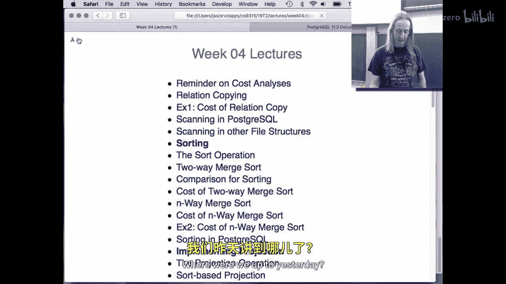

标准的二分查找算法使用低（`low`）和高（`high`）两个边界索引来确定搜索范围。在文件搜索的上下文中，这些边界对应的是我们感兴趣的页面索引。

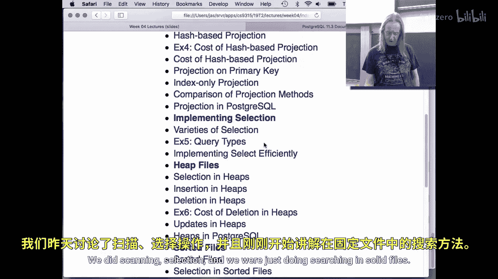

以下是搜索过程的步骤：

1.  初始化 `low = 0`，`high = N-1`（N为总页数）。
2.  计算中点 `mid = (low + high) / 2`。
3.  读取第 `mid` 页。
4.  扫描该页中的所有元组，寻找目标键值。
5.  如果找到，则搜索成功。
6.  如果未找到，则根据目标键值与该页中存储的键值范围（最小值和最大值）的比较结果，更新 `low` 或 `high` 边界，将搜索范围缩小一半。
7.  重复步骤2-6，直到找到目标或确定其不存在。

让我们通过几个具体例子来理解这个过程。

以下是几个搜索案例的分析：

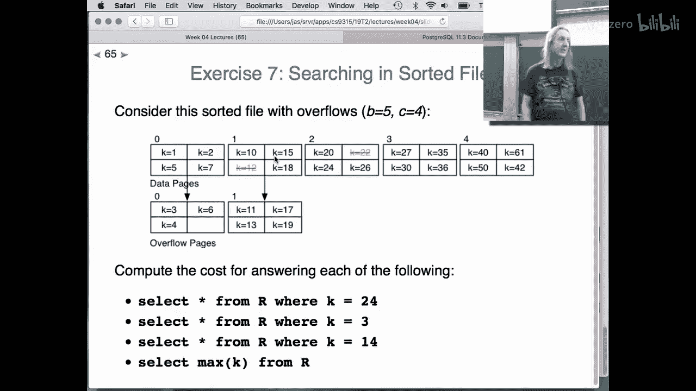

*   **搜索 K=24**：从中间页（第2页）开始，扫描后直接找到目标。**成本：1次页面读取**。
*   **搜索 K=3**：先读取中间页（第2页），未找到。由于3小于该页的最小值，搜索范围缩小至前两页（第0、1页）。接下来读取第0页，扫描后找到目标。**成本：3次页面读取**（第2页、第0页及其可能的溢出页）。
*   **搜索 K=14**：先读取中间页（第2页），未找到且14小于其最小值。搜索范围缩小至前两页。读取第0页，发现14大于其最大值。因此，唯一可能的是第1页。读取第1页及其溢出链进行扫描，最终未找到目标。**成本：多次页面读取**。
*   **搜索最大K值**：由于文件按属性K排序，最大值必然在最后一页。可以直接读取最后一页进行查找。**成本：1次页面读取**。

## 搜索优化策略

在上述搜索K=14的例子中，为了判断目标值是否可能存在于某个桶（页面链）中，我们需要扫描整个溢出链来获取该链的最小值和最大值。这增加了额外的I/O开销。

我们可以考虑一种优化方法：在每个桶的**主数据页**（即链表的第一个页面）中，额外存储该桶所有数据（包括溢出页）的**最小键值**和**最大键值**。

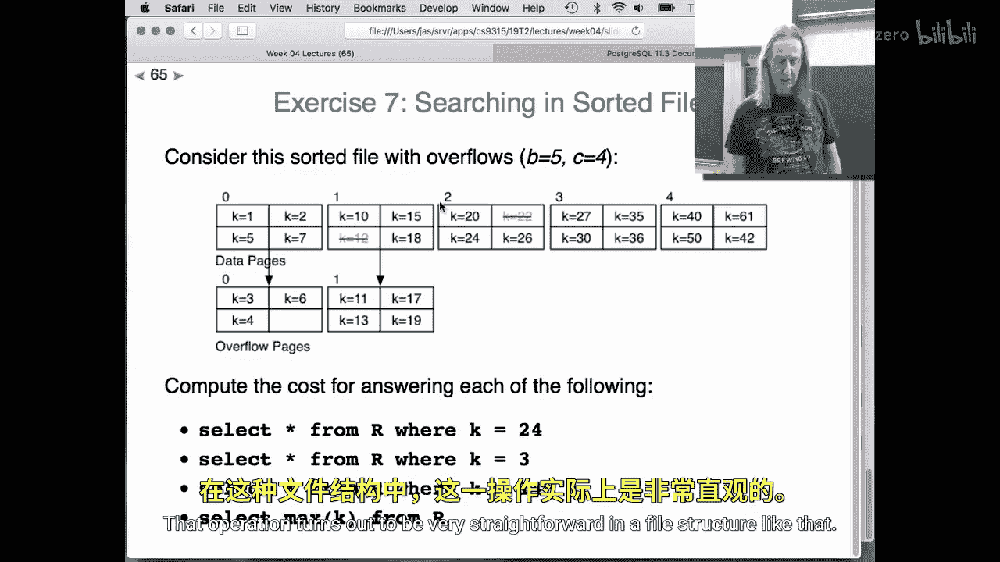

优化后的搜索逻辑如下：

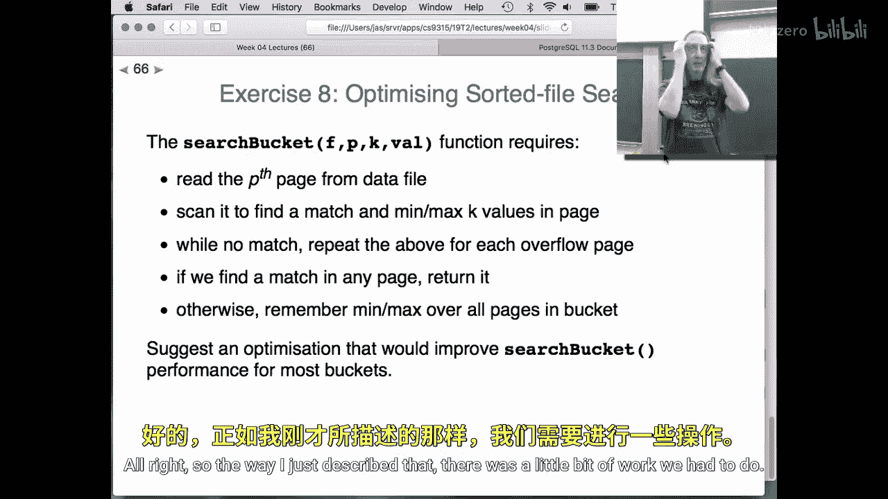

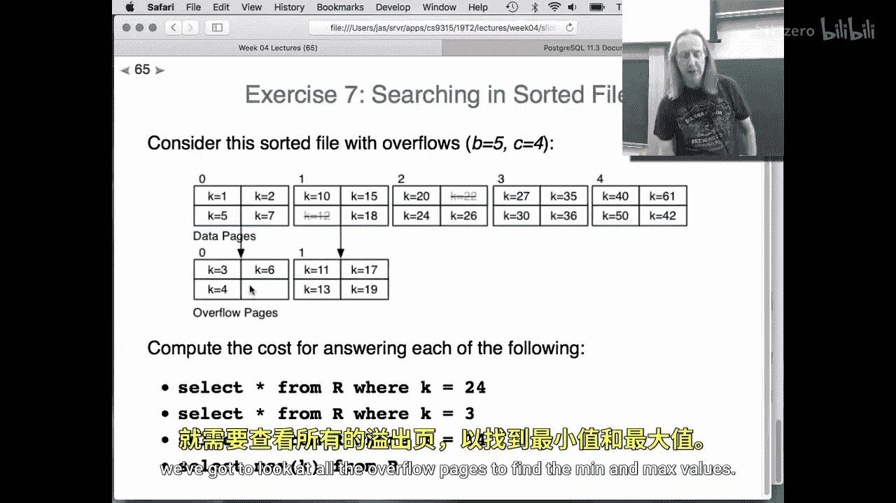

1.  读取目标桶的主数据页。
2.  检查目标键值是否介于该页存储的 `min` 和 `max` 值之间。
    *   如果不在这个范围内，则可以立即排除整个桶，无需读取任何溢出页。
    *   如果在这个范围内，则继续扫描该桶的主数据页和所有必要的溢出页以寻找确切匹配。

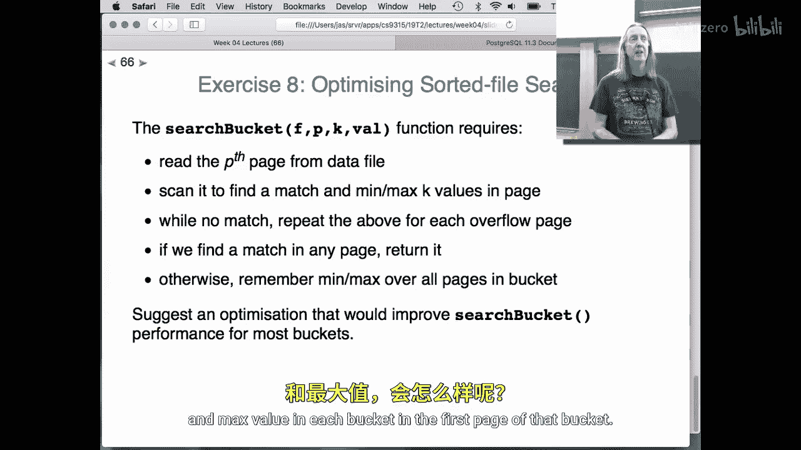

例如，在搜索K=14时：
*   读取第1页的主数据页，发现其存储的 `min=10`, `max=19`，14在此范围内。
*   因此，我们只需要扫描第1页及其溢出链即可，避免了读取第0页溢出链的不必要操作。

这种方法**显著减少了为确定搜索方向而进行的溢出页读取次数**，尤其是在目标值不在某个桶的范围内时。然而，我们仍然需要读取每个候选桶的主数据页来获取这些元数据。

---

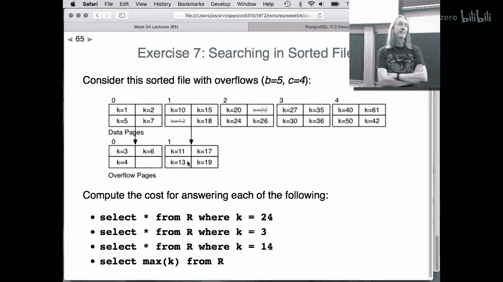

本节课中我们一起学习了在排序文件上进行二分查找的基本方法及其I/O成本。我们了解到，通过在每个数据页头部维护其对应整个数据链（包括溢出页）的最小值和最大值，可以有效地在搜索初期排除不可能的页面，从而优化搜索性能，减少磁盘访问次数。这是一种典型的以空间（存储额外元数据）换取时间（减少I/O操作）的优化策略。