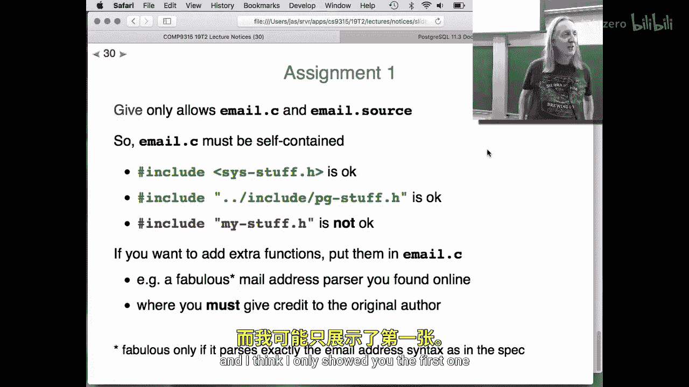
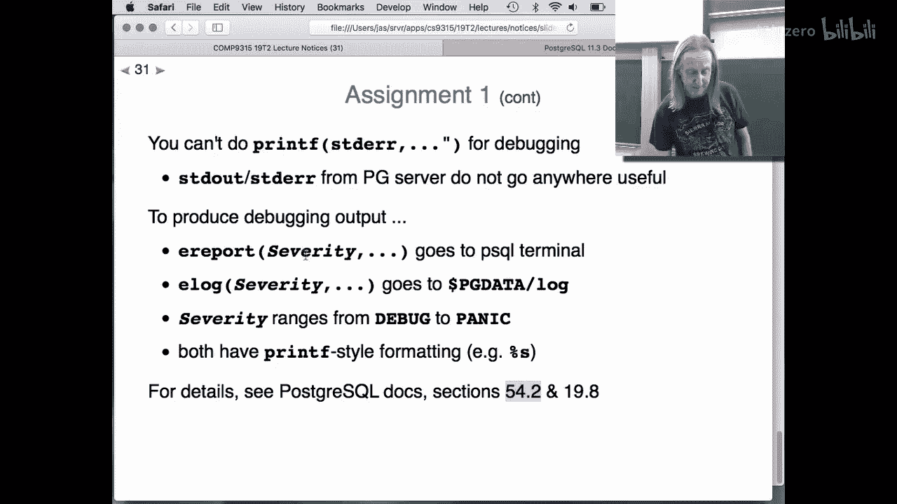
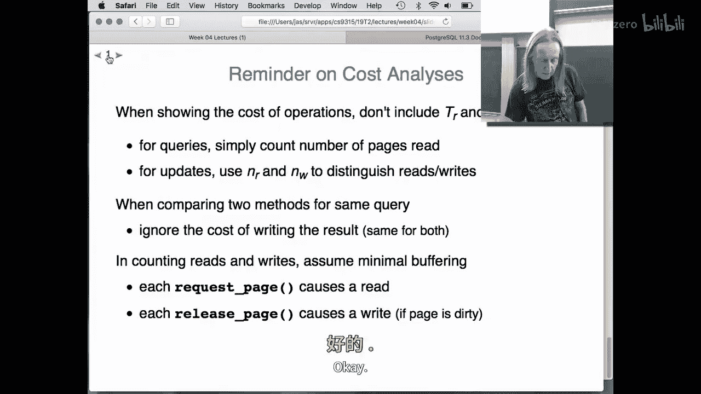
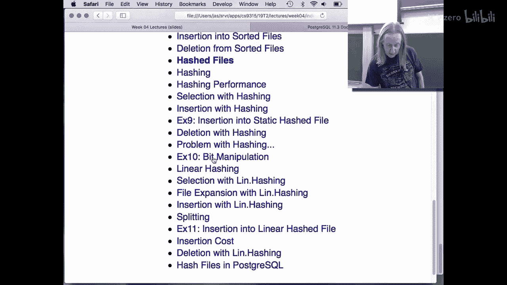
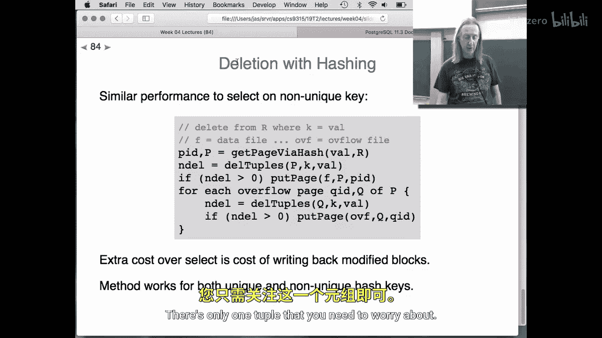
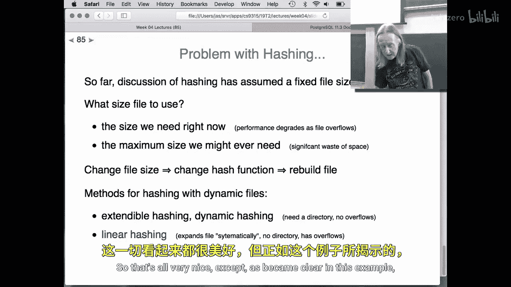
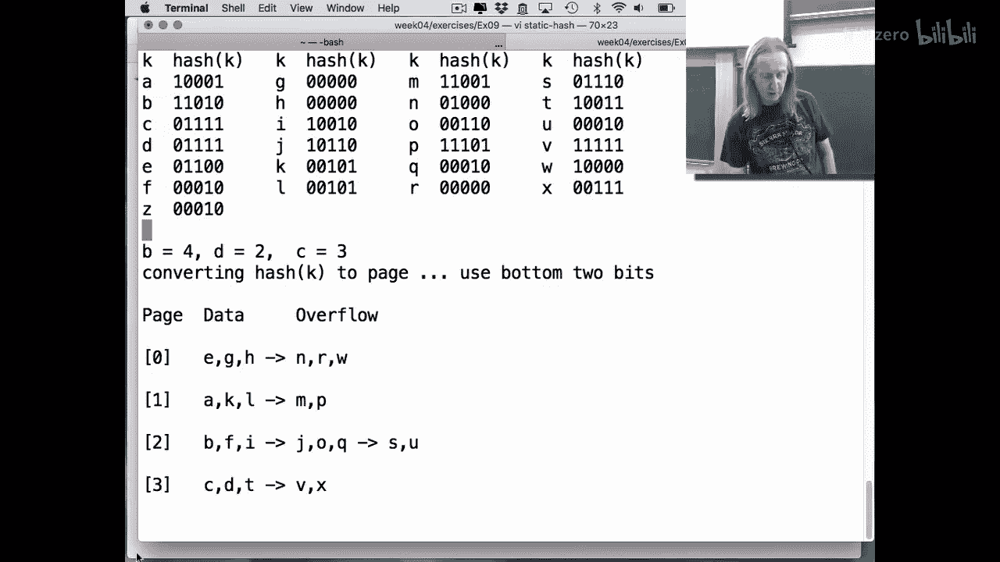
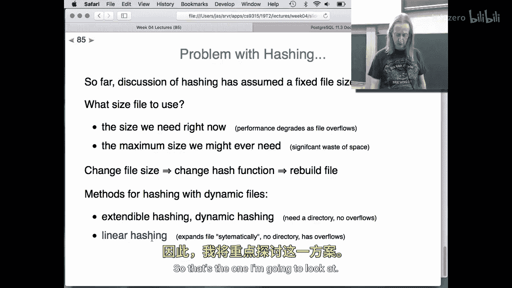
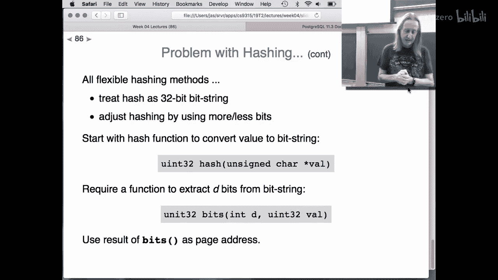

# 新南威尔士大学【中英⚡Postgres数据库实现原理｜COMP9315 2018 Postgres Implementation】 p16 P16 -BV1qXoqYHErC_p16-

Okay， youll figure again。嗯。I realized during the break that I had two slides on assignment1 and I think I only showed you the first one。

And the Ze land might be important over the next week。😔，So how do you debug these things， You know。

 it's all very nice。 You， you write your C code， the compiles， you set it all up with the。

Postgre Ser， you run your Postgre Ser， you try to insert something and all it says is server crashed or something like that。

 how do you work out what went wrong？That gets a little bit trickyy so you need to put some information somewhere。

 you can't just write it to the screen like you do with a normal seaprint。Normal C program。

So two possibilities， the first one's probably not going to work that well because it tries to write out error message and if the server crashes then there's no guarantee that you're going to get anything。

Logging it， though， writing it to the log is certainly going to。Work。So there's two functions for。

Reporting stuff from the server to a place where you can actually find it。E report might work。

 You can try that。 That's if you， when you're using PQl， if you do something wrong。

 you try to insert。A tuple with a primary key value that already exists。

 you get narrow message on the PSQL console that's coming from an E report E log tends to write things to the log。

The log file that you set up when you run Pgs or whatever。

 that starts writing stuff to a log file so you can put stuff in there。

And this severity thing basically says how serious is this error。

 it can be as unserious as I'm just doing some debugging output to help。

The the serve is just about to crash， which is。Pink stations。So诶。

You'll have to have a look that they have slightly obscure syntax as they think so have a look at that section of the manual that tells you how to use them。

And then。As soon as your server crashes， start。Trying to collect some information using the debugging help。

All right。Let us continue。

て。

咩咩啊。so stay and beat manipulation。

Yeah， I just did that。 okay。嗯。Right so when we're deleting from a hash file。

 you use the hash function， you go to the appropriate page。

 you search for a matching double so it's kind of like doing a select once you find that double you market has being deleted so you said it's X max value。

If we're talking about a nonun key then youve got to scan the entire overflow chain and every time you find a matching tu you just mark it as deleted and youve got to write out the page if you make any deions at all。

So that'll work for whether you've got a unique or a non unique key。In the case of unique key。

After the put page， you could add return because once you've found the page containing the。

Appropriate tuple and deleted it and written the page， that's it。

 there's only one tuple that you need to。

Wrry that。All right， so that's all very nice except as it became clear。

This example this example， if I keep adding tuples。

 they just get the overflow chains get longer and longer and longer and sure the hashing， you know。

 isolates part of the。Part of the data， so it cuts our search to a quarter of the total data。

 but if we've got 100，000 tuples， cutting it to a quarter is still 25，000 tus， which is too much。

So what to do。M nobody seem to do it be make it bigger。

And then obviously that naturally the chains will be shorter over the same number of tuples。嗯。

That's good， but if we make it10，000 buckets。Then we翻那个。

10000 tus and we're talking post rescuel page sizes and if everything spreads uniformly you're going to have one tuble per page which is a bit of a was of space。

On the other hand， the size we need right now is basically that scenario I was just talking about we started out with nothing in the file and we kept the file the same size and the overflow changed to grow longer and longer。

A problem if we're using that mod function。And we add an extra page to the file。

And then we start working out hash values using mod B， where B has changed。

The has function is totally different now。😔，Now some tus will still have the same hash value。

 but others will have totally different hash values and we won't be able to find it。So。

That's a problem。Simply changing B and keeping using B mod or even doubling the file size and using。

The bit selecting the bottom K bits is still a bit problematic。

 you won't be able to find every tuple you can find some。

 but not all so methods have been developed for handling。

Dynamic hashing so we can't we don't use the kind of thing that you can use in for collision resolution in in memory hashing。

 you can have secondary hash or whatever or you can。Put it in the next。Entry in the array。

And so on and so on doesn't work here。Extendable hashing and the dynamic hashing are two techniques where you've got a directory and all of these techniques basically say if I want to change the number of pages in the file I effectively have to add another bit to my hash value if I'm increasing the file size I add another bit now you might say hey that means doubling the file size effectively potentially you can do that but there are slightly smarter ways of handling it we you don't have to double a file size where you can increase the file size incrementally and still keep using the hash functions。

So these two require a directory and the way you handle the pages where you don't need so many bits is you have multiple the size of the directory is always related to the number of bits in the hash function。

 so if you need to increase the file size of the directory doubles but the directory simply contains pointers or references to pages or contains page IDs。

 so it's effectively an array of page IDs， page IDs aren't too big。

 so hopefully the directoryies not going to be too big， but it's still doubles。

Each time you need to expand the file， linear hating doesn't require a directory and it adds one page at a time as you increase the size of the file。

And。These don't have overflows， these two techniques。

 so you effectively take a page that's filled up and you're split it into two pages。

And from the directory， you have entries in the directory that point to these two different pages。

When you double a director， you can end up with multiple directory entries pointing to a single page。

L so you don't have overflows， but in the case of linear hashing， you do potentially have overflows。

 however the way linear hashing works， gradually as the file expands。

 it also reduces the length of overflow chains as it goes。

That's reasonably good properties for a file based hasshing scheme， so that's the one I'm going to。

你就改。Right， but just。To talk about how you deal with hashing in this context。

 so hashing a hash is a 32 bit string。It would be extremely surprising if you ever needed all of those 32 bits to address that would mean you got two to the 32 pages。

 that's a lot of pages。😔。

呃。So generally what we're doing。